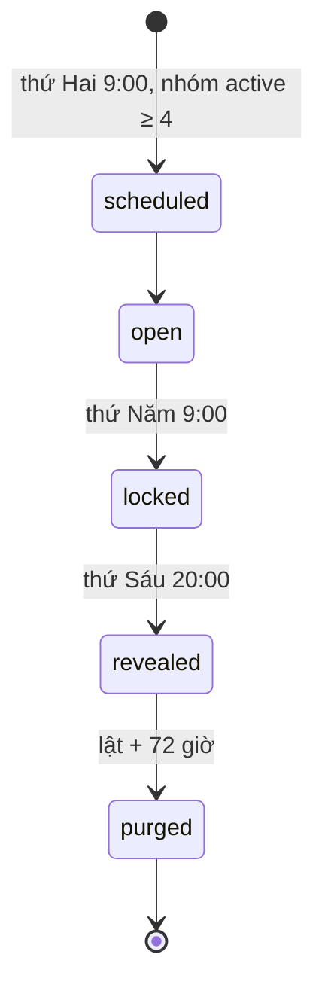

# Hết Cứu % — SRS

> Phiên bản: 0.1 (nháp) · Cập nhật: 26/10/2026 · Trạng thái: **chờ owner duyệt**, chưa dựng (giai đoạn 3 của
> `docs/plans/2026-10-23-privacy-content-game-plan.md`).
> PRD: [het-cuu-phan-tram-prd.md](het-cuu-phan-tram-prd.md). User story: G10–G16 trong `docs/user-stories/game/`.
> Tài liệu chung (người khác viết, SRS này không định nghĩa lại): `shared-room-platform-srs.md` (phiên thiết bị, header, giới hạn tần suất
> chung), DPIA `docs/legal/2026-10-26-game-line-dpia.md`, store/chính sách `docs/legal/2026-10-26-game-line-store-privacy-and-policy-draft.md`.
> Nếu SRS này lệch với hợp đồng dữ liệu chung của dòng game, hợp đồng dữ liệu chung thắng và SRS phải sửa.

---

## 1. Thuật ngữ

| Từ | Nghĩa |
|---|---|
| Nhóm | Nhóm kín 4–12 thành viên chơi Hết Cứu %; có một host |
| Thành viên | Một phiên thiết bị + biệt danh trong một nhóm |
| Phiên thiết bị | Mã ngẫu nhiên lưu trong cookie HttpOnly của trình duyệt; không phải tài khoản |
| Sự kiện | Một đề của tuần, có 3 mức hành động |
| Tự khai (claim) | % một thành viên tự đặt cho một mức, bước 5% |
| Phiếu đoán (guess) | Lựa chọn "ai khai cao nhất ở mức L" của một thành viên, kèm số lá |
| Lá | Đơn vị độ tự tin, 3 lá mỗi người mỗi sự kiện, không giá trị, không quy đổi |
| Nhân Vật Chính (NVC) | Thành viên tự nguyện để cả nhóm đoán % mức 3 của mình |
| Ước lượng NVC | Con số một thành viên đoán cho % mức 3 của NVC (là một loại phiếu đoán) |
| Khoảnh khắc | Bản ghi danh hiệu của một sự kiện, giữ tới hết mùa + 30 ngày |
| Mùa | 8 sự kiện liên tiếp (không tính tuần nghỉ) |

Giờ trong tài liệu là giờ Việt Nam (`Asia/Ho_Chi_Minh`, UTC+7, không đổi giờ mùa hè). Máy chủ lưu UTC.

## 2. Kiến trúc tóm tắt

- **Web (PWA)** trên origin riêng của Lá Úp, tách origin và cookie khỏi app Lá Lành. Không SDK phân tích, quảng cáo hay theo dõi của bên thứ ba.
- **API** trong modular monolith hiện có (module mới `laup_hetcuu`), REST JSON, chạy trên hạ tầng hiện tại: Hetzner (Đức) + Supabase PostgreSQL
  (Frankfurt). Không thêm nhà cung cấp mới. Chuyển dữ liệu xuyên biên giới theo dossier `docs/legal/2026-10-22-privacy-counsel-dossier.md` (#52).
- **Worker lịch** (một tiến trình, khoá idempotent theo `event_id`): thả đề, khoá, lật, xoá số thô, xoá nhóm hết hạn, gửi thông báo.
- **Web Push** (VAPID, payload mã hoá theo RFC 8291) qua dịch vụ đẩy của hãng trình duyệt (Apple, Google, Mozilla). Đây là đích dữ liệu bên thứ
  ba duy nhất; payload không chứa dữ liệu cá nhân (§9).
- Không thời gian thực; client tải lại bằng polling nhẹ (≥ 60 giây) quanh giờ lật hoặc khi người dùng mở trang.

## 3. Yêu cầu chức năng

Mỗi yêu cầu có ID `HC-FR-xx` và story sở hữu. Mỗi hành vi chỉ thuộc một story.

### 3.1. Nhóm và lời mời — G10

| ID | Yêu cầu |
|---|---|
| HC-FR-01 | Người dùng tạo nhóm không cần tài khoản: chọn tên nhóm từ danh sách soạn sẵn (không chữ tự do), chọn gói đề `office` / `campus` / `mixed`, nhập biệt danh, xác nhận 18+ và đồng ý theo màn C-HC-00 (§8). Người tạo thành host |
| HC-FR-02 | Biệt danh: 2–20 ký tự sau chuẩn hoá NFC, cắt khoảng trắng đầu/cuối; cấm ký tự điều khiển, ký tự độ rộng 0, ký tự đổi chiều chữ, URL, `@`, dãy từ 6 chữ số liền (giống số điện thoại), từ trong danh sách chặn (cùng bộ lọc với RP-FR-13 của hạ tầng phòng chung); duy nhất trong nhóm (không phân biệt hoa thường, không phân biệt dấu) |
| HC-FR-03 | Tạo nhóm sinh một **link mời**: token ngẫu nhiên 256 bit, chỉ lưu băm HMAC-SHA256; hạn 7 ngày; thu hồi được; số lần dùng không vượt số chỗ còn trống |
| HC-FR-04 | Host chia sẻ link bằng bảng chia sẻ của hệ điều hành (Web Share API) hoặc sao chép. Hệ thống không tự gửi tin, không đọc danh bạ, không tự mời |
| HC-FR-05 | Token nằm trong **fragment** của link (`https://<origin>/j#<token>`), nên trình duyệt không gửi nó trong request, log máy chủ hay Referer. Trang tham gia đọc fragment, xoá nó khỏi thanh địa chỉ bằng `history.replaceState`, rồi gửi token trong body `POST /join/preview` để lấy tên nhóm và số chỗ còn trống. Sau khi đồng ý (C-HC-01), `POST /join` đổi token lấy phiên thiết bị. Trang tham gia không hiện danh sách thành viên trước khi vào |
| HC-FR-06 | Nhóm tối đa 12 thành viên. Link mời của nhóm đủ 12 trả trạng thái "nhóm đã đủ" mà không lộ biệt danh |
| HC-FR-07 | Host thu hồi link (hiệu lực ngay), tạo link mới (link cũ thu hồi tự động), gỡ thành viên, đổi biệt danh của một thành viên (biệt danh mới qua cùng bộ lọc) |
| HC-FR-08 | Host chuyển vai host cho một thành viên. Nếu phiên của host không hoạt động 21 ngày, thành viên vào nhóm sớm nhất còn hoạt động thấy nút "Nhận vai host" |
| HC-FR-09 | Thành viên bị gỡ: phiên mất quyền với nhóm ngay; dữ liệu của họ trong nhóm bị xoá như HC-FR-48; không thông báo lý do cho người khác ngoài dòng "Một thành viên đã rời nhóm" |
| HC-FR-10 | Một phiên thiết bị là thành viên của tối đa 5 nhóm và host của tối đa 3 nhóm đang hoạt động |

### 3.2. Sự kiện tuần và tự khai — G11

| ID | Yêu cầu |
|---|---|
| HC-FR-11 | Thứ Hai 9:00, worker thả một sự kiện cho mỗi nhóm `active` có ≥ 4 thành viên và không đặt tuần nghỉ. Nhóm < 4 thành viên thấy "Cần thêm {k} người để bắt đầu", không thả |
| HC-FR-12 | Sự kiện chọn ngẫu nhiên (seed theo `group_id` + số tuần) từ ngân hàng đã duyệt theo gói của nhóm, không lặp trong nhóm cho tới khi hết ngân hàng. Từ màn lật thứ Sáu tới thứ Hai 9:00, host xem trước đề tuần sau và được đổi **một lần** sang đề dự phòng |
| HC-FR-13 | Thẻ sự kiện hiện: tranh, tên sự kiện, ba mức, lá của tuần, giờ đóng, giờ lật |
| HC-FR-14 | Cửa sổ tự khai: thứ Hai 9:00 → thứ Năm 9:00. Ngoài cửa sổ, API từ chối ghi (409 `event_locked`) |
| HC-FR-15 | Mỗi mức có thanh trượt 0–100, bước 5. Server chỉ nhận số nguyên chia hết cho 5 trong [0,100]. Thanh trượt chưa chạm hiển thị "chưa khai", không gửi giá trị mặc định |
| HC-FR-16 | Thẻ lời khai: chọn đúng một `alibi_card_id` từ danh sách đã duyệt; gắn với mức có % cao nhất của người đó (hoà thì mức số lớn hơn) |
| HC-FR-17 | Phiếu đoán: với mỗi mức, chọn tối đa một thành viên khác mình, thuộc danh sách "có thể bị đoán" (đang là thành viên, không bật "đừng đoán tôi" cho sự kiện này). Mỗi phiếu ≥ 1 lá; tổng lá của người đó trong sự kiện ≤ 3; được bỏ qua mức |
| HC-FR-18 | Lá không dùng hết khi khoá thì mất. Không mang sang sự kiện sau, không nạp lại, không mua, không tặng (D3) |
| HC-FR-19 | Người chơi sửa mọi câu trả lời cho tới khi khoá. Mỗi lần lưu là một ghi đè toàn bộ có `version` chống ghi chồng; xung đột trả 409 và client tải lại |
| HC-FR-20 | Nộp được một phần (chỉ tự khai, chỉ đoán). Một thành viên được tính "đã tham gia" khi có ít nhất một tự khai hoặc một phiếu đoán |
| HC-FR-21 | Thứ Năm 9:00 khoá sự kiện. Trang hiện "Đã khoá. Kết quả lúc 20:00 thứ Sáu". Không hiện ai đã nộp, ai chưa nộp; chỉ hiện số đếm "{k}/{n} người đã tham gia" |
| HC-FR-22 | Thành viên vào nhóm khi sự kiện đang mở thì chơi được sự kiện đó; vào sau khi khoá thì chờ sự kiện sau |

### 3.3. Màn lật và chấm điểm — G13

| ID | Yêu cầu |
|---|---|
| HC-FR-23 | Thứ Sáu 20:00, worker tính kết quả một lần, idempotent theo `event_id`, ghi `hc_event_result`; trang lật đọc kết quả đã tính, không tính lại theo từng request |
| HC-FR-24 | Phần đoán chỉ chạy khi có ≥ 3 thành viên "có thể bị đoán" đã tự khai ở ít nhất một mức. Nếu không, sự kiện ở chế độ **chỉ tự khai**: hiện các thẻ lời khai (không tên người chọn) và số người tham gia; không điểm, không danh hiệu ngoài "Cả nhóm đã có mặt" |
| HC-FR-25 | Với mỗi mức: người khai cao nhất (mọi người hoà cao nhất). Hiện biệt danh và % hoặc dải `cao` (≥ 70) / `vừa` (35–65) / `thấp` (≤ 30) nếu người đó bật "ẩn %". Thẻ lời khai của người đó hiện kèm nếu gắn với mức này. Không hiện % của người khác. Nếu % cao nhất của mức là 0, mức đó hiện "Cả nhóm đồng lòng: 0%" và không chấm điểm phiếu của mức đó |
| HC-FR-26 | Điểm của mỗi người: với mỗi phiếu, đúng → + lá, sai → − lá; cộng "Lừa cả hội" +3 cho mỗi mức đạt điều kiện HC-FR-27; cộng "Đọc vị" +2 (HC-FR-35); điểm sự kiện = max(0, tổng) |
| HC-FR-27 | Lừa cả hội ở mức L: người X thuộc nhóm khai cao nhất mức L; số người đoán mức L (trừ X) ≥ 3; số người trong đó đoán X ≤ ⌊số người đoán / 3⌋ |
| HC-FR-28 | Phiếu đoán nhắm vào người đã rời nhóm, bị gỡ hoặc bật "đừng đoán tôi" trước khi khoá bị huỷ; lá trả lại cho người đoán trước khi khoá (client báo "Một phiếu của bạn không còn hợp lệ, lá đã trả lại"); sau khi khoá, phiếu đó không tính điểm |
| HC-FR-29 | Danh hiệu theo PRD §4.4: danh hiệu mức 3 của sự kiện, Thánh Lừa, Thầy Đọc Vị (điểm > 0), Hết Cứu (G16). Hoà thì cùng nhận. Không có danh hiệu tiêu cực |
| HC-FR-30 | Mỗi người chỉ thấy điểm của chính mình. Không API nào trả điểm, phiếu đoán hay "ai đoán ai" của người khác. Màn lật hiện số đếm "{k}/{n} người đoán đúng" theo mức |
| HC-FR-31 | Thả cảm xúc: 6 emoji soạn sẵn, chỉ lưu số đếm theo sự kiện, không gắn thành viên; xoá cùng số thô |
| HC-FR-32 | Chia sẻ thẻ danh hiệu: chỉ thẻ của chính mình (biệt danh, danh hiệu, tên sự kiện, lá của tuần). Ảnh tạo trên máy, chia sẻ bằng Web Share API hoặc tải xuống; ảnh không chứa link mời, mã nhóm hay QR có token |
| HC-FR-33 | Cầu nối Lá Lành: link "Xem lá này trong Lá Lành" trên lá của tuần, mở trang tĩnh của Lá Lành, không tham số định danh, `rel="noopener noreferrer"`, kèm màn C-HC-06 |
| HC-FR-34 | Lật + 72 giờ: job xoá toàn bộ `hc_claim`, `hc_guess`, `hc_nvc_volunteer`, `hc_reaction_count` và phần số liệu của `hc_event_result` của sự kiện; giữ `hc_moment` |

### 3.4. Nhân Vật Chính — G16

| ID | Yêu cầu |
|---|---|
| HC-FR-35 | Đọc vị: ước lượng NVC lệch ≤ 10 điểm so với % mức 3 của NVC → +2 |
| HC-FR-36 | Tình nguyện: trong cửa sổ khai, một thành viên đã tự khai mức 3 và không bật "ẩn %" / "đừng đoán tôi" có thể nhận ghế qua màn C-HC-02. Mỗi sự kiện tối đa một NVC, ai bấm trước được nhận (khoá giao dịch). Người làm NVC sự kiện trước không nhận được nếu còn ≥ 1 thành viên khác chưa từng làm NVC trong mùa đã tình nguyện cho sự kiện này trong 24 giờ đầu |
| HC-FR-37 | Thành viên khác (trừ NVC) nhập ước lượng 0–100, bước 5. Ước lượng là một phiếu đoán, theo cùng thời hạn xoá |
| HC-FR-38 | NVC rút lui được tới trước giờ lật; khi rút, mọi ước lượng của sự kiện bị xoá ngay và phần NVC không hiện |
| HC-FR-39 | Màn ba nhịp: tự khai a, "cả hội đoán" b = trung bình các ước lượng làm tròn tới số nguyên, lệch \|a−b\|; nhãn: ≥ 50 "HẾT CỨU", 20–49 "Cứu được chút", < 20 "Tự biết mình ghê". Cần ≥ 3 ước lượng, nếu không hiện "Chưa đủ người đoán, ghế nóng để tuần sau" |
| HC-FR-40 | Sau màn lật, NVC thấy màn C-HC-03 để chọn giữ khoảnh khắc (mặc định không giữ). Không trả lời trong 72 giờ = không giữ |

### 3.5. Mùa — G14

| ID | Yêu cầu |
|---|---|
| HC-FR-41 | Mùa có 8 sự kiện. Host đặt "nghỉ tuần này" trước thứ Hai 9:00; tuần nghỉ không tính, không thả đề, không thông báo |
| HC-FR-42 | Nhóm không có ai tham gia trong 4 sự kiện liền tự chuyển `paused` (không thả đề, không thông báo). Host bấm "Chơi tiếp" để mở lại. Không gửi tin nhắc khi tạm dừng (HC-D4) |
| HC-FR-43 | Sau màn lật sự kiện thứ 8, trang tổng kết mùa hiện: danh hiệu từng tuần (từ `hc_moment`), khoảnh khắc NVC đã được giữ. Không có tổng điểm, không thứ hạng, không đếm số danh hiệu theo người |
| HC-FR-44 | Host chọn "Sang mùa mới" (thả đề ngay thứ Hai kế) hoặc "Nghỉ một tuần rồi sang mùa mới". Mùa mới có thể chiếu lại một sự kiện cũ do host chọn; màn lật của sự kiện chiếu lại chỉ so với khoảnh khắc đã giữ (nếu có), không so với số thô |
| HC-FR-45 | Mùa kết thúc + 30 ngày: xoá mọi `hc_moment` của mùa. Nếu không có mùa mới bắt đầu trong 30 ngày đó: xoá nhóm, thành viên, link mời, thuê bao đẩy (HC-D4) |

### 3.6. Quyền riêng tư và lựa chọn của tôi — G15

| ID | Yêu cầu |
|---|---|
| HC-FR-46 | "Ẩn % của tôi" bật/tắt theo từng sự kiện, mặc định tắt, đổi được tới khi khoá. Khi bật, mọi nơi hiện % của người đó chỉ hiện dải (HC-FR-25) |
| HC-FR-47 | "Tuần này đừng đoán tôi" bật được tới khi khoá. Khi bật: xoá tự khai và thẻ lời khai của người đó cho sự kiện, ẩn khỏi danh sách có thể bị đoán, huỷ phiếu nhắm vào họ (HC-FR-28), không nhận danh hiệu mức 3. Người đó vẫn đoán người khác được. Tắt lại trước khi khoá thì khai lại từ đầu |
| HC-FR-48 | "Rời nhóm": xoá ngay thành viên, mọi tự khai, phiếu đoán, ước lượng, cờ NVC, khoảnh khắc mang biệt danh của họ, thuê bao đẩy của họ cho nhóm. Nếu là host, phải chuyển host trước; host là thành viên cuối thì rời = xoá nhóm |
| HC-FR-49 | "Xoá dữ liệu của tôi" (vẫn ở lại nhóm): xoá tự khai, phiếu, ước lượng, cờ NVC của sự kiện đang mở và mọi khoảnh khắc mang biệt danh của họ. Giữ biệt danh và tư cách thành viên |
| HC-FR-50 | "Dữ liệu của tôi": hiện trên màn hình mọi thứ đang lưu về người đó trong nhóm (biệt danh, ngày vào, câu trả lời của sự kiện đang lưu, khoảnh khắc, trạng thái thông báo) và nút sao chép bản JSON. Không gửi email |
| HC-FR-51 | Báo cáo: danh mục cố định "Đề tuần này làm tôi khó chịu", "Tôi thấy mình bị nhắm vào", "Biệt danh không phù hợp", "Lý do khác". Không ô chữ. Báo cáo biệt danh báo cho host (không lộ người báo cáo); mọi báo cáo cộng vào bộ đếm theo `bank_event_id` cho owner rà đề |
| HC-FR-52 | Sau khi gửi báo cáo "Tôi thấy mình bị nhắm vào", người báo cáo được đề nghị ngay "Bật đừng đoán tôi cho tuần này" và "Rời nhóm" |

### 3.7. Thông báo — G15

| ID | Yêu cầu |
|---|---|
| HC-FR-53 | Thông báo tắt mặc định. Bật qua màn C-HC-04 rồi mới gọi `Notification.requestPermission()` trong cùng thao tác chạm |
| HC-FR-54 | Mỗi thành viên nhận **tối đa 1 thông báo mỗi tuần mỗi nhóm**, loại do họ chọn: `drop` (thứ Hai 9:00) hoặc `reveal` (thứ Sáu 20:00). Không có thông báo nhắc, không "bạn chưa khai", không đếm tuần đã bỏ |
| HC-FR-55 | Payload cố định, không biệt danh, không con số, không tên nhóm: "Hết Cứu %: sự kiện tuần này đã lên." / "Hết Cứu %: kết quả tuần này đã lật." Chạm mở trang chủ của Lá Úp, không token |
| HC-FR-56 | Tắt thông báo, rời nhóm, bị gỡ, nhóm bị xoá, hoặc dịch vụ đẩy trả 404/410 → xoá thuê bao ngay. Tuần nghỉ và nhóm `paused` không gửi |

### 3.8. Tin nóng giữa tuần — G12 (sau MVP)

| ID | Yêu cầu |
|---|---|
| HC-FR-57 | Thứ Tư 12:00, thẻ sự kiện hiện thêm dòng tin nóng từ ngân hàng. Không gửi thông báo cho tin nóng |
| HC-FR-58 | Từ thứ Tư 12:00 tới khoá, mỗi thành viên sửa được **một** con số tự khai đã nộp trước 12:00 (một mức). Cờ `midweek_edit_used` ghi trên tự khai; số trước khi sửa không lưu |
| HC-FR-59 | Màn lật không tiết lộ ai đã dùng lượt sửa |

### 3.9. Nội dung — dùng chung

| ID | Yêu cầu |
|---|---|
| HC-FR-60 | Ngân hàng sự kiện, thẻ lời khai, danh hiệu, lá của tuần, tin nóng là nội dung đóng gói có phiên bản (`hc_bank_version`), chỉ phát hành khi owner duyệt văn phong và qua rà chủ đề cấm (PRD §5.5) |
| HC-FR-61 | Sự kiện có số báo cáo "khó chịu" hoặc "bị nhắm vào" ≥ 2 từ ≥ 2 nhóm trong một tuần bị gỡ khỏi lượt chọn tuần sau cho tới khi owner rà lại |
| HC-FR-62 | Sự kiện đang mở không bị đổi chữ giữa chừng; bản sửa chỉ áp cho lần thả sau |

## 4. Trạng thái

### 4.1. Máy trạng thái

| Đối tượng | Trạng thái |
|---|---|
| Nhóm | `forming` (< 4) → `active` → `paused` (HC-FR-42) ↔ `active` → `season_ended` → `deleted` |
| Link mời | `active` → `revoked` / `expired` / `full` |
| Thành viên | `active` → `left` / `removed` (bản ghi xoá ngay, chỉ còn số đếm) |
| Thuê bao đẩy | `active` → xoá |

### 4.2. Trạng thái màn hình

| Màn | Loading | Empty | Error | Hết hạn / thu hồi | Offline |
|---|---|---|---|---|---|
| Trang tham gia | Khung xương, không lộ tên nhóm khi chưa kiểm token | — | "Không mở được lời mời. Thử lại." | Một thông báo chung cho mọi lý do: "Lời mời này không còn dùng được. Nhờ host gửi link mới." (không phân biệt hết hạn, thu hồi, sai token) | "Bạn đang offline. Mở lại khi có mạng." Không lưu gì trên máy |
| Nhà của nhóm | Khung xương | "Cần thêm {k} người để bắt đầu" + nút chia sẻ link (chỉ host) | Thử lại; không hiện mã lỗi kỹ thuật | Nhóm đã xoá: "Nhóm này không còn." | Hiện bản đã tải gần nhất trong bộ nhớ, ghi "Đang offline"; nút gửi bị khoá |
| Tự khai | Khung xương | "Tuần này nhóm nghỉ." / "Sự kiện mới lên lúc 9:00 thứ Hai." | Lưu lỗi: giữ câu trả lời trong bộ nhớ trang, nút "Lưu lại"; 409 → tải bản mới, báo "Có thay đổi mới, kiểm tra lại câu trả lời" | Đã khoá: "Đã khoá. Kết quả lúc 20:00 thứ Sáu" | Không cho lưu; giữ trong bộ nhớ trang, **không** ghi localStorage/IndexedDB |
| Màn lật | "Đang lật…" | Chế độ chỉ tự khai (HC-FR-24) | "Chưa tải được kết quả. Thử lại." | Sau 72 giờ: "Số liệu tuần này đã được xoá. Danh hiệu vẫn còn trong tổng kết mùa." | Bản đã tải trong bộ nhớ |
| Tổng kết mùa | Khung xương | "Chưa có danh hiệu nào được giữ." | Thử lại | Sau mùa + 30 ngày: "Tổng kết mùa này đã được xoá." | Bản đã tải |

## 5. Phiên thiết bị và giới hạn đã biết

- Phiên là cookie `HttpOnly; Secure; SameSite=Lax; Path=/` trên origin Lá Úp, giá trị 256 bit ngẫu nhiên, DB lưu băm HMAC-SHA256 với khoá trong secret store.
  Cookie trượt 120 ngày; phiên không còn thành viên nào hoặc 120 ngày không hoạt động thì xoá.
- Không có khôi phục: xoá dữ liệu trình duyệt hoặc đổi máy = mất chỗ trong nhóm. Trang tham gia nói rõ điều này. Người chơi vào lại bằng link mời
  với biệt danh mới hoặc cũ (nếu còn trống); host gỡ thành viên cũ không còn hoạt động.
- Chế độ duyệt riêng tư: cookie mất khi đóng cửa sổ; trang tham gia cảnh báo "Bạn đang dùng tab ẩn danh, đóng tab là rời nhóm" khi phát hiện được.

## 6. Mô hình dữ liệu

Khớp hợp đồng dữ liệu chung (brief dòng game, mục Hết Cứu %). Cột đánh dấu **[bổ sung]** là đề xuất vận hành ngoài hợp đồng, cần DPIA (Writer D) ghi nhận.

| Bảng | Trường | Kiểu | Ghi chú | Thời hạn | Xoá bởi |
|---|---|---|---|---|---|
| `hc_group` | `group_id` | UUID | | Tới HC-FR-45 hoặc host xoá | `purge_groups` |
| | `name_preset_id`, `pack` | enum | Không chữ tự do; không phải dữ liệu cá nhân | | |
| | `status`, `season_no`, `season_event_count`, `skip_next_week`, `created_at`, `season_ended_at` | | | | |
| `hc_invite` | `invite_id`, `group_id`, `token_hash`, `created_at`, `expires_at`, `revoked_at`, `uses` | | Token thô không lưu, không log | Tới hết hạn/thu hồi + 7 ngày | `purge_invites` |
| `hc_device_session` **[bổ sung: vòng đời 120 ngày]** | `session_hash`, `created_at`, `last_seen_at` | | Không IP, không user-agent | 120 ngày không hoạt động hoặc không còn thành viên | `purge_sessions` |
| `hc_member` | `member_id`, `group_id`, `session_hash`, `nickname`, `role` (host/member), `joined_at`, `last_seen_day` | | `nickname` mã hoá AES-GCM theo bản ghi | Tới rời/gỡ/xoá nhóm | Ngay (giao dịch) |
| `hc_event` | `event_id`, `group_id`, `season_no`, `event_no`, `bank_event_id`, `bank_version`, `state`, `opens_at`, `locks_at`, `reveals_at`, `purge_at` | | Không dữ liệu cá nhân | Tới xoá nhóm | `purge_groups` |
| `hc_claim` | `event_id`, `member_id`, `level` (1–3), `pct` (0–100, bước 5), `hide_pct` (bool), `midweek_edit_used` (bool), `version` | | "ẩn % của tôi" là `hide_pct` | Lật + 72 giờ | `purge_raw` |
| `hc_alibi` | `event_id`, `member_id`, `alibi_card_id` | | | Lật + 72 giờ | `purge_raw` |
| `hc_guess` | `event_id`, `guesser_member_id`, `kind` (`top_claim`/`nvc_estimate`), `level`, `target_member_id` (null với ước lượng NVC), `leaves` (1–3, null với NVC), `estimate_pct` (null với top_claim) | | Không API nào trả bản ghi của người khác | Lật + 72 giờ | `purge_raw` |
| `hc_participation_flags` | `event_id`, `member_id`, `do_not_guess_me` (bool), `nvc_volunteer` (bool) | | "tuần này đừng đoán tôi", cờ NVC | Lật + 72 giờ | `purge_raw` |
| `hc_event_result` | `event_id`, `per_level` (người khai cao nhất, % hoặc dải, số người đoán đúng / số người đoán), `per_member_score` (chỉ đọc bởi chính member), `nvc` (a, b, lệch) | JSONB mã hoá | Tính lúc lật | Lật + 72 giờ | `purge_raw` |
| `hc_reaction_count` **[bổ sung]** | `event_id`, `emoji_id`, `count` | | Không gắn thành viên; không phải dữ liệu cá nhân | Lật + 72 giờ | `purge_raw` |
| `hc_moment` | `moment_id`, `group_id`, `season_no`, `event_no`, `kind` (`level3_title`/`thanh_lua`/`thay_doc_vi`/`het_cuu`), `member_id`, `nickname_snapshot`, `nvc_numbers` (chỉ khi NVC giữ, C-HC-03) | | "titles/moments" | Hết mùa + 30 ngày; hoặc người đó rời/xoá dữ liệu/bỏ giữ | `purge_moments` + giao dịch |
| `hc_push_subscription` | `member_id`, `endpoint`, `p256dh`, `auth`, `kind` (`drop`/`reveal`), `created_at` | | Mã hoá AES-GCM | Tới tắt / rời / 404–410 | Ngay |
| `hc_report` **[bổ sung]** | `report_id`, `group_id`, `category`, `bank_event_id`, `reported_member_id` (chỉ với "biệt danh"), `created_at` | | Không lưu người báo cáo | 30 ngày hoặc khi xử lý xong | `purge_reports` |
| `hc_metric_daily` | số đếm tổng hợp (PRD §6) | | Không định danh; không ghi khi nhóm có < 4 thành viên tham gia | Không giới hạn (DPIA X7 đề xuất 24 tháng như RP §6.3 — chờ owner) | — |

**Job xoá** (worker, chạy mỗi 15 phút, idempotent, ghi biên nhận gồm số dòng xoá, không ghi định danh):

| Job | Điều kiện | Sai lệch tối đa |
|---|---|---|
| `purge_raw` | `hc_event.purge_at` ≤ now (lật + 72 giờ) | ≤ 15 phút |
| `purge_moments` | `season_ended_at + 30 ngày` ≤ now | ≤ 24 giờ |
| `purge_groups` | HC-FR-45; nhóm `deleted` | ≤ 24 giờ |
| `purge_invites`, `purge_sessions`, `purge_reports` | như bảng | ≤ 24 giờ |

Bản sao lưu: dữ liệu đã xoá có thể còn trong bản sao lưu tới hết vòng xoay sao lưu; khôi phục phải chạy lại các job xoá trước khi mở dịch vụ
(`docs/operations/backup-restore-and-deletion-reconciliation.md`, P07). Chính sách quyền riêng tư phải nói điều này.

**API (gợi ý, prefix `/v1/laup/hc`)**: `POST /groups`, `GET /groups/{id}`, `POST /invites/{id}/revoke`, `POST /groups/{id}/invites`,
`POST /join/preview`, `POST /join` (token chỉ trong body, không trong path hay query), `PUT /events/{id}/answers`, `POST /events/{id}/nvc`, `DELETE /events/{id}/nvc`,
`GET /events/{id}/reveal`, `POST /members/me/leave`, `DELETE /members/me/data`, `GET /members/me/data`, `PUT /members/me/push`, `DELETE /members/me/push`,
`POST /reports`, host: `POST /members/{id}/remove`, `PATCH /members/{id}/nickname`, `POST /groups/{id}/host-transfer`, `POST /groups/{id}/skip-week`.

## 7. Bảo mật

| Chủ đề | Yêu cầu |
|---|---|
| Phiên và quyền | Mọi route nhóm kiểm `session_hash` → `member` thuộc `group_id`; route host kiểm `role=host`. Không tin `member_id` từ client. Truy cập nhóm khác trả 404 giống nhau (không lộ tồn tại) |
| CSRF | Mọi thay đổi (POST/PUT/PATCH/DELETE) cần Origin tin cậy + token CSRF tách khỏi cookie phiên |
| Link mời | Token 256 bit trong fragment URL; băm HMAC; kiểm dạng trước khi tra DB; một phản hồi chung cho sai/hết hạn/thu hồi; fragment xoá khỏi thanh địa chỉ ngay khi đọc; trang có token: `Cache-Control: no-store`, `Referrer-Policy: no-referrer`, `X-Robots-Tag: noindex, nofollow`, `<meta name="robots" content="noindex,nofollow">`; token không vào log, analytics, lịch sử server-side; Service Worker không cache route có token |
| Giới hạn tần suất | Tạo nhóm: 3/phiên/ngày, 10/IP/ngày. Mở/nộp link mời: 20/IP/giờ, 5 lần sai liên tiếp/IP → chờ 15 phút. Lưu câu trả lời: 30/phiên/giờ. Báo cáo: 5/phiên/ngày. Đổi biệt danh/gỡ: 20/host/ngày. Bộ đếm IP chỉ giữ trong bộ nhớ hoặc cache tạm ≤ 24 giờ, không vào DB |
| Kiểm tra đầu vào | Schema chặt, từ chối trường thừa; enum đóng; % bội số 5; tổng lá ≤ 3; phiếu không tự đoán mình |
| Lạm dụng | Không chữ tự do ngoài biệt danh; bộ lọc biệt danh; host gỡ/đổi tên; nhóm tối đa 12; không khám phá công khai; HC-FR-61 tự gỡ đề bị báo cáo |
| Ghi log | Log chỉ có: route mẫu (không token), mã trạng thái, thời gian, mã lỗi thô. **Cấm**: token, cookie, biệt danh, %, phiếu, ước lượng, endpoint đẩy, IP đầy đủ (cắt /24 nếu cần), nội dung body. Có test quét log |
| Lỗi | Không trả stack trace; lỗi người dùng là câu tiếng Việt cố định |
| Mã hoá | TLS 1.2+ (HSTS). AES-GCM theo bản ghi cho `nickname`, `hc_event_result`, `hc_push_subscription`, như cách hiện có của Lá Lành |
| Header | CSP chặt (không script bên thứ ba), `Permissions-Policy` tắt camera/mic/geolocation, `X-Content-Type-Options: nosniff`, `frame-ancestors 'none'` |
| Phụ thuộc | Không thêm SDK bên thứ ba; thư viện web push phía server được ghim phiên bản và quét lỗ hổng |
| Đua và nhất quán | Nhận ghế NVC, khoá sự kiện, rời nhóm chạy trong giao dịch; lật idempotent; ghi câu trả lời sau `locks_at` bị từ chối kể cả khi request đến muộn |

Mô hình mối đe doạ ngắn: (1) người ngoài có link → giới hạn 12, link có hạn, host gỡ; (2) thành viên muốn biết ai đoán mình → không API nào trả, không có trong
DOM; (3) đoán link → 256 bit + giới hạn tần suất; (4) host lạm quyền đổi biệt danh xúc phạm → biệt danh mới qua bộ lọc, thành viên báo cáo/rời;
(5) lộ qua thông báo đẩy → payload cố định không dữ liệu; (6) khôi phục sao lưu làm sống lại dữ liệu → chạy lại job xoá (P07).

## 8. Quyền riêng tư

### 8.1. Danh mục dữ liệu cá nhân

| Dữ liệu | Thu thập / suy ra | Mục đích | Ai thấy | Thời hạn |
|---|---|---|---|---|
| Biệt danh | Người dùng nhập | Nhận ra nhau trong nhóm | Thành viên nhóm | Tới rời/xoá nhóm |
| Mã phiên thiết bị | Hệ thống tạo | Giữ chỗ trong nhóm | Không ai (chỉ băm) | 120 ngày không hoạt động |
| % tự khai, thẻ lời khai, cờ ẩn %, cờ đừng đoán tôi, cờ NVC | Người dùng nhập | Chạy sự kiện | % chỉ hiện nếu khai cao nhất (hoặc NVC) | Lật + 72 giờ |
| Phiếu đoán, lá, ước lượng NVC | Người dùng nhập | Chấm điểm sự kiện | Chỉ chính người đó | Lật + 72 giờ |
| Điểm sự kiện | Suy ra | Chọn danh hiệu | Chỉ chính người đó | Lật + 72 giờ |
| Danh hiệu, khoảnh khắc | Suy ra | Tổng kết mùa | Thành viên nhóm | Hết mùa + 30 ngày |
| Endpoint đẩy | Trình duyệt cấp | Gửi thông báo | Dịch vụ đẩy của hãng trình duyệt | Tới tắt/rời |
| Báo cáo | Người dùng chọn | An toàn nội dung | Owner (đếm), host (biệt danh) | 30 ngày |

Không thu: ngày/giờ/nơi sinh, toạ độ, danh bạ, ảnh, giọng, chữ tự do, email, số điện thoại, IP lưu lâu, mã quảng cáo. "Mood" không tồn tại trong trò này.
Dữ liệu suy ra (khoảng lệch, danh hiệu) nói về cách một người chơi một tình huống hư cấu; không được dùng để suy đoán tính cách, sức khoẻ hay bất cứ
mục đích nào khác. Không chuyển dữ liệu game sang Lá Lành.

### 8.2. Màn đồng ý (nháp, chờ owner và luật sư)

Quy tắc chung: ô đồng ý **không tick sẵn**; mỗi mục đích một ô; nút từ chối cùng kích thước, cùng độ nổi với nút đồng ý; đồng ý lưu kèm phiên bản
(`hc-join-v1`, …) và thời điểm trong bản ghi thành viên; im lặng không phải đồng ý; rút lại dễ như khi đồng ý.

**C-HC-00 — Tạo nhóm** (phiên bản `hc-host-v1`)

> **Tạo nhóm Hết Cứu %**
> Bạn không cần tài khoản. Để chạy nhóm, Lá Úp lưu trên máy chủ ở Đức:
> • Biệt danh bạn chọn.
> • Một mã ngẫu nhiên gắn với trình duyệt này để giữ vai host. Xoá dữ liệu trình duyệt là mất vai host.
> • Mỗi tuần: % bạn tự khai, thẻ lời khai, phiếu đoán và lá. Những số này xoá 72 giờ sau màn lật.
> • Danh hiệu của nhóm, giữ tới 30 ngày sau khi mùa kết thúc.
> Là host, bạn gửi link mời, có thể gỡ người khỏi nhóm và thu hồi link.
> ☐ Tôi từ 18 tuổi trở lên.
> ☐ Tôi đồng ý cho Lá Úp lưu và dùng các dữ liệu trên để chạy nhóm này.
> [Tạo nhóm] [Không tạo] · Đọc chính sách quyền riêng tư

**C-HC-01 — Vào nhóm** (`hc-join-v1`)

> **Vào nhóm {tên nhóm}**
> Hết Cứu % là trò của nhóm kín, từ 18 tuổi. Bạn không cần tài khoản. Lá Úp lưu trên máy chủ ở Đức:
> • Biệt danh bạn chọn, để nhóm nhận ra bạn.
> • Một mã ngẫu nhiên gắn với trình duyệt này. Xoá dữ liệu trình duyệt hoặc đổi máy là mất chỗ trong nhóm.
> • Mỗi tuần: % bạn tự khai, thẻ lời khai, phiếu đoán và lá. Những số này xoá 72 giờ sau màn lật.
> • Danh hiệu của nhóm, giữ tới 30 ngày sau khi mùa kết thúc.
> Không ai thấy bạn đoán ai. Bạn có thể ẩn % của mình, xin không bị đoán, rời nhóm và xoá dữ liệu bất cứ lúc nào.
> ☐ Tôi từ 18 tuổi trở lên.
> ☐ Tôi đồng ý cho Lá Úp lưu và dùng các dữ liệu trên để chơi trong nhóm này.
> [Vào nhóm] [Không vào] · Đọc chính sách quyền riêng tư

**C-HC-02 — Nhân Vật Chính** (`hc-nvc-v1`, theo từng sự kiện)

> **Ngồi ghế nóng tuần này?**
> Nếu bạn nhận, cả nhóm sẽ đoán % bạn tự khai ở mức 3. Ở màn lật thứ Sáu, mọi người thấy % của bạn cạnh % cả hội đoán và độ lệch.
> Bạn rút lui được tới trước giờ lật. Khi rút, phần này không hiện và mọi phiếu đoán về bạn bị xoá.
> ☐ Tôi muốn làm Nhân Vật Chính tuần này và đồng ý cho cả nhóm thấy % mức 3 của tôi ở màn lật.
> [Nhận ghế nóng] [Để tuần khác]

**C-HC-03 — Giữ khoảnh khắc** (`hc-moment-v1`)

> **Giữ khoảnh khắc này cho tổng kết mùa?**
> Nếu giữ, nhóm sẽ thấy lại dòng "{biệt danh}: tự khai {a}%, cả hội đoán {b}%" ở tổng kết mùa.
> Dòng này xoá 30 ngày sau khi mùa kết thúc, hoặc ngay khi bạn bỏ giữ.
> ☐ Giữ khoảnh khắc này.
> [Lưu lựa chọn]

**C-HC-04 — Thông báo** (`hc-push-v1`)

> **Nhận một thông báo mỗi tuần?**
> Chọn một lúc: ○ Khi sự kiện mới lên (thứ Hai 9:00) ○ Khi lật kết quả (thứ Sáu 20:00)
> Thông báo không có tên ai và không có con số. Để gửi, trình duyệt cho Lá Úp một địa chỉ nhận thông báo; thông báo đi qua dịch vụ của hãng
> trình duyệt (Apple, Google hoặc Mozilla). Lá Úp xoá địa chỉ đó khi bạn tắt thông báo hoặc rời nhóm.
> Trên iPhone, thông báo chỉ chạy khi bạn đã thêm Lá Úp vào Màn hình chính.
> ☐ Tôi muốn nhận thông báo này.
> [Bật thông báo] [Không, cảm ơn]

**C-HC-05 — Trước khi chia sẻ thẻ danh hiệu** (thông tin, không phải đồng ý)

> Thẻ có biệt danh và danh hiệu của bạn. Khi đã gửi ra ngoài, Lá Úp không thu hồi được. [Chia sẻ] [Thôi]

**C-HC-06 — Cầu nối Lá Lành** (thông tin)

> Bạn sắp mở Lá Lành ở trang mới. Lá Úp không gửi gì về nhóm hay câu trả lời của bạn sang Lá Lành. [Mở Lá Lành] [Ở lại]

### 8.3. Quyền của người dùng

Biết (C-HC-00/01, chính sách) · đồng ý và rút đồng ý (rời nhóm = rút `hc-join-v1`; bỏ NVC; bỏ giữ khoảnh khắc; tắt thông báo) · truy cập
(HC-FR-50) · chỉnh sửa (sửa câu trả lời tới khi khoá; đổi biệt danh) · xoá (HC-FR-48/49) · phản đối (báo cáo, "đừng đoán tôi"). Vì không có tài
khoản, yêu cầu ngoài app (ví dụ mất thiết bị) không xác minh được danh tính; dữ liệu khi đó tự xoá theo thời hạn. Kênh liên hệ công khai: chờ owner chốt.

### 8.4. Đối chiếu luật và chính sách (cần luật sư xác nhận)

- Luật 91/2025/QH15 (hiệu lực 1/1/2026) và Nghị định 356/2025/NĐ-CP: đồng ý tách mục đích, không tick sẵn, im lặng không là đồng ý; thời hạn lưu;
  quyền của chủ thể. Chưa đối chiếu nguyên văn điều khoản trong lượt này; dựa vào báo cáo và dossier 22/10/2026.
- Lưu trữ ở Đức: thuộc câu hỏi xuyên biên giới của dossier #52.
- Nghị định 147/2024/NĐ-CP: phân loại game (G1) cho "công cụ party không lưu nội dung lâu" chưa rõ; câu hỏi cho luật sư.
- Apple (nếu sau này gói vào app): 1.1.1, 1.2 (bộ lọc, báo cáo, chặn, liên hệ công khai), 5.1.1, 5.1.2; câu hỏi "Simulated Gambling" của bảng xếp hạng tuổi.
  Google Play: User Data, Data safety, UGC, chính sách cờ bạc/mô phỏng cờ bạc. Web-first không cần nhãn store, nhưng chính sách quyền riêng tư phải khớp.

## 9. Quy tắc thông báo

| Quy tắc | Giá trị |
|---|---|
| Mặc định | Tắt |
| Bật | Màn C-HC-04 + quyền trình duyệt, cùng một thao tác chạm |
| Tần suất | ≤ 1/tuần/nhóm/thành viên; loại `drop` hoặc `reveal` |
| Nội dung | Hai câu cố định ở HC-FR-55 |
| Không bao giờ | Nhắc khai, đếm tuần bỏ lỡ, streak, "bạn sắp mất…", tên người, con số, giờ yên tĩnh (không gửi 22:00–8:00; hai giờ cố định đã nằm ngoài) |
| Tắt | Một chạm trong "Lựa chọn của tôi"; xoá endpoint ngay |

## 10. Phi chức năng

| Mục | Yêu cầu |
|---|---|
| Độ trễ | API đọc p95 ≤ 300 ms, ghi p95 ≤ 500 ms (đo tại máy chủ). Màn lật sẵn sàng ≤ 60 giây sau 20:00 cho mọi nhóm |
| Khả dụng | Worker lịch có giám sát; job trễ > 15 phút báo động cho operator. `purge_at` = giờ lật thực tế + 72 giờ. Nếu lật thất bại quá 24 giờ, sự kiện bỏ lật, hiện "Tuần này không lật được, xin lỗi cả nhóm" và số thô bị xoá ngay; không có trường hợp số thô sống quá giờ lật dự kiến + 96 giờ |
| Thiết bị | Safari iOS 16.4+, Chrome Android 2 phiên bản gần nhất, trình duyệt máy tính hiện hành; màn 320–430 px; dùng được không cần cài PWA (thông báo cần cài trên iOS) |
| Trợ năng | WCAG 2.2 AA: thanh trượt có nút −/+ 5% và nhập số, nhãn đọc màn hình "Mức 2, 35 phần trăm"; vùng chạm ≥ 44×44; không dựa vào màu; tôn trọng `prefers-reduced-motion` cho màn ba nhịp; chữ phóng 200% không vỡ |
| Ngôn ngữ | `vi-VN`; chữ theo chuẩn nội dung |
| Dung lượng | Trang đầu ≤ 200 KB JS nén; tranh sự kiện ≤ 150 KB mỗi ảnh |
| Lưu trên máy | Không localStorage/IndexedDB cho câu trả lời, biệt danh hay token; chỉ cookie phiên HttpOnly. Service Worker chỉ cache tài nguyên tĩnh |

## 11. Móc kiểm thử chấp nhận

| Test | Kiểm | FR | AC |
|---|---|---|---|
| T-HC-01 | Tạo nhóm cần cả hai ô; ô không tick sẵn; từ chối không tạo bản ghi | 01 | G10-AC01, AC02 |
| T-HC-02 | Bộ lọc biệt danh (độ dài, URL, số điện thoại, trùng không dấu) | 02 | G10-AC03 |
| T-HC-03 | Token 256 bit trong fragment, chỉ băm trong DB, không có trong log máy chủ (quét log sau bộ test), fragment bị xoá khỏi thanh địa chỉ, header no-store/no-referrer/noindex | 03, 05 | G10-AC04, AC05 |
| T-HC-04 | Một phản hồi chung cho token sai/hết hạn/thu hồi; giới hạn 5 lần sai | 05, §7 | G10-AC06 |
| T-HC-05 | Nhóm đủ 12 chặn vào; thu hồi có hiệu lực ngay | 06, 07 | G10-AC07, AC08 |
| T-HC-06 | Đồng hồ giả: thả 9:00 thứ Hai, khoá 9:00 thứ Năm, lật 20:00 thứ Sáu, xoá +72 giờ | 11, 14, 21, 23, 34 | G11-AC01, G13-AC01, AC09 |
| T-HC-07 | Từ chối % không chia hết cho 5, tổng lá > 3, tự đoán mình, đoán người "đừng đoán tôi" | 15, 17 | G11-AC03–AC05 |
| T-HC-08 | Lá không mang sang sự kiện sau; không endpoint nào trả tổng điểm nhiều sự kiện | 18, 30, 43 | G11-AC06, G14-AC03 |
| T-HC-09 | Chấm điểm: bảng kịch bản hoà, lừa cả hội (biên 1/3), sàn 0 | 25–27 | G13-AC02–AC04 |
| T-HC-10 | Không API/DOM nào lộ phiếu, điểm của người khác (kiểm phản hồi JSON theo từng phiên) | 30 | G13-AC05 |
| T-HC-11 | NVC: một người/sự kiện dưới đua; rút lui xoá ước lượng; < 3 ước lượng thì bỏ phần NVC | 36–39 | G16-AC01–AC05 |
| T-HC-12 | "Đừng đoán tôi" xoá tự khai, huỷ phiếu, trả lá | 28, 47 | G15-AC02, AC03 |
| T-HC-13 | Rời nhóm xoá mọi bản ghi của người đó, gồm khoảnh khắc và thuê bao đẩy (đếm dòng trước/sau) | 48 | G15-AC04 |
| T-HC-14 | Thông báo: tắt mặc định; ≤ 1/tuần; payload đúng câu cố định; 410 xoá thuê bao | 53–56 | G15-AC07–AC09 |
| T-HC-15 | Hết mùa + 30 ngày xoá khoảnh khắc; không mùa mới thì xoá nhóm | 45 | G14-AC05, AC06 |
| T-HC-16 | Quét log: không token, biệt danh, %, endpoint | §7 | G10-AC05, G15-AC10 |
| T-HC-17 | Tin nóng: một lượt sửa, không lưu số cũ | 57–59 | G12-AC01–AC04 |
| T-HC-18 | Trợ năng: axe + đọc màn hình thủ công cho thanh trượt và màn lật | §10 | G11-AC08, G13-AC08 |

## 12. Truy vết

| PRD | FR | Story |
|---|---|---|
| §4.1 nhịp tuần | 11–14, 21, 23, 34 | G11, G13 |
| §4.2 bước | 15–20 | G11 |
| §4.3 điểm, D3 | 18, 26–28, 30 | G11, G13 |
| §4.4 danh hiệu | 29 | G13 |
| §4.5 mùa | 41–45 | G14 |
| D8 NVC | 35–40 | G16 |
| HC-D2 thông báo | 53–56 | G15 |
| HC-D4 vòng đời nhóm | 42, 45 | G14 |
| HC-D5 tin nóng | 57–59 | G12 |

## 13. Bàn giao theo AGENTS.md

**Đối chiếu DPIA:** biện pháp KS-01, KS-06, KS-08, KS-09, KS-15, KS-16, KS-17, KS-22, KS-23, KS-24, KS-26 của `docs/legal/2026-10-26-game-line-dpia.md` nằm ở HC-FR-02, §7, §6, HC-FR-46–56, HC-FR-33, §10.

**Nguồn đã kiểm tra:** PRD đi cùng; brief dòng game (hợp đồng dữ liệu chung); báo cáo "Chốt năm trò"; `AGENTS.md`; `docs/legal/privacy-security-flow-notes.md`
(mẫu capability link, phiên, CSRF); `docs/legal/2026-10-22-privacy-counsel-dossier.md`; `docs/legal/store-privacy-data-map.md`;
`docs/user-stories/US-08-gui-loi-moi-la-chung.md` (mẫu token, idempotency, rate limit); WebKit "Web Push for Web Apps on iOS and iPadOS"
(qua kết quả tìm kiếm 26/10/2026: chỉ web app trên Màn hình chính, xin quyền sau thao tác chạm); trang Apple App Review Guidelines (26/10/2026).

**Phát hiện đã sửa:** token link mời đặt trong fragment URL và chỉ gửi trong body POST, nên không vào log máy chủ hay Referer; thông báo đẩy được ghi là đích bên thứ ba và payload không dữ liệu;
"đừng đoán tôi" không thu %; phiếu nhắm vào người rời nhóm được huỷ và trả lá; màn lật không hiện % ngoài người khai cao nhất; bộ đếm IP không vào DB.

**Rủi ro chưa giải quyết:** các cột **[bổ sung]** (vòng đời phiên 120 ngày, `hc_report`, `hc_reaction_count`) và HC-D4 chưa có trong hợp đồng dữ liệu chung
(DPIA §5.7 và ma trận 7.5 của nháp chính sách đã ghi nhận, chờ owner); dịch vụ đẩy của hãng trình duyệt là bên nhận chưa có trong data map (DPIA §15 đã ghi); phân loại mô phỏng cờ bạc (D3) và G1 chưa có ý kiến luật sư; không có cách xác minh
quyền chủ thể ngoài phiên thiết bị; kênh liên hệ công khai chưa có.

**AC/DoD còn thiếu:** toàn bộ chưa dựng (đúng kế hoạch); owner chưa duyệt màn đồng ý và nội dung; DPIA và nháp chính sách/nhãn store đã đối chiếu với §6
(26/10/2026) nhưng chưa được owner, counsel duyệt.
