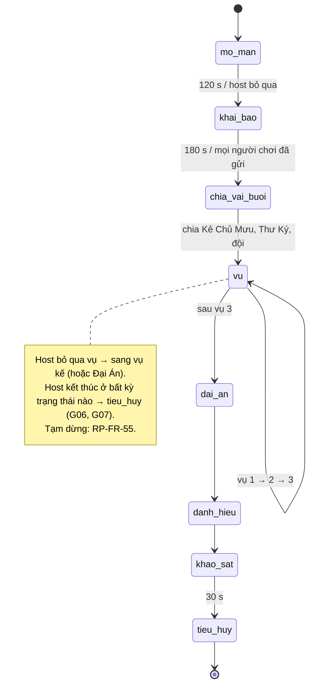
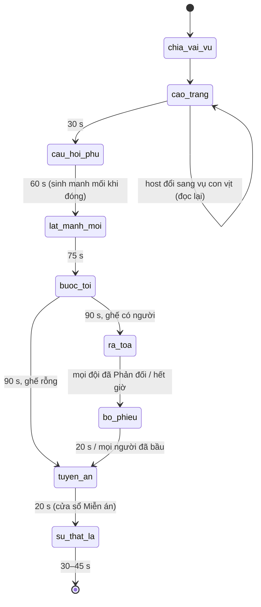

# Phiên Tòa Tủ Lạnh — SRS

> Phiên bản: 0.1 (nháp) · Cập nhật: 26/10/2026 · Trạng thái: **chờ owner duyệt, chưa được duyệt để triển khai.**
> Requirement gốc: [PRD Phiên Tòa Tủ Lạnh](phien-toa-tu-lanh-prd.md). Hạ tầng dùng chung (phòng, vào phòng, đồng ý, 5 câu, chia vai,
> phiếu, nút host, tiêu huỷ, báo cáo, vào lại): [shared-room-platform-srs.md](shared-room-platform-srs.md) — tài liệu này **không
> nhắc lại** các yêu cầu đó, chỉ tham chiếu mã `RP-*` và story G01–G09.
> User story: G31–G37. Không có ma ở bất kỳ chế độ nào (owner, 26/10/2026).

## 1. Phạm vi

Trong phạm vi: cấu hình buổi (chế độ, gói vụ), chia đội và vai Phiên Tòa, vòng một vụ (cáo trạng → câu hỏi phụ → manh mối →
thảo luận/buộc tội → ra tòa → bỏ phiếu → tuyên án → sự thật là), Đại Án, điểm đội, danh hiệu, Thẩm Phán Lá bằng mẫu câu, xử lý
người rời/vắng theo vai.

Ngoài phạm vi: mọi thứ trong hạ tầng chung; AI (D7); thẻ tự thú; mùa nhiều buổi; khán giả trên 50 người; cầu nối lá Justice (sau
MVP, xem PRD §8).

## 2. Thuật ngữ riêng

| Từ | Nghĩa |
|---|---|
| Vụ | Một vòng xử án, dựng từ một mẫu ở PRD §6.1 |
| Hồ sơ | Bộ manh mối về một Thủ Phạm trong vụ. Số hồ sơ = số Thủ Phạm của vụ (PRD §5.2) |
| Ghế bị cáo | Danh sách người bị các đội buộc tội trong vụ (gộp trùng) |
| Ràng buộc bí mật | Phương án Thủ Phạm buộc phải chọn ở câu hỏi phụ |
| Chữ của Chủ Mưu | Ba chữ cái game giao cho Kẻ Chủ Mưu, mỗi vụ một chữ, là chữ cái đầu (bỏ dấu, viết hoa) của ba câu trả lời của người đó |

## 3. Yêu cầu chức năng

### 3.1. Cấu hình buổi (G31)

| ID | Yêu cầu |
|---|---|
| PT-FR-01 | Host chọn chế độ `van_phong`, `lop_hoc` hoặc `tat_nien` khi tạo phòng (RP-FR-02). Không có lựa chọn nào bật yếu tố ma. |
| PT-FR-02 | Host chọn 3 vụ từ danh sách đã lọc theo nhãn chế độ, hoặc "Ngẫu nhiên" (mặc định). Ngẫu nhiên không lặp vụ trong buổi. |
| PT-FR-03 | Công tắc "Tránh chủ đề lấy đồ" (mặc định tắt): loại vụ có nhãn "lấy đồ" và vụ "nhạy cảm vừa" khỏi danh sách và khỏi bốc ngẫu nhiên. |
| PT-FR-04 | Nút "Đổi sang vụ con vịt cao su" có trên bảng host từ khi vụ bắt đầu tới hết pha cáo trạng. Bấm vào: thay vụ hiện tại bằng Vụ 4 (nếu Vụ 4 đã dùng, lấy vụ "không lấy đồ" còn lại), giữ nguyên vai đã chia, đọc lại cáo trạng mới. |
| PT-FR-05 | Chỗ trống `{do_vat}`, `{dia_diem}`, `{tinh_tiet}` bốc ngẫu nhiên từ phương án của mẫu khi vụ bắt đầu, cố định tới hết vụ. |
| PT-FR-06 | Số người chơi tối thiểu 15 để bắt đầu (PT-D1). Trên 50 người chơi: người vào sau là khán giả (RP-FR-16, RP-NFR-01). |

### 3.2. Khai báo, chia đội và vai (G32)

| ID | Yêu cầu |
|---|---|
| PT-FR-10 | Pha khai báo dùng G03, dài 180 s. |
| PT-FR-11 | Chia đội do máy chủ (RP-FR-33, kiểu a), số đội theo PRD §5.2, chênh lệch ≤ 1 người. Tên đội theo thứ tự: Sao Thủy, Sao Kim, Sao Hỏa, Sao Mộc, Sao Thổ, Sao Thiên Vương; mỗi đội có biểu tượng riêng (RP-NFR-15). Đội giữ nguyên cả buổi. |
| PT-FR-12 | Vai cả buổi (chia một lần sau khai báo): 1 Kẻ Chủ Mưu, 1 Thư Ký Tòa. |
| PT-FR-13 | Vai theo vụ (chia lại đầu mỗi vụ): Thủ Phạm, Đồng Phạm, Nhân Chứng (1 mỗi đội) theo PRD §5.2. Luật Sư chia khi ra tòa (PT-FR-50). Người còn lại là Bồi Thẩm – Thám Tử. |
| PT-FR-14 | Điều kiện: Thủ Phạm và Kẻ Chủ Mưu cần ≥ 3 câu trả lời khác `skip`; Đồng Phạm cần ≥ 2. Người vắng (RP-FR-92) không nhận vai đặc biệt. |
| PT-FR-15 | Ràng buộc chia: không ai làm Thủ Phạm hai lần trong buổi; ưu tiên người chưa làm Đồng Phạm; Kẻ Chủ Mưu và Thư Ký không làm Thủ Phạm/Đồng Phạm; Nhân Chứng không làm Thủ Phạm/Đồng Phạm trong cùng vụ; Thủ Phạm của một vụ rải sang các đội khác nhau khi có nhiều hồ sơ. |
| PT-FR-16 | Dự phòng khi thiếu người đủ điều kiện, theo thứ tự: (1) giảm Đồng Phạm tới tối thiểu 1 mỗi hồ sơ; (2) giảm số hồ sơ còn 1; (3) nếu vẫn không có Thủ Phạm đủ điều kiện: vụ dùng **Thủ Phạm hư cấu** — manh mối mô tả một nhân vật không có trong phòng, "Sự thật là" kết bằng câu "Thủ phạm là con mèo của tầng 3". Bảng host hiện dòng giải thích theo G04-AC06. |
| PT-FR-17 | Mỗi hồ sơ được gán cho một hoặc nhiều đội theo vòng tròn (đội 1 → hồ sơ A, đội 2 → hồ sơ B, …). Điện thoại hiện hồ sơ của đội mình nổi hơn, nhưng màn chiếu hiện mọi hồ sơ. |
| PT-FR-18 | Thẻ vai (G04) hiện: tên vai, việc của vai trong vụ này, đội; với Thủ Phạm thêm "Ràng buộc bí mật: ở câu hỏi phụ, hãy chọn '…'"; với Kẻ Chủ Mưu thêm chữ của vụ này. |

### 3.3. Điều tra một vụ (G33)

| ID | Yêu cầu |
|---|---|
| PT-FR-20 | **Cáo trạng** (30 s): màn chiếu hiện số vụ, tên vụ và câu cáo trạng đã điền chỗ trống, kèm câu Thẩm Phán (TPL-04). Ở chế độ Tất niên thêm câu dẫn (PRD §6.1). |
| PT-FR-21 | **Câu hỏi phụ** (60 s): mọi người chơi nhận câu hỏi phụ của vụ với 4 phương án, là phiếu `pt_side_prompt` (G05). Giao diện như nhau cho mọi vai. Lựa chọn của Thủ Phạm được máy chủ ghi bằng phương án ràng buộc, bất kể Thủ Phạm bấm gì. |
| PT-FR-22 | Trong cùng 60 s: mỗi Đồng Phạm nhận phiếu bí mật `pt_accomplice_swap` — chọn một trường (trong các trường mà cả Thủ Phạm của hồ sơ mình và chính mình đều có câu trả lời) để thay bằng giá trị của chính mình. Hết giờ chưa chọn: máy chủ chọn ngẫu nhiên. |
| PT-FR-23 | Trong cùng 60 s: Kẻ Chủ Mưu nhận phiếu bí mật `pt_mastermind_letter` — chọn một manh mối (bản rõ) và một vị trí chữ cái để thay bằng chữ của vụ này. Hết giờ: máy chủ chọn ngẫu nhiên một manh mối thật và một vị trí không phải khoảng trắng. |
| PT-FR-24 | Trong cùng 60 s: Thư Ký nhận phiếu bí mật `pt_clerk_check` — chọn một số thứ tự manh mối sẽ kiểm (kết quả trả ở pha lật manh mối). Hết giờ: không kiểm. |
| PT-FR-25 | Ràng buộc bí mật của Thủ Phạm là một phương án câu hỏi phụ được bốc ngẫu nhiên khi chia vai; nhiều Thủ Phạm trong cùng vụ có ràng buộc khác nhau. |
| PT-FR-26 | **Sinh manh mối** (máy chủ, khi câu hỏi phụ đóng): theo §6. |
| PT-FR-27 | **Lật manh mối** (75 s): màn chiếu hiện các manh mối đã mã hoá, nhóm theo hồ sơ, thứ tự xáo trộn, đánh số; hiện số đếm câu hỏi phụ theo phương án (không theo người), phương án có dưới 3 người gộp thành "dưới 3 người" (RP-PRV-10). Thư Ký nhận riêng kết quả kiểm: `thật`, `giả` hoặc `bị sửa một chữ`. Mỗi Nhân Chứng nhận riêng một manh mối thật đã mã hoá cho hồ sơ của đội mình. |
| PT-FR-28 | Điện thoại có công cụ giải mã đi kèm từng kiểu mã (bảng dịch Caesar, bảng emoji → phương án), không tự giải hộ. |
| PT-FR-29 | **Thảo luận + buộc tội** (90 s): mỗi đội có phiếu `pt_team_accuse` chỉ thành viên đội được bầu; lựa chọn là mọi người chơi có vai trong phòng (trừ khán giả), kể cả người cùng đội; không cho chọn chính mình. Đóng phiếu: người nhiều phiếu nhất của đội lên ghế bị cáo; hoà thì máy chủ rút thăm giữa người hoà và Thẩm Phán nói "Tòa rút thăm". Đội không ai bầu: không buộc tội. |

### 3.4. Ra tòa và bỏ phiếu (G34)

| ID | Yêu cầu |
|---|---|
| PT-FR-40 | Ghế bị cáo là danh sách người bị buộc tội, gộp trùng, tối đa bằng số đội. Màn chiếu ghi tiêu đề "Ghế bị cáo — những người bị nghi đóng vai Thủ Phạm". |
| PT-FR-41 | Ghế bị cáo rỗng (không đội nào buộc tội): bỏ qua ra tòa và bỏ phiếu, sang tuyên án với kết quả "chưa đủ chứng cứ" (TPL-20). |
| PT-FR-50 | **Luật Sư** (15 s): mỗi bị cáo được gán một Luật Sư ngẫu nhiên từ Bồi Thẩm không ngồi ghế và không giữ vai đặc biệt trong vụ. Luật Sư nhận phiếu `pt_lawyer_card` với 3 thẻ ngoại phạm bốc từ PRD §6.5. Hết giờ: chọn ngẫu nhiên. Thẻ hiện trên màn chiếu dưới tên bị cáo. |
| PT-FR-51 | **"Phản đối!"**: trong pha ra tòa, mỗi đội có một nút "Phản đối!" trên điện thoại mọi thành viên. Lần bấm đầu tiên của đội được tính; máy chủ ghi một lượt Phản đối (đội, vụ, slot đã bấm, thời điểm). Màn chiếu hiện dấu "PHẢN ĐỐI!" (qua kiểm nhấp nháy), tên đội, đồng hồ 20 s. |
| PT-FR-52 | Trong 20 s Phản đối, đội nói miệng hoặc một thành viên chọn 1 trong 3 thẻ chứng cứ trên điện thoại để hiện lên màn chiếu (người ngại nói). Thẻ chứng cứ dùng chung kho PRD §6.5. |
| PT-FR-53 | Hai đội bấm gần như cùng lúc: máy chủ xếp hàng theo thứ tự đến; đội sau chờ đội trước hết 20 s. |
| PT-FR-54 | Pha ra tòa kết thúc khi mọi đội đã dùng Phản đối, hoặc hết thời lượng `max(60 s, 20 s × số đội) + 15 s`, hoặc host bỏ qua. |
| PT-FR-55 | **Bỏ phiếu** (20 s): phiếu `pt_room_verdict` cho mọi người chơi; lựa chọn là ghế bị cáo; số lựa chọn tối đa = số hồ sơ của vụ; có phiếu trắng. Khán giả có phiếu khán giả riêng (RP-FR-46), không quyết định. |
| PT-FR-56 | Kết án: bị cáo nằm trong nhóm `k` người nhiều phiếu nhất (`k` = số hồ sơ) **và** có số phiếu ≥ 1/4 số người đã bỏ phiếu (không tính phiếu trắng). Hoà ở vị trí `k`: không kết án những người hoà đó. |

### 3.5. Tuyên án, Miễn án, Sự thật là (G35)

| ID | Yêu cầu |
|---|---|
| PT-FR-60 | Với mỗi người bị kết án: nếu là Thủ Phạm → Thẩm Phán tuyên (TPL-15) kèm một bản án tượng trưng bốc từ PRD §6.4 và dòng "Bản án mang tính tượng trưng"; nếu không phải Thủ Phạm → án oan, **tự động Miễn án** (TPL-18), không hiện bản án. |
| PT-FR-61 | Nút **Miễn án** hiện trên điện thoại người bị kết án và trên bảng host trong 20 s (PT-D4). Bấm: phiếu `pt_pardon`, màn chiếu đóng dấu "ĐÃ MIỄN ÁN" (TPL-17). Không bấm cũng không có hậu quả nào; bản án chỉ là câu trên màn chiếu. |
| PT-FR-62 | Thủ Phạm không bị kết án: TPL-19. Ghế rỗng hoặc hoà: TPL-20. |
| PT-FR-63 | Lá Justice (Công Lý) hiện như hình tĩnh "án lệ" cạnh bản án. Không dữ liệu cá nhân, không link ở MVP. |
| PT-FR-64 | **Sự thật là** (30–45 s): màn chiếu hiện lại từng manh mối ở bản rõ, đánh dấu `thật`, `do Đồng Phạm cài` hoặc `bị đổi một chữ` (tô chữ bị đổi). Hiện ai đóng vai Thủ Phạm, Đồng Phạm của vụ (TPL-16, chỉ người có `consent_display`), ràng buộc bí mật của Thủ Phạm. Không hiện Kẻ Chủ Mưu, Thư Ký, Nhân Chứng. |
| PT-FR-65 | Thẩm Phán gọi lại vụ trước (TPL-23, TPL-24) khi có điều kiện: cùng đội đoán trúng hai vụ liền, cùng đồ vật xuất hiện lại, hay một đội dùng Phản đối ở mọi vụ. Trí nhớ này chỉ là sự kiện của đội và nội dung vụ, không gắn người. |
| PT-FR-66 | Điểm đội cập nhật theo PRD §4.3 và hiện ở cuối "Sự thật là" dưới dạng bảng đội (không bảng cá nhân). |

### 3.6. Đại Án, danh hiệu, kết thúc (G36)

| ID | Yêu cầu |
|---|---|
| PT-FR-70 | Sau vụ 3: màn chiếu hiện ba chữ bị đổi (theo thứ tự vụ) và gợi ý TPL-28. |
| PT-FR-71 | Ghép chữ và thảo luận 60 s; mỗi đội có phiếu `pt_grand_nominate` (45 s) để đề cử một người làm Kẻ Chủ Mưu. Cách đóng phiếu như PT-FR-29. |
| PT-FR-72 | Cả phòng bỏ phiếu `pt_grand_verdict` (20 s), một lựa chọn trong danh sách đề cử. Kẻ Chủ Mưu "lộ diện" khi đứng đầu và có ≥ 1/4 số phiếu (như PT-FR-56). Người bị bầu nhầm không có bản án. |
| PT-FR-73 | Tuyên án cuối (TPL-29 hoặc TPL-30), hiện Kẻ Chủ Mưu và Thư Ký là ai (người có `consent_display`). Kẻ Chủ Mưu lộ diện nhận bản án tượng trưng + Miễn án như PT-FR-60/61. |
| PT-FR-74 | Danh hiệu theo PRD §4.3, mỗi danh hiệu một câu TPL-31. Danh hiệu cá nhân chỉ hiện biệt danh của người có `consent_display` (PT-D2); người đã rời hiện "Người đã rời". Không có danh hiệu tiêu cực. |
| PT-FR-75 | Câu khảo sát cuối buổi (G08): "Có lúc nào bạn thấy bị nhắm vào không?" — `Không` · `Có` · `Không muốn trả lời`; chỉ lưu số đếm. |
| PT-FR-76 | Màn tiêu huỷ (G07) với câu TPL-32, rồi TPL-33. |

### 3.7. Rời phòng, vắng mặt, kick theo vai

| Vai | Rời / bị kick / vắng khi tới lượt | Xử lý |
|---|---|---|
| Thủ Phạm | Trước bỏ phiếu | Hồ sơ vẫn trên màn; ở tuyên án: "Thủ Phạm đã rời tòa, hồ sơ khép lại"; không kết án; đội buộc tội đúng vẫn được +1 |
| Đồng Phạm | Trước khi tráo | Máy chủ tráo ngẫu nhiên (PT-FR-22) nếu dữ liệu còn; nếu đã rời (câu trả lời đã xoá) thì bỏ manh mối giả đó |
| Kẻ Chủ Mưu | Bất kỳ lúc nào | Không chia lại. Vụ còn lại không có chữ bị đổi; Đại Án dùng các chữ đã có; nếu chưa có chữ nào, Đại Án bị bỏ, Thẩm Phán: "Kẻ Chủ Mưu đã rời phòng, đại án khép lại" |
| Thư Ký | Bất kỳ lúc nào | Không kiểm nữa |
| Nhân Chứng | Bất kỳ lúc nào | Không ảnh hưởng |
| Luật Sư | Trước khi chọn thẻ | Máy chủ chọn ngẫu nhiên |
| Bị cáo trên ghế | Trong ra tòa | Vẫn là lựa chọn phiếu với nhãn "Người đã rời"; nếu bị kết án: không có bản án |

### 3.8. Thẩm Phán Lá (G37)

| ID | Yêu cầu |
|---|---|
| PT-FR-80 | Mọi câu Thẩm Phán lấy từ kho mẫu câu có phiên bản (PRD §6.3), mỗi câu có mã `TPL-xx`, nhịp, nhãn (`thuong`, `dong_vai`, `khen`), danh sách slot được phép. |
| PT-FR-81 | Bộ điền slot chỉ nhận slot trong danh sách của câu. `{biet_danh}` chỉ được điền ở câu nhãn `dong_vai` hoặc `khen`. Câu thiếu slot hoặc slot sai bị từ chối ở bước kiểm nội dung trước phát hành, không ở runtime. |
| PT-FR-82 | Mỗi nhịp có ≥ 2 biến thể khi kho đủ; không lặp cùng một câu trong 2 lần dùng liền. |
| PT-FR-83 | Không có câu nào sinh lúc chạy; không gọi dịch vụ ngoài. Mã câu hiện trong gói tin để báo cáo "Nội dung làm tôi khó chịu" kèm được (RP-FR-73). |

## 4. Trạng thái

### 4.1. Cả buổi

### 4.2. Một vụ

## 5. Đồng hồ (mặc định; host +30 s tối đa 3 lần mỗi pha — RP-FR-56)

| Pha | Mặc định | Tối thiểu khi thử nghiệm | Ghi chú |
|---|---|---|---|
| Mở màn | 120 s | 60 s | Host bỏ qua được |
| Khai báo | 180 s | 120 s | Đóng sớm khi mọi người chơi đã gửi |
| Cáo trạng | 30 s | 20 s | |
| Câu hỏi phụ (+ lượt bí mật) | 60 s | 45 s | Đóng sớm khi mọi phiếu đã đủ |
| Lật manh mối | 75 s | 60 s | Báo cáo: 60–90 s |
| Thảo luận + buộc tội | 90 s | 60 s | |
| Luật Sư | 15 s | 10 s | Chạy đầu pha ra tòa |
| Ra tòa | `max(60, 20 × số đội)` s | — | Mỗi Phản đối 20 s |
| Bỏ phiếu | 20 s | 15 s | |
| Tuyên án + Miễn án | 20 s | 15 s | |
| Sự thật là | 30–45 s | 30 s | Theo số manh mối |
| Đại Án: ghép chữ | 60 s | 45 s | |
| Đại Án: đề cử | 45 s | 30 s | |
| Đại Án: bỏ phiếu | 20 s | 15 s | |
| Danh hiệu | 45 s | 30 s | |
| Khảo sát | 30 s | 20 s | |

Ước lượng: mở 2' + khai 3' + 3 vụ × ~7,5' + Đại Án ~4,5' + kết ~1,5' ≈ 33,5 phút (khớp 25–35 phút của báo cáo).

## 6. Sinh manh mối

1. Với mỗi hồ sơ (một Thủ Phạm T):
   - Chọn ngẫu nhiên 2 trường khác nhau trong các câu trả lời khác `skip` của T → 2 manh mối thật từ mẫu PRD §6.2.
   - Thêm 1 manh mối thật từ lựa chọn bắt buộc ở câu hỏi phụ.
   - Với mỗi Đồng Phạm gán cho hồ sơ: lấy trường Đồng Phạm đã chọn, tạo manh mối giả cùng mẫu nhưng mang giá trị của Đồng Phạm.
     Nếu giá trị trùng giá trị của T, bỏ manh mối giả đó (không tạo manh mối giả trùng thật).
2. Kẻ Chủ Mưu thay một chữ cái trên **bản rõ** của manh mối đã chọn bằng chữ của vụ (giữ nguyên hoa/thường của vị trí).
3. Mỗi manh mối nhận một kiểu mã hoá (Caesar, emoji, thiếu chữ), luân phiên để mỗi hồ sơ có ít nhất hai kiểu.
4. Manh mối Nhân Chứng: một manh mối thật từ trường thứ ba của T (nếu có), nếu không thì trùng trường với một manh mối đã hiện
   (vai trò "xác nhận").
5. Kết quả kiểm của Thư Ký: `gia` cho manh mối giả, `bi_sua` cho manh mối có chữ bị đổi, `that` cho còn lại.
6. Thủ Phạm hư cấu (PT-FR-16): dùng bộ giá trị cố định trong kho nội dung, không lấy từ người chơi.
7. Không manh mối nào dùng câu `skip` (G03 quy tắc 4).

## 7. Mô hình dữ liệu (theo hợp đồng dữ liệu chung — không thêm trường)

Dùng nguyên các thực thể ở hạ tầng §6.1. Phần riêng của Phiên Tòa:

| Dữ liệu | Thuộc thực thể chung | Chi tiết |
|---|---|---|
| Đội | Vai (nhóm) | Mã đội, cố định cả buổi |
| Vai cả buổi | Vai | `ke_chu_muu`, `thu_ky`; chữ của Chủ Mưu suy ra từ câu trả lời của chính người đó lúc chia, không lưu riêng ngoài trạng thái vụ |
| Vai theo vụ | Vai (có chỉ số vụ) | `thu_pham` (+ hồ sơ, ràng buộc), `dong_pham` (+ hồ sơ), `nhan_chung`, `luat_su` (+ bị cáo), `boi_tham` |
| Phiếu | Phiếu (`ballot_type`) | `pt_side_prompt`, `pt_accomplice_swap`, `pt_mastermind_letter`, `pt_clerk_check`, `pt_team_accuse`, `pt_lawyer_card`, `pt_room_verdict`, `pt_pardon`, `pt_grand_nominate`, `pt_grand_verdict` |
| Lượt "Phản đối!" | Riêng theo trò (hợp đồng chung) | Đội, chỉ số vụ, slot đã bấm, thời điểm, mã thẻ chứng cứ (nếu có) |
| Trạng thái vụ | Phòng (trạng thái) | Mã vụ, chỗ trống đã bốc, manh mối (bản rõ, kiểu mã, nhãn thật/giả/sửa), ghế bị cáo, kết quả, điểm đội |
| Câu khảo sát | Số đếm tổng hợp | Chỉ số đếm theo phương án |

Mọi dữ liệu trên xoá khi kết thúc (RP-FR-60). Manh mối chứa giá trị câu trả lời nên là dữ liệu cá nhân trong buổi, xoá cùng phòng.

## 8. Sự kiện thời gian thực riêng (bổ sung hạ tầng §5.3)

| Sự kiện | Kênh | Nội dung |
|---|---|---|
| `pt.case_started` | tất cả | Số vụ, mã vụ, tên vụ (không vai) |
| `pt.indictment` | display, audience, player | Câu cáo trạng đã điền, mã câu `TPL` |
| `pt.secret_task` | player (từng người) | Việc bí mật của vai trong câu hỏi phụ; người không có việc nhận gói đệm cùng cỡ (RP-FR-35) |
| `pt.clues` | display, audience | Manh mối đã mã hoá theo hồ sơ, số đếm câu hỏi phụ |
| `pt.private_clue` | player (Nhân Chứng, Thư Ký) | Manh mối riêng hoặc kết quả kiểm; người khác nhận gói đệm cùng cỡ |
| `pt.bench` | tất cả | Ghế bị cáo (biệt danh), thẻ ngoại phạm |
| `pt.objection` | tất cả | Đội, thẻ chứng cứ (nếu có), đồng hồ 20 s |
| `pt.verdict` | tất cả | Kết quả, bản án, cửa sổ Miễn án |
| `pt.truth` | tất cả | Manh mối bản rõ + nhãn, vai của vụ (chỉ người có đồng ý), điểm đội |
| `pt.grand_case` | tất cả | Ba chữ, gợi ý |
| `pt.titles` | tất cả | Danh hiệu |

## 9. Bảo mật

| ID | Yêu cầu |
|---|---|
| PT-SEC-01 | Vai, ràng buộc bí mật, chữ của Chủ Mưu, lựa chọn của Đồng Phạm/Chủ Mưu/Thư Ký, manh mối riêng chỉ ở kênh của người giữ vai (RP-FR-31, RP-SEC-07). |
| PT-SEC-02 | Trong pha câu hỏi phụ và lật manh mối, mọi điện thoại nhận gói tin cùng cỡ, cùng nhịp (RP-FR-35). |
| PT-SEC-03 | Lệnh `pt_*` từ người không giữ vai tương ứng trả `not_allowed` giống phiếu không tồn tại (G05-AC09). |
| PT-SEC-04 | Ghi đè lựa chọn câu hỏi phụ của Thủ Phạm làm ở máy chủ; client của Thủ Phạm không nhận cờ "đã bị ghi đè". |
| PT-SEC-05 | Không câu Thẩm Phán nào chứa chữ do người chơi nhập ngoài biệt danh; biệt danh luôn được escape. |

## 10. Quyền riêng tư

| ID | Yêu cầu |
|---|---|
| PT-PRV-01 | Chỉ người có `consent_display = true` nhận vai và có câu trả lời làm manh mối (khán giả không bao giờ). |
| PT-PRV-02 | Màn chiếu chỉ hiện câu trả lời dưới dạng manh mối về **vai** ("Thủ Phạm mặc áo…"), không bao giờ "X mặc áo…". Biệt danh chỉ gắn với vai ở "Sự thật là", tuyên án và danh hiệu. |
| PT-PRV-03 | Số đếm câu hỏi phụ là số đếm theo phương án, ẩn nhóm dưới 3 người (RP-PRV-10); không ai thấy ai chọn gì. |
| PT-PRV-04 | Không ai bị công bố đã bầu ai, buộc tội ai, hay báo cáo ai. |
| PT-PRV-05 | Nội dung vụ, manh mối, bản án, thẻ không chạm nhóm chủ đề cấm (brief chung, PRD §6). Biên bản rà nội dung là điều kiện phát hành. |
| PT-PRV-06 | Không có dữ liệu sinh, không có chú thích chiêm tinh cá nhân; lá Justice là hình tĩnh. |
| PT-PRV-07 | Không gửi thông báo đẩy, email hay tin nhắn nào, trong hay sau buổi (RP §1; chỉ Hết Cứu % có thông báo tự bật). |

## 11. Phi chức năng riêng

- Mục tiêu 15–30 người chơi ở cổng phát hành MVP; hạ tầng hỗ trợ 50 (RP-NFR-01).
- Manh mối mã hoá phải đọc được trên màn chiếu từ 8 m: mỗi manh mối ≤ 40 ký tự bản rõ, chữ ≥ 48 px ở 1080p.
- Âm thanh búa gõ và hiệu ứng "camera an ninh rè hình" có bản tắt âm và bản tĩnh (RP-NFR-13); hiệu ứng rè qua kiểm nhấp nháy.
- Điện thoại dùng một tay được: nút Phản đối ≥ 64 px chiều cao.

## 12. Móc kiểm thử

| ID | Móc |
|---|---|
| PT-TH-01 | Hạt giống cố định (RP-TH-01) cho chia vai, bốc vụ, bốc chỗ trống, ràng buộc, chữ của Chủ Mưu, kiểu mã |
| PT-TH-02 | Kịch bản giả lập 15, 24, 34, 50 người chơi chạy trọn buổi với đồng hồ giả; kiểm số vai mỗi vụ đúng PRD §5.2 |
| PT-TH-03 | Kiểm "Thủ Phạm không lặp" trên 1.000 buổi giả lập |
| PT-TH-04 | Kiểm câu Thẩm Phán: mọi câu `{biet_danh}` có nhãn `dong_vai`/`khen`; không câu nào có động từ gán hành vi cho người (danh sách từ cấm: "đã lấy", "đã ăn", "đã trộm" đi với `{biet_danh}`) |
| PT-TH-05 | Kiểm nội dung: quét kho vụ, manh mối, bản án, thẻ với danh sách từ khoá nhóm chủ đề cấm |
| PT-TH-06 | Kiểm án oan: bị cáo không phải Thủ Phạm bị kết án → không có bản án, có TPL-18 |
| PT-TH-07 | Kiểm payload câu hỏi phụ: gói `pt.secret_task` của mọi vai cùng cỡ |

## 13. Truy vết

| Yêu cầu | Nguồn |
|---|---|
| Vai, Kẻ Chủ Mưu, 3 vụ + Đại Án, Phản đối, Miễn án, ba chế độ, bảy vụ, bảng quy mô | Báo cáo, mục Phiên Tòa |
| Án oan tự miễn; câu hỏi phụ là câu chọn hư cấu; Thủ Phạm hư cấu dự phòng | Đề xuất mới của tài liệu này (chờ owner) |
| Chia nhỏ mâu thuẫn thành nhịp | Research note §3 (Takumi) |
| Thẩm phán nhớ vụ trước | Research note §1, §3 (Courtroom Chaos) |
| Phán quyết nhắm vai, không người | Research note §4; báo cáo, lằn ranh |

## 14. Quyết định mở

Xem PRD §11 (PT-D1–PT-D11, D1, D7). Hai quyết định phát sinh từ SRS (đã chép sang PRD):

| ID | Câu hỏi | Đề xuất — chờ owner |
|---|---|---|
| PT-D9 | Ngưỡng kết án 1/4 số phiếu | Giữ 1/4; chơi thử đo tỷ lệ "chưa đủ chứng cứ" |
| PT-D10 | Cho đội buộc tội người cùng đội | Có (Thủ Phạm có thể ở bất kỳ đội nào) |

## 15. Bàn giao theo AGENTS.md

**Nguồn đã kiểm tra:** như PRD §13; thêm SRS hạ tầng phòng (cùng tác giả, cùng ngày).

**Phát hiện đã xử lý:** mọi lượt chọn bí mật theo vai lưu như phiếu để giữ đúng hợp đồng dữ liệu; Thủ Phạm hư cấu khi thiếu người
đủ điều kiện, tránh ép người khai thêm; manh mối nói về vai chứ không về biệt danh; lựa chọn câu hỏi phụ của Thủ Phạm ghi đè ở máy
chủ để giao diện Thủ Phạm giống người khác; Kẻ Chủ Mưu rời phòng có đường kết thúc.

**Rủi ro chưa giải quyết:** cân bằng (ngưỡng 1/4, điểm, độ khó mã) chưa chơi thử; manh mối dùng chi tiết nhìn thấy được (màu áo,
chỗ ngồi) có thể làm người mặc áo hiếm bị chú ý nhiều — chơi thử đo bằng câu khảo sát; các rủi ro pháp lý ở PRD §9.

**AC/DoD chưa hoàn tất:** toàn bộ (chưa có code, test, chơi thử, duyệt nội dung, DPIA duyệt, nhãn cửa hàng).
