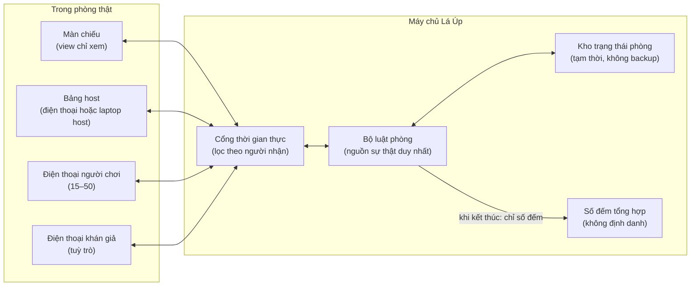
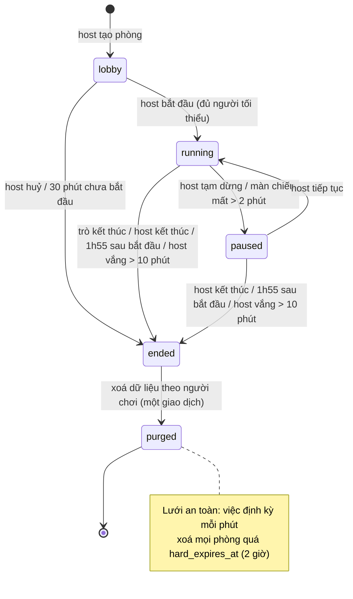

# Hạ tầng phòng trực tiếp dùng chung — SRS

> Phiên bản: 0.1 (nháp) · Cập nhật: 26/10/2026 · Trạng thái: **chờ owner duyệt, chưa được duyệt để triển khai.**
> Giai đoạn 3 (game) chưa bắt đầu. Tài liệu này chỉ chuẩn bị, không đụng runtime (kế hoạch owner 23/10/2026,
> [`docs/plans/2026-10-23-privacy-content-game-plan.md`](../../plans/2026-10-23-privacy-content-game-plan.md)).
> Dùng cho: **Phiên Tòa Tủ Lạnh** ([PRD](phien-toa-tu-lanh-prd.md), [SRS](phien-toa-tu-lanh-srs.md)),
> **Sĩ Số +1** ([PRD](si-so-cong-1-prd.md), [SRS](si-so-cong-1-srs.md)) và **Tam Sao Thất Bản bản phòng trực tiếp**
> ([SRS](tam-sao-that-ban-srs.md), do Writer A giữ). User story: G01–G09 trong
> [`docs/user-stories/game/`](../../user-stories/game/).
> Nguồn thiết kế: báo cáo "Chốt năm trò, giữ trọn chữ Lành" (26/10/2026), mục "Phiên Tòa Tủ Lạnh và Sĩ Số +1 là hai trò
> riêng, dùng chung hạ tầng phòng"; ghi chú `research_notes/Chốt trò chơi nhóm Lá Lành/comedy_courtroom_formats.md` §1, §4, §5.

## 0. Tóm tắt

Một host mở phòng trên trình duyệt, chiếu **màn chiếu** lên TV hoặc máy chiếu. Người chơi quét QR hoặc gõ mã 6 ký tự,
đặt biệt danh, tick đồng ý, rồi dùng điện thoại làm tay cầm. Máy chủ giữ toàn bộ luật: chia vai bí mật, mở và đóng
phiếu, đếm phiếu, chạy đồng hồ. Host có nút khoá phòng, kick, đổi tên, bỏ qua, tạm dừng và kết thúc. Khi kết thúc,
màn chiếu hiện cảnh **tiêu huỷ hồ sơ** và máy chủ đã xoá xong mọi dữ liệu theo người chơi trước khi hiệu ứng chạy.
Phòng tự hết hạn 2 giờ sau khi bắt đầu. Không tài khoản, không ngày sinh, không chữ tự do ngoài biệt danh.

Hạ tầng này là phần đắt nhất của dòng game phòng. Làm cho Phiên Tòa trước (không có ma, hợp văn phòng), rồi Sĩ Số +1
dùng lại gần hết (báo cáo, mục "Bảy trò, ba nhà").

## 1. Phạm vi

### 1.1. Trong phạm vi

| Khối | Mô tả | Story |
|---|---|---|
| Tạo phòng, màn chiếu, bảng host | Host không cần tài khoản; màn chiếu là một view riêng chỉ xem | G01 |
| Vào phòng | QR/mã 6 ký tự, biệt danh 2–20 ký tự, xác nhận 18+, đồng ý hiện trên màn chiếu | G02 |
| Khai báo 5 câu vô hại | Module tuỳ chọn theo trò (Phiên Tòa, Sĩ Số +1 bật; Tam Sao tắt) | G03 |
| Chia vai bí mật và chia nhóm | Máy chủ chia, chỉ gửi vai tới đúng máy của người đó | G04 |
| Bỏ phiếu đồng thời | Cửa sổ phiếu có hạn, một phiếu mỗi người, không hiện số phiếu trực tiếp | G05 |
| Nút host | Khoá phòng, thu hồi link, kick, đổi tên, bỏ qua, tạm dừng, kết thúc | G06 |
| Tiêu huỷ hồ sơ và hết hạn | Xoá khi kết thúc, chậm nhất ở mốc hết hạn cứng | G07 |
| Báo cáo, rời phòng, chỉ xem | Không chữ tự do, rời là xoá dữ liệu của mình | G08 |
| Mất kết nối và vào lại | Vào lại đúng chỗ trên cùng trình duyệt | G09 |

### 1.2. Ngoài phạm vi

- Luật riêng của từng trò (pha, vai cụ thể, nội dung) — nằm trong SRS của trò.
- Tài khoản, đăng nhập, hồ sơ, lịch sử chơi, danh sách bạn, tìm phòng công khai.
- Chat, nhắn riêng, chữ tự do (ngoài biệt danh), ảnh, khuôn mặt, giọng nói, ghi âm, camera, vị trí, danh bạ.
- AI hay LLM lúc chạy (quyết định D7 đề xuất; báo cáo mục Phiên Tòa "Thẩm Phán Lá chạy bằng mẫu câu ở MVP").
- Thông báo đẩy. Phòng trực tiếp không gửi thông báo nào.
- Bản cho người dưới 18 tuổi.
- Bản chat không đồng bộ của Tam Sao (Writer A, quyết định D4).

### 1.3. Ranh giới thương hiệu và bề mặt

- Chạy trên web (trình duyệt, PWA tuỳ chọn), **tách khỏi app Lá Lành**, ghi "một sản phẩm của Lá Lành". Tên thương
  hiệu phụ đề xuất **Lá Úp** (D1, chờ owner).
- **RP-D6 (đề xuất — chờ owner):** đặt Lá Úp trên một origin riêng nằm ngoài `cookie_domain` của Lá Lành, để cookie
  phiên của app chính không bao giờ đi kèm request của game và ngược lại. Cách tách origin đã dùng cho media của
  Nơi bình yên (PRD Nơi bình yên D19).
- Không SDK analytics, quảng cáo hay theo dõi của bên thứ ba. Font, ảnh, âm thanh tự host.
- Hạ tầng hiện có: Hetzner (Đức) và Supabase (Frankfurt) — xem
  [`docs/legal/2026-10-22-privacy-counsel-dossier.md`](../../legal/2026-10-22-privacy-counsel-dossier.md). Không thêm nhà
  cung cấp mới trong tài liệu này. Hồ sơ chuyển dữ liệu ra nước ngoài (#52) áp dụng.

## 2. Thuật ngữ

| Từ | Nghĩa |
|---|---|
| Phòng | Một buổi chơi của một trò, từ lúc tạo đến lúc tiêu huỷ |
| Host | Người tạo phòng và cầm bảng host. Ở MVP host **không nhận vai** (RP-D1) |
| Màn chiếu | View chỉ xem, chiếu cho cả phòng. Không bao giờ nhận dữ liệu bí mật |
| Bảng host | View điều khiển của host. Thấy biệt danh, trạng thái kết nối, tiến độ phiếu (số đếm). Không thấy vai, câu trả lời hay ai bầu ai |
| Người chơi | Người đã vào phòng, đồng ý hiện câu trả lời, có thể nhận vai |
| Khán giả | Người vào chế độ "chỉ xem": không khai, không vai, bỏ phiếu khán giả nếu trò cho phép |
| Slot | Chỗ của một người trong phòng, gắn với `player_session` |
| Phiếu (ballot) | Một lượt chọn có hạn giờ. Gồm phiếu bầu công khai và mọi lượt chọn bí mật theo vai |
| Pha | Một bước trong luật của trò, có đồng hồ |
| Tiêu huỷ hồ sơ | Màn kết thúc: máy chủ xoá dữ liệu theo người chơi rồi mới chạy hiệu ứng đóng dấu |

## 3. Kiến trúc mức khái niệm (trung lập công nghệ)

- **Máy chủ là nguồn sự thật duy nhất.** Client chỉ gửi ý định (lệnh) và hiển thị trạng thái được gửi xuống. Client
  không tự tính vai, phiếu hay kết quả.
- **Lọc theo người nhận ở máy chủ.** Mỗi kênh (màn chiếu, host, từng người chơi, khán giả) nhận một bản trạng thái
  riêng đã lọc. Dữ liệu bí mật không bao giờ được gửi xuống rồi giấu bằng giao diện.
- **Kho trạng thái phòng là tạm thời.** Yêu cầu RP-PRV-04: dữ liệu theo người chơi không được ghi vào kho có backup
  hay khôi phục theo thời điểm (PITR). Hiện Hetzner giữ backup trên đĩa và Supabase có backup/PITR (dossier P10). Nếu
  buộc phải dùng PostgreSQL thì phải nằm trong kế hoạch sổ ghi xoá P07 trước khi mở. **RP-D3 (chờ owner/operator).**

## 4. Yêu cầu chức năng

### 4.1. Tạo phòng, màn chiếu, bảng host (G01)

| ID | Yêu cầu |
|---|---|
| RP-FR-01 | Host tạo phòng không cần tài khoản. Máy chủ cấp `host_session` (ngẫu nhiên ≥ 128 bit, gắn với trình duyệt bằng cookie `HttpOnly; Secure; SameSite=Lax`, chỉ lưu hash ở máy chủ). |
| RP-FR-02 | Khi tạo, host chọn trò, chế độ (theo trò), số người tối đa (mặc định theo trò, trần 50 người chơi), có cho khán giả không. Host xác nhận "Tôi từ 18 tuổi trở lên và tổ chức cho người từ 18 tuổi". |
| RP-FR-03 | Máy chủ sinh: `room_id` (ngẫu nhiên, không đoán được), **mã phòng 6 ký tự** từ bảng 31 ký tự không gây nhầm (bỏ 0, O, 1, I, L), **token vào phòng** (≥ 128 bit) và **token màn chiếu** (≥ 128 bit). Máy chủ chỉ lưu hash có khoá (pepper ở máy chủ) của mã và hai token. |
| RP-FR-04 | Link vào phòng đặt token sau dấu `#` (fragment) để token không nằm trong dòng request, log máy chủ hay header `Referer`. Trang vào phòng đọc fragment rồi gửi token trong thân `POST`. QR chứa đúng link này. |
| RP-FR-05 | Màn chiếu mở bằng link riêng chứa token màn chiếu (cũng ở fragment) hoặc bằng cách bấm "Chiếu trên máy này" trên bảng host. Token màn chiếu chỉ cho quyền xem kênh màn chiếu, không gửi được lệnh. |
| RP-FR-06 | Màn chiếu và bảng host có thể chạy trên cùng một máy (hai tab hoặc chia màn) hoặc trên hai máy. Bảng host không được hiện trên màn chiếu. |
| RP-FR-07 | Sảnh chờ trên màn chiếu hiện: QR lớn, mã phòng chữ to, số người đã vào, biệt danh của người chơi (không hiện biệt danh khán giả, chỉ số đếm), nhắc "Chỉ dành cho người từ 18 tuổi". |
| RP-FR-08 | Host bắt đầu khi đủ số người tối thiểu của trò. Khi bắt đầu, máy chủ ghi `started_at` và đặt `hard_expires_at = started_at + 2 giờ`. |
| RP-FR-09 | Phòng chưa bắt đầu tự hết hạn sau 30 phút kể từ lúc tạo. |

### 4.2. Vào phòng, biệt danh, đồng ý (G02)

| ID | Yêu cầu |
|---|---|
| RP-FR-10 | Người vào bằng QR (link có token) hoặc gõ mã 6 ký tự trên trang vào phòng. Mã không phân biệt hoa thường. |
| RP-FR-11 | Trang vào phòng hỏi biệt danh, ô **"Tôi từ 18 tuổi trở lên"** và (nếu trò có khai báo) ô **"Câu trả lời của tôi có thể hiện trên màn hình chung"**. Cả hai ô **không tick sẵn**. Hai nút ngang hàng, cùng kích thước: `Đồng ý và chơi` và `Chỉ xem, không khai`. |
| RP-FR-12 | `Đồng ý và chơi` chỉ bật khi cả hai ô đã tick. `Chỉ xem, không khai` chỉ cần ô 18+. Không tick ô 18+ thì không vào được dưới bất kỳ hình thức nào. |
| RP-FR-13 | Biệt danh: 2–20 ký tự sau chuẩn hoá Unicode NFC; cho phép chữ (kể cả tiếng Việt có dấu), số, khoảng trắng, `-`, `_`, `.`; bỏ ký tự điều khiển, ký tự độ rộng 0, ký tự đổi chiều chữ; cấm URL, `@`, dãy số từ 6 chữ số trở lên (giống số điện thoại); lọc từ cấm (chửi thề, tình dục, miệt thị nhóm người, tên người nổi tiếng trong danh sách chặn). |
| RP-FR-14 | Biệt danh trùng trong phòng được thêm hậu tố số ("Lan 2"). Người dùng thấy hậu tố trước khi vào. |
| RP-FR-15 | Khi vào, máy chủ cấp `player_session` (ngẫu nhiên ≥ 128 bit, cookie `HttpOnly; Secure; SameSite=Lax`, `Max-Age` không quá `hard_expires_at`), chỉ lưu hash. |
| RP-FR-16 | Sau khi phòng bắt đầu, người mới chỉ vào được làm khán giả (nếu host cho phép khán giả). Trò có thể cho người vào muộn nhận vai ở mốc an toàn (SRS của trò quy định). |
| RP-FR-17 | Phòng đã khoá, đã đủ người, đã kết thúc hoặc mã sai: trả **cùng một thông báo**: "Không vào được phòng này. Có thể mã chưa đúng, phòng đã khoá hoặc đã kết thúc." Không tiết lộ phòng có tồn tại hay không. |
| RP-FR-18 | Bản ghi đồng ý gồm: `consent_display` (đúng/sai), `consent_copy_version`, `consented_at`. Không lưu riêng cờ 18+: slot chỉ được tạo khi request có xác nhận 18+. |

### 4.3. Khai báo 5 câu vô hại (G03, chỉ trò bật module)

| ID | Yêu cầu |
|---|---|
| RP-FR-20 | Năm câu, **chọn từ danh sách, không gõ chữ**: bữa sáng, bài hát nghe gần nhất (theo loại nhạc), chỗ ngồi gần cửa sổ hay cửa ra vào, màu áo, một món trong túi. Danh sách phương án ở §6.2. |
| RP-FR-21 | Mỗi câu có phương án **"Không muốn nói"**. Chọn phương án này không bị phạt; trò không được dùng câu đó làm manh mối cho người đó. |
| RP-FR-22 | Chỉ người chơi có `consent_display = true` mới thấy và gửi được 5 câu. Khán giả không bao giờ được hỏi. |
| RP-FR-23 | Người chơi sửa được câu trả lời cho tới khi pha khai báo đóng. Sau đó câu trả lời bị khoá tới hết buổi. |
| RP-FR-24 | Không câu nào hỏi về người khác. Câu "bạn ngồi cạnh ai" của thiết kế cũ đã bị bỏ vì bắt khai thông tin về người thứ ba (báo cáo, phần bàn giao). |

### 4.4. Chia vai bí mật và chia nhóm (G04)

| ID | Yêu cầu |
|---|---|
| RP-FR-30 | Máy chủ chia vai bằng bộ sinh số ngẫu nhiên an toàn mật mã, theo bảng số vai của trò. Client không tham gia. |
| RP-FR-31 | Vai của mỗi người chỉ gửi tới kênh của chính người đó. Màn chiếu, bảng host và người khác không nhận dữ liệu này cho tới pha lật mặt của trò. |
| RP-FR-32 | Thẻ vai trên điện thoại mặc định **úp**. Người chơi giữ nút "Giữ để xem vai" mới hiện; thả tay là úp lại. Có lựa chọn thay thế cho người dùng trình đọc màn hình (nút bật/tắt, có cảnh báo "người bên cạnh có thể nhìn thấy"). |
| RP-FR-33 | Chia nhóm có hai kiểu: (a) **máy chủ chia** cân bằng (Phiên Tòa: đội hành tinh), (b) **người chơi tự chọn** trong các nhãn host đặt (Sĩ Số +1: dãy bàn; Tam Sao: bàn). Nhóm là một phần của bản ghi vai. |
| RP-FR-34 | Người chỉ được nhận một số vai khi đủ điều kiện dữ liệu (ví dụ ít nhất 3 câu trả lời khác "Không muốn nói"). SRS của trò quy định điều kiện. |
| RP-FR-35 | Mọi gói dữ liệu gửi xuống ở cùng một pha có **kích thước và nhịp gửi giống nhau** giữa các vai, để người nhìn sang điện thoại người khác hay đo mạng không đoán được vai (ví dụ pha đêm của Sĩ Số +1 ai cũng có một việc trên màn hình). |

### 4.5. Bỏ phiếu đồng thời (G05)

| ID | Yêu cầu |
|---|---|
| RP-FR-40 | Máy chủ mở một phiếu với: `ballot_id`, `ballot_type`, danh sách người được bỏ phiếu, danh sách lựa chọn, số lựa chọn tối đa (1 hoặc k), có cho phiếu trắng không, `deadline_at` theo giờ máy chủ. |
| RP-FR-41 | Mỗi slot đủ quyền gửi một phiếu. Gửi lại trước hạn thì **thay** phiếu cũ (mặc định cho phép đổi ý). Lệnh mang `cmd_id` để gửi lặp không tạo thêm phiếu. |
| RP-FR-42 | Trong lúc mở phiếu, màn chiếu và bảng host chỉ thấy **"đã bỏ phiếu: x/y"**. Không ai thấy số phiếu từng lựa chọn hay ai bầu ai cho tới khi phiếu đóng. |
| RP-FR-43 | Phiếu đóng ở `deadline_at`, hoặc sớm hơn khi mọi slot đủ quyền đã bỏ phiếu. Máy chủ nhận lệnh tới `deadline_at + 750 ms` để bù trễ mạng, rồi chốt. |
| RP-FR-44 | Kết quả công bố là **số đếm theo lựa chọn**. Không bao giờ công bố ai bầu ai, kể cả sau khi kết thúc. |
| RP-FR-45 | Người không bỏ phiếu tính là phiếu trắng. Không có nhắc nhở hay đánh dấu "chưa bầu" theo tên trên màn chiếu. |
| RP-FR-46 | Phiếu khán giả (nếu trò cho phép) đếm riêng, hiện thành dòng "Khán giả nghĩ…". Ở MVP phiếu khán giả không quyết định kết quả, trừ khi SRS của trò ghi khác. |
| RP-FR-47 | Mọi lượt chọn bí mật theo vai (ví dụ Đồng Phạm tráo chi tiết, Thư Ký kiểm tra, Thầy Pháp soi, Hồn gửi chữ) là một phiếu có `ballot_type` riêng và danh sách người được bỏ phiếu chỉ gồm người giữ vai đó. Không có bảng dữ liệu riêng cho các lượt này. |

### 4.6. Nút host (G06)

| ID | Yêu cầu |
|---|---|
| RP-FR-50 | **Khoá phòng:** không ai vào thêm (kể cả khán giả). Mở khoá được. |
| RP-FR-51 | **Thu hồi link:** vô hiệu token vào phòng và mã phòng hiện tại, sinh mã và token mới. Người đang trong phòng không bị ảnh hưởng. |
| RP-FR-52 | **Kick:** đưa một slot ra khỏi phòng ngay; xoá dữ liệu theo người chơi của slot đó như khi rời phòng (RP-FR-82); chặn `player_session` đó vào lại phòng này. Màn chiếu không hiện ai bị kick. |
| RP-FR-53 | **Đổi tên:** host đổi biệt danh của một slot thành tên trung tính do hệ thống đặt ("Người chơi 7") hoặc một tên host chọn từ danh sách có sẵn. Host không gõ chữ tự do cho người khác. |
| RP-FR-54 | **Bỏ qua:** kết thúc pha hiện tại (hoặc cả vụ/vòng, theo trò) ngay. Phiếu đang mở bị huỷ, không công bố. |
| RP-FR-55 | **Tạm dừng:** đóng băng mọi đồng hồ (lưu thời gian còn lại), màn chiếu hiện màn tạm dừng của trò, điện thoại hiện "Đang tạm dừng". Tạm dừng không kéo dài `hard_expires_at`. |
| RP-FR-56 | **Thêm 30 giây:** cộng 30 giây cho pha đang chạy, tối đa 3 lần mỗi pha. |
| RP-FR-57 | **Kết thúc:** hỏi xác nhận một lần, rồi chuyển phòng sang `ended` và chạy tiêu huỷ hồ sơ (§4.7). |
| RP-FR-58 | Bảng host hiện số báo cáo đang có (theo loại) và biệt danh bị báo cáo (nếu báo cáo nhắm vào biệt danh). Không hiện ai báo cáo. |
| RP-FR-59 | Mọi lệnh host cần `host_session` hợp lệ của phòng đó. Lệnh từ token màn chiếu hay `player_session` bị từ chối. |

### 4.7. Tiêu huỷ hồ sơ và hết hạn (G07)

| ID | Yêu cầu |
|---|---|
| RP-FR-60 | Khi phòng chuyển `ended` (host kết thúc, trò tự kết thúc, hoặc hết hạn), máy chủ **xoá trước, hiện sau**: xoá mọi dữ liệu theo người chơi (§6.1, cột "Xoá khi kết thúc") trong một giao dịch, ghi số đếm tổng hợp, rồi mới gửi lệnh chạy màn tiêu huỷ. |
| RP-FR-61 | Màn tiêu huỷ hiện danh mục đã xoá bằng chữ thường ("Đã xoá: 27 biệt danh, 135 câu trả lời, vai và phiếu của buổi này") rồi hiệu ứng đóng dấu "ĐÃ TIÊU HUỶ". Số trên màn là số máy chủ thật sự đã xoá. |
| RP-FR-62 | Sau tiêu huỷ, mọi link, mã, token và cookie của phòng không còn tác dụng. Điện thoại hiện "Buổi chơi đã kết thúc. Dữ liệu của bạn đã được xoá." |
| RP-FR-63 | Phòng tự kết thúc ở `started_at + 1 giờ 55 phút` (cảnh báo trên màn chiếu và bảng host ở phút 105), để luồng tiêu huỷ thường chạy xong trước mốc 2 giờ. |
| RP-FR-64 | Lưới an toàn: một việc định kỳ chạy mỗi phút xoá mọi phòng quá `hard_expires_at`. Truy cập vào phòng quá hạn bị từ chối ngay cả khi việc xoá chưa chạy. |
| RP-FR-65 | Host mất kết nối quá 10 phút liên tục: phòng tự kết thúc và tiêu huỷ. |
| RP-FR-66 | Chỉ giữ lại số đếm tổng hợp không định danh (§6.3). Không giữ `room_id` gắn với số đếm sau khi tiêu huỷ quá 24 giờ (số đếm được gộp theo ngày). |

### 4.8. Báo cáo, rời phòng, chỉ xem (G08)

| ID | Yêu cầu |
|---|---|
| RP-FR-70 | Nút **Báo cáo** luôn có trên điện thoại (người chơi và khán giả). Chọn loại, không gõ chữ: `Biệt danh không phù hợp`, `Tôi thấy bị nhắm vào`, `Nội dung làm tôi khó chịu`, `Lý do khác`. Với loại biệt danh, chọn biệt danh trong danh sách. |
| RP-FR-71 | Báo cáo tới bảng host ngay (loại + biệt danh bị báo cáo nếu có). Màn chiếu không hiện gì. |
| RP-FR-72 | Mỗi slot gửi tối đa 5 báo cáo mỗi phòng. Báo cáo không nêu ai gửi, kể cả với host. |
| RP-FR-73 | Báo cáo `Nội dung làm tôi khó chịu` kèm mã nội dung đang hiện (mã vụ, mã câu thoại), để đội nội dung xem lại mẫu câu. Chỉ mã nội dung và số đếm được giữ sau buổi. |
| RP-FR-74 | Trang có liên hệ công khai của Lá Úp (email hỗ trợ) ở màn vào phòng, màn báo cáo và màn kết thúc (Apple 1.2: thông tin liên hệ công khai). |
| RP-FR-80 | Nút **Rời phòng** luôn có. Xác nhận một lần: "Rời phòng sẽ xoá biệt danh và câu trả lời của bạn khỏi buổi này." |
| RP-FR-81 | Rời phòng không làm hỏng ván: trò thay biệt danh bằng "Người đã rời" ở mọi chỗ hiện sau đó và xử lý vai theo SRS của trò. |
| RP-FR-82 | Khi rời hoặc bị kick, máy chủ xoá ngay: biệt danh, 5 câu trả lời, bản ghi đồng ý. Vai và phiếu đã chốt được giữ dưới dạng ẩn danh ("Người đã rời") tới hết buổi để số đếm không đổi, rồi xoá cùng phòng. |
| RP-FR-83 | **Chỉ xem:** vào bằng nút `Chỉ xem, không khai`, hoặc người chơi chuyển sang chỉ xem trước khi pha khai báo đóng (câu trả lời đã gửi bị xoá ngay). Khán giả không có vai, không khai, chỉ bỏ phiếu khán giả nếu trò cho phép. |

### 4.9. Mất kết nối và vào lại (G09)

| ID | Yêu cầu |
|---|---|
| RP-FR-90 | Mất kết nối, client tự thử lại với độ trễ tăng dần có ngẫu nhiên (1 s, 2 s, 4 s… tối đa 15 s). |
| RP-FR-91 | Vào lại trên **cùng trình duyệt** (cookie `player_session` còn): máy chủ trả ảnh chụp trạng thái đầy đủ đã lọc cho slot đó (biệt danh, vai, pha, phiếu đang mở, phiếu mình đã bỏ). Không cần phát lại từng sự kiện. |
| RP-FR-92 | Slot mất kết nối quá 90 giây bị đánh dấu "vắng": không nhận vai mới nếu chưa chia, tính phiếu trắng, đồng hồ không chờ. Vắng không phải bị loại; vào lại là chơi tiếp. |
| RP-FR-93 | Trình duyệt khác hoặc đã xoá cookie: không khôi phục slot cũ. Nếu đang ở sảnh thì vào như người mới; nếu đã bắt đầu thì vào làm khán giả. Slot cũ tự xoá theo RP-FR-82 sau 10 phút vắng liên tục hoặc khi phòng kết thúc. |
| RP-FR-94 | Màn chiếu mất kết nối quá 2 phút: phòng tự tạm dừng, bảng host báo "Màn chiếu mất kết nối". |
| RP-FR-95 | Host mất kết nối: trò tiếp tục theo đồng hồ (các pha tự chạy). Nút host không dùng được. Màn chiếu hiện chấm nhỏ "Host đang kết nối lại". Quá 10 phút: RP-FR-65. |
| RP-FR-96 | **RP-D7 (chờ owner):** có cấp "mã khôi phục host" để chuyển bảng host sang máy khác không. Mặc định MVP: không; mất máy host thì phòng kết thúc theo RP-FR-65. |

## 5. Hợp đồng thời gian thực (trung lập công nghệ)

Tài liệu không chọn công nghệ (WebSocket, SSE, long-poll…). Mọi cách triển khai phải đạt hợp đồng dưới đây.

### 5.1. Kênh và người nhận

| Kênh | Ai nghe | Được nhận | Không bao giờ nhận |
|---|---|---|---|
| `display` | Màn chiếu (token màn chiếu) | Pha, đồng hồ, nội dung công khai của pha, biệt danh người chơi, số đếm | Vai trước pha lật mặt, câu trả lời chưa tới lúc công khai, ai bầu ai, biệt danh khán giả, báo cáo |
| `host` | Bảng host (`host_session`) | Như `display` + trạng thái kết nối từng slot, số báo cáo, biệt danh bị báo cáo | Vai, câu trả lời, ai bầu ai, ai báo cáo |
| `player:{slot}` | Một người chơi | Pha, đồng hồ, vai và nhóm của chính mình, phiếu mình được bỏ, thông tin bí mật dành riêng cho vai mình | Vai, câu trả lời, phiếu của người khác |
| `audience` | Khán giả | Như `display` + phiếu khán giả | Mọi dữ liệu bí mật |

### 5.2. Phong bì tin nhắn

Từ máy chủ xuống:

| Trường | Kiểu | Ghi chú |
|---|---|---|
| `v` | số nguyên | Phiên bản hợp đồng |
| `seq` | số nguyên tăng dần theo phòng | Client bỏ tin có `seq` nhỏ hơn tin đã áp dụng |
| `type` | enum | Xem §5.3 |
| `phase` | chuỗi | Mã pha của trò |
| `server_time` | thời điểm (ms) | Để client ước lượng lệch giờ |
| `deadline_at` | thời điểm (ms) hoặc rỗng | Hạn của pha/phiếu, theo giờ máy chủ |
| `payload` | đối tượng | Đã lọc theo kênh |

Từ client lên (lệnh):

| Trường | Kiểu | Ghi chú |
|---|---|---|
| `cmd_id` | UUID ngẫu nhiên | Khoá idempotency; máy chủ nhớ 10 phút hoặc tới hết phòng |
| `type` | enum | Xem §5.4 |
| `ballot_id` | chuỗi, tuỳ lệnh | |
| `choice` | mã lựa chọn hoặc danh sách mã | Không bao giờ là chữ tự do (trừ biệt danh lúc vào phòng) |

Phản hồi lệnh: `accepted`, `duplicate` (đã nhận trước đó, trả kết quả cũ), `rejected` với mã lỗi chung (`not_allowed`,
`closed`, `invalid`, `rate_limited`). Mã lỗi không tiết lộ vai hay trạng thái bí mật.

### 5.3. Loại sự kiện xuống (chung)

`room.snapshot` (ảnh chụp đầy đủ đã lọc), `room.phase` (đổi pha), `room.paused`, `room.resumed`, `room.timer_extended`,
`lobby.roster` (biệt danh người chơi + số khán giả), `role.assigned` (chỉ kênh người chơi), `ballot.opened`,
`ballot.progress` (chỉ x/y), `ballot.closed` (số đếm), `slot.removed` (chỉ kênh của người bị kick/rời), `report.received`
(chỉ host), `room.ending`, `room.purged` (kèm số đếm đã xoá). Trò thêm sự kiện riêng với tiền tố tên trò.

### 5.4. Loại lệnh lên (chung)

Người chơi/khán giả: `join`, `answers.submit`, `consent.withdraw` (chuyển sang chỉ xem), `ballot.cast`, `report.create`,
`room.leave`. Host: `room.start`, `room.lock`, `room.unlock`, `room.rotate_link`, `slot.kick`, `slot.rename`,
`phase.skip`, `room.pause`, `room.resume`, `timer.extend`, `room.end`.

### 5.5. Thứ tự, đồng hồ và công bằng

- Máy chủ quyết định mọi mốc thời gian. Client hiện đồng hồ bằng `deadline_at - (giờ máy chủ ước lượng)`. Ước lượng
  lệch giờ bằng `server_time` của các tin gần nhất.
- Mỗi phòng xử lý lệnh tuần tự theo thứ tự đến máy chủ. Hai lệnh cùng `cmd_id` chỉ có hiệu lực một lần.
- Phiếu nhận tới `deadline_at + 750 ms` (RP-FR-43). Sau đó lệnh trả `closed`.
- Khi vào lại, client gửi `seq` cuối đã áp dụng; máy chủ luôn trả `room.snapshot` mới nhất (không phát lại lịch sử).
- Nếu kênh bền (persistent) không mở được, client dùng chế độ dự phòng hỏi định kỳ 2 giây/lần với cùng phong bì.

### 5.6. Mục tiêu độ trễ

| Chỉ số | Mục tiêu |
|---|---|
| Sự kiện từ máy chủ tới điện thoại, cùng vùng, 4G | p95 ≤ 500 ms, p99 ≤ 1,5 s |
| Lệnh phiếu được xác nhận | p95 ≤ 300 ms tại máy chủ |
| Quét QR tới hành động đầu tiên (đặt biệt danh xong) | Trung vị ≤ 60 giây (chỉ số của báo cáo, mục Phiên Tòa) |
| Vào lại sau mất mạng ngắn | Trạng thái đúng trong ≤ 3 s sau khi có mạng |

## 6. Mô hình dữ liệu (theo hợp đồng dữ liệu chung)

Dòng đánh dấu **[bổ sung]** là đề xuất vận hành ngoài hợp đồng dữ liệu chung; DPIA §5.7 đã ghi nhận, chờ owner. Ngoài bảng này, khoá
giới hạn tần suất (§7.1, hash IP có muối xoay theo ngày + phiên trình duyệt, chỉ trong bộ nhớ, tối đa 24 giờ) cũng là **[bổ sung]**.

### 6.1. Dữ liệu theo phòng và theo người chơi

| Thực thể | Trường | Ghi chú | Xoá khi |
|---|---|---|---|
| Phòng | `room_id` | Ngẫu nhiên, không chứa thông tin | Kết thúc (thay bằng số đếm gộp theo ngày) |
| | mã phòng (6 ký tự) | Chỉ lưu hash có khoá | Kết thúc, hoặc khi thu hồi link |
| | token vào phòng, token màn chiếu | Chỉ lưu hash có khoá; plaintext chỉ có ở phản hồi tạo phòng và trong QR/link | Kết thúc, hoặc khi thu hồi |
| | `host_session` | Hash; gắn trình duyệt host | Kết thúc |
| | trò, chế độ, cấu hình, trạng thái, `created_at`, `started_at`, `hard_expires_at`, `ended_at` | Dấu thời gian | Kết thúc |
| Slot | `player_session` | Hash; gắn trình duyệt | Kết thúc; hoặc rời/kick (slot ẩn danh hoá) |
| | `nickname` | Biệt danh tự đặt | Rời, kick, kết thúc |
| | loại slot (người chơi/khán giả), trạng thái kết nối | Trạng thái kết nối chỉ trong bộ nhớ | Kết thúc |
| | `consent_display`, `consent_copy_version`, `consented_at` **[bổ sung: phiên bản và thời điểm]** | Bằng chứng đồng ý trong buổi | Rời, kick, kết thúc |
| | 5 câu trả lời vô hại | Mã phương án hoặc `skip`; chỉ trò bật module | Rời, kick, kết thúc |
| Vai | slot, vai, nhóm, chỉ số vụ/vòng (theo trò), `assigned_at` | | Kết thúc |
| Phiếu | `ballot_id`, `ballot_type`, slot, lựa chọn, `cast_at` | Gồm mọi lượt chọn bí mật theo vai (RP-FR-47) | Kết thúc |
| Riêng theo trò | Lượt "Phản đối!" (Phiên Tòa); lời thì thầm: Kẻ Bị Nhập nào chọn câu trả lời nào của ai (Sĩ Số +1) | Xem SRS của trò | Kết thúc |
| Báo cáo **[bổ sung]** | loại, slot bị báo cáo (nếu có), mã nội dung (nếu có), thời điểm | Không lưu người gửi sau khi đã kiểm giới hạn 5 báo cáo/slot | Kết thúc (chỉ giữ số đếm theo loại và mã nội dung) |
| Log lỗi thô | mã lỗi, pha, trò, thời điểm làm tròn tới phút, phiên bản | **Không** biệt danh, câu trả lời, mã phòng, token, vai, lựa chọn phiếu | Theo chính sách log hiện hành (P08) |

### 6.2. Phương án của 5 câu (nháp, chờ owner duyệt văn phong)

| Câu | Phương án |
|---|---|
| Sáng nay bạn ăn gì? | Bánh mì trứng · Bánh mì thịt · Xôi · Phở hoặc bún · Cơm tấm · Mì gói · Bánh bao · Cháo · Sữa và ngũ cốc · Chưa ăn sáng · Không muốn nói |
| Bài hát bạn nghe gần nhất thuộc loại nào? | Nhạc Việt pop · Ballad · Rap/hip-hop · Bolero · K-pop · Nhạc Âu Mỹ · Nhạc phim/anime · Nhạc không lời/lo-fi · EDM · Hôm nay chưa nghe · Không muốn nói |
| Bạn đang ngồi gần đâu? | Gần cửa sổ · Gần cửa ra vào · Ở giữa phòng · Đang đứng · Không muốn nói |
| Áo bạn đang mặc màu gì? | Đen · Trắng · Xám · Xanh dương · Xanh lá · Đỏ · Vàng · Hồng · Nâu/be · Nhiều màu · Không muốn nói |
| Một món đang có trong túi của bạn? | Sạc dự phòng · Tai nghe · Bút · Chìa khoá · Khăn giấy · Bình nước · Kẹo hoặc snack · Ô/dù · Sổ tay · Son dưỡng · Không muốn nói |

Đã cố ý loại khỏi danh sách: thuốc, ví, tiền, giấy tờ tuỳ thân, đồ liên quan sức khoẻ, đồ có thể gợi tôn giáo. Màu áo và
chỗ ngồi là chi tiết ai cũng nhìn thấy; trò dùng chúng để tạo khoảnh khắc "cả phòng quay sang nhìn áo nhau", không phải
để nhận xét ngoại hình.

### 6.3. Số đếm tổng hợp được giữ

Gộp theo ngày và theo trò, không `room_id`, không slot: số phòng tạo, số phòng bắt đầu, số phòng tới màn kết thúc, số
người chơi và khán giả theo dải (≤ 15, 16–30, 31–50, > 50), thời lượng theo dải 5 phút, pha bị bỏ qua (theo mã pha), số
lần tạm dừng, số báo cáo theo loại và theo mã nội dung, số lần chọn "Không muốn nói" theo câu, số người rời giữa chừng,
số trả lời câu khảo sát cuối buổi (trò quy định) theo phương án. Giữ 24 tháng, rồi xoá. Không dùng cho quảng cáo.

## 7. Bảo mật

| ID | Yêu cầu |
|---|---|
| RP-SEC-01 | Mã phòng: tối đa 10 lần đoán sai mỗi 10 phút cho mỗi khoá giới hạn (hash IP có muối xoay theo ngày + phiên trình duyệt); quá ngưỡng trả `rate_limited` và chờ tăng dần. Báo cho operator khi tổng số lần đoán sai toàn hệ thống tăng bất thường. Không gian mã 31⁶ ≈ 887 triệu. |
| RP-SEC-02 | Token vào phòng, token màn chiếu, `host_session`, `player_session`: ≥ 128 bit ngẫu nhiên an toàn mật mã, chỉ lưu hash có khoá, so sánh thời gian hằng. Không bao giờ ghi log, analytics, thông báo lỗi hay `localStorage`. |
| RP-SEC-03 | Mọi trang và API của phòng: `Cache-Control: no-store`, `Referrer-Policy: no-referrer`, `X-Robots-Tag: noindex, nofollow`, `<meta name="robots" content="noindex,nofollow">`, CSP chặt (không inline script, `frame-ancestors 'none'`), `Permissions-Policy` tắt camera, micro, vị trí, `X-Content-Type-Options: nosniff`, HSTS. Service worker (nếu có PWA) không cache response của phòng. Token vào phòng và token màn chiếu chỉ ở fragment (RP-FR-04, RP-FR-05), nên luật header phải khớp **đúng đường** trang vào phòng và trang màn chiếu (không token trong path; tên đường chốt khi build), không chỉ mẫu có `/*`. Kiểm riêng HTML cuối, redirect, trang lỗi và phản hồi qua service worker; header API kiểm riêng (RP-TH-07). |
| RP-SEC-04 | Chống CSRF: cookie `SameSite=Lax`; mọi lệnh thay đổi trạng thái kiểm `Origin` thuộc danh sách cho phép; kênh thời gian thực kiểm `Origin` lúc bắt tay. |
| RP-SEC-05 | Phân quyền theo lệnh: lệnh host cần `host_session` của đúng phòng; lệnh người chơi cần `player_session` của đúng slot; token màn chiếu chỉ đọc. Không tin `room_id` hay `slot` do client gửi khi chưa đối chiếu phiên. |
| RP-SEC-06 | Biệt danh được mã hoá đầu ra (escape) ở mọi nơi hiển thị; không bao giờ chèn thành HTML. Bộ lọc biệt danh chạy ở máy chủ. |
| RP-SEC-07 | Lọc payload theo kênh có test tự động: với một phòng giả lập, gói `display`, `host`, `audience` không chứa trường vai, câu trả lời chưa công khai, hay lựa chọn phiếu của từng người. |
| RP-SEC-08 | Giới hạn tần suất: xem §7.1. |
| RP-SEC-09 | Thông báo lỗi chung, không lộ stack trace, không lộ phòng có tồn tại hay không (RP-FR-17). |
| RP-SEC-10 | Ảnh chụp QR bị đăng lên mạng: host khoá phòng sau khi đủ người, thu hồi link, kick; phòng đã bắt đầu chỉ nhận khán giả; trần số người. |
| RP-SEC-11 | Phụ thuộc: khoá phiên bản, quét lỗ hổng trong CI, không thư viện client của bên thứ ba tải từ CDN ở runtime. |
| RP-SEC-12 | Chuẩn kiểm tra: OWASP ASVS (bản hiện hành) cho web/PWA. Lá Úp không có app native ở MVP; nếu sau này có, áp OWASP MASVS/MASTG và rà quyền nền tảng, lưu trữ native riêng (AGENTS.md cổng 2). |

### 7.1. Giới hạn tần suất (đề xuất mặc định)

| Hành động | Giới hạn |
|---|---|
| Tạo phòng | 5 phòng/giờ mỗi khoá giới hạn; 2 phòng đang mở cùng lúc mỗi `host_session` |
| Đoán mã phòng | 10 lần sai/10 phút mỗi khoá (RP-SEC-01) |
| Vào phòng (`join`) | 20 lần/10 phút mỗi khoá |
| Đổi biệt danh trước khi vào | 10 lần/phút |
| Lệnh trong phòng | 10 lệnh/giây, đỉnh 20, mỗi slot |
| Báo cáo | 5/phòng mỗi slot |
| Kết nối thời gian thực | Trần 50 người chơi + 200 khán giả + 1 host + 2 màn chiếu mỗi phòng |

Khoá giới hạn là hash của IP với muối xoay mỗi ngày, chỉ trong bộ nhớ, sống tối đa 24 giờ. Không ghi khoá này vào log.

### 7.2. Mô hình mối đe doạ (tóm tắt)

| Mối đe doạ | Giảm thiểu |
|---|---|
| Người ngoài đoán mã hoặc dùng ảnh QR để vào phá | RP-SEC-01, RP-SEC-10, khoá phòng, kick, trần người |
| Biệt danh xúc phạm hoặc nhắm vào người thật | Lọc biệt danh, host đổi tên/kick, báo cáo |
| Người chơi đoán vai qua điện thoại người khác hoặc qua mạng | RP-FR-32 (thẻ úp), RP-FR-35 (gói tin đồng dạng), lọc theo kênh |
| Màn chiếu bị quay lại, đăng lên mạng | Lời đồng ý nói rõ màn chiếu có thể bị quay; màn chiếu chỉ hiện biệt danh và câu trả lời vô hại đã đồng ý; không ai bị gắn với chuyện thật |
| Giả host | `host_session` riêng, lệnh host kiểm phiên |
| Lộ token qua log/referrer | Fragment URL, `no-referrer`, cấm log token, canary log (§10) |
| Dữ liệu sống lại sau khôi phục backup | RP-PRV-04, RP-D3 |
| Từ chối dịch vụ bằng tạo phòng hàng loạt | §7.1, hết hạn phòng 30 phút khi chưa bắt đầu |
| Lỗi giữa chừng khi tiêu huỷ | Xoá trong một giao dịch; việc định kỳ mỗi phút làm lại; phòng quá hạn bị từ chối truy cập |

## 8. Quyền riêng tư

| ID | Yêu cầu |
|---|---|
| RP-PRV-01 | Chỉ thu đúng các trường ở §6.1. Không ngày sinh, giờ sinh, nơi sinh, toạ độ, danh bạ, ảnh, giọng nói, email hay số điện thoại. |
| RP-PRV-02 | Đồng ý tách mục đích, không tick sẵn, nút đồng ý và từ chối ngang hàng (Luật 91/2025/QH15; Nghị định 356/2025/NĐ-CP cấm ô tick sẵn và giao diện làm mờ ranh giới đồng ý/từ chối — theo research note `risks_privacy_policy.md` §2; chưa đối chiếu nguyên văn tiếng Việt trong lượt này). |
| RP-PRV-03 | Lời đồng ý (bản nháp, chờ owner duyệt câu chữ) ở §8.1. Phiên bản câu chữ ghi trong `consent_copy_version`. |
| RP-PRV-04 | Dữ liệu theo người chơi chỉ nằm trong kho tạm thời không có backup/PITR; xoá theo §6.1. RP-D3. |
| RP-PRV-05 | Rút đồng ý trong buổi: chuyển sang chỉ xem (xoá câu trả lời ngay) hoặc rời phòng (xoá biệt danh, câu trả lời, đồng ý ngay). |
| RP-PRV-06 | Không chia sẻ dữ liệu phòng cho bên thứ ba nào. Không SDK bên thứ ba. Chỉ số đếm tổng hợp. |
| RP-PRV-07 | Cầu nối về Lá Lành (mỗi trò một cầu nối, ví dụ lá Justice, lá The Moon) là một link thường, không chứa `room_id`, slot, biệt danh, tham số theo dõi hay referrer. Bấm vào cần bước đồng ý riêng ở phía Lá Lành nếu Lá Lành thu dữ liệu. Không dữ liệu game nào đi qua. |
| RP-PRV-08 | **RP-D5 (chờ counsel):** Nghị định 356 đặt nghĩa vụ chứng minh đồng ý lên bên kiểm soát dữ liệu (research note §2, Điều 6). Thiết kế này xoá cả bằng chứng đồng ý khi kết thúc buổi để tối thiểu hoá. Đề xuất giữ: phiên bản câu chữ + số người đồng ý theo ngày (không định danh). Counsel cần xác nhận cách này đủ. |
| RP-PRV-10 | **Ngưỡng nhỏ nhất cho số đếm hiện trên màn chung** (DPIA KS-04): mọi số đếm theo phương án hiện cho cả phòng (số đếm phiếu không tính, ví dụ số đếm câu hỏi phụ, bản sao ghép) không hiện nhóm có dưới 3 người; gộp thành "dưới 3 người" hoặc "khác". Kết quả phiếu bầu (RP-FR-44) không áp ngưỡng này vì không phải câu trả lời cá nhân. |
| RP-PRV-09 | Bảng kê dữ liệu này phải khớp DPIA ([`docs/legal/2026-10-26-game-line-dpia.md`](../../legal/2026-10-26-game-line-dpia.md)) và nháp nhãn cửa hàng/chính sách ([`docs/legal/2026-10-26-game-line-store-privacy-and-policy-draft.md`](../../legal/2026-10-26-game-line-store-privacy-and-policy-draft.md)). Lệch thì sửa cả ba trong cùng một PR. |

### 8.1. Lời đồng ý ở màn vào phòng (nháp, chờ owner duyệt câu chữ)

> **Trước khi vào phòng**
>
> Bạn sẽ đặt một biệt danh và trả lời 5 câu vô hại về mình: bữa sáng, loại nhạc vừa nghe, chỗ ngồi, màu áo, một món
> trong túi. Trò chơi dùng các câu này làm manh mối, nên chúng có thể hiện trên màn hình chung cùng biệt danh của bạn.
> Người trong phòng có thể chụp hoặc quay màn hình chung.
>
> Không cần tài khoản. Không hỏi ngày sinh. Không có ô viết tự do. Khi buổi chơi kết thúc, biệt danh, câu trả lời, vai
> và phiếu của bạn bị xoá. Bạn có thể rời phòng bất cứ lúc nào, và dữ liệu của bạn bị xoá ngay.
>
> ☐ Tôi từ 18 tuổi trở lên.
> ☐ Câu trả lời của tôi có thể hiện trên màn hình chung.
>
> [Đồng ý và chơi]  [Chỉ xem, không khai]
>
> Chỉ xem: bạn không trả lời câu nào, không nhận vai, vẫn xem và bỏ phiếu khán giả nếu phòng cho phép.
> Liên hệ: (email hỗ trợ Lá Úp) · Chính sách quyền riêng tư

Trò không có khai báo (Tam Sao) dùng bản rút gọn: chỉ ô 18+, biệt danh có thể hiện trên màn hình chung. Câu này chỉ nói về sảnh
chờ và danh sách người chơi. Hiện biệt danh cạnh từng bước khi phát lại, và hiện biệt danh trên thẻ lật, mỗi việc cần một ô riêng
**không tick sẵn** (`show_name_on_screen`, `show_name_on_card`, SRS Tam Sao §8.2). Không tick thì phát lại hiện "Người chơi A, B…".

## 9. Yêu cầu phi chức năng

### 9.1. Quy mô

| ID | Mục tiêu |
|---|---|
| RP-NFR-01 | Mỗi phòng: 15–50 người chơi, cộng tới 200 khán giả (mục tiêu thiết kế). Cổng phát hành MVP kiểm ở 50 người chơi + 100 khán giả. Khán giả trên 50 người là tính năng sau MVP của Phiên Tòa (báo cáo, mục phạm vi). |
| RP-NFR-02 | Một phiếu của cả phòng: 250 lệnh trong 20 giây, không mất phiếu, không phiếu đôi. |
| RP-NFR-03 | Đồng thời 100 phòng đang chạy trên hạ tầng hiện có (ước lượng, operator xác minh bằng thử tải trước khi mở). |
| RP-NFR-04 | Tải trang người chơi lần đầu ≤ 300 KB nén (không tính âm thanh tuỳ chọn), dùng được trên Wi-Fi hội trường yếu và 4G. |

### 9.2. Tương thích

Safari iOS và Chrome Android hai bản lớn gần nhất; trình duyệt máy tính hai bản lớn gần nhất cho màn chiếu. Màn chiếu
thiết kế cho 16:9, 1920×1080, xem từ xa 6–10 m; vẫn đọc được ở 1280×720. Không cần cài app.

### 9.3. Trợ năng màn chiếu và điện thoại

| ID | Yêu cầu | Căn cứ |
|---|---|---|
| RP-NFR-10 | Chữ nội dung trên màn chiếu ≥ 40 px ở 1080p, chữ chính của pha ≥ 72 px; tối đa khoảng 12 từ mỗi dòng. | Đọc từ xa (đề xuất sản phẩm) |
| RP-NFR-11 | Tương phản chữ/nền ≥ 7:1 cho chữ chính, tối thiểu 4,5:1 cho mọi chữ. | WCAG 2.2 SC 1.4.3, 1.4.6 |
| RP-NFR-12 | Không nhấp nháy quá 3 lần/giây, không chớp đỏ diện rộng. Hiệu ứng "nhiễu", "rè hình" phải qua kiểm này. | WCAG 2.2 SC 2.3.1 |
| RP-NFR-13 | Host có công tắc "giảm chuyển động" (tắt rung hình, nhiễu, đóng dấu động) và "tắt âm thanh". Mặc định theo `prefers-reduced-motion` của máy chiếu. | WCAG 2.2 SC 2.3.3 |
| RP-NFR-14 | Mọi câu nói của nhân vật hệ thống (Thẩm Phán Lá, Người thứ N+1) hiện bằng chữ. Âm thanh chỉ là phụ, không mang thông tin riêng. | WCAG 2.2 SC 1.2.x (tương đương) |
| RP-NFR-15 | Đội, nhóm, lựa chọn phân biệt bằng tên + biểu tượng, không chỉ bằng màu. | WCAG 2.2 SC 1.4.1 |
| RP-NFR-16 | Đồng hồ hiện bằng số và thanh; host thêm được 30 giây (RP-FR-56). | WCAG 2.2 SC 2.2.1 |
| RP-NFR-17 | Mỗi dòng chữ quan trọng trên màn chiếu đứng yên tối thiểu `3 s + 1 s mỗi 10 từ`. | Thời gian đọc (đề xuất sản phẩm) |
| RP-NFR-18 | Điện thoại: đạt WCAG 2.2 AA; vùng chạm ≥ 44×44 px; nhãn cho trình đọc màn hình; phóng chữ 200% không vỡ bố cục ở 320 px; chế độ sáng/tối. | WCAG 2.2 AA |
| RP-NFR-19 | Điện thoại không bắt buộc nói. Mọi lượt "nói trước phòng" có lựa chọn thẻ soạn sẵn cho người ngại nói (báo cáo, mục Phiên Tòa). | Sản phẩm |

### 9.4. Độ tin cậy

- Kho trạng thái phòng có thể mất khi máy chủ khởi động lại: phòng đang chạy kết thúc và coi như đã tiêu huỷ (không có
  bản sao để khôi phục). Điện thoại hiện "Buổi chơi bị gián đoạn. Dữ liệu của bạn không được giữ lại."
- Không có phương án AI nên không phụ thuộc dịch vụ ngoài lúc chạy (bài học Death by AI: cần dự phòng khi AI sập —
  research note §1).

### 9.5. Nguyên tắc sản phẩm

Không streak, không coin, không XP, không điểm mang sang buổi sau, không thông báo kéo quay lại (kế hoạch 23/10/2026,
`apps/web/src/shared/ui/companion/growth.test.ts`). Điểm đội và danh hiệu chỉ sống trong một phòng và bị xoá cùng phòng.
Màn kết thúc có nút "Chơi lại" và "Tôi muốn tự làm host" (chỉ đếm số lần bấm, không theo dõi người bấm).

## 10. Móc kiểm thử

| ID | Móc | Ghi chú |
|---|---|---|
| RP-TH-01 | Hạt giống ngẫu nhiên cố định cho chia vai và chọn ứng viên | Chỉ ở môi trường test; build production không có cờ này |
| RP-TH-02 | Đồng hồ giả (tua nhanh pha, tua tới mốc hết hạn) | Chỉ test |
| RP-TH-03 | Bộ giả lập 50 người chơi + 200 khán giả + mất kết nối ngẫu nhiên | Thử tải và thử vào lại |
| RP-TH-04 | Kiểm payload theo kênh | Ghi lại mọi gói `display`/`host`/`audience` của một ván giả lập, khẳng định không có trường bí mật (RP-SEC-07) |
| RP-TH-05 | Canary log | Một biệt danh và một token canary biết trước; quét toàn bộ log ứng dụng, ingress và log lỗi sau ván; phải không tìm thấy |
| RP-TH-06 | Kiểm tiêu huỷ | Sau `room.purged`, truy vấn trực tiếp kho trạng thái: không còn hàng nào của phòng ngoài số đếm gộp; số trên màn tiêu huỷ khớp số hàng đã xoá |
| RP-TH-07 | Kiểm header | Mọi route phòng trả đủ header ở RP-SEC-03 |
| RP-TH-08 | Kiểm nhấp nháy | Quay màn chiếu của mọi hiệu ứng, kiểm bằng công cụ phân tích nhấp nháy (ví dụ PEAT) |

## 11. Trạng thái phòng

Trạng thái slot: `joining` → `player` hoặc `audience` → (`absent` ↔ `player`/`audience`) → `left` | `kicked` → xoá.

## 12. Quyết định mở

| ID | Câu hỏi | Đề xuất — chờ owner |
|---|---|---|
| RP-D1 | Host có được nhận vai và chơi không? | Không ở MVP. Host là người dẫn; bảng host không thấy vai |
| RP-D2 | Trần khán giả ở MVP | 100; thiết kế cho 200 |
| RP-D3 | Kho trạng thái phòng nằm ở đâu để không vào backup/PITR | Kho tạm thời trong bộ nhớ trên Hetzner; nếu phải dùng PostgreSQL thì đưa vào P07 trước. Owner/operator chốt |
| RP-D4 | Báo cáo đi đâu ngoài host | MVP: chỉ host trong buổi + số đếm theo loại và mã nội dung. Không hộp thư kiểm duyệt (không có chữ tự do để kiểm) |
| RP-D5 | Cách chứng minh đồng ý khi đã xoá hết sau buổi | Giữ phiên bản câu chữ + số người đồng ý theo ngày; chờ counsel |
| RP-D6 | Origin riêng cho Lá Úp | Origin riêng ngoài `cookie_domain` của Lá Lành |
| RP-D7 | Mã khôi phục host | Không ở MVP |

Các quyết định chung D1 (tên Lá Úp), D6 (Sĩ Số +1 bật đèn ở văn phòng), D7 (không AI ở MVP) xem
[README](README.md).

## 13. Truy vết

| Yêu cầu | Nguồn |
|---|---|
| QR, màn hình chung, điện thoại làm tay cầm, 5 câu, phiếu đồng thời, nút host, tiêu huỷ hồ sơ | Báo cáo, mục "hai trò riêng, dùng chung hạ tầng phòng" |
| Câu "ngồi gần cửa sổ hay cửa ra vào" thay "ngồi cạnh ai"; ô đồng ý không tick sẵn | Báo cáo, cùng mục + phần bàn giao |
| Host kick bắt buộc; dự phòng khi AI sập | Research note §1 (Death by AI) |
| Nhóm song song hoặc khán giả bỏ phiếu khi quá ~10 người | Research note §1, §5 |
| Apple 1.2: lọc, báo cáo, chặn (ở đây là kick), liên hệ công khai | Apple App Review Guidelines 1.2, đọc lại 26/10/2026 |
| Link nhạy cảm theo năng lực | AGENTS.md; `docs/legal/privacy-security-flow-notes.md` |
| Không streak/coin/XP | Kế hoạch 23/10/2026; `growth.test.ts` |

## 14. Bàn giao theo AGENTS.md

**Nguồn đã kiểm tra:** brief chung của dòng game (26/10/2026); báo cáo "Chốt năm trò, giữ trọn chữ Lành" (toàn văn);
`research_notes/Chốt trò chơi nhóm Lá Lành/comedy_courtroom_formats.md`; `research_notes/Trò chơi viral thần bí cho
nhóm/risks_privacy_policy.md` §1–§5; `AGENTS.md`; `docs/foundation/la-lanh-plain-vietnamese-content-standard.md`;
`docs/plans/2026-10-23-privacy-content-game-plan.md`; mẫu `la-lanh-noi-binh-yen-prd.md`, `la-lanh-srs.md`, US-08, US-22;
`docs/legal/store-privacy-data-map.md`, `2026-10-22-privacy-counsel-dossier.md`, `privacy-security-flow-notes.md`.
Đọc lại trực tiếp Apple App Review Guidelines 1.2 và 1.1.1 ngày 26/10/2026 (developer.apple.com). Luật 91/2025,
Nghị định 356/2025, Nghị định 147/2024 và chính sách Google Play **chưa** được đối chiếu lại trong lượt này; dùng theo
research note và dossier.

**Phát hiện đã xử lý trong tài liệu:** token đặt sau `#` để không vào log/referrer; "xoá trước, hiện sau" để màn tiêu
huỷ nói thật; tự kết thúc lúc 1h55 để không vượt mốc 2 giờ; kho tạm thời không backup (backup trên đĩa Hetzner và PITR
Supabase sẽ làm dữ liệu sống lại); lời đồng ý nói rõ màn chiếu có thể bị quay; gói tin đồng dạng giữa các vai; mọi lượt
chọn bí mật theo vai lưu như phiếu để không thêm trường ngoài hợp đồng dữ liệu; thông báo lỗi chung không lộ phòng.

**Rủi ro chưa giải quyết:** RP-D3 (nơi đặt kho tạm thời); RP-D5 (bằng chứng đồng ý); phân loại giấy phép G1 theo Nghị
định 147/2024 cho "công cụ party không lưu nội dung" chưa có hướng dẫn; biệt danh là nội dung do người dùng tạo duy nhất
— bộ lọc từ cấm tiếng Việt chưa có; Google Play UGC/Data safety chưa đọc; mục tiêu tải 100 phòng là ước lượng.

**AC/DoD chưa hoàn tất:** toàn bộ. Chưa có code, test, thử tải, kiểm header thật, canary log thật, DPIA được duyệt,
nhãn cửa hàng, chính sách quyền riêng tư, câu chữ đồng ý được owner duyệt, ý kiến counsel.
