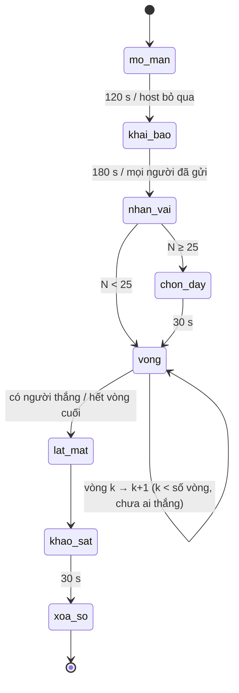
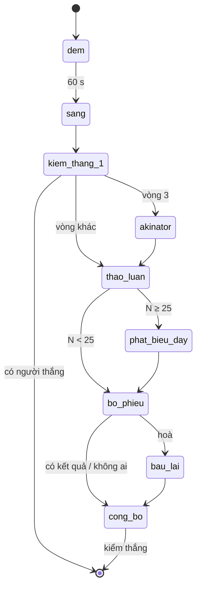

# Sĩ Số +1 — SRS

> Phiên bản: 0.1 (nháp) · Cập nhật: 26/10/2026 · Trạng thái: **chờ owner duyệt, chưa được duyệt để triển khai.**
> Requirement gốc: [PRD Sĩ Số +1](si-so-cong-1-prd.md). Hạ tầng dùng chung (phòng, vào phòng, đồng ý, 5 câu, chia vai, phiếu, nút
> host, tiêu huỷ, báo cáo, vào lại): [shared-room-platform-srs.md](shared-room-platform-srs.md) — tài liệu này **không nhắc lại** các yêu
> cầu đó, chỉ tham chiếu mã `RP-*` và story G01–G09. User story: G41–G47.

## 1. Phạm vi

Trong phạm vi: bối cảnh và chế độ (Lớp ma / Bật đèn), cảnh báo nội dung, mở màn N+1, chia vai và dãy bàn, pha đêm (việc giả, 3 ứng viên,
thì thầm, Thầy Pháp, Hồn chọn chữ), buổi sáng, ban ngày (dãy bàn, người nói, trục xuất), Hồn và bảng thư, Akinator bằng cây quyết định,
thắng thua, lật mặt và bản sao ghép, giải thích cơ chế, chuyển sang xoá sổ.

Ngoài phạm vi: mọi thứ của hạ tầng chung; AI (D7); giọng nói quanh phòng; cốt truyện nhiều tập; lây sang lớp khác; cầu nối The Moon (sau
MVP); thẻ chia sẻ.

## 2. Thuật ngữ riêng

| Từ | Nghĩa |
|---|---|
| N | Số người chơi có vai lúc chia vai (không tính khán giả) |
| Lượt bắt | Một lần Kẻ Bị Nhập chọn người cho con ma "đến tìm" trong một đêm |
| Ứng viên | Người được đưa vào danh sách 3 người cho một lượt bắt |
| Lời thì thầm | Bản ghi: đêm, Kẻ Bị Nhập, người bị chọn, câu trả lời được chọn (hợp đồng dữ liệu chung) |
| Bảng thư | Khu trên màn chiếu hiện các chữ cái Hồn đã gửi |
| Ngoài Hành Lang | Trạng thái của người bị trục xuất (bật đèn: Đi Công Tác) |
| Cây hỏi | Cây quyết định có/không dựng trên 5 câu trả lời cho vòng Akinator |

## 3. Yêu cầu chức năng

### 3.1. Bối cảnh, chế độ, mở màn (G41)

| ID | Yêu cầu |
|---|---|
| SS-FR-01 | Khi tạo phòng (RP-FR-02), host chọn bối cảnh `van_phong`, `lop_hoc` hoặc `nhom_ban`. Mặc định chế độ: `van_phong` → **Bật đèn** (D6); `lop_hoc`, `nhom_ban` → **Lớp ma**. |
| SS-FR-02 | Host đổi được chế độ trước khi bắt đầu. Đổi `van_phong` sang Lớp ma cần tick ô (không tick sẵn) "Mọi người trong phòng đã biết đây là bản rợn nhẹ và đồng ý chơi" (SS-D9). |
| SS-FR-03 | Chế độ Lớp ma: màn vào phòng (G02) thêm khối cảnh báo trước lời đồng ý: "Trò có yếu tố rợn nhẹ: chuyện ma học đường, chữ hiện dần, nhạc nền nhẹ. Không máu me, không doạ bằng tiếng động lớn. Bạn có thể chỉ xem." |
| SS-FR-04 | Chế độ được cố định khi bắt đầu; mọi chữ, tên vai và hiệu ứng lấy theo bảng chế độ (PRD §4.3). |
| SS-FR-05 | Số vòng mặc định 4, host chọn 4 hoặc 5 trước khi bắt đầu. Số người chơi tối thiểu 15 (SS-D1). |
| SS-FR-06 | Mở màn (120 s, host bỏ qua được): bộ đếm chạy từ `max(1, N−3)` tới N (mỗi số 0,8 s), dừng 1,5 s, rồi hiện N+1. Một ô tên mờ hiện thêm trong danh sách sảnh (hiệu ứng thị giác; trình đọc màn hình đọc "Một cái tên không đọc được"). Sau đó câu SS-M01 hiện từng chữ, rồi SS-M02. Bật đèn: "Bảng chấm công" và giao diện sáng. |
| SS-FR-07 | Mọi hiệu ứng mở màn qua kiểm nhấp nháy (RP-NFR-12), có bản tĩnh khi bật giảm chuyển động (RP-NFR-13), không âm thanh đột ngột lớn hơn nhạc nền. |

### 3.2. Chia vai, dãy bàn (G42)

| ID | Yêu cầu |
|---|---|
| SS-FR-10 | Khai báo dùng G03, 180 s. |
| SS-FR-11 | Chia vai một lần sau khai báo (G04): Kẻ Bị Nhập, Thầy Pháp theo PRD §5.2; còn lại là Người Sống. Không đổi vai giữa các vòng. |
| SS-FR-12 | Điều kiện: Kẻ Bị Nhập và Thầy Pháp không cần điều kiện dữ liệu. Người có < 2 câu trả lời khác `skip` vẫn là Người Sống nhưng không bao giờ là ứng viên (SS-FR-22). |
| SS-FR-13 | Kẻ Bị Nhập thấy biệt danh đồng bọn trên thẻ vai (SS-D7). |
| SS-FR-14 | Phòng ≥ 25 người chơi: sau khi nhận vai, mỗi người chọn dãy bàn trong các nhãn host đặt (mặc định "Dãy 1", "Dãy 2"[, "Dãy 3"] theo PRD §5.2) (RP-FR-33, kiểu b). Không chọn trong 30 s: máy chủ gán vào dãy ít người nhất. |

### 3.3. Pha đêm (G42)

| ID | Yêu cầu |
|---|---|
| SS-FR-20 | Đêm dài 60 s. Mọi điện thoại (người chơi, Hồn, Ngoài Hành Lang) hiện một màn đêm cùng bố cục; khán giả thấy "Đêm xuống" không có việc. |
| SS-FR-21 | Số lượt bắt của đêm = `min(bảng PRD §5.2, số Kẻ Bị Nhập còn lại, số người đủ điều kiện ứng viên)`. Người đủ điều kiện được chia cho các lượt, mỗi lượt tối đa 3, chia đều nhất có thể. Lượt bắt giao cho Kẻ Bị Nhập còn lại theo vòng xoay (ai chưa được giao lâu nhất được giao trước). |
| SS-FR-22 | Người đủ điều kiện ứng viên: Người Sống hoặc Thầy Pháp, chưa thành Hồn, chưa bị trục xuất, không vắng (RP-FR-92), có ≥ 2 câu trả lời khác `skip`. |
| SS-FR-23 | Mỗi lượt bắt nhận **3 ứng viên** (ít hơn nếu không đủ), các lượt trong cùng đêm không trùng ứng viên. Ứng viên bốc ngẫu nhiên, ưu tiên người có số lần được đưa vào danh sách ít nhất trong buổi. |
| SS-FR-24 | Kẻ Bị Nhập giữ lượt chọn một ứng viên rồi chọn một trong các câu trả lời khác `skip` của người đó (hiện nhãn câu + phương án) — phiếu `ss_night_capture`. Kết quả ghi thành một **lời thì thầm**. Hết giờ: máy chủ chọn ngẫu nhiên ứng viên và câu. |
| SS-FR-25 | Thầy Pháp còn trong cuộc (chưa là Hồn, chưa bị trục xuất) chọn một người chơi còn lại (không phải mình) để soi — phiếu `ss_seer_check`. Kết quả trả ở buổi sáng (SS-FR-33). |
| SS-FR-26 | Mỗi Hồn chọn một chữ cái chưa gửi trong biệt danh của Kẻ Bị Nhập mục tiêu (SS-FR-50) — phiếu `ss_ghost_letter` (chi tiết §3.6). |
| SS-FR-27 | Người không có việc thật (Người Sống, Kẻ Bị Nhập không giữ lượt, Ngoài Hành Lang, Thầy Pháp đã thành Hồn…) làm **việc giả**: chạm thắp 3 ngọn nến (Lớp ma) hoặc xếp 3 tập hồ sơ (Bật đèn). Việc giả chạy trên máy, gửi lệnh `ss.night_done` cùng cỡ với lệnh thật; máy chủ **không lưu** nội dung việc giả. |
| SS-FR-28 | Gói tin đêm của mọi vai cùng cỡ và cùng nhịp (RP-FR-35). Màn chiếu chỉ hiện SS-M03 và đồng hồ; không hiện "đã xong x/y". |

### 3.4. Buổi sáng (G43)

| ID | Yêu cầu |
|---|---|
| SS-FR-30 | Với mỗi lời thì thầm của đêm, theo thứ tự ngẫu nhiên: màn chiếu hiện **câu chi tiết** (PRD §6.2/§6.3, câu tương ứng câu được thì thầm, ưu tiên câu chưa dùng trong buổi), rồi **câu nối** từ một câu khác (không `skip`) của cùng người (ưu tiên trường chưa dùng trong các buổi sáng trước), rồi **câu kết**, chờ 3 s, rồi dòng biệt danh (SS-D3). Mỗi lời 15–20 s. |
| SS-FR-31 | Người bị bắt thành **Hồn** từ thời điểm dòng biệt danh hiện. Điện thoại người đó hiện thẻ Hồn (G45). |
| SS-FR-32 | Đêm không có lượt bắt nào: SS-M04. |
| SS-FR-33 | Thầy Pháp nhận riêng kết quả: "`{biet_danh}`: bị nhập" hoặc "`{biet_danh}`: không bị nhập". Mọi người khác nhận gói đệm cùng cỡ. |
| SS-FR-34 | Bảng thư cập nhật các chữ Hồn đã gửi trong đêm (SS-M09), mỗi Hồn một cột có biệt danh Hồn; không hiện độ dài biệt danh của Kẻ Bị Nhập. |
| SS-FR-35 | Kiểm thắng ngay sau buổi sáng (§3.8). |

### 3.5. Ban ngày (G44)

| ID | Yêu cầu |
|---|---|
| SS-FR-40 | Phòng < 25 người chơi: thảo luận 90 s (SS-M05), rồi bỏ phiếu. |
| SS-FR-41 | Phòng ≥ 25: thảo luận theo dãy 60 s; rồi mỗi dãy có 30 s cho một người nói. Người nói là người đầu tiên trong dãy bấm "Tôi nói cho dãy" trong lúc thảo luận; không ai bấm thì dãy đó được bỏ qua, không ai bị chỉ định. Màn chiếu hiện "Dãy 2 — `{biet_danh}` đang nói" và đồng hồ 30 s. |
| SS-FR-42 | Bỏ phiếu trục xuất (20 s) — phiếu `ss_day_vote`: người được bầu là người chơi còn trong cuộc (Người Sống, Kẻ Bị Nhập, Thầy Pháp chưa là Hồn, chưa bị trục xuất); lựa chọn là những người đó (kể cả mình) hoặc phiếu trắng. Hồn, Ngoài Hành Lang, khán giả không bầu. |
| SS-FR-43 | Người nhiều phiếu nhất bị trục xuất. Hoà: bầu lại 15 s giữa những người hoà (`ss_day_revote`); vẫn hoà hoặc mọi phiếu trắng: không ai bị trục xuất (SS-M08). |
| SS-FR-44 | Công bố (15 s): SS-M06 hoặc SS-M07 với vai thật của người bị trục xuất (tên vai theo chế độ). Người đó thành Ngoài Hành Lang. |
| SS-FR-45 | Ngoài Hành Lang có phiếu đoán không tính `ss_hallway_guess` mỗi ngày (chọn một người còn trong cuộc); màn chiếu hiện một dòng nhỏ "Hành lang đoán: `{biet_danh}` (x phiếu)" sau khi phiếu trục xuất đã đóng. |
| SS-FR-46 | Kiểm thắng ngay sau công bố (§3.8). |

### 3.6. Hồn và bảng thư (G45)

| ID | Yêu cầu |
|---|---|
| SS-FR-50 | Khi thành Hồn, máy chủ gán cho Hồn một **mục tiêu**: một Kẻ Bị Nhập còn trong cuộc, bốc ngẫu nhiên (không dựa vào ai đã chọn Hồn — SS-D4). Thẻ Hồn hiện: "Bạn đã thành Hồn. Con ma để lộ một cái tên: `{biet_danh_muc_tieu}` là Kẻ Bị Nhập. Mỗi đêm, gửi một chữ cái trong tên đó cho cả lớp. Hồn chỉ nói bằng chữ." (Bật đèn: "Bạn đang đi họp. Em nhân viên mới lỡ nói: `{…}` là Người Được Nhờ…"). |
| SS-FR-51 | Chữ cái lấy từ biệt danh của Kẻ Bị Nhập sau khi bỏ dấu, viết hoa, chỉ giữ A–Z và 0–9. Hồn chọn một chữ chưa gửi (chữ lặp tính riêng từng vị trí); thứ tự hiện trên điện thoại Hồn được xáo trộn. Hết giờ: máy chủ chọn ngẫu nhiên một chữ chưa gửi. |
| SS-FR-52 | Kẻ Bị Nhập mục tiêu của Hồn bị trục xuất hoặc rời phòng: Hồn nhận mục tiêu mới là một Kẻ Bị Nhập còn lại (ngẫu nhiên) từ đêm sau; thẻ Hồn cập nhật. Không còn Kẻ Bị Nhập nào: Hồn làm việc giả. |
| SS-FR-53 | Hồn gửi hết chữ của mục tiêu: các đêm sau làm việc giả. |
| SS-FR-54 | Hồn không bỏ phiếu trục xuất; vẫn trả lời Akinator và xem màn lật; báo cáo, rời phòng như mọi người (G08). |

### 3.7. Akinator (G46)

| ID | Yêu cầu |
|---|---|
| SS-FR-60 | Chạy ở vòng 3, sau buổi sáng và trước ban ngày. Nếu ván kết thúc trước vòng 3, Akinator chạy ở đầu màn lật. |
| SS-FR-61 | Màn chiếu: SS-M10 và hướng dẫn "Cả phòng thống nhất miệng một người đang chơi. Đừng nói tên ra cho điện thoại biết." (30 s). |
| SS-FR-62 | Ứng viên của cây hỏi: mọi người chơi có vai, còn trong phòng (kể cả Hồn, Ngoài Hành Lang), trừ người đã bấm "Bỏ qua tôi". |
| SS-FR-63 | Nút "Bỏ qua tôi" có trên mọi điện thoại người chơi trong 30 s đầu. Có người bấm: màn chiếu hiện "Người được chọn muốn bỏ qua. Hãy chọn người khác." và chờ thêm 15 s; người đó bị loại khỏi ứng viên của lần Akinator này. |
| SS-FR-64 | Mỗi câu hỏi 10 s; mọi điện thoại trong phòng (người chơi, Hồn, Ngoài Hành Lang, khán giả — SS-D5) trả lời `Có` / `Không` / `Không biết` — phiếu `ss_akinator_answer`. Đáp án = đa số; hoà = `Không biết`. |
| SS-FR-65 | Chọn câu hỏi theo §6. Tối đa 7 câu. Dừng khi còn ≤ 1 ứng viên, hoặc hết 7 câu, hoặc không câu nào còn chia được. |
| SS-FR-66 | Kết quả: 1 người → SS-M11; 2–3 người → SS-M12; 0 hoặc > 3 người → SS-M13. Màn chiếu có thể hiện "Còn `x` người khớp" sau mỗi câu. |

### 3.8. Thắng thua

| ID | Yêu cầu |
|---|---|
| SS-FR-70 | Người Sống thắng ngay khi số Kẻ Bị Nhập còn trong cuộc = 0. |
| SS-FR-71 | Con ma thắng ngay khi số Hồn ≥ ⌈N / 2⌉, hoặc khi số Kẻ Bị Nhập còn trong cuộc ≥ số Người Sống + Thầy Pháp còn trong cuộc. |
| SS-FR-72 | Hết vòng cuối (sau công bố ngày cuối): Người Sống thắng nếu số Kẻ Bị Nhập đã bị trục xuất ≥ ⌈số Kẻ Bị Nhập ban đầu / 2⌉; nếu không, con ma thắng. |
| SS-FR-73 | Kẻ Bị Nhập rời phòng được tính như "không còn trong cuộc" nhưng không tính là "bị trục xuất" ở SS-FR-72. |

### 3.9. Lật mặt và kết thúc (G47)

| ID | Yêu cầu |
|---|---|
| SS-FR-80 | Màn lật (180–240 s) theo thứ tự: (0) 10 s đầu, điện thoại mỗi Kẻ Bị Nhập hiện công tắc "Hiện tên tôi ở lời thì thầm" (mặc định tắt — SS-D10); (1) câu thắng (SS-M17/SS-M18); (2) từng lời thì thầm theo thứ tự đêm: SS-M14 ("một Kẻ Bị Nhập") với cụm của câu được thì thầm, hoặc SS-M14b với biệt danh nếu chính Kẻ Bị Nhập đó đã bật công tắc; (3) **giải thích cơ chế SS-M15** — bắt buộc, đứng yên ≥ 15 s, đồng thời hiện trên mọi điện thoại; (4) bản sao ghép (SS-FR-81); (5) SS-M16; (6) danh sách vai: Kẻ Bị Nhập, Thầy Pháp; (7) lá The Moon (hình tĩnh). |
| SS-FR-81 | **Bản sao ghép:** với mỗi câu trong 5 câu, lấy phương án được nhiều người chơi chọn nhất (không tính `skip`), hiện "`{cụm}`: `{số}` người". Chỉ hiện khi số đó ≥ 3 (RP-PRV-10, DPIA KS-04); nếu không, hiện "mỗi người một kiểu". Hoà: hiện phương án đứng trước trong danh sách. Không hiện biệt danh, không hiện ai chọn gì. |
| SS-FR-82 | Câu khảo sát (G08): "Có lúc nào bạn thấy bị nhắm vào hoặc sợ thật không?" — `Không` · `Có` · `Không muốn trả lời`; chỉ lưu số đếm. |
| SS-FR-83 | Xoá sổ điểm danh (G07) với SS-M19. |
| SS-FR-84 | Host kết thúc sớm (G06) ở bất kỳ pha nào sau mở màn: màn tiêu huỷ thêm câu SS-M15 trước dấu đóng, để không buổi nào kết thúc mà không giải thích cơ chế. |

### 3.10. Rời phòng, vắng, kick theo vai

| Vai | Xử lý |
|---|---|
| Kẻ Bị Nhập giữ lượt bắt, vắng trong đêm | Máy chủ chọn ngẫu nhiên (SS-FR-24) |
| Kẻ Bị Nhập rời/bị kick | Không còn trong cuộc (SS-FR-73); lời thì thầm cũ giữ ẩn danh "Người đã rời"; Hồn đổi mục tiêu (SS-FR-52) |
| Thầy Pháp rời | Không soi nữa |
| Ứng viên rời trước khi bị chọn | Bị loại khỏi danh sách; lượt bắt chọn trong số còn lại |
| Người bị bắt rời trước buổi sáng | Lời buổi sáng vẫn hiện (chi tiết là của vai, đã đồng ý), dòng biệt danh thành "Người đã rời"; không thành Hồn |
| Hồn rời | Cột thư của Hồn giữ các chữ đã gửi, tên cột thành "Người đã rời" |

## 4. Trạng thái

### 4.1. Cả buổi

### 4.2. Một vòng

## 5. Đồng hồ (mặc định; host +30 s tối đa 3 lần mỗi pha — RP-FR-56)

| Pha | Mặc định | Ghi chú |
|---|---|---|
| Mở màn | 120 s | Host bỏ qua được |
| Khai báo | 180 s | Đóng sớm khi đủ |
| Nhận vai | 20 s | |
| Chọn dãy | 30 s | Chỉ N ≥ 25 |
| Đêm | 60 s | Không đóng sớm (để không lộ ai đã xong) |
| Sáng | 10 s + 18 s × số lượt bắt | 40–75 s |
| Akinator | ≤ 120 s | 30 s chọn người + tối đa 7 × 10 s + kết quả |
| Thảo luận | 90 s (N < 25) · 60 s theo dãy (N ≥ 25) | |
| Người nói của dãy | 30 s × số dãy có người nói | |
| Bỏ phiếu / bầu lại | 20 s / 15 s | |
| Công bố | 15 s | |
| Lật mặt | 180–240 s | Câu giải thích ≥ 15 s |
| Khảo sát | 30 s | |

Ước lượng 4 vòng: N < 25 ≈ 2 + 3 + 4 × (1 + 0,5 + 2,1) + 2 + 3,5 ≈ 25 phút; N 40–50 ≈ 30 phút.

## 6. Cây hỏi Akinator

1. **Kho câu hỏi** (nháp, chờ owner duyệt văn phong): mỗi câu hỏi là một tập phương án của một trong 5 câu, kèm câu hỏi tự nhiên. Gồm
   mọi câu hỏi một phương án ("Người đó đang ngồi gần cửa sổ?") và các nhóm:
   - Bữa sáng: "Người đó ăn bánh mì sáng nay?" {bánh mì trứng, bánh mì thịt} · "…ăn món nước?" {phở hoặc bún, cháo} · "…ăn xôi hoặc
     cơm tấm?" · "…chưa ăn gì?".
   - Loại nhạc: "Bài người đó nghe gần nhất là nhạc Việt?" {nhạc Việt pop, ballad, bolero} · "…nhạc nước ngoài?" {K-pop, Âu Mỹ} · "…nhạc
     sôi động?" {rap, EDM} · "…nhạc không lời hoặc nhạc phim?".
   - Màu áo: "Người đó mặc áo màu tối?" {đen, xám} · "…áo màu xanh?" {xanh dương, xanh lá} · "…áo màu rực?" {đỏ, hồng, vàng} · "…áo
     trắng?".
   - Món trong túi: "Trong túi người đó có đồ điện tử?" {sạc dự phòng, tai nghe} · "…đồ để viết?" {bút, sổ tay} · "…đồ ăn uống?" {kẹo,
     bình nước}.
2. **Chọn câu kế tiếp:** với tập ứng viên C, mỗi câu hỏi chưa hỏi q chia C thành `có` (phương án thuộc q), `không` (phương án không thuộc
   q), `chưa biết` (câu đó là `skip`). Chọn q làm nhỏ nhất `max(|có| + |chưa biết|, |không| + |chưa biết|)`; hoà thì chọn ngẫu nhiên. Bỏ q
   nếu nó không làm C nhỏ đi ở cả hai nhánh.
3. **Lọc:** đáp án `Có` giữ `có ∪ chưa biết`; `Không` giữ `không ∪ chưa biết`; `Không biết` không lọc và bỏ mọi câu hỏi cùng trường khỏi
   lượt này.
4. **An toàn:** cây chỉ dùng 5 câu đã đồng ý; không dùng vai, phiếu hay lời thì thầm. Câu hỏi không bao giờ nhắc tên người.

## 7. Mô hình dữ liệu (theo hợp đồng dữ liệu chung — không thêm trường)

Dùng nguyên các thực thể ở hạ tầng §6.1. Phần riêng của Sĩ Số +1:

| Dữ liệu | Thuộc thực thể chung | Chi tiết |
|---|---|---|
| Vai | Vai | `nguoi_song`, `ke_bi_nhap`, `thay_phap`; trạng thái trong cuộc: `con`, `hon`, `hanh_lang` |
| Dãy bàn | Vai (nhóm) | Nhãn host đặt (N ≥ 25) |
| Lời thì thầm | Riêng theo trò (hợp đồng chung) | Đêm, slot Kẻ Bị Nhập, slot người bị chọn, mã câu được chọn |
| Mục tiêu của Hồn | Vai (thuộc bản ghi vai của Hồn) | Slot Kẻ Bị Nhập được gán ngẫu nhiên; không thêm thực thể mới |
| Công tắc "Hiện tên tôi" lúc lật | Phòng (trạng thái tạm) | Chỉ sống trong màn lật |
| Phiếu | Phiếu (`ballot_type`) | `ss_night_capture`, `ss_seer_check`, `ss_ghost_letter`, `ss_day_vote`, `ss_day_revote`, `ss_hallway_guess`, `ss_akinator_answer` |
| Số lần được đưa vào danh sách ứng viên | Phòng (trạng thái) | Bộ đếm trong buổi để ưu tiên người ít được đưa vào |
| Việc giả ban đêm | Không lưu | Lệnh `ss.night_done` bị bỏ sau khi xác nhận |
| "Bỏ qua tôi" ở Akinator | Phòng (trạng thái tạm) | Xoá khi lượt Akinator kết thúc |
| Bản sao ghép | Tính lúc lật | Chỉ số đếm theo phương án; không lưu sau buổi |
| Câu khảo sát | Số đếm tổng hợp | |

Mọi dữ liệu trên xoá khi kết thúc (RP-FR-60).

## 8. Sự kiện thời gian thực riêng (bổ sung hạ tầng §5.3)

| Sự kiện | Kênh | Nội dung |
|---|---|---|
| `ss.cold_open` | display, audience | N, N+1, chế độ |
| `ss.night` | player (mỗi người, cùng cỡ) | Việc thật (ứng viên + câu, soi, chọn chữ) hoặc việc giả |
| `ss.morning` | tất cả | Lời buổi sáng đã ghép, mã câu, biệt danh người bị bắt, bảng thư |
| `ss.seer_result` | player (Thầy Pháp; người khác nhận đệm cùng cỡ) | Kết quả soi |
| `ss.ghost_card` | player (Hồn) | Mục tiêu, chữ còn lại |
| `ss.day` | tất cả | Pha, dãy, người nói |
| `ss.expelled` | tất cả | Biệt danh + vai |
| `ss.akinator` | tất cả | Câu hỏi, số còn khớp, kết quả |
| `ss.reveal` | tất cả | Lời thì thầm + Kẻ Bị Nhập, câu giải thích, bản sao ghép, vai |

## 9. Bảo mật

| ID | Yêu cầu |
|---|---|
| SS-SEC-01 | Vai, đồng bọn, ứng viên, lời thì thầm, kết quả soi, mục tiêu Hồn chỉ ở kênh của người giữ vai cho tới màn lật (RP-FR-31, RP-SEC-07). |
| SS-SEC-02 | Pha đêm: mọi gói xuống và lệnh lên cùng cỡ, cùng nhịp; đêm không đóng sớm (SS-FR-28, §5). |
| SS-SEC-03 | Lệnh `ss_*` từ người không giữ quyền tương ứng trả `not_allowed` giống phiếu không tồn tại. |
| SS-SEC-04 | Kẻ Bị Nhập chỉ thấy câu trả lời của 3 ứng viên của mình trong 60 s đêm đó, không thấy câu trả lời của người khác. Câu `skip` không bao giờ được gửi xuống. |
| SS-SEC-05 | "Bỏ qua tôi" không làm lộ người được chọn trên màn chiếu (chỉ câu chung); máy chủ không dùng thông tin này ngoài việc loại khỏi ứng viên. |

## 10. Quyền riêng tư

| ID | Yêu cầu |
|---|---|
| SS-PRV-01 | Chỉ người có `consent_display = true` nhận vai và có câu trả lời được dùng (khán giả không bao giờ). |
| SS-PRV-02 | Con ma chỉ nói câu trả lời đã đồng ý, không suy ra điều mới, không dùng `skip`. |
| SS-PRV-03 | Bản sao ghép là số đếm, chỉ phương án có ≥ 3 người (RP-PRV-10). |
| SS-PRV-04 | Không ai biết "Kẻ Bị Nhập nào đã chọn ai": Hồn nhận mục tiêu ngẫu nhiên (SS-FR-50); màn lật chỉ nêu biệt danh ở lời thì thầm khi chính Kẻ Bị Nhập đó tự bật (SS-FR-80, SS-D10). Danh sách vai cuối nêu ai là Kẻ Bị Nhập (tiết lộ vai như mọi trò ẩn vai). |
| SS-PRV-05 | Không thông báo đẩy, email, tin nhắn hay link "tập sau" nào, trong hay sau buổi (RP §1; chỉ Hết Cứu % có thông báo tự bật); không thẻ chia sẻ ở MVP. |
| SS-PRV-06 | Không ngày sinh, không chú thích chiêm tinh cá nhân; lá The Moon là hình tĩnh. |
| SS-PRV-07 | Kho câu không chạm nhóm chủ đề cấm (brief chung, PRD §6); biên bản rà là điều kiện phát hành. |

## 11. Phi chức năng riêng

- Lời buổi sáng trên màn chiếu: chữ ≥ 56 px, hiện từng câu, mỗi câu đứng yên theo RP-NFR-17.
- Chế độ Lớp ma dùng nền tối nhưng tương phản chữ ≥ 7:1; không chữ đỏ trên nền đen làm chữ chính.
- Hiệu ứng "chữ nhiễu" là thay đổi độ mờ/vị trí chậm, không chớp; có bản tĩnh.
- Không âm thanh nào vượt mức nhạc nền đã đặt; không âm thanh bất ngờ.

## 12. Móc kiểm thử

| ID | Móc |
|---|---|
| SS-TH-01 | Hạt giống cố định cho chia vai, ứng viên, chọn câu thoại, cây hỏi (RP-TH-01) |
| SS-TH-02 | Giả lập 15, 24, 25, 39, 40, 50 người chơi; kiểm số Kẻ Bị Nhập, số lượt bắt, số dãy theo PRD §5.2 |
| SS-TH-03 | Giả lập 1.000 buổi: không ai bị bắt hai lần; độ lệch số lần làm ứng viên giữa người đủ điều kiện ≤ 1 trong mỗi buổi khi có thể |
| SS-TH-04 | Kiểm câu thoại: mọi câu chỉ dùng slot cho phép; quét từ cấm (chết, máu, giết, tự tử, nguyền, nghi lễ tôn giáo, các nhóm chủ đề cấm) |
| SS-TH-05 | Kiểm cây hỏi: với bộ câu trả lời giả lập, khi đáp án đúng theo một người X, cây kết thúc ở tập chứa X trong ≤ 7 câu với tỉ lệ ≥ 80% (phòng 30 người, ≤ 20% `skip`) |
| SS-TH-06 | Kiểm payload đêm: mọi gói `ss.night` và lệnh lên cùng cỡ |
| SS-TH-07 | Kiểm bản sao ghép: không phương án có < 3 người nào hiện số |
| SS-TH-09 | Kiểm "ai chọn ai": mục tiêu của Hồn độc lập với lời thì thầm (1.000 buổi giả lập, tỉ lệ trùng xấp xỉ 1/số Kẻ Bị Nhập còn lại); màn lật không có biệt danh ở lời thì thầm khi công tắc tắt |
| SS-TH-08 | Kiểm kết thúc sớm: host kết thúc ở mỗi pha → màn tiêu huỷ có câu SS-M15 |

## 13. Truy vết

| Yêu cầu | Nguồn |
|---|---|
| N+1, vai, 3 ứng viên, không ai bị chọn hai lần, lời buổi sáng, dãy bàn, Akinator, Hồn gửi chữ, bản sao ghép số đếm, bật đèn, thắng thua | Báo cáo, mục Sĩ Số +1 |
| Luôn giải thích cơ chế; không tin nhắn dây chuyền | Báo cáo, lằn ranh; research note risks §1 (Momo) |
| Đêm ngắn, nhóm song song | Research note §1, §5 (BotC chậm khi đông; Werewolf nhiều làng) |
| Số lượt bắt mỗi đêm, luật hết vòng, Ngoài Hành Lang, "Bỏ qua tôi" ở Akinator, Hồn nhận mục tiêu ngẫu nhiên | Đề xuất mới của tài liệu này (chờ owner) |
| Ngưỡng 3 cho số đếm; màn lật mặc định không nêu ai đã thì thầm | DPIA KS-04, DP-1 (chờ owner) |

## 14. Quyết định mở

Xem PRD §11 (D6, D7, SS-D1–SS-D9).

## 15. Bàn giao theo AGENTS.md

**Nguồn đã kiểm tra:** như PRD §13; SRS hạ tầng phòng.

**Phát hiện đã xử lý:** việc giả không lưu (tối thiểu hoá); lời thì thầm và mục tiêu Hồn không thêm thực thể ngoài hợp đồng; theo DPIA (KS-04, DP-1): ngưỡng 3 cho bản sao ghép, màn lật mặc định không nêu ai đã thì thầm, Hồn nhận mục tiêu ngẫu nhiên thay vì biết ai đã chọn mình; đêm không đóng
sớm để không lộ ai đã xong; câu `skip` không bao giờ gửi xuống điện thoại Kẻ Bị Nhập; host kết thúc sớm vẫn có câu giải thích cơ chế;
người được nghĩ tới ở Akinator có quyền bỏ qua.

**Rủi ro chưa giải quyết:** SS-D2 cân bằng; cây hỏi có thể không đủ phân biệt ở phòng 50 người nhiều câu trả lời giống nhau (SS-TH-05 đo);
Nghị định 147/2024 về nội dung mê tín; Hồn tự nói tên.

**AC/DoD chưa hoàn tất:** toàn bộ.
