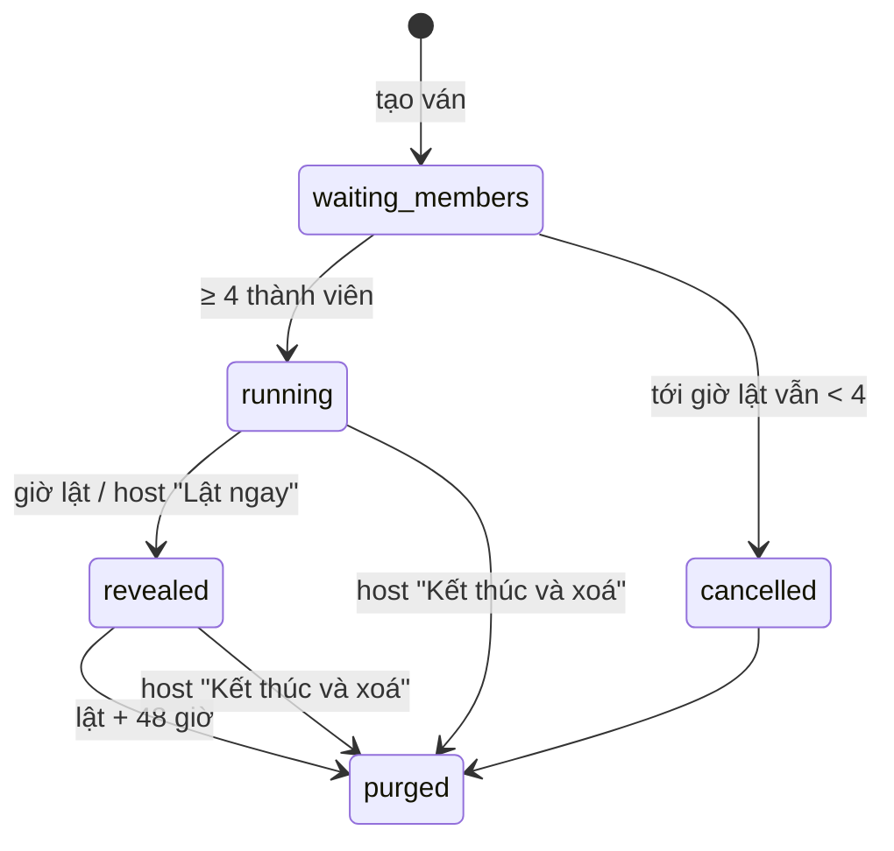

# Tam Sao Thất Bản — SRS

> Phiên bản: 0.1 (nháp) · Cập nhật: 26/10/2026 · Trạng thái: **chờ owner duyệt**, chưa dựng (giai đoạn 3 của
> `docs/plans/2026-10-23-privacy-content-game-plan.md`). Mã nội bộ: Mercury Relay.
> PRD: [tam-sao-that-ban-prd.md](tam-sao-that-ban-prd.md). User story: G20–G25 trong `docs/user-stories/game/`.
> **Bản phòng trực tiếp** chạy trên hạ tầng phòng chung [`shared-room-platform-srs.md`](shared-room-platform-srs.md) (RP-*): tạo phòng, màn chiếu,
> vào phòng, phiên, phiếu, nút host, tiêu huỷ hồ sơ, báo cáo, rời phòng, mất kết nối. SRS này chỉ thêm phần riêng của Tam Sao và không định nghĩa lại RP-*.
> **Bản nhóm chat** không dùng phòng trực tiếp; SRS này định nghĩa đủ cho bản đó. Bản chat chỉ dựng nếu owner chốt D4 sau playtest.
> DPIA: `docs/legal/2026-10-26-game-line-dpia.md` §5.4, KS-18. Nếu SRS lệch hợp đồng dữ liệu chung, hợp đồng chung thắng.

---

## 1. Thuật ngữ

| Từ | Nghĩa |
|---|---|
| Ván | Một lần chơi: một phòng trực tiếp, hoặc một ván nhóm chat |
| Chuỗi | Đường đi của một thông điệp gốc qua 5 bước |
| Bước (hop) | Một lựa chọn trong chuỗi: 1 Gieo, 2 Diễn đạt, 3 Bắt mood, 4 Nói lại, 5 Đoán gốc |
| Bàn | Nhóm 4–6 người trong phòng > 12 người; chuỗi xoay trong bàn |
| Bot Sao Thủy | Bộ chọn ngẫu nhiên có nhãn, điền bước khi hết giờ hoặc không có người; **không phải AI** |
| Độ thất bản | Điểm 0–4 của một chuỗi (PRD §4.3) |
| Nhận lượt (claim) | Bản chat: một thành viên giữ một bước đang chờ trong 10 phút |
| Thẻ lật | Ảnh dọc tóm tắt một chuỗi, tạo trên máy người dùng |
| Ngân hàng đề | Nội dung đóng gói có phiên bản: thông điệp gốc, giọng, phương án, mood, câu nói lại, phương án nhiễu, chú thích |

Giờ hiển thị theo `Asia/Ho_Chi_Minh`; máy chủ lưu UTC. Đồng hồ bước do máy chủ quyết.

## 2. Kiến trúc tóm tắt

- **Phòng trực tiếp:** kho trạng thái tạm thời của hạ tầng phòng (bộ nhớ máy chủ Hetzner, không backup, RP-D3 chờ owner/operator), kênh thời gian thực của RP.
  Module trò `tamsao_live` xử lý xoay vòng, đồng hồ bước, ghép phương án, Bot, tính độ thất bản.
- **Nhóm chat:** module `tamsao_async` trong modular monolith, lưu ở Supabase (Frankfurt). Worker: hết hạn giữ lượt, hết hạn bước (Bot), lật đúng giờ, xoá sau 48 giờ.
- **Ngân hàng đề:** gói JSON có phiên bản, đóng gói cùng bản phát hành; client nhận đúng các phương án của bước mình, không nhận cả ngân hàng hay cả chuỗi.
- Không SDK bên thứ ba, không AI, không thông báo đẩy.

## 3. Yêu cầu chức năng

### 3.1. Phòng trực tiếp — G20

| ID | Yêu cầu |
|---|---|
| TS-FR-01 | Host tạo phòng Tam Sao theo RP-FR-01–09; cấu hình riêng: gói giọng (mặc định cả 5), "đọc to" bật/tắt (mặc định tắt, TS-D5), nhịp `thường` / `chậm` (chậm = gấp đôi thời lượng mỗi bước). Tối thiểu 4, tối đa 30 người chơi |
| TS-FR-02 | Vào phòng theo RP-FR-10–18 với bản đồng ý rút gọn cho trò không khai báo (ô 18+) **cộng** hai ô riêng của Tam Sao, đều không tick sẵn và không bắt buộc để chơi: "Hiện biệt danh của tôi ở từng bước khi phát lại" (`show_name_on_screen`) và "Cho biệt danh của tôi nằm trên thẻ lật để chia sẻ ra ngoài" (`show_name_on_card`). Chữ ở §8.2 |
| TS-FR-03 | Phòng > 12 người chia bàn 4–6 người theo RP-FR-33(b): người chơi tự chọn bàn trong sảnh; khi host bấm bắt đầu, máy chủ cân lại để mọi bàn có 4–6 người (chuyển ít người nhất, người tự chọn trước được giữ trước). Phòng ≤ 12 là một bàn |
| TS-FR-04 | Bước 1: mỗi người nhận 3 thông điệp gốc khác ý định, rút ngẫu nhiên an toàn từ ngân hàng, không trùng ý định với người khác cùng bàn khi ngân hàng đủ. Chọn 1 trong 10 giây (nhịp thường) |
| TS-FR-05 | Xoay vòng: bàn có N người (4–6) lúc bắt đầu, đánh số 0…N−1 theo thứ tự trong bàn; chuỗi j do người j gieo. Bước s (1–5) của chuỗi j do người (j + o(s)) mod N làm. Độ lệch o: N = 5 hoặc 6 → 0, 1, 2, 3, 4; **N = 4 → 0, 1, 2, Bot, 3**, tức bước 4 do Bot Sao Thủy điền cho mọi chuỗi (có nhãn) và bước 5 do người (j + 3) mod 4 làm (TS-D3). Nói cách khác, ở bước s người i làm chuỗi (i − o(s)) mod N. **Bất biến:** không ai làm hai bước của cùng một chuỗi; người gieo không bao giờ làm bước 5 (đoán gốc). Bảng phân công ở §3.1.1. Người rời giữa ván không làm đổi bảng: bước còn lại của họ do Bot điền (TS-FR-13) |
| TS-FR-06 | Bước 2: người chơi chỉ nhận chip ý định + sắc thái của chuỗi và một giọng V được giao ngẫu nhiên; chọn 1 trong 4 phương án (TS-FR-42). 20 giây |
| TS-FR-07 | Bước 3: chỉ nhận câu bước 2; chọn mood (8) và độ mạnh (1–3). 15 giây. Nếu "đọc to" bật: màn bước 2 của người trước hiện thêm nút "Đọc to câu này" (chỉ nhắc, không ghi âm, không dùng micro); người chơi bỏ qua được |
| TS-FR-08 | Bước 4: chỉ nhận mood + độ mạnh; giọng V' ≠ V; chọn 1 trong 4 câu (TS-FR-43). 20 giây |
| TS-FR-09 | Bước 5: chỉ nhận câu bước 4; chọn câu gốc trong 4 phương án (TS-FR-44). 15 giây |
| TS-FR-10 | Hết giờ, mất kết nối quá thời gian bước, hoặc người đã rời: Bot chọn ngẫu nhiên đều một phương án đang hiện cho bước đó; bước ghi `bot_filled = true` |
| TS-FR-11 | Thêm 30 giây (RP-FR-56) và tạm dừng (RP-FR-55) áp cho cả vòng của bàn. Vòng kết thúc sớm khi mọi người trong bàn đã chọn |
| TS-FR-12 | Người vào sau khi bắt đầu, và người bấm "Chỉ xem", là khán giả (RP-FR-16, RP-FR-83): không làm bước, bỏ phiếu khán giả ở màn lật |
| TS-FR-13 | Người chơi rời hoặc bị kick giữa ván: các bước còn lại của họ do Bot điền; bước đã làm giữ dưới nhãn "Người đã rời" (RP-FR-81/82) |
| TS-FR-14 | Điện thoại chỉ nhận dữ liệu của bước mình đang làm. Không API nào trả chuỗi khác hoặc các bước trước bước liền kề trước khi lật |

#### 3.1.1. Bảng phân công theo TS-FR-05

Ký hiệu: P1…PN là người trong bàn (P1 = người số 0); Cj là chuỗi do Pj gieo. Mỗi ô ghi chuỗi người đó làm ở bước đó. Bảng được kiểm bằng script (26/10/2026) theo ba điều: không ai làm hai bước của một chuỗi; người gieo không làm bước 5; ở mỗi bước có người, mỗi người làm đúng một chuỗi.

**N = 4** (bước 4 là Bot cho mọi chuỗi)

| Người | B1 Gieo | B2 Diễn đạt | B3 Bắt mood | B4 Nói lại | B5 Đoán gốc |
|---|---|---|---|---|---|
| P1 | C1 | C4 | C3 | Bot | C2 |
| P2 | C2 | C1 | C4 | Bot | C3 |
| P3 | C3 | C2 | C1 | Bot | C4 |
| P4 | C4 | C3 | C2 | Bot | C1 |

Theo chuỗi: C1 = P1 → P2 → P3 → Bot → P4; C2 = P2 → P3 → P4 → Bot → P1; C3 = P3 → P4 → P1 → Bot → P2; C4 = P4 → P1 → P2 → Bot → P3.

**N = 5**

| Người | B1 Gieo | B2 Diễn đạt | B3 Bắt mood | B4 Nói lại | B5 Đoán gốc |
|---|---|---|---|---|---|
| P1 | C1 | C5 | C4 | C3 | C2 |
| P2 | C2 | C1 | C5 | C4 | C3 |
| P3 | C3 | C2 | C1 | C5 | C4 |
| P4 | C4 | C3 | C2 | C1 | C5 |
| P5 | C5 | C4 | C3 | C2 | C1 |

Theo chuỗi: Cj = Pj → Pj+1 → Pj+2 → Pj+3 → Pj+4 (đếm vòng trong 5 người). Ví dụ C1 = P1 → P2 → P3 → P4 → P5.

**N = 6**

| Người | B1 Gieo | B2 Diễn đạt | B3 Bắt mood | B4 Nói lại | B5 Đoán gốc |
|---|---|---|---|---|---|
| P1 | C1 | C6 | C5 | C4 | C3 |
| P2 | C2 | C1 | C6 | C5 | C4 |
| P3 | C3 | C2 | C1 | C6 | C5 |
| P4 | C4 | C3 | C2 | C1 | C6 |
| P5 | C5 | C4 | C3 | C2 | C1 |
| P6 | C6 | C5 | C4 | C3 | C2 |

Theo chuỗi: Cj = Pj → Pj+1 → … → Pj+4 (đếm vòng trong 6 người); người Pj+5 không chạm vào chuỗi Cj. Ví dụ C1 = P1 → P2 → P3 → P4 → P5.

### 3.2. Nhóm chat không đồng bộ — G21 (chỉ khi D4 đạt)

| ID | Yêu cầu |
|---|---|
| TS-FR-15 | Host tạo ván không cần tài khoản: biệt danh, 18+, đồng ý C-TS-01 (host), chọn số chuỗi 3 hoặc 4, giờ lật (2–48 giờ sau lúc tạo; mặc định 21:00 gần nhất cách ≥ 6 giờ). Cấp `host_session` gắn thiết bị (cookie HttpOnly, băm ở máy chủ) |
| TS-FR-16 | Link ván: token 256 bit trong fragment `https://<origin>/t#<token>`; chỉ lưu băm HMAC; trang đọc fragment, xoá khỏi thanh địa chỉ, gửi token trong body POST |
| TS-FR-17 | Vào ván: biệt danh (bộ lọc RP-FR-13), 18+, đồng ý C-TS-02 và hai ô biệt danh (như TS-FR-02). Tối đa 8 thành viên; ván đủ 8 trả phản hồi chung |
| TS-FR-18 | Ván bắt đầu khi có ≥ 4 thành viên; trước đó trang hiện "Cần thêm {k} người". Nếu tới giờ lật vẫn < 4 thành viên, ván huỷ, dữ liệu xoá ngay, trang hiện "Ván chưa đủ người nên đã huỷ" |
| TS-FR-19 | Hàng chờ: mỗi chuỗi có đúng một bước "sẵn sàng" tại một thời điểm. Thành viên mở trang thấy "Nhận một lượt"; máy chủ giao bước sẵn sàng lâu nhất mà thành viên đó đủ điều kiện (chưa làm bước nào trong chuỗi đó) |
| TS-FR-20 | Bước 1 của mỗi chuỗi cũng là lượt nhận được. Một thành viên gieo tối đa một chuỗi |
| TS-FR-21 | Giữ lượt 10 phút; hết 10 phút chưa nộp thì lượt trả về hàng chờ. Được gia hạn một lần thêm 10 phút |
| TS-FR-22 | Hạn chót bước: 3 giờ từ khi bước sẵn sàng (TS-D4). Quá hạn → Bot điền. Không còn thành viên nào đủ điều kiện cho bước đó → Bot điền ngay |
| TS-FR-23 | Giữ người cho bước đoán gốc: khi bước 4 của một chuỗi sẵn sàng mà chỉ còn **đúng một** thành viên đủ điều kiện, máy chủ không giao bước 4 cho người đó; Bot điền bước 4 ngay và người đó được giữ cho bước 5. Nhờ vậy bước 5 luôn do một người chưa chạm vào chuỗi làm, không bao giờ là người gieo. Nhóm 4 thành viên luôn rơi vào trường hợp này (TS-D3, cùng bất biến với TS-FR-05) |
| TS-FR-24 | Giờ lật: mọi bước còn thiếu do Bot điền, rồi lật. Nếu mọi chuỗi xong trước giờ lật, host được bấm "Lật ngay" |
| TS-FR-25 | Chuỗi "hoàn tất" khi có ≥ 4 bước do người làm (tính cả bước 1). Chỉ dùng cho chỉ số và nhãn "Sao Thủy gánh" khi < 4 |
| TS-FR-26 | Câu nhắc: với mỗi bước đang chờ quá 1 giờ, host thấy "Sao chép câu nhắc" một lần duy nhất cho bước đó. Câu cố định: "Tam Sao Thất Bản còn lượt đang chờ. Ai rảnh vào nhận nhé, kết quả lúc {giờ lật}." Không chứa biệt danh, không chứa link (host tự dán link nếu muốn) |
| TS-FR-27 | Không thông báo đẩy, không email, không bot gửi tin vào nhóm chat |
| TS-FR-28 | Thành viên chỉ thấy: số chuỗi, số bước đã xong (đếm), lượt mình đã làm (chỉ lựa chọn của chính mình), giờ lật. Không thấy ai đã làm lượt nào |
| TS-FR-29 | Host thu hồi link: không ai vào thêm; thành viên đã có phiên chơi tiếp. Host "Kết thúc và xoá": xoá ngay mọi dữ liệu của ván (G25) |
| TS-FR-30 | Giới hạn: một `host_session` có tối đa 2 ván chat đang mở; một `player_session` là thành viên tối đa 5 ván đang mở |

### 3.3. Màn lật và phát lại — G22

| ID | Yêu cầu |
|---|---|
| TS-FR-31 | Độ thất bản của chuỗi theo PRD §4.3: +1 nếu bước 2 không phải [đúng ý]; +1 nếu mood bước 3 khác mood gốc; +1 nếu câu bước 4 thuộc ý định khác ý định gốc; +1 nếu bước 5 sai. Bot vẫn tính |
| TS-FR-32 | Phòng trực tiếp: màn chiếu phát lại từng chuỗi của bàn (hoặc chuỗi được bầu của từng bàn khi > 1 bàn) theo thứ tự Gốc → Ý định → Câu → Mood → Câu mới → Đoán, rồi nhãn độ thất bản và Sao Thủy chú thích. Mỗi bước ≥ 3 giây; host bấm "Tiếp" hoặc để tự chạy |
| TS-FR-33 | Ở mỗi bước khi phát lại: hiện biệt danh người làm nếu `show_name_on_screen = true`; nếu không, hiện "Người chơi A/B/C…" theo thứ tự bước; bước của Bot hiện "Sao Thủy điền giúp"; bước của người đã rời hiện "Người đã rời" |
| TS-FR-34 | Bỏ phiếu theo RP-FR-40–46: mỗi bàn bầu một chuỗi (khi > 1 bàn), rồi cả phòng bầu "chuỗi thất bản đẹp nhất". Chỉ công bố chuỗi thắng và số phiếu; không công bố ai bầu gì. Phiếu khán giả đếm riêng |
| TS-FR-35 | Không hiện điểm hay nhận xét đúng/sai cho từng người. Không có chữ "sai" gắn với biệt danh |
| TS-FR-36 | Sao Thủy chú thích: một dòng chọn theo bảng mẫu (TS-FR-48) dựa trên loại trôi đầu tiên của chuỗi; không dùng dữ liệu người chơi |
| TS-FR-37 | Thẻ lật: tạo trên máy người dùng (canvas), dọc 1080×1920; câu gốc và câu cuối chữ to, ở giữa là 3 bước kia thu gọn, nhãn độ thất bản, logo "Tam Sao Thất Bản · một sản phẩm của Lá Lành". Tên mỗi bước: biệt danh nếu `show_name_on_card = true`, nếu không "Người chơi A/B…"; không link mời, không mã phòng, không QR có token |
| TS-FR-38 | Trước khi chia sẻ hiện C-TS-05. Chia sẻ qua Web Share API (tệp ảnh) hoặc tải xuống. Mỗi người chia sẻ được mọi chuỗi của ván; tên trên thẻ tuân TS-FR-37 |
| TS-FR-39 | Bản chat: trang lật hiện như TS-FR-32/33 trên điện thoại, cho thành viên xem lại tới `purge_at` (lật + 48 giờ); bỏ phiếu chuỗi đẹp nhất mở 24 giờ sau lật |
| TS-FR-40 | Cầu nối: dòng "Đọc thêm về Sao Thủy trong Lá Lành" dưới chú thích, link tĩnh không tham số định danh, `noopener noreferrer`, kèm C-TS-06 (KS-22) |

### 3.4. Ngân hàng đề và ghép phương án — G23

| ID | Yêu cầu |
|---|---|
| TS-FR-41 | Mỗi mục ngân hàng có: `intent_id`, chip ý định, chip sắc thái, `mood_id` gốc + độ mạnh, câu gốc, gói (`chung`/`trường`/`văn phòng`), phương án bước 2 theo từng giọng (4 câu, mỗi câu một nhãn trôi, đúng một câu [đúng ý]), câu bước 4 theo từng giọng × mood, 3 phương án nhiễu bước 5 (mỗi câu một nhãn trôi) |
| TS-FR-42 | Bước 2: hiện 4 phương án của (`intent_id`, V) theo thứ tự xáo trộn; phải có đúng 1 [đúng ý] và ≥ 2 phương án khác loại trôi |
| TS-FR-43 | Bước 4: hiện 4 câu giọng V' có mood trùng mood bước 3 (độ mạnh lệch ≤ 1): 1 câu của ý định gốc nếu có, còn lại từ ý định khác; thiếu câu cùng mood thì lấy mood gần nhất trên vòng (bảng kề mood ở gói ngân hàng). Xáo trộn |
| TS-FR-44 | Bước 5: nếu câu bước 4 thuộc ý định gốc: câu gốc + 3 phương án nhiễu của nó. Nếu khác: câu gốc + 1 phương án nhiễu của câu gốc + câu gốc của ý định bước 4 + 1 phương án nhiễu của câu đó. Xáo trộn |
| TS-FR-45 | Ngẫu nhiên dùng bộ sinh an toàn mật mã ở máy chủ, seed theo chuỗi; máy chủ lưu id các phương án đã hiện cho từng bước để phát lại đúng |
| TS-FR-46 | Ngân hàng chỉ phát hành khi: owner duyệt văn phong; qua rà chủ đề cấm (PRD §2, brief: ngoại hình, tình dục, sức khoẻ, phạm pháp, quan hệ thật, tiền, gia đình nhạy cảm, tôn giáo, vùng miền, chính trị, người thật có tên, tự hại, rượu bia, kết quả thi); thơ lục bát đúng 6/8 chữ; không tên người thật hay chương trình cụ thể |
| TS-FR-47 | Kiểm tra tự động trước phát hành: mỗi (ý định, giọng) đủ 4 phương án và đúng 1 [đúng ý]; mỗi mood có ≥ 4 câu ở mỗi giọng; mỗi ý định có 3 phương án nhiễu; không câu nào trùng nhau sau chuẩn hoá; chữ qua danh sách từ cấm |
| TS-FR-48 | Bảng Sao Thủy chú thích: ≥ 3 câu cho mỗi loại trôi (giọng, mood, chữ, ý định, không trôi); chọn theo seed chuỗi |
| TS-FR-49 | Ván đang chạy dùng `bank_version` cố định từ lúc tạo |
| TS-FR-50 | Báo cáo "Nội dung làm tôi khó chịu" gắn mã mục ngân hàng đang hiện (RP-FR-73); mục có ≥ 3 báo cáo từ ≥ 2 ván trong 7 ngày bị tạm gỡ khỏi lượt rút cho tới khi owner rà |

### 3.5. Quyền của host và người chơi — G24

| ID | Yêu cầu |
|---|---|
| TS-FR-51 | Phòng trực tiếp: dùng nguyên nút host RP-FR-50–59 (khoá, thu hồi, kick, đổi tên, bỏ qua, tạm dừng, thêm 30 giây, kết thúc). "Bỏ qua" ở pha chơi = kết thúc vòng hiện tại, Bot điền phần còn lại; ở màn lật = bỏ chuỗi đang phát |
| TS-FR-52 | Host bật/tắt "đọc to" và đổi nhịp `thường`/`chậm` trong sảnh; trong ván chỉ được đổi giữa hai vòng |
| TS-FR-53 | Host ẩn một chuỗi khỏi màn lật (ví dụ thấy không hợp): chuỗi đó không phát, không vào phiếu bầu và không tạo được thẻ lật |
| TS-FR-54 | Bản chat: host đổi biệt danh thành tên trung tính, gỡ thành viên (dữ liệu xử lý như TS-FR-62), thu hồi link, kết thúc và xoá. Mọi lệnh host cần `host_session` của ván |
| TS-FR-55 | Người chơi (cả hai chế độ): rời (RP-FR-80/81; bản chat TS-FR-62), báo cáo (RP-FR-70–74, cùng danh mục), chỉ xem (phòng trực tiếp), đổi hai lựa chọn biệt danh tới trước khi lật |
| TS-FR-56 | Liên hệ công khai của Lá Úp hiện ở màn vào, màn báo cáo và màn kết thúc (RP-FR-74) |
| TS-FR-57 | Host mất máy: phòng trực tiếp theo RP-FR-65/96; bản chat tiếp tục chạy theo lịch, tới giờ lật vẫn lật và tự xoá theo TS-FR-61; không có khôi phục host ở MVP |

### 3.6. Xoá dữ liệu và tiêu huỷ hồ sơ — G25

| ID | Yêu cầu |
|---|---|
| TS-FR-60 | Phòng trực tiếp: kết thúc → RP-FR-60–66 ("xoá trước, hiện sau"); màn tiêu huỷ đếm thêm "{n} chuỗi, {m} lựa chọn" từ số đã xoá thật. Chậm nhất ở `hard_expires_at` (2 giờ sau bắt đầu) |
| TS-FR-61 | Bản chat: `purge_at = lật thực tế + 48 giờ`. Job mỗi 15 phút xoá ván, thành viên, chuỗi, bước, phiếu, giữ lượt, link. Ván không lật được trong 24 giờ sau giờ lật dự kiến thì xoá luôn. Không dữ liệu nào của ván sống quá giờ tạo + 48 giờ (giờ lật tối đa) + 24 giờ + 48 giờ |
| TS-FR-62 | Bản chat, thành viên rời hoặc bị gỡ trước khi lật: xoá ngay bản ghi thành viên (biệt danh, cờ đồng ý, phiên); bước đã làm giữ không gắn người với nhãn "Người đã rời"; giữ lượt đang giữ bị huỷ. Sau khi lật: như trên, và thẻ/trang lật hiện "Người đã rời" thay biệt danh |
| TS-FR-63 | "Kết thúc và xoá" (host bản chat): xoá ngay mọi dữ liệu của ván; trang hiện màn tiêu huỷ tương tự RP-FR-61 cho người đang mở |
| TS-FR-64 | Sau xoá, mọi link, token, cookie của ván không còn tác dụng; trang hiện "Ván này đã kết thúc. Dữ liệu đã được xoá." (một thông báo chung cho hết hạn, thu hồi, xoá) |
| TS-FR-65 | Chỉ giữ số đếm tổng hợp không định danh (PRD §6), gộp theo ngày, không `game_id`/`room_id` sau 24 giờ (KS-08) |
| TS-FR-66 | Thẻ lật đã tạo nằm trên máy người dùng; Lá Úp không lưu ảnh ở máy chủ. Chính sách nói rõ ảnh đã chia sẻ không thu lại được (KS-18) |
| TS-FR-67 | Bản chat phải vào sổ ghi xoá P07: khôi phục backup Supabase chạy lại job xoá trước khi mở dịch vụ (KS-23) |

## 4. Trạng thái

### 4.1. Máy trạng thái

Phòng trực tiếp (phần riêng của Tam Sao trong pha `playing` của RP):

```mermaid
stateDiagram-v2
  [*] --> lobby
  lobby --> round_1: host bắt đầu (≥ 4)
  round_1 --> round_2 --> round_3 --> round_4 --> round_5
  round_5 --> table_vote: > 1 bàn
  round_5 --> replay: 1 bàn
  table_vote --> replay
  replay --> room_vote --> ended
  ended --> purged: RP-FR-60
```

Bản chat:



Bước bản chat: `pending` (chưa tới) → `ready` → `claimed` (≤ 10 phút, gia hạn 1 lần) → `done`; `ready`/`claimed` quá hạn 3 giờ → `bot_done`.

### 4.2. Trạng thái màn hình

| Màn | Loading | Empty | Error | Hết hạn / thu hồi | Offline |
|---|---|---|---|---|---|
| Bước (trực tiếp) | "Đang chuẩn bị lượt…" | — | Gửi lỗi: thử lại tự động tới hết giờ; hết giờ thì Bot điền và báo "Sao Thủy đã điền giúp lượt này" | Phòng đã kết thúc: RP-FR-62 | Theo RP-FR-90–93; quá thời gian bước thì Bot điền |
| Trang ván chat | Khung xương | "Cần thêm {k} người" / "Chưa có lượt nào cho bạn. Quay lại sau, kết quả lúc {giờ}." | "Chưa tải được. Thử lại." | Một câu chung TS-FR-64 | "Bạn đang offline." Nút nhận lượt khoá; không lưu gì trên máy |
| Đang giữ lượt | Đồng hồ 10 phút | — | Nộp lỗi: giữ lựa chọn trong bộ nhớ trang, "Gửi lại"; hết giữ lượt: "Lượt đã trả về hàng chờ" | — | Lựa chọn giữ trong bộ nhớ trang; hết 10 phút thì mất |
| Màn lật | "Đang lật…" | Ván bị huỷ: TS-FR-18 | "Chưa tải được kết quả. Thử lại." | Sau 48 giờ: TS-FR-64 | Bản đã tải trong bộ nhớ trang |

## 5. Phiên

- Phòng trực tiếp: `host_session`, `player_session` theo RP-FR-01, RP-FR-15.
- Bản chat: cookie `HttpOnly; Secure; SameSite=Lax` trên origin Lá Úp, ≥ 256 bit, băm HMAC ở máy chủ, `Max-Age` không quá `purge_at` của ván.
  Xoá cookie hoặc đổi máy = mất chỗ trong ván (vào lại thành thành viên mới nếu ván còn chỗ; bước đã làm vẫn tính là của "Người đã rời").

## 6. Mô hình dữ liệu

Khớp hợp đồng dữ liệu chung (mục Tam Sao Thất Bản): biệt danh; bước trong chuỗi (mã ý định, mã diễn đạt, mã mood, mã câu đoán); dấu thời gian. Trực tiếp xoá khi phòng
kết thúc; chat: link năng lực băm, chuỗi xoá 48 giờ sau lật; thẻ lật chỉ có biệt danh được chọn và chữ ngân hàng. Cột **[bổ sung]** là đề xuất ngoài hợp đồng, cần DPIA ghi nhận.

### 6.1. Phòng trực tiếp (kho trạng thái của RP, không backup)

| Bản ghi | Trường | Xoá |
|---|---|---|
| Phòng (RP) | `room_id`, mã, token băm, `host_session` băm, cấu hình Tam Sao (`voices`, `read_aloud`, `pace`, `bank_version`), mốc thời gian | Kết thúc / `hard_expires_at` |
| Slot người chơi (RP) | `player_session` băm, `nickname`, bàn (bản ghi vai RP-FR-33), cờ khán giả, đồng ý RP-FR-18, **[bổ sung]** `show_name_on_screen`, `show_name_on_card` | Rời/kick: ngay (RP-FR-82); còn lại: kết thúc |
| `ts_chain` | `chain_id`, `table_id`, `seed_slot`, `intent_id`, `voice_step2`, `voice_step4`, `drift_score`, `hidden_by_host` | Kết thúc |
| `ts_hop` | `chain_id`, `step` (1–5), `slot` (null nếu Bot hoặc đã rời), `bot_filled`, `offered_option_ids[]`, `choice_id` (step 1: mã câu gốc; 2: mã diễn đạt; 3: `mood_id` + `intensity`; 4: mã câu nói lại; 5: mã câu đoán), `submitted_at` | Kết thúc |
| Phiếu (RP-FR-40) | phiếu bàn, phiếu phòng, phiếu khán giả | Kết thúc; chỉ số đếm được công bố |

### 6.2. Bản chat (Supabase)

| Bảng | Trường | Ghi chú | Xoá |
|---|---|---|---|
| `ts_async_game` | `game_id`, `link_token_hash`, `host_session_hash`, `chain_count`, `reveal_at`, `revealed_at`, `purge_at`, `bank_version`, `state`, `link_revoked_at`, `created_at` | Không dữ liệu cá nhân ngoài băm phiên | `purge_at` / host xoá |
| `ts_async_member` | `member_id`, `game_id`, `session_hash`, `nickname` (AES-GCM theo bản ghi), `consent_version`, `consented_at`, **[bổ sung]** `show_name_on_screen`, `show_name_on_card`, `joined_at` | | Rời/gỡ: ngay; còn lại: `purge_at` |
| `ts_chain`, `ts_hop` | như §6.1, `member_id` thay `slot`; thêm `ready_at`, `deadline_at` | `member_id` đặt null khi người đó rời | `purge_at` |
| `ts_claim` | `chain_id`, `step`, `member_id`, `lease_expires_at`, `extended` | | Khi nộp/hết hạn; `purge_at` |
| `ts_vote` | `game_id`, `member_id`, `chain_id` | Chỉ công bố số đếm | `purge_at` |
| `ts_report` **[bổ sung]** | `game_id`, `category`, `bank_item_id`, `reported_member_id` (chỉ với biệt danh), `created_at` | Không lưu người báo cáo | `purge_at`; chỉ mã nội dung + số đếm giữ sau đó (RP-FR-73) |
| `ts_metric_daily` | số đếm PRD §6 | Không định danh, gộp theo ngày | Theo DPIA X7 (mặc định nằm ở đó, chờ owner) |

**Job:** `ts_expire_claims` (mỗi phút), `ts_bot_fill` (mỗi phút), `ts_reveal` (mỗi phút, idempotent), `ts_purge` (mỗi 15 phút; biên nhận số dòng, không định danh).

**API bản chat (gợi ý, prefix `/v1/laup/ts`)**: `POST /games`, `POST /join/preview`, `POST /join`, `GET /games/me`, `POST /claims`, `POST /claims/{id}/extend`,
`PUT /hops/{id}`, `GET /reveal`, `POST /votes`, `PATCH /members/me/name-display`, `POST /members/me/leave`, `POST /reports`; host: `POST /games/{id}/revoke-link`,
`POST /games/{id}/reveal-now`, `POST /games/{id}/end-and-delete`, `POST /members/{id}/remove`, `POST /members/{id}/neutral-name`, `GET /games/{id}/nudge-text`.

## 7. Bảo mật

| Chủ đề | Yêu cầu |
|---|---|
| Quyền | Mọi route kiểm phiên → thành viên/slot của đúng ván; route host kiểm `host_session`. Không tin id từ client. Truy cập ván khác: 404 chung |
| Tách thông tin | Máy chủ chỉ gửi cho mỗi điện thoại dữ liệu bước người đó đang làm (TS-FR-14); kiểm bằng test hợp đồng phản hồi. Màn chiếu không nhận lựa chọn trước khi lật |
| CSRF | Mọi thay đổi cần Origin tin cậy + token CSRF (như RP) |
| Link năng lực | Token trong fragment; băm; kiểm dạng trước khi tra; phản hồi chung; `Cache-Control: no-store`, `Referrer-Policy: no-referrer`, `X-Robots-Tag: noindex, nofollow`; không vào log/analytics/localStorage; Service Worker không cache route có token (KS-05, KS-06). Request HTTP chỉ tới **đúng đường `/t`** (token chỉ ở fragment): luật header khớp chính xác `/t` (và `/t/` nếu router chuẩn hoá), không chỉ mẫu `/t/*`; kiểm riêng HTML cuối, redirect, trang lỗi và phản hồi qua Service Worker; header API kiểm riêng |
| Giới hạn tần suất | Tạo ván chat: 3/phiên/ngày, 10/khoá IP/ngày. Vào ván: 20/khoá IP/giờ; 5 lần token sai liên tiếp → chờ 15 phút. Nhận lượt: 30/phiên/giờ. Nộp bước: 60/phiên/giờ. Báo cáo: 5/slot. Khoá IP là hash có muối xoay theo ngày, chỉ trong bộ nhớ ≤ 24 giờ (KS-24). Phòng trực tiếp theo RP |
| Đầu vào | `choice_id` phải thuộc `offered_option_ids` của bước; mood ∈ 8, độ mạnh ∈ 1–3; schema chặt, từ chối trường thừa; nộp sau hết giờ (trực tiếp: hết giờ + 750 ms) bị từ chối |
| Đua | Nhận lượt dùng khoá dòng: một bước chỉ một người giữ; nộp kiểm `lease` còn hạn và đúng người; lật idempotent |
| Lạm dụng | Không chữ tự do ngoài biệt danh (KS-01); bộ lọc biệt danh; host đổi tên/gỡ; báo cáo; ván kín, không khám phá; tối đa 30 (trực tiếp) / 8 (chat) |
| Log | Chỉ route mẫu, mã trạng thái, thời gian, mã lỗi. Cấm token, cookie, biệt danh, lựa chọn, id phương án, IP đầy đủ (KS-09). Có test quét log |
| Lỗi | Không stack trace; câu tiếng Việt cố định |
| Mã hoá | TLS; TLS đã xác minh tới PostgreSQL; AES-GCM theo bản ghi cho `nickname` bản chat (KS-23) |
| Header | CSP chặt, `Permissions-Policy` tắt camera/micro/vị trí (lượt "đọc to" không dùng micro), `frame-ancestors 'none'` |
| AI | Không gọi mô hình nào (KS-21). Bot Sao Thủy là bộ chọn ngẫu nhiên |

Mô hình mối đe doạ ngắn: (1) người chơi xem trước chuỗi qua API → TS-FR-14, test hợp đồng; (2) đoán token ván chat → 256 bit + giới hạn; (3) link ván lan ra ngoài → tối đa 8, host
thu hồi/gỡ, link hết tác dụng sau xoá; (4) biệt danh xúc phạm lên màn chiếu → bộ lọc, host đổi tên, kick; (5) thẻ lật lộ biệt danh → mặc định ẩn, cảnh báo trước khi chia sẻ;
(6) giữ lượt để phá ván (giữ rồi bỏ) → lease 10 phút, gia hạn 1 lần, giới hạn 30 lượt/giờ, Bot điền khi quá hạn.

## 8. Quyền riêng tư

### 8.1. Danh mục dữ liệu cá nhân

| Dữ liệu | Thu thập | Mục đích | Ai thấy | Thời hạn |
|---|---|---|---|---|
| Biệt danh | Người dùng nhập | Nhận ra nhau | Người trong phòng/ván; thẻ lật nếu `show_name_on_card` | Trực tiếp: kết thúc; chat: rời hoặc lật + 48 giờ |
| Mã phiên (host/người chơi) | Hệ thống | Giữ chỗ | Không ai (băm) | Như trên |
| Lựa chọn từng bước (mã ngân hàng) | Người dùng chọn | Tạo chuỗi, màn lật | Người trong phòng/ván khi lật; gắn biệt danh chỉ nếu `show_name_on_screen` | Như trên; rời thì bỏ liên kết với người |
| Hai cờ hiện biệt danh | Người dùng chọn | Tôn trọng lựa chọn hiện tên | Hệ thống | Như biệt danh |
| Phiếu bầu | Người dùng chọn | Chọn chuỗi đẹp nhất | Chỉ số đếm được công bố | Như trên |
| Báo cáo | Người dùng chọn | An toàn | Host (biệt danh bị báo cáo), owner (mã nội dung, số đếm) | Như trên |

"Mood" trong Tam Sao là nhãn cảm xúc của **câu nhắn**, không phải tâm trạng người chơi, nên không thuộc nhóm "mood" cần xem xét đặc biệt theo AGENTS.md; vẫn không dùng
cho mục đích nào khác. Không thu: ngày/giờ/nơi sinh, toạ độ, danh bạ, ảnh, giọng nói, chữ tự do, email, số điện thoại. Không chuyển dữ liệu sang Lá Lành.

### 8.2. Màn đồng ý (nháp, chờ owner và luật sư)

Quy tắc: ô **không tick sẵn**; mỗi mục đích một ô; nút từ chối cùng kích thước và độ nổi; đồng ý lưu phiên bản + thời điểm; rút lại dễ như đồng ý.

**Phòng trực tiếp:** bản rút gọn của RP §8 (ô 18+, biệt danh hiện ở sảnh trên màn chung) **cộng hai ô riêng**, nằm ngay dưới, không bắt buộc (`ts-live-v1`):

> Khi phát lại, Tam Sao Thất Bản cho cả phòng xem từng câu đã đi qua chuỗi.
> ☐ Hiện biệt danh của tôi ở bước tôi đã chọn khi phát lại. *(Không tick: hiện "Người chơi A, B…")*
> ☐ Cho biệt danh của tôi nằm trên thẻ lật. Ai trong phòng cũng có thể tải thẻ và gửi ra ngoài; ảnh đã gửi thì không thu lại được.

**C-TS-01 — Tạo ván nhóm chat** (`ts-async-host-v1`)

> **Tạo ván Tam Sao Thất Bản cho nhóm chat**
> Bạn không cần tài khoản. Lá Úp lưu trên máy chủ ở Đức: biệt danh của bạn, một mã ngẫu nhiên gắn với trình duyệt này để giữ vai host, và các lựa chọn trong ván.
> Mọi dữ liệu của ván bị xoá 48 giờ sau giờ lật, hoặc ngay khi bạn bấm "Kết thúc và xoá".
> Là host, bạn gửi link vào nhóm, có thể gỡ người, đổi biệt danh về tên trung tính và thu hồi link.
> ☐ Tôi từ 18 tuổi trở lên và tạo ván cho người từ 18 tuổi.
> ☐ Tôi đồng ý cho Lá Úp lưu và dùng các dữ liệu trên để chạy ván này.
> [Tạo ván] [Không tạo] · Liên hệ · Chính sách quyền riêng tư

**C-TS-02 — Vào ván nhóm chat** (`ts-async-join-v1`)

> **Vào ván Tam Sao Thất Bản**
> Bạn không cần tài khoản và không viết chữ nào ngoài biệt danh. Lá Úp lưu trên máy chủ ở Đức: biệt danh, một mã ngẫu nhiên gắn với trình duyệt này, và các lựa chọn bạn
> bấm trong ván. Mọi dữ liệu bị xoá 48 giờ sau giờ lật ({giờ lật}). Bạn rời ván được bất cứ lúc nào; khi rời, biệt danh của bạn bị xoá ngay.
> ☐ Tôi từ 18 tuổi trở lên.
> ☐ Tôi đồng ý cho Lá Úp lưu và dùng các dữ liệu trên để chơi ván này.
> ☐ Hiện biệt danh của tôi ở bước tôi đã chọn khi lật. *(không bắt buộc)*
> ☐ Cho biệt danh của tôi nằm trên thẻ lật. Ảnh đã gửi ra ngoài thì không thu lại được. *(không bắt buộc)*
> [Vào ván] [Không vào] · Liên hệ · Chính sách quyền riêng tư

**C-TS-05 — Trước khi chia sẻ thẻ lật** (thông tin)

> Thẻ này có các câu trong chuỗi và biệt danh của những người đã đồng ý hiện tên. Khi đã gửi ra ngoài, Lá Úp không thu lại được. [Chia sẻ] [Thôi]

**C-TS-06 — Cầu nối Lá Lành** (thông tin)

> Bạn sắp mở Lá Lành ở trang mới. Lá Úp không gửi gì về ván hay lựa chọn của bạn sang Lá Lành. [Mở Lá Lành] [Ở lại]

### 8.3. Quyền của người dùng

Biết (màn đồng ý, chính sách, liên hệ công khai) · đồng ý/rút (bỏ tick hai ô biệt danh tới trước khi lật; rời = rút đồng ý chơi) · truy cập (người chơi thấy lựa chọn của chính mình
trong ván) · xoá (rời: xoá biệt danh và bỏ liên kết lựa chọn) · phản đối (báo cáo). Không có tài khoản nên không xác minh được yêu cầu ngoài phiên; dữ liệu tự xoá theo thời hạn ngắn.

### 8.4. Đối chiếu luật và chính sách (cần luật sư)

- Luật 91/2025/QH15, Nghị định 356/2025/NĐ-CP: đồng ý tách mục đích, không tick sẵn; thời hạn lưu; quyền chủ thể. Chưa đọc lại nguyên văn trong lượt này.
- Nghị định 147/2024/NĐ-CP: bản chat có thể bị coi là "mạng xã hội" hoặc game G1 (DPIA Q17); cổng pháp lý KS-26 áp dụng trước khi dựng.
- Lưu ở Đức (Supabase Frankfurt, Hetzner): dossier xuyên biên giới #52.
- Apple 1.1.1, 1.2 (bộ lọc, báo cáo, chặn, liên hệ), 4.7 (nếu chạy như trò web nhúng trong app), 5.1.1, 5.1.2; Google Play User Data, Data safety, UGC. Web-first: chính sách
  quyền riêng tư phải khớp; nhãn store chỉ cần khi gói vào app.

## 9. Quy tắc thông báo

Tam Sao **không gửi thông báo đẩy, email hay tin nhắn**. Bản chat: tối đa một câu nhắc cố định cho mỗi bước đang chờ, do host tự sao chép và gửi (TS-FR-26). Không streak,
không đếm ván đã bỏ, không "bạn chưa chơi".

## 10. Phi chức năng

| Mục | Yêu cầu |
|---|---|
| Độ trễ trực tiếp | Lệnh → màn chiếu/điện thoại p95 ≤ 1 giây trong phòng 30 người + 20 khán giả; đổi vòng ≤ 2 giây sau khi người cuối chọn |
| Độ trễ chat | API p95 đọc ≤ 300 ms, ghi ≤ 500 ms; Bot điền ≤ 2 phút sau hạn; lật ≤ 2 phút sau giờ lật |
| Thời lượng | Ván trực tiếp ≈ 15 phút ở nhịp thường (5 vòng ≈ 2–3 phút + màn lật 5–8 phút + sảnh) |
| Thiết bị | Điện thoại: Safari iOS 16.4+, Chrome Android 2 bản gần nhất; màn chiếu: trình duyệt máy tính hiện hành, 1080p, chữ phát lại ≥ 32 px ở 1080p |
| Trợ năng | WCAG 2.2 AA. Đồng hồ hiện bằng số và thanh; nhịp `chậm` gấp đôi thời lượng và host thêm 30 giây (SC 2.2.1); vòng mood có nhãn chữ cho mỗi emoji; phương án là nút đọc được bằng đọc màn hình; không dựa vào màu cho nhãn trôi; `prefers-reduced-motion` tắt hiệu ứng dấu đỏ |
| Ngôn ngữ | `vi-VN`; chữ theo chuẩn nội dung |
| Lưu trên máy | Không localStorage/IndexedDB cho biệt danh, lựa chọn hay token; chỉ cookie phiên HttpOnly; thẻ lật chỉ ở bộ nhớ tới khi người dùng chia sẻ/tải |
| Dung lượng | JS trang chơi ≤ 200 KB nén; ngân hàng không gửi nguyên gói xuống client |

## 11. Móc kiểm thử chấp nhận

| Test | Kiểm | FR | AC |
|---|---|---|---|
| T-TS-01 | Xoay vòng đúng bảng §3.1.1 với N = 4, 5, 6: không ai làm hai bước một chuỗi; người gieo không làm bước 5; N = 4 thì bước 4 là Bot và bước 5 của chuỗi j do người (j + 3) mod 4 | 05 | G20-AC03, AC04, AC13 |
| T-TS-02 | Hợp đồng phản hồi: điện thoại chỉ nhận dữ liệu bước mình; màn chiếu không nhận lựa chọn trước lật | 14 | G20-AC07 |
| T-TS-03 | Hết giờ / mất kết nối / rời → Bot chọn trong phương án đang hiện, `bot_filled` | 10, 13 | G20-AC05, AC06 |
| T-TS-04 | Chia bàn > 12: mọi bàn 4–6, chuyển ít người nhất | 03 | G20-AC02 |
| T-TS-05 | Nhận lượt: một bước một người; lease 10 phút; gia hạn 1 lần; không nhận bước thứ hai trong cùng chuỗi | 19–21 | G21-AC03–AC05 |
| T-TS-06 | Hạn chót 3 giờ và không còn người đủ điều kiện → Bot; bước 4 còn đúng một người đủ điều kiện → Bot điền bước 4, người đó làm bước 5 | 22, 23 | G21-AC06 |
| T-TS-07 | Đồng hồ giả: lật đúng giờ, Bot điền phần thiếu, < 4 thành viên thì huỷ và xoá | 18, 24 | G21-AC02, AC07 |
| T-TS-08 | Câu nhắc: một lần mỗi bước, không biệt danh, không link | 26 | G21-AC08 |
| T-TS-09 | Độ thất bản: bảng kịch bản 0–4 | 31 | G22-AC01 |
| T-TS-10 | Tên khi phát lại và trên thẻ theo hai cờ; mặc định ẩn | 33, 37 | G22-AC03, AC05 |
| T-TS-11 | Thẻ lật: không token/QR/mã phòng; C-TS-05 trước chia sẻ | 37, 38 | G22-AC05, AC06 |
| T-TS-12 | Ghép phương án: bước 2 đúng 1 [đúng ý]; bước 4 cùng mood; bước 5 theo hai nhánh | 42–44 | G23-AC02–AC04 |
| T-TS-13 | Kiểm tra ngân hàng tự động (đủ phương án, 6/8 chữ, từ cấm, trùng) | 46, 47 | G23-AC05, AC06 |
| T-TS-14 | Nút host trong ván Tam Sao (bỏ qua vòng, ẩn chuỗi, đọc to, nhịp) | 51–53 | G24-AC01–AC04 |
| T-TS-15 | Tiêu huỷ trực tiếp: đếm chuỗi/lựa chọn đã xoá khớp màn | 60 | G25-AC01 |
| T-TS-16 | Bản chat: xoá lật + 48 giờ; host xoá ngay; rời bỏ liên kết | 61–63 | G25-AC02–AC04 |
| T-TS-17 | Quét log: không token, biệt danh, lựa chọn, id phương án | §7 | G25-AC06 |
| T-TS-18 | Trợ năng: nhịp chậm, đọc màn hình cho vòng mood và phương án | §10 | G20-AC09 |

## 12. Truy vết

| PRD | FR | Story |
|---|---|---|
| §4.1 phòng trực tiếp | 01–14 | G20 |
| §4.2 nhóm chat, D4, TS-D4 | 15–30 | G21 |
| §4.3 độ thất bản, §4.4 chú thích, TS-D1, TS-D2 | 31–40 | G22 |
| §5 ngân hàng | 41–50 | G23 |
| Nút host, TS-D5 | 51–57 | G24 |
| §2.1 G4 dữ liệu ngắn hạn | 60–67 | G25 |

**Đối chiếu DPIA:** KS-01 (TS-FR-17, RP-FR-13), KS-05/06 (TS-FR-16, §7), KS-07 (TS-FR-60), KS-08 (TS-FR-65), KS-09 (§7), KS-12 (TS-FR-51–56), KS-13 (TS-FR-02, 15, 17),
KS-18 (TS-FR-16, 37, 38, 61, 66), KS-21 (§7), KS-22 (TS-FR-40), KS-23 (TS-FR-67), KS-24 (§7), KS-26 (§8.4).

## 13. Bàn giao theo AGENTS.md

**Nguồn đã kiểm tra:** PRD đi cùng; brief dòng game (hợp đồng dữ liệu chung); `shared-room-platform-srs.md` (RP-FR-01–96, bản đồng ý rút gọn cho Tam Sao); DPIA
`2026-10-26-game-line-dpia.md` §5.4 và bảng KS; báo cáo "Chốt năm trò"; `relay_games_chat_vs_live.md`; `AGENTS.md`; `privacy-security-flow-notes.md`; US-08 (mẫu link).

**Phát hiện đã sửa:** thêm hai cờ hiện biệt danh (phát lại / thẻ) thay cho việc gắn tên mặc định; bỏ thông báo đẩy ở bản chat; câu nhắc không chứa biệt danh hay link; bàn 4 người dùng Bot ở
bước 4; bước 5 thêm câu gốc của ý định bước 4 để đoán sai xảy ra được; rời ván bỏ liên kết lựa chọn với người; giới hạn thời gian sống tối đa của ván chat. Theo review Codex @ c1960a3 (26/10/2026): công thức cũ cho bàn 4 người (lệch 0, 1, 2, 4 mod 4) chuyền bước 5 về đúng người gieo; nay lệch 0, 1, 2, Bot, 3, có bảng phân công N = 4, 5, 6 kiểm bằng script (§3.1.1), bất biến "người gieo không đoán gốc" ghi vào TS-FR-05, TS-FR-23, T-TS-01, T-TS-06; header link `/t` theo đường chính xác.

**Rủi ro chưa giải quyết:** hai cờ biệt danh và `ts_report` là **[bổ sung]** chưa có trong hợp đồng dữ liệu chung (DPIA §5.7 đã ghi nhận, chờ owner); bản đồng ý rút gọn của RP
nay đã ghi rõ câu "biệt danh có thể hiện trên màn hình chung" chỉ nói về sảnh, gắn tên vào từng bước cần ô riêng (RP §8.1); phân loại G1/mạng xã hội (KS-26) chưa có ý kiến luật sư; độ trôi của trắc nghiệm chưa kiểm chứng.

**AC/DoD còn thiếu:** toàn bộ chưa dựng; owner chưa duyệt chữ đồng ý, ngân hàng, D4, TS-D1–TS-D6; DPIA (§5.4, §5.7, §7) và nháp chính sách (mục 5.2, 6.4, 7.4) đã có hai cờ biệt danh và `ts_report` nhưng chưa được owner, counsel duyệt.
