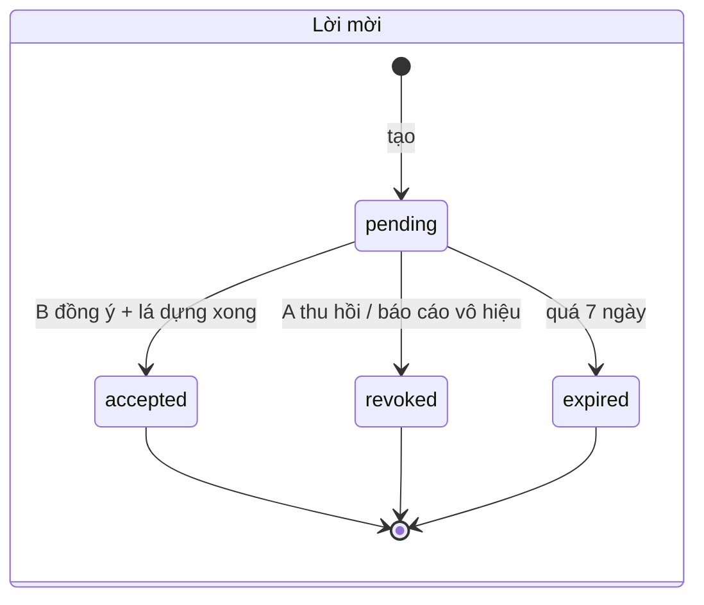

# Lá Lành — SRS "Tri Kỷ"

> Phiên bản: 0.1 (nháp) · Viết: 26/10/2026 · Trạng thái: **chờ owner duyệt**, chưa triển khai.
> Tầng kỹ thuật của [`tri-ky-prd.md`](tri-ky-prd.md). PRD trả lời "tính năng gì, vì sao"; SRS này trả lời "hệ thống làm gì, dữ liệu nào, giữ bao lâu, ai được làm gì".
> Mọi mục gắn **Đề xuất — chờ owner** đi theo quyết định D5 và TK-1–TK-12 ở PRD §9. Nếu owner chọn khác, sửa SRS trước khi build.
> Không có code ở giai đoạn này. Tên bảng, endpoint và field dưới đây là hợp đồng đề xuất để review, không phải mô tả runtime.

---

## 1. Phạm vi và thuật ngữ

| Thuật ngữ | Nghĩa |
|---|---|
| **A** | Người mời. Có hồ sơ sinh của chính mình, đã đăng nhập khi tạo link (TK-2) |
| **B** | Người nhận lời mời. Dùng hồ sơ sinh của chính mình (có sẵn hoặc tạo trong luồng mời) |
| **Thành viên** | A hoặc B sau khi lá đôi được dựng. Hai thành viên có quyền ngang nhau |
| **Lời mời** (`tri_ky_invite`) | Capability link dùng một lần, hạn 7 ngày |
| **Lá đôi** (`tri_ky_pair`) | Bản ghi cặp + projection nội dung đã mã hoá |
| **Kiểu đồng điệu** (`band`) | `deep`, `complementary`, `opening`. Phân loại ngang hàng, không thứ bậc |
| **Yêu cầu chia sẻ** | Một lần xin chia sẻ một ảnh cụ thể, cần người kia duyệt. Hàng vận hành, xoá 7 ngày sau trạng thái cuối |
| **Bằng chứng đồng ý chia sẻ** | Bản ghi tối thiểu cho mỗi lần một thành viên đồng ý chia sẻ một ảnh (ai, lúc nào, bản câu chữ, bản ảnh). Tách khỏi hàng yêu cầu chia sẻ; sống khi lá còn |
| **Câu báo dữ liệu nhạy cảm** | Câu đặt ngay trên ô đồng ý `tri-ky-pair-v1` của A và của B, nói rõ lá đôi là dữ liệu nhạy cảm (Nghị định 356 Điều 6 khoản 4) |
| **Lượt đố** | Một lượt Hiểu Nhau Không? (sau MVP) |

Trong phạm vi: G50–G55. Ngoài phạm vi: mọi thứ ở PRD §2.2.

## 2. Luồng tổng quát

```mermaid
sequenceDiagram
  participant A as App A
  participant API as API Tri Kỷ
  participant OS as Bảng chia sẻ OS
  participant B as App/Web B
  A->>API: POST /v1/tri-ky/invites (consent A, tên hiển thị, idempotency)
  API-->>A: link một lần (token trong fragment), hạn 7 ngày
  A->>OS: chia sẻ cho một người
  OS-->>B: link
  B->>API: POST /v1/public/tri-ky/invite/preview {token}
  API-->>B: tên A chọn, hạn, binding_id (không gì khác)
  B->>B: dùng hồ sơ của mình hoặc tạo hồ sơ (US-01/US-02)
  B->>API: POST /v1/public/tri-ky/invite/accept {token, binding_id, consent B, tên hiển thị B}
  API->>API: kiểm 18+, không tự mời, không bị chặn, giới hạn; tính lá từ hai hồ sơ mã hoá
  API-->>B: lá đôi (projection)
  API-->>A: mục hộp thư trong app; push câu cố định nếu đã bật
  A->>API: GET /v1/tri-ky/pairs/{id}
  Note over A,B: Chia sẻ cần hai người duyệt. Giải tán: một người, im lặng, xoá cứng.
```

## 3. Hợp đồng dùng lại và hợp đồng mới

### 3.1. Dùng lại (không đổi hợp đồng gốc)

| Thành phần có sẵn | Nguồn | Tri Kỷ dùng thế nào |
|---|---|---|
| Hồ sơ sinh mã hoá, đồng ý hồ sơ của từng người | US-01, US-02, US-06; `BirthChartService` | Nguồn duy nhất của dữ liệu sinh cho lá đôi. Không có form sinh nào trong Tri Kỷ |
| Tính chart Western Recommended và `calculate_relationship_bundle` | `NatalChartEngine`; relationship engine v2 | Tính synastry/composite từ hai chart hiện tại |
| Quy tắc độ chính xác thấp | US-22 AC07; radar spec §8 | Không rõ giờ: bỏ Mặt Trăng, cung mọc, nhà; contact chỉ dùng khi chắc trong orb trên tích hai miền ngày sinh |
| Bất biến `scalar_score_eligible=false` | US-13 AC04; relationship engine | Giữ; Tri Kỷ còn bỏ cả ba chỉ báo 0–100 (§3.2) |
| Ngữ cảnh `friend` và copy friend | `radar/service.py` `CONTEXTS`; `radar/reading.py` | Cố định `friend`, không có bộ chọn ngữ cảnh |
| Hợp đồng capability link | US-08 §6 BR1–BR10, §7 | Token ngẫu nhiên, lưu hash, bản mã hoá tạm để gửi lại, xoá khi kết thúc; idempotency; thu hồi thắng race; giới hạn tần suất; không ghi "đã gửi" |
| Header công khai an toàn | `routes/radar.py` `_safe_public` | `Cache-Control: no-store, max-age=0`, `Referrer-Policy: no-referrer`, `X-Robots-Tag: noindex, nofollow, noarchive`, CSP chặt, `nosniff` |
| Xác thực mutation | Radar/Lá Chứng owner mutation | Phiên chủ sở hữu + trusted Origin + CSRF; người nhận dùng phiên khách + CSRF |
| Bind lời mời theo tab | radar spec §7 (`request_id` binding) | `binding_id` không bí mật gửi kèm accept để tab cũ không tác động lên lời mời khác |
| Quyền của người nhận theo phiên | radar spec §7, P09 D2 | Thành viên xem/giải tán bằng phiên của chính mình; không cần receipt |
| `EnvelopeCipher` (AES-GCM theo context bản ghi), `SecretHasher` | `app/infrastructure/crypto` | Mã hoá tên hiển thị, lá đôi, câu trả lời đố; hash token |
| Erasure journal (P07) | `erasure_journal/journal.py` | Thêm kiểu mới (§3.2) |
| Outbox + hộp thư trong app | US-09 BR7 | Báo A khi B nhận lời; push chỉ câu cố định |
| Khung báo cáo lý do đóng | US-09 S46 | Lý do allowlist, không chữ tự do |
| Lịch dọn dẹp sáu giờ | radar spec §6 | Dọn lời mời hết hạn, yêu cầu chia sẻ, lượt đố |
| Bảng chia sẻ native, không danh bạ | US-08 S39, Apple 5.1.2(v) | Như US-08; không xin `READ_CONTACTS` |

### 3.2. Mới

| Thành phần mới | Vì sao không dùng lại |
|---|---|
| Domain `tri_ky` với bảng riêng (§6) | `radar_requests` gắn với hạn 24 giờ/30 ngày, ngữ cảnh có `crush/partner`, cột private check, nhãn riêng A đặt cho B và ba chỉ báo. Thêm mode thứ ba vào bảng đó sẽ kéo theo các hợp đồng Tri Kỷ cấm |
| Projection `tri-ky-card-v1` | Radar Living Dossier có chương "Điểm dễ cấn", ba chỉ báo số và chủ đề `attraction`. Tri Kỷ cần ba khối, một kiểu đồng điệu, không số |
| Gate từ vựng `tri-ky-lexicon-v1` | Chặn khung lãng mạn ngoài gate chung |
| Đồng ý `tri-ky-pair-v1` (cả A và B), `tri-ky-share-v1` (mỗi lần chia sẻ), `tri-ky-quiz-v1` (trò đố) | Mục đích mới, không gộp với `radar-pair-v1` hay đồng ý hồ sơ |
| Tên hiển thị theo cặp | Thay `recipient_label` (nhãn riêng của A) bằng tên mỗi người tự chọn cho chính mình |
| Yêu cầu chia sẻ hai bên duyệt | Chưa có cơ chế nào trong repo cần hai người duyệt |
| Danh sách chặn người mời | Radar/Lá Chứng chưa có chặn theo người |
| Erasure kind `tri_ky_dissolved`, `tri_ky_quiz_cleared` | Ghi giải tán và rút đồng ý đố để chạy lại sau restore |
| Lời mời với token trong fragment, đổi bằng POST | Radar/Lá Chứng đặt token trong path của GET; xem §3.3 |

### 3.3. Khác biệt cố ý với runtime hiện tại (cần ghi nhận, không sửa trong PR này)

1. **Xem trước lộ nhãn riêng.** `GET /public/radar/{token}` và `GET /public/la-chung/{token}` trả `recipient_label` (tên A đặt cho B) cho bất kỳ ai cầm link. US-08 §5 nói `recipient_label` là riêng tư và mô tả `sender_display_name` cho màn của B, nhưng runtime Lá Chứng chưa có trường này. Tri Kỷ **không** trả nhãn A đặt cho B; xem trước chỉ có `sender_display_name` A tự chọn. Phát hiện này nên được rà riêng cho Radar/Lá Chứng (follow-up, không thuộc PR này).
2. **Token trong path.** Radar/Lá Chứng nhận token trong path rồi đổi sang cookie; path có thể vào log proxy. Tri Kỷ đặt token trong fragment (`/tri-ky/i#<token>`), client gửi token trong body POST. Cần kiểm universal link iOS/app link Android có giữ fragment không (evidence native, `[Pending]`).
3. **Level 3.** `_lock_chart_sources` của Radar yêu cầu `profile_level == 3` cho cả hai. Tri Kỷ đề xuất Level 1 trở lên (TK-1), nên cần nhánh tính mới theo quy tắc độ chính xác thấp.
4. **Hạn.** Radar invite đã đồng ý giữ 30 ngày. Tri Kỷ không có hạn riêng (TK-7), sống theo vòng đời hồ sơ của hai người.
5. **Luna.** Radar có đường viết lại cho cả hai góc nhìn khi bật. Tri Kỷ không enqueue viết lại (TK-10).

## 4. Yêu cầu chức năng

Ký hiệu: **P** = bắt buộc ở MVP; **L** = sau MVP; ID ổn định để story và test trỏ tới.

### 4.1. Lối vào và lời mời (G50)

| ID | Yêu cầu | Mức |
|---|---|---|
| FR-TK-001 | Màn giới thiệu nói: người hiểu mình, không yêu đương, không xếp hạng, chỉ hai người thấy, rời lúc nào cũng được. Không hiện danh sách gợi ý người | P |
| FR-TK-002 | A cần hồ sơ hiện tại đạt mức tối thiểu (TK-1: Level 1). Thiếu hồ sơ → dẫn sang US-02 rồi quay lại đúng màn | P |
| FR-TK-003 | Tạo link cần A đăng nhập (TK-2). Bản nháp (tên hiển thị) giữ qua US-19; huỷ đăng nhập không tạo lời mời | P |
| FR-TK-004 | A nhập `sender_display_name` 1–32 grapheme, lọc ký tự điều khiển/markup, mặc định từ tên hồ sơ nếu có; xem trước đúng màn B sẽ thấy | P |
| FR-TK-005 | A tick ô đồng ý `tri-ky-pair-v1`, mặc định trống. Nút tạo link chỉ bật khi đã tick. **Ngay trên ô** (không xen nội dung, nút hay liên kết nào khác) là câu báo dữ liệu nhạy cảm; bản nháp chờ owner duyệt: "Lá đôi là dữ liệu nhạy cảm vì nó nói về đời sống riêng tư của hai bạn. Lá Lành chỉ tạo khi cả hai cùng đồng ý, và chỉ hai bạn xem được." Câu này không chỉ nằm trong chính sách | P |
| FR-TK-006 | Tạo lời mời idempotent theo `idempotency_key` + hash nháp; bấm hai lần chỉ có một lời mời | P |
| FR-TK-007 | Token ≥ 256 bit ngẫu nhiên; DB giữ hash; bản mã hoá envelope chỉ để A gửi lại, xoá khi lời mời kết thúc | P |
| FR-TK-008 | Hạn 7 × 24 giờ theo giờ server; gửi lại không kéo dài hạn | P |
| FR-TK-009 | Gửi qua bảng chia sẻ OS hoặc sao chép; không picker danh bạ ở MVP; không ghi "đã gửi/đã đọc" | P |
| FR-TK-010 | A xem danh sách lời mời đang chờ (tên A chọn, hạn, trạng thái), gửi lại, thu hồi. Thu hồi có hiệu lực ngay và thắng race với accept | P |
| FR-TK-011 | Giới hạn: tối đa 5 lời mời đang chờ và 10 lá đang có mỗi người (TK-3); tối đa 10 lần tạo mỗi ngày; vượt → thông báo trung tính | P |

### 4.2. Nhận lời mời (G51)

| ID | Yêu cầu | Mức |
|---|---|---|
| FR-TK-020 | Xem trước qua POST với token trong body; trả `binding_id`, `sender_display_name`, `expires_at`. Không trả chart, Vibe, nhãn riêng hay định danh của A | P |
| FR-TK-021 | Token sai, hết hạn, thu hồi, đã dùng → cùng một phản hồi 404 và cùng một màn "Lời mời này không còn mở được" | P |
| FR-TK-022 | Accept cần phiên khách của B, trusted Origin, CSRF, `binding_id` khớp, `consent_version = tri-ky-pair-v1`, `consent_given = true`, `display_name` 1–32 grapheme | P |
| FR-TK-023 | B chưa có hồ sơ → 409 `profile_required`; app dẫn sang US-01/US-02 (đồng ý hồ sơ riêng), giữ ý định quay lại lời mời. Không có form sinh trong Tri Kỷ | P |
| FR-TK-024 | **Chặn Check kín:** không endpoint Tri Kỷ nào nhận trường sinh (`birth_date`, `birth_time_*`, `place_id`, tọa độ) hay `authorization_attested`. Schema `extra=forbid` trả 422. Attestation `radar-authorized-input-v1` không mở được bất kỳ đường Tri Kỷ nào | P |
| FR-TK-025 | B phải ≥ 18 tuổi theo hồ sơ của chính B; dưới 18 → từ chối trước khi tính, không lưu gì | P |
| FR-TK-026 | Không tự nhận lời: cùng principal hoặc cùng guest với A → 422 | P |
| FR-TK-027 | Lời mời dùng một lần: accept chuyển `pending → accepted` nguyên tử; accept thứ hai → màn "không còn mở được" | P |
| FR-TK-028 | Nếu phiên của B đã chặn A, xem trước và accept trả cùng phản hồi 404 như link không hợp lệ; A không được báo là đã bị chặn | P |
| FR-TK-029 | B có "Không nhận" (không lưu gì, không báo A), "Báo cáo lời mời" (lý do: `not_for_me`, `dont_know_sender`, `unsafe_name`, `suspicious_link`, `other`; không chữ tự do), "Không nhận lời mời Tri Kỷ từ người này nữa" (thêm chặn) | P |
| FR-TK-030 | Đã có lá đang có giữa đúng hai người → không dựng lá thứ hai; trả về lá hiện có | P |
| FR-TK-031 | Accept thành công: dựng lá trong cùng giao dịch; lỗi engine/gate → rollback, không lưu đồng ý, không lưu lá dở, lời mời vẫn `pending` | P |
| FR-TK-032 | Sau accept: một mục hộp thư cho A (idempotent theo `pair_id`). Push chỉ khi A đã bật push và chỉ câu cố định (TK-12) | P |
| FR-TK-033 | Màn đồng ý của B: ngay trên ô `tri-ky-pair-v1` (mặc định trống) là cùng câu báo dữ liệu nhạy cảm như FR-TK-005, không xen nội dung khác. Thiếu câu này thì không được bật nút "Đồng ý và mở lá" (kiểm bằng test copy T-TK-23) | P |

### 4.3. Lá đôi (G52)

| ID | Yêu cầu | Mức |
|---|---|---|
| FR-TK-040 | Projection `tri-ky-card-v1` gồm: `band`, `shared` (Điều hai bạn chung), `complement` (Cách hai bạn bù nhau), `try_this` (Một việc nhỏ để thử), `evidence` (sau disclosure), `precision` của mỗi người ở mức `date_only/time_known`, metadata version | P |
| FR-TK-041 | Projection **không** có trường số nào: không %, không chỉ báo `resonance/coordination/friction`, không điểm, không thứ hạng. Con số duy nhất trong domain là `quiz_best_score` (0–7) | P |
| FR-TK-042 | Ngữ cảnh cố định `friend`. Bỏ chủ đề `attraction` và mọi motif dẫn tới sức hút/tình cảm. Không có chương "Điểm dễ cấn" | P |
| FR-TK-043 | `complement` tối đa một khác biệt, luôn kèm việc làm được; nói bằng dải mềm ("một người hay mở đầu, một người giúp việc đi tới cùng"), không số | P |
| FR-TK-044 | Câu nguyên tố chỉ dùng khi Sun sign của người đó chắc chắn (ngày không giáp ranh hoặc có giờ) | P |
| FR-TK-045 | Nội dung đóng băng lúc dựng (cùng seed `pair_id`). Mở lại trả đúng bản đã dựng | P |
| FR-TK-046 | Mỗi thành viên thấy projection theo góc nhìn của mình ("bạn"/"[tên kia]"). Không ai thấy dữ liệu sinh, cung, nguyên tố thô hay chart của người kia ngoài câu đã dựng | P |
| FR-TK-047 | Hồ sơ của một thành viên đổi (đổi ngày, thêm/bớt giờ hoặc nơi): xoá ciphertext lá hiện tại và dựng lại ở lần mở kế tiếp trong cùng mục đích đồng ý; nếu dựng lại lỗi → màn "Lá đang được dựng lại", không hiện bản cũ | P |
| FR-TK-048 | Danh sách lá chỉ hiện tên hiển thị của người kia và ngày tạo, sắp theo ngày tạo mới nhất. Không hiện kiểu đồng điệu, không đếm tổng ra ngoài | P |
| FR-TK-049 | Mỗi thành viên sửa được tên hiển thị của chính mình trong cặp | P |
| FR-TK-050 | Gate trước khi lưu: gate chung (evidence, điều kiện, chống thao túng) + `tri-ky-lexicon-v1`. Gate trượt → không lưu, thử nhánh low-signal (`opening`), vẫn trượt → lỗi chung có retry | P |
| FR-TK-051 | Lá tarot của hai đứa: chọn tất định từ HMAC(`pair_id`) trên catalog 78 lá đã duyệt, khung `friend` | L |

### 4.4. Chia sẻ khi cả hai đồng ý (G53)

| ID | Yêu cầu | Mức |
|---|---|---|
| FR-TK-060 | Thành viên tạo yêu cầu chia sẻ với `layout_version` cố định; người tạo được tính là đã đồng ý (`tri-ky-share-v1`) và có một bằng chứng đồng ý theo FR-TK-067 | P |
| FR-TK-061 | Người kia thấy đúng ảnh sẽ được chia sẻ và chọn "Đồng ý chia sẻ" hoặc "Không chia sẻ". Không chọn trong 72 giờ → `expired` | P |
| FR-TK-062 | "Không chia sẻ" và hết hạn hiện giống nhau với người xin: "Ảnh này chưa chia sẻ được." Không nói lý do, không thông báo | P |
| FR-TK-063 | Ảnh chỉ gồm: chữ "Tri Kỷ", hai tên hiển thị, nhãn kiểu, một câu `shared` đã qua gate không nhắc cung/nguyên tố/ngày (TK-8). Không mã QR, không link, không ID | P |
| FR-TK-064 | Ảnh dựng trên máy từ projection, không lưu ảnh trên server, không tạo URL công khai. Sau khi duyệt, hai thành viên được xuất ảnh đó trong 24 giờ; sau đó phải xin lại | P |
| FR-TK-065 | Tối đa một yêu cầu đang chờ mỗi cặp; tối đa 3 yêu cầu mỗi cặp mỗi ngày | P |
| FR-TK-066 | File ảnh tạm trên native ghi vào thư mục cache của app, xoá sau khi bảng chia sẻ đóng | P |
| FR-TK-067 | Mỗi lần một thành viên đồng ý chia sẻ (người xin khi tạo yêu cầu; người kia khi bấm "Đồng ý chia sẻ"), server ghi một hàng `tri_ky_share_consents` (§6.3) trong cùng giao dịch: thành viên (`a`/`b`), thời điểm, phiên bản câu chữ đồng ý, `layout_version` và `card_hash` của đúng ảnh đã duyệt. Không ảnh, không câu trong ảnh, không tên. Hàng này không bị xoá khi hàng yêu cầu chia sẻ bị dọn (7 ngày sau trạng thái cuối); nó sống khi lá còn và bị xoá cùng lá khi giải tán hoặc xoá hồ sơ. Có phải giữ bằng chứng lâu hơn lá không là câu hỏi counsel Q-L7, **chờ counsel** | P |

### 4.5. Giải tán, rút đồng ý và xoá (G54)

| ID | Yêu cầu | Mức |
|---|---|---|
| FR-TK-080 | Một thành viên bấm "Giải tán" và xác nhận → xoá cứng trong một giao dịch: hàng `tri_ky_pairs`, yêu cầu chia sẻ, bằng chứng đồng ý chia sẻ, lượt đố và câu trả lời, kỷ lục, đồng ý theo cặp; ghi erasure journal `tri_ky_dissolved` | P |
| FR-TK-081 | Không thông báo, không mục hộp thư, không push cho người kia. Người kia mở lá → 404 → "Lá này không còn", giống hệt khi hồ sơ bị xoá hay hết hạn | P |
| FR-TK-082 | Giải tán idempotent: lần gọi thứ hai của bất kỳ thành viên nào trả cùng kết quả, không lộ ai giải tán trước | P |
| FR-TK-083 | "Rút đồng ý" Tri Kỷ chính là giải tán; không có trạng thái "đồng ý đã rút nhưng lá còn" | P |
| FR-TK-084 | Xoá hồ sơ khách/tài khoản của một thành viên cascade xoá mọi lá, lời mời, yêu cầu chia sẻ, bằng chứng đồng ý chia sẻ, lượt đố có người đó | P |
| FR-TK-085 | Rút giờ/nơi sinh: áp FR-TK-047 (dựng lại với độ chính xác mới); không giữ bản dựng từ dữ liệu đã rút | P |
| FR-TK-086 | Sau restore backup, erasure journal chạy lại để lá đã giải tán không sống lại (P07) | P |

### 4.6. Hiểu Nhau Không? (G55, sau MVP)

| ID | Yêu cầu | Mức |
|---|---|---|
| FR-TK-100 | Mỗi thành viên đồng ý riêng `tri-ky-quiz-v1` cho cặp đó trước lượt đầu; ô mặc định trống, ngay trên ô có câu nói câu trả lời gắn với cặp nên được xử lý như dữ liệu nhạy cảm (copy PRD §5); rút đồng ý → xoá lượt đang mở và kỷ lục (`tri_ky_quiz_cleared`) | L |
| FR-TK-101 | Một lượt = 7 câu rút từ ngân hàng đã duyệt (≥ 28 câu, phiên bản cố định), không trùng bộ câu của lượt trước của cặp | L |
| FR-TK-102 | Mỗi câu có 3–5 lựa chọn soạn sẵn; không chữ tự do. Mỗi người chọn câu của mình và đoán câu của người kia | L |
| FR-TK-103 | Chơi không đồng bộ; lượt hết hạn sau 7 ngày nếu chưa đủ hai người → xoá câu trả lời, không tính điểm, không thông báo | L |
| FR-TK-104 | Điểm chung của cặp `x/7`; một câu được tính theo TK-5 (mặc định: cả hai cùng đoán đúng). Không lưu, không trả điểm riêng từng người | L |
| FR-TK-105 | Kết quả hiện cho mỗi người: từng câu với lựa chọn của hai người, dấu "hiểu nhau" cho câu được tính, `x/7`, kỷ lục của cặp | L |
| FR-TK-106 | Câu trả lời gắn với cặp nên là **dữ liệu nhạy cảm (đời sống riêng tư)** (§6.6). Xoá câu trả lời ngay khi cả hai đã xem kết quả, muộn nhất 7 ngày sau khi lượt hoàn tất, cái nào tới trước. Sau đó cặp chỉ còn `quiz_best_score` (x/7) và `quiz_best_month` (tháng/năm), giữ khi cặp còn. Giải tán hoặc xoá hồ sơ xoá hết (FR-TK-080, FR-TK-084) | L |
| FR-TK-107 | Không nhắc, không push, không đếm ngược, không cooldown hiển thị, không "mỗi tháng" (TK-6). Một lượt đang mở mỗi cặp | L |
| FR-TK-108 | Ngân hàng câu loại: ngoại hình, sức khoẻ, tình dục, tiền, gia đình, tôn giáo, vùng miền, chính trị, người thật có tên, rượu bia, tình cảm/yêu đương, "ai toxic" | L |

### 4.7. An toàn và lạm dụng

| ID | Yêu cầu | Mức |
|---|---|---|
| FR-TK-120 | Danh sách chặn của B lưu HMAC của principal người mời; B xem và bỏ chặn được; chặn không thông báo cho A | P |
| FR-TK-121 | Báo cáo lời mời: lý do đóng, rate limit; `dont_know_sender`/`suspicious_link` vô hiệu lời mời ngay và đánh dấu xem xét lạm dụng; không chữ tự do | P |
| FR-TK-122 | Tên hiển thị qua bộ lọc từ cấm (tục, miệt thị, số điện thoại/email/URL); báo cáo `unsafe_name` có hàng đợi xem xét | P |
| FR-TK-123 | Thông tin liên hệ hỗ trợ công khai trong app (Apple 1.2) | P |

## 5. Trạng thái



| Đối tượng | Trạng thái | Chuyển | Ghi chú |
|---|---|---|---|
| Lời mời | `pending`, `accepted`, `revoked`, `expired` | như sơ đồ; mọi trạng thái cuối xoá `token_ciphertext` | Hàng lời mời cuối xoá sau 30 ngày (§8) |
| Lá đôi | `active`, `rebuilding` | `active → rebuilding` khi hồ sơ đổi; `rebuilding → active` khi dựng lại xong | Không có `dissolved`: giải tán là xoá hàng |
| Yêu cầu chia sẻ | `pending`, `approved`, `expired`, `cancelled` | `pending → approved` khi người kia đồng ý; `pending → expired` khi quá 72 giờ hoặc "Không chia sẻ"; người xin huỷ → `cancelled` | "Không chia sẻ" lưu thành `expired` để không phân biệt được. Hàng xoá 7 ngày sau trạng thái cuối (`approved` tính từ hết `export_until`); bằng chứng đồng ý (§6.3) không xoá theo |
| Lượt đố | `open`, `completed`, `expired` | `open → completed` khi đủ hai người; `open → expired` sau 7 ngày | Câu trả lời xoá theo FR-TK-106 |

## 6. Mô hình dữ liệu (theo hợp đồng dữ liệu chung, brief 26/10/2026)

Dòng đánh dấu **[bổ sung]** ở §6.6 là trường hoặc thời hạn ngoài hợp đồng dữ liệu chung, cần cho an toàn và chống lạm dụng; DPIA §5.7 đã ghi nhận, chờ owner.

Mọi bảng bật RLS, không grant cho PUBLIC/anon/authenticated, server dùng điều kiện sở hữu tường minh. Trường **mã hoá** dùng `EnvelopeCipher` với context riêng theo bản ghi.

### 6.1. `tri_ky_invites`

| Field | Kiểu | Ghi chú |
|---|---|---|
| `id` | UUID | Riêng tư, chỉ trên route của A |
| `inviter_principal_id`, `inviter_guest_id` | UUID FK cascade | Chủ lời mời |
| `sender_display_name_ciphertext` | mã hoá (`tri-ky-invite-name:{id}`) | 1–32 grapheme |
| `inviter_consent_version`, `inviter_consented_at` | text, timestamp | `tri-ky-pair-v1` |
| `token_hash` | bytes | `SecretHasher("tri-ky-capability")` |
| `token_ciphertext`, `key_version` | mã hoá | Chỉ để gửi lại; NULL khi kết thúc |
| `binding_id` | UUID | Không bí mật; bind tab |
| `status` | enum | §5 |
| `created_at`, `expires_at`, `terminal_at` | timestamp | Giờ server |
| `idempotency_hash`, `request_hash` | bytes | HMAC; xoá cùng hàng |

### 6.2. `tri_ky_pairs`

| Field | Kiểu | Ghi chú |
|---|---|---|
| `id` | UUID | Riêng tư, chỉ thành viên |
| `member_a_principal_id`, `member_a_guest_id` | UUID FK cascade | A (B có thể là khách nên có cả guest) |
| `member_b_principal_id` (nullable), `member_b_guest_id` | UUID FK cascade | B |
| `pair_key_hash` | bytes unique | HMAC của cặp principal/guest đã sắp xếp; chặn lá trùng (FR-TK-030) |
| `member_a_display_name_ciphertext`, `member_b_display_name_ciphertext` | mã hoá (`tri-ky-name:{id}:{a|b}`) | Mỗi người tự chọn |
| `member_a_consent_version/at`, `member_b_consent_version/at` | text, timestamp | `tri-ky-pair-v1` |
| `card_ciphertext` | mã hoá (`tri-ky-card:{id}`) | JSON projection cả hai góc nhìn, **gồm `band`**; NULL khi `rebuilding` |
| `source_a_snapshot_id/revision`, `source_b_snapshot_id/revision` | UUID, timestamp | Phát hiện hồ sơ đổi |
| `status` | enum | `active`, `rebuilding` |
| `created_at`, `card_built_at` | timestamp | |
| `quiz_consent_a_at`, `quiz_consent_b_at` | timestamp nullable | `tri-ky-quiz-v1` (L) |
| `quiz_best_score` | smallint nullable 0–7 | Con số duy nhất; không phải dữ liệu analytics (L) |
| `quiz_best_month` | date nullable (ngày 1 của tháng) | (L) |

`band`, nội dung, evidence **không** có cột plaintext. Không truy vấn SQL nào nhóm theo kiểu đồng điệu được.

### 6.3. `tri_ky_share_requests` và `tri_ky_share_consents`

`tri_ky_share_requests` (hàng vận hành): `id`, `pair_id` FK cascade, `requester` (`a|b`), `layout_version`, `status`, `created_at`, `expires_at` (72 giờ), `approved_at`, `export_until` (24 giờ sau duyệt), `terminal_at`. Không lưu ảnh. Hàng xoá 7 ngày sau `terminal_at` (§8).

`tri_ky_share_consents` (bằng chứng đồng ý, FR-TK-067): `id`, `pair_id` FK cascade, `member` (`a|b`), `consent_version` (`tri-ky-share-v1`), `consented_at`, `layout_version`, `card_hash` (HMAC theo khoá server của projection ảnh đã duyệt; không đảo ngược ra nội dung). Không có `request_id` để hàng này không phụ thuộc hàng vận hành; không ảnh, không câu, không tên, không IP. Sống khi lá còn; xoá cùng lá (giải tán, xoá hồ sơ). Giữ sau giải tán hay không: **chờ counsel** (Q-L7).

### 6.4. `tri_ky_quiz_rounds` (L)

`id`, `pair_id` FK cascade, `bank_version`, `question_ids` (mảng id công khai của ngân hàng), `answers_ciphertext` (mã hoá `tri-ky-quiz:{id}`: mỗi người `self_choice_ids[7]`, `guess_choice_ids[7]`), `status`, `created_at`, `expires_at`, `completed_at`, `seen_a_at`, `seen_b_at`.

### 6.5. `tri_ky_blocks`, `tri_ky_reports`

- `tri_ky_blocks`: `blocker_principal_id` hoặc `blocker_guest_id` FK cascade, `blocked_inviter_hash` (HMAC principal người mời), `blocked_display_name_ciphertext` (tên A đã dùng lúc bị chặn, mã hoá, chỉ để B nhận ra mà bỏ chặn), `created_at`. Giữ tới khi bỏ chặn hoặc hồ sơ người chặn bị xoá.
- `tri_ky_reports`: `invite_id` FK (SET NULL khi hàng lời mời bị xoá), `reason` enum, `created_at`. Giữ 30 ngày cho xử lý lạm dụng rồi xoá. Không lưu IP, thiết bị, token.

### 6.6. Inventory dữ liệu cá nhân

| Dữ liệu | Thu/suy ra/lưu ở đâu | Mục đích | Mức nhạy cảm (đề xuất) | Lưu bao lâu |
|---|---|---|---|---|
| Hồ sơ sinh của A, B | Có sẵn trong domain birth, mỗi người tự khai | Dựng lá | Theo inventory hiện có | Theo hồ sơ |
| Tên hiển thị trong cặp **[bổ sung]** | Người dùng nhập | Hiện cho người kia | Cơ bản | Như lá / lời mời |
| Đồng ý theo cặp (`tri-ky-pair-v1`, trên hàng cặp) và đồng ý đố (`tri-ky-quiz-v1`) | Hành động người dùng | Chứng minh đồng ý | Cơ bản (bản ghi đồng ý) | Tới khi giải tán hoặc hồ sơ bị xoá; giữ lâu hơn hay không: chờ counsel (Q-L7) |
| Hàng yêu cầu chia sẻ (vận hành) | Hành động người dùng | Chạy luồng duyệt và xuất ảnh | Cơ bản | 7 ngày sau trạng thái cuối |
| Bằng chứng đồng ý chia sẻ (`tri_ky_share_consents`: thành viên, thời điểm, phiên bản câu chữ, `layout_version`, `card_hash`; không ảnh) | Hệ thống ghi khi người dùng đồng ý | Chứng minh từng người đã đồng ý đúng ảnh đó | Cơ bản (bản ghi đồng ý) | Khi lá còn; xoá khi giải tán hoặc hồ sơ bị xoá; giữ lâu hơn hay không: chờ counsel (Q-L7) |
| Lá đôi (kiểu, ba khối, evidence) | Suy luận từ hai hồ sơ | Hiện cho hai người | **Nhạy cảm (đời sống riêng tư)** cho tới khi luật sư trả lời Q-L1 | Tới khi giải tán hoặc hồ sơ hết hạn/xoá |
| Quan hệ "A có lá với B" | Suy ra từ hàng cặp | Phân quyền | **Nhạy cảm** (đồ thị quan hệ) | Như lá |
| Câu trả lời đố (mã lựa chọn, gắn với cặp) | Người dùng chọn | Tính điểm lượt | **Nhạy cảm (đời sống riêng tư)** vì gắn với một cặp cụ thể, dù từng câu là sở thích vô hại | Xoá ngay khi cả hai đã xem kết quả, muộn nhất 7 ngày sau khi lượt hoàn tất; lượt không đủ hai người xoá sau 7 ngày; giải tán xoá hết |
| Kỷ lục đố (`quiz_best_score` x/7; `quiz_best_month` **[bổ sung]**) | Suy ra | Hiện cho hai người | Nhạy cảm (như lá) | Khi cặp còn; rút đồng ý đố hoặc giải tán thì xoá |
| Danh sách chặn (HMAC người mời + tên A lúc chặn, mã hoá) **[bổ sung]** | Hành động người dùng | An toàn | Cơ bản | Tới khi bỏ chặn |
| Báo cáo lời mời **[bổ sung]** | Hành động người dùng | Xử lý lạm dụng | Cơ bản | 30 ngày |
| Hàng lời mời đã kết thúc **[bổ sung: giữ 30 ngày]** | Hệ thống | Chống lạm dụng (như US-08/US-09) | Cơ bản | 30 ngày sau trạng thái cuối |
| Token, binding, idempotency | Hệ thống | Bảo mật | Bí mật kỹ thuật | Như lời mời |
| Bộ đếm tổng hợp theo ngày (danh sách ở §10) | Hệ thống | Chỉ số PRD §6 | Không định danh: không ID người/cặp, không kiểu, không nội dung; ẩn ô nhỏ theo §10 | Theo DPIA X7 (mặc định nằm ở đó, chờ owner) |

Không thu: danh bạ, số điện thoại, email người nhận, vị trí hiện tại, ảnh, giọng, chữ tự do ngoài tên hiển thị, ID quảng cáo.

## 7. Đồng ý và copy pháp lý

| Version | Ai | Khi nào | Nội dung tối thiểu (copy nháp ở PRD §5, chờ owner và luật sư) | Rút thế nào |
|---|---|---|---|---|
| `tri-ky-pair-v1` | A khi tạo link; B khi nhận | Ngay trước hành động | Câu báo dữ liệu nhạy cảm đặt **ngay trên ô** (FR-TK-005, FR-TK-033); mục đích (dựng lá Tri Kỷ với người cụ thể), dữ liệu dùng (hồ sơ sinh của tôi), ai thấy (chỉ hai người), giữ tới khi một người giải tán, xoá thế nào | Giải tán |
| `tri-ky-share-v1` | Từng người cho từng ảnh | Khi xin/duyệt chia sẻ | Ảnh gồm gì, ai sẽ thấy là người nhận ảnh, ảnh ra ngoài không thu lại được. Mỗi lần đồng ý ghi một bằng chứng `tri_ky_share_consents` (FR-TK-067) | Không duyệt / để hết hạn (ảnh đã xuất thì không thu lại được) |
| `tri-ky-quiz-v1` (L) | Từng người cho từng cặp | Trước lượt đầu | Câu trả lời gắn với cặp nên xử lý như dữ liệu nhạy cảm; lưu câu chọn cho lượt chơi; xoá khi cả hai đã xem kết quả, muộn nhất 7 ngày sau khi lượt xong; chỉ giữ kỷ lục x/7 của cặp | Tắt trong cài đặt cặp |

Luật: ô đồng ý mặc định trống; với `tri-ky-pair-v1`, câu báo dữ liệu nhạy cảm nằm ngay trên ô ở cả màn của A và màn của B, và có test copy trước khi build (T-TK-23); nút đồng ý và nút từ chối cùng kích thước và độ rõ; từ chối không chặn dùng phần còn lại của app; mỗi version lưu kèm thời điểm; đổi nghĩa copy = version mới. Đồng ý hồ sơ sinh (US-01/US-02) không thay cho `tri-ky-pair-v1`.

## 8. Lưu trữ và xoá

| Dữ liệu | Hạn | Xoá bởi |
|---|---|---|
| Lời mời `pending` | 7 ngày | Hết hạn → `expired`; `token_ciphertext` NULL |
| Hàng lời mời cuối | 30 ngày sau `terminal_at` (như US-08/US-09 cho chống lạm dụng) | Dọn dẹp sáu giờ |
| Lá đôi | Tới khi một thành viên giải tán, hoặc hồ sơ của một thành viên bị xoá/hết hạn (30 ngày không hoạt động với khách, 365 ngày với tài khoản liên kết) (TK-7) | FR-TK-080, FR-TK-084 |
| Yêu cầu chia sẻ (hàng vận hành) | 72 giờ chờ; 24 giờ xuất sau duyệt; hàng xoá 7 ngày sau trạng thái cuối | Dọn dẹp |
| Bằng chứng đồng ý chia sẻ | Khi lá còn; xoá cùng lá. Giữ sau giải tán hay không: chờ counsel (Q-L7) | FR-TK-080, FR-TK-084 |
| Câu trả lời đố | Xoá ngay khi cả hai đã xem kết quả, muộn nhất 7 ngày sau khi lượt hoàn tất (FR-TK-106); lượt không đủ hai người xoá sau 7 ngày (FR-TK-103) | Dọn dẹp |
| Kỷ lục đố (x/7, tháng) | Khi cặp còn; rút đồng ý đố hoặc giải tán thì xoá | FR-TK-100, FR-TK-080 |
| Bộ đếm tổng hợp | Theo DPIA X7 (chờ owner) | Dọn dẹp |
| Chặn | Tới khi bỏ chặn/hồ sơ xoá | Người dùng |
| Báo cáo | 30 ngày | Dọn dẹp |
| Erasure journal | 15 ngày mặc định (P07) | Theo P07 |

Ghi chú trung thực (giống radar spec §6): xoá vật lý theo lịch, không phải mốc cứng; sao lưu theo vòng đời riêng và được hoà giải bằng erasure journal; ảnh người dùng đã chia sẻ ra ngoài và ảnh chụp màn hình không thu lại được. Copy không được hứa "xoá mọi bản sao ngay lập tức".

## 9. Bảo mật

Baseline: OWASP ASVS cho API/web, OWASP MASVS/MASTG cho app native (theo AGENTS.md).

| Chủ đề | Yêu cầu |
|---|---|
| Xác thực/phân quyền | Mọi route riêng xác định thành viên từ credential server-side; không nhận `member_id`/`principal_id` từ client. ID đoán, của người khác, đã xoá → cùng 404 |
| CSRF/Origin | Mọi mutation: trusted Origin + CSRF; public accept dùng phiên khách + CSRF |
| Capability link | 256 bit, `token_urlsafe(32)`; link dạng `https://<host>/tri-ky/i#<token>`; client đọc fragment, xoá fragment khỏi lịch sử (`history.replaceState`) rồi POST token trong body; server kiểm hình dạng trước khi tra hash; dùng một lần; thu hồi; hạn 7 ngày |
| Header | `_safe_public` cho mọi route công khai và trang landing HTML: `no-store`, `no-referrer`, `noindex, nofollow, noarchive`, CSP chặt, không script bên thứ ba. Vì token nằm trong fragment, request HTTP chỉ tới **đúng đường `/tri-ky/i`** (không dấu `/` cuối, không token trong path). Luật header phải khớp chính xác `/tri-ky/i` (và `/tri-ky/i/` nếu router chuẩn hoá dấu `/`, cùng mọi route con thật nếu sau này có); mẫu `/tri-ky/i/*` một mình không khớp `/tri-ky/i`. Kiểm riêng, không thay bằng kiểm header API: HTML cuối cùng trả cho trình duyệt; mọi redirect và trang lỗi trên đường đó; service worker không cache và không trả từ cache đường đó (kể cả app shell/navigation fallback). Header API `/v1/public/tri-ky/*` kiểm riêng (T-TK-11) |
| Rate limit | Tạo lời mời (5 đang chờ, 10/ngày), xem trước và accept theo IP-bucket và phiên (chống dò), báo cáo, yêu cầu chia sẻ, lượt đố; cần giới hạn phân tán ở edge trước public launch (như chart-synthesis runbook) |
| Đầu vào | Pydantic `extra=forbid`; enum đóng; giới hạn grapheme; lọc tên hiển thị (FR-TK-122) |
| Mật mã | AES-GCM envelope theo context bản ghi; khoá quản lý như hiện tại; HMAC cho token, cặp, chặn, idempotency; không tự chế thuật toán |
| Log/APM/crash | Không ghi token, fragment, `binding_id`, tên hiển thị, kiểu đồng điệu, nội dung lá, câu trả lời đố, ID cặp/lời mời thô. Log lỗi chỉ mã lỗi + version. Proxy/CDN redact đường `/tri-ky/i` nếu có query nhầm |
| Race | Accept, thu hồi, hết hạn, giải tán khoá hàng (`FOR UPDATE`); chỉ một chuyển trạng thái thắng |
| Lộ lỗi | Lỗi công khai luôn trung tính; không phân biệt hết hạn/thu hồi/đã dùng/bị chặn |
| Native (MASVS) | Lá và tên chỉ trong bộ nhớ; không Preferences/localStorage/IndexedDB/service-worker cache; xoá khi đổi phiên; Android backup tắt (như hiện tại); file ảnh tạm trong cache dir và xoá sau share; universal/app link xác minh domain; deep link chỉ nhận đường `/tri-ky/i`; không log WebView |
| Web companion | B mở trên trình duyệt: không cookie theo dõi; cookie phiên khách như hiện tại; không script bên thứ ba |
| Phụ thuộc | Không thêm SDK/thư viện mới cho MVP; ảnh chia sẻ dựng bằng canvas có sẵn |

### 9.1. Mô hình đe doạ ngắn

| Mối đe doạ | Đường | Chặn |
|---|---|---|
| A tính lá cho người chưa đồng ý | Gửi trường sinh của B | FR-TK-024; không form; 422 |
| Người lạ dò token | Brute-force preview | 256 bit, hash, rate limit, 404 đồng nhất |
| Link chuyển tiếp | Người thứ ba nhận trước | Dùng một lần; cảnh báo; A thấy tên và giải tán được (TK-4) |
| Quấy rối bằng lời mời lặp lại | A tạo link mới sau khi bị giải tán | Chặn theo người (FR-TK-120), báo cáo, giới hạn tạo |
| Lộ quan hệ qua thông báo/xem trước | Push, preview bot, referrer | Push câu cố định; không link xem trước; no-referrer |
| Lộ quan hệ qua analytics | Sự kiện có ID | Chỉ bộ đếm tổng hợp không ID |
| Khôi phục lá đã giải tán | Restore backup | Erasure journal |
| Suy ra ai giải tán | Thời điểm, thông báo | Không thông báo; màn cuối đồng nhất; idempotent |
| Ép đồng ý | Copy gây áp lực | Copy test; nút ngang hàng; không đếm ngược |

## 10. Quyền riêng tư

- **Tối thiểu hoá:** không dữ liệu sinh mới; chỉ tên hiển thị là chữ do người dùng nhập.
- **Không theo dõi từng người, không phân tích nội dung; chỉ có bộ đếm tổng hợp.** Không sự kiện client, không SDK, không ID người/cặp/lời mời, không kiểu đồng điệu, không nội dung lá, không câu trả lời hay điểm đố. Đây là **danh sách chuẩn** của bộ đếm Tri Kỷ; PRD §6, DPIA và nháp store trỏ về đây:
  - **Trường:** server tăng một số nguyên theo ngày (giờ `Asia/Ho_Chi_Minh`) cho `invite_created`, `invite_accepted`, `pair_built`, `invite_profile_created_in_flow`, `share_requested`, `share_approved`, `pair_dissolved_lt30d`, `pair_dissolved_ge30d`, `invite_reported{reason}`, `inviter_blocked`, `build_failed{code}`. Không lưu sự kiện từng lần, chỉ lưu số đếm của ngày.
  - **Mục đích:** đo sức khoẻ luồng mời và guardrail an toàn (PRD §6); không dùng để nhắm ai, không nối với dữ liệu khác.
  - **Ngưỡng ô nhỏ:** mọi số đếm theo ngày < 3 bị ẩn trong báo cáo (sàn chung KS-04 của DPIA). Tri Kỷ chặt hơn: báo cáo chỉ hiện một ô khi ô đó ≥ 10, ô nhỏ hơn hiện là "< 10", vì đây là dữ liệu về quan hệ.
  - **Thời hạn:** theo DPIA X7 (mặc định nằm ở đó, chờ owner).
  - **Nhãn store:** có phải khai các bộ đếm này là Analytics "Not linked" hay không phụ thuộc counsel; nháp store ghi hai phương án, chờ quyết định.
- **Thông báo:** hộp thư trong app được hiện tên người kia (đã đăng nhập, trong app). Push nếu có: một câu cố định "Có cập nhật mới trong Lá Lành", không tên, không kiểu, không chữ "Tri Kỷ". Không thông báo khi giải tán, từ chối, hết hạn, chặn, báo cáo.
- **Xem trước link:** không có link công khai cho lá hay ảnh. Link mời không có OG tag mô tả nội dung, không ảnh xem trước; tiêu đề trang chung "Lá Lành".
- **Bên thứ ba:** không gửi gì cho OpenAI/Luna (TK-10); không SDK quảng cáo/analytics. Hosting như hiện tại (Hetzner Đức, Supabase Frankfurt), thuộc hồ sơ chuyển dữ liệu ra nước ngoài #52.
- **Quyền chủ thể:** xem (mở lá), xoá (giải tán), rút đồng ý (giải tán / tắt đố), xuất: lá đôi có trong bản xuất dữ liệu của mỗi thành viên ở góc nhìn của người đó, không kèm dữ liệu sinh của người kia (follow-up khi có tính năng xuất).
- **Nhãn store:** xem PRD §13; dòng mới phải khớp bảng §6.6.

## 11. Yêu cầu phi chức năng

| ID | Yêu cầu |
|---|---|
| NFR-TK-01 | Dựng lá p95 ≤ 3 giây, p99 ≤ 6 giây trên hạ tầng hiện tại; timeout → rollback (FR-TK-031) |
| NFR-TK-02 | Xem trước và accept chịu được preview bot: GET không đổi trạng thái; không có GET nào nhận token |
| NFR-TK-03 | Native là đích phát hành; web companion cho B. Cần evidence native cho share sheet, universal link giữ fragment, bộ nhớ, xoá |
| NFR-TK-04 | Trợ năng: control ≥ 44 px, screen reader đọc nhãn kiểu như chữ (không chỉ màu), 200% chữ, Reduce Motion, WCAG AA, 320/390/430 px |
| NFR-TK-05 | Ultraviolet Paper, Be Vietnam Pro, light/dark; ba nhãn kiểu cùng màu nền và kích thước |
| NFR-TK-06 | Không confetti, không đếm ngược, không bộ đếm ngày, không huy hiệu |
| NFR-TK-07 | Offline: không hiện lá (không cache bền); hiện "Cần kết nối để mở lá" |
| NFR-TK-08 | Tất định: cùng hai snapshot + cùng version → cùng projection |
| NFR-TK-09 | Content gate: `ContentReviewAgent`, chuẩn nội dung, checklist tâm lý; copy mới owner duyệt qua Excel |

## 12. API (đề xuất)

Route riêng dưới `/v1/tri-ky`, route công khai dưới `/v1/public/tri-ky`. Mutation cần trusted Origin + CSRF. Mọi phản hồi riêng `Cache-Control: no-store`.

| Method | Path | Ai | Body / trả về | Lỗi |
|---|---|---|---|---|
| POST | `/v1/tri-ky/invites` | A | `{sender_display_name, consent_version, consent_given, idempotency_key}` → `{id, share_url, expires_at}` (`share_url` chỉ ở phản hồi này và `/share`) | 401, 409 `profile_required`, 422, 429 |
| GET | `/v1/tri-ky/invites` | A | danh sách `{id, sender_display_name, status, created_at, expires_at}` | |
| POST | `/v1/tri-ky/invites/{id}/share` | A | `{share_url}` khi `pending` | 404 |
| POST | `/v1/tri-ky/invites/{id}/revoke` | A | 204 | 404 |
| POST | `/v1/public/tri-ky/invite/preview` | ai có link | `{token}` → `{binding_id, sender_display_name, expires_at}` | 404 đồng nhất, 429 |
| POST | `/v1/public/tri-ky/invite/accept` | B (phiên khách) | `{token, binding_id, consent_version, consent_given, display_name, idempotency_key}` → `{pair_id, card}` | 401, 404, 409 `profile_required`, 422, 429 |
| POST | `/v1/public/tri-ky/invite/report` | ai có link | `{token, reason}` → 202 | 404, 429 |
| POST | `/v1/tri-ky/blocks` | B | `{token}` hoặc `{pair_id}` → 204 | 404 |
| GET / DELETE | `/v1/tri-ky/blocks[/{id}]` | B | danh sách chặn `{id, blocked_display_name, created_at}`; không định danh thật của người mời | |
| GET | `/v1/tri-ky/pairs` | thành viên | `[{pair_id, other_display_name, created_at}]` sắp theo `created_at` giảm dần | |
| GET | `/v1/tri-ky/pairs/{id}` | thành viên | `{pair_id, my_display_name, other_display_name, status, card}` | 404 |
| PATCH | `/v1/tri-ky/pairs/{id}/display-name` | thành viên | `{display_name}` → 204 | 404, 422 |
| POST | `/v1/tri-ky/pairs/{id}/dissolve` | thành viên | 204; idempotent theo FR-TK-082 | 404 đồng nhất khi người gọi chưa từng là thành viên |
| POST | `/v1/tri-ky/pairs/{id}/share-requests` | thành viên | `{layout_version}` → `{request_id, expires_at}` | 404, 409, 429 |
| GET | `/v1/tri-ky/pairs/{id}/share-requests/current` | thành viên | yêu cầu đang chờ/đã duyệt (chưa hết `export_until`) | 404 |
| POST | `/v1/tri-ky/share-requests/{id}/approve` · `/decline` · `/cancel` | thành viên | 204 | 404 |
| POST / DELETE | `/v1/tri-ky/pairs/{id}/quiz/consent` | thành viên (L) | 204 | 404 |
| POST | `/v1/tri-ky/pairs/{id}/quiz/rounds` | thành viên (L) | `{round_id, questions}` | 404, 409 |
| POST | `/v1/tri-ky/quiz/rounds/{id}/answers` | thành viên (L) | `{self_choice_ids[7], guess_choice_ids[7], idempotency_key}` → 204 | 404, 422 |
| GET | `/v1/tri-ky/quiz/rounds/{id}/result` | thành viên (L) | `{score, best_score, items}` | 404, 409 `waiting` |

Ghi chú `dissolve`: để không lộ ai giải tán trước, phản hồi cho thành viên thứ hai giống thành viên thứ nhất; triển khai bằng tombstone tối thiểu trong bộ nhớ đệm 60 giây hoặc trả 204 cho mọi `pair_id` không còn mà người gọi từng là thành viên theo erasure journal. Chọn cách khi build; yêu cầu bất biến là FR-TK-082.

## 13. Hợp đồng nội dung `tri-ky-card-v1`

1. Đầu vào: hai chart Western Recommended hiện tại; `RelationshipBundle` (synastry + composite). Không Davison, không Jyotish ở MVP.
2. Lọc: bỏ contact chỉ giữa điểm thế hệ (như Dossier); bỏ motif `attraction`; độ chính xác thấp theo US-22 AC07.
3. Phân loại kiểu (`band`), tất định:
   - đếm contact cá nhân hoá đủ mạnh theo tone `flow` và `activation/mixed` (ngưỡng đặt trong `tri-ky-band-v1`, có test golden);
   - ít hơn ngưỡng tín hiệu tối thiểu → `opening`;
   - `flow` trội rõ → `deep`; còn lại → `complementary`.
   - Ngưỡng không phải điểm và không được trả ra API.
4. `shared`: 1–2 câu từ cluster trùng hướng mạnh nhất, khung `friend`.
5. `complement`: 1 câu từ cân bằng nguyên tố/tính chất hoặc cluster khác hướng, dải mềm; tối đa một khác biệt kèm lối ra.
6. `try_this`: một việc nhỏ, có động từ và tình huống "khi…", làm được trong tuần, cho cả hai.
7. Evidence sau disclosure "Vì sao Lá đọc vậy?": hành tinh, góc chiếu, nguyên tố; không ngày, giờ, nơi, tọa độ.
8. Gate: gate chung + `tri-ky-lexicon-v1` chặn (không phân biệt hoa thường, có và không dấu): crush, nửa kia, soulmate, người yêu, người thương, hẹn hò, yêu đương (trừ dòng chặn hiểu sai cố định), thả thính, rung động, tình cảm đôi lứa, định mệnh, duyên phận, se duyên, hợp đôi, chemistry, sức hút, top, hạng, thân nhất, hơn cặp.
9. Payload lưu: `knowledge_version`, `renderer_version` (`tri-ky-card-v1`), `gate_version`, `band_version`, `chart_config_version`, `evidence_ids`, `concept_ids`.
10. Giọng: direct (TK-9). Không gửi provider (TK-10).
11. Low-signal: nhánh `opening` có câu riêng, không bịa đủ ba khối; `complement` được phép là câu mời tự khám phá.

## 14. Test hook (cho QA và CI khi build)

| ID | Kiểm gì | Loại |
|---|---|---|
| T-TK-01 | JSON schema `tri-ky-card-v1` không có trường number/integer nào; `GET /pairs/{id}` không chứa `resonance`, `coordination`, `friction`, `score`, `percent`, `%` | Contract |
| T-TK-02 | Mọi endpoint Tri Kỷ từ chối `birth_date`, `birth_time_local`, `birth_time_mode`, `place_id`, `latitude`, `longitude`, `authorization_attested` (422) | API |
| T-TK-03 | Lexicon gate: bộ câu cấm bị chặn; dòng chặn hiểu sai cố định được qua | Unit |
| T-TK-04 | Projection không bao giờ chọn motif `attraction`; ngữ cảnh khác `friend` bị từ chối | Unit |
| T-TK-05 | Accept: dưới 18, tự nhận, bị chặn, đã có lá, binding sai, consent thiếu/sai version → không có hàng mới | API |
| T-TK-06 | Race accept/accept, accept/revoke, accept/expire → đúng một kết quả | Integration |
| T-TK-07 | Giải tán: sau giao dịch không còn hàng `tri_ky_pairs`, `share_requests`, `share_consents`, `quiz_rounds` của cặp; có journal `tri_ky_dissolved`; người kia nhận 404 giống ID ngẫu nhiên | Integration |
| T-TK-08 | Không có outbox/push/inbox nào được tạo khi giải tán, từ chối, hết hạn, chặn, báo cáo | Integration |
| T-TK-09 | Nội dung push (nếu bật) đúng chuỗi cố định; không chứa tên/kiểu/"Tri Kỷ" | Unit |
| T-TK-10 | Canary log/APM/crash: chạy luồng đầy đủ với giá trị đánh dấu; không tìm thấy token, fragment, tên hiển thị, kiểu, nội dung | Privacy |
| T-TK-11 | Header công khai đúng `_safe_public` trên **đường chính xác** `/tri-ky/i`: HTML cuối, redirect, trang lỗi, phản hồi qua service worker; header API `/v1/public/tri-ky/*` kiểm riêng; không route GET nào nhận token | Security |
| T-TK-12 | Danh sách lá sắp theo `created_at`, không chứa kiểu đồng điệu | Contract |
| T-TK-13 | Chia sẻ: thiếu duyệt của người kia thì không có `export_until`; "Không chia sẻ" và hết hạn trả cùng trạng thái cho người xin | API |
| T-TK-14 | Ảnh chia sẻ: render từ fixture; không chứa ngày, cung, nguyên tố, URL, QR | Visual/unit |
| T-TK-15 | Hồ sơ đổi → lá `rebuilding`, bản cũ không còn đọc được; dựng lại tất định | Integration |
| T-TK-16 | Xoá hồ sơ một thành viên cascade xoá lá, lời mời, yêu cầu, lượt đố | Integration |
| T-TK-17 | Restore backup cũ + chạy erasure journal → lá đã giải tán không sống lại | Rehearsal (operator) |
| T-TK-18 | Không UI Tri Kỷ nào có bộ đếm ngày/streak/huy hiệu; giữ `growth.test.ts` xanh | UI |
| T-TK-19 | Bộ đếm tổng hợp không có cột ID và không lưu sự kiện từng lần; ô < 3 luôn bị ẩn (KS-04) và báo cáo Tri Kỷ chỉ hiện ô ≥ 10 (§10) | Privacy |
| T-TK-20 (L) | Đố: không trả điểm riêng; xoá câu trả lời ngay khi cả hai đã xem, hoặc đúng 7 ngày sau khi hoàn tất nếu chưa đủ hai người xem (FR-TK-106); kỷ lục chỉ tăng; giải tán xoá hết | Integration |
| T-TK-21 | Native: lá không có trong storage bền; file ảnh tạm bị xoá; universal link giữ fragment | Device (MASVS) |
| T-TK-22 | Rate limit tạo/xem trước/accept/báo cáo trả 429 trung tính | Security |
| T-TK-23 | Test copy (chạy trước khi build và trong CI UI): ở màn đồng ý của A và của B, câu báo dữ liệu nhạy cảm là phần tử ngay phía trên ô `tri-ky-pair-v1` trống, có chữ "dữ liệu nhạy cảm", đọc được bằng screen reader trước ô; thiếu câu thì nút đồng ý không bật | UI/copy |
| T-TK-24 | Bằng chứng đồng ý chia sẻ: mỗi lần đồng ý có đúng một hàng `tri_ky_share_consents`, không có ảnh/câu/tên; hàng còn sau khi hàng yêu cầu chia sẻ bị dọn sau 7 ngày; giải tán và xoá hồ sơ xoá hàng này | Integration |

## 15. Bàn giao theo AGENTS.md

**Nguồn đã kiểm tra:** như PRD §14; thêm code chỉ đọc `radar/service.py` (accept dựng hai projection, `_lock_chart_sources` yêu cầu Level 3, `RECEIPT_TTL`), `routes/radar.py` (`_safe_public`, token trong path GET rồi cookie), `routes/la_chung.py` (`PublicInviteResponse.recipient_label`, tạo mới tắt), `erasure_journal/journal.py` (danh sách `ErasureKind`), `config.py` (`CHART_FREE_REWRITE_SURFACES = {daily_home, tarot}`).

**Phát hiện đã sửa trong thiết kế:** SRS tách domain riêng thay vì thêm mode vào `radar_requests`; bỏ ba chỉ báo số; chặn trường sinh ở schema (Check kín); token trong fragment và đổi bằng POST; xem trước không trả nhãn riêng; giải tán không lộ ai giải tán; "Không chia sẻ" lưu như hết hạn; trò đố chỉ điểm chung.

**Rà lại theo review Codex @ c1960a3 (26/10/2026):** thống nhất một hợp đồng cho câu trả lời đố (nhạy cảm vì gắn với cặp; xoá khi cả hai đã xem, muộn nhất 7 ngày; chỉ giữ kỷ lục) và cho chia sẻ (hàng vận hành xoá 7 ngày sau trạng thái cuối; bằng chứng đồng ý tối thiểu `tri_ky_share_consents` sống khi lá còn, Q-L7 chờ counsel); thêm câu báo dữ liệu nhạy cảm ngay trên ô đồng ý của A và B (FR-TK-005, FR-TK-033, T-TK-23); §10 thành danh sách chuẩn của bộ đếm tổng hợp, ngưỡng ô nhỏ và thời hạn trỏ DPIA X7; header theo đường chính xác `/tri-ky/i`.

**Rủi ro chưa giải quyết:** universal link có giữ fragment trên iOS/Android chưa kiểm; ngưỡng `tri-ky-band-v1` chưa có dữ liệu golden; cách hiện thực FR-TK-082 (tombstone vs journal) chưa chọn; xem trước Radar/Lá Chứng hiện trả `recipient_label` cho người cầm link (follow-up riêng); các câu hỏi luật sư Q-L1–Q-L7.

**AC/DoD còn thiếu:** toàn bộ triển khai; quyết định D5, TK-1–TK-12; copy và lexicon chờ owner; DPIA và nháp store label/chính sách đã đối chiếu với §6.6 (26/10/2026) nhưng chưa được owner, counsel duyệt; data map và trang `/privacy` hiện có chưa cập nhật; evidence native chưa có.
