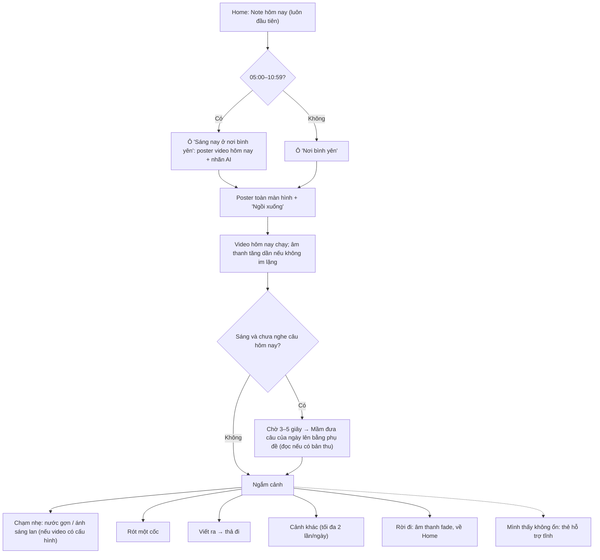

# Lá Lành — PRD "Nơi bình yên"

> Phiên bản: 0.7 (nháp) · Cập nhật: 22/10/2026 · Trạng thái: **chờ chủ sản phẩm duyệt**, chưa được duyệt để triển khai.
> Tài liệu này là requirement gốc cho tính năng "Nơi bình yên". Nó bổ sung cho [la-lanh-prd.md](la-lanh-prd.md) và [US-03](../user-stories/US-03-doc-note-hom-nay.md), không thay đổi AC của US-01 đến US-19.
> Nền nghiên cứu (máy chủ sản phẩm, ngoài git): `reports/Học từ app thư giãn.md`, `reports/Safe place thư giãn Lá Lành.md`, `reports/Note buổi sáng nơi bình yên.md`, và các ghi chú trong `research_notes/Nơi bình yên video AI/`, `research_notes/Note buổi sáng nơi bình yên/`. Các kết luận cần thiết đã được chép vào PRD này.
>
> **Thay đổi so với 0.6** (chủ sản phẩm chốt 22/10/2026: nơi bình yên **không thêm dịch vụ trả phí hay tích hợp mới** ngoài hệ thống đang chạy; mức chi phí cụ thể giữ ngoài repo):
> 1. **Video do chủ sản phẩm tự tạo** bằng công cụ AI bên ngoài, trên gói cho phép dùng thương mại. Lá Lành không gọi, không tích hợp và không trả phí dịch vụ tạo video nào. Video vẫn gắn nhãn AI (D8, D9, §8.6).
> 2. **Nhạc do chủ sản phẩm tự tải lên**, mỗi file có license dùng trong app và bằng chứng license đi kèm; nhạc là tùy chọn (D10, §8.3).
> 3. **Xử lý media bằng một script ffmpeg chạy trên máy quản trị** ([scripts/media/nby-media.sh](../../scripts/media/nby-media.sh)): kiểm đầu vào, cắt, lặp liền mạch, chỉnh màu, chuyển mã, poster, chuẩn hóa âm lượng, SHA-256. Không dùng dịch vụ đám mây (NBY-09 AC02, §7.6).
> 4. **Đồ họa vẽ bằng code, kiểu A "giấy vẽ tay"** (D21): rót nước, cốc, chiếc lá thả đi, thanh phụ đề và chip vẽ bằng SVG/CSS cùng chất trang giấy của Note. Bỏ clip rót, ảnh cốc và ảnh lá tạo bằng AI (NBY-05, NBY-07, §7.4). Cảnh vẫn là video; không dựng cảnh bằng code.
> 5. **Giọng Mầm v1 chỉ có phụ đề.** Tùy chọn: chủ sản phẩm tự thu giọng thật, dùng cùng cơ chế gói. Giọng AI và giọng nhân bản để sau. Đây là đề xuất thay D16, chờ owner xác nhận; D17 hoãn. Các yêu cầu về người cho giọng rời khỏi v1 (NBY-04 AC10, §8.3, §8.5).
> 6. **Media origin** là hostname thứ hai trên máy chủ hiện có, **anh em** với host app, không nằm dưới host app (D19, §7.1).
> 7. Giữ nguyên mọi sửa của 0.5 và 0.6.
>
> **Thay đổi so với 0.5** (review Codex PR #44 @ `53df113`, hai P2):
> 1. Origin WebView iOS là `capacitor://localhost` (mặc định `server.iosScheme`), không phải `la-lanh://localhost`; `ios.scheme` là scheme build Xcode. Sửa mô tả, CORS allowlist và yêu cầu bằng chứng (§7.1, §14). Không đổi cấu hình native.
> 2. US-03 AC43 trỏ đúng wrapper `reading_projection.active` cho các trường nguồn.
> 3. DoD và NBY-06 AC09, NBY-07 AC04 đồng bộ với media origin riêng (D19): phân biệt asset đóng gói với `fetch` tới media origin đã allowlist; giữ omit credential, no-referrer, kiểm hash trước `blob:` và cấm nội dung tâm sự rời máy.
>
> **Thay đổi so với 0.4** (xử lý review Codex PR #44 @ `6c6bc21`, sáu P2; không thay quyết định owner đã chốt):
> 1. Tải media không mang credential: media origin riêng ngoài `cookie_domain`, `fetch` trọn file `credentials: "omit"`, kiểm SHA-256, phát qua `blob:`; CSP/CORS/Range/service worker thống nhất cho web và Capacitor (§7.1, D19).
> 2. Âm thanh câu mở của Note là **một gói chung**, không có URL theo từng câu; inventory và log media origin cập nhật (NBY-09 AC12, §8.1, §9, US-03 AC43/AC47).
> 3. US-03 AC43 chỉ tra audio khi bản đọc là `deterministic`, Western, giọng direct, không fallback; Luna giữ nguyên câu mở không được đọc trừ khi owner chọn khác (D20).
> 4. Lịch sử chống lặp theo ngày (≤ 7 ngày × ≤ 4 video), gồm ngày, đêm và "Cảnh khác" (NBY-02 AC03, AC06, §8.1).
> 5. Bỏ nhánh mood khỏi v1; D6 ghi rõ hai phương án và hệ quả, không tồn tại AC mood song song với quy tắc cấm (§2.2, NBY-04 AC08, NBY-08 AC08).
> 6. Manifest có revision tăng dần, hạn dùng, danh sách thu hồi, chống phát lại; rollback là phát hành mới được ký; hành vi offline và xoay khóa (§7.7, NBY-09 AC07, §9).
> 7. Viện dẫn xử phạt văn hóa–quảng cáo cập nhật sang Nghị định 87/2026/NĐ-CP (§8.2).
>
> **Thay đổi so với 0.3** (chủ sản phẩm chọn "hướng B" ngày 22/10/2026):
> 1. Ghi bản chất sản phẩm do chủ sản phẩm phát biểu (§0.1) làm thước đo cho mọi quyết định.
> 2. **Note hôm nay là "trang giấy", nơi bình yên là "ô cửa sổ"**: Note giữ chất giấy minh họa (hợp Ultraviolet Paper và reel tham chiếu R6), Mầm sống trên trang giấy và **đọc câu mở của Note khi người dùng chạm**; cảnh video chỉ ở nơi bình yên. Hành vi của Note thuộc [US-03 §24](../user-stories/US-03-doc-note-hom-nay.md); PRD này giữ phần chung (giọng Mầm, audio, nhãn AI).
> 3. Đã xác minh trong code: câu mở của Note (bản Western, giọng direct) lấy từ một kho **90 câu viết sẵn** (15 nhóm tình huống × 6), mỗi câu 8–11 từ, nên audio có thể tạo sẵn offline, không gửi dữ liệu người dùng cho dịch vụ giọng.
>
> **Thay đổi so với 0.2** (theo yêu cầu chủ sản phẩm ngày 22/10/2026):
> 1. Video không còn là bộ cố định đóng gói trong app: **chủ sản phẩm đăng video mới hằng ngày vào một thư viện**, app **chọn ngẫu nhiên** một video cho mỗi buổi sáng.
> 2. Thêm **một lớp hiệu ứng chạm** phủ lên mọi video, cấu hình theo từng video.
> 3. **Mầm Aura đọc "câu của ngày"** vào buổi sáng, nối nơi bình yên với Note hôm nay thành một nghi thức sáng.
> 4. Sửa các lỗi của 0.2: mốc đêm mâu thuẫn (21:00/23:00), câu ví dụ gần như dịch lại reel R3, khóa nghi thức bị "tiêu" lúc 00:30.

---

## 0. Tóm tắt một đoạn

Mỗi sáng, người dùng mở Lá Lành và đọc **Note hôm nay** như thường lệ. Ngay dưới Note là ô **"Sáng nay ở nơi bình yên"** với ảnh tĩnh của cảnh hôm nay. Chạm vào, một video thiên nhiên chân thực, gần như tĩnh, được chọn ngẫu nhiên từ thư viện mà chủ sản phẩm cập nhật mỗi ngày, mở ra toàn màn hình. Sau vài giây để mắt ổn định, **Mầm** đưa lên một câu ngắn của ngày bằng phụ đề (và khẽ đọc nếu có bản thu giọng). Người dùng có thể chạm nhẹ vào cảnh (nước gợn, ánh sáng lan), giữ để rót cho mình một cốc nước trên tấm thẻ giấy vẽ tay, hoặc viết điều đang nặng lòng rồi thả nó đi. Cảnh do chủ sản phẩm tạo bằng công cụ AI và được gắn nhãn; cốc, lá và Mầm là đồ họa vẽ bằng code. Không có đồng hồ, không có streak, không ai đọc những gì người dùng viết, kể cả Lá Lành.

### 0.1. Bản chất Lá Lành (chủ sản phẩm, 22/10/2026)

> Lá Lành là **nơi tìm được những giây phút thư giãn bình yên, vui vẻ, những khoảnh khắc giúp bạn cảm giác được hiểu.**

Mỗi bề mặt buổi sáng phục vụ một phần của câu này, và không bề mặt nào được làm mất phần khác:

| Phần | Bề mặt | Cách phục vụ |
|---|---|---|
| Cảm giác được hiểu | Note hôm nay (trang giấy) | Câu mở gọi đúng một tình huống đời thường ("Bạn bận cả buổi, việc vẫn chưa xong."); Mầm đưa câu lên khi người dùng chạm, đọc bằng giọng ấm nếu có bản thu (D16) |
| Thư giãn, bình yên | Nơi bình yên (ô cửa sổ) | Cảnh video chậm, âm thanh, câu của ngày, chạm nhẹ, thả đi |
| Vui vẻ | Mầm | Một nhân vật nhỏ, ấm, hơi tinh nghịch; phản ứng khi được chạm; không bao giờ phán xét hay gây áy náy |

Khi một yêu cầu mới làm một phần tốt hơn nhưng làm phần khác tệ đi (ví dụ thêm thông báo làm "được nhắc" nhưng mất "bình yên"), mặc định là không làm cho tới khi có cách giữ cả ba.

## 1. Bối cảnh và vấn đề

- Lá Lành chưa có bề mặt nào để người dùng chỉ "ở đó". Mood check-in (US-04) cố ý không có text, không có lịch sử, không có crisis flow.
- Người trẻ Việt có nhu cầu thật nhưng lệch về riêng tư; tâm sự hiện sống trên các trang Confessions công khai.
- "Chữa lành" và "năng lượng tích cực" đã bị báo chí phê phán như trào lưu thương mại; copy phải tránh cả hai.
- Các app thư giãn được yêu thích nhất mở ra là đã đủ và dùng cảnh quay/video, không dựng bằng code. Ba bản mẫu dựng bằng code (21/10/2026) bị chủ sản phẩm đánh giá "giả, không relax".
- Calm, Headspace, CHANI cho thấy mô hình **"một thứ mới cho hôm nay, một chạm, không phạt khi bỏ qua"** là lõi của nghi thức buổi sáng. Daily Calm đổi nội dung mỗi 24 giờ; CHANI ghép horoscope ngày với một phần thiền theo ngày.
- Bằng chứng tâm lý (chi tiết §2.5): một khoảnh khắc sáng ngắn **có thể** nâng tâm trạng một chút trong ngắn hạn; xem cảnh thiên nhiên giúp hồi phục căng thẳng và giúp người đang buồn nhiều hơn; nhưng **không** có bằng chứng "sáng tốt thì cả ngày tốt", và câu khẳng định kiểu "bạn thật tuyệt vời" có thể làm người tự ti thấy tệ hơn.

## 2. Mục tiêu, phi mục tiêu và nguyên tắc

### 2.1. Mục tiêu

| ID | Mục tiêu | Cách biết đã đạt (v1) |
|---|---|---|
| G1 | Người dùng thấy dịu lại chỉ sau vài giây ngồi | Test người dùng có đồng ý (8–12 người 18–25): ≥ 70% mô tả bằng từ như "dịu", "yên", "dễ chịu" sau 30 giây |
| G2 | Cảnh trông như thước phim thật, đủ chậm để mắt nghỉ | ≥ 70% không chỉ ra được lỗi hình (méo, chớp, đường nối) trong 2 phút xem; không ai thấy chóng mặt |
| G3 | Buổi sáng có một nghi thức ngắn nối với Note: đọc Note → vào cảnh → nhận câu của ngày từ Mầm | Toàn bộ nghi thức gói gọn trong 60–90 giây nếu người dùng muốn; ≥ 70% người test nói muốn mở lại sáng hôm sau mà không cần nhắc |
| G4 | Mỗi ngày có cái mới mà vẫn đồng nhất | Không người test nào nhận xét cảnh "lạc tông" hay "giật mình" giữa các ngày; thư viện qua kiểm tra phong cách §7.5 |
| G5 | Có chỗ để viết ra rồi buông, với lời hứa riêng tư đúng sự thật | Kiểm thử chứng minh chữ không rời máy, không nằm trong storage sau khi thả |
| G6 | Không tạo rủi ro pháp lý hay đạo đức mới | Không trường dữ liệu người dùng mới trên server; nhãn privacy Apple/Google không đổi; nội dung AI gắn nhãn đúng Luật 134/2025 và Nghị định 142/2026; không claim sức khỏe |

### 2.2. Phi mục tiêu

- Không trị liệu, không chẩn đoán, không claim giúp ngủ hay "đổi vận".
- Không AI đọc hoặc trả lời nội dung tâm sự. **Không gọi API AI nào lúc chạy**: video, giọng đọc và câu của ngày được tạo và duyệt trước khi đăng.
- **Không thêm dịch vụ trả phí hay tích hợp bên thứ ba mới** (tạo video, giọng, nhạc, CDN, analytics) cho nơi bình yên trong v1. Công cụ chủ sản phẩm tự dùng bên ngoài để tạo video hay nhạc không phải tích hợp của Lá Lành.
- Không chia sẻ tâm sự cho người khác.
- **Không ghép cảm xúc hay câu của ngày với chiêm tinh**: cảnh, câu và hiệu ứng không được chọn theo cung, lá số, mood hay nội dung Note. Trong v1 không có ngoại lệ nào (kể cả mood US-04). Nếu owner duyệt phương án D6-B ở §12, ngoại lệ duy nhất được phép là thay câu của ngày bằng **câu đồng hành "cho phép" được xuất bản cùng ngày** (NBY-04 AC08); quy tắc này phải được sửa ngay trong §2.2 và NBY-04 khi duyệt, không tồn tại song song như một AC riêng.
- Không streak, không đếm phút, không phần thưởng, không push trong v1, không badge "video mới".
- Không feed vô tận: "Cảnh khác" có giới hạn trong ngày (NBY-02).
- Không paywall hay upsell trong, ngay trước hoặc ngay sau nơi bình yên.
- Không dùng thời tiết thật, vị trí, nhịp tim, micro hay camera.
- Không white/pink noise, binaural beats, "sóng não".
- Không cảnh có người thật, khuôn mặt, địa danh nhận diện được hay sự kiện có thật.
- Không nói hay ngụ ý cảnh là "quay thật".

### 2.3. Nguyên tắc thiết kế

1. **Chỗ trú, không phải bài tập.** Mọi thứ tùy chọn trừ một chạm "Ngồi xuống".
2. **Note trước, nơi bình yên sau. Note là trang giấy, nơi bình yên là ô cửa sổ.** Home luôn để Note hôm nay lên đầu, trong chất giấy minh họa; cảnh video chỉ xuất hiện khi người dùng bước qua ô cửa sổ. Không đặt video sau chữ của Note, không để cảnh hay câu của nơi bình yên phụ thuộc nội dung Note.
3. **Ngắm là chính, chạm nhẹ là phụ.** Tương tác ít, chậm, hợp với thế giới trong cảnh; không kiểu đồ chơi.
4. **Mới mỗi ngày, nhưng một giọng.** Mọi video và câu trong thư viện theo cùng một hướng dẫn phong cách (§7.5) để sự ngẫu nhiên không thành giật mình.
5. **Mầm là người kể, không phải nhân vật trong cảnh.** Mầm Aura xuất hiện nhỏ trong thanh phụ đề (lớp giao diện), không đặt vào khung video; Mầm chỉ đọc, không khuyên, không tiên đoán, không "nhớ bạn".
6. **Cho phép, không ép vui.** Câu của ngày mời và cho phép ("không cần phải ổn ngay"), không ra lệnh tích cực, không khẳng định ngôi thứ nhất.
7. **An toàn, dư dả, mềm mại.** Không có gì héo, nguội, hết hạn hay khan hiếm.
8. **Trung thực.** Cảnh AI được gắn nhãn (giọng cũng vậy, nếu sau này dùng giọng AI); "Không ai đọc, kể cả Lá Lành" chỉ được viết khi runtime thực sự không gửi, không lưu, không log.

### 2.4. Tham chiếu phong cách (chủ sản phẩm gửi 21/10/2026)

| # | Reel | Lấy gì |
|---|---|---|
| R1 | Wondervisionary — bờ hoa nhìn biển, mây lớn ([link](https://www.facebook.com/share/r/1A6sG1sZmA/)) | Tiền cảnh nhòe, nhiều khoảng trời, chuyển động chỉ ở hoa và sóng |
| R2 | Wondervisionary — lối mòn sườn đồi nắng chiều ([link](https://www.facebook.com/share/r/1CXw5rQpba/)) | Ánh sáng vàng dịu, sương tạo chiều sâu |
| R3 | Wondervisionary — cửa sổ gỗ, cốc trà, đồng hoa ([link](https://www.facebook.com/share/r/1DoxRQPQAj/)) | Gần nhất với "rót một cốc, ngồi nhìn ra"; nhắc phải có license nhạc (reel bị tắt tiếng do khiếu nại) |
| R4 | Hedoniaru — suối, cầu gỗ, nắng qua tán lá ([link](https://www.facebook.com/share/v/18tcZkaf7C/)) | Camera trôi rất chậm; cận cảnh nắng trên nước |
| R5 | Surendra Digital Studio — cỏ bốn lá đọng sương ([link](https://www.facebook.com/share/r/19xpvhdXGr/)) | Tông huyền ảo, dễ "lộ AI": chỉ cho dịp đặc biệt |
| R6 | Power of Positivity — thẻ giấy vân, minh họa vẽ tay cô gái giữa vòng hoa vàng, một câu lớn ([link](https://www.facebook.com/share/r/1Jt5Kh7bvi/)) | **Tham chiếu cho Note dạng trang giấy** (US-03 §24): giấy có vân, minh họa tay, một câu chính, chuyển động rất ít. Không lấy cách viết "rồi điều tốt sẽ đến" (hứa kết quả) |

Reel chỉ là tham chiếu phong cách. Không dùng lại hình, nhạc hay caption của reel; không mô phỏng gần như nguyên khung một reel cụ thể.

### 2.5. Vì sao routine này vẫn calm, và với điều kiện gì

Ba thứ mới (video đổi mỗi ngày, lớp chạm, Mầm đọc câu) đều có thể làm nghi thức **bớt** yên nếu làm sai. Chúng giữ được sự calm khi thỏa các điều kiện sau, và các điều kiện này là AC bắt buộc:

| Rủi ro | Vì sao có thể mất calm | Điều kiện để vẫn calm |
|---|---|---|
| Video ngẫu nhiên | Ngẫu nhiên mỗi lần mở biến thành "lướt feed"; cảnh lệch tông gây giật mình | Chọn **một lần cho mỗi buổi sáng** và giữ nguyên cả ngày; chỉ chọn trong thư viện đã qua kiểm tra phong cách; không lặp trong 7 ngày gần nhất; "Cảnh khác" tối đa 2 lần/ngày, chuyển bằng crossfade chậm |
| Đăng hằng ngày | Ngày quên đăng thành "trống"; chất lượng không đều | App không phụ thuộc video mới: luôn chọn được từ thư viện cũ; mỗi video phải qua cổng duyệt §7.6 trước khi vào thư viện |
| Lớp chạm | Hiệu ứng mạnh, giả, hoặc lệch với cảnh phá cảm giác thật (bài học của 3 bản mẫu) | Hiệu ứng rất nhẹ, cấu hình theo từng video (chỉ "nước" khi có mặt nước thật trong cảnh); mặc định "không có" nếu chưa cấu hình; tự tắt khi máy yếu |
| Mầm đọc câu (khi có bản thu) | Giọng bật ra đột ngột; câu "lên dây cót" kiểu tích cực độc hại | Chờ 3–5 giây sau khi cảnh mở mới đọc; giọng nhỏ, chậm, tăng dần; có phụ đề; tôn trọng chế độ im lặng; một câu ≤ 20 từ, cho phép chứ không ra lệnh |
| Tổng thể | Thêm bước, thêm chữ, thêm lựa chọn | Nghi thức sáng tối đa 3 bước (Note → cảnh → câu); không màn hướng dẫn; không câu hỏi; người dùng có thể rời bất kỳ lúc nào |

Bằng chứng nền (đã nghiên cứu, mức độ khiêm tốn): tâm trạng đầu ngày có ảnh hưởng tới phần còn lại của ngày làm việc (Rothbard & Wilk 2011, mẫu nhỏ); can thiệp tâm lý tích cực ngắn qua app có hiệu ứng nhỏ (g ≈ 0,29, sát ngưỡng ý nghĩa); xem cảnh thiên nhiên giúp hồi phục căng thẳng ngắn hạn, nhiều hơn ở người đang buồn; đặt tên một chuỗi hành động là "nghi thức" giảm lo âu (Brooks 2016); thói quen cần trung vị 66 ngày để thành tự động (Lally 2010); câu tự khẳng định tích cực làm người tự ti thấy tệ hơn (Wood 2009); áp lực "phải vui" đi trước triệu chứng trầm cảm ở người đang trầm cảm (Bastian 2012). Kết luận: hứa "một khoảng lặng nhỏ đầu ngày", không hứa "năng lượng cho cả ngày".

## 3. Người dùng, lối vào và phạm vi release

- **Actor:** guest hoặc account user, **18+** theo chính sách hiện hành. Không yêu cầu login, không yêu cầu ngày sinh.
- **Actor quản trị:** chủ sản phẩm (và người được ủy quyền) tự tạo video bên ngoài, xử lý bằng script local, rồi đăng video, nhạc, câu của ngày và (tùy chọn) bản thu giọng qua công cụ quản trị (NBY-09).
- **Lối vào v1:**
  - **Buổi sáng (05:00–10:59 theo giờ máy):** ngay dưới thẻ Note hôm nay, ô "Sáng nay ở nơi bình yên" với poster của video hôm nay, nhãn "Cảnh tạo bằng AI" và một dòng mời ngắn. Ô không được đẩy thẻ Note xuống ở khung 390×844.
  - **Các giờ khác:** ô nhỏ hơn "Nơi bình yên" ở cùng vị trí, không nhắc "sáng nay".
  - Route `/noi-binh-yen`. Không đặt lối vào phụ thuộc mood trong v1.
- **Feature flag:** `noiBinhYen` tắt mặc định; staging trước, production sau release gate §10.
- **Nền tảng:** web/PWA và app Capacitor iOS/Android dùng chung mã web.

### 3.1. Mốc thời gian dùng thống nhất (sửa mâu thuẫn của 0.2)

Repo hiện có 6 mốc thời gian khác nhau. Nơi bình yên chỉ dùng giờ **địa phương của máy** và các mốc sau:

| Khoảng | Tên | Hành vi |
|---|---|---|
| 05:00–10:59 | Sáng | Ô "Sáng nay…", Mầm đưa câu của ngày lần đầu vào cảnh (đọc nếu có bản thu) |
| 11:00–20:59 | Ngày | Biến thể ánh sáng ngày; câu của ngày chỉ hiện dạng chữ khi người dùng chạm vào Mầm |
| 21:00–22:59 | Tối | Biến thể đêm; không đọc giọng; câu hiện dạng chữ |
| 23:00–04:59 | Khuya | Biến thể đêm; Mầm chỉ hiện một câu chúc ngủ viết sẵn, không đọc giọng, không gợi ý gì thêm |

"Ngày" của nơi bình yên (để chọn video và câu) đổi lúc **05:00 giờ máy**, không phải 00:00 giờ server, để người mở app lúc 00:30 không "tiêu" mất buổi sáng. Khóa nghi thức hiện có `la-lanh-daily-ritual-v1` (theo `note_date` của server) **không** được dùng cho nơi bình yên.

### 3.2. Phạm vi theo phiên bản

| Hạng mục | v1 | v1.1 (cần quyết định riêng) | Không làm |
|---|---|---|---|
| Thư viện video | Chủ sản phẩm đăng qua công cụ quản trị; app chọn ngẫu nhiên một video mỗi buổi sáng; bộ khởi đầu ≥ 14 video đã duyệt trước khi bật | Bộ sưu tập theo mùa, Tết, Trung thu | Video người dùng tải lên; video có người thật |
| Cảnh | Video AI do chủ sản phẩm tự tạo bên ngoài, xử lý bằng script local (§7.6); lặp 12–20 giây, 9:16, gần như tĩnh, gắn nhãn; biến thể ngày/đêm theo thẻ | Camera trôi chậm kiểu R4 | 3D, cảnh dựng bằng code; tích hợp API tạo video |
| Đồ họa lớp đồng hành | Kiểu A "giấy vẽ tay" (D21): thẻ giấy kem, nét mực hơi run; cho cốc và rót nước, chiếc lá, thanh phụ đề cùng Mầm, chip (§7.4) | Thêm họa tiết theo mùa | Ảnh chụp/AI cho cốc và lá; đồ họa phẳng kiểu icon |
| Lớp chạm | Hiệu ứng "nước" (khúc xạ trong vùng nước có mặt nạ) và "ánh sáng" (quầng sáng mềm lan nhẹ) cấu hình theo video; mặc định "không" | Hiệu ứng "gió" (tiếng gió lớn dần, video lá lay nhanh hơn chút) | Kéo mây, vuốt cỏ, hạt lấp lánh, hiệu ứng kiểu game |
| Câu của ngày | Một câu mỗi ngày, Mầm đưa lên bằng phụ đề vào buổi sáng; chỉ đọc thành tiếng khi có bản thu của chủ sản phẩm (D16) | Giọng AI hoặc nhân bản (quyết định riêng) | Câu sinh bằng AI lúc chạy; câu theo cung/mood |
| Mầm | Mầm Aura dạng nhỏ trong thanh phụ đề, chỉ đưa câu và chúc ngủ; trên Note (US-03 §24) Mầm ngồi ở góc trang giấy, phản ứng khi được chạm và đọc câu mở nếu có bản thu | Mầm lớn dần theo số ngày ghé (theo báo cáo companion) | Mầm trò chuyện, khuyên, tiên đoán, đọc phần chiêm tinh |
| Note hôm nay | Thuộc US-03 §24: chất trang giấy, một câu chính lớn; audio câu mở chỉ khi chủ sản phẩm đã thu đủ 90 câu direct | Đọc thêm phần tình huống | Video sau chữ Note; đọc evidence, chart, roast voice |
| Rót nước | 4 món, đồ họa SVG kiểu A: giữ để rót, nước dâng có mặt sóng, hơi bốc với đồ nóng (NBY-05) | Thêm món | Clip rót hay ảnh cốc tạo bằng AI; món phải mua; suy mood từ đồ uống |
| Âm thanh | Âm thanh nền theo thẻ cảnh + nhạc êm tùy chọn do chủ sản phẩm tải lên có license; chỉ phát khi app mở | Phát nền khi khóa màn hình (D1) | Âm thanh/nhạc từ YouTube, noise/binaural; dịch vụ nhạc thuê bao tích hợp vào app |
| Tâm sự | Chip cảm xúc tùy chọn + ô viết; thả đi | Giữ lại trên máy (D3) | AI, server, chia sẻ |
| An toàn | Lối "Mình thấy không ổn" mọi lúc; thẻ hỗ trợ tĩnh offline | Gợi ý thẻ khi có từ khóa trên máy (D5) | Tự báo cáo, chặn |
| Nhắc buổi sáng | Không | Thông báo cục bộ, tắt mặc định, tối đa 1 lần/ngày, chữ chung chung (D13) | Push từ server, nhắc kiểu "bạn đã bỏ lỡ" |

## 4. Trải nghiệm tổng thể

**Nghi thức sáng chuẩn (60–90 giây nếu người dùng muốn):** đọc Note (~20–30 giây) → chạm ô nơi bình yên → 3–5 giây để mắt ổn định với cảnh → câu của ngày (~5–8 giây) → ngồi tiếp bao lâu tùy thích. Mục "Thử một việc nhỏ" của Note là phần "chủ động" của buổi sáng; nơi bình yên là phần "thả lỏng". Hai phần không chia sẻ nội dung.

Bố cục trong cảnh: video toàn khung dọc; nhãn AI góc trên; **thanh phụ đề ở đáy** gồm Mầm nhỏ bên trái và dòng chữ; thanh điều khiển mờ phía dưới gồm: cảnh khác, cốc nước, âm thanh, viết ra, tạm dừng, "Mình thấy không ổn", rời đi. Thanh điều khiển tự mờ sau 6 giây không chạm (luôn hiện khi bật VoiceOver/TalkBack hoặc phóng chữ lớn).

## 5. User stories và tiêu chí chấp nhận

AC đánh mã `NBY-xx-ACyy`. Mỗi story là một kết quả người dùng đạt được, theo quy tắc của [README user stories](../user-stories/README.md).

### NBY-01 — Bước vào từ Note buổi sáng

> Là người vừa đọc Note hôm nay, tôi muốn bước vào một khung cảnh yên chỉ với một chạm, để bắt đầu ngày bằng một khoảng lặng nhỏ.

| AC | Tiêu chí |
|---|---|
| AC01 | Home luôn hiển thị thẻ Note hôm nay trước; ô nơi bình yên nằm ngay dưới thẻ Note và không đẩy thẻ Note xuống ở khung 390×844. |
| AC02 | 05:00–10:59 giờ máy: ô hiện tiêu đề "Sáng nay ở nơi bình yên", poster của video hôm nay (NBY-02), nhãn "Cảnh tạo bằng AI" và một dòng mời viết sẵn. Ngoài khung này: ô "Nơi bình yên" với poster cùng video. |
| AC03 | Chạm ô → poster toàn màn hình + nút "Ngồi xuống" trong ≤ 1 giây khi poster đã có trên máy; không hỏi mood, mục tiêu, email hay login. |
| AC04 | Không paywall, quảng cáo, upsell hay banner tính năng khác ở bất kỳ màn nào của nơi bình yên và ô lối vào. |
| AC05 | Mốc thời gian theo §3.1; không gọi API để biết giờ, không xin vị trí. |
| AC06 | Roast voice tắt trên toàn bộ nơi bình yên và ô lối vào. |
| AC07 | Nếu chưa có video nào trên máy và đang offline: ô hiện poster dự phòng đóng gói sẵn, nơi bình yên vẫn mở được với poster tĩnh và âm thanh đóng gói; không báo lỗi. |
| AC08 | Ô lối vào không có badge, chấm đỏ, chữ "mới" hay số đếm. |

### NBY-02 — Video của hôm nay từ thư viện

> Là người quay lại mỗi sáng, tôi muốn thấy một khung cảnh mới mà vẫn quen thuộc, để có lý do ngồi lại mà không bị choáng.

**Quy tắc chọn video (chạy trên máy):**

1. App tải **manifest thư viện** công khai đang còn hiệu lực (§7.1, §7.7) — không kèm cookie hay định danh người dùng.
2. Lọc theo biến thể ánh sáng phù hợp khung giờ §3.1 (thẻ `ngày`/`đêm`) và chỉ lấy video đã có trên máy hoặc tải được.
3. Loại **mọi** video đã hiển thị trong 7 "ngày nơi bình yên" gần nhất, gồm hôm nay: video ngày, video đêm và các video của lượt "Cảnh khác" (lịch sử theo ngày, NBY-02 AC06).
4. Ưu tiên nhẹ video đăng trong 3 ngày gần đây (trọng số × 2) để thư viện "mới" có cơ hội xuất hiện, nhưng vẫn ngẫu nhiên.
5. Chọn một video bằng bộ sinh ngẫu nhiên của máy; **giữ nguyên lựa chọn đó cho đến 05:00 hôm sau**.
6. Nếu chưa có manifest (lần đầu, offline): dùng bộ video khởi đầu đóng gói sẵn trong app.

| AC | Tiêu chí |
|---|---|
| AC01 | Mỗi "ngày nơi bình yên" (§3.1) chọn đúng một video ngày và, nếu cần, một video đêm; mở lại app trong ngày thấy cùng video. |
| AC02 | Lựa chọn không dựa trên cung, lá số, mood, nội dung Note, vị trí hay bất kỳ dữ liệu cá nhân nào. |
| AC03 | Không hiển thị lại bất kỳ video nào đã hiển thị trong 7 ngày nơi bình yên gần nhất (gồm hôm nay; tính cả ngày, đêm và "Cảnh khác"), miễn là thư viện còn video phù hợp chưa nằm trong lịch sử đó. Nếu không còn, chọn video có lần hiển thị cuối xa nhất; nếu bằng nhau thì ngẫu nhiên. Mỗi ngày tối đa 4 video (1 ngày + 1 đêm + 2 "Cảnh khác"), nên bảo đảm này cần thư viện ≥ 28 video phù hợp mỗi biến thể để luôn đạt; bộ khởi đầu 14 video (NBY-09 AC10) chỉ đạt khi người dùng không dùng "Cảnh khác". |
| AC04 | Nút "Cảnh khác" chọn video khác theo cùng quy tắc, chuyển bằng crossfade ≥ 1 giây; tối đa **2 lần** mỗi ngày; sau đó nút ẩn và một dòng nhẹ: "Hôm nay mình ngồi ở đây nhé." |
| AC05 | Manifest, video, poster và audio tải từ **media origin không cookie** bằng `fetch(…, { credentials: "omit" })`, kiểm SHA-256 với manifest rồi mới phát từ `blob:` URL (§7.1). Request không mang cookie, token hay header định danh; e2e kiểm trên cả web và Capacitor. Server/proxy không ghi log ai xem video nào (§9). |
| AC06 | Trên máy chỉ lưu **lịch sử theo ngày** trong khóa `la-lanh-binh-yen-library-v1`: tối đa 7 mục `{ day: "YYYY-MM-DD", ids: [...] }` (ngày theo mốc 05:00 §3.1, mỗi mục ≤ 4 ID video), cùng ID video ngày/đêm của hôm nay, số lượt "Cảnh khác" hôm nay (0–2) và cờ "đã nghe câu hôm nay". Không lưu giờ xem, thời lượng, số lần vào hay thứ tự trong ngày. Mục cũ hơn 7 ngày bị xóa khi mở app. Khóa này, kho blob media (AC09) và highest-revision của manifest (§7.7) nằm trong `clearPersonalDataOnDevice()`. |
| AC07 | Video gỡ khỏi thư viện (bởi quản trị) biến mất khỏi lựa chọn ở lần tải manifest kế tiếp; nếu đang là video hôm nay thì chọn lại ở lần mở sau, không cắt ngang người đang xem. |
| AC08 | Tải video mới chỉ khi app đang mở; mặc định chỉ tải trước video của ngày mai khi có Wi-Fi (nếu nền tảng cho biết); trên dữ liệu di động chỉ tải video hôm nay. Có tùy chọn "Chỉ tải cảnh khi có Wi-Fi". |
| AC09 | Bộ đệm trên máy là kho blob trong IndexedDB, khóa bằng SHA-256 nội dung, giữ tối đa 3 video tải về gần nhất + gói âm thanh Note (§7.1); tổng ≤ 40 MB ngoài bộ khởi đầu đóng gói. Mục nằm trong danh sách thu hồi của manifest hiện hành bị xóa ngay khi nhận manifest đó (§7.7). |
| AC10 | Video lặp liền mạch: không lộ đường nối, chớp hay giật trong 10 phút xem liên tục trên iPhone và Android tầm trung. |
| AC11 | Video không có rãnh âm thanh; tự phát muted + `playsinline`; nếu bị chặn tự phát (iOS Low Power Mode) giữ poster tĩnh, không báo lỗi. |
| AC12 | Nút **Tạm dừng** chuyển động luôn có (WCAG 2.2.2). Với `prefers-reduced-motion` hoặc `data-motion="paused"`: mặc định hiện poster tĩnh, người dùng có thể tự bật video. |
| AC13 | Phát video dừng khi `visibilitychange` sang hidden hoặc rời route. |
| AC14 | Nhãn AI hiển thị theo §8.5 mỗi lần vào cảnh. |

### NBY-03 — Lớp chạm trên video

> Là người đang ngồi ngắm, tôi muốn chạm nhẹ vào cảnh và thấy nó phản hồi tinh tế, để cảm giác mình đang ở trong đó.

**Kiểu hiệu ứng (quản trị chọn cho từng video ở NBY-09):**

| Kiểu | Dùng khi | Hiệu ứng | Giới hạn |
|---|---|---|---|
| `nuoc` | Video có mặt nước thật (suối, hồ, biển lặng) | Khúc xạ: biến dạng UV rất nhẹ trên texture video, loang ~1 giây rồi lặng, **chỉ trong mặt nạ vùng nước** do quản trị vẽ; không vẽ vòng sáng, không bóng nhựa | Biên độ dịch ≤ 1,5% chiều rộng; tối đa 3 gợn đồng thời |
| `anh_sang` | Video không có nước (cửa sổ, đồng hoa, đồi) | Một quầng sáng ấm, mềm, lan rộng rồi tan trong ~1,2 giây tại điểm chạm, hòa theo màu cảnh (blend kiểu screen, độ mờ ≤ 12%) | Không hạt, không lấp lánh, không đổi màu cảnh |
| `khong` | Mặc định khi chưa cấu hình, hoặc cảnh không hợp | Không hiệu ứng | — |

| AC | Tiêu chí |
|---|---|
| AC01 | Lớp chạm là một canvas WebGL 1 trong suốt phủ trên video, đọc cấu hình `touch` của video từ manifest; không cần video riêng cho hiệu ứng. |
| AC02 | Kiểu `nuoc` chỉ phản hồi khi chạm trong đa giác mặt nạ (tọa độ chuẩn hóa 0–1, khớp khung 9:16 sau khi cắt cho màn hình); chạm ngoài mặt nạ không có gì. |
| AC03 | Phản hồi bắt đầu trong ≤ 33 ms; kéo ngón tay để lại tối đa 1 gợn mỗi 120 ms (không thành "vẽ"). |
| AC04 | Nếu không có WebGL, texture video không cập nhật được (giới hạn iOS) hoặc frame time > 33 ms trong 3 giây: tắt lớp chạm, video vẫn phát; không báo lỗi. |
| AC05 | Với giảm chuyển động hoặc khi đang tạm dừng: không hiệu ứng chạm. |
| AC06 | Không âm thanh chạm mặc định; nếu người dùng bật "Âm thanh chạm", âm thanh nhỏ, giới hạn tần suất. |
| AC07 | Không điểm số, mục tiêu hay phần thưởng gắn với việc chạm; không đếm số lần chạm. |
| AC08 | Lớp chạm không chặn cử chỉ hệ điều hành ở mép màn hình (24 px) và không chặn nút điều khiển. |
| AC09 | Mọi chức năng đều làm được bằng nút thường; cảnh có mô tả ngắn cho trình đọc màn hình. |
| AC10 | Mỗi kiểu hiệu ứng được chủ sản phẩm duyệt trên ít nhất 3 video thật trước khi bật; nếu bị đánh giá "giả", kiểu đó tắt bằng cấu hình, không cần phát hành app mới. |

### NBY-04 — Mầm đưa câu của ngày

> Là người bắt đầu buổi sáng, tôi muốn nhận một câu ngắn, dịu dàng khi ngồi xuống, để có một điều nhỏ mang theo vào ngày.

**v1 (0.7):** câu hiện bằng phụ đề cạnh Mầm. Giọng chỉ có khi chủ sản phẩm đã tự thu file cho câu đó (D16). Các AC về giọng dưới đây chỉ áp dụng khi có bản thu; khi không có, Mầm và phụ đề vẫn chạy đúng nhịp như có giọng.

**Nội dung:** mỗi ngày một câu do quản trị đăng (NBY-09), kèm bản thu giọng nếu có. Câu là của Lá Lành viết, hoặc trích dẫn có nguồn đã xác minh (§8.6). Nếu ngày đó chưa có câu mới, app chọn ngẫu nhiên một câu đã xuất bản không lặp trong 60 ngày.

**Loại câu được dùng:** quan sát giác quan ("Nắng sớm đến chậm thôi, không vội gì."), cho phép ("Không cần phải ổn ngay. Ngồi đây một chút cũng được."), một việc nhỏ có thể làm ("Uống một ngụm nước ấm trước khi mở tin nhắn đầu tiên."), biết ơn nhẹ không bắt buộc. Các câu ví dụ trong PRD là **bản nháp cần duyệt**.

**Không dùng:** khẳng định ngôi thứ nhất ("Tôi thật tuyệt vời"), ra lệnh vui ("Hãy tích cực lên!"), hứa kết quả ("Hôm nay mọi điều tốt sẽ đến"), chiêm tinh hay dự báo, từ ngữ mê tín ("ngày xấu", "giải hạn", "hóa giải", "tránh xuất hành", "kích tài lộc"), "chữa lành", "năng lượng tích cực", "vũ trụ gửi tín hiệu".

| AC | Tiêu chí |
|---|---|
| AC01 | 05:00–10:59, **lần đầu** vào cảnh trong ngày: sau 3–5 giây kể từ khi video bắt đầu, phụ đề câu của ngày hiện dần cạnh Mầm (~1 giây). Nếu câu có bản thu và giọng đang bật, giọng tăng từ 0 lên mức đã chọn trong ~1 giây và phụ đề chạy theo câu đọc. |
| AC02 | Nếu đang ở chế độ im lặng hoặc âm lượng hệ thống tắt: không phát giọng; chỉ hiện phụ đề. Dòng giới thiệu lần đầu "Mầm sẽ đọc một câu nhỏ mỗi sáng. Bạn có thể tắt giọng đọc." chỉ hiện khi câu hôm nay có bản thu. |
| AC03 | Khi thư viện có bản thu giọng: có công tắc "Mầm đọc câu buổi sáng" (bật/tắt giọng) trong cài đặt của nơi bình yên, nhớ trên máy. Khi không có bản thu nào, công tắc không hiện. |
| AC04 | Đọc xong, phụ đề giữ ~6 giây rồi mờ; Mầm trở về trạng thái nghỉ. Chạm vào Mầm bất cứ lúc nào trong ngày để xem lại câu dạng chữ (không đọc lại giọng ngoài khung sáng, trừ khi người dùng chạm nút nghe). |
| AC05 | Mỗi ngày Mầm chỉ tự đọc **một lần**; vào lại cảnh trong ngày không tự đọc nữa. |
| AC06 | 21:00–04:59: không đọc giọng; 23:00–04:59 Mầm chỉ hiện một câu chúc ngủ viết sẵn. |
| AC07 | Câu ≤ 20 từ, giọng đọc ≤ 10 giây; tốc độ đọc chậm, âm lượng chuẩn hóa thấp hơn âm thanh cảnh 3–6 dB khi cả hai cùng phát; âm thanh cảnh tự hạ nhẹ (ducking) khi Mầm đọc. |
| AC08 | **v1:** câu và giọng **không** được chọn theo cung, lá số, mood, chip, nội dung Note hay dữ liệu cá nhân nào; mọi người dùng cùng ngày nghe cùng câu (trừ khi lấy câu dự phòng ngẫu nhiên không lặp 60 ngày). Vì không có nhánh theo mood, **mọi câu của ngày phải tự an toàn cho người đang buồn**: cổng nội dung NBY-09 AC05 từ chối câu chỉ hợp với người đang vui (biết ơn bắt buộc, "việc nhỏ" đòi năng lượng, hứa kết quả). Nếu owner duyệt D6-B (§12), AC này được thay bằng: "mọi người cùng ngày nghe cùng câu chính; người có mood hôm nay `drained`/`tense` nghe **câu đồng hành 'cho phép' của cùng ngày** do quản trị xuất bản cùng câu chính; mood chỉ đọc trên máy, không gửi đi" — và §2.2, NBY-08 AC08 được sửa cùng lúc. |
| AC09 | Mầm Aura hiển thị nhỏ (≤ 44 px) trong thanh phụ đề, có `aria-hidden`; phụ đề đọc qua `aria-live="polite"`. Mầm không đặt lên khung video và không có bong bóng thoại kiểu truyện tranh. |
| AC10 | **v1 (D16 đề xuất ở 0.7):** Mầm không có giọng AI. Nếu có giọng, đó là **giọng thật do chủ sản phẩm (hoặc một người trong team đã đồng ý) tự thu**, không qua dịch vụ giọng nào; tấm ⓘ ghi theo NBY-AI-AC03; không có chip "Giọng AI". Người đọc có thể rút: bản thu được gỡ khỏi manifest và gói ở lần phát hành kế tiếp, Mầm quay về chỉ phụ đề. Giọng AI hay giọng nhân bản là quyết định riêng sau v1 (nhà cung cấp, chi phí, đồng ý của người có giọng, chip "Giọng AI" theo Nghị định 142/2026 Điều 18(2)(a)); không bao giờ dùng giọng mô phỏng người nổi tiếng, nghệ sĩ hay người dưới 18 tuổi. |
| AC11 | Nếu câu không có bản thu hoặc không tải được file giọng: chỉ hiện phụ đề, không báo lỗi. App không dùng giọng đọc tổng hợp của hệ điều hành thay thế (giọng máy làm mất calm). |
| AC12 | Mọi câu đã qua cổng nội dung (NBY-09 AC05) và danh sách cấm ở §6 trước khi xuất bản. |

### NBY-05 — Rót cho mình một cốc

> Là người đang ngồi, tôi muốn tự rót một cốc nước mình thích, để có một nghi thức nhỏ báo cho mình biết giờ là lúc nghỉ.

**Menu v1 (nháp):** trà nóng, cà phê sữa, cacao nóng, nước chanh mát. Mỗi món là **đồ họa SVG kiểu A** (§7.4): ấm hoặc bình, cốc và màu nước riêng, vẽ bằng nét mực hơi run trên **thẻ giấy kem** phía trên thanh phụ đề (lớp giao diện), không ghép vào khung video. Vì video đổi hằng ngày, thẻ giấy giữ cho cốc hợp với mọi cảnh mà không cần ảnh riêng.

| AC | Tiêu chí |
|---|---|
| AC01 | Tùy chọn; ngồi không rót vẫn đầy đủ. |
| AC02 | Chạm cốc → chọn món → thẻ giấy hiện ấm và cốc rỗng → **giữ để rót**: ấm nghiêng, dòng nước chảy, nước trong cốc dâng lên với mặt sóng nhẹ; buông tay thì ngừng rót và giữ mức hiện tại; đầy cốc thì tự dừng, ấm trở về. Không cần giữ: một chạm vào nút "Rót" thay thế (trợ năng, NBY-03 AC09). |
| AC03 | Màu thẻ giấy và nước theo biến thể ngày/đêm của cảnh; đồ nóng có hơi bốc (2–3 nét cong mờ dần), đồ mát có giọt đọng; không hạt, không lấp lánh. |
| AC04 | Tên cốc từ template viết sẵn; không AI lúc chạy. |
| AC05 | **Đồ uống thuần trang trí:** không gửi đi, không suy ra mood, không gắn cung, không thành "điềm". |
| AC06 | Món gần nhất lưu trên máy (khóa tiền tố `la-lanh-binh-yen-`), không timestamp, trong `clearPersonalDataOnDevice()`. |
| AC07 | Rót lại bất cứ lúc nào; không đếm, không chấm điểm độ đầy. Với giảm chuyển động: không có ấm nghiêng hay sóng, cốc hiện đầy ngay. |
| AC08 | Hoạt ảnh chỉ dùng `transform`/`opacity` và path SVG đã vẽ sẵn, không thư viện mới; đạt ≥ 50 fps trên Android tầm trung; dừng khi hidden. |

### NBY-06 — Âm thanh và nhạc

> Là người đang ngồi, tôi muốn nghe âm thanh hợp với cảnh và một bản nhạc êm, để thấy mình đang ở đó.

**Âm thanh theo thẻ cảnh:** mỗi video trong thư viện có thẻ âm thanh (`nuoc_chay`, `song_nhe`, `gio_dong`, `mua_hien`, `dem_de`…). App ghép các lớp âm thanh **đóng gói sẵn** theo thẻ, không cần âm thanh riêng cho từng video.

| AC | Tiêu chí |
|---|---|
| AC01 | Âm thanh chỉ bắt đầu sau "Ngồi xuống", tăng dần ~3 giây; không tự phát khi mở màn. |
| AC02 | Nút im lặng luôn thấy; "Im lặng" nhớ trên máy. Nhạc có công tắc riêng. Hai thanh trượt: âm thanh cảnh, nhạc. |
| AC03 | Không nghe thấy chỗ nối vòng lặp trong 10 phút (AudioBuffer, `loopStart`/`loopEnd`, crossfade). |
| AC04 | Chuyển "Cảnh khác" thì âm thanh crossfade sang bộ lớp của thẻ mới trong ≥ 2 giây. |
| AC05 | Hẹn giờ tùy chọn (15/30/60 phút) với fade dài; mặc định không hẹn giờ. |
| AC06 | **Chỉ phát khi app đang mở (D1).** Hidden: fade và dừng. Lần đầu: "Âm thanh sẽ dừng khi bạn khóa màn hình hoặc rời app." |
| AC07 | Quay lại app: tiếp tục nếu được; nếu AudioContext bị treo, nút "Bật lại âm thanh", không phát lớn đột ngột. |
| AC08 | Nhạc chỉ từ file chủ sản phẩm tải lên kèm bằng chứng license **dùng trong app** (§8.3). Khi thư viện chưa có bản nhạc nào: không hiện công tắc và thanh trượt nhạc; chỉ có âm thanh cảnh. |
| AC09 | Âm thanh và nhạc là asset đóng gói của app hoặc được tải từ media origin đã allowlist theo §7.1 (`credentials: "omit"`, `no-referrer`, kiểm SHA-256 rồi phát từ `blob:`); không tải từ CDN bên thứ ba khác; AAC/M4A do script §7.6 xuất (lặp liền mạch, chuẩn hóa âm lượng, nhạc thấp hơn âm thanh cảnh ~9 LU); ≤ 5 MB lớp âm thanh mỗi thẻ, ≤ 4 MB mỗi bản nhạc. |
| AC10 | Không claim giúp ngủ, giảm stress hay cải thiện sức khỏe. |

### NBY-07 — Tâm sự rồi thả đi

> Là người đang có điều nặng lòng, tôi muốn viết nó ra rồi thả đi, để thấy nhẹ hơn mà không lo có ai đọc được.

**Luồng:** "Viết ra" → (tùy chọn) chip cảm giác → viết trên tờ giấy mờ phủ lên cảnh → giữ "Thả đi" → tờ giấy gấp thành chiếc lá vẽ tay (SVG kiểu A, §7.4), **bay lên và tan vào ánh sáng của cảnh** (hướng trôi không phụ thuộc nội dung video, vì video đổi hằng ngày; nếu video có thẻ `nuoc` thì lá rơi xuống vùng mặt nạ nước và trôi theo hướng chảy được khai báo) → Mầm hiện một câu viết sẵn theo chip.

**Chip v1 (nháp, chỉ là nhãn):** Mệt · Buồn · Bực · Rối · Lo · Chưa gọi tên được.

| AC | Tiêu chí |
|---|---|
| AC01 | Tùy chọn; không bao giờ được nhắc bằng popup. |
| AC02 | Trên ô viết: "Chữ chỉ nằm ở đây khi bạn đang viết. Thả đi hay rời đi là nó mất. Không ai đọc, kể cả Lá Lành." Chỉ ship khi AC03–AC09 qua kiểm thử. |
| AC03 | Nội dung chỉ trong state bộ nhớ; **không** ghi vào localStorage, sessionStorage, IndexedDB, CacheStorage, cookie, URL, history state, clipboard hay log. |
| AC04 | Ô viết và thao tác thả không tạo request mạng nào. Trong suốt phiên nơi bình yên chỉ được có: asset đóng gói của app và `fetch` media tới media origin đã allowlist theo §7.1 (omit credential, no-referrer, kiểm hash); không request nào chứa nội dung tâm sự, chip hay dữ liệu suy ra từ chúng; kiểm bằng network log e2e trên web và Capacitor. |
| AC05 | Không tự lưu nháp; rời đi thì chữ mất, không hỏi lại. |
| AC06 | Sau khi thả: state xóa, textarea rỗng, không undo; e2e kiểm chuỗi không còn trong DOM và storage. |
| AC07 | `autocomplete="off"`, `autocorrect="off"`, `spellcheck="false"` khi hỗ trợ; không hứa bàn phím không tự học. |
| AC08 | Khi hidden: lớp che lên ô viết (cần xác minh trên WKWebView/Android WebView). |
| AC09 | Error reporting không nhận nội dung hay chip; không analytics. |
| AC10 | Mầm phản hồi bằng câu viết sẵn theo chip, không theo nội dung; không AI; không khuyên, chẩn đoán hay chiêm tinh; không đọc giọng (chỉ chữ) để tránh cảm giác "có ai nghe". |
| AC11 | Giới hạn 2.000 ký tự; không chặn dán. |
| AC12 | Giảm chuyển động: lá mờ tại chỗ. |
| AC13 | Không xuất, chia sẻ hay gửi nội dung. |
| AC14 | Copy dùng "nhẹ lòng hơn", "buông xuống một chút"; không "chữa lành", "giải tỏa stress". |

### NBY-08 — Lối an toàn "Mình thấy không ổn"

| AC | Tiêu chí |
|---|---|
| AC01 | Nút hiện ở mọi màn của nơi bình yên, kể cả khi thanh điều khiển mờ. |
| AC02 | Thẻ hỗ trợ **tĩnh**, đóng gói sẵn, offline, do người viết và duyệt; không AI. |
| AC03 | Thứ tự: (1) 115 nếu nguy hiểm tức thì; (2) Tổng đài 111 — dưới 18 tuổi hoặc lo cho một bạn nhỏ; (3) Đường dây Ngày Mai 096 306 1414 kèm giờ hoạt động; (4) lời khuyến khích nói với một người mình tin. Link `tel:`. |
| AC04 | "Đã xác minh ngày dd/mm/yyyy"; gọi xác minh ≤ 30 ngày trước mỗi release; Ngày Mai không bao giờ là số duy nhất. |
| AC05 | Mở thẻ không gửi gì, không log, không chặn quay lại cảnh. |
| AC06 | Không "Lá luôn ở đây vì bạn", không Mầm trên thẻ. |
| AC07 | Dòng: "Nơi bình yên là chỗ nghỉ, không phải trị liệu hay hỗ trợ khẩn cấp." |
| AC08 | **v1:** thẻ hỗ trợ và câu của ngày **không** đọc mood US-04 hay chip của NBY-07. An toàn cho người đang buồn được bảo đảm bằng nội dung: mọi câu của ngày tự an toàn (NBY-04 AC08), nút "Mình thấy không ổn" luôn hiện (AC01). Cách dùng mood, nếu có, chỉ được thêm qua quyết định D6-B ở §12 và khi đó sửa đồng thời §2.2, NBY-04 AC08 và AC này; không có AC mood tồn tại song song với quy tắc cấm. |

### NBY-09 — Quản trị thư viện: đăng video, nhạc, câu và bản thu hằng ngày

> Là chủ sản phẩm, tôi muốn đăng video tự tạo, nhạc, câu của ngày và (nếu có) bản thu giọng mỗi ngày một cách an toàn, để người dùng luôn có thứ mới mà không phải phát hành app.

**Xử lý media (v1, 0.7):** chủ sản phẩm chạy [scripts/media/nby-media.sh](../../scripts/media/nby-media.sh) trên máy của mình (ffmpeg, miễn phí, không gửi file đi đâu), theo [nby-media-pipeline.md](../operations/nby-media-pipeline.md). Studio mục "Nơi bình yên" sau này gọi cùng script, không viết lại pipeline.

**Kênh phát hành (D14):** Content Studio hiện **chỉ chạy local/beta và tự từ chối khởi động ở production** ([content-studio-runbook.md](../operations/content-studio-runbook.md)). Đề xuất: mở rộng Studio thêm mục "Nơi bình yên" chạy ở local/beta; khi **Xuất bản**, Studio đẩy file đã duyệt lên object storage của media origin (§7.1) và ghi một **manifest có ký, có revision và hạn dùng** (§7.7). Production chỉ đọc manifest; không có endpoint ghi nào mở ở production. Bước xuất bản là quyền ghi nội dung tới mọi người dùng, nên phải đạt điều kiện publisher trong runbook liên kết (MFA/allowlist, role riêng, origin/session/CSRF, release và audit bất biến); bearer token beta hiện tại của Studio **không** đủ làm publisher.

| AC | Tiêu chí |
|---|---|
| AC01 | Quản trị tải lên: video đã qua script (H.264 + HEVC + poster + mục manifest), thẻ ánh sáng (`ngay`/`dem`), thẻ âm thanh, kiểu chạm (`nuoc`/`anh_sang`/`khong`) và — với `nuoc` — vẽ đa giác mặt nạ và hướng chảy trên khung xem trước. Tùy chọn: bản nhạc đã qua script, kèm bằng chứng license (§8.3). |
| AC02 | **Script media** ([nby-media.sh](../../scripts/media/nby-media.sh)): kiểm đầu vào bằng ffmpeg, không cần ffprobe (video chỉ H.264/HEVC/ProRes, ≤ 200 MB, 8–30 giây; âm thanh phải có rãnh audio, ≤ 50 MB) và từ chối file khác; cắt tối đa 16 giây; **lặp liền mạch** bằng cách hòa 1 giây cuối vào đầu; 1080×1920, 24 fps; chỉnh màu mềm kiểu phim; xuất H.264 + HEVC **không rãnh âm thanh**, poster JPEG; **xóa toàn bộ metadata gốc** (gồm vị trí/thiết bị) rồi ghi thẻ nguồn gốc AI dạng chữ (`comment`, công cụ do quản trị khai) vào file video; âm thanh: lặp 60 giây hòa 3 giây ở chỗ nối, chuẩn hóa EBU R128 (âm thanh cảnh −23 LUFS, nhạc −32 LUFS), AAC 48 kHz; tính SHA-256 mọi file và ghi mục manifest. **Còn thiếu, phải có trước khi bật flag:** metadata IPTC/XMP `digitalSourceType` và ký lại C2PA cho file phát hành (§8.5 AC04–AC05), kiểm nhấp nháy tự động (AC03). |
| AC03 | **Cổng duyệt video** (chặn xuất bản nếu thiếu): kiểm tra nhấp nháy (WCAG 2.3.1) qua công cụ tự động chạy local; xem trước vòng lặp 3 lần liên tiếp để kiểm đường nối; checklist phong cách §7.5 (người duyệt tick từng mục); checklist lỗi AI (hoa biến hình, chữ giả, người lẫn vào); điền công cụ và gói chủ sản phẩm đã dùng, model nếu công cụ ghi, ngày tạo, ảnh chụp điều khoản thương mại của gói đó tại ngày tạo (§8.6). |
| AC04 | Quản trị nhập câu của ngày (≤ 20 từ), loại câu (quan sát/cho phép/việc nhỏ/biết ơn), nguồn (Lá Lành viết hoặc trích dẫn có nguồn), và tùy chọn tải bản thu giọng (AAC/M4A, ≤ 10 giây) kèm người đọc và ngày thu. v1 không nhận file giọng AI; Studio chặn file khai là giọng AI cho tới khi có quyết định riêng (NBY-04 AC10). |
| AC05 | **Cổng nội dung câu** (chặn xuất bản): độ dài; danh sách cấm §6 (kể cả "năng lượng tích cực", từ ngữ mê tín, khẳng định ngôi thứ nhất, ra lệnh vui, chiêm tinh); không trùng câu đã xuất bản trong 60 ngày; nếu là trích dẫn thì bắt buộc có nguồn và người duyệt xác nhận đã kiểm nguồn. |
| AC06 | Có thể lên lịch câu của ngày trước nhiều ngày; video không cần lịch (vào thư viện ngay khi xuất bản). |
| AC07 | Mỗi lần xuất bản tạo một manifest mới **revision tăng dần**, có chữ ký và hạn dùng (§7.7). "Gỡ video/câu", "rút giọng" và "**quay lại release trước**" đều là **một lần xuất bản mới** có revision cao hơn (rollback = ký lại nội dung cũ dưới revision mới, kèm danh sách thu hồi), không bao giờ là trỏ lại file manifest cũ. App áp dụng ở lần làm mới manifest kế tiếp; manifest cũ phát lại từ cache/CDN bị app từ chối (§7.7). |
| AC08 | Mọi thao tác quản trị ghi audit log (ai, khi nào, release nào); log không chứa dữ liệu người dùng. |
| AC09 | Manifest production chỉ liệt kê nội dung đã qua cả hai cổng; app từ chối mục thiếu trường bắt buộc (nhãn AI, poster, thẻ ánh sáng) thay vì hiển thị sai. |
| AC10 | Bộ khởi đầu ≥ 14 video (≥ 10 ngày, ≥ 4 đêm) và ≥ 60 câu đã duyệt trước khi bật flag production, để thư viện không cạn khi quản trị bận. |
| AC11 | Nếu không có release mới trong 7 ngày, app vẫn hoạt động bình thường với thư viện hiện có; không có trạng thái "hết nội dung". |
| AC12 | **Audio câu mở của Note (cho US-03 §24), chỉ khi có bản thu:** Studio liệt kê mọi câu mở giọng direct trong catalog Daily hiện hành (hiện 90 câu), trạng thái đã có/chưa có bản thu với giọng Mầm đang dùng; nhận bản thu theo lô (chủ sản phẩm tự thu, mỗi câu một file, chuẩn hóa âm lượng bằng script); đóng **một gói duy nhất** `note-voice` cho toàn bộ câu mở (một file pack + chỉ mục bên trong: SHA-256 của chính xác chuỗi văn bản sau chuẩn hóa Unicode NFC và khoảng trắng → vị trí trong pack, người đọc, ngày thu, loại giọng `human`/`ai`). Chưa thu đủ thì không phát hành gói; Mầm trên Note chỉ phản ứng khi chạm (US-03 AC48). Gói này đóng sẵn trong app native và được PWA tải **trọn gói** một lần; không bao giờ có URL hay request theo từng câu (§8.1, US-03 AC47). Gói được liệt kê trong manifest có ký như mọi media khác. |
| AC13 | Khi catalog Daily đổi câu mở (Content Studio publish hoặc đổi code), CI/Studio báo các câu thiếu audio; câu thiếu audio vẫn hiển thị bình thường, chỉ không có nút nghe — không chặn release Daily. Khi đổi giọng Mầm (D16) hoặc người đọc rút bản thu, toàn bộ audio câu mở được thu lại hoặc gỡ cùng lúc. |

### NBY-10 — Rời đi và quay lại

| AC | Tiêu chí |
|---|---|
| AC01 | Rời đi bằng một chạm; âm thanh fade ~1,5 giây; về Home. |
| AC02 | Không màn tổng kết, không màn chặn khi thoát, không "Chờ đã". |
| AC03 | Không có gì héo, nguội, buồn hay "nhớ bạn" khi vắng. Sáng hôm sau có cảnh mới và câu mới — sự dư dả, không phải phần thưởng cho việc quay lại. |
| AC04 | Không push, không badge, không nhắc trong v1 (nhắc buổi sáng là v1.1, D13). |
| AC05 | Không đếm số lần vào; chỉ lưu những gì liệt kê ở §8.1. |

### NBY-11 — Giữ lại cho mình (gated, không ship trong v1)

Giữ nguyên ranh giới của 0.2: chỉ bật sau D3 và review MASVS-STORAGE; mã hóa bằng khóa Keychain/Keystore, loại khỏi sao lưu cloud; "Chỉ trên máy này. Xóa app hoặc đổi máy là mất."; xóa từng ghi chú và xóa tất cả; cập nhật inventory, `/privacy` và nhãn store trước khi bật.

## 6. Nội dung và giọng

- **Được dùng:** "ngồi", "nghỉ một nhịp", "dịu lại", "nhẹ lòng hơn", "chăm mình", "một khoảng lặng nhỏ đầu ngày".
- **Cấm dùng** (áp dụng cho câu của ngày, câu của Mầm, dòng mời, copy store): "chữa lành", "trị liệu", "liệu pháp", "điều trị lo âu/trầm cảm/mất ngủ", "giải tỏa stress" như lời hứa, **"năng lượng tích cực"**, "chuyển năng lượng", "tín hiệu vũ trụ", "dây thần kinh phế vị", polyvagal; từ ngữ mê tín và nghi lễ: "ngày xấu", "ngày đen", "giải hạn", "hóa giải", "tránh xuất hành", "kích tài lộc", "đổi vận"; khẳng định ngôi thứ nhất; ra lệnh vui ("hãy tích cực", "mỉm cười lên nào"); hứa kết quả; điểm số kiểu PHQ-9/GAD-7; mọi câu nói hay ngụ ý cảnh là "quay thật".
- **Cổng tự động:** danh sách cấm được kiểm bằng code ở Studio (NBY-09 AC05) và bằng một bài test trong CI quét bảng câu đóng gói; không chỉ nằm trong tài liệu.
- **Không chiêm tinh** ở bất kỳ màn nào của nơi bình yên, kể cả ô lối vào nằm dưới Note.
- **Dòng mời trên ô lối vào (nháp):** "Ngồi xuống một chút trước khi bắt đầu nhé." · "Có một chỗ yên đang chờ bạn." Không dịch hay phỏng theo caption của reel tham chiếu.
- **Duyệt chuyên môn:** bộ câu khởi đầu, câu chip của NBY-07 và thẻ hỗ trợ NBY-08 được một chuyên gia tâm lý có chứng chỉ duyệt trước release; sau đó duyệt mẫu ngẫu nhiên 10% câu mới mỗi tháng.
- **Mô tả store:** nếu nhắc nơi bình yên: "Lá Lành không phải thiết bị y tế và không chẩn đoán, điều trị hay phòng ngừa bệnh" và "Cảnh trong Nơi bình yên được tạo bằng AI". Ảnh store đúng như trong app; trình bày như nghi thức suy ngẫm/thư giãn, không như "bói toán" (Apple 4.3(b)).

## 7. Yêu cầu phi chức năng

### 7.1. Kỹ thuật

- Video: `<video muted playsinline>` với lặp liền mạch (hai thẻ video crossfade nếu `loop` gốc để lộ khoảng hở); poster cho mọi video. Lớp chạm: WebGL 1 viết tay đọc texture video, chỉ bật khi đạt hiệu năng. Âm thanh và giọng đọc: Web Audio API với ducking. **Không thêm thư viện, font, plugin native** (quyết định 11/10/2026).
- **Phục vụ media — một cơ chế chung cho web và Capacitor (đề xuất D19, chờ duyệt):**
  - **Vì sao không dùng `/media/` cùng origin:** cookie guest/CSRF đặt `Path=/` với `Domain` = host API (`settings.cookie_domain`, bắt buộc khi bật native), nên mọi request cùng origin hoặc tới subdomain của host đó đều mang cookie, kể cả `<video crossorigin="anonymous">` (Anonymous vẫn gửi credentials khi cùng origin). Bỏ cookie ở proxy không xóa việc trình duyệt đã gửi. Còn WebView của app Capacitor chạy ở `capacitor://localhost` (iOS: `server.iosScheme` mặc định `capacitor`, `server.hostname` mặc định `localhost`) và `https://localhost` (Android: `server.androidScheme = "https"`), nên server HTTPS luôn là cross-origin với app native. `ios.scheme = "la-lanh"` trong `capacitor.config.ts` là **scheme build của Xcode**, không phải origin WebView. Đổi scheme runtime của WebView (đặt `server.iosScheme`) là một quyết định riêng vì ảnh hưởng tới origin, cookie và storage hiện có của app; PRD này không đề xuất đổi.
  - **Media origin riêng:** một host chỉ phục vụ media, **không phải host API và không nằm dưới `cookie_domain`**, không bao giờ đặt cookie, không có endpoint ghi.
  - **Cách làm v1 (D19, 0.7) — không thêm dịch vụ:** hostname thứ hai trên máy chủ Hetzner đang chạy, **anh em** với host app hiện tại `la-lanh.<IP>.sslip.io`, ví dụ `la-lanh-media.<IP>.sslip.io`. **Không** dùng `media.la-lanh.<IP>.sslip.io`: host đó nằm dưới host app, nên sẽ nhận cookie ngay khi `cookie_domain` được đặt cho native. sslip.io đã là cách phân giải tên của production hiện nay; Caddy hiện có tự cấp TLS. Site media trong Caddy chỉ phục vụ một thư mục tĩnh chỉ đọc (`file_server`, không `reverse_proxy` tới app), đặt các header CORS/cache dưới đây, access log không ghi query string. Staging hiện ở `staging.la-lanh.<IP>.sslip.io`, tức nằm dưới host production; media của staging cũng phải là một host anh em riêng, không dùng chung host media production (bài học sự cố định tuyến staging, `6a85c6f`). Khi chuyển sang miền riêng theo kế hoạch đã có, media chuyển theo cùng quy tắc "anh em, không nằm dưới".
  - **Tải:** mọi manifest, video, poster và gói âm thanh được tải bằng `fetch(url, { credentials: "omit", referrerPolicy: "no-referrer" })` **trọn file** (không Range), kiểm SHA-256 bằng Web Crypto với giá trị trong manifest đã kiểm chữ ký, rồi mới tạo `blob:` URL cho `<video>`, ``, Web Audio. Không bao giờ gán URL media origin trực tiếp vào `src`. Với Capacitor, `CapacitorHttp` đang bật vá `fetch` và có thể đi đường HTTP native (không qua CORS của WebView); media origin không có cookie trong cookie jar nên không có gì để gửi. E2E trên máy thật phải chứng minh cả hai đường: đường WebView (CORS với origin `capacitor://localhost`/`https://localhost`) và đường `CapacitorHttp`, đều không có header `Cookie`/`Referer`. Không coi việc `CapacitorHttp` bỏ qua CORS là bằng chứng allowlist đúng.
  - **CORS tại media origin:** `Access-Control-Allow-Origin` là danh sách cố định (origin web production/staging, `capacitor://localhost`, `https://localhost`; nếu sau này đổi `server.iosScheme`/`server.hostname` thì cập nhật allowlist cùng lúc), **không** `Access-Control-Allow-Credentials`; chỉ `GET`/`HEAD`; `Access-Control-Expose-Headers: Content-Length`; `Cross-Origin-Resource-Policy: cross-origin`; `X-Content-Type-Options: nosniff`; `Cache-Control: public, max-age=31536000, immutable` cho file theo hash và `no-cache` cho manifest. Video phát từ `blob:` cùng origin với trang nên WebGL đọc texture không bị "taint".
  - **Range:** client không dùng Range. Media origin vẫn có thể hỗ trợ Range cho công cụ khác, nhưng service worker không bao giờ lưu phản hồi 206.
  - **CSP** ([_headers](../../apps/web/public/_headers) và CSP của app native): `media-src 'self' blob:`; `img-src` đã có `blob:`; `connect-src` liệt kê **tường minh** media origin (thay vì dựa vào `https:` chung); không thêm media origin vào `media-src`/`img-src` vì không bao giờ tải trực tiếp.
  - **Bộ khởi đầu đóng gói** (`/assets/` của web build, gói app native) đi cùng đường: `fetch` trọn file → kiểm hash → `blob:`. Không gán trực tiếp vào `<video src>` để tránh request Range qua service worker.
- **Service worker phải sửa trước:** [sw.js](../../apps/web/public/sw.js) hiện `cache.put` mọi phản hồi `ok` dưới `/assets/`, kể cả 206 (Range), mà `cache.put` từ chối. Sửa: chỉ lưu phản hồi `status === 200`, bỏ qua mọi request có header `Range`, và không xử lý request tới media origin (đã ra khỏi nhánh vì khác origin). Áp dụng cho cả video đóng gói dưới `/assets/`, không chỉ `/media/`.
- **Lưu đệm:** kho blob IndexedDB khóa theo SHA-256 nội dung, dùng chung cho web và WebView native (không phụ thuộc service worker, vốn không chạy trên scheme tùy biến của Capacitor — WebKit 206741). Nếu IndexedDB không dùng được, tải lại mỗi lần; poster đóng gói vẫn hiện. Plugin lưu file native là quyết định riêng (D15), không cần cho v1.
- **Định danh file:** tên file theo hash nội dung; manifest liệt kê `id`, `hash`, `poster`, `src_hevc`, `src_h264`, `light`, `sound_tags`, `touch` (kiểu, mặt nạ, hướng chảy), `ai_label` (công cụ, ngày tạo), `published_at` (ngày, không giờ), cùng các trường freshness ở §7.7.
- Dừng mọi phát/vẽ khi `visibilitychange` sang hidden.
- **Âm thanh và công tắc im lặng của iPhone:** web không đọc được công tắc gạt im lặng. Đặt `navigator.audioSession.type = "ambient"` (Safari/WKWebView hỗ trợ từ iOS 16.4) để công tắc im lặng tắt được giọng Mầm và âm thanh cảnh, và để không ngắt nhạc người dùng đang nghe; cần kiểm trên máy thật. Trình duyệt chặn phát âm thanh khi chưa có thao tác của người dùng, nên mọi giọng đọc chỉ bắt đầu sau một chạm ("Ngồi xuống" trong nơi bình yên, chạm Mầm trên Note).

### 7.2. Hiệu năng và dung lượng

| Chỉ số | Ngưỡng |
|---|---|
| Video | 1080×1920, 24 fps, 12–20 giây; HEVC ~3–6 MB, H.264 ~5–9 MB; không rãnh âm thanh |
| Dữ liệu mỗi ngày | Một video (≤ 9 MB) + poster (≤ 200 KB) + bản thu giọng nếu có (≤ 200 KB); tải trước ngày mai chỉ khi Wi-Fi |
| Bộ khởi đầu đóng gói | ≤ 60 MB (gồm 4–6 video, poster, âm thanh); cốc, ấm, lá là SVG nằm trong bundle JS/CSS |
| Đồ họa SVG kiểu A | ≥ 50 fps khi rót và thả lá trên Android tầm trung; chỉ `transform`/`opacity`/path dựng sẵn; bộ lọc "nét run" (nếu dùng `feTurbulence`) tính một lần, không chạy mỗi khung hình |
| Poster | Hiện trong ≤ 1 giây khi đã có trên máy |
| Lớp chạm | ≥ 45 fps trên Android tầm trung, tự tắt nếu không đạt |
| Pin / nhiệt | 15 phút tốn ≤ 5% pin; không throttling nhiệt |
| Bundle JS thêm vào | ≤ 35 KB gzip, tải lười theo route |

### 7.3. Trợ năng

- Vùng chạm ≥ 44 px; tương phản ≥ 4,5:1 (nhãn AI, phụ đề, dòng mời trên nền video dùng nền mờ); phóng chữ 200% ở 320 px.
- Tạm dừng chuyển động (2.2.2), không nhấp nháy (2.3.1), âm thanh có điều khiển (1.4.2); phụ đề cho mọi giọng đọc.
- Toàn bộ tính năng dùng được không cần chạm vào cảnh.

### 7.4. Thiết kế hình ảnh

- Ultraviolet Paper giữ cho Home và ô lối vào. Trong route, video toàn khung; nút điều khiển trắng trên nền mờ (D7).
- **Lớp đồng hành kiểu A "giấy vẽ tay" (D21, chủ sản phẩm chọn 22/10/2026):** thanh phụ đề cùng Mầm, thẻ rót nước, chiếc lá thả đi và chip cảm giác là **thẻ giấy kem** có vân rất nhẹ, góc bo mềm, bóng đổ dịu; nét vẽ màu mực nâu sẫm, dày không đều, hơi run như vẽ tay. Cùng chất với Note "trang giấy" (US-03 §24) và Mầm, để Note → nơi bình yên là một bộ đồ dùng. Thẻ giấy bán trong suốt vừa đủ để chữ đạt tương phản 4,5:1 trên mọi video.
- Đồ họa chỉ nằm ở lớp đồng hành, **không** thay video và không vẽ cảnh (ba bản mẫu cảnh dựng bằng code đã bị đánh giá "giả"). Không đồ họa phẳng kiểu icon, không ảnh chụp hay ảnh AI cho cốc và lá.
- Mầm Aura dùng đúng thiết kế đã có ở [AuraSproutCompanion.tsx](../../apps/web/src/shared/ui/companion/AuraSproutCompanion.tsx), thu nhỏ, chỉ trong thanh phụ đề. Đây là lần đầu Mầm rời `/companion-lab`; các trạng thái lớn dần, phụ kiện, lễ hội **không** dùng trong v1.
- Bản mẫu tương tác (giữ để rót, sóng nước, hơi bốc, lá bay) đã dựng trong phiên thiết kế 22/10/2026 nhưng **chưa thử trên máy thật**; kiểu A phải được chủ sản phẩm duyệt trên iPhone và Android tầm trung, đặt trên ít nhất 3 video thật, trước khi bật.

### 7.5. Hướng dẫn phong cách cho thư viện (checklist duyệt)

Mỗi video phải đạt tất cả: (1) khung dọc 9:16, chủ thể thiên nhiên hoặc góc nhà yên tĩnh; (2) không người, khuôn mặt, chữ, biển hiệu, logo, địa danh nhận diện được; (3) máy đứng yên hoặc trôi rất chậm, không cắt cảnh; (4) chuyển động chỉ ở nước, lá, mây, sương, ánh sáng; (5) ánh sáng dịu, không cháy trắng, không lóe; (6) màu ngả phim, pastel ấm, vùng tối được nâng; (7) có độ sâu (tiền cảnh nhòe hoặc sương); (8) không yếu tố đáng sợ hay buồn (giông bão, cây chết, bóng tối dày); (9) đêm: có nguồn sáng ấm (trăng, đèn), không đen kịt; (10) không lỗi AI thấy được khi xem 3 vòng; (11) lặp liền mạch; (12) hợp với ít nhất một thẻ âm thanh có sẵn.

### 7.6. Sản xuất video (cho quản trị)

1. **Chủ sản phẩm tạo video** bằng công cụ AI tự chọn, trên gói cho phép dùng thương mại (§8.6). Ưu tiên image-to-video với **khung đầu gần giống khung cuối**, máy đứng yên, 9:16 (hoặc ngang đủ rộng để cắt dọc), dài 8–30 giây. Duyệt bố cục theo §7.5 trước khi xử lý.
2. **Lưu bản gốc** đúng như công cụ xuất (kèm C2PA/watermark nếu có), ảnh chụp điều khoản của gói tại ngày tạo, và ghi dòng mới vào sổ đăng ký (§8.3).
3. **Chạy script** trên máy quản trị, theo [nby-media-pipeline.md](../operations/nby-media-pipeline.md): `scripts/media/nby-media.sh -v <video> -g "<tên công cụ>" -o <thư mục ra>`. Script kiểm đầu vào, cắt, lặp liền mạch (hòa 1 giây cuối vào đầu, không ping-pong), chỉnh màu mềm, chuyển mã, tạo poster, xóa metadata gốc, ghi thẻ nguồn gốc AI và SHA-256. Không thêm hạt phim.
4. **Nhạc và âm thanh cảnh:** `-m <nhạc>` và/hoặc `-a <âm thanh cảnh>`; mỗi lớp thành một file lặp 60 giây riêng, vì app trộn hai lớp lúc chạy bằng hai thanh trượt (NBY-06 AC02).
5. **Duyệt** theo NBY-09 AC03 (xem 3 vòng lặp, kiểm nhấp nháy, checklist §7.5 và lỗi AI), rồi tải file ra và mục manifest lên Studio (NBY-09). Bản gốc không bao giờ được phát trong app.

### 7.7. Manifest: chữ ký, độ mới, thu hồi và rollback

Chữ ký và hash chỉ chứng minh nội dung đã từng được phát hành, không chứng minh nó **còn hiện hành**. Hợp đồng sau áp dụng cho manifest thư viện (gồm câu của ngày và gói âm thanh Note):

| Trường / quy tắc | Yêu cầu |
|---|---|
| `revision` | Số nguyên tăng dần, mỗi lần xuất bản +1 (kể cả gỡ, rút giọng, rollback). |
| `issued_at`, `expires_at` | Thời điểm ký và hạn dùng do server ký (UTC); đề xuất `expires_at = issued_at + 7 ngày`. Studio phát hành lại ít nhất 3 ngày/lần dù không có nội dung mới, để manifest không hết hạn khi owner bận. |
| `revoked` | Danh sách hash/ID bị thu hồi (video gỡ, câu gỡ, bản thu giọng đã rút). Giữ trong manifest ít nhất 30 ngày sau khi thu hồi. |
| `key_id` + chữ ký | Ed25519 trên toàn bộ nội dung manifest (kể cả `revision`, `expires_at`, `revoked`). App nhúng khóa công khai hiện hành và khóa kế tiếp; xoay khóa bằng một bản app có khóa mới, sau đó manifest ký bằng khóa mới. |
| Chống phát lại | App lưu `revision` cao nhất đã chấp nhận (không phải dữ liệu cá nhân) và **từ chối** manifest có revision thấp hơn hoặc bằng nhưng khác nội dung, dù chữ ký hợp lệ. Manifest đã quá `expires_at` không được chấp nhận như bản mới. |
| Làm mới | Khi mở nơi bình yên hoặc ô buổi sáng: tải manifest với `cache: "no-cache"`; CDN/proxy giữ manifest `no-cache`. |
| Áp dụng thu hồi | Khi nhận manifest hợp lệ mới: xóa ngay khỏi kho blob và lịch sử lựa chọn mọi mục trong `revoked`; nếu video hôm nay bị thu hồi thì chọn lại ở lần mở sau (không cắt ngang người đang xem); nếu file giọng bị thu hồi thì dừng phát giọng đó ngay và chỉ hiện phụ đề. |
| Offline / hết hạn | Nếu không làm mới được: dùng manifest hợp lệ gần nhất tối đa **14 ngày sau `expires_at`**, chỉ với các mục chưa bị thu hồi trong manifest đó; quá hạn này thì chỉ dùng bộ khởi đầu đóng gói (vẫn tôn trọng `revoked` đã biết). Không hiện lỗi cho người dùng. |
| Rollback | Luôn là **phát hành mới** với revision cao hơn chứa nội dung cũ (và `revoked` nếu cần), ký lại; không bao giờ đưa lại file manifest cũ. |
| Khẩn cấp | Lộ khóa ký hoặc nội dung xấu đã phát: tắt flag `noiBinhYen` (kill switch hiện có) trong khi phát hành manifest thu hồi và xoay khóa. |
| Giới hạn đã biết | Không thu hồi được bytes người dùng đã tải hoặc file đóng gói trong bản app cũ cho tới khi họ mở app với mạng; PRD không hứa ngược lại. Bộ khởi đầu và gói âm thanh đóng gói phải tôn trọng `revoked` khi app nhận được manifest. |

## 8. Dữ liệu, quyền riêng tư, nhãn AI và bản quyền

### 8.1. Inventory dữ liệu

| Dữ liệu | Thu/tạo | Nơi lưu | Thời gian giữ | Rời máy? | Nhạy cảm? | Xóa |
|---|---|---|---|---|---|---|
| Lịch sử hiển thị theo ngày: ≤ 7 mục `{day, ids ≤ 4}` (≤ 28 ID), ID video ngày/đêm hôm nay | App chọn | localStorage `la-lanh-binh-yen-library-v1` | Cuộn 7 ngày, mục cũ hơn bị xóa khi mở app | Không | Có thể là dữ liệu hành vi (4(l)) theo giả định thận trọng; cần luật sư | `clearPersonalDataOnDevice()` |
| Số lượt "Cảnh khác" hôm nay (0–2) | App đếm | cùng khóa, reset khi đổi ngày | 1 ngày | Không | Như trên | Như trên |
| Đã nghe câu hôm nay (cờ) | App | cùng khóa | 1 ngày | Không | Không đáng kể | Như trên |
| Revision manifest cao nhất đã chấp nhận | App | cùng khóa | Tới khi xóa | Không | Không phải dữ liệu cá nhân (giống nhau cho mọi người) | Như trên |
| Đồ uống gần nhất | Người dùng chọn | `la-lanh-binh-yen-drink-v1` | Tới khi xóa | Không | Sở thích | Như trên |
| Âm lượng, im lặng, nhạc, giọng đọc, tạm dừng, chỉ Wi-Fi, hẹn giờ, "Mầm đọc Note" | Người dùng chọn | `la-lanh-binh-yen-prefs-v1` | Tới khi xóa | Không | Không đáng kể | Như trên |
| Câu mở của Note dùng để tra audio | Đã có (Note hôm nay) | Chỉ bộ nhớ (băm SHA-256 trên máy để tra **chỉ mục bên trong gói** `note-voice`) | Trong phiên | **Không** — không có request theo từng câu; gói đóng sẵn trong app native, PWA tải trọn gói giống nhau cho mọi người | Như Note hiện có (câu được chọn theo chart/lens) | — |
| Video, poster, gói âm thanh đã kiểm hash | App tải | Kho blob IndexedDB khóa theo SHA-256 nội dung | ≤ 3 video + gói âm thanh; xóa khi bị thu hồi | Không | Danh sách video trên máy phản ánh lịch sử xem (như dòng lịch sử) | `clearPersonalDataOnDevice()` xóa kho blob |
| Chip cảm giác | Người dùng chọn | Chỉ bộ nhớ | Tới khi thả/rời | Không | Có thể là "tình trạng sức khỏe" (4(d)) | Tự mất |
| Nội dung tâm sự | Người dùng viết | Chỉ bộ nhớ | Tới khi thả/rời | Không | Gần như chắc chắn nhạy cảm | Tự mất |
| Mood hôm nay | **Không dùng trong v1** (chỉ dùng nếu owner duyệt D6-B) | — | — | — | — | — |
| Request tải manifest/media tới media origin | App | Log của media origin/CDN/proxy (IP, giờ, đường dẫn, kích thước) | Theo chính sách log của media origin, đề xuất ≤ 7 ngày | Có (như mọi request) | IP là dữ liệu cá nhân; đường dẫn chỉ là hash nội dung video/poster/gói chung, **không** có đường dẫn theo câu mở của Note | Media origin không nhận cookie nên không ghép được với guest/account; access log không bật ghi query string; error/report không chứa câu mở hay hash của câu mở |
| Tài khoản quản trị, audit log | Quản trị | Môi trường Studio | Theo chính sách hồ sơ | — | Dữ liệu nhân sự nội bộ | Theo quy trình nội bộ |
| Bản thu giọng của **người đọc trong team** (nếu có; không phải người dùng app) | Người đọc tự thu và tự nguyện cung cấp | Máy quản trị/Studio; file phát hành nằm trong manifest và gói `note-voice` | Tới khi người đọc rút hoặc đổi giọng | Có — phát cho mọi người dùng như mọi media; **không** gửi tới dịch vụ giọng nào | Giọng nói của một người được nhận biết; ghi đồng ý ngắn bằng văn bản của người đọc nếu không phải chủ sản phẩm | Gỡ khỏi manifest và gói ở lần phát hành kế tiếp (§7.7 `revoked`) |
| Video, nhạc gốc và bằng chứng license/điều khoản | Chủ sản phẩm | Máy quản trị, sổ đăng ký asset | Theo vòng đời asset | Chỉ file đã xử lý được phát | Không phải dữ liệu cá nhân (không người, không địa danh, §7.5) | Gỡ asset theo NBY-09 AC07 |

Không có trường dữ liệu người dùng mới trên server, không lịch sử xem, không analytics, không SDK bên thứ ba, không gọi API AI lúc chạy.

### 8.2. Đối chiếu luật và chính sách dữ liệu

- **Luật BVDLCN 91/2025/QH15 và Nghị định 356/2025/NĐ-CP** (từ 1/1/2026): thiết kế không đưa dữ liệu người dùng mới lên server; **xử lý thuần trên máy có tạo nghĩa vụ bên kiểm soát hay không cần luật sư xác nhận**. Request tải media mang IP như mọi request hiện có; không được ghép log media với guest/account.
- **Nghị định 330/2026/NĐ-CP**: phạt theo số chủ thể dữ liệu nhạy cảm, có đình chỉ 1–24 tháng — lý do giữ nguyên tắc "không lên server khi chưa có consent riêng".
- **Apple App Privacy / Google Play Data safety:** dữ liệu chỉ trên máy không phải khai; **nhãn privacy không đổi**. Media tạo offline không dùng dữ liệu người dùng nên không kích hoạt Apple 5.1.2(i).
- **Apple 1.1.6, 1.4.1, 4.3(b), 5.1.3; Google Play Health declaration; Luật Quảng cáo 75/2025:** không claim y tế; "for entertainment" không cứu tính năng sai; không trình bày như bói toán; rà lại khai báo Health hiện có.
- **Luật pháp về mê tín:** Bộ luật Hình sự Điều 320 (hành nghề mê tín dị đoan). Xử phạt hành chính trong lĩnh vực văn hóa và quảng cáo hiện theo **Nghị định 87/2026/NĐ-CP** (ký 27/3/2026, hiệu lực 15/5/2026; [PDF chính thức](https://datafiles.chinhphu.vn/cpp/files/vbpq/2026/4/87-ndcp.signed.pdf)); Điều 93(2)(a) và (c) làm Nghị định 38/2021 và Nghị định 128/2022 hết hiệu lực từ ngày đó. PRD chưa xác minh điều khoản cụ thể nào của Nghị định 87/2026 về hành vi liên quan mê tín và không suy ra mức phạt — cần luật sư. Luật chưa định nghĩa "mê tín dị đoan" — lý do của danh sách cấm từ ngữ nghi lễ ở §6.
- **Điểm lệch có sẵn, ngoài phạm vi:** store map khai mood (US-04) là Other User Content/App activity, không phải Health; `/privacy` không nhắc mood.

### 8.3. Bản quyền âm thanh, nhạc và giọng đọc

- **Âm thanh cảnh:** tự thu; tổng hợp Web Audio; Freesound CC0; NPS public domain; Sonniss GDC v2.0. Không YouTube (kể cả Audio Library), BBC, xeno-canto, license NC, Uppbeat miễn phí.
- **Nhạc dùng trong app (D10, 0.7):** chủ sản phẩm tự tải file lên; Lá Lành không thuê bao hay tích hợp dịch vụ nhạc nào. Mỗi file chỉ được dùng khi có **bằng chứng license** lưu trong sổ đăng ký: nguồn, gói, ngày, mã license hoặc hóa đơn, ảnh chụp điều khoản tại ngày tải. License phải cho phép (1) dùng trong **ứng dụng di động và web** — license chỉ cho mạng xã hội/YouTube **không** đủ; (2) chỉnh sửa (cắt, lặp, đổi âm lượng, trộn với âm thanh cảnh); (3) phát cho số người dùng không giới hạn; (4) tiếp tục dùng file đã phát hành nếu gói kết thúc, hoặc ghi rõ phải gỡ khi gói kết thúc. Nhạc tự sáng tác hay nhạc tự tạo bằng AI theo cùng quy tắc với gói của công cụ. Không dùng: nhạc trong reel tham chiếu, YouTube Audio Library, Pixabay Music, Udio (đã tắt tải), file không rõ nguồn; Suno chỉ khi gói hiện hành cho phép thương mại và chủ sản phẩm chấp nhận việc Suno không bảo đảm đầu ra không vi phạm. Nhạc là tùy chọn: không có nhạc thì nơi bình yên chỉ có âm thanh cảnh (NBY-06 AC08).
- **Giọng đọc của Mầm (D16 đề xuất ở 0.7, chờ owner xác nhận):** v1 **không có giọng AI**. Mầm đưa câu bằng phụ đề. Tùy chọn: chủ sản phẩm hoặc một người trong team tự thu giọng thật (điện thoại + phòng yên tĩnh là đủ), chuẩn hóa âm lượng bằng script §7.6, dùng cho câu của ngày và gói `note-voice`. Nếu người đọc không phải chủ sản phẩm thì có đồng ý ngắn bằng văn bản cho việc phát giọng trong app và có thể rút bất cứ lúc nào. Tấm ⓘ ghi người thật đọc (NBY-AI-AC03). Câu Mầm đọc do Lá Lành viết và duyệt.
- **Giọng AI hoặc nhân bản (để sau v1, cần quyết định riêng):** cần chọn nhà cung cấp (chi phí định kỳ, tích hợp mới), đồng ý của người có giọng, chip "Giọng AI" và cập nhật inventory. Nghiên cứu ngày 22/10/2026 dưới đây giữ làm tài liệu tham khảo, **không** phải yêu cầu của v1:
  - **Đường chính — giọng nhân bản có đồng ý:** ElevenLabs Eleven v4 (Multilingual v2 **không** hỗ trợ tiếng Việt), Professional Voice Clone. Người cho giọng phải **tự tạo và xác minh clone trên tài khoản của chính họ** (ElevenLabs chỉ cho nhân bản giọng của chính mình), rồi chia sẻ riêng cho tài khoản Lá Lành. Cần 30 phút–3 giờ thu âm sạch. Đầu ra thuộc bên dùng; audio có watermark ẩn kiểm được bằng công cụ phát hiện của ElevenLabs; người cho giọng xóa được clone. Không có SSML: nhịp chậm điều chỉnh bằng audio tag và cách viết câu.
  - **Đường dự phòng — giọng có sẵn, không nhân bản:** Google Cloud TTS Chirp 3 HD `vi-VN` (khả dụng chung, `speaking_rate` 0,25–2,0, SSML/ngắt nghỉ; Google không nhận quyền đầu ra). Dùng khi hợp đồng người cho giọng chưa xong hoặc bị rút. Không cần thủ tục dữ liệu người cho giọng; vẫn gắn nhãn "Giọng AI".
  - **Lựa chọn trong nước:** Vbee AIVoice (nhân bản tiếng Việt; điều khoản 01/07/2026 ghi đầu ra thuộc khách hàng và có thể yêu cầu bằng chứng đồng ý) — chưa rõ nơi lưu dữ liệu, có dùng để huấn luyện không, có watermark không; chỉ dùng sau khi hỏi rõ bằng văn bản.
  - **Không dùng:** OpenAI TTS (các model TTS hiện tại ngừng 6/1/2027; giọng tùy chỉnh chỉ qua sales); giọng trong Voice Library của ElevenLabs (phần lớn là clone của người khác, chủ giọng có thể rút); model mã nguồn mở tiếng Việt mạnh nhất hiện có license phi thương mại (F5-TTS-Vietnamese CC-BY-NC-SA, viXTTS); Google Instant Custom Voice và Azure Professional/Personal Voice (chỉ cho khách được duyệt; Azure giữ bản ghi đồng ý và model "as long as necessary").
  - **Chọn giọng:** thử nghe mù với ≥ 15 người nghe Việt giữa clone và 2–3 giọng Chirp 3 HD, chấm độ tự nhiên, độ ấm, độ "dịu"; chưa có benchmark độc lập cho tiếng Việt.
  - **Khi mở lại giọng nhân bản:** việc gửi bản thu của người cho giọng tới nhà cung cấp nước ngoài kéo theo các nghĩa vụ dữ liệu cá nhân và hợp đồng riêng (ghi chú `voice_clone_legal.md`). Các nghĩa vụ này chỉ phát sinh khi chọn đường nhân bản, nên không nằm trong v1.
- **Sổ đăng ký:** `docs/legal/media-asset-register.md` (hoặc bảng trong Studio, đồng bộ ra file): mỗi asset một dòng gồm mã, loại, công cụ và **gói** chủ sản phẩm đã dùng, model nếu công cụ ghi, tác giả/người đọc, license, ảnh chụp điều khoản có ngày, ngày tạo/tải, SHA-256 gốc và phát hành, các bước script đã chạy, trạng thái nhãn AI/C2PA, kết quả kiểm nhấp nháy, người duyệt. File chỉ chứa thông tin asset; không chứa hóa đơn, thông tin thanh toán hay số tiền.
- Không có tính năng tải hay xuất file media gốc.

### 8.4. Bản quyền hình ảnh và video

- Video và poster do chủ sản phẩm tạo bằng công cụ AI trên gói cho phép dùng thương mại (§8.6), hoặc tự quay. Cốc, ấm, lá, thẻ giấy và Mầm do Lá Lành vẽ bằng code, không dùng AI. Script §7.6 chỉ biến đổi kỹ thuật (cắt, lặp, chỉnh màu, chuyển mã), không làm mất nghĩa vụ gắn nhãn AI.
- Nội dung thuần AI có thể không được bảo hộ quyền tác giả ở Việt Nam; giá trị nằm ở trải nghiệm. Cần luật sư xác nhận.
- Không dùng hình từ reel tham chiếu; prompt không nêu tên nghệ sĩ, nhiếp ảnh gia hay thương hiệu.

### 8.5. Gắn nhãn nội dung AI

**Căn cứ:** Luật Trí tuệ nhân tạo 134/2025/QH15 (từ 1/3/2026) Điều 11 — nhà cung cấp đánh dấu máy đọc được (11(2)); **bên triển khai** (Lá Lành) thông báo rõ khi nội dung có thể gây nhầm lẫn về tính xác thực (11(3)); nhãn hiển thị bắt buộc cho nội dung mô phỏng người thật/sự kiện có thật (11(4)). Nghị định 142/2026/NĐ-CP (từ 1/5/2026) Điều 17 (cách đánh dấu: trong file, metadata, chữ ký số; tự chạy model thì tự đánh dấu) và Điều 18 (thông báo khi có thể nhầm lẫn về nguồn gốc; nhãn hiện trước hoặc ngay khi tiếp cận, không thiết kế để khó nhận ra; có thể đặt trong giao diện app). App store không bắt buộc gắn nhãn media AI app chỉ hiển thị; Apple 2.3/2.3.14 yêu cầu metadata chính xác. EU AI Act Điều 50 (từ 2/8/2026) có thể áp dụng nếu có người dùng ở EU.

| AC | Tiêu chí |
|---|---|
| NBY-AI-AC01 | Ô lối vào và poster có nhãn chữ "Cảnh tạo bằng AI" đọc được, có nhãn cho trình đọc màn hình. |
| NBY-AI-AC02 | Mỗi lần vào cảnh, nhãn hiện rõ vài giây rồi thu thành ⓘ luôn hiện; không ẩn hoàn toàn. |
| NBY-AI-AC03 | ⓘ mở tấm thông tin: video hôm nay tạo bằng công cụ AI nào (từ manifest, chủ sản phẩm khai); "Cốc, lá và Mầm do Lá Lành vẽ."; nếu Mầm có giọng: "Giọng của Mầm do một người trong team Lá Lành đọc." (v1 không có giọng AI; nếu sau này có, câu này đổi theo loại giọng trong manifest); âm thanh và nhạc từ đâu; dòng ghi công nếu license yêu cầu. |
| NBY-AI-AC04 | Mọi file video và poster phát hành mang metadata nguồn gốc. v1 script đã ghi thẻ chữ `comment` (AI-generated + công cụ) vào MP4. Trước khi bật flag phải có thêm: IPTC/XMP `digitalSourceType = trainedAlgorithmicMedia` cho video và poster, và C2PA ký lại cho file phát hành với bản gốc làm thành phần (công cụ local miễn phí, ví dụ exiftool, c2patool). Giữ bản gốc kèm C2PA nếu có. Kiểm trên file thực sự ship. |
| NBY-AI-AC05 | Chuyển mã luôn làm mất C2PA nhúng trong file gốc. Vì vậy trước khi dùng một công cụ, đọc điều khoản về watermark và Content Credentials: nếu điều khoản cấm xóa, file phát hành **phải** được ký lại C2PA với bản gốc làm thành phần trước khi xuất bản, hoặc không dùng công cụ đó. Không dùng bước nào để xóa watermark nhìn thấy được. |
| NBY-AI-AC06 | Mô tả store và `/privacy` có một câu về cảnh tạo bằng AI; không chỗ nào nói "quay thật". |
| NBY-AI-AC07 | Không nội dung nào chứa người, khuôn mặt, địa danh nhận diện được hay sự kiện có thật. v1 không có ngoại lệ. Giọng người thật của người đọc trong team không phải nội dung AI mô phỏng người thật. |
| NBY-AI-AC08 | Ô lối vào và nhãn khi vào cảnh dùng chữ "Cảnh tạo bằng AI". Chỉ khi một quyết định sau v1 đưa giọng AI vào, chữ mới đổi thành "Cảnh và giọng tạo bằng AI" và mô tả store thêm một câu về giọng AI. |
| NBY-AI-AC09 | Chip "Giọng AI" chỉ hiện khi file đang phát có loại giọng `ai` trong manifest (không có trong v1). Với giọng người thật: không chip; ⓘ cạnh Mầm mở cùng tấm thông tin của NBY-AI-AC03. |

### 8.6. Công cụ tạo nội dung AI và trích dẫn

**v1 (D9, 0.7):** chủ sản phẩm tự chọn và tự trả phí công cụ tạo video ngoài Lá Lành. Lá Lành không gọi API, không giữ tài khoản và không tích hợp công cụ nào. PRD chỉ đặt **yêu cầu** cho công cụ và gói được dùng:

| Yêu cầu | Vì sao / kiểm thế nào |
|---|---|
| Gói hiện hành cho phép **dùng thương mại** đầu ra, gồm hiển thị trong app | Nhiều gói miễn phí cấm thương mại (ví dụ Kling Free, Pika Free/Starter tại 21/10/2026). Chụp điều khoản tại ngày tạo, lưu vào sổ đăng ký |
| Công cụ không giữ quyền hạn chế việc dùng trong app, không đòi ghi công trong sản phẩm, hoặc ghi công được đặt trong tấm ⓘ | Đọc mục quyền sở hữu đầu ra của điều khoản |
| Biết điều khoản về watermark và Content Credentials | Quyết định phải ký lại C2PA hay không (NBY-AI-AC05) |
| Không đưa ảnh có người thật, ảnh của người khác hay ảnh từ reel tham chiếu làm đầu vào; prompt không nêu tên nghệ sĩ, nhiếp ảnh gia, thương hiệu | §8.4, §7.5 |
| Ghi tên công cụ, gói, model (nếu công cụ ghi), ngày tạo vào manifest và sổ đăng ký | Tấm ⓘ đọc trường này (NBY-AI-AC03) |

**Tham khảo đã nghiên cứu ngày 21/10/2026 (không phải khuyến nghị mua; điều khoản có thể đã đổi):** Google Veo 3.1 qua Vertex AI có bồi thường IP cho đầu ra chưa chỉnh sửa, có first + last frame và SynthID; Midjourney không bồi thường IP; Kling gói miễn phí không cho dùng thương mại; Adobe Firefly cấm xóa Content Credentials; Sora đã ngừng.

**Trích dẫn trong câu của ngày:** ưu tiên câu do Lá Lành viết. Nếu trích người khác: chỉ câu ngắn, ghi tên tác giả, nguồn đã kiểm (sách/bài gốc, không lấy từ trang tổng hợp "quote" vì sai tác giả rất phổ biến), không trích tác phẩm còn bảo hộ quá mức cần thiết; bản dịch tiếng Việt do Lá Lành dịch phải ghi "Lá Lành dịch". Không trích lời bài hát. Không dùng tên Thích Nhất Hạnh/Làng Mai theo cách ngụ ý bảo trợ.

## 9. Bảo mật (baseline OWASP MASVS/MASTG cho app, web cho PWA)

| Hạng mục | Đánh giá v1 | Yêu cầu |
|---|---|---|
| Quản trị (mới) | Lần đầu có luồng đăng nội dung đi tới production | Studio chỉ chạy local/beta (giữ quy tắc hiện có); quyền ghi object storage chỉ cấp cho bước xuất bản, khóa riêng, không nằm trong app; manifest ký và có hash; audit log; không có endpoint ghi ở production (D14) |
| Kiểm file tải lên | File media do công cụ bên thứ ba tạo, có thể dị dạng; ffmpeg phân tích file trên máy quản trị | Script chạy trên máy quản trị, chỉ với file của chủ sản phẩm; kiểm codec/kích thước/thời lượng trước khi xử lý; chuyển mã lại toàn bộ (không phát file gốc); xóa toàn bộ metadata gốc; tên file đầu ra chỉ gồm `[A-Za-z0-9._-]`; giữ ffmpeg cập nhật bản vá. Script không có quyền ghi media origin; tải lên là bước riêng (D14) |
| MASVS-STORAGE | Chỉ ID video, khóa ngày, sở thích trong localStorage; tâm sự chỉ trong bộ nhớ | E2E NBY-07; xác minh sao lưu WebView; khóa mới trong `clearPersonalDataOnDevice()` |
| MASVS-PRIVACY | Không thu mới, không SDK, không analytics, không AI lúc chạy | Network log e2e (web và Capacitor trên máy thật): request media chỉ tới media origin, không header `Cookie`/`Authorization`/`Referer`; không request nào chứa câu mở hay hash của câu mở |
| MASVS-PLATFORM | Không permission mới, không plugin mới trong v1 | `AndroidManifest`/`Info.plist` không đổi (D13, D15 có thể mở lại) |
| MASVS-NETWORK | Media qua HTTPS từ media origin không cookie (§7.1), là host anh em trên máy chủ hiện có | CSP `media-src 'self' blob:`, `connect-src` liệt kê tường minh media origin; CORS allowlist cố định, không `Allow-Credentials`; site media chỉ `file_server` thư mục tĩnh, không `reverse_proxy` tới app, không liệt kê thư mục; bằng chứng: header thực tế từ staging, không có `Set-Cookie` |
| Toàn vẹn và độ mới nội dung | App hiển thị nội dung tải về hằng ngày; manifest cũ hợp lệ có thể bị phát lại | Kiểm chữ ký Ed25519 và SHA-256 trước khi phát; revision tăng dần, `expires_at`, danh sách `revoked`, chống phát lại và rollback bằng phát hành mới (§7.7); test cho manifest revision thấp hơn, hết hạn, sai chữ ký, mục bị thu hồi |
| Log của media origin | Access log có IP, giờ, đường dẫn | Đường dẫn chỉ là hash nội dung chung; không có đường dẫn theo câu mở; không ghi query string; lưu ≤ 7 ngày (đề xuất); bằng chứng: mẫu log từ staging sau khi phát gói `note-voice` |
| Web/PWA | Service worker cache sai phản hồi 206 | Chỉ lưu `status === 200`, bỏ qua request có `Range`, áp dụng cả `/assets/` (§7.1) |
| Log và lỗi | Không log nội dung, chip, lựa chọn, video đã xem theo người dùng | Kiểm `console.*`, error boundary, log reverse proxy |
| Threat model | Lộ chữ qua ảnh trình chuyển app; bàn phím tự học; tài khoản quản trị bị chiếm → phát nội dung xấu cho mọi người | NBY-07 AC07–AC08; khóa xuất bản tách riêng, MFA cho tài khoản quản trị, rollback một chạm, giới hạn ai được xuất bản |

## 10. Release gate và Definition of Done

### 10.1. Definition of Done (v1)

- [ ] PRD được chủ sản phẩm duyệt; D1–D22 có câu trả lời ghi vào §12.
- [ ] SRS/user story chi tiết trong `docs/user-stories/` cho NBY-01 đến NBY-10 (trừ NBY-11); cập nhật [README user stories](../user-stories/README.md) và US-03 (ô nơi bình yên dưới Note).
- [ ] Mọi AC của NBY-01–10 và NBY-AI có test tự động hoặc bằng chứng kiểm thử trên máy thật.
- [ ] Script media `scripts/media/nby-media.sh` có test tự động (đã có ở 0.7) và đủ phần còn thiếu của NBY-09 AC02: IPTC/XMP `digitalSourceType`, ký lại C2PA, kiểm nhấp nháy.
- [ ] Studio mục "Nơi bình yên" với hai cổng duyệt, gọi đúng script trên; manifest ký; rollback hoạt động.
- [ ] Media origin anh em (D19) trên máy chủ hiện có, bằng chứng header thực tế từ staging và production.
- [ ] Đồ họa kiểu A (thanh phụ đề cùng Mầm, rót nước, lá, chip) đạt NBY-05 AC08, §7.2 và giảm chuyển động; chủ sản phẩm duyệt trên máy thật với ít nhất 3 video.
- [ ] Bộ khởi đầu ≥ 14 video và ≥ 60 câu đã duyệt; bộ đóng gói offline có trong app.
- [ ] E2E (web và Capacitor): request của nơi bình yên chỉ gồm (a) asset đóng gói của app và (b) `fetch` tới **media origin đã allowlist** (D19) với `credentials: "omit"`, `referrerPolicy: "no-referrer"`, không header `Cookie`/`Authorization`/`Referer`, kiểm SHA-256 trước khi tạo `blob:`; không request nào tới API chứa dữ liệu nơi bình yên; nội dung tâm sự không rời máy; tâm sự không còn trong DOM/storage sau khi thả; khóa mới trong `clearPersonalDataOnDevice()`; chọn video ổn định trong ngày, đổi lúc 05:00, không lặp 7 ngày, giới hạn "Cảnh khác".
- [ ] Sửa service worker (chỉ lưu `200`, bỏ qua `Range`, cả `/assets/`); CSP `media-src 'self' blob:` và `connect-src` tường minh media origin; có test.
- [ ] Máy thật (iPhone hiện hành, Android tầm trung; PWA và Capacitor): vòng lặp video 10 phút, Low Power Mode, tải từ media origin không cookie (kiểm header thực tế), kiểm hash rồi phát `blob:`, kho blob IndexedDB, lớp chạm `nuoc` và `anh_sang`, giọng Mầm và ducking, pin/nhiệt §7.2, khóa màn hình, ngắt nhạc của người dùng.
- [ ] Trợ năng: VoiceOver, TalkBack, 200%, 320 px, giảm chuyển động, tạm dừng, phụ đề, kiểm nhấp nháy mọi video.
- [ ] Nhãn AI và metadata nguồn gốc kiểm trên file ship; tấm ⓘ đúng nguồn theo từng video.
- [ ] Sổ đăng ký asset đầy đủ: điều khoản gói công cụ video tại ngày tạo cho từng video; bằng chứng license dùng trong app cho từng file nhạc.
- [ ] Giọng Mầm: v1 chạy đúng khi không có bản thu (chỉ phụ đề, không công tắc giọng). Nếu có bản thu: người đọc đã đồng ý (nếu không phải chủ sản phẩm), chủ sản phẩm nghe duyệt, việc gỡ bản thu qua `revoked` đã diễn tập.
- [ ] Thẻ hỗ trợ xác minh ≤ 30 ngày trước release.
- [ ] Chuyên gia tâm lý duyệt bộ câu khởi đầu, câu chip, thẻ hỗ trợ.
- [ ] Cổng danh sách cấm chạy trong Studio và CI.
- [ ] Store map, `/privacy`, mô tả store cập nhật câu về cảnh AI; nhãn privacy xác nhận không đổi; ghi bằng chứng vào [store-privacy-data-map.md](../legal/store-privacy-data-map.md).
- [ ] US-03 §24 (trang giấy, Mầm trên Note) đạt AC40–AC49. Nếu có bản thu: đủ 90 câu mở, đã duyệt, nằm trong gói chung `note-voice` được liệt kê trong manifest có ký; nếu chưa: không phát hành gói, Mầm chỉ phản ứng (AC48).
- [ ] Bàn giao theo AGENTS.md.

### 10.2. Rollout

1. Flag tắt ở production; bật ở staging với bộ khởi đầu.
2. Test người dùng có đồng ý (8–12 người 18–25) trong **7 buổi sáng liên tiếp** (để kiểm cảm giác "mới mà quen" và việc quay lại không cần nhắc), quan sát/phỏng vấn, không telemetry; đo G1–G4.
3. Bật production theo flag; rollback = tắt flag hoặc quay lại release thư viện trước.

## 11. Kiểm thử tối thiểu

| Nhóm | Ca kiểm thử |
|---|---|
| Lối vào | Note luôn đầu; ô dưới Note không đẩy Note ở 390×844; ô "Sáng nay…" 05:00–10:59; offline lần đầu dùng bộ đóng gói |
| Chọn video | Ổn định cả ngày; đổi lúc 05:00 (không phải 00:00); không hiển thị lại video nào trong 7 ngày, tính cả ngày/đêm/"Cảnh khác" (lịch sử ≤ 7 mục × ≤ 4 ID); thư viện không đủ thì chọn video xa nhất; ưu tiên video mới; "Cảnh khác" tối đa 2; video bị thu hồi biến mất đúng lúc; không dùng dữ liệu cá nhân |
| Tải/đệm | Chỉ Wi-Fi cho ngày mai; ≤ 3 video đệm; request không cookie/token/referrer trên web và Capacitor; kiểm hash; manifest sai chữ ký, revision thấp hơn, đã hết hạn bị từ chối; mục trong `revoked` bị xóa khỏi kho blob và lịch sử; offline quá 14 ngày sau hạn chỉ dùng bộ khởi đầu |
| Service worker | Không lưu phản hồi 206; bỏ qua request có `Range`; video đóng gói dưới `/assets/` phát được khi đã cài PWA |
| Video | Lặp 10 phút; Low Power Mode; tạm dừng; giảm chuyển động → poster; hidden dừng |
| Lớp chạm | `nuoc` chỉ trong mặt nạ; `anh_sang` mọi nơi; `khong`; tự tắt khi chậm; tắt khi giảm chuyển động |
| Mầm đưa câu | Chờ 3–5 giây; một lần mỗi ngày; phụ đề; không có bản thu thì không công tắc giọng; có bản thu: im lặng chỉ phụ đề, tắt giọng, ducking; tối/khuya không đọc; thiếu file giọng chỉ phụ đề; câu dự phòng không lặp 60 ngày |
| Rót nước | Giữ để rót, buông giữa chừng giữ mức, đầy tự dừng; nút "Rót" một chạm; ngày/đêm; giảm chuyển động hiện cốc đầy; ≥ 50 fps; không request |
| Script media | Test tự động trên đầu vào tổng hợp: 1080×1920, 24 fps, không rãnh âm thanh, độ dài lặp, đường nối, loudness, SHA-256 khớp mục manifest, metadata gốc bị xóa, thẻ AI có mặt, từ chối đầu vào sai codec/quá ngắn/không có audio |
| An toàn | Nút ở mọi màn; thẻ offline; v1 không đọc mood; mọi câu của ngày qua cổng "an toàn cho người đang buồn" (NBY-04 AC08) |
| Tâm sự | Thả; lá bay/trôi; không còn trong DOM/storage; không request |
| Quản trị | Cổng video và cổng câu chặn đúng; lịch câu; rollback; audit log; xuất bản thiếu nhãn AI bị chặn |
| Nhãn AI | Ô, poster, cảnh, ⓘ theo từng video; metadata trên file ship |
| Xóa dữ liệu | `clearPersonalDataOnDevice()` xóa mọi khóa `la-lanh-binh-yen-*` và cache video |

## 12. Quyết định cần chủ sản phẩm

| ID | Câu hỏi | Đề xuất mặc định | Trạng thái |
|---|---|---|---|
| D1 | Âm thanh phát khi khóa màn hình? | Không trong v1 | Chờ duyệt |
| D2 | Rung khi chạm? | Không trong v1 | Chờ duyệt |
| D3 | "Giữ lại cho mình" khi nào? | Sau v1 | Chờ duyệt |
| D4 | Âm thanh cảnh lấy từ đâu? | Tự thu + Web Audio + Freesound CC0 | Chờ duyệt |
| D5 | Quét từ khóa khủng hoảng trên máy? | Không trong v1 | Chờ duyệt |
| D6 | Có dùng mood US-04 cho câu của ngày không? | **D6-A (mặc định v1, đang ghi trong PRD):** không dùng mood; mọi câu của ngày phải tự an toàn cho người đang buồn; mọi người cùng ngày nghe cùng câu. **D6-B:** mỗi ngày xuất bản thêm một câu đồng hành "cho phép"; người có mood hôm nay `drained`/`tense` nghe câu đồng hành; mood chỉ đọc trên máy. Hệ quả của B: thêm việc biên tập mỗi ngày, cần hợp đồng enum mood được duyệt theo US-04, phải sửa đồng thời §2.2, NBY-04 AC08, NBY-08 AC08 và inventory; mood trở thành đầu vào cá nhân hóa của bề mặt bình yên | Chờ owner chọn A hoặc B |
| D7 | Ngoại lệ Ultraviolet Paper trong route | Video toàn khung, nút điều khiển trắng nền mờ; phụ đề, cốc, lá, chip trên thẻ giấy kiểu A (D21) | Chờ duyệt |
| D8 | Nguồn cảnh | Video AI có gắn nhãn, **do chủ sản phẩm tự tạo bên ngoài** | **Đã chọn** 21/10/2026; cách tạo chốt 22/10/2026 |
| D9 | Công cụ tạo video | Chủ sản phẩm tự chọn, trên gói cho phép thương mại; Lá Lành không tích hợp; ghi công cụ, gói, điều khoản vào sổ đăng ký (§8.6) | **Đã chọn** 22/10/2026 |
| D10 | Nguồn nhạc | Chủ sản phẩm tự tải file có license dùng trong app, kèm bằng chứng; script lặp và chuẩn hóa; nhạc tùy chọn (§8.3) | **Đã chọn** 22/10/2026 |
| D11 | Chọn video thế nào? | Ngẫu nhiên trên máy, một lần mỗi buổi sáng, không lặp 7 ngày, "Cảnh khác" ≤ 2 | **Hướng đã chọn** 22/10/2026 (đăng hằng ngày + random); chi tiết chờ duyệt |
| D12 | Lớp chạm | `nuoc` + `anh_sang` theo cấu hình video, mặc định `khong` | **Hướng đã chọn** 22/10/2026; kiểu hiệu ứng chờ duyệt trên video thật |
| D13 | Nhắc buổi sáng | v1.1: thông báo cục bộ (`@capacitor/local-notifications`), tắt mặc định, tối đa 1 lần/ngày, chữ chung chung, không exact alarm | Chờ duyệt (là thay đổi quyết định "không plugin") |
| D14 | Kênh đăng nội dung hằng ngày | Studio local/beta + xuất bản lên object storage với manifest ký; không endpoint ghi ở production | Chờ duyệt |
| D15 | Lưu đệm video trên app native | Thử Cache Storage trong WebView trước; plugin lưu file là quyết định riêng | Chờ duyệt |
| D16 | Giọng của Mầm | **Đề xuất 0.7:** v1 không có giọng AI; Mầm đưa câu bằng phụ đề; tùy chọn chủ sản phẩm (hoặc người trong team đã đồng ý) tự thu giọng thật cho câu của ngày và 90 câu mở. Giọng AI/nhân bản là quyết định riêng sau v1 vì cần dịch vụ trả phí và tích hợp mới. Hướng cũ (22/10/2026: giọng AI, có thể nhân bản từ người thật) giữ ở §8.3 làm tham khảo | **Chờ owner xác nhận** thay hướng cũ; và chọn: chỉ phụ đề, hay tự thu |
| D17 | Ai là người cho giọng nhân bản? | Không cần trong v1 (D16 đề xuất 0.7) | **Hoãn** cùng giọng nhân bản |
| D18 | Note hôm nay theo hướng nào? | **Hướng B**: Note là trang giấy minh họa, Mầm phản ứng khi được chạm và đọc câu mở nếu có bản thu, nơi bình yên là ô cửa sổ video | **Đã chọn** 22/10/2026; chi tiết ở US-03 §24 |
| D19 | Phục vụ media thế nào để không mang cookie? | **Đề xuất:** media origin riêng ngoài `cookie_domain`, `fetch` trọn file với `credentials: "omit"`, kiểm hash, phát qua `blob:` (§7.1). **Cách làm 0.7:** hostname anh em `la-lanh-media.<IP>.sslip.io` trên máy chủ hiện có, Caddy `file_server` tĩnh; không thêm dịch vụ. Phương án khác: (a) cùng origin `/media/` + `fetch` `credentials: "omit"` + `blob:` — không cần hostname mới nhưng mọi request `<video src>` sai về sau sẽ mang cookie và app native vẫn cross-origin; (b) đóng gói mọi video vào app — không đăng hằng ngày được. Hệ quả: một site Caddy mới (operator làm), băng thông dùng chung máy chủ, bộ nhớ RAM cho file ≤ 9 MB khi kiểm hash | Chờ duyệt |
| D20 | Note do Luna viết lại nhưng giữ nguyên câu mở catalog có được Mầm đọc không? | **Mặc định:** không — chỉ đọc khi nguồn bản đọc là `deterministic` (US-03 AC43). Phương án khác: cho phép đọc mọi câu mở trùng chính xác catalog bất kể nguồn — người dùng Luna pilot nghe được nhiều hơn, nhưng audio gắn với bản đọc do AI sinh và phải sửa AC43/AC44, tấm thông tin ⓘ phải nói rõ phần nào do AI | Chờ duyệt |
| D21 | Phong cách đồ họa lớp đồng hành | **Kiểu A "giấy vẽ tay"**: thẻ giấy kem, nét mực hơi run, cùng chất Note và Mầm (§7.4) | **Đã chọn** 22/10/2026 |
| D22 | Ràng buộc chi phí và tích hợp của nơi bình yên | Không thêm dịch vụ trả phí hay tích hợp mới ngoài hệ thống đang chạy; video, nhạc do chủ sản phẩm tự tạo/tải; xử lý bằng script local; đồ họa bằng code (§2.2) | **Đã chọn** 22/10/2026; mức chi phí giữ ngoài repo |

## 13. Truy vết requirement

| Requirement ở đây | Liên hệ | Ghi chú |
|---|---|---|
| Ô nơi bình yên dưới Note | US-03 §24 (đã cập nhật 22/10/2026), Home Note-first (review 11/10/2026) | Ô thuộc NBY-01; trang giấy và Mầm đọc câu mở thuộc US-03 |
| Audio câu mở của Note | `daily_psychology.py` (`hook = issue.headlines[headline_slot]`), 15 nhóm × 6 câu = 90 câu direct; `voice.py` có 90 câu roast tương ứng | Chỉ làm audio cho giọng direct; roast, Luna rewrite, Jyotish và fallback không có audio |
| Ngày nơi bình yên đổi lúc 05:00 giờ máy | `growth.ts` (`dayStage`), `laVoice.dayPart()`, companion day 05:00 | Không dùng `la-lanh-daily-ritual-v1` (theo `note_date` 00:00 server) |
| Chọn video không dùng dữ liệu cá nhân | Seed của Note là ngày + lá số | Không tái dùng `scene_key`/seed của Note (đó là dữ liệu chiêm tinh) |
| Mầm Aura | `AuraSproutCompanion.tsx`, `/companion-lab` | Lần đầu Mầm ra sản phẩm, chỉ ở dạng narrator |
| v1 không dùng mood cho câu của ngày; nếu D6-B được duyệt thì mood chỉ đọc trên máy để chọn câu đồng hành | US-04 AC14 personalization boundary | D6-B cần hợp đồng enum được duyệt và sửa đồng thời §2.2, NBY-04 AC08, NBY-08 AC08 |
| Studio xuất bản | content-studio-runbook (Studio local/beta, từ chối production) | Mở rộng, không mở endpoint production |
| Không plugin/thư viện | Quyết định 11/10/2026 | D13, D15 có thể mở lại |
| Nhắc buổi sáng | Quy tắc N1–N3 (báo cáo companion): không push mặc định, không FOMO, ≤ 1/ngày, bỏ qua nếu đã ghé | Áp dụng cho D13 |
| Nhãn AI | store-privacy-data-map "External generation disclosure gate" | Loại mới: media hiển thị, không sinh lúc chạy |
| Sửa service worker, CSP | `sw.js`, `_headers` | Lỗi 206 có sẵn |
| Script media (NBY-09 AC02, §7.6) | [scripts/media/nby-media.sh](../../scripts/media/nby-media.sh), [test_nby_media_pipeline.py](../../apps/api/tests/scripts/test_nby_media_pipeline.py), [nby-media-pipeline.md](../operations/nby-media-pipeline.md) | Chạy local; Studio sau này gọi lại, không viết lại |
| Media origin anh em (D19) | `infra/hetzner/Caddyfile`, `infra/hetzner/staging/staging.caddy.example`, `apps/api/app/config.py` (`cookie_domain`) | Host app production `la-lanh.<IP>.sslip.io`; staging nằm dưới host production; native chưa bật nên cookie hiện là host-only |

## 14. Nguồn đã kiểm tra, rủi ro còn mở và AC/DoD chưa hoàn tất

**Nguồn đã kiểm tra (21–22/10/2026):** ba báo cáo nghiên cứu nêu ở đầu tài liệu và các bộ ghi chú đi kèm, gồm: bằng chứng tâm lý buổi sáng (Rothbard & Wilk 2011; meta-analysis can thiệp tâm lý tích cực; Gollwitzer if-then; Brooks 2016; Lally 2010; Wood 2009; Ford; Bastian 2012), mẫu buổi sáng của Calm, Headspace, Finch, Stoic, Fabulous, Co-Star, CHANI, The Pattern; nghiên cứu thông báo (Kushlev 2016; Fitz 2019), tài liệu Capacitor local-notifications v8, Apple 4.5.4, Google Play; Luật 134/2025, Nghị định 142/2026, Luật 91/2025, Nghị định 356/2025, Nghị định 330/2026, Nghị định 91/2020 (qua bản tóm tắt), Bộ luật Hình sự Điều 320, Nghị định 38/2021; điều khoản các công cụ video AI và nhạc; tài liệu và điều khoản giọng AI của ElevenLabs (terms 9/10/2026, use policy, PVC), Google Cloud TTS (Chirp 3 HD, Instant Custom Voice), Azure (transparency note, limited access), OpenAI TTS, Vbee (điều khoản 01/07/2026); Luật 91/2025 Điều 9, 19, 20, 21, 31, 38, Nghị định 356 Điều 4–6, 17, Luật Căn cước 2023 Điều 15, Bộ luật Dân sự Điều 25, 32, Nghị định 134/2026 (ghi chú `ai_voice_vendors.md`, `voice_clone_legal.md`); WebKit, Workbox, MDN, Capacitor 8; WCAG 2.2. Trong repo: US-03, US-04, `daily/service.py`, `noteCache.ts`, `HomePage.tsx`, `growth.ts`, `laVoice.ts`, `AuraSproutCompanion.tsx`, `CompanionLabPage.tsx`, `clearPersonalData.ts`, `sw.js`, `_headers`, `content-studio-runbook.md`, `routes/content_studio.py`, store-privacy-data-map.

**Đã kiểm cho bản 0.7 (22/10/2026):** host production `la-lanh.<IP>.sslip.io` và staging `staging.la-lanh.<IP>.sslip.io` trong `infra/hetzner/` và runbook; `LA_LANH_NATIVE_APP_ENABLED=false` trong `app.env.example` nên production chưa cần `cookie_domain`; quy tắc `cookie_domain` trong `apps/api/app/config.py`. Script media chạy trên đầu vào tổng hợp (ffmpeg 7.1; sóng sin trôi 20 giây, tiếng sine, pink noise) và có 16 test tự động: video ra 15,0 giây, 1080×1920, SAR 1:1, 24 fps, không rãnh âm thanh; chỗ nối chênh 1,46 so với bước khung trung vị 1,37 (thang xám 0–255), trong khi một nhát cắt thẳng của cùng đầu vào chênh 95,8; metadata vị trí bị xóa (bản đột biến bỏ bước xóa thì lộ vị trí, test bắt được); âm thanh 60 giây, AAC 48 kHz stereo, đo được −23,2 và −32,0 LUFS; khoảng 20 giây xử lý mỗi cảnh trên máy Apple Silicon. Kết quả với video AI thật chưa có.

**Lỗi đã sửa trong tài liệu:** mâu thuẫn mốc đêm của 0.2 (thống nhất ở §3.1); câu ví dụ gần như dịch lại caption reel R3 (đã bỏ); việc tái dùng khóa nghi thức theo `note_date` (đã cấm). Bản 0.5: sáu P2 của review Codex PR #44 (xem đầu tài liệu) và viện dẫn Nghị định 38/2021 đã hết hiệu lực (đã đọc trực tiếp trang 1 và trang 98, Điều 93 của PDF Nghị định 87/2026). **Chưa sửa trong code:** service worker cache phản hồi 206 (cả `/assets/`); CSP chưa có `media-src`/`connect-src` tường minh; US-03 mô tả mốc đổi ngày và luồng "chạm thông báo mở Note" lệch với runtime (chưa có deep-link handler).

**Đã kiểm trong code cho bản 0.5:** cookie guest/CSRF đặt `path="/"`, `domain=settings.cookie_domain` (`apps/api/app/infrastructure/session_cookies.py`), `cookie_domain` bắt buộc khi bật native (`apps/api/app/config.py`); Capacitor: `server.androidScheme = "https"`, không đặt `server.iosScheme`/`server.hostname` nên WebView iOS dùng mặc định `capacitor://localhost` (đối chiếu `@capacitor/cli` `declarations.d.ts` mục `server.iosScheme` @default `capacitor` và `CAPInstanceDescriptor.swift` `scheme = "capacitor"`); `ios.scheme = "la-lanh"` là scheme build Xcode; `CapacitorHttp` và `CapacitorCookies` đang bật (`apps/mobile/capacitor.config.ts`). Bản 0.5 từng ghi nhầm origin iOS là `la-lanh://localhost`, đã sửa ở 0.6; `DailyNoteResponse` có `fallback_used` và `reading_projection`, `ReadingContentProjection.source` là `deterministic`/`generated`, `tradition`, `purpose` (`apps/api/app/api/v1/routes/daily_notes.py`, `apps/api/app/domains/readings/models.py`); giọng Roast được yêu cầu qua `?voice=roast` (`apps/web/src/shared/api/client.ts`).

**Rủi ro chưa giải quyết:**

- Lần đầu Lá Lành có **luồng nội dung hằng ngày tới production**: tài khoản quản trị bị chiếm có thể phát nội dung xấu cho mọi người dùng; cần MFA, khóa xuất bản tách riêng, rollback.
- Gánh nặng vận hành đăng hằng ngày; chất lượng có thể không đều; giảm bằng cổng duyệt và bộ khởi đầu.
- Lớp chạm trên video tùy ý có thể trông giả; phải duyệt trên video thật, có thể phải tắt kiểu `anh_sang`.
- Không có giọng, nghi thức sáng có thể kém "ấm" hơn bản có Mầm đọc; bản thu tự làm có thể không đều chất lượng. Cần thử với người dùng cả hai cách.
- Chất lượng và tính lặp của video phụ thuộc công cụ chủ sản phẩm chọn: nếu khung đầu và cuối khác xa, đoạn hòa 1 giây có thể lộ "bóng ma" ở chỗ nối; phải xem 3 vòng trước khi đăng. Điều khoản các gói công cụ đổi nhanh; bồi thường IP (nếu có) thường chỉ cho đầu ra chưa chỉnh sửa, mà script luôn chỉnh sửa.
- Chuyển mã làm mất C2PA gốc; chưa có bước ký lại C2PA và XMP `digitalSourceType` (NBY-AI-AC04–AC05).
- Đồ họa vẽ bằng code có thể trông lạc giữa video chân thực; kiểu A mới là bản mẫu, chưa thử trên máy thật.
- Media origin dùng chung băng thông và máy chủ với app: lượt tải video lớn có thể ảnh hưởng app; cần theo dõi lưu lượng sau khi bật. sslip.io là dịch vụ phân giải tên bên ngoài mà production đã dựa vào; thay bằng miền riêng theo kế hoạch đã có.
- Phát video hằng ngày qua mạng: dung lượng dữ liệu di động, đệm trên app native chưa xác minh (D15).
- Mầm Aura chưa từng ra sản phẩm; thiết kế thu nhỏ trong thanh phụ đề chưa có.
- Ô lối vào dưới Note có thể bị xem là "đẩy" Home khỏi Note-first; cần kiểm ở 390×844.
- Hành vi audio/video trong WKWebView và Android WebView chưa test trên máy thật.
- Danh bạ hỗ trợ chưa gọi xác minh; giờ Ngày Mai mâu thuẫn giữa các nguồn.
- Chưa có nghiên cứu người dùng Việt; chưa đọc được `docs/reviews/2026-10-16-duyet-noi-dung-la-va-ui.xlsx`.

**Cần luật sư Việt Nam xác nhận:** Điều 18(1) Nghị định 142/2026 với cảnh thiên nhiên và mức nhãn đủ; nghĩa vụ đánh dấu máy đọc được (Điều 17) khi Lá Lành chỉnh sửa video do chủ sản phẩm tạo bằng công cụ của bên khác; các câu hỏi về giọng nhân bản chỉ cần khi mở lại hướng đó; mức phạt chính xác của Nghị định 330/2026; quyền tác giả của nội dung có AI hỗ trợ; điều khoản dưới-18 của Google với app 18+; xử lý thuần trên máy theo Luật 91/2025/Nghị định 356; ID video đã xem trên máy có là dữ liệu hành vi không; trích dẫn câu của người khác và bản dịch; từ ngữ có thể bị coi là mê tín; EU AI Act khi hosting ở EU; hợp đồng nhạc đặt sáng tác.

**AC/DoD chưa hoàn tất:** gần như toàn bộ. PRD ở trạng thái nháp. Đã có: script media và test tự động (một phần NBY-09 AC02). Chưa có: SRS, user story chi tiết, code app; quyết định D1–D7, D13–D15, D16 (đề xuất 0.7 chờ xác nhận), D19, D20 (D11, D12 mới có hướng; D17 hoãn); XMP/C2PA và kiểm nhấp nháy trong script; media origin; khóa ký manifest; Studio mục nơi bình yên; đồ họa kiểu A trong app; bộ khởi đầu; sổ đăng ký; license nhạc; duyệt chuyên môn; xác minh danh bạ hỗ trợ.
