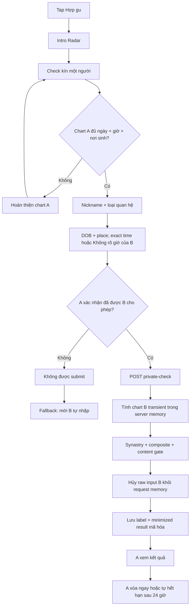

# Lá Lành — Radar hợp gu 1:1

**Status:** Active MVP scope  
**Version:** `radar-authorized-input-v1` / `radar-pair-v1` / `radar-result-v2` / `radar-readable-v2` (from 29/10/2026; stored `radar-living-dossier-v1` results stay as they are)  
**Product decision:** Check kín bằng dữ liệu do người dùng tự nhập là flow chính. Lời mời tự nhập là fallback khi người dùng chưa được phép nhập hộ. Pool matching/Vòng Ghép chưa thuộc scope này.

## 1. Product promise

Radar giúp một người hiểu tương tác với người họ đã biết: chỗ dễ nói chuyện, dễ rung động, nhịp hành động hợp nhau và chỗ dễ cấn. Từ `radar-readable-v2` (29/10/2026, phản hồi owner) Radar mở đầu bằng **một bậc có tên theo ngữ cảnh** kèm một câu lý do, ba mảng theo ngữ cảnh (hợp / cân bằng / cần để ý / chưa rõ) và vài đoạn ngắn; không hiển thị con số. Bậc xếp theo thứ hạng so với phân bố tham chiếu tổng hợp cố định, không phải xác suất thành công. Radar không kết luận soulmate/red flag/định mệnh và không suy ra ý định, cảm xúc hoặc độ an toàn của người kia. (Bài cũ `radar-living-dossier-v1` hiển thị ba chỉ báo 0–100 cho tới khi hết hạn.)

**“Check kín” nghĩa là:** Lá Lành không gửi link/thông báo cho người kia, không tạo hồ sơ cho họ và không đưa họ vào pool. “Kín” không có nghĩa là được phép dùng lén dữ liệu. Người nhập phải xác nhận người kia đã cho phép dùng thông tin sinh cho mục đích này.

## 2. Hai mode

| Mode | Khi nào dùng | Ai nhập dữ liệu B | Kết quả | Dữ liệu B |
|---|---|---|---|---|
| `private_check` — chính | A đã được B cho phép dùng thông tin sinh | A nhập trong một phiên tính | A nhận ngay | DOB/time/place chỉ ở server memory; không lưu vào Radar |
| `consented_invite` — phụ | A chưa được phép nhập hộ hoặc B muốn tự kiểm soát | B mở link, tự nhập chart và consent riêng | A và B nhận bản đọc rút gọn | Lưu trong birth profile mã hóa của B theo consent của B |

Không được tự động chuyển từ mode này sang mode kia. CTA chính luôn là `Check kín ngay`; `Mời họ tự nhập` chỉ xuất hiện dưới cổng quyền sử dụng dữ liệu.

## 3. Screen map

| Route | Screen | Primary job | Data action |
|---|---|---|---|
| `/radar` | Intro / bước 1 | Nói rõ USP, “kín” là gì, giới hạn; bắt đầu mới hoặc mở lịch sử | Read-only |
| `/radar/start` | Check kín / bước 2 | Nhập nickname/context + DOB/place, chọn giờ chính xác hoặc `Không rõ giờ`, rồi attestation; xem lại lịch sử | Tính transient; chỉ lưu result/label mã hóa |
| `/radar/result/:id` | Kết quả riêng / bước 3 | Đọc, mở evidence, check người khác, xem lịch sử hoặc xóa kết quả | Owner-bound read/delete |
| `/radar/invite` | Fallback invite | Tạo link khi A chưa có quyền nhập hộ | Capability 7 ngày |
| `/radar/i/:token` | Public preview | B hiểu mục đích/quyền trước khi nhập | Safe capability continuation |
| `/radar/continue` | Pair consent | B consent riêng và chạy hai chart | Derived pair result |
| `/radar/receipt` | Kết quả phía người nhận | B mở lại trong 30 ngày (bằng hạn kết quả) hoặc rút chart khỏi kết quả | HttpOnly receipt-bound read/withdraw |

Ba bước `Bắt đầu → Thông tin → Bản đọc` phải xuất hiện nhất quán trên flow chính và flow lời mời. Màn kết quả không được là ngõ cụt: owner luôn có đường `Check thêm một người`, `Xem các lần check` và điều hướng chính; recipient mở lại bằng receipt trên đúng thiết bị trong 30 ngày (bằng hạn kết quả), có thể rút chart và luôn có đường về Radar. Kết quả hết hạn/đã xóa phải hiển thị terminal state có CTA quay lại thay vì một trang trống.

## 4. Primary user flow

## 5. Field contract

| Field | Type | Validation | Persistence |
|---|---|---|---|
| `recipient_label` | text | trim/collapse; 1–40 chars; escaped on render | AES-GCM only |
| `context` | enum | `crush`, `friend`, `partner`, `someone` | Plain enum |
| `birth_date` | ISO date | 18–120 years old | Never persisted by Radar |
| `birth_time_mode` | enum | `exact` hoặc `unknown` | Chỉ dùng trong request; precision rút gọn được giữ trong result |
| `birth_time_local` | nullable `HH:MM` | bắt buộc khi `exact`; phải null khi `unknown` | Never persisted by Radar |
| `place_id` | local allow-list ID | must resolve in local place index | Never persisted by Radar |

Local place index dùng catalog `vn-admin-2025-07-01`: browse 34 tỉnh/thành hiện hành và nhận 29 tên tỉnh cũ cho dữ liệu nơi sinh lịch sử. Kết quả tên cũ phải hiện mapping mới; không gọi geocoder ngoài, không xin GPS và không lưu query.
| `authorization_attested` | boolean | must be exactly `true` | Only attestation timestamp + version |
| `consent_version` | fixed version | `radar-authorized-input-v1` | Stored for accountability |

Inputs must not enter URL, localStorage/sessionStorage, analytics, logs, error text or page metadata. React state is cleared on unmount. The backend schema intentionally has no columns for B DOB/time/place in `private_check`.

## 6. Data and retention

| Data | Storage | Retention | User control |
|---|---|---|---|
| Raw B DOB/time/place in private mode | Request memory only | One computation | No history/profile created |
| Nickname | AES-GCM, request-bound context | Private check: 24 hours; consented invite: 30 days from acceptance | Owner delete |
| Minimized Radar result | AES-GCM | Private check: 24 hours; consented invite: 30 days from acceptance | Owner delete |
| Permission attestation | Version + timestamp | Same request lifetime | Deleted with result |
| Invite capability | Hash + temporary encrypted copy | 7 days or terminal state | Revoke |
| B birth profile in invite mode | Existing encrypted birth domain | Existing guest policy | B withdraw/delete |
| Recipient result receipt | HttpOnly, SameSite=Strict capability cookie | 30 days, same as the consented result (owner decision P09 D1, 22/10/2026; was 7 days) | B withdraw; inaccessible after expiry |

Private-check retention (owner decision 2026-10-19): A enters B's data under A's attestation alone, so the
result is kept only long enough to reopen it, 24 hours from creation.

- **Hidden at expiry, always.** Read, replay and history treat a row with `expires_at <= now` as expired.
- **Physical deletion is nominal, not a hard deadline.** The six-hour `cleanup_expired` job deletes expired
  rows and their rewrite jobs (FK cascade). With no delay that is within about 30 hours of creation. The job
  skips an owner while that owner has an active rewrite send fence or a started generation attempt (any
  surface, Daily included), and a pass that cannot delete stops and is retried only at the next timer run.
  Each overlap therefore defers deletion by one six-hour run. The fence is kept on purpose: it protects
  in-flight sends from deletion races. There is no upper bound until a retry-after-fence mechanism exists.
- **Notices state the row's own expiry.** The form states the 24-hour rule for new checks. The history row and
  the result page show the stored `expires_at` in Vietnam time and keep the delete-now button. Results created
  before this change keep the expiry they were created with (at most 30 days, as their notice said) and show
  that expiry; there is no backfill.
- A consented invite keeps 30 days because B consented separately and can withdraw.

No contact upload, phone/email, GPS, current city, precise distance, IP fingerprint, mood, chat, advertising ID or model-training use belongs in Radar.

## 7. Security and privacy controls

- Owner mutation requires owner session tied to the same guest, trusted Origin and CSRF.
- Private result read/delete is owner-bound; guessed UUID returns the same not-found behavior.
- Pydantic rejects extra fields; time/date/place use strict server validation.
- Birthplace resolves from a local allow-list, so the query is not sent to a map provider.
- Raw B birth input is passed directly to a transient chart calculation and is not written to DB, cache, event stream or application log.
- Result projection excludes raw date/time/place/coordinates and any scalar compatibility number (`SHOW_TIER_SCORE = False`). The named tier comes only from traceable evidence contributions (the contacts it read are listed in the "Vì sao?" receipts) and is never used to rank people against each other.
- Public invite trả về `request_id` không bí mật để bind đúng consent action với đúng lời mời đang hiển thị. Accept/decline phải gửi lại binding này; receipt withdrawal cũng phải gửi đúng `request_id`. Cookie và request binding lệch nhau bị từ chối để một tab cũ không thể tác động lên lời mời/kết quả vừa mở ở tab khác.
- Web giữ expected `request_id` theo từng tab trong session storage; `/radar/continue` chỉ hiện consent khi expected ID trùng invitation cookie hiện tại. Không lưu token, ngày sinh, giờ sinh hoặc nơi sinh ở đây.
- Owner history/result cache is keyed by server-confirmed guest session epoch. Khi phiên đổi hoặc người dùng xóa dữ liệu, cache history/result/place-search bị xóa trước khi UI có thể render lại.
- Recipient projection được lưu chung trong encrypted result envelope nhưng chỉ mở bằng receipt riêng hoặc bằng chính phiên guest đã accept (P09 D2); owner và recipient nhận hai projection đổi chiều nên đại từ và góc nhìn không bị lẫn.
- **Quyền của B khi không còn receipt (P09 D2, API).** Phiên guest đã accept là bằng chứng, không thu lại ngày sinh: `GET /v1/radar/received` (chỉ bản còn hợp lệ, lọc trước giới hạn trang; phân trang ổn định qua `before`/`next_before` trên mọi người gửi), `GET /v1/radar/received/{request_id}` (projection phía B, không kèm nickname A đặt cho B) và `POST /v1/radar/received/{request_id}/withdraw` (trusted Origin + CSRF). B mất cả receipt lẫn phiên vẫn rút được bằng cách chứng minh còn giữ link mời: `POST /v1/public/radar/invite/withdraw` chỉ với token trong body (không nằm trong URL; không bind `request_id` vì B ở máy mới không biết được nó), chỉ rút, không bao giờ mở bản đọc, vì A giữ cùng link và vốn đã xóa được. Mọi đường dùng chung cửa sổ 30 ngày của kết quả và cùng lõi rút (hủy job viết lại, chờ send fence). Màn web cho các đường này cần copy được owner duyệt; chưa có trong PR API. B của check kín không có danh tính nào trong hệ thống: kênh là nhờ A xóa, hoặc kết quả tự hết hạn sau 24 giờ (`docs/operations/radar-recipient-rights.md`).
- Stored nickname/result use separate envelope-encryption contexts.
- Result is inaccessible after TTL and physically deletable. Production requires a scheduled physical purge of expired rows.
- Secondary invite retains 256-bit capability tokens, safe public headers, consent, revoke and recipient withdrawal.
- Attestation reduces misuse but is not proof that valid consent exists. Public launch requires Vietnamese privacy counsel to review lawful basis, notice, evidence and third-party-data handling.

## 8. Content and engine contract

- Inputs: chart A exact và chart B Western Tropical cùng `CalculationConfig`. B có thể chọn `unknown`; engine dùng local noon làm mốc thiên văn nội bộ nhưng phải loại Moon của B, mọi aspect dính Moon của B, Rising, angles, houses và overlays phụ thuộc giờ khỏi evidence/result.
- Calculation: Swiss Ephemeris → natal facts → synastry contacts → bidirectional house overlays → midpoint composite → evidence motifs → Pair Signature.
- Synastry đọc cách hai chức năng của A/B kích hoạt nhau; overlay giữ rõ chiều A→B/B→A và chỉ dùng khi precision đủ; Composite chỉ mô tả pattern chung, không gán thành tính cách của một người.
- **`radar-readable-v2` (29/10/2026).** Owner feedback: bài cũ khó đọc, khoảng 1.200 chữ, điểm 0–100 dồn trong 44–73, tiêu đề nào cũng "…; nhưng…", kicker rào đón ở 94% bài, ba ngữ cảnh gần như giống nhau. Hợp đồng mới (đo trong `pnpm experience:audit`, US-22 AC11):
  - **Bậc:** `ease = coordination − 0,6 × friction` (trung bình có trọng số của tối đa 6 contact mạnh nhất mỗi kênh), đặt vào phân bố `radar-tier-ref-v1` (2.000 cặp tổng hợp, seed cố định, `scripts.radar_tier_reference`). 15% cao nhất / 25% / 30% / 20% / 10% thấp nhất ⇒ `very_easy / easy / complementary / warming_up / patient`. Tên bậc khác nhau theo crush / friend / partner / someone (`TIER_LABELS`); không "định mệnh", "tri kỷ"; bậc thấp nhất không kết án. Low-signal ⇒ `unclear`.
  - **Con số:** không hiện. Cờ `SHOW_TIER_SCORE` (mặc định `False`) thêm `tier.score` = thứ hạng 0–100; bật cờ là gỡ invariant "không điểm số", cần owner quyết, bump `GATE_VERSION` và làm lại fallback approval.
  - **Tiêu đề:** một câu về cách hai người tương tác, theo theme hợp nhất × ngữ cảnh; không ép "nhưng".
  - **Mảng:** ba mảng mỗi ngữ cảnh (crush: Điểm thu hút / Cách mở lời / Nhịp tiến gần; bạn bè: Nói chuyện / Chơi chung / Hỗ trợ nhau; người yêu: Gắn bó / Xử lý bất đồng / Nhịp sống chung; một người: Nói chuyện / Cảm xúc / Nhịp phối hợp), mỗi theme thuộc đúng một mảng; mức `hợp / cân bằng / cần để ý / chưa rõ` và một câu lý do.
  - **Màn mặc định:** `Điều trôi chảy` (theme hợp nhất, thêm một theme "hợp" thứ hai nếu có; "hợp" = coordination ≥ max(friction, `GOOD_MIN_COORDINATION` = 0,45), còn lại "cân bằng"), `Điều cần để ý` **chỉ khi** một cluster có friction ≥ `TENSION_THRESHOLD = 0,6` và lớn hơn coordination (khoảng 40% cặp tham chiếu), `Một gợi ý` (một việc nhỏ + một câu có thể hỏi người kia, không đoán). Dòng kết cố định một lần: "Kết quả để tham khảo, cách hai bạn đối xử với nhau mới là điều quyết định."
  - **Một lớp "Xem thêm":** `Vì sao ra kết quả này?` (tối đa 5 theme, mức và thuật ngữ chiêm tinh, receipts kỹ thuật), `Hai phía có thể thấy khác nhau` (không nói hộ phía kia, gợi ý hỏi), `Thêm vài cách thử` (prompt biên tập theo giọng).
  - Thuật ngữ chiêm tinh/app chỉ ở lớp "Xem thêm". Section có `layer: "main" | "more"`; `compatibility_map` rỗng; `metadata.signal_bands` (low/medium/high) chỉ cho payload Luna.
- Bản `radar-living-dossier-v1` (trước 29/10/2026) mở đầu bằng một mâu thuẫn ("…; nhưng…"), có Compatibility Map ba chỉ báo và bốn chương `Điểm hợp`, `Điểm dễ cấn`, `Hai phía có thể thấy khác nhau`, `Đem ra đời thật`. Kết quả đã lưu theo bản này giữ nguyên tới khi hết hạn; web vẫn render chúng.
- Renderer gom các contact liên quan thành theme cluster trước khi chọn luận điểm. Mỗi section giữ `title/body/evidence` để tương thích ngược; mọi highlight và factor phải truy được về evidence ID.
- Outer-planet/Node/Chiron contact chỉ được đưa vào luận điểm khi nó chạm một hành tinh cá nhân hoặc social planet; contact chỉ giữa hai điểm thế hệ bị loại khỏi Dossier vì không đủ khả năng phân biệt đúng cặp. Quy tắc tương tự áp dụng khi chọn Composite aspect cho main copy.
- Độ dài báo cáo đi theo lượng evidence thật. Chapter có ít evidence được phép ngắn; không tạo filler, không lặp cùng một nhu cầu ở hai vế và không đổi synonym để giả cảm giác cá nhân hóa.
- Nếu không có friction vượt ngưỡng, bài **không có** đoạn cấn (không chế thêm mâu thuẫn, không câu "chưa thấy điểm cấn"). Nếu không còn contact đủ riêng sau content gate, Radar vẫn trả một low-signal report ngắn thay vì lỗi hoặc bịa đủ bốn luận điểm.
- `Hai phía có thể thấy khác nhau` tách A→B, B→A và nhịp chung khi có overlay/composite phù hợp. Nếu thiếu một lớp evidence, UI không được bịa đủ ba phía.
- UI (`radar-readable-v2`): bậc + lý do + tiêu đề, ba mảng, các section `main`; một `
` "Xem thêm: vì sao ra kết quả này" đóng sẵn chứa các section `more`. Bài cũ vẫn dùng layout ba chỉ báo + mục lục bốn chương.
- Với consented invite, hệ thống tính projection A→B để lưu cho chủ lời mời và projection B→A để trả ngay cho người nhận. Vì vậy `bạn/người kia` luôn đi theo người đang đọc; raw chart và nickname riêng của chủ lời mời không bị gửi sang phía kia.
- Context `crush/friend/partner/someone` đổi tên bậc, mảng, tiêu đề, đoạn hợp, đoạn cấn và gợi ý. Nó không đổi chart evidence, evidence ID hoặc thứ hạng của cặp. Crush: không câu nào đoán người kia có thích mình hay không.
- Mỗi chương có evidence receipt giải thích bằng đời thường và metadata kỹ thuật tối thiểu. Payload lưu `knowledge_version`, `renderer_version`, `gate_version`, `chart_config_version`, `evidence_ids` và `concept_ids`.
- `scalar_score_eligible=false` vẫn là hard invariant; không tạo điểm tổng, soulmate/red-flag verdict hoặc xác suất dài hạn.
- Every interpretation is conditional and traceable to evidence IDs.
- Copy may help the user notice/ask/verify; it must not advise stalking, testing, manipulating, confronting, dating or leaving someone.
- Disclaimer stays near the reading: this is a reflection tool, not proof of intent, compatibility, consent or safety.

### Backward read

- Kết quả mới tiếp tục được ghi bằng `radar-result-v2`; Dossier là phần mở rộng additive, không phải một loại kết quả hay mục đích xử lý mới.
- Web nhận biết các field Dossier optional. Kết quả v2 cũ chỉ có `title/body/evidence` vẫn render bằng card cũ và không cần migration.
- API và web vẫn đọc `radar-result-v1` đã mã hóa cho tới khi tự hết hạn (tối đa 30 ngày với bản tạo trước 2026-10-19); không migrate hoặc giải mã hàng loạt dữ liệu cũ.
- Không bổ sung cột dữ liệu cá nhân và không gửi chart facts tới provider ngoài.

## 9. Edge cases

| Case | Required behavior |
|---|---|
| A has no exact chart | 409; send A to own birth-time flow and return to Radar |
| B is under 18 or over 120 | Reject before chart compute |
| Invalid time/place | Reject; do not guess timezone or nearest city |
| A does not attest permission | CTA disabled; API also rejects |
| A has information but no permission | Show only `Mời họ tự nhập`; do not offer bypass |
| Double tap | UI lock; production also needs idempotency key |
| Engine fails/busy | Generic retry; do not persist partial input/result |
| User leaves form | Discard state; no draft in browser storage |
| Result expires | Return terminal/not found; purge job deletes ciphertext |
| Owner deletes | Hard-delete request row and encrypted result |
| Recipient reloads result | Reopen `/radar/receipt` with HttpOnly receipt for at most 30 days (the result's lifetime) |
| Recipient withdraw fails | Keep result unchanged; show explicit retry rather than claiming success |
| Two invite tabs cross | Block consent when tab-bound request ID differs from current invite cookie |

## 10. Release gates

| Gate | Internal review | Public/native release |
|---|---|---|
| Direct private check | Implemented + automated | Device E2E and accessibility |
| Raw-input non-persistence | Schema/test evidence | Log/APM redaction verification |
| Consent/attestation | Implemented | Legal review under VN Law 91/2025/QH15 and Decree 356/2025/NĐ-CP |
| Retention | Access TTL + manual delete | Scheduled physical purge + DSAR evidence |
| Engine/content | Real calculation, no mock/score | Editorial/safety sampling and monitoring |
| Abuse | Permission gate | Rate limit, abuse reporting and operations runbook |

Primary references checked 2026-09-21:

- [Vietnam Law 91/2025/QH15 on Personal Data Protection](https://vanban.chinhphu.vn/?classid=1&docid=214590&pageid=27160&typegroupid=3), effective 2026-01-01.
- [Decree 356/2025/NĐ-CP implementing the Personal Data Protection Law](https://vanban.chinhphu.vn/?classid=1&docid=216387&pageid=27160), effective 2026-01-01.
- [Google Play User Data policy](https://support.google.com/googleplay/android-developer/answer/10144311?hl=en-GB).
- [Apple App Privacy Details](https://developer.apple.com/app-store/app-privacy-details/).
- [OWASP MASVS Privacy controls](https://mas.owasp.org/MASVS/controls/MASVS-PRIVACY-1/).
