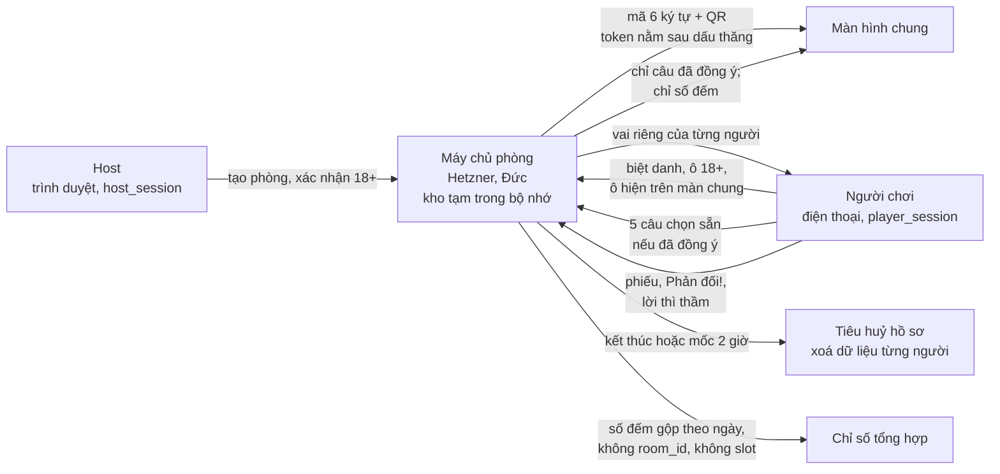
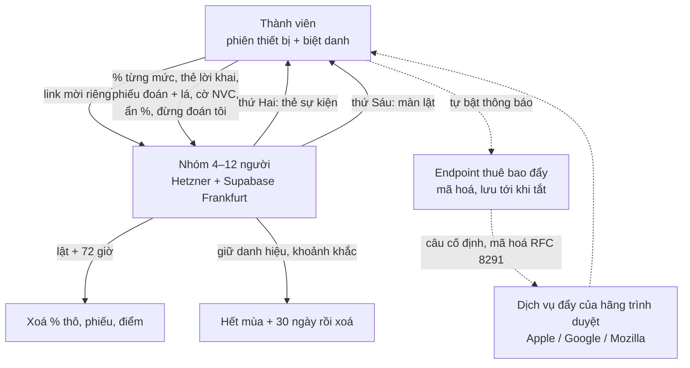
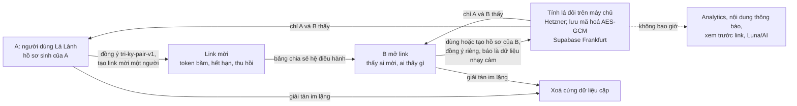
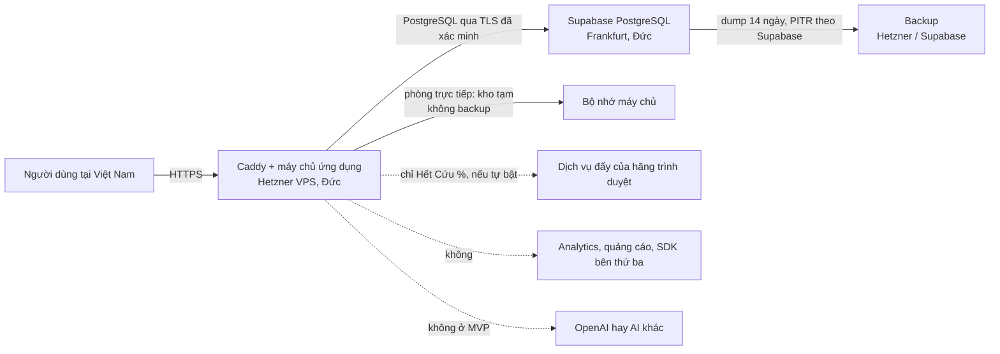

# Hồ sơ đánh giá tác động xử lý dữ liệu cá nhân — dòng game Lá Lành (Lá Úp và Tri Kỷ)

> **BẢN NHÁP, CHƯA PHẢI HỒ SƠ NỘP.** Đây là tài liệu làm việc để owner và luật sư (counsel) đọc, sửa và quyết. Không phải
> ý kiến pháp lý, không phải kết luận tuân thủ. Chưa ai ký. Chưa gửi cơ quan nào.
>
> - Ngày soạn: 26/10/2026. Ngày kiểm tra nguồn pháp luật: **26/10/2026**.
> - Phạm vi: năm trò của dòng game (Hết Cứu %, Tam Sao Thất Bản, Phiên Tòa Tủ Lạnh, Sĩ Số +1, Tri Kỷ kèm Hiểu Nhau Không?).
> - Giai đoạn: tài liệu và chơi thử bằng giấy. **Chưa có code game.** Mọi mô tả xử lý dưới đây là thiết kế dự kiến, lấy theo
>   hợp đồng dữ liệu chung của dòng game và sáu SRS bản nháp (đã đối chiếu nhất quán 26/10/2026). Khi dựng thật, hồ sơ phải đối chiếu lại với runtime.
> - Bên soạn: Claude (Writer D). Tài liệu nguồn của dự án: `docs/legal/store-privacy-data-map.md`,
>   `docs/legal/2026-10-22-privacy-counsel-dossier.md`, `docs/legal/privacy-security-flow-notes.md`,
>   `docs/foundation/game-line/*`.

## 0. Tóm tắt một trang

Dòng game thu ít dữ liệu và xoá sớm. Bốn trò Lá Úp không có tài khoản, không ngày sinh, chỉ biệt danh và lựa chọn soạn sẵn.
Phòng trực tiếp xoá dữ liệu từng người ngay khi kết thúc, chậm nhất 2 giờ sau khi bắt đầu. Tri Kỷ là phần nặng nhất: nó dùng
hồ sơ sinh của hai người và tạo ra một kết quả suy luận về quan hệ của hai người đó.

Năm điểm owner và counsel cần biết trước:

1. **Nghị định 147/2024/NĐ-CP có thể buộc phải thu thêm dữ liệu.** Nếu các trò Lá Úp bị coi là "trò chơi điện tử trên mạng",
   người chơi phải đăng ký tài khoản với họ tên, ngày sinh, số điện thoại di động Việt Nam (Điều 56 khoản 1), lưu tới 6 tháng
   sau khi ngừng chơi (Điều 56 khoản 2), và doanh nghiệp phải có ít nhất một hệ thống máy chủ đặt tại Việt Nam (Điều 54
   khoản 1). Cả ba điều này trái với thiết kế "không tài khoản, chỉ biệt danh" và với hạ tầng hiện tại ở Đức. Đây là câu hỏi
   lớn nhất cho counsel (câu Q15–Q17). Chưa được mở trò nào trước khi có câu trả lời.
2. **Bằng chứng đồng ý đụng với xoá ngay.** Nghị định 356/2025/NĐ-CP Điều 6 khoản 2 buộc bên kiểm soát lưu sự đồng ý và chịu
   trách nhiệm chứng minh. Phòng trực tiếp xoá cả bản ghi đồng ý khi kết thúc. Đề xuất giữ phiên bản câu chữ và số đếm theo
   ngày, không định danh (RP-D5). Cần counsel xác nhận (Q7).
3. **Tri Kỷ nhiều khả năng là dữ liệu nhạy cảm.** Nghị định 356 Điều 4 khoản 1 điểm c xếp "thông tin về đời sống riêng tư"
   vào nhóm nhạy cảm. Lá đôi suy ra từ lá số của hai người nên được xử lý như nhạy cảm. Hệ quả: phải báo rõ cho người dùng đây
   là dữ liệu nhạy cảm (Nghị định 356 Điều 6 khoản 4), và doanh nghiệp nhỏ hoặc khởi nghiệp **mất quyền miễn** lập hồ sơ đánh
   giá tác động (Luật 91 Điều 38 khoản 2, Nghị định 356 Điều 41).
4. **Toàn bộ dữ liệu game đi ra nước ngoài.** Máy chủ ở Hetzner (Đức), cơ sở dữ liệu ở Supabase (Frankfurt). Luật 91 Điều 20
   khoản 1 điểm c và Nghị định 356 Điều 17 khoản 1 điểm a coi đây là chuyển dữ liệu xuyên biên giới. Cần hồ sơ Mẫu số 09.
   Trạng thái hồ sơ này cho app hiện tại vẫn là câu hỏi mở từ dossier ngày 22/10 (P10, câu 2).
5. **Thông báo đẩy của Hết Cứu % đi qua dịch vụ đẩy của hãng trình duyệt** (Apple, Google, Mozilla, tuỳ trình duyệt người
   dùng). Đây không phải nhà cung cấp mới do Lá Lành chọn, nhưng là một bên nhận dữ liệu phải khai (Q13).

Không có rủi ro mức P0/P1 nào được chấp nhận ở bản này: mọi rủi ro "cao" đều có cổng chặn trước khi dựng (mục 13).

## 1. Nguồn pháp luật đã kiểm tra (26/10/2026)

Cách đọc: **Chính thức** là văn bản lấy từ Công báo hoặc Cổng văn bản Chính phủ. **Thứ cấp** là bản chép hoặc bài phân tích.
Nghị định 356 chỉ có bản PDF ký số dạng ảnh quét, nên văn bản được đọc qua nhận dạng chữ (OCR) trên máy. Câu chữ trích dưới
đây có thể sai lặt vặt do OCR. Counsel cần đọc lại bản gốc trước khi dùng.

| Điểm | Nội dung đã xác minh | Điều khoản | Nguồn | Loại |
|---|---|---|---|---|
| Hiệu lực Luật | Luật 91/2025/QH15 thông qua 26/6/2025, hiệu lực 01/01/2026 | Điều 38 khoản 1 | Công báo số 971+972 ngày 24/7/2025, bản DOC tại [congbao.chinhphu.vn](https://congbao.chinhphu.vn/van-ban/luat-so-91-2025-qh15-45578.htm); [vanban.chinhphu.vn docid=214590](https://vanban.chinhphu.vn/?docid=214590&pageid=27160) | Chính thức |
| Hiệu lực Nghị định | Nghị định 356/2025/NĐ-CP ban hành 31/12/2025, hiệu lực 01/01/2026, thay Nghị định 13/2023/NĐ-CP | Điều 42 | [vanban.chinhphu.vn docid=216387](https://vanban.chinhphu.vn/default.aspx?docid=216387&pageid=27160), PDF ký số [356-nd.signed.pdf](https://datafiles.chinhphu.vn/cpp/files/vbpq/2026/01/356-nd.signed.pdf) | Chính thức (đọc qua OCR) |
| Dữ liệu cá nhân, khử nhận dạng | "Dữ liệu cá nhân sau khi khử nhận dạng không còn là dữ liệu cá nhân." Dữ liệu mã hoá vẫn là dữ liệu cá nhân | Luật Điều 2 khoản 1, 11; Điều 12 khoản 1 | Như trên | Chính thức |
| Danh mục cơ bản | Ngày sinh, nơi sinh là dữ liệu cơ bản; khoản 11 là "các thông tin khác gắn liền với một con người cụ thể hoặc giúp xác định một con người cụ thể" | Nghị định Điều 3 | Như trên | Chính thức (OCR) |
| Danh mục nhạy cảm | Gồm: điểm c "đời sống riêng tư, bí mật cá nhân, bí mật gia đình"; điểm e đời sống tình dục, xu hướng tình dục; điểm h "vị trí của cá nhân được xác định qua dịch vụ định vị"; điểm l "dữ liệu theo dõi hành vi, hoạt động sử dụng dịch vụ viễn thông, mạng xã hội, dịch vụ truyền thông trực tuyến và các dịch vụ khác trên không gian mạng" | Nghị định Điều 4 khoản 1 | Như trên | Chính thức (OCR) |
| Xử lý dữ liệu nhạy cảm | Phải có phân quyền giới hạn truy cập, quy trình xử lý, biện pháp bảo mật | Nghị định Điều 4 khoản 2 | Như trên | Chính thức (OCR) |
| Đồng ý | Tự nguyện, biết rõ loại dữ liệu, mục đích, bên kiểm soát, quyền; theo từng mục đích; không kèm điều kiện; im lặng không phải đồng ý | Luật Điều 9 | Công báo | Chính thức |
| Cách thể hiện đồng ý | Kiểm chứng được ai đồng ý, lúc nào, nội dung gì; bên kiểm soát lưu và chịu trách nhiệm chứng minh; **cấm mặc định đồng ý** và chỉ dẫn gây hiểu lầm giữa đồng ý và không đồng ý; xin đồng ý cho dữ liệu nhạy cảm phải báo rõ đó là dữ liệu nhạy cảm | Nghị định Điều 6 khoản 1–4 | PDF ký số | Chính thức (OCR) |
| Rút đồng ý | Bằng văn bản, kể cả dạng điện tử hoặc định dạng kiểm chứng được; không áp dụng ngược cho xử lý trước đó | Luật Điều 10 | Công báo | Chính thức |
| Thu thập | Phải có đồng ý trước khi thu thập, trừ trường hợp luật quy định khác | Luật Điều 11 khoản 1 | Công báo | Chính thức |
| Công khai dữ liệu | Chỉ công khai khi có đồng ý, theo luật, theo Điều 19, hoặc theo hợp đồng; phạm vi phải hợp mục đích | Luật Điều 16 | Công báo | Chính thức |
| Không cần đồng ý | Gồm điểm d "thực hiện thỏa thuận của chủ thể dữ liệu cá nhân với cơ quan, tổ chức, cá nhân có liên quan" | Luật Điều 19 khoản 1 | Công báo | Chính thức |
| Thời hạn quyền chủ thể | Phản hồi 02 ngày làm việc; xem/sửa/cung cấp: làm trong 10 ngày; xoá: 20 ngày (30 ngày nếu cần bên xử lý); rút đồng ý, hạn chế, phản đối: 15 ngày (20 ngày nếu cần bên xử lý); gia hạn một lần | Nghị định Điều 5 khoản 2–4 | PDF ký số | Chính thức (OCR) |
| Xuyên biên giới | Gồm "sử dụng nền tảng ở ngoài lãnh thổ… để xử lý dữ liệu cá nhân được thu thập tại Việt Nam"; nộp hồ sơ trong 60 ngày từ ngày đầu chuyển | Luật Điều 20 khoản 1 điểm c, khoản 2; Nghị định Điều 17 khoản 1 điểm a ("hệ thống máy chủ đặt ngoài lãnh thổ… hoặc trên dịch vụ điện toán đám mây của nhà cung cấp dịch vụ ở nước ngoài") | Công báo; PDF ký số | Chính thức |
| Hồ sơ xuyên biên giới | Mẫu số 09 + hợp đồng chuyển giao + chính sách; nội dung báo cáo gồm 9 mục a–i; trả kết quả trong 15 ngày; hoàn thiện trong 30 ngày | Nghị định Điều 18 | PDF ký số | Chính thức (OCR) |
| Hồ sơ đánh giá tác động (DPIA) | Bên kiểm soát lập, lưu, nộp 01 bản chính trong 60 ngày từ ngày đầu xử lý; **làm 01 lần cho suốt thời gian hoạt động** và cập nhật | Luật Điều 21 khoản 1–2 | Công báo | Chính thức |
| Thành phần DPIA | Báo cáo theo Mẫu số 10 + hợp đồng/thỏa thuận xử lý + chính sách, quy trình, biểu mẫu; nội dung báo cáo gồm 7 mục a–g; kèm Mẫu 02a (tổ chức) hoặc 02b (cá nhân); trả kết quả đạt/không đạt trong 15 ngày | Nghị định Điều 19 | PDF ký số | Chính thức (OCR) |
| Cập nhật hồ sơ | Định kỳ 06 tháng kể từ lần nộp đầu khi có **mục đích xử lý mới** hoặc thay đổi bên kiểm soát/xử lý/bên thứ ba; cập nhật ngay trong **10 ngày** khi tổ chức lại, đổi đơn vị dịch vụ bảo vệ dữ liệu, đổi ngành nghề liên quan; dùng Mẫu 03a/03b | Luật Điều 22; Nghị định Điều 20 | Công báo; PDF ký số | Chính thức |
| Đánh giá an ninh quốc gia trong Mẫu 10 | Chỉ khi xử lý dữ liệu cơ bản của trên 100.000 chủ thể hoặc dữ liệu nhạy cảm của trên 10.000 chủ thể | Mẫu số 10, Phần A mục III.2.3 | PDF ký số | Chính thức (OCR) |
| Miễn cho doanh nghiệp nhỏ, khởi nghiệp | Được chọn không làm Điều 21, 22 và khoản 2 Điều 33 trong 05 năm từ 01/01/2026; **trừ** khi kinh doanh dịch vụ xử lý dữ liệu, **trực tiếp xử lý dữ liệu nhạy cảm**, hoặc xử lý từ **100 nghìn chủ thể trở lên tính cộng dồn** | Luật Điều 38 khoản 2; Nghị định Điều 41 khoản 1 | Công báo; PDF ký số | Chính thức |
| Hộ kinh doanh, doanh nghiệp siêu nhỏ | Không phải làm Điều 21, 22 và khoản 2 Điều 33, với cùng ba ngoại lệ | Luật Điều 38 khoản 3; Nghị định Điều 41 khoản 2 | Như trên | Chính thức |
| Cơ quan nhận hồ sơ | Cơ quan chuyên trách bảo vệ dữ liệu cá nhân thuộc Bộ Công an. Mẫu của Nghị định 356 ghi đơn vị thi hành là Cục An ninh mạng và phòng, chống tội phạm sử dụng công nghệ cao (A05). Nộp trực tuyến, trực tiếp hoặc bưu chính | Luật Điều 33 khoản 1, Điều 36 khoản 2; Nghị định Điều 19 khoản 4, Điều 39, Mẫu 02a, Mẫu 07 | PDF ký số | Chính thức (OCR); cổng nộp trực tuyến chưa kiểm |
| Nhân sự bảo vệ dữ liệu | Tổ chức phải chỉ định bộ phận/nhân sự (trừ khi được miễn khoản 2 Điều 33); điều kiện: cao đẳng trở lên, ít nhất 02 năm kinh nghiệm liên quan, đã được đào tạo | Luật Điều 33 khoản 2; Nghị định Điều 13 | Như trên | Chính thức (OCR) |
| Thông báo vi phạm | Chậm nhất 72 giờ từ khi phát hiện, theo Mẫu số 08 | Luật Điều 23 khoản 1; Nghị định Điều 28 | Như trên | Chính thức |
| Trẻ em | Người đại diện theo pháp luật thực hiện quyền thay trẻ em; công bố, tiết lộ đời sống riêng tư của trẻ từ đủ 07 tuổi cần đồng ý của cả trẻ và người đại diện | Luật Điều 24 khoản 2 | Công báo | Chính thức |
| Tuổi "trẻ em" | Trẻ em là người dưới 16 tuổi | Luật Trẻ em 102/2016/QH13, Điều 1 | [LuatVietnam](https://luatvietnam.vn/lao-dong/luat-tre-em-2016-104818-d1.html), [Thư Viện Pháp Luật](https://thuvienphapluat.vn/van-ban/van-hoa-xa-hoi/Law-102-2016-QH13-children-312407.aspx) | **Thứ cấp**; luật có sửa đổi sau 2016, chưa kiểm Điều 1 bản hợp nhất |
| Điện toán đám mây | Hợp đồng với nhà cung cấp đám mây phải nêu chấp hành luật Việt Nam, luồng xử lý và vai trò, biện pháp bảo mật, thời hạn và xoá; dữ liệu trên đám mây phải mã hoá khi nghỉ và khi truyền, phân quyền chặt | Nghị định Điều 12 khoản 2, 4 | PDF ký số | Chính thức (OCR) |
| Vị trí | "Dữ liệu vị trí cá nhân là dữ liệu được xác định thông qua công nghệ định vị" | Luật Điều 31 khoản 1 | Công báo | Chính thức |
| Mạng xã hội | Nghĩa vụ riêng: thông báo rõ dữ liệu thu, lựa chọn "không theo dõi", công khai chính sách… | Luật Điều 29 | Công báo | Chính thức |
| Trò chơi điện tử | G1 là trò "có sự tương tác giữa nhiều người chơi với nhau đồng thời thông qua hệ thống máy chủ trò chơi của doanh nghiệp"; G1 cần giấy phép và quyết định phát hành | Nghị định 147/2024/NĐ-CP Điều 37 khoản 1–2 | Công báo số 1261–1264 ngày 20/11/2024, bản DOC tại [congbao.chinhphu.vn](https://congbao.chinhphu.vn/van-ban/nghi-dinh-so-147-2024-nd-cp-43155/52693.htm) | Chính thức |
| Thông tin người chơi | Khi đăng ký tài khoản: họ tên, ngày sinh, số di động Việt Nam; dưới 16 tuổi thì cha mẹ đăng ký; lưu suốt thời gian dùng và 06 tháng sau | Nghị định 147 Điều 56; Điều 39 khoản 1 điểm đ | Như trên | Chính thức |
| Máy chủ tại Việt Nam | Doanh nghiệp cung cấp dịch vụ trò chơi phải có ít nhất 01 hệ thống máy chủ đặt tại Việt Nam | Nghị định 147 Điều 54 khoản 1 | Như trên | Chính thức |
| Giờ chơi dưới 18 tuổi | G1: không quá 60 phút mỗi trò, 180 phút mỗi ngày | Nghị định 147 Điều 39 khoản 1 điểm e | Như trên | Chính thức |
| Điểm thưởng | Chỉ dùng trong trò, không quy đổi ra tiền, thẻ hay hiện vật; không mua bán giữa người chơi | Nghị định 147 Điều 3 khoản 40, Điều 57 | Như trên | Chính thức |
| Định nghĩa mạng xã hội | Hệ thống cho phép người dùng "cung cấp, trao đổi, tương tác, chia sẻ thông tin với nhau" | Nghị định 147 Điều 3 khoản 25 | Như trên | Chính thức |
| Sửa đổi Nghị định 147 | Có tin Nghị định 116/2026/NĐ-CP (01 hoặc 02/4/2026) sửa một số nghị định về thủ tục thuộc Bộ Văn hoá, Thể thao và Du lịch, có thể gồm Điều 44 Nghị định 147 | — | [hcc.nghean.gov.vn](https://hcc.nghean.gov.vn/laws/detail/Nghi-dinh-so-116-2026-ND-CP-cua-Chinh-phu-Sua-doi-bo-sung-mot-so-dieu-cua-cac-Nghi-dinh-co-quy-dinh-thu-tuc-hanh-chinh-lien-quan-den-hoat-dong-san-xuat-kinh-doanh-thuoc-pham-vi-quan-ly-cua-Bo-Van-hoa-The-thao-va-Du-lich-2513/) | **Thứ cấp, chưa xác minh**; bộ chủ quản lĩnh vực game hiện nay cũng cần counsel xác nhận |
| Apple | 1.2 (nội dung do người dùng tạo; gỡ app dùng chủ yếu cho chat ngẫu nhiên/ẩn danh, chấm điểm người thật, bắt nạt); 5.1.1(i), (iii), (v), (viii); 5.1.2(i), (v) | — | [App Review Guidelines](https://developer.apple.com/app-store/review/guidelines/), đọc trực tiếp 26/10/2026 (trang không hiện ngày cập nhật trong phần đã đọc) | Chính thức |
| Google Play | Data safety: "collect" là truyền dữ liệu ra khỏi máy; bên cung cấp dịch vụ xử lý thay không tính là "sharing"; xử lý tạm trong bộ nhớ có quy tắc riêng; phải nói có kênh nhận yêu cầu xoá | — | [Data safety help](https://support.google.com/googleplay/android-developer/answer/10787469), đọc 26/10/2026 | Chính thức |

Không dùng để kết luận: bản dịch tiếng Anh của Nghị định 356 trên trang QTSC, các bài phân tích của PwC, EY, LuatVietnam,
Vietnam Briefing. Các nguồn này chỉ giúp tìm điều khoản.

## 2. Hồ sơ này nằm ở đâu trong nghĩa vụ nộp

- **Một bên kiểm soát, một hồ sơ.** Luật 91 Điều 21 khoản 2 nói hồ sơ đánh giá tác động làm 01 lần cho suốt thời gian hoạt
  động của bên kiểm soát, rồi cập nhật. Vì vậy tài liệu này **không phải một hồ sơ nộp riêng**. Nó là phần "dòng game" để ghép
  vào hồ sơ Mẫu số 10 chung của đơn vị vận hành Lá Lành, và là căn cứ cho lần cập nhật vì có **mục đích xử lý mới** (Nghị định
  356 Điều 20 khoản 1 điểm a). Counsel xác nhận cách ghép và thời điểm (Q1).
- **Hồ sơ chung của app chưa rõ trạng thái.** Dossier ngày 22/10 (P10, câu 2 và 3) đã hỏi app hiện tại có phải lập hồ sơ đánh
  giá tác động và hồ sơ xuyên biên giới không. Câu trả lời đó quyết định dòng game là "cập nhật" hay "lập mới". Nếu app đã xử
  lý dữ liệu từ trước mà chưa nộp, hạn 60 ngày có thể đã qua (Q2).
- **Hai hồ sơ, không phải một.** Dữ liệu game nằm ở Đức nên cần cả Mẫu số 10 (đánh giá tác động xử lý) và Mẫu số 09 (đánh giá
  tác động chuyển xuyên biên giới). Mục 16 liệt kê phần của dòng game trong Mẫu 09.
- **Quyền miễn khó dùng được.** Kể cả khi đơn vị vận hành là doanh nghiệp nhỏ hoặc khởi nghiệp, quyền miễn mất khi trực tiếp xử
  lý dữ liệu nhạy cảm (Tri Kỷ, mục 8) hoặc khi tổng số chủ thể đã xử lý cộng dồn đạt 100.000. Trò phòng trực tiếp tạo ra rất
  nhiều chủ thể ngắn hạn: mỗi người chơi một phiên là một chủ thể, kể cả khi dữ liệu đã xoá sau 2 giờ. Counsel xác nhận cách
  đếm (Q3). Khuyến nghị: lập hồ sơ như chưa được miễn.
- **Trước khi nộp còn thiếu**: thông tin pháp nhân (tên, mã số thuế, trụ sở, ngành nghề), quyết định chỉ định nhân sự bảo vệ
  dữ liệu, bản sao hợp đồng với Hetzner và Supabase, chính sách lưu trữ và xoá bằng văn bản, biểu mẫu đồng ý (mục 22).

## 3. Đối chiếu khung Mẫu số 10

| Mẫu số 10 | Nội dung yêu cầu | Ở đâu trong tài liệu này |
|---|---|---|
| Phần A, I | Thông tin bên nộp, bộ phận/nhân sự bảo vệ dữ liệu | Mục 4 (để trống, chờ owner) |
| Phần A, II.1 | Vai trò (bên kiểm soát / bên xử lý / bên thứ ba), đối tượng chủ thể, số lượng | Mục 4, mục 5 |
| Phần A, II.2 | Luồng xử lý theo vai trò, sơ đồ quy trình và hệ thống | Mục 5, mục 6 |
| Phần A, II.3 | Loại dữ liệu cơ bản và nhạy cảm (tích theo Điều 3, Điều 4 Nghị định 356) | Mục 7, mục 8 |
| Phần A, II.4 | Sự đồng ý: nội dung, hình thức, quy trình, kèm biểu mẫu | Mục 9 |
| Phần A, II.5–6 | Quy định lưu trữ; quy định xoá, huỷ | Mục 7 (cột thời hạn), mục 14 |
| Phần A, II.7–9 | Chuyển giao; có thu phí; sàn dữ liệu; kinh doanh dịch vụ xử lý dữ liệu | Mục 15 (không chuyển giao có thu phí, không sàn dữ liệu, không kinh doanh dịch vụ xử lý dữ liệu, chờ counsel xác nhận Q14) |
| Phần A, II.10 | Chuyển xuyên biên giới | Mục 16 |
| Phần A, II.11 | Phương án an toàn, biện pháp bảo vệ, kiểm tra an ninh, đánh giá tuân thủ | Mục 12, mục 22 |
| Phần A, III.1 | Đánh giá tổng quan, sự cần thiết | Mục 10 |
| Phần A, III.2.1 | Tác động đến chủ thể dữ liệu | Mục 11, 12, 13 |
| Phần A, III.2.2 | Tác động đến an ninh, an toàn hệ thống | Mục 11 (R03, R12, R18), mục 12 |
| Phần A, III.2.3 | Tác động an ninh quốc gia (chỉ khi > 100.000 chủ thể dữ liệu cơ bản hoặc > 10.000 chủ thể dữ liệu nhạy cảm) | Chưa đến ngưỡng ở giai đoạn này; phải đếm lại trước mỗi lần cập nhật 6 tháng |
| Phần B | Thông tin bên kiểm soát, bên xử lý, bên thứ ba | Mục 15 |

## 4. Bên kiểm soát và nhân sự bảo vệ dữ liệu

| Mục | Nội dung |
|---|---|
| Bên kiểm soát và xử lý | Đơn vị vận hành Lá Lành (tên pháp nhân, mã số thuế, địa chỉ: **chờ owner**). Lá Úp là thương hiệu phụ, "một sản phẩm của Lá Lành", cùng bên kiểm soát |
| Nhân sự bảo vệ dữ liệu | **Chờ owner**: chỉ định bằng văn bản theo Nghị định 356 Điều 13, hoặc thuê đơn vị dịch vụ; hoặc xác nhận được miễn theo Luật Điều 38 (không khuyến nghị dựa vào miễn, xem mục 2) |
| Liên hệ công khai | Email hỗ trợ Lá Úp (RP-FR-74) và kênh quyền riêng tư của Lá Lành: **chờ owner** |
| Host phòng | Người tạo phòng không có tài khoản. Host là người dùng, không phải bên xử lý. Câu hỏi khi host là công ty tổ chức tất niên: Q18 |
| Đối tượng chủ thể | Người chơi và khán giả phòng trực tiếp (18+); host; thành viên nhóm Hết Cứu %; người dùng Lá Lành dùng Tri Kỷ (người mời A và người được mời B) |
| Số lượng | Chưa có, vì chưa dựng. Phải đếm thật trước khi nộp và trước mỗi lần cập nhật |

## 5. Mô tả xử lý theo từng trò

Toàn bộ trường, mục đích và thời hạn ở mục này lấy **đúng** theo hợp đồng dữ liệu chung của dòng game (brief 26/10/2026).
Trường nào các SRS đề xuất thêm ngoài hợp đồng được đánh dấu **[bổ sung]** và ghi ở mục 5.7.

### 5.1. Phần chung của phòng trực tiếp (Phiên Tòa, Sĩ Số +1, Tam Sao bản trực tiếp)

Nguồn chi tiết: `docs/foundation/game-line/shared-room-platform-srs.md` (RP-*).

- **Trường:** `room_id`; mã phòng 6 ký tự (giới hạn số lần đoán, token năng lực băm trong URL); `host_session` (gắn thiết bị,
  không tài khoản); `player_session` (mã ngẫu nhiên gắn thiết bị); `nickname`; vai được chia; phiếu bầu; dấu thời gian; log lỗi
  thô không có biệt danh, câu trả lời hay token.
- **Mục đích:** cho một nhóm người đang ngồi cùng nhau chơi một ván trên màn hình chung và điện thoại.
- **Thời hạn:** phòng hết hạn cứng 2 giờ sau khi bắt đầu. Phòng kết thúc thì **xoá ngay mọi dữ liệu theo người chơi** (màn "tiêu
  huỷ hồ sơ"), chậm nhất ở mốc hết hạn cứng. Chỉ giữ số đếm tổng hợp không định danh (số lượng, thời lượng, tỷ lệ hoàn tất, số
  báo cáo). Log không bao giờ chứa token phòng, biệt danh, câu trả lời.
- **Xoá theo người:** rời phòng hoặc bị kick thì xoá ngay biệt danh, câu trả lời, bản ghi đồng ý (RP-FR-82).
- **Nơi lưu (dự kiến):** kho trạng thái tạm thời trong bộ nhớ trên máy chủ Hetzner, không có backup hay PITR (RP-PRV-04,
  RP-D3 chờ owner/operator). Thiết bị người chơi chỉ giữ cookie phiên `HttpOnly`.

### 5.2. Phiên Tòa Tủ Lạnh

- **Thêm:** 5 câu trả lời vô hại về chính mình (bữa sáng, bài hát nghe gần nhất, ngồi gần cửa sổ hay cửa ra vào, màu áo, một món
  trong túi), chọn từ danh sách có "Không muốn nói"; cờ đồng ý "câu trả lời có thể hiện trên màn hình chung" (không tick sẵn);
  phiếu bầu; lượt dùng "Phản đối!".
- **Mục đích:** câu trả lời thật của người được chia vai Thủ Phạm thành manh mối cho vụ án hư cấu; cả phòng bỏ phiếu.
- **Thời hạn:** xoá khi kết thúc buổi. Số liệu hiện trên màn hình chỉ là số đếm, ẩn nhóm dưới 3 người (PT-PRV-03, RP-PRV-10).
  Nguồn chi tiết: `phien-toa-tu-lanh-srs.md` (PT-*).
- **Điểm nhạy:** phán quyết nhắm vào vai do game chia, không nhắm vào người. Chế độ văn phòng có rủi ro quấy rối nơi làm việc
  (R04).

### 5.3. Sĩ Số +1

- **Thêm:** như Phiên Tòa (5 câu, cờ đồng ý, phiếu bầu), cộng **lời thì thầm**: Kẻ Bị Nhập nào đã chọn câu trả lời nào của ai.
- **Mục đích:** "con ma" đọc lại một chi tiết thật; cuối buổi màn lật giải thích con ma biết bằng cách nào; "Người thứ 31" là bản
  ghép bằng số đếm từ câu trả lời của cả phòng.
- **Thời hạn:** xoá khi kết thúc buổi.
- **Điểm nhạy:** số đếm trong phòng nhỏ có thể lộ một người (R02); màn lật có thể nêu tên người đã thì thầm (R10). Theo DP-1, SRS
  mặc định chỉ nói "một Kẻ Bị Nhập đã thì thầm"; chỉ nêu biệt danh khi chính người đó bật công tắc "Hiện tên tôi" lúc lật (SS-D10,
  SS-FR-80; công tắc chỉ sống trong màn lật). Vòng "Akinator" dùng câu trả lời để đoán ra một biệt danh, có nút "Bỏ qua tôi"
  (SS-FR-63, R02); chủ đề rợn (R06). Nguồn chi tiết: `si-so-cong-1-srs.md` (SS-*).

### 5.4. Tam Sao Thất Bản

- **Trường:** biệt danh; các bước trong chuỗi (chọn từ ngân hàng đề: mã ý định, mã cách diễn đạt, mã mood, mã câu đoán cuối);
  dấu thời gian. **[bổ sung]** (mục 5.7): hai cờ hiện biệt danh `show_name_on_screen` (cạnh bước mình chọn khi phát lại) và
  `show_name_on_card` (trên thẻ lật), đều không tick sẵn; bảng báo cáo `ts_report` của bản chat. Nguồn chi tiết:
  `tam-sao-that-ban-srs.md` (TS-*).
- **Bản trực tiếp:** xoá khi phòng kết thúc.
- **Bản nhóm chat (chờ D4):** link nhóm là năng lực (lưu băm); chuỗi xoá **48 giờ sau màn lật**; thẻ lật chỉ chứa biệt danh tự
  chọn và chữ trong ngân hàng đề.
- **Điểm nhạy:** thẻ lật được chia sẻ ra ngoài nhóm qua bảng chia sẻ của hệ điều hành (R11). Không có chữ tự do nên không có
  nội dung người dùng viết.
- **Không thuộc phạm vi:** "Sao Thủy chú thích tôi" bản cá nhân trong báo cáo nghiên cứu. Bản này cần hồ sơ sinh, trái nguyên tắc
  "Lá Úp không có dữ liệu sinh". Hồ sơ này không đánh giá nó. Nếu owner muốn thêm, phải cập nhật hồ sơ trước (mục 20).

### 5.5. Hết Cứu %

Nguồn chi tiết: `docs/foundation/game-line/het-cuu-phan-tram-prd.md`, `het-cuu-phan-tram-srs.md` (HC-*).

- **Trường:** nhóm (4–12 người, link mời riêng, thu hồi được); phiên thành viên gắn thiết bị và biệt danh; theo từng sự kiện:
  % tự khai cho từng mức (bước 5%), mã thẻ "lời khai" đã chọn, phiếu đoán và số lá đã đặt, cờ tình nguyện làm Nhân Vật Chính
  (tuỳ chọn), "ẩn % của tôi", "tuần này đừng đoán tôi".
- **Mục đích:** mỗi tuần một sự kiện hư cấu; mỗi người tự khai về chính mình; cả nhóm đoán; màn lật tối thứ Sáu.
- **Thời hạn:** % thô và phiếu đoán xoá **72 giờ sau màn lật thứ Sáu**. Nhóm chỉ giữ danh hiệu và khoảnh khắc của từng sự kiện
  tới **hết mùa + 30 ngày**, rồi xoá.
- **Thông báo (tuỳ chọn):** phải tự bật; **tối đa 1 thông báo mỗi tuần cho mỗi nhóm**, người chơi chọn lúc thả đề (thứ Hai) hoặc lúc
  lật (thứ Sáu); câu cố định không biệt danh, không con số, không tên nhóm (HC-FR-53–56). Qua Web Push; lưu endpoint thuê bao đẩy
  **tới khi tắt**, rời nhóm, nhóm bị xoá hoặc dịch vụ đẩy báo hết hạn. Tam Sao, Phiên Tòa và Sĩ Số +1 không gửi thông báo nào.
- **Lá:** chỉ sống trong một sự kiện (3 lá mỗi sự kiện, không mang sang, không nạp lại, không cửa hàng), điểm về 0 mỗi sự kiện.
  Đây là đề xuất mặc định, **chờ owner chốt D3**.
- **Điểm nhạy:** phiếu đoán là suy đoán về người khác (R10); "ai khai cao nhất" là kết quả hiện cho nhóm (R01); nhóm đồng nghiệp
  có thứ bậc (R04).

### 5.6. Tri Kỷ và Hiểu Nhau Không? (trong Lá Lành)

Nguồn chi tiết: `docs/foundation/game-line/tri-ky-prd.md`, `tri-ky-srs.md` (FR-TK-*); đường ray US-08/US-09 (Lá Chứng) và Radar ngữ
cảnh bạn bè (US-13, `docs/foundation/la-lanh-radar-hop-gu-spec.md`). **[bổ sung]** (mục 5.7): tên hiển thị trong cặp, danh sách chặn,
báo cáo lời mời, hàng lời mời đã kết thúc giữ 30 ngày, `quiz_best_month`.

- **Trường:** hồ sơ sinh đã có của **cả hai** người (mỗi người dùng hồ sơ đã đồng ý của chính mình, không ai nhập hộ ai); bản ghi
  mời và nhận lời; **lá đôi** (nội dung suy luận về quan hệ, xử lý như dữ liệu nhạy cảm "đời sống riêng tư"); đồng ý chia sẻ của
  cả hai; câu trả lời Hiểu Nhau Không? (mã lựa chọn) và điểm cặp x/7.
- **Đồng ý:** riêng cho từng người và từng mục đích (PRD dùng tên `tri-ky-pair-v1`, `tri-ky-quiz-v1`). Lối "Check kín" của US-12
  (A tự khai đã được B cho phép) **bị chặn** cho Tri Kỷ.
- **Thời hạn:** lá đôi tồn tại tới khi một trong hai người giải tán. Giải tán là im lặng, người kia không được báo, dữ liệu cặp bị
  xoá. Câu trả lời trò đố xoá sau khi hiện kết quả; chỉ giữ điểm cao nhất của cặp khi cặp còn. Lá cũng mất khi hồ sơ của một
  người hết hạn hoặc bị xoá (30 ngày không hoạt động với khách, 365 ngày với tài khoản liên kết, theo data map), vì xoá theo
  chuỗi.
- **Loại trừ:** không vào analytics, không có trong nội dung thông báo, không có trong xem trước link chia sẻ, không gửi cho Luna
  hay bất kỳ AI nào.

### 5.7. Dữ liệu phát sinh ngoài hợp đồng chung (cần owner ghi nhận)

Các trường dưới đây không có trong hợp đồng dữ liệu chung nhưng cần để chạy an toàn. SRS đã đề xuất; hồ sơ này ghi nhận và
đánh giá. Mỗi dòng là một quyết định chờ owner.

| Trường | Đề xuất bởi | Mục đích | Thời hạn đề xuất | Đánh giá |
|---|---|---|---|---|
| Khoá giới hạn tần suất (hash IP với muối xoay mỗi ngày + phiên trình duyệt) | RP-SEC-01, §7.1 | Chống đoán mã phòng, chống tạo phòng hàng loạt | Chỉ trong bộ nhớ, tối đa 24 giờ, không ghi log | Vẫn là dữ liệu cá nhân bút danh hoá (IP). Chấp nhận được nếu đúng như mô tả. Cơ sở pháp lý: Q6 |
| Bản ghi báo cáo trong phòng (loại, slot bị báo cáo, mã nội dung, thời điểm) | RP-FR-70–73 | Host xử lý trong buổi | Xoá khi kết thúc; giữ số đếm theo loại và mã nội dung | Phù hợp |
| `consent_copy_version`, `consented_at` | RP-FR-18 | Chứng minh đồng ý trong buổi | Xoá khi rời hoặc kết thúc | Xem R16, Q7 |
| `hc_device_session` vòng đời 120 ngày không hoạt động | HC SRS §6 [bổ sung] | Giữ phiên thành viên qua nhiều tuần | 120 ngày không hoạt động hoặc khi không còn nhóm | Phù hợp; ghi vào chính sách |
| `hc_report` (có `reported_member_id` khi báo cáo biệt danh) | HC SRS §6 [bổ sung] | Xử lý báo cáo trong nhóm kéo dài nhiều tuần | 30 ngày hoặc khi xử lý xong; không lưu người báo cáo | Phù hợp |
| `hc_reaction_count` | HC SRS §6 [bổ sung] | Đếm cảm xúc ở màn lật | Lật + 72 giờ | Không định danh |
| Khoá `p256dh`, `auth` của thuê bao đẩy | HC SRS §6 | Mã hoá nội dung thông báo theo chuẩn Web Push | Như endpoint | Cần cho bảo mật; phải khai |
| Thời gian sống của nhóm khi không còn chơi (HC-D4) | HC PRD | Xoá nhóm và danh sách thành viên khi hết mùa + 30 ngày mà không mở mùa mới | Như cột trái | Khuyến nghị chấp nhận; đang chờ owner |
| Hai cờ hiện biệt danh `show_name_on_screen`, `show_name_on_card` (không tick sẵn) | TS SRS §6, §8.2 [bổ sung] | Tôn trọng lựa chọn gắn tên vào từng bước khi phát lại và trên thẻ lật | Như biệt danh: trực tiếp tới kết thúc; chat tới rời hoặc lật + 48 giờ | Phù hợp; là đồng ý riêng (mục 9.2) |
| `ts_report` (có `reported_member_id` khi báo cáo biệt danh) | TS SRS §6.2 [bổ sung] | Xử lý báo cáo trong ván chat | Tới `purge_at` của ván; sau đó chỉ mã nội dung + số đếm; không lưu người báo cáo | Phù hợp |
| Công tắc "Hiện tên tôi ở lời thì thầm" (mặc định tắt) | SS SRS SS-FR-80, §7; DP-1 | Cho Kẻ Bị Nhập tự chọn có nêu tên ở màn lật | Chỉ trong màn lật | Phù hợp; thực thi DP-1 |
| Tên hiển thị trong cặp Tri Kỷ (A chọn cho lời mời; mỗi người chọn trong cặp) | TK SRS §6.1–6.2, §6.6 [bổ sung] | Người kia nhận ra mình | Như lời mời / như lá | Phù hợp; mã hoá theo bản ghi |
| Danh sách chặn Tri Kỷ (HMAC người mời, tên A lúc bị chặn, mã hoá) | TK SRS §6.5 [bổ sung] | B chặn người mời | Tới khi bỏ chặn hoặc hồ sơ người chặn bị xoá | Phù hợp |
| Báo cáo lời mời Tri Kỷ (lý do, thời điểm) | TK SRS §6.5 [bổ sung] | Xử lý lạm dụng | 30 ngày; không lưu IP, thiết bị, token | Phù hợp |
| Hàng lời mời Tri Kỷ đã kết thúc | TK SRS §8 [bổ sung] | Chống lạm dụng, như US-08/US-09 | 30 ngày sau trạng thái cuối | Phù hợp; token đã NULL |
| `quiz_best_month` (tháng/năm của kỷ lục đố) | TK SRS §6.2 [bổ sung] | Hiện "kỷ lục tháng…" cho cặp | Như lá | Chấp nhận; owner xem có cần không (tối thiểu hoá) |
| Số đếm tổng hợp gộp theo ngày | RP §6.3 (giữ 24 tháng); SRS HC (`hc_metric_daily`), TS (`ts_metric_daily`), TK (bộ đếm §10) ghi "không giới hạn" | Đo sức khoẻ trò | Đề xuất thống nhất **24 tháng** cho mọi trò (X7) | Không định danh nếu có ngưỡng nhỏ nhất (KS-04) |

Bên nhận ngoài hợp đồng chung: **dịch vụ đẩy của hãng trình duyệt** (Apple, Google, Mozilla) nhận endpoint và payload đã mã hoá của
thông báo Hết Cứu % (HC SRS §2, §6; mục 15; Q13). Nháp chính sách 5.2 và ma trận 7.5 đã ghi.

## 6. Sơ đồ luồng dữ liệu

### 6.1. Phòng trực tiếp

### 6.2. Hết Cứu % theo tuần

### 6.3. Tri Kỷ

### 6.4. Hạ tầng và đường ra nước ngoài

## 7. Bảng kiểm kê dữ liệu

Viết tắt: **CB** = dữ liệu cơ bản (Nghị định 356 Điều 3); **NC** = dữ liệu nhạy cảm (Điều 4). **ĐY** = đồng ý (Luật Điều 9,
Điều 11). Cột "Cơ sở" là **đề xuất**, chờ counsel (Q6). "Đức" nghĩa là xử lý trên hạ tầng ở Đức, tức chuyển xuyên biên giới.

| Trường | Trò | Loại | Mục đích | Cơ sở (đề xuất) | Lưu ở đâu | Thời hạn | Ai thấy / bên nhận | Xuyên biên giới |
|---|---|---|---|---|---|---|---|---|
| `room_id` | Phòng trực tiếp | Kỹ thuật; dữ liệu cá nhân khi gắn với slot | Định danh phòng | ĐY khi vào phòng | Bộ nhớ, Hetzner | Tới kết thúc; số đếm không giữ `room_id` quá 24 giờ | Máy chủ | Đức |
| Mã phòng 6 ký tự, token vào phòng, token màn chiếu | Phòng trực tiếp | Năng lực | Vào phòng, mở màn chiếu | ĐY | Hash có khoá, bộ nhớ | Tới kết thúc hoặc thu hồi | Ai có mã/QR | Đức |
| `host_session` | Phòng trực tiếp | CB (khoản 11) | Quyền host | ĐY | Hash; cookie `HttpOnly` trên máy host | Tới kết thúc | Máy chủ | Đức |
| `player_session` | Phòng trực tiếp | CB (khoản 11) | Gắn người chơi với slot | ĐY | Hash; cookie `HttpOnly` | Tới kết thúc; rời/kick thì ẩn danh hoá slot | Máy chủ | Đức |
| `nickname` | Mọi trò Lá Úp | CB (tên gọi khác, khoản 1, nếu là tên thật) | Hiện trong ván | ĐY | Bộ nhớ (phòng); AES-GCM trong Supabase (Hết Cứu %) | Phòng: rời/kick/kết thúc. Hết Cứu %: tới rời/gỡ/xoá nhóm | Người trong phòng/nhóm, màn chung | Đức |
| Vai được chia | Phòng trực tiếp | CB (khoản 11) | Luật chơi | ĐY | Bộ nhớ | Tới kết thúc | Chỉ chính người đó tới màn lật | Đức |
| Phiếu bầu, lượt chọn bí mật theo vai | Phòng trực tiếp | CB (khoản 11) | Quyết định của ván | ĐY | Bộ nhớ | Tới kết thúc | Chỉ số đếm được công bố; không bao giờ công bố ai bầu ai (RP-FR-44) | Đức |
| Dấu thời gian | Mọi trò | Kỹ thuật | Đồng hồ, hết hạn | ĐY | Theo bản ghi gốc | Theo bản ghi gốc | Máy chủ | Đức |
| 5 câu trả lời vô hại | Phiên Tòa, Sĩ Số +1 | CB (khoản 11) | Manh mối, câu thoại con ma, "Người thứ 31" | ĐY riêng: hiện trên màn chung (Luật Điều 16 khoản 2 điểm a) | Bộ nhớ | Xoá khi kết thúc | Màn chung (chỉ khi đã đồng ý); số đếm | Đức |
| Cờ đồng ý hiện trên màn chung, phiên bản câu chữ, thời điểm | Phiên Tòa, Sĩ Số +1 | Bản ghi đồng ý | Chứng minh đồng ý trong buổi | Nghĩa vụ Nghị định 356 Điều 6 khoản 2 | Bộ nhớ | Rời/kick/kết thúc (xem R16) | Máy chủ | Đức |
| Lượt "Phản đối!" | Phiên Tòa | CB (khoản 11) | Nhịp phiên tòa | ĐY | Bộ nhớ | Kết thúc | Phòng | Đức |
| Lời thì thầm (Kẻ Bị Nhập nào chọn câu nào của ai) | Sĩ Số +1 | CB (khoản 11) | Câu thoại con ma; màn giải thích cuối | ĐY | Bộ nhớ | Kết thúc | Màn lật nêu câu và cơ chế; biệt danh người thì thầm chỉ khi người đó tự bật (SS-FR-80, DP-1, R10) | Đức |
| Công tắc "Hiện tên tôi ở lời thì thầm" [bổ sung] | Sĩ Số +1 | Lựa chọn riêng tư | Thực thi DP-1 | ĐY | Bộ nhớ | Chỉ trong màn lật | Máy chủ | Đức |
| Bản ghi báo cáo (loại, slot bị báo cáo, mã nội dung) [bổ sung] | Phòng trực tiếp | CB (khoản 11) | Host xử lý trong buổi | ĐY | Bộ nhớ | Kết thúc; chỉ giữ số đếm theo loại và mã nội dung | Host (biệt danh bị báo cáo); không ai biết người gửi | Đức |
| Bước trong chuỗi (mã ý định, mã diễn đạt, mã mood, mã câu đoán) | Tam Sao | CB (khoản 11) | Tạo chuỗi và màn lật | ĐY | Bộ nhớ (trực tiếp); Supabase (bản chat) | Trực tiếp: kết thúc. Chat: lật + 48 giờ | Người trong nhóm; thẻ lật | Đức |
| Hai cờ hiện biệt danh `show_name_on_screen`, `show_name_on_card` [bổ sung] | Tam Sao | Bản ghi đồng ý | Gắn tên vào bước khi phát lại; tên trên thẻ lật | ĐY riêng, không tick sẵn | Bộ nhớ (trực tiếp); Supabase (chat) | Như biệt danh | Máy chủ | Đức |
| Link nhóm chat (năng lực, băm) | Tam Sao bản chat | Năng lực | Vào nhóm | ĐY | Hash | Tới khi host thu hồi hoặc ván bị xoá (lật + 48 giờ, hoặc host "Kết thúc và xoá") (TS-FR-29, TS-FR-64) | Ai có link | Đức |
| Thẻ lật | Tam Sao | CB (biệt danh, chỉ của người tick `show_name_on_card`) | Chia sẻ kết quả vui | ĐY | Tạo trên máy người dùng; máy chủ không lưu ảnh (TS-FR-66) | Ngoài tầm kiểm soát khi đã chia sẻ | Bất kỳ ai nhận ảnh | — |
| `ts_report` [bổ sung] | Tam Sao bản chat | CB (khoản 11) | An toàn | ĐY | Supabase | Tới `purge_at` của ván; sau đó chỉ mã nội dung + số đếm | Host (biệt danh bị báo cáo); owner (số đếm) | Đức |
| Nhóm (thông tin nhóm, link mời) | Hết Cứu % | Kỹ thuật/năng lực | Nhóm kín | ĐY | Supabase | Theo HC-D4; link mời tới hết hạn/thu hồi + 7 ngày | Thành viên | Đức |
| Phiên thành viên gắn thiết bị | Hết Cứu % | CB (khoản 11) | Nhận biết thành viên qua nhiều tuần | ĐY | Hash, Supabase | 120 ngày không hoạt động [bổ sung] | Máy chủ | Đức |
| % tự khai từng mức | Hết Cứu % | CB (khoản 11) | Màn lật | ĐY | Supabase | Lật + 72 giờ | Nhóm thấy người khai cao nhất; "ẩn %" chỉ hiện dải | Đức |
| Mã thẻ lời khai | Hết Cứu % | CB (khoản 11) | Màn lật | ĐY | Supabase | Lật + 72 giờ | Nhóm | Đức |
| Phiếu đoán + số lá | Hết Cứu % | CB (khoản 11), là suy đoán về người khác | Chấm điểm sự kiện | ĐY | Supabase | Lật + 72 giờ | Không ai thấy ai đoán ai; mỗi người chỉ thấy điểm của mình | Đức |
| Cờ Nhân Vật Chính, "ẩn %", "đừng đoán tôi" | Hết Cứu % | Lựa chọn riêng tư | Tôn trọng lựa chọn | ĐY | Supabase | Lật + 72 giờ | Máy chủ | Đức |
| Danh hiệu, khoảnh khắc | Hết Cứu % | CB (biệt danh kèm danh hiệu) | Tổng kết mùa | ĐY; số của NVC chỉ khi NVC đồng ý giữ | Supabase | Hết mùa + 30 ngày; hoặc khi người đó rời/xoá dữ liệu | Nhóm | Đức |
| `hc_report` [bổ sung] | Hết Cứu % | CB (khoản 11) | Xử lý báo cáo trong nhóm | ĐY | Supabase | 30 ngày hoặc khi xử lý xong; không lưu người báo cáo | Host (biệt danh bị báo cáo); owner (số đếm) | Đức |
| `hc_reaction_count` [bổ sung] | Hết Cứu % | Không phải dữ liệu cá nhân (không gắn thành viên) | Đếm cảm xúc ở màn lật | — | Supabase | Lật + 72 giờ | Nhóm | Đức |
| Endpoint thuê bao đẩy, `p256dh`, `auth` | Hết Cứu % | CB (khoản 11, mã định danh do dịch vụ đẩy cấp) | Gửi tối đa 1 thông báo/tuần cho mỗi nhóm, câu cố định | ĐY riêng (`hc-push-v1`) | AES-GCM, Supabase | Tới khi tắt, rời nhóm, hoặc dịch vụ đẩy báo hết hạn (404/410) | Dịch vụ đẩy của hãng trình duyệt | Đức; dịch vụ đẩy có thể ở nước khác (Q13) |
| Hồ sơ sinh của A và của B (ngày; giờ, nơi sinh, toạ độ nếu có) | Tri Kỷ | CB (ngày sinh, nơi sinh). Toạ độ nơi sinh **không** phải "vị trí qua dịch vụ định vị" | Tính lá đôi | Đã có ĐY hồ sơ của từng người + ĐY Tri Kỷ riêng | AES-GCM, Supabase (đã có) | Theo vòng đời hồ sơ hiện tại | Không ai thấy hồ sơ của người kia | Đức |
| Bản ghi mời và nhận lời | Tri Kỷ | CB | Mở lá đôi | ĐY | Supabase; token băm | Lời mời chờ 7 ngày; hàng lời mời đã kết thúc giữ 30 ngày [bổ sung] (TK SRS §8) | A, B | Đức |
| Tên hiển thị trong cặp [bổ sung] | Tri Kỷ | CB (tên gọi khác) | Người kia nhận ra mình | ĐY | AES-GCM, Supabase | Như lời mời / như lá | Người kia trong cặp | Đức |
| Danh sách chặn, báo cáo lời mời [bổ sung] | Tri Kỷ | CB | An toàn, chống lạm dụng | ĐY / lợi ích an toàn (Q6) | Supabase; HMAC người mời, tên mã hoá | Chặn: tới khi bỏ chặn; báo cáo: 30 ngày | B; đội xử lý lạm dụng (báo cáo) | Đức |
| **Lá đôi** (kết quả suy luận về quan hệ) | Tri Kỷ | **NC đề xuất** (đời sống riêng tư, Điều 4 khoản 1 điểm c) | Khoảnh khắc "được hiểu" chung | ĐY riêng của **cả hai**, báo là dữ liệu nhạy cảm (Nghị định 356 Điều 6 khoản 4) | AES-GCM, Supabase | Tới khi một người giải tán, hoặc hồ sơ một người hết hạn/bị xoá | Chỉ A và B | Đức |
| Đồng ý chia sẻ ảnh lá | Tri Kỷ | Bản ghi đồng ý | Chỉ chia sẻ khi cả hai cùng bấm | ĐY | Supabase | Theo lá | A, B | Đức |
| Câu trả lời Hiểu Nhau Không? (mã lựa chọn) | Tri Kỷ (sau MVP) | NC đề xuất (gắn với cặp) | Tính điểm x/7 | ĐY riêng (`tri-ky-quiz-v1`) | Supabase | Xoá sau khi hiện kết quả | A, B | Đức |
| Điểm cao nhất của cặp (`quiz_best_score`, `quiz_best_month` [bổ sung]) | Tri Kỷ | NC đề xuất | Kỷ lục của cặp | ĐY | Supabase | Khi cặp còn | A, B | Đức |
| Log lỗi thô | Mọi trò | Không chứa dữ liệu cá nhân theo thiết kế | Vận hành | — | Hetzner | Theo chính sách log hiện hành (P08) | Operator | Đức |
| Số đếm tổng hợp | Mọi trò | Không định danh nếu qua ngưỡng (Luật Điều 2 khoản 1) | Đo sức khoẻ sản phẩm | Không còn là dữ liệu cá nhân (đánh giá của chúng tôi, Q4) | Supabase | 24 tháng (đề xuất thống nhất; SRS HC, TS, TK hiện ghi không giới hạn, X7) | Owner, đội sản phẩm | Đức |

**Không thu ở bất kỳ trò Lá Úp nào:** ngày sinh, giờ sinh, nơi sinh, toạ độ, vị trí thiết bị, danh bạ, ảnh, khuôn mặt, giọng
nói, email, số điện thoại, chữ tự do ngoài biệt danh, mã quảng cáo, dấu vân tay thiết bị (RP-PRV-01).

## 8. Phân loại theo Nghị định 356

| Câu hỏi | Đánh giá của chúng tôi (chờ counsel) |
|---|---|
| Biệt danh, 5 câu trả lời, %, phiếu có phải dữ liệu cá nhân? | Có. Trong một căn phòng, biệt danh và chi tiết như màu áo giúp xác định một người cụ thể (Luật Điều 2 khoản 1; Nghị định Điều 3 khoản 11). Xếp CB |
| Có trường nào là "vị trí" nhạy cảm (Điều 4 khoản 1 điểm h; Luật Điều 31)? | Không. "Ngồi gần cửa sổ hay cửa ra vào" là người chơi tự chọn, không qua công nghệ định vị. Không xin quyền vị trí. Toạ độ nơi sinh trong Tri Kỷ cũng không qua dịch vụ định vị |
| Lá đôi Tri Kỷ có phải "đời sống riêng tư" (điểm c)? | Nên xử lý như **có**. Lá nói về cách hai người hợp và bù nhau, suy ra từ lá số của cả hai. Báo cáo nghiên cứu đã chỉ ra điểm này nhưng chưa đối chiếu nguyên văn; bản này đã đọc nguyên văn điểm c. Nghị định không nói rõ dữ liệu *suy luận* có thuộc điểm c hay không (Q4) |
| Hết Cứu %, Phiên Tòa, Sĩ Số +1 có chạm điểm c? | Không theo thiết kế: chỉ tự khai về tình huống hư cấu và chi tiết vô hại. Ngân hàng đề loại sức khoẻ, tình dục, tôn giáo, chính trị, tiền, gia đình, vùng miền, tội phạm thật. Rủi ro còn lại là người chơi bàn tán ngoài trò (R01) |
| Điểm l "dữ liệu theo dõi hành vi, hoạt động sử dụng… dịch vụ khác trên không gian mạng" có bao trùm phiếu, lựa chọn trong game? | **Chưa rõ**. Câu chữ rất rộng. Chúng tôi không theo dõi hành vi qua các dịch vụ, không có analytics theo người, chỉ có lựa chọn trong ván rồi xoá. Nếu counsel đọc điểm l rộng, mọi trò đều thành xử lý dữ liệu nhạy cảm, kéo theo báo nhạy cảm khi xin đồng ý và mất quyền miễn (Q5) |
| Ngày sinh, nơi sinh trong Tri Kỷ? | CB (Điều 3 khoản 2, khoản 4). Lá số dẫn xuất đã có trong app: theo data map hiện hành |
| Có xử lý dữ liệu của trẻ em? | Không có chủ đích; ra mắt 18+. Rủi ro người dưới 18 vẫn vào (R05, mục 17) |

## 9. Sự đồng ý

### 9.1. Yêu cầu và cách thiết kế đáp ứng

| Yêu cầu | Căn cứ | Thiết kế |
|---|---|---|
| Đồng ý theo từng mục đích, không kèm điều kiện | Luật Điều 9 khoản 4 điểm a, b | Tách: vào phòng / hiện câu trả lời trên màn chung / thông báo đẩy / Tri Kỷ / trò đố / chia sẻ ảnh lá. Không đồng ý hiện câu trả lời vẫn chơi được bằng "Chỉ xem, không khai" (RP-FR-11, RP-FR-12) |
| Biết rõ loại dữ liệu, mục đích, bên kiểm soát, quyền | Luật Điều 9 khoản 2 | Màn vào phòng và màn đồng ý của từng trò phải nêu: dữ liệu gì, để làm gì, ai thấy, xoá khi nào, ai là bên kiểm soát (Lá Lành), liên hệ. Câu chữ chờ owner duyệt |
| Không mặc định đồng ý, không chỉ dẫn gây hiểu lầm | Nghị định Điều 6 khoản 3 | Ô không tick sẵn; hai nút ngang hàng, cùng cỡ (RP-FR-11) |
| Báo rõ là dữ liệu nhạy cảm | Nghị định Điều 6 khoản 4 | Bắt buộc ở màn đồng ý Tri Kỷ của cả A và B. Câu chữ PRD Tri Kỷ hiện nói "thông tin riêng tư"; cần thêm chữ "dữ liệu nhạy cảm" hoặc câu tương đương counsel duyệt |
| Kiểm chứng được và lưu lại | Nghị định Điều 6 khoản 1–2 | Lá Lành, Hết Cứu %: lưu phiên bản, thời điểm, chủ thể (bút danh). Phòng trực tiếp: xung đột với xoá ngay (9.3) |
| Im lặng không phải đồng ý | Luật Điều 9 khoản 4 điểm d | Không tự bật thông báo; không coi việc ở lại phòng là đồng ý hiện câu trả lời |
| Rút đồng ý bằng định dạng kiểm chứng được | Luật Điều 10 khoản 2 | Nút trong trò: "Chỉ xem" (xoá câu trả lời), "Rời phòng", tắt thông báo, giải tán lá, "Xoá dữ liệu của tôi". Counsel xác nhận nút trong app đủ là "định dạng kiểm chứng được" với người không tài khoản (Q8) |
| Không bắt bật tính năng hệ thống để dùng | Apple 5.1.2(i) | Thông báo đẩy không bao giờ là điều kiện chơi |

### 9.2. Danh mục đồng ý

| Mục đích | Ai | Mặc định | Tên phiên bản (theo SRS/PRD) | Rút thế nào |
|---|---|---|---|---|
| Vào phòng với biệt danh, xác nhận 18+ | Người chơi, khán giả, host | Không tick | `consent_copy_version` (RP) | Rời phòng |
| Câu trả lời có thể hiện trên màn hình chung | Người chơi Phiên Tòa, Sĩ Số +1 | Không tick | như trên | "Chỉ xem" hoặc rời phòng |
| Hiện biệt danh cạnh bước mình chọn khi phát lại | Người chơi Tam Sao | Không tick | `ts-live-v1`, `ts-async-join-v1` (`show_name_on_screen`) | Bỏ tick trước khi lật; rời |
| Biệt danh nằm trên thẻ lật | Người chơi Tam Sao | Không tick | như trên (`show_name_on_card`) | Bỏ tick trước khi lật; rời |
| Nêu tên mình ở lời thì thầm khi lật | Kẻ Bị Nhập, Sĩ Số +1 | Tắt | Công tắc SS-FR-80 (SS-D10, DP-1) | Không bật |
| Tạo và tham gia nhóm Hết Cứu % | Host, thành viên | Không tick | `hc-host-v1`, `hc-join-v1` (C-HC-00, C-HC-01) | Rời nhóm, "Xoá dữ liệu của tôi" (HC-FR-48, HC-FR-49) |
| Làm Nhân Vật Chính tuần này | Người tự nguyện | Không tick | `hc-nvc-v1` (C-HC-02) | Rút lui trước giờ lật |
| Giữ số của Nhân Vật Chính trong khoảnh khắc mùa | NVC | Không | `hc-moment-v1` (C-HC-03) | Bỏ giữ |
| Thông báo (tối đa 1/tuần mỗi nhóm) | Thành viên Hết Cứu % | Tắt | `hc-push-v1` (C-HC-04) | Một chạm tắt; xoá endpoint ngay |
| Dựng lá đôi | A và B, mỗi người riêng | Không tick | `tri-ky-pair-v1` | Giải tán |
| Trò đố Hiểu Nhau Không? | A và B | Không tick | `tri-ky-quiz-v1` | Không chơi; giải tán |
| Chia sẻ ảnh lá | A và B, cho đúng ảnh đó | Không | `tri-ky-share-v1` (FR-TK-060–066) | Không bấm; để hết hạn |
| Cầu nối về Lá Lành | Người chơi Lá Úp | Không | Đồng ý hiện có của Lá Lành | Theo Lá Lành |

### 9.3. Xung đột: chứng minh đồng ý và xoá ngay

Phòng trực tiếp xoá bản ghi đồng ý khi kết thúc để tối thiểu hoá. Nghị định 356 Điều 6 khoản 2 lại đặt trách nhiệm chứng minh
đồng ý lên bên kiểm soát. Đề xuất (RP-D5, chờ counsel):

- Giữ không thời hạn **phiên bản câu chữ và ảnh chụp màn đồng ý** của từng phiên bản, cùng bằng chứng thiết kế (test chứng minh
  ô không tick sẵn, nút ngang hàng, câu trả lời không lên màn chung khi chưa tick).
- Giữ **số người đã đồng ý / chỉ xem theo ngày và theo phiên bản**, không định danh.
- Không giữ bản ghi theo từng người sau buổi.

Lập luận: sau buổi không còn dữ liệu của người đó để tranh chấp; trong buổi, bản ghi theo người vẫn có. Counsel cho biết cách
này có đủ không (Q7).

## 10. Sự cần thiết và tương xứng

| Câu hỏi | Trả lời |
|---|---|
| Có cần dữ liệu cá nhân không? | Có, tối thiểu: phải biết ai là ai trong một ván (biệt danh, phiên), phải có câu trả lời thật để có cú "sao nó biết". Không cần danh tính thật |
| Có cách ít xâm phạm hơn? | Đã chọn: không tài khoản, biệt danh tự chọn, lựa chọn đóng thay chữ tự do, "Không muốn nói", xoá khi kết thúc, chỉ công bố số đếm, không bao giờ công bố ai bầu ai. Phương án ít hơn nữa (không câu trả lời thật) làm mất lõi của Phiên Tòa và Sĩ Số +1 |
| Thời hạn có tương xứng? | Phòng: 0 phút sau kết thúc, tối đa 2 giờ. Hết Cứu %: 72 giờ đủ để cả nhóm xem lại màn lật cuối tuần. Danh hiệu: hết mùa + 30 ngày đủ cho tổng kết. Tri Kỷ: "tới khi giải tán" là theo ý hai người, giới hạn bởi vòng đời hồ sơ (Q19) |
| Có dùng cho mục đích khác? | Không: không quảng cáo, không phân tích theo người, không huấn luyện mô hình, không chuyển sang Lá Lành, không bán. Cầu nối về Lá Lành không mang dữ liệu game (RP-PRV-07) |
| Cân bằng lợi ích | Lợi ích: khoảnh khắc vui tập thể, cảm giác được hiểu, đúng câu sao Bắc Đẩu. Rủi ro chính là xã hội (bắt nạt, quấy rối), không phải lộ dữ liệu quy mô lớn. Biện pháp nhắm vào rủi ro xã hội trước (mục 12) |
| Tri Kỷ có tương xứng? | Chỉ khi cả hai đồng ý trực tiếp, chỉ hai người thấy, không %, giải tán xoá cứng. Nếu counsel coi lá đôi là nhạy cảm, các biện pháp này vẫn giữ, cộng thêm báo nhạy cảm và phân quyền theo Điều 4 khoản 2 |

## 11. Sổ rủi ro

Thang đo: **Khả năng (K)** 1 hiếm, 2 có thể, 3 dễ xảy ra. **Tác động (T)** 1 khó chịu nhẹ, 2 tổn hại rõ (xấu hổ, mất quan hệ,
vi phạm hành chính), 3 tổn hại nặng (bắt nạt kéo dài, quấy rối, lộ dữ liệu nhạy cảm, buộc dừng dịch vụ). **Điểm** = K × T.
Từ 6 trở lên là cao. Cột "Biện pháp" trỏ tới mục 12. Điểm còn lại ở mục 13.

| ID | Rủi ro | Trò | K | T | Điểm | Biện pháp |
|---|---|---|---|---|---|---|
| R01 | **Bắt nạt, nhắm vào một người** qua phiếu bầu, vai Thủ Phạm, bị con ma "bắt", bị đoán khai cao nhất | Phiên Tòa, Sĩ Số +1, Hết Cứu % | 2 | 3 | 6 | KS-10, KS-11, KS-12, KS-15 |
| R02 | **Tái nhận dạng từ số đếm trong phòng nhỏ.** "Áo vàng: 1 người" lộ đúng một người; vòng Akinator suy ra biệt danh từ câu trả lời | Sĩ Số +1, Phiên Tòa | 3 | 2 | 6 | KS-03, KS-04 |
| R03 | **Lộ link hoặc mã phòng** (ảnh QR lên mạng, chuyển tiếp link, referrer, log) để người lạ vào phòng hay nhóm | Mọi trò Lá Úp, Tri Kỷ | 2 | 2 | 4 | KS-05, KS-06, KS-18, KS-20 |
| R04 | **Quấy rối nơi làm việc**: bản án trùng ấm ức thật, thứ bậc sếp–nhân viên, áp lực phải chơi trong tất niên | Phiên Tòa, Hết Cứu %, Sĩ Số +1 (văn phòng) | 2 | 3 | 6 | KS-10, KS-11, KS-12, KS-14, KS-15; Q18 |
| R05 | **Người dưới 18 tuổi vẫn vào** dù 18+, vì không thu ngày sinh để kiểm | Lá Úp | 3 | 2 | 6 | KS-13 |
| R06 | **Hoảng loạn đạo đức, sợ thật** (kiểu Momo): chủ đề ma bị đồn thành nguy hiểm, người nhạy cảm sợ thật | Sĩ Số +1 | 2 | 2 | 4 | KS-14 |
| R07 | **Dữ liệu suy luận quan hệ bị lộ hoặc bị hiểu sai** (bị đọc thành yêu đương, bị ép mời, ảnh lá lan ra) | Tri Kỷ | 2 | 3 | 6 | KS-19, KS-20, KS-21 |
| R08 | **Đồng ý bị ép** bởi áp lực đám đông (cả phòng tick, mình không tick thì lạc lõng; người mời Tri Kỷ là cấp trên) | Phiên Tòa, Sĩ Số +1, Tri Kỷ | 2 | 2 | 4 | KS-03, KS-19 |
| R09 | **Endpoint đẩy bị lộ hoặc nội dung thông báo lộ chuyện trong game**; bên dịch vụ đẩy thấy siêu dữ liệu | Hết Cứu % | 1 | 2 | 2 | KS-17 |
| R10 | **Lộ "ai chọn ai"**: màn lật Sĩ Số +1 nêu tên người đã thì thầm; phiếu đoán Hết Cứu % bị lộ | Sĩ Số +1, Hết Cứu % | 2 | 2 | 4 | KS-11, KS-15; đề xuất DP-1 (mục 20) |
| R11 | **Ảnh chụp, thẻ lật lan ra ngoài nhóm** (màn chung bị quay, thẻ Tam Sao, thẻ danh hiệu) | Mọi trò | 3 | 1 | 3 | KS-18, KS-03; cảnh báo trước khi chia sẻ |
| R12 | **Xoá không trọn**: dữ liệu còn trong backup, cache, log, máy người dùng, dịch vụ đẩy | Hết Cứu %, Tam Sao chat, Tri Kỷ | 2 | 2 | 4 | KS-07, KS-09, KS-16, KS-23 |
| R13 | **Chuyển xuyên biên giới chưa có hồ sơ hoặc hợp đồng đủ nội dung** (Đức) | Mọi trò | 3 | 2 | 6 | KS-25; mục 16 |
| R14 | **Trượt mục đích**: dùng dữ liệu game cho analytics theo người, quảng cáo, nối sang hồ sơ Lá Lành, đưa vào AI | Mọi trò | 1 | 3 | 3 | KS-08, KS-21, KS-22 |
| R15 | **Bị phân loại là trò chơi điện tử (G1) hoặc mạng xã hội** theo Nghị định 147, buộc thu họ tên, ngày sinh, số điện thoại, lưu 6 tháng, đặt máy chủ ở Việt Nam | Lá Úp | 2 | 3 | 6 | Cổng chặn KS-26; Q15–Q17 |
| R16 | **Không chứng minh được đồng ý** vì đã xoá theo thiết kế | Phòng trực tiếp | 3 | 2 | 6 | KS-27; Q7 |
| R17 | **Thông tin nhạy cảm lọt qua biệt danh hoặc lựa chọn** (tên thật đầy đủ, số điện thoại, lời miệt thị; món trong túi gợi bệnh) | Lá Úp | 2 | 2 | 4 | KS-01, KS-02 |
| R18 | **Lạm dụng vì không có tài khoản**: tạo phòng hàng loạt, dò mã, spam nhóm | Lá Úp | 2 | 2 | 4 | KS-05, KS-24 |
| R19 | **Điểm l Điều 4 bị đọc rộng**: mọi lựa chọn trong game thành dữ liệu nhạy cảm | Mọi trò | 2 | 2 | 4 | Q5; giữ thiết kế tối thiểu như hiện tại |
| R20 | **Cầu nối về Lá Lành mang theo dữ liệu game** qua tham số URL, referrer hay cookie chung | Lá Úp | 1 | 2 | 2 | KS-22; RP-D6 (origin riêng) |
| R21 | **Lá bị coi là mô phỏng cờ bạc** (đặt lá, cộng trừ điểm) | Hết Cứu % | 2 | 2 | 4 | D3 mặc định; dự phòng bỏ lá; Q17 |
| R22 | **Người còn lại của Tri Kỷ không biết lá đã bị giải tán vì sao** và không có lối hỏi | Tri Kỷ | 2 | 1 | 2 | Màn "Lá này không còn" chung cho mọi nguyên nhân; Q19 |

## 12. Biện pháp kiểm soát và nơi phải có trong SRS

Cột "SRS" ghi yêu cầu đã có (ID). Bản đầu của hồ sơ này soạn khi mới có SRS hạ tầng phòng (RP-*) và Hết Cứu % (HC-*). Đợt rà
soát nhất quán ngày 26/10/2026 đã đối chiếu thêm SRS Phiên Tòa (PT-*), Sĩ Số +1 (SS-*), Tam Sao (TS-*) và Tri Kỷ (FR-TK-*).

| ID | Biện pháp | Giảm rủi ro | SRS |
|---|---|---|---|
| KS-01 | Không tài khoản. Biệt danh 2–20 ký tự, lọc ở máy chủ (cấm URL, `@`, dãy từ 6 chữ số, từ cấm); host đổi tên về tên trung tính, kick | R17, R18 | RP-FR-13, RP-FR-52, RP-FR-53, RP-SEC-06; HC SRS |
| KS-02 | Chỉ lựa chọn đóng, luôn có "Không muốn nói"; ngân hàng đề và danh sách phương án loại thuốc, giấy tờ, tiền, đồ y tế, đồ tôn giáo; không câu nào hỏi về người khác | R17, R01 | RP-FR-20, RP-FR-21, RP-FR-24, RP §6.2 |
| KS-03 | Đồng ý hiện trên màn chung tách riêng, không tick sẵn; chưa đồng ý thì câu trả lời không bao giờ lên màn chung và không bị dùng làm manh mối; "Chỉ xem" ngang hàng | R02, R08, R11 | RP-FR-11, RP-FR-12, RP-FR-22 |
| KS-04 | **Ngưỡng nhỏ nhất cho số đếm**: không hiện một nhóm câu trả lời có dưới 3 người (gộp vào "khác"); "Người thứ 31" và vòng Akinator chỉ dùng câu trả lời của người đã đồng ý; Akinator chỉ đưa ra biệt danh đã có trên màn chung | R02 | RP-PRV-10, RP-FR-22; PT-PRV-03; SS-FR-81, SS-FR-62–63, SS-TH-07; HC `hc_metric_daily` (không ghi khi nhóm < 4) |
| KS-05 | Mã 6 ký tự, token ≥ 128 bit sau dấu `#`, chỉ lưu hash có khoá; giới hạn đoán mã; khoá phòng; phòng đã bắt đầu chỉ nhận khán giả; thu hồi link; hết hạn | R03, R18 | RP-FR-03, RP-FR-04, RP-FR-16, RP-FR-50, RP-FR-51, RP-SEC-01, RP-SEC-10 |
| KS-06 | Route năng lực: `noindex, nofollow`, `Cache-Control: no-store`, `Referrer-Policy: no-referrer`, CSP; token không vào log, analytics, `localStorage`; log truy cập Caddy tắt khi URL có thể chứa token | R03 | RP-SEC-02, RP-SEC-03; runbook Hetzner (cấm access log) |
| KS-07 | Tiêu huỷ hồ sơ "xoá trước, hiện sau"; tự kết thúc ở 1 giờ 55 phút; lưới an toàn mỗi phút; kho tạm không backup | R12 | RP-FR-60 đến RP-FR-66, RP-PRV-04 (RP-D3 chờ) |
| KS-08 | Chỉ số tổng hợp không định danh, gộp theo ngày; không SDK analytics hay quảng cáo bên thứ ba | R14 | RP §6.3, RP-PRV-06; HC SRS |
| KS-09 | Log thô không biệt danh, câu trả lời, mã, token, vai, phiếu, endpoint, IP đầy đủ; có test quét log | R12 | RP §6.1; HC SRS §7, T-HC-16 |
| KS-10 | Phán quyết nhắm vai, không nhắm người; vụ án hư cấu; bản án tượng trưng có "Miễn án"; host đổi vụ; không ai bị loại | R01, R04 | PT-FR-03, PT-FR-04, PT-FR-60–62, PT-PRV-02, PT-PRV-05, PT-TH-04–06 |
| KS-11 | Mục tiêu do game phân ngẫu nhiên: Kẻ Bị Nhập chọn trong 3 ứng viên ngẫu nhiên, không ai bị chọn hai lần; Thủ Phạm đổi theo vụ; Hồn vẫn chơi; không công bố ai bầu ai | R01, R10 | RP-FR-30, RP-FR-44; SS-FR-21–23, SS-FR-50, SS-FR-80, SS-TH-03, SS-TH-09; PT-FR-13–15, PT-PRV-04 |
| KS-12 | Nút host: khoá, thu hồi, kick, đổi tên, bỏ qua, tạm dừng, kết thúc. Người chơi: rời, báo cáo, chỉ xem; liên hệ công khai | R01, R04 | RP-FR-50 đến RP-FR-59, RP-FR-70 đến RP-FR-82 |
| KS-13 | Cổng 18+: ô "Tôi từ 18 tuổi trở lên" không tick sẵn, không vào được nếu không tick; host xác nhận tổ chức cho người 18+; không chế độ trường học; không thu ngày sinh | R05 | RP-FR-02, RP-FR-11, RP-FR-12 |
| KS-14 | Sĩ Số +1: cảnh báo nội dung rợn trước khi vào; "bật đèn" mặc định ở văn phòng (D6); không tin nhắn dây chuyền, không thử thách ngoài đời, không nhắc tự hại; luôn giải thích cơ chế ở cuối | R06, R04 | SS-FR-01–03, SS-FR-07, SS-FR-80, SS-FR-84, SS-TH-04, SS-TH-08 |
| KS-15 | Hết Cứu %: chỉ tự khai về tình huống hư cấu; "ẩn % của tôi" (chỉ hiện dải), "tuần này đừng đoán tôi" (không thu % của người đó); không bao giờ lộ ai đoán ai; mỗi người chỉ thấy điểm của mình; NVC chỉ người tự nguyện; không bảng xếp hạng cộng dồn | R01, R04, R10 | HC PRD, HC SRS |
| KS-16 | Job xoá Hết Cứu %: % thô và phiếu lật + 72 giờ; danh hiệu hết mùa + 30 ngày; rời nhóm hoặc "Xoá dữ liệu của tôi" thì xoá ngay cả khoảnh khắc mang biệt danh của họ; biên nhận job không định danh | R12 | HC SRS §6, HC-FR-49 |
| KS-17 | Web Push: tắt mặc định; tối đa 1 thông báo/tuần cho mỗi nhóm; nội dung là câu cố định không có biệt danh, %, kết quả; payload mã hoá theo RFC 8291; endpoint mã hoá khi lưu; xoá khi tắt, rời nhóm, nhóm bị xoá, hoặc dịch vụ trả 404/410 | R09 | HC-FR-54, HC SRS §6, T-HC-14 |
| KS-18 | Tam Sao bản chat: link nhóm băm, thu hồi, hết hạn; chuỗi xoá 48 giờ sau lật; thẻ lật chỉ có biệt danh (của người đã tick) và chữ trong ngân hàng đề; cảnh báo "ảnh đã chia sẻ thì không thu lại được" | R03, R11, R12 | TS-FR-16, TS-FR-29, TS-FR-33, TS-FR-37, TS-FR-38, TS-FR-61, TS-FR-64, TS-FR-66; C-TS-05 |
| KS-19 | Tri Kỷ: đồng ý riêng từng người, báo là dữ liệu nhạy cảm; API từ chối dữ liệu sinh của người khác; không Check kín; không %; mã hoá AES-GCM theo bản ghi; chỉ A và B truy cập; phân quyền và quy trình theo Nghị định 356 Điều 4 khoản 2; giải tán xoá cứng | R07, R08 | FR-TK-005, FR-TK-022, FR-TK-024, FR-TK-041, FR-TK-080–086; TK SRS §6, §7. **Còn thiếu:** câu đồng ý ở TK SRS §7 ghi "thông tin riêng tư", chưa có chữ "dữ liệu nhạy cảm" (mục 9.1) |
| KS-20 | Tri Kỷ: mời từng người qua bảng chia sẻ, không danh bạ, không chọn hàng loạt (Apple 5.1.2(v)); link hết hạn, thu hồi, token băm; B có chặn và báo cáo | R03, R07 | US-08 (mẫu link); FR-TK-007–011, FR-TK-020–021, FR-TK-120–122 |
| KS-21 | Không AI ở MVP cho cả dòng game. Nếu thêm: chỉ nhãn vai, không tên hiển thị, lọc đầu ra, cập nhật hồ sơ này và Mẫu 09 trước khi bật | R07, R14 | README dòng game (nguyên tắc 5) |
| KS-22 | Cầu nối về Lá Lành là link thường, không `room_id`, slot, biệt danh, tham số theo dõi hay referrer; cần đồng ý riêng ở Lá Lành; Lá Úp ở origin riêng ngoài cookie của Lá Lành | R14, R20 | RP-PRV-07, RP-D6 |
| KS-23 | Mã hoá: TLS cho mọi kết nối; TLS đã xác minh tới PostgreSQL; AES-GCM theo bản ghi cho biệt danh, kết quả, endpoint (Hết Cứu %) và lá đôi; Hết Cứu % phải vào sổ ghi xoá P07 để xoá không "sống lại" sau khôi phục backup | R12, R13 | HC SRS §7; runbook Hetzner; data map (P07) |
| KS-24 | Giới hạn tần suất tạo phòng, tạo nhóm, gửi mời, vào phòng; khoá giới hạn là hash IP có muối xoay theo ngày, chỉ trong bộ nhớ, tối đa 24 giờ | R18 | RP-SEC-01, RP §7.1 |
| KS-25 | Hợp đồng xử lý với Hetzner và Supabase có các nội dung của Nghị định 356 Điều 7 khoản 1 và Điều 12 khoản 2; Mẫu 09 cập nhật cho mục đích game; cập nhật hồ sơ 6 tháng | R13 | Việc của owner và counsel (mục 22) |
| KS-26 | **Cổng pháp lý trước khi dựng**: không dựng trò Lá Úp nào cho người dùng thật trước khi counsel trả lời Q15–Q17. Nếu phải đăng ký người chơi theo Nghị định 147, cập nhật hồ sơ này, data map, nhãn store và câu chữ đồng ý trước | R15 | README dòng game; mục 22 |
| KS-27 | Bằng chứng đồng ý không định danh (phiên bản câu chữ, ảnh màn, test, số đếm theo ngày) | R16 | RP-PRV-08 (RP-D5 chờ counsel) |

## 13. Rủi ro còn lại

| ID | Điểm trước | Điểm sau biện pháp | Còn lại vì | Chấp nhận? |
|---|---|---|---|---|
| R01 | 6 | 3 (K1 × T3) | Người chơi vẫn có thể trêu nhau ngoài màn hình | Chấp nhận có điều kiện: chơi thử giấy phải có 0 báo cáo "bị nhắm vào" |
| R02 | 6 | 2 (K1 × T2) | Người trong phòng nhìn thấy nhau, tự đoán được | Chấp nhận: KS-04 đã có ở RP-PRV-10, PT-PRV-03, SS-FR-81; còn phải có test khi dựng (SS-TH-07) |
| R03 | 4 | 2 | Ảnh QR vẫn có thể bị đăng | Chấp nhận |
| R04 | 6 | 4 (K2 × T2) | Văn hoá công ty nằm ngoài tầm kiểm soát | Chấp nhận có điều kiện: counsel trả lời Q18; hướng dẫn host văn phòng |
| R05 | 6 | 4 (K2 × T2) | Tự khai tuổi không kiểm được | **Chờ counsel (Q10)** |
| R06 | 4 | 2 | Tin đồn lan ngoài sản phẩm | Chấp nhận |
| R07 | 6 | 3 (K1 × T3) | Ảnh đã chia sẻ không thu lại được; người ngoài có thể đọc thành yêu đương | Chấp nhận có điều kiện: counsel trả lời Q4, câu chữ báo nhạy cảm |
| R08 | 4 | 2 | Áp lực xã hội không biến mất hẳn | Chấp nhận |
| R09 | 2 | 1 | Dịch vụ đẩy vẫn thấy siêu dữ liệu (thời điểm, endpoint) | Chấp nhận, chờ Q13 |
| R10 | 4 | 2 theo DP-1 (SRS đã theo: SS-D10, SS-FR-80); 4 nếu owner chọn nêu tên như báo cáo | Thiết kế báo cáo nêu tên người thì thầm | **Chờ owner chốt DP-1 / SS-D10** |
| R11 | 3 | 2 | Không chặn được quay màn hình | Chấp nhận |
| R12 | 4 | 2 | Backup giữ tới 14 ngày; dịch vụ đẩy và máy người dùng có vòng đời riêng | Chấp nhận khi P07 chạy được cho bảng game |
| R13 | 6 | 2 | Phụ thuộc hồ sơ chung của app | **Chờ owner/counsel** |
| R14 | 3 | 1 | — | Chấp nhận |
| R15 | 6 | 6 | Chưa có câu trả lời pháp lý | **Không chấp nhận**: cổng chặn KS-26 |
| R16 | 6 | 3 | Phụ thuộc cách đọc của cơ quan chuyên trách | **Chờ counsel (Q7)** |
| R17 | 4 | 2 | Bộ lọc không bắt hết | Chấp nhận |
| R18 | 4 | 2 | — | Chấp nhận |
| R19 | 4 | 4 | Câu chữ điểm l rộng | **Chờ counsel (Q5)** |
| R20 | 2 | 1 | — | Chấp nhận |
| R21 | 4 | 2 nếu bỏ lá | — | **Chờ owner (D3) và counsel (Q17)** |
| R22 | 2 | 2 | Đánh đổi có chủ ý để giải tán được im lặng | Chấp nhận, chờ Q19 |

## 14. Quyền của chủ thể dữ liệu

Người chơi Lá Úp không có tài khoản. Bằng chứng duy nhất về "người này là ai" là phiên trên thiết bị (cookie `HttpOnly`). Hồ sơ
này **không** thu thêm email, số điện thoại hay giấy tờ để xác minh, vì làm vậy thu nhiều dữ liệu hơn chính dữ liệu cần bảo vệ.

| Quyền (Luật Điều 4) | Phòng trực tiếp | Hết Cứu % | Tam Sao bản chat | Tri Kỷ |
|---|---|---|---|---|
| Được biết | Màn vào phòng; màn tiêu huỷ nêu đúng số đã xoá | Màn vào nhóm; "Lựa chọn của tôi" | Màn vào nhóm | Màn giới thiệu, màn đồng ý |
| Xem | Trên điện thoại: biệt danh, câu trả lời, vai của mình trong buổi | Màn "Dữ liệu của tôi", `GET /members/me/data` (HC-FR-50) | Trong ván: các bước mình đã chọn (TS SRS §8.3) | Trong app: lá đôi, trạng thái đồng ý |
| Cung cấp (xuất) | Không có bản xuất riêng: dữ liệu chỉ sống trong buổi và đã hiện đủ trên máy người chơi | Nút sao chép trên màn "Dữ liệu của tôi" (HC-FR-50) | Không có bản xuất riêng; dữ liệu tự xoá 48 giờ sau lật (TS SRS §8.3) | Theo kênh xuất của Lá Lành (TK SRS §10, follow-up) |
| Chỉnh sửa | Sửa câu trả lời tới khi khoá pha (RP-FR-23); host đổi tên | Sửa tự khai tới khi khoá (HC-FR-19); host đổi biệt danh (HC-FR-07) | Host đổi về tên trung tính (TS-FR-54) | Sửa hồ sơ sinh theo luồng hiện có; lá dựng lại (FR-TK-047); sửa tên hiển thị trong cặp (FR-TK-049) |
| Xoá | Rời phòng: xoá ngay (RP-FR-82) | Rời nhóm (HC-FR-48); "Xoá dữ liệu của tôi" (HC-FR-49) | Rời ván: xoá biệt danh, bỏ liên kết lựa chọn (TS-FR-62); host "Kết thúc và xoá" (TS-FR-63) | Giải tán: xoá cứng (FR-TK-080); xoá hồ sơ: xoá theo chuỗi (FR-TK-084) |
| Rút đồng ý, hạn chế | "Chỉ xem" (xoá câu trả lời) | Tắt thông báo; "đừng đoán tôi"; rời | Rời | Giải tán; tắt trò đố |
| Phản đối | Báo cáo; rời | Báo cáo; rời | Báo cáo; rời | Chặn, báo cáo người mời |
| Khiếu nại | Liên hệ công khai (RP-FR-74) | Như bên trái | Như bên trái | Kênh của Lá Lành |

**Khi mất phiên** (xoá dữ liệu trình duyệt, đổi máy):

- Phòng trực tiếp: dữ liệu tự xoá chậm nhất 2 giờ. Thời hạn trả lời của Nghị định 356 Điều 5 (2 ngày làm việc để phản hồi, 20
  ngày để xoá) dài hơn nhiều, nên tự xoá luôn xảy ra trước. Kênh liên hệ trả lời theo mẫu: dữ liệu đã hoặc sẽ tự xoá vào lúc nào.
- Hết Cứu %: người đó nhờ host gỡ thành viên cũ (xoá ngay), hoặc chờ % thô tự xoá sau 72 giờ và nhóm tự xoá theo HC-D4. Kênh
  thủ công: người yêu cầu chứng minh còn giữ link mời của nhóm và nêu biệt danh; operator chỉ gỡ đúng thành viên đó, không thu
  thêm dữ liệu. Counsel xác nhận mức xác minh này (Q9).
- Tri Kỷ: theo đường quyền hiện có của Lá Lành (tài khoản hoặc phiên khách), như cách P09 D2 đã làm cho Radar.

**Thời hạn nội bộ đề xuất**, theo Nghị định 356 Điều 5: phản hồi trong 2 ngày làm việc; xem hoặc cung cấp trong 10 ngày; xoá
trong 20 ngày (30 ngày nếu cần bên xử lý); rút đồng ý trong 15 ngày. Nút trong trò làm ngay, nên các hạn này chỉ áp cho yêu
cầu thủ công. Nhật ký yêu cầu không lưu dữ liệu game của người yêu cầu.

**Giới hạn phải nói thật trong câu chữ:** ảnh đã chia sẻ, màn chung bị quay, backup (tối đa 14 ngày, có sổ ghi xoá P07), bản
sao ở dịch vụ đẩy và trên máy người khác không xoá được bằng nút trong trò.

## 15. Bên xử lý và bên nhận dữ liệu

Danh sách theo data map và dossier ngày 22/10. **Không thêm nhà cung cấp mới.**

| Bên | Vai trò (đề xuất, chờ Q14) | Vị trí | Dữ liệu game | Trạng thái |
|---|---|---|---|---|
| Hetzner (VPS) | Bên xử lý: máy chủ ứng dụng, Caddy, kho tạm phòng, backup trên đĩa | Đức | Mọi dữ liệu game khi đang xử lý; dump DB 14 ngày | Đang dùng cho Lá Lành |
| Supabase (PostgreSQL) | Bên xử lý: cơ sở dữ liệu | Frankfurt, Đức | Hết Cứu %, Tam Sao bản chat, Tri Kỷ; không có dữ liệu phòng trực tiếp (RP-D3) | Đang dùng cho Lá Lành |
| Dịch vụ đẩy của hãng trình duyệt (Apple, Google, Mozilla… tuỳ trình duyệt người dùng) | Bên nhận bắt buộc của chuẩn Web Push. Lá Lành không chọn hãng; trình duyệt của người dùng quyết định | Tuỳ hãng, có thể ngoài EU | Endpoint, payload đã mã hoá (câu cố định), thời điểm gửi | **Mới với dòng game, phải khai.** Không phải nhà cung cấp do Lá Lành ký (Q13) |
| Let's Encrypt | Cấp chứng chỉ TLS | — | Không có dữ liệu người dùng | Đang dùng |
| OpenAI | **Không dùng** cho dòng game | — | Không | Luna chỉ thuộc Lá Lành, tắt với Tri Kỷ |
| Google sign-in | **Không dùng** cho Lá Úp | — | Không | Tắt (P12) |
| Analytics, quảng cáo, SDK bên thứ ba | **Không có** | — | Không | — |
| Apple, Google (cửa hàng ứng dụng) | Chỉ liên quan Tri Kỷ vì nằm trong app Lá Lành. Lá Úp chạy trên web, không qua cửa hàng ở MVP | — | Không nhận dữ liệu game | Nhãn store do Writer E soạn |

Không chuyển giao có thu phí, không giao dịch trên sàn dữ liệu, không kinh doanh dịch vụ xử lý dữ liệu cá nhân (Mẫu 10, II.7–9).
Counsel xác nhận Lá Lành không rơi vào "dịch vụ thu thập, xử lý dữ liệu cá nhân trực tuyến" của Nghị định 356 Điều 21 khoản 3,
vì điều đó cần giấy chứng nhận riêng và làm mất quyền miễn (Q14).

## 16. Chuyển dữ liệu xuyên biên giới

- **Có chuyển.** Người dùng ở Việt Nam, dữ liệu được xử lý trên Hetzner (Đức) và lưu ở Supabase (Frankfurt). Khớp Luật 91 Điều 20
  khoản 1 điểm c và Nghị định 356 Điều 17 khoản 1 điểm a. Không có trường hợp miễn nào trong Luật Điều 20 khoản 6 hay Nghị định
  Điều 17 khoản 3 khớp với dòng game.
- **Hồ sơ dùng chung.** Luật Điều 20 khoản 3 nói đánh giá làm 01 lần cho suốt thời gian hoạt động rồi cập nhật. Dòng game nên là
  phần cập nhật của Mẫu 09 chung (dossier #52), không phải hồ sơ riêng. Nghị định Điều 20 khoản 1 yêu cầu cập nhật khi có mục đích
  chuyển mới (Q12).
- **Phần của dòng game trong Mẫu 09** (Nghị định Điều 18 khoản 3):

| Mục | Nội dung cho dòng game |
|---|---|
| a, b. Các bên và liên hệ | Bên chuyển: đơn vị vận hành Lá Lành (chờ owner). Bên nhận: Hetzner, Supabase (bên xử lý); dịch vụ đẩy của hãng trình duyệt (bên nhận theo chuẩn, Q13). Nhân sự bảo vệ dữ liệu: chờ owner |
| c. Mục đích, loại dữ liệu, hoạt động, sơ đồ | Mục 5, mục 6.4, mục 7 |
| d. Đồng ý, lưu trữ, xoá | Mục 9, cột thời hạn mục 7, mục 14 |
| đ. Bảo đảm an toàn sau khi chuyển | KS-05 đến KS-09, KS-17, KS-23 |
| e. Sơ đồ hệ thống bên nhận | Mục 6.4; runbook Hetzner/Supabase |
| g. Bên nhận chuyển tiếp cho bên thứ ba | Hetzner, Supabase không được chuyển tiếp ngoài hợp đồng; tiểu xử lý của họ cần liệt kê từ DPA (chưa có trong repo) |
| h. Tự đánh giá tuân thủ | Chưa làm; mục 22 |
| i. Mức bảo vệ ở bên nhận, rủi ro, biện pháp | Đức thuộc EU, áp GDPR. Rủi ro chính: truy cập trái phép vào máy chủ, backup giữ lâu hơn thời hạn game. Biện pháp: kho tạm không backup cho phòng trực tiếp, mã hoá theo bản ghi, sổ ghi xoá P07. Đây là đánh giá của chúng tôi, counsel duyệt |

- **Mâu thuẫn tiềm ẩn với Nghị định 147.** Nếu trò bị coi là dịch vụ trò chơi điện tử, Điều 54 khoản 1 đòi ít nhất một hệ thống
  máy chủ đặt tại Việt Nam. Hạ tầng hiện tại không có (Q15).

## 17. Trẻ em và giới hạn 18+

- **Quyết định sản phẩm:** chỉ người từ 18 tuổi (đại học, văn phòng). Bản cho học sinh dưới 18 ngoài phạm vi.
- **Luật:** trẻ em là người dưới 16 tuổi (Luật Trẻ em, nguồn thứ cấp). Người đại diện thực hiện quyền thay trẻ; công bố đời sống
  riêng tư của trẻ từ đủ 7 tuổi cần đồng ý của cả trẻ và người đại diện (Luật 91 Điều 24 khoản 2). Nếu là trò chơi điện tử theo
  Nghị định 147: dưới 16 tuổi do cha mẹ đăng ký, dưới 18 tuổi bị giới hạn giờ chơi (Điều 39 khoản 1 điểm đ, e; Điều 56 khoản 1).
- **Lá Úp:** không thu ngày sinh, nên chỉ có ô tự khai 18+ và xác nhận của host (KS-13). Đây là cố ý: thu ngày sinh để kiểm tuổi
  sẽ đưa dữ liệu sinh vào một sản phẩm đã hứa không có dữ liệu sinh. Rủi ro còn lại: người dưới 18 vẫn tick (R05). Dữ liệu của họ
  cũng bị xoá khi hết buổi. Counsel cho biết tự khai có đủ không, và phải làm gì khi phát hiện một người chơi dưới 18 (Q10).
- **Tri Kỷ:** app Lá Lành đã chặn ngày sinh dưới 18 ở máy khách trước khi gửi (flow notes). Data map ghi rõ đây chưa phải xác minh
  tuổi chắc chắn.
- **Cửa hàng:** nếu Tri Kỷ có yếu tố gần "hẹn hò, ghép đôi", Google Play có thể đòi kiểm soát hạn chế người chưa thành niên (data
  map, mục Vòng Lá). Tri Kỷ đã chặn khung yêu đương; Writer E kiểm lại khi soạn nhãn store.

## 18. Nghị định 147/2024/NĐ-CP: phân loại là câu hỏi cho counsel

Bản này chỉ nêu dữ kiện từ văn bản Công báo, không kết luận.

| Khả năng | Dấu hiệu | Hệ quả nếu đúng |
|---|---|---|
| Phòng trực tiếp là **G1** | "Tương tác giữa nhiều người chơi với nhau **đồng thời** thông qua hệ thống máy chủ trò chơi của doanh nghiệp" (Điều 37 khoản 1 điểm a). Phòng trực tiếp khớp câu chữ | Giấy phép G1 và quyết định phát hành từng trò (Điều 37 khoản 2); đăng ký tài khoản bằng họ tên, ngày sinh, số di động Việt Nam, chỉ tài khoản đã xác thực mới được chơi (Điều 39 khoản 1 điểm đ, Điều 56); lưu 6 tháng sau khi ngừng; máy chủ tại Việt Nam (Điều 54 khoản 1); phân loại tuổi hiện liên tục (Điều 38) |
| Hết Cứu % **không đồng thời** | Người chơi khai trong cửa sổ 72 giờ, không tương tác thời gian thực | Có thể là G2, hoặc "thể loại mới phát sinh" do cơ quan quản lý đề xuất (Điều 37 khoản 1 điểm đ) |
| Hết Cứu % hay Tam Sao bản chat là **mạng xã hội** | Nhóm cho phép người dùng "trao đổi, tương tác, chia sẻ thông tin với nhau" (Điều 3 khoản 25) | Nghĩa vụ mạng xã hội theo Nghị định 147 và Luật 91 Điều 29 |
| **Không phải** trò chơi điện tử theo nghĩa quản lý | Không thu tiền, không vật phẩm ảo bán được, không lưu tài khoản, là công cụ dẫn trò cho một nhóm đang ngồi cùng nhau | Không áp các nghĩa vụ trên. Chưa có hướng dẫn nào cho dạng "công cụ party không lưu nội dung" (báo cáo nghiên cứu đã nêu) |

Vì sao đây là câu hỏi về **dữ liệu cá nhân** chứ không chỉ về giấy phép: nếu là G1, Lá Lành buộc phải thu thêm ba trường định
danh mạnh (họ tên, ngày sinh, số điện thoại) cho một trò hiện chỉ cần biệt danh, giữ chúng tới 6 tháng, và đặt máy chủ ở Việt
Nam. Mọi phần của hồ sơ này (kiểm kê, thời hạn, rủi ro, xuyên biên giới, nhãn store) đều phải viết lại.

Cần counsel kiểm thêm: văn bản sửa đổi sau 2024 (có tin Nghị định 116/2026/NĐ-CP), bộ hiện quản lý lĩnh vực game sau sắp xếp bộ
máy năm 2025, và Nghị định xử phạt mới nếu có.

## 19. Ràng buộc Apple và Google ảnh hưởng tới xử lý

Chỉ ghi điểm làm thay đổi cách xử lý dữ liệu. Phần nhãn và chính sách thuộc tài liệu của Writer E.

| Quy định | Ảnh hưởng |
|---|---|
| Apple 5.1.1(viii): không tổng hợp thông tin cá nhân không lấy trực tiếp từ người đó hoặc không có đồng ý rõ ràng | Tri Kỷ không tính lá cho người chưa đồng ý; chặn Check kín; mỗi người dùng hồ sơ của mình |
| Apple 5.1.2(v): không liên hệ người qua danh bạ trừ khi người dùng chủ động từng người; không "chọn tất cả" | Lời mời Tri Kỷ từng người qua bảng chia sẻ; không tải danh bạ |
| Apple 5.1.1(iii): tối thiểu dữ liệu, ưu tiên bảng chia sẻ | Như trên |
| Apple 5.1.1(v): không bắt đăng nhập nếu không cần tính năng gắn tài khoản; có tài khoản thì phải xoá được trong app | Lá Úp không tài khoản (nếu sau này đóng gói app). Tri Kỷ dùng đường xoá tài khoản hiện có |
| Apple 5.1.2(i): không bắt bật thông báo, vị trí để dùng | Thông báo đẩy luôn tuỳ chọn |
| Apple 1.2: nội dung do người dùng tạo cần lọc, báo cáo, chặn, liên hệ công khai; app dùng chủ yếu cho chat ẩn danh, chấm điểm người thật, bắt nạt có thể bị gỡ | Biệt danh là nội dung người dùng tạo: có lọc, báo cáo, kick, liên hệ. Không chữ tự do, không chat, không xếp hạng người |
| Google Data safety: bên cung cấp dịch vụ xử lý thay không tính là "sharing"; xử lý tạm trong bộ nhớ có quy tắc riêng; phải khai kênh nhận yêu cầu xoá | Áp cho Tri Kỷ trong app Android. Hetzner, Supabase là bên cung cấp dịch vụ. Dữ liệu phòng trực tiếp không đi qua app ở MVP |

## 20. Đối chiếu tài liệu và xung đột còn mở

| # | Xung đột | Nguồn | Cách xử lý trong hồ sơ này |
|---|---|---|---|
| X1 | Báo cáo nghiên cứu có chú thích chiêm tinh **cá nhân** trong Lá Úp ("Sao Thủy chú thích tôi" ở Tam Sao; chú thích cho Nhân Vật Chính ở Hết Cứu %) | Báo cáo "Chốt năm trò" | Ngoài phạm vi; trái nguyên tắc "Lá Úp không có dữ liệu sinh". HC PRD cũng đã loại (HC-D1). Muốn thêm thì cập nhật hồ sơ trước |
| X2 | Báo cáo: "mỗi đầu tháng nhận lại 10 lá" và điểm theo mùa | Báo cáo | Theo mặc định D3 (chờ owner): lá chỉ trong một sự kiện, điểm về 0 |
| X3 | Báo cáo: "Tuần 3 bạn khai 10%, giờ thì sao?" cần giữ % thô quá 72 giờ | Báo cáo | Không giữ. HC PRD đã đổi sang chỉ so với khoảnh khắc đã được đồng ý giữ |
| X4 | Màn lật Sĩ Số +1 nêu tên người đã thì thầm ("… vì Lan đã thì thầm") | Báo cáo | Rủi ro R10. **Đề xuất DP-1, chờ owner:** màn lật nêu vai và cơ chế ("một Kẻ Bị Nhập đã thì thầm"), chỉ nêu biệt danh khi người đó tự bật lúc lật. PRD, SRS (SS-D10, SS-FR-80), story G47, bộ chơi thử giấy và nháp chính sách đã theo DP-1 |
| X5 | Tri Kỷ sống tới khi giải tán, trong khi Radar mời có đồng ý chỉ 30 ngày | Brief; Radar spec | Giữ theo hợp đồng; giới hạn bởi vòng đời hồ sơ (Tri Kỷ PRD R9, TK-7). Counsel xem có cần hạn tối đa (Q19) |
| X6 | Thông báo Hết Cứu %: hợp đồng nói "tối đa 1/tuần", SRS ghi "1/tuần **mỗi nhóm**" | Brief; HC-FR-54 | **Đã thống nhất trong bộ tài liệu (26/10/2026):** tối đa 1 thông báo đẩy tự bật mỗi tuần cho mỗi nhóm, câu cố định không tên, không số; Tam Sao, Phiên Tòa, Sĩ Số +1 không gửi. Một thiết bị ở tối đa 5 nhóm (HC-FR-10) nên có thể nhận tới 5 thông báo/tuần; owner có thể hạ xuống trần theo thiết bị |
| X7 | Số đếm tổng hợp: phòng giữ 24 tháng, Hết Cứu %, Tam Sao bản chat, Tri Kỷ "không giới hạn" | RP §6.3; HC SRS §6; TS SRS §6.2; TK SRS §6.6 | Đề xuất thống nhất 24 tháng; các SRS đã ghi chú "chờ owner" |
| X8 | Trường ngoài hợp đồng (mục 5.7) | RP, HC, TS, SS, TK SRS | Ghi nhận ở mục 5.7, mục 7 và ma trận 7.x của nháp chính sách; chờ owner |
| X9 | Hợp đồng không có ngưỡng nhỏ nhất cho số đếm hiện trên màn chung | Brief; RP | Đã thêm KS-04 vào RP-PRV-10, PT-PRV-03, SS-FR-81; hợp đồng chung vẫn chưa ghi, chờ owner |
| X10 | Tri Kỷ dùng đường ray Lá Chứng, mà code tạo mới của Lá Chứng đang tắt (`la_chung_accepting_new_activity=False`) | Tri Kỷ PRD | Không ảnh hưởng hồ sơ; ghi để SRS Tri Kỷ không giả định đường ray đang chạy |

## 21. Câu hỏi cho counsel

1. **Ghép hồ sơ.** Phần dòng game này có được ghép vào hồ sơ Mẫu số 10 chung của đơn vị như một lần cập nhật vì mục đích mới
   (Nghị định 356 Điều 20 khoản 1 điểm a), hay phải nộp riêng? Cập nhật theo kỳ 6 tháng hay trước khi mở trò?
2. **Hồ sơ chung của app.** App đã xử lý dữ liệu và đã đặt máy chủ ở Đức từ trước. Hồ sơ Mẫu 10 và Mẫu 09 chung đã nộp chưa? Nếu
   chưa và hạn 60 ngày (Luật Điều 20 khoản 2, Điều 21 khoản 1) đã qua, cần làm gì? (nối tiếp dossier P10, câu 2 và 3)
3. **Quyền miễn.** Đơn vị vận hành có phải doanh nghiệp nhỏ, khởi nghiệp hay siêu nhỏ? Tri Kỷ (và Radar hiện có) có làm đơn vị
   "trực tiếp xử lý dữ liệu cá nhân nhạy cảm" không? Ngưỡng 100.000 chủ thể cộng dồn tính thế nào với người chơi phòng trực tiếp
   chỉ tồn tại 2 giờ?
4. **Phân loại.** Lá đôi Tri Kỷ (kết quả suy luận từ lá số của hai người) có thuộc "thông tin về đời sống riêng tư" (Nghị định 356
   Điều 4 khoản 1 điểm c) không? Số đếm tổng hợp gộp theo ngày có được coi là đã khử nhận dạng (Luật Điều 2 khoản 1) không?
5. **Điểm l.** "Dữ liệu theo dõi hành vi, hoạt động sử dụng… các dịch vụ khác trên không gian mạng" (Điều 4 khoản 1 điểm l) có bao
   trùm phiếu bầu, phiếu đoán, lựa chọn trong game, dù không theo dõi qua các dịch vụ và xoá ngay?
6. **Cơ sở pháp lý.** Với dữ liệu cần để chơi (biệt danh, phiên, vai, phiếu), nên dựa vào đồng ý (Luật Điều 9, 11) hay "thực hiện
   thỏa thuận của chủ thể" (Điều 19 khoản 1 điểm d)? Với khoá giới hạn tần suất từ IP, cơ sở nào phù hợp?
7. **Chứng minh đồng ý.** Phòng trực tiếp xoá bản ghi đồng ý khi kết thúc. Giữ phiên bản câu chữ, ảnh màn, test và số đếm theo
   ngày (không định danh) có đáp ứng Nghị định 356 Điều 6 khoản 2 không?
8. **Rút đồng ý.** Với người không tài khoản, nút "Chỉ xem", "Rời phòng", "Tắt thông báo" trong trò có đủ là "định dạng kiểm chứng
   được" (Luật Điều 10 khoản 2) không?
9. **Xác minh người yêu cầu.** Với người mất phiên, chứng minh còn giữ link mời nhóm và nêu biệt danh có đủ để xoá dữ liệu Hết Cứu %
   của họ không? Có bắt buộc trả lời yêu cầu khi dữ liệu sẽ tự xoá trước hạn của Nghị định 356 Điều 5?
10. **Tuổi.** Ô tự khai 18+ không kèm ngày sinh có đủ không? Khi phát hiện người chơi dưới 18 (hoặc dưới 16), phải làm gì? Hiện câu
    trả lời vô hại của một người chưa thành niên lỡ vào phòng trên màn chung có phải "công bố, tiết lộ đời sống riêng tư" (Luật
    Điều 24 khoản 2) không?
11. **Công khai.** Hiện câu trả lời trên màn chung trong một căn phòng có phải "công khai dữ liệu cá nhân" theo Luật Điều 16 không?
    Ô đồng ý riêng hiện tại có đủ không?
12. **Xuyên biên giới.** Một hồ sơ Mẫu 09 có bao trùm mọi mục đích không? Thêm dòng game có buộc cập nhật Mẫu 09 không?
13. **Dịch vụ đẩy.** Dịch vụ đẩy của hãng trình duyệt (do trình duyệt người dùng chọn, nhận endpoint và payload đã mã hoá) là bên
    xử lý, bên thứ ba, hay không phải bên nhận dữ liệu cá nhân? Có làm phát sinh chuyển xuyên biên giới cần khai không?
14. **Bên xử lý và dịch vụ.** Điều khoản chuẩn (DPA) của Hetzner và Supabase có đủ nội dung của Nghị định 356 Điều 7 khoản 1 và
    Điều 12 khoản 2 không, hay cần phụ lục? Lá Lành có rơi vào "dịch vụ thu thập, xử lý dữ liệu cá nhân trực tuyến" (Điều 21 khoản 3)
    cần giấy chứng nhận không?
15. **Nghị định 147: phân loại.** Phòng trực tiếp Lá Úp (miễn phí, không vật phẩm ảo, không tài khoản, dùng cho một nhóm đang ngồi
    cùng nhau) có phải "trò chơi điện tử G1 trên mạng" (Điều 37 khoản 1 điểm a) không? Hết Cứu % (không đồng thời) thuộc loại nào?
    Có hướng nào hợp pháp để không phải đăng ký người chơi bằng họ tên, ngày sinh, số điện thoại (Điều 56)?
16. **Nghị định 147: hạ tầng và văn bản mới.** Nếu là dịch vụ trò chơi, yêu cầu máy chủ tại Việt Nam (Điều 54 khoản 1) áp thế nào
    khi hạ tầng ở Đức? Nghị định 147 đã được sửa bởi văn bản nào sau 2024 (có tin Nghị định 116/2026/NĐ-CP)? Bộ nào đang quản lý?
17. **Mạng xã hội và cờ bạc.** Nhóm Hết Cứu % hay nhóm chat Tam Sao có bị coi là mạng xã hội (Nghị định 147 Điều 3 khoản 25; Luật 91
    Điều 29) không? "Lá" đặt cược không quy đổi có bị coi là điểm thưởng (Điều 3 khoản 40, Điều 57) hay mô phỏng cờ bạc không?
18. **Nơi làm việc.** Khi công ty tổ chức Phiên Tòa hay Sĩ Số +1 trong tất niên, công ty có thành bên kiểm soát chung không? Có chạm
    Luật 91 Điều 25 (dữ liệu người lao động) và quy định về quấy rối nơi làm việc (Bộ luật Lao động 2019, Nghị định 145/2020, **chưa
    kiểm trong bản này**) không?
19. **Tri Kỷ.** Giải tán im lặng, không báo người kia, có hợp quyền "được biết" (Luật Điều 4 khoản 1 điểm a) không? Lá không có hạn
    riêng (chỉ theo vòng đời hồ sơ) có hợp nguyên tắc lưu trữ "trong khoảng thời gian phù hợp với mục đích" (Điều 3 khoản 3) không?
20. **Sự cố.** Với dữ liệu phòng chỉ sống 2 giờ, sự cố nào phải báo trong 72 giờ (Luật Điều 23)? Mẫu 08 cần thông tin gì mà hệ thống
    phải giữ được sau khi đã xoá?
21. **Nhân sự bảo vệ dữ liệu.** Đơn vị có bắt buộc chỉ định theo Luật Điều 33 khoản 2 và Nghị định 356 Điều 13 không, hay được miễn?
22. **Màn lật Sĩ Số +1.** Nêu biệt danh người đã thì thầm ở màn lật (thiết kế của báo cáo) có vấn đề về dữ liệu cá nhân hay quấy rối
    không, nếu người đó đã đồng ý luật chơi lúc vào phòng?

## 22. Việc phải làm trước khi nộp hoặc mở trò

- [ ] Owner điền thông tin pháp nhân, nhân sự bảo vệ dữ liệu, liên hệ (mục 4).
- [ ] Counsel trả lời Q1–Q22; ưu tiên Q15–Q17 (cổng KS-26), Q2, Q3, Q4, Q7.
- [ ] Owner chốt D3, DP-1, X6, X7, HC-D4, RP-D3, RP-D5, RP-D6 và các trường [bổ sung] ở mục 5.7.
- [x] Thêm KS-04 (ngưỡng nhỏ nhất cho số đếm) vào RP và SRS Sĩ Số +1, Phiên Tòa (RP-PRV-10, PT-PRV-03, SS-FR-81).
- [x] SRS Phiên Tòa, Sĩ Số +1, Tam Sao, Tri Kỷ trích KS tương ứng ở mục 12 (đối chiếu 26/10/2026).
- [ ] Câu đồng ý Tri Kỷ có chữ "dữ liệu nhạy cảm" (KS-19, TK SRS §7).
- [ ] Bản sao hợp đồng hoặc DPA với Hetzner, Supabase; danh sách tiểu xử lý của họ.
- [ ] Chính sách lưu trữ và xoá bằng văn bản cho dòng game (lấy từ mục 7, mục 14).
- [ ] Biểu mẫu đồng ý cuối cùng do owner duyệt, có chữ "dữ liệu nhạy cảm" ở Tri Kỷ.
- [ ] Đưa bảng Hết Cứu %, Tam Sao chat, Tri Kỷ vào sổ ghi xoá P07 trước khi mở.
- [ ] Tự đánh giá tuân thủ (Mẫu 10, II.11) và kiểm tra an ninh theo OWASP ASVS cho web (RP-SEC-12).
- [ ] Đếm số chủ thể thật trước khi nộp; xem lại ngưỡng Mẫu 10 III.2.3.
- [ ] Đối chiếu lại hồ sơ với runtime khi dựng; cập nhật data map, nhãn Apple/Google, chính sách quyền riêng tư và câu chữ trong
      app cho khớp (tài liệu của Writer E).

## 23. Ký duyệt

> BẢN NHÁP, CHƯA PHẢI HỒ SƠ NỘP. Chưa có chữ ký nào dưới đây.

| Vai trò | Họ tên | Ý kiến | Ngày | Chữ ký |
|---|---|---|---|---|
| Owner / người đại diện bên kiểm soát | | | | |
| Nhân sự bảo vệ dữ liệu cá nhân | | | | |
| Counsel (luật sư bảo vệ dữ liệu Việt Nam) | | | | |

## 24. Bàn giao theo AGENTS.md

**Nguồn đã kiểm tra (26/10/2026):**

- Chính thức: Luật 91/2025/QH15 (bản DOC Công báo số 971+972, đọc toàn văn); Nghị định 356/2025/NĐ-CP (PDF ký số trên
  datafiles.chinhphu.vn, đọc qua OCR, có thể sai lặt vặt); Nghị định 147/2024/NĐ-CP (bản DOC Công báo 1261–1264, đọc các Điều 3,
  37–39, 54, 56, 57, 69); trang App Review Guidelines của Apple; trang Data safety của Google Play.
- Thứ cấp: Luật Trẻ em 2016 Điều 1 (LuatVietnam, Thư Viện Pháp Luật); tin về Nghị định 116/2026/NĐ-CP (hcc.nghean.gov.vn, chưa xác
  minh). Bản dịch QTSC và bài phân tích của PwC, EY không dùng để kết luận.
- Trong repo: `AGENTS.md`; `docs/legal/store-privacy-data-map.md`; `docs/legal/2026-10-22-privacy-counsel-dossier.md`;
  `docs/legal/privacy-security-flow-notes.md`; `docs/plans/2026-10-23-privacy-content-game-plan.md`;
  `docs/foundation/la-lanh-plain-vietnamese-content-standard.md`; `docs/foundation/game-line/README.md`,
  `shared-room-platform-srs.md`, `het-cuu-phan-tram-prd.md`, `het-cuu-phan-tram-srs.md`, `tri-ky-prd.md`; ở đợt rà soát nhất quán:
  `phien-toa-tu-lanh-srs.md`, `si-so-cong-1-prd.md`, `si-so-cong-1-srs.md`, `tam-sao-that-ban-srs.md`, `tri-ky-srs.md`, bộ chơi thử
  `docs/playtests/2026-11-game-line/`;
  `docs/user-stories/US-08-gui-loi-moi-la-chung.md`; `docs/foundation/la-lanh-radar-hop-gu-spec.md`;
  `docs/operations/hetzner-supabase-release-runbook.md`; báo cáo "Chốt năm trò, giữ trọn chữ Lành".

**Phát hiện đã ghi vào thiết kế (qua hồ sơ này):**

- Nghị định 147 có thể buộc thu họ tên, ngày sinh, số điện thoại và đặt máy chủ ở Việt Nam: thêm cổng chặn KS-26.
- Số đếm trong phòng nhỏ có thể lộ một người: thêm KS-04 (ngưỡng nhỏ nhất); đã vào RP-PRV-10, PT-PRV-03, SS-FR-81.
- Thông báo đẩy đi qua dịch vụ đẩy của hãng trình duyệt: ghi là bên nhận phải khai.
- Màn lật Sĩ Số +1 nêu tên người thì thầm: đề xuất DP-1.
- Tri Kỷ cần chữ "dữ liệu nhạy cảm" trong màn đồng ý (Nghị định 356 Điều 6 khoản 4).
- Trần thông báo đã thống nhất là 1/tuần mỗi nhóm, chỉ Hết Cứu % (X6). Thời hạn số đếm chưa thống nhất (X7).
- Rà soát nhất quán 26/10/2026: thêm các trường [bổ sung] của SRS Tam Sao, Sĩ Số +1, Tri Kỷ vào mục 5.7 và mục 7; cột SRS ở mục 12
  trỏ tới ID thật; bỏ các ghi chú "SRS chưa có".
- Quyền miễn cho doanh nghiệp nhỏ khó áp dụng vì Tri Kỷ và ngưỡng 100.000 cộng dồn.

**Rủi ro chưa giải quyết:** R15 (Nghị định 147, không chấp nhận tới khi có ý kiến counsel); R16 (bằng chứng đồng ý); R05 (tuổi tự
khai); R13 (hồ sơ xuyên biên giới chung); R19 (điểm l); R10 (DP-1); R21 (lá và cờ bạc); quy định quấy rối nơi làm việc chưa kiểm;
câu chữ Nghị định 356 mới đọc qua OCR.

**AC/DoD còn thiếu:** chưa có thông tin pháp nhân và nhân sự bảo vệ dữ liệu; chưa có câu trả lời của counsel; câu đồng ý Tri
Kỷ chưa có chữ "dữ liệu nhạy cảm"; owner chưa chốt D3, DP-1, X7, HC-D4, RP-D3, RP-D5, RP-D6 và các trường [bổ sung]; chưa có DPA trong repo; chưa có runtime để đối chiếu; data map, nhãn Apple/Google và chính sách quyền riêng tư chưa cập
nhật cho dòng game.
