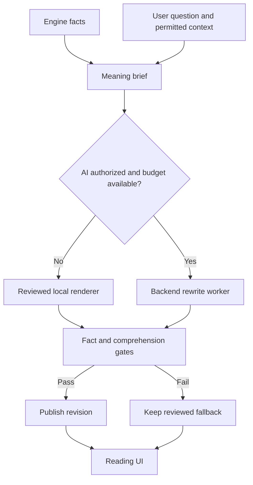
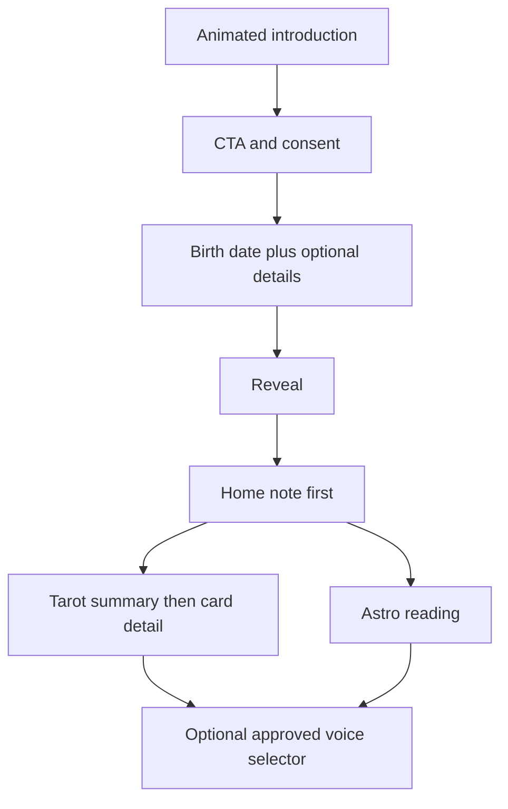

# Finish privacy, content quality and onboarding

## Goal Capsule

- Objective: Người dùng đọc hiểu bài Astro/Tarot, kiểm soát được dữ liệu của mình và bắt đầu sử dụng Lá Lành mà không gặp luồng giới thiệu rối.
- Means: Sửa các lỗi vòng đời dữ liệu trước, sau đó sửa phần diễn giải và kiểm duyệt trước khi thay trang giới thiệu và bổ sung giọng đọc, theo KTD1–KTD6.
- Authority: Yêu cầu mới nhất của người dùng và Product Contract của plan này. Các plan cũ là nguồn tham khảo, không chứng minh bản hiện tại đã hoàn thành.
- Execution profile: Làm tuần tự. Chỉ dùng test offline và dữ liệu tổng hợp cho tới khi có môi trường kiểm chứng PostgreSQL và phê duyệt gọi API trả phí.
- Stop conditions: Không chuyển sang phát hành khi còn lỗi privacy đã xác nhận, kiểm chứng PostgreSQL chưa chạy hoặc review bắt buộc chưa hoàn thành. Không mua credit để vượt quota.
- Delivery owner: Agent thực hiện và ghi bằng chứng; chủ sản phẩm duyệt thiết kế intro, giọng thứ hai và phát hành. Plan này không tự cấp quyền deploy, push hay thay billing.

---

## Product Contract

### Summary

Đóng các khoảng trống bảo mật và chi phí còn lại, sửa nội dung thành câu dễ hiểu, rồi mới làm trang giới thiệu có animation và lựa chọn giọng đọc.
Giọng direct là mặc định của Astro.
Giọng thứ hai phải có mẫu để chủ sản phẩm chọn trước khi chốt prompt.

### Problem Frame

Người dùng đã nhiều lần phản ánh nội dung khó hiểu, lặp lại, có ví dụ không liên quan và trộn disclaimer vào bài đọc.
Các đoạn Tarot đang ghép nghĩa lá, chủ đề và câu hành động thành câu dài nhưng không giải thích được câu hỏi của người đọc.
Các bản vá chi phí có test local nhưng chưa có bằng chứng khóa giao dịch trên PostgreSQL.
Deep scan hiện tại dừng vì quota, đồng thời giữ lại các phát hiện về dữ liệu chart cũ và consent hai người trong Radar.

### Key Decisions

- D1. **Bảo mật và chi phí trước nội dung, intro, giọng đọc.** session-settled: user-directed. Không chuyển ưu tiên khi người dùng vẫn đang hỏi lỗi đã sửa chưa. Governs R1, R2, R3.
- D2. **Astro mặc định direct.** session-settled: user-directed. Người dùng chọn câu ngắn, nói thẳng thay vì văn ẩn dụ. Governs R4, R5.
- D3. **Một giọng cọc nhưng có tình là lựa chọn tự nguyện.** session-settled: user-directed. Sắc thái cụ thể chưa được chọn. Governs R8.
- D4. **Ngân sách test USD1/tháng.** session-settled: user-directed. Đây là giới hạn mới nhất, thay cho USD1/ngày trong lịch sử. Governs R2.
- D5. **Intro thay trang đầu hiện tại, không thêm bước onboarding.** session-settled: user-directed. Governs R7.

### Requirements

**Privacy and spending**

- R1. Xóa giờ/nơi sinh phải xóa các kết quả suy ra từ độ chính xác đó, kể cả sau khi người dùng đã chuyển sang giờ không rõ hoặc dữ liệu thiếu.
- R2. API key chỉ ở backend; mọi lệnh trả phí phải qua consent, quyền sở hữu, giới hạn ngân sách bền vững và giới hạn retry. Xóa dữ liệu cá nhân không được xóa khoản chi đã giữ hoặc đã phát sinh.
- R3. Không gửi dữ liệu suy ra của người thứ hai sang nhà cung cấp AI dựa riêng vào consent của người đang xem. Radar riêng tư vẫn dùng được bằng diễn giải nội bộ khi không đủ consent của các chủ thể.

**Readable content**

- R4. Mọi bài đọc đang hiển thị phải nói rõ điều đang diễn giải bằng tiếng Việt đời thường, có chủ thể và tình huống cụ thể; không đòi hỏi người đọc biết Astro/Tarot.
- R5. Bản viết lại chỉ thay lời văn; không đổi hành tinh, nhà, góc, độ, lá bài, vị trí trải, chiều xuôi/ngược hoặc các chỉ báo đã tính. Ví dụ phải được trình bày là ví dụ, không thành chuyện được biết chắc về người dùng.
- R6. Tarot hiển thị tóm tắt trước phần từng lá. Disclaimer tách khỏi đoạn diễn giải, có kiểu UI riêng và vẫn đọc được; không lặp trên từng lá.
- R9. Gate phải từ chối nội dung sai dữ kiện, chung chung, lặp câu hoặc không trả lời đúng phạm vi câu hỏi; khi lỗi phải hiển thị bản nội bộ đã được duyệt, không đưa nháp lỗi ra giao diện.
- R10. CMS là công cụ review riêng, không phải điều kiện để sản phẩm có nội dung tốt hay hoạt động.

**Onboarding and voice**

- R7. Trang đầu giới thiệu rõ người dùng làm được gì, có animation và một CTA chính vào nhập thông tin. Không tạo phiên khách hay ghi consent chỉ vì mở trang. Demo, privacy, restart và Radar deep-link phải giữ nguyên ý nghĩa.
- R8. Người dùng có thể đổi direct và giọng cọc có tình trên Astro/Tarot sau khi giọng thứ hai được duyệt. Nội dung nhạy cảm không dùng giọng mắng; không công kích ngoại hình, giá trị con người hoặc hoàn cảnh sống.
- R11. Animation không chặn CTA, không tự bật âm thanh, tôn trọng reduced-motion và không gây nhấp nháy. Giữ concept cream/purple/lime, một font và phân cấp chữ của bản Ultraviolet đã chọn.

### Actors and Key Flows

- A1. Người dùng khách hoặc có tài khoản, có thể cung cấp ít dữ liệu và rút consent.
- A2. Người thứ hai trong Radar, có quyền consent riêng; không đồng nhất với người nhập thông tin về họ.
- A3. Chủ sản phẩm duyệt nội dung, giọng và thiết kế.
- A4. Backend tính dữ kiện và kiểm duyệt, nhà cung cấp AI chỉ viết lại phần được phép.

- F1. Người dùng sửa/xóa độ chính xác → khóa phiên và đối chiếu dữ liệu hiện tại → thu hồi dữ liệu dẫn xuất → xóa cache giao diện → các request cũ không được khôi phục kết quả đã xóa.
- F2. Engine tính dữ kiện → tạo bản ý nghĩa → diễn giải nội bộ hoặc AI được cấp phép → gate → công bố revision hợp lệ → giao diện đọc revision đó. AI lỗi hoặc hết ngân sách quay về nội dung nội bộ, không tự gọi lại vô hạn.
- F3. Mở intro → chọn CTA và consent đúng mục đích → nhập ngày sinh, giờ/nơi sinh tùy chọn → reveal → Home. Không thêm intro thứ hai vào luồng.
- F4. Chọn giọng → giữ dữ kiện và phạm vi bài đọc → dùng bản đã cache đúng giọng/phiên bản hoặc yêu cầu đã qua ngân sách → gate → hiển thị. Không mỗi lần toggle là một lần tính phí mới.

### Acceptance Examples

- AE1. Có chart đầy đủ, sau đó chọn không rõ giờ rồi xóa giờ/nơi sinh. Chart chính xác cũ, report dẫn xuất và link chia sẻ cũ không còn đọc được.
- AE2. Request đọc đã bắt đầu trước khi rút độ chính xác. Sau khi thao tác xóa hoàn tất, request đó không được lưu các nhà/góc cũ vào snapshot ngày sinh còn lại.
- AE3. Radar chỉ có một bên đồng ý xử lý qua AI. Không có request provider chứa dữ liệu của cả hai; bài nội bộ vẫn đọc được.
- AE4. Tarot hỏi chưa rõ như "với một người". Bài đọc không tự biến câu này thành "họ có yêu mình không" và không đoán cảm xúc của người kia.
- AE5. Gate phát hiện nội dung nói nhầm King of Cups thành một lá khác. Revision lỗi không được công bố; bản hợp lệ trước đó còn nguyên.
- AE6. Mở welcome hoặc đổi tone nhiều lần. Không có tạo guest từ việc mở trang, không có gọi provider trực tiếp từ browser và không mất Radar pending request.

### Scope Boundaries

**Active run (2026-10-09):** U2/U3 và U4, sau triage U1 đã có. U4 lần này xử lý bài Tarot tạo mới; Astro direct hiện có được regression-test, không viết lại mọi bài legacy. R4 vẫn là mục tiêu toàn sản phẩm: các revision cũ còn nguyên và chưa đạt mục tiêu mới không được coi là đã sửa. U5 giữ bản intro đã chọn và đã làm ở local, không thêm thiết kế; U6 chờ duyệt sắc thái; U7 chưa có quyền deploy. DoD dưới đây là của toàn roadmap, không phải tuyên bố tất cả đã xong trong run này.

Trong scope: lỗi bảo mật/chi phí, lifecycle dữ liệu chart và Radar, các bài đọc đang có, Tarot summary/gate, intro thay welcome, hai tone sau khi duyệt, test và runbook.

Không triển khai marketplace tarot reader, chatbot tự do, tính năng Vòng Ghép hay tính năng tìm người mới đang deferred. Không tăng giới hạn tiền, tạo key mới, mua quota, tự bật worker trên live hoặc public CMS.

Không xây thêm một scoring engine Astro/Tarot trong lần này. Vấn đề là dữ liệu dẫn xuất và cách diễn giải, không phải thay công thức để làm bài nghe thuyết phục hơn.

---

## Planning Contract

### Evidence Baseline

Các bản vá trước deep scan có bằng chứng 556 backend test, ruff và mypy qua local. Đây không phải bằng chứng PostgreSQL, browser, native app hoặc production.

Deep scan `9bdffbe3-169e-449a-bad2-3dde3de736e6` có trạng thái failed, không có successful discovery manifest. Có 75 mục giữ lại, gồm nhiều mục trùng nguyên nhân; chưa thể coi là 75 lỗ hổng độc lập. Không có tổng token/chi phí đo được trong context và manifest đã kiểm tra.

`apps/api/app/domains/birth/postgres.py` đang quyết định cleanup chart theo `profile_level == 3`. Trường hợp đã hạ level trước thao tác xóa có thể đi qua mà không dọn chart lịch sử.
`apps/api/app/domains/content_rewrite/registry.py` đăng ký 13 loại nội dung. Đăng ký không chứng minh mỗi loại đã có luồng provider, projector, fallback và UI hoàn chỉnh. U4 phải kiểm kê theo runtime, không theo số enum.

### Key Technical Decisions

- KTD1. **Lifecycle lấy dữ liệu thực tế làm căn cứ, không lấy level UI làm căn cứ xóa.** Thực thi R1 và AE1. Hợp nhất đường edit, downgrade và erase theo cùng chính sách cleanup; không vá riêng nhánh hiển thị.
- KTD2. **Kiểm tra snapshot đang còn hợp lệ tại lúc ghi kết quả.** Thực thi R1, R3, AE2. Request tính toán từ snapshot cũ phải bị từ chối sau withdrawal. Dùng cùng thứ tự khóa phiên/chủ thể trước tài nguyên và job để tránh khóa ngược nhau.
- KTD3. **Giới hạn tiền nằm ở transaction backend.** Thực thi R2. Giữ khoản reserve khi không biết provider đã nhận request hay chưa, không retry mù. [OWASP API4](https://api-security.owasp.org/editions/2023/en/0xa4-unrestricted-resource-consumption/) mô tả rủi ro chi phí từ gọi API hàng loạt. Không coi budget trong dashboard là hard cap của ứng dụng.
- KTD4. **Bản ý nghĩa đứng giữa kiến thức và lời văn.** Thực thi R4, R5, R9. Nó ghi dữ kiện nguồn, nghĩa liên quan câu hỏi, giới hạn suy luận, ví dụ và điều không được khẳng định. Tách disclaimer khỏi bản lời văn. Không thêm hồ sơ nền không cần thiết để cứu prompt.
- KTD5. **Gate kết hợp kiểm tra cấu trúc và corpus biên tập.** Thực thi R9. Kiểm tra schema/fact ID/độ dài/lặp có thể tự động; mức dễ hiểu cần corpus review rõ tiêu chí. Không gọi thêm một model trả phí cho từng bài để chấm model trước đó.
- KTD6. **Welcome giữ logic phiên, thay nội dung và motion sau khi chọn thiết kế.** Thực thi R7, R11. Không reset session hoặc gọi API trong effect animation.
- KTD7. **Tone là tùy chọn trình bày có phiên bản.** Thực thi R5, R8. Khóa cache chứa tone và prompt/gate version; chọn lại bản đã có không phát sinh generation. [CARROT](https://www.meetcarrot.com/weather/) cho phép chọn personality; [Duolingo](https://blog.duolingo.com/copy-testing-experiments/) kiểm thử copy theo ngôn ngữ. Đây là gợi ý thiết kế, không phải bằng chứng giọng mắng luôn hiệu quả hay viral tại Việt Nam.
- KTD8. **Chứng minh TLS và khóa trên PostgreSQL trước phát hành.** [PostgreSQL SSL](https://www.postgresql.org/docs/current/libpq-ssl.html) phân biệt xác minh certificate/hostname với chỉ mã hóa kết nối. Test SQLite không chứng minh row-lock hoặc RLS trên PostgreSQL.

### High-Level Technical Design

Luồng nội dung và ranh giới dữ liệu:



Withdrawal và request đang chạy:

```mermaid
sequenceDiagram
  participant U as User
  participant B as Birth lifecycle
  participant W as Reading request
  participant D as Database
  W->>D: Read snapshot identity and permitted precision
  U->>B: Withdraw precision
  B->>D: Lock subject and erase derived artifacts
  B-->>U: Withdrawal completed
  W->>D: Compare current lifecycle before persisting
  D-->>W: Reject stale result; do not recreate erased data
```

Luồng giao diện:



### Assumptions and Blockers

- PostgreSQL test service chưa có local. Không dùng production/Supabase chứa người thật để giả lập test xóa hoặc race. Cần môi trường riêng không có PII; nếu tạo dịch vụ phát sinh tiền phải hỏi lại.
- Deep scan hết quota là terminal failure của scan này. Không restart, complete hay đổi tên scan để vượt điều kiện. Giữ report/context đã có; một lần scan mới sau này cần được yêu cầu rõ ràng.
- Review độc lập của plan và bản vá mới chưa chạy sau khi quota hết. Không coi tự đọc plan là review độc lập.
- Thiết kế intro cần chọn trong ba option theo product-design:ideate. Không cần hỏi lại scope đã chốt, nhưng chưa có lựa chọn thiết kế cụ thể cho intro này.
- Giọng thứ hai cần duyệt mẫu trước prompt. Giọng direct không bị chặn bởi lựa chọn đó.
- Đánh giá 10 persona là dữ liệu tổng hợp, không tuyên bố đã phỏng vấn/test với 10 người thật.

### System-Wide Impact

Backend, worker, migrations, browser cache và share endpoint cùng chịu trách nhiệm withdrawal. Chỉ xóa một bảng hoặc invalidate một màn hình không đủ.
Người xem Radar không tự có quyền cho AI xử lý dữ liệu của người được nhập vào.
Việc đổi tone ảnh hưởng API contract, cache key, corpus và share preview; dữ liệu chia sẻ vẫn không mang question/context riêng tư mặc định.
App và web dùng chung nội dung, nhưng motion và lưu preference ở native cần kiểm chứng riêng trước phát hành app.

---

## Implementation Units

Execution update 2026-10-09: U3 now has actual isolated PostgreSQL process-kill,
connection-termination and UTC rollover proof (23 cases). New Tarot U4 has six banks,
eight recognised purposes, 24 purpose-action variants, three supported card links and
the versioned Luna meaning brief. Regression tests reject the reproduced polarity
inversion, but heuristics are not a semantic guarantee. Formal ce-code-review dispatch
failed before required reviewer/report leaves; U7 shipping remains blocked. No paid
calls, live activation, key transfer, commit, push or deploy were performed in this run.
See [execution receipt](../reviews/2026-10-09-security-content-work-handoff.md) and
[ten synthetic Tarot questions](../reviews/security-content-2026-10-09/tarot-purpose-corpus.md).

### U1. Triage retained security findings

**Goal:** Xác định nguyên nhân riêng biệt và đường khai thác thực tế từ kết quả scan bị dừng.

**Requirements:** R1–R3. **Dependencies:** Context scan đã lưu, không cần restart scan.

**Files:** `apps/api/app/domains/birth/postgres.py`, `apps/api/app/domains/readings/application.py`, `apps/api/app/domains/readings/postgres.py`, `apps/api/app/domains/radar/service.py`, `apps/api/app/domains/radar/rewrite.py`, `apps/api/app/domains/content_rewrite/authorization.py`, `apps/api/tests/content_rewrite/test_execution_fences.py`, `apps/api/tests/birth/test_postgres_encryption.py`.

**Approach:** Đọc retained findings từ kho Codex Security. Gom các phát hiện trùng theo nguyên nhân và đối chiếu code hiện tại; ghi đúng mục nào còn lỗi, đã được vá, hoặc không áp dụng. Không thay canonical report của scan failed. Lưu evidence bảo mật qua kho artifact của skill.

**Test scenarios:**

- Dựng lại chuỗi full → unknown → erase bằng dữ liệu tổng hợp và xác nhận chart chính xác cũ còn hay mất.
- Chặn request trước lúc persist, thực hiện withdrawal, rồi cho request tiếp tục để quan sát dữ liệu bị khôi phục.
- Ghi payload provider bằng fake transport khi chỉ một phía consent; xác nhận có chứa dữ liệu của phía còn lại hay không.

**Verification:** Mỗi nguyên nhân có evidence và disposition, không suy luận mức độ từ số 75 mục. Các test tái hiện lỗi hiện có phải chỉ ra được hành vi cần sửa.

### U2. Close precision and two-person consent gaps

**Goal:** Withdrawal không để lại hoặc tái tạo chart chính xác và không gửi sai dữ liệu hai người sang AI.

**Requirements:** R1, R3, AE1–AE3. **Dependencies:** U1.

**Files:** Các file birth/readings/radar và authorization của U1; `apps/api/app/domains/birth/service.py`, `apps/api/app/domains/birth/repository.py`, `apps/web/src/shared/api/client.ts`, `apps/web/src/features/profile/ProfilePage.tsx`; test `apps/api/tests/birth/test_birth_api.py`, `apps/api/tests/radar/test_flow.py`, `apps/api/tests/content_rewrite/test_radar_rewrite.py`, `apps/api/tests/content_rewrite/test_execution_fences.py`, `apps/web/src/features/profile/ProfilePage.test.tsx`.

**Approach:**

1. Sửa lifecycle theo KTD1 và KTD2 ở tất cả implementation đang dùng, kể cả repository phục vụ test.
2. Liên kết kết quả với snapshot nguồn được kiểm tra khi ghi, không chỉ current snapshot được đọc lại sau tính toán.
3. Áp dụng R3 cho enqueue và execute Radar; private manual-input dùng local renderer khi không có consent riêng có thể kiểm chứng của người thứ hai.
4. Xóa query cache liên quan sau withdrawal, không giữ report cá nhân trong tab vừa xóa.

**Execution note:** Bắt đầu bằng regression test cho ba đường lỗi đã giữ lại, rồi sửa chung nguyên nhân.

**Test scenarios:**

- Covers AE1. Hạ level trước erase vẫn xóa snapshot lịch sử, daily/reading revisions và share dẫn xuất.
- Covers AE2. Stale request daily, insight và Radar không persist sau withdrawal của mỗi chủ thể.
- Covers AE3. Consent một phía, revoked consent, expired guest và private third-party input không gọi provider.
- Đủ consent hai chủ thể và tài nguyên còn hiệu lực thì generation đi đúng phạm vi; revoke một phía trước execute làm job thất bại an toàn.
- Rút giờ không xóa Tarot chỉ dựa question/card; rút guest xóa toàn bộ dữ liệu của guest.
- Browser reload, back và đổi route không hiện report đã xóa từ query cache.

**Verification:** Không còn nguyên nhân privacy đã xác nhận ở U1; test API và browser chứng minh withdrawal, không chỉ assert tên hàm hoặc SQL.

### U3. Verify cost and PostgreSQL release fences

**Goal:** API bị gọi hàng loạt, retry hoặc xóa guest không vượt ngân sách đã duyệt.

**Requirements:** R2. **Dependencies:** U2 và PostgreSQL test riêng.

**Files:** `apps/api/app/db/session.py`, `apps/api/app/db/rewrite_scope.py`, `apps/api/app/domains/content_rewrite/postgres.py`, `apps/api/app/domains/content_rewrite/worker.py`, `apps/api/migrations/versions/20261008_0029_rewrite_monthly_spend.py`, `apps/api/migrations/versions/20261008_0030_rewrite_fences.py`, `apps/api/tests/content_rewrite/test_execution_fences.py`, `apps/api/tests/content_rewrite/test_repository.py`; planned integration test `apps/api/tests/content_rewrite/test_postgres_release_fences.py`.

**Approach:** Dùng fake provider và database riêng để chứng minh KTD3, KTD8. Kiểm tra migration từ schema trước, budget UTC, reset tháng, job lease hết hạn, reserve không hoàn lại khi trạng thái gửi chưa rõ, RLS và certificate validation. Không bật paid worker để chứng minh test.

Kiểm tra worker khởi động bằng chính secret mount của Compose, không miễn validator production. Nếu chờ lock/send marker qua ngày UTC, không gửi bằng khoản reserve ngày cũ; giữ khoản đã reserve. Bằng chứng rollback exception không được gọi là process kill hoặc đứt kết nối database thật. Kiểm chứng các tình huống này riêng trên PostgreSQL localhost tổng hợp; thiếu proof phải ghi là release blocker.

**Test scenarios:**

- Nhiều worker reserve đồng thời ngay dưới cap, tổng accepted reservation không vượt USD1/tháng.
- Xóa guest, cleanup job, restart worker và retry không reset khoản đã giữ/đã chi.
- Provider nhận request rồi mất kết nối; expired job không gửi lại khi chưa biết đã tính phí.
- Projection fail làm rollback cả publication; lease hết hạn trong lúc chờ lock không gọi provider.
- Anonymous/authenticated database roles không đọc hoặc sửa ledger; migration không làm mất lịch sử chi.
- Certificate không tin cậy hoặc hostname sai làm kết nối thất bại; CA/hostname đúng kết nối được.

**Verification:** Có bằng chứng PostgreSQL thật và fake-transport call count. Secret không xuất hiện trong log, bundle, OpenAPI, artifact hay diff. Các test SQLite cũ chỉ là baseline.

### U4. Rewrite active Astro and Tarot content with quality gates

**Goal:** Người chưa biết Astro/Tarot hiểu bài ngay lần đọc đầu và biết phần nào là nội dung, ví dụ hoặc lưu ý.

**Requirements:** R4–R6, R9, R10, AE4–AE5. **Dependencies:** U2, U3 và review plan bắt buộc.

**Files:** `apps/api/app/domains/readings/knowledge.py`, `apps/api/app/domains/readings/renderers.py`, `apps/api/app/domains/readings/rewrite.py`, `apps/api/app/domains/readings/review_agent.py`, `apps/api/app/domains/readings/gates.py`, `apps/api/app/domains/tarot/knowledge.py`, `apps/api/app/domains/tarot/engine.py`, `apps/api/app/domains/tarot/rewrite.py`, `apps/api/app/domains/content_rewrite/registry.py`, `apps/api/app/domains/content_rewrite/gates.py`, `apps/web/src/features/tarot/TarotPage.tsx`, `apps/web/src/shared/ui/ReadingContent.tsx`; tests `apps/api/tests/content_rewrite/test_reading_gates.py`, `apps/api/tests/content_rewrite/test_tarot_rewrite.py`, `apps/api/tests/tarot/test_engine.py`, `apps/api/tests/readings/test_renderers.py`, `apps/web/src/features/tarot/TarotPage.test.tsx`, `apps/web/src/shared/ui/ReadingContent.test.tsx`; proposed corpus `apps/api/tests/fixtures/content_rewrite/direct_comprehension_corpus.json`.

**Approach:**

1. Kiểm kê runtime từng bài hiển thị: Home/detail, reveal, natal, planet/house/aspect/transit, Radar, Tarot, share/recap đang bật. Nội dung deferred không được âm thầm bật lại.
2. Tạo bản ý nghĩa theo KTD4 cho mỗi loại, sửa local renderer trước prompt. Không dùng một cảnh tin nhắn trả lời chậm cho mọi lá và mọi vấn đề.
3. Giữ direct Astro đã chốt. Tarot dùng bản ý nghĩa có phiên bản: chủ đề, mục đích câu hỏi đã rút gọn tại máy chủ, vai trò từng lá, điều có thể hiểu và hành động có thể tự chọn. Không đưa câu hỏi nguyên văn hoặc birth chart vào provider để tăng cá nhân hóa.
4. Bổ sung ngân hàng riêng cho công việc, giao tiếp, sức lực và chăm mình. Mỗi lá có nghĩa, điểm dễ vướng và hành động theo chủ đề; không thay vài danh từ trong nghĩa tình cảm để gọi là cá nhân hóa. Thiếu nghĩa phải được phát hiện trong audit trước phát hành.
5. Tổng hợp cả trải bài bằng liên hệ đã biên tập: điểm cùng nhấn mạnh, điểm đối lập hoặc thứ tự nhìn vấn đề rồi hành động. Chỉ gọi tên mối liên hệ khi có rule và hai lá nguồn; không suy luận chuyện đã xảy ra từ lá bốc ngẫu nhiên. Bài một lá không có liên hệ giả.
6. Luna nhận bản ý nghĩa và tóm tắt nội bộ, viết lại một lần bằng giọng direct. Nó không chọn lá, tự thêm dữ kiện người dùng hoặc đổi ý của lá. Prompt có ví dụ tốt/xấu, câu ngắn có chủ ngữ và động từ. Tránh thuật ngữ trị liệu dịch máy, khẩu hiệu và ví dụ tin nhắn dùng cho mọi chủ đề.
7. Gate theo KTD5 áp dụng cả bản nội bộ và bản AI. Kiểm tra giữ nguyên lá/vị trí, summary đề cập toàn bộ lá, không tự đoán suy nghĩ người khác, không chỉ lặp lại một câu cho nhiều lá. Output bất hợp lệ không được công bố; không gọi lại provider để cứu nội dung. Lưu nguyên nhân bằng mã, không log birth data hoặc question.
8. Summary Tarot vẫn ở trước danh sách lá. Bản lưu cũ giữ revision cũ, không tự chạy rewrite hàng loạt hay tính phí lúc reload. QA đọc các bài tạo mới; chuyển đổi legacy là bước riêng có dự toán trước.

9. Phân loại thêm mục đích cụ thể bằng mã cục bộ đóng: xin lỗi khác chốt lịch gặp, bàn giao việc khác muốn được ghi nhận. Giữ nhiều mục đích khi nhận ra, không lấy tên hoặc câu hỏi nguyên văn gửi AI. Câu chưa phân loại được giữ chủ đề chung, không giả vờ hiểu thêm chuyện.
10. Khi local gate không có bài hợp lệ ở lần bốc đầu, lưu bộ lá đã chọn với trạng thái complete và reading rỗng (contract hiện có cho phép). UI báo “Chưa mở được phần diễn giải. Bộ lá của bạn không thay đổi.”, cho quay lại/xóa. Không lộ nháp, không yêu cầu bốc lại, không enqueue AI hoặc tự gọi lại để cứu bài.
11. Audit toàn bộ sáu chủ đề, kể cả general và relationship, không suy từ bốn ngân hàng mới. Test cấu trúc/keyword chỉ chặn các lỗi đã biết, không chứng minh hiểu đúng nghĩa hoặc tiếng Việt tự nhiên. Corpus đọc thủ công là gate riêng; mười persona là tổng hợp, không phải mười người thử thật.

**Content acceptance:** Với “Mình nên nói rõ điều gì với người đang tìm hiểu?” và Nhà Vua Cốc / Ba Gậy / Sáu Tiền, người đọc hiểu: nói cảm xúc mà không cố tỏ ra ổn, đừng chờ đối phương tự biết bước tiếp theo, và làm rõ sự quan tâm có đến từ hai phía. Đây là cách đọc bộ lá, không phải khẳng định đối phương đang làm gì. Summary không mở bằng “ba lớp nhìn”, “vùng mờ” hay giải thích định nghĩa Tarot. Ví dụ đều được gắn nhãn, disclaimer nằm riêng.

**Research:** [Joan Bunning: card pairs](https://www.learntarot.com/less15.htm) định hướng rule so sánh ý nghĩa; không xác nhận khả năng dự đoán. [OpenAI Structured Outputs](https://developers.openai.com/api/docs/guides/structured-outputs) chỉ đảm bảo cấu trúc, không đảm bảo nội dung có ích; corpus và review người đọc vẫn là gate độc lập. [OpenAI data controls](https://developers.openai.com/api/docs/guides/your-data) yêu cầu phân biệt `store:false` với chính sách lưu phục vụ chống lạm dụng. [OWASP unbounded consumption](https://genai.owasp.org/llmrisk/llm102025-unbounded-consumption/) là căn cứ giữ reservation và không retry mù khi provider đã có thể nhận request.

**Additional files:** Planned `apps/api/app/domains/tarot/context_readings.py`, `apps/api/app/domains/tarot/meaning_brief.py`, `apps/api/tests/tarot/test_meaning_brief.py`; existing `apps/api/app/infrastructure/generation/privacy.py`, `apps/api/app/infrastructure/generation/schemas.py`, `apps/api/tests/infrastructure/generation/test_privacy.py`.

**Test scenarios:**

- Covers AE4. Question mơ hồ giữ đúng phạm vi, không đoán hộ ý người khác.
- King of Cups, Three of Wands, Six of Pentacles trong relationship/conversation có nghĩa khác nhau theo vị trí, không lặp template nguyên câu.
- Giữ cùng lá nhưng đổi câu hỏi sang công việc tạo ví dụ công việc, không kéo cảnh nhắn tin tình cảm vào.
- Covers AE5. Đổi card/planet/house/orb trong output bị gate từ chối; fallback hợp lệ vẫn có.
- 10 persona tổng hợp, gồm date-only, approximate time, full chart và 1/3/5-card spread, đọc được nội dung có liên quan và không lẫn disclaimer.
- Provider off, hết budget, timeout và gate fail đều có bản dễ hiểu; CMS off không ảnh hưởng.
- Giữ bộ lá nhưng đổi giữa các chủ đề tạo diễn giải và ví dụ phù hợp chủ đề; đổi intent tạo câu hỏi tự soi tương ứng, không chỉ đổi headline.
- Cùng chủ đề/intent nhưng xin lỗi sau lỡ hẹn và chốt lịch gặp có summary/reflection khác nhau; câu có cả hai giữ cả hai goal codes.
- Local gate fail ở lần chọn cuối vẫn giữ đủ lá sau reload, không mở fan mới hoặc tạo provider job.
- Bản ý nghĩa truyền tới provider chỉ chứa trường có schema đóng và nội dung biên tập. Câu hỏi có tên, email hoặc chỉ dẫn “ignore instructions” không xuất hiện trong payload.
- Rewrite sửa sai ý lá hoặc thêm kết luận chắc về người khác bị chặn; bản gốc hợp lệ còn nguyên.
- 390px mobile, text zoom và light/dark không có tiêu đề dài phóng to chiếm hết màn; summary xuất hiện trước card detail trong DOM và visual.

**Verification:** Corpus có chấm thủ công rõ ràng theo câu hỏi, dữ kiện, ngôn ngữ và tính cụ thể. Chủ sản phẩm xem output mẫu thật của engine; không thay kết quả bằng mock để làm bản demo đẹp.

### U5. Select and build animated introduction

**Goal:** Trang đầu nói rõ app dùng để làm gì và đưa người dùng vào ngay, không kéo dài onboarding.

**Requirements:** R7, R11, AE6. **Dependencies:** U4; chủ sản phẩm chọn một trong ba phương án intro.

**Files:** `apps/web/src/features/welcome/WelcomePage.tsx`, `apps/web/src/shared/ui/SignalStationFrame.tsx`, `apps/web/src/features/welcome/WelcomePage.test.tsx`, `apps/web/tests/e2e/welcome.spec.ts`; planned welcome-specific styling beside `WelcomePage.tsx`.

**Approach:** Dùng product-design:ideate tạo đúng ba thiết kế độc lập theo concept đã chọn, có reference thật. Sau lựa chọn mới triển khai. Giữ logic CTA, consent, session idempotency và pending Radar; không gắn animation vào reset dữ liệu. Motion tạo cảm giác bước vào app nhưng CTA sử dụng ngay, reduced-motion có bản tĩnh.

**Test scenarios:**

- Covers AE6. Mở trang, reload và animation chạy không tạo guest hoặc consent.
- CTA bấm hai lần không tạo hai phiên; lỗi mạng có retry không mất Radar context.
- Guest cũ, restart và deep-link tiếp tục đúng flow đã có.
- Reduced-motion, bàn phím, screen reader và zoom vẫn dùng được CTA và privacy.
- Intro không có thêm màn xác nhận mới hoặc animation bắt buộc phải xem hết.

**Verification:** Screenshot mobile/desktop bám thiết kế đã chọn; browser E2E từ intro tới Home và Radar tiếp tục qua được.

### U6. Approve and implement optional affectionate sharp voice

**Goal:** Người dùng đổi giọng đọc mà không đổi ý nghĩa hoặc bị mắng không mong muốn.

**Requirements:** R5, R8. **Dependencies:** U5; chủ sản phẩm chọn sắc thái.

**Files:** `apps/api/app/domains/content_rewrite/models.py`, `apps/api/app/domains/readings/rewrite.py`, `apps/api/app/domains/tarot/models.py`, `apps/api/app/domains/tarot/rewrite.py`, `packages/contracts/src/v1.ts`, `apps/web/src/features/profile/ProfilePage.tsx`; tests `apps/api/tests/content_rewrite/test_reading_rewrite.py`, `apps/api/tests/content_rewrite/test_tarot_rewrite.py`, `apps/web/src/features/profile/ProfilePage.test.tsx`; proposed voice corpus beside corpus U4.

**Approach:** Trình bày mẫu cùng một meaning brief với ba mức cọc; nghiên cứu chỉ lấy nguyên tắc opt-in và thử nghiệm copy, không sao chép lời thương hiệu. Sau khi chọn mới chốt prompt. Tone phản ứng với hành vi đang mô tả, không đánh giá người đọc. High-stakes dùng direct theo R8. Legacy tone lưu trước đó có migration/alias rõ ràng.

**Test scenarios:**

- Direct và giọng được duyệt có cùng fact IDs, card order, chỉ báo, giới hạn và privacy.
- Chọn giọng rồi đổi lại dùng cache/version đúng, không gửi lại request vì render hoặc toggle lặp.
- Question về sức khỏe, khủng hoảng hoặc an toàn không có câu mắng, miệt thị hoặc xúi giục.
- Thiếu preference dùng direct; provider off vẫn có giọng nội bộ đã duyệt.
- Share không tự mang giọng hoặc context riêng tư của người dùng sang người nhận.

**Verification:** Chủ sản phẩm duyệt mẫu Astro lẫn Tarot trước khi prompt dùng trong sản phẩm; không đánh dấu lựa chọn mẫu là đã triển khai.

### U7. Integrate, review and prepare release

**Goal:** Người dùng đi hết flow với nội dung và UI đúng, không chỉ endpoint trả 200.

**Requirements:** R1–R11. **Dependencies:** U1–U6, review độc lập, release authority mới.

**Files:** `apps/web/tests/e2e/product-flow.spec.ts`, `apps/web/tests/e2e/welcome.spec.ts`, `docs/operations/luna-rewrite-release-runbook.md`, `docs/operations/hetzner-supabase-release-runbook.md`, `docs/legal/store-privacy-data-map.md`; proposed experience receipt under `docs/reviews/`.

**Approach:** Kiểm tra tất cả luồng thay đổi bằng dữ liệu tổng hợp và fake provider, kiểm content output lẫn screenshot. Ghi phạm vi thực sự đã chạy, source revision, schema và flag. Chỉ bàn giao deploy sau review và U3 đạt; không tự gọi API thật để chứng minh.

**Test scenarios:**

- Intro → birth đủ/thiếu giờ → reveal → Home/detail → natal/insight → Tarot 1/3/5 lá → Radar manual input → withdrawal → reload.
- Mất mạng, budget exhausted, stale revision và expired guest có UI giải thích được và không lộ dữ liệu.
- Desktop/mobile, reduced-motion, text zoom và mỗi theme không đổi thứ tự nội dung đã chốt.
- Key không có trong build output; share không chứa date/time/place/question mặc định; error/metrics không ghi PII.

**Verification:** Có review receipt và checklist deploy/rollback được cập nhật, không phát hành nếu chỉ pass unit test mà nội dung còn bị người review đánh giá khó hiểu.

---

## Verification Contract

Các lệnh dưới đây là entry point đã có trong `package.json`, không phải bằng chứng đã chạy cho plan mới.

| Gate | Entry point | Required proof |
|---|---|---|
| Backend | `pnpm api:test`, `pnpm api:lint`, `pnpm api:typecheck` | Regression mới và suite hiện tại qua; không gọi provider thật |
| PostgreSQL | U3 integration tests on isolated PostgreSQL | Khóa, RLS, migration, budget, withdrawal race và TLS được kiểm chứng |
| Contracts | `pnpm contracts:check` | Backend, web, mobile không lệch API/tone enum |
| Content | `pnpm content:audit`, `pnpm tarot:audit`, `pnpm content:review`, `pnpm rewrite:corpus` | Matrix và corpus direct đều qua, không chỉ có manifest |
| Experience | `pnpm experience:audit`, manual corpus review | Chấm 10 persona tổng hợp; không gọi là test với 10 người thật |
| Web | `pnpm web:lint`, `pnpm web:typecheck`, `pnpm web:test`, `pnpm web:e2e` | Summary ở trên, intro không dài thêm, preference/cache không mất dữ liệu |
| Privacy/runtime | `pnpm verify:runtime` | Không secret client-side, share/withdrawal không giữ PII ngoài mục đích |
| Release | Independent code/security review and current runbooks | Không dùng report deep scan bị dừng làm chứng nhận toàn hệ thống |

Không chạy `rewrite:release` hoặc lệnh có provider/network trả phí khi chưa kiểm tra chế độ và có phê duyệt chi phí cụ thể.

---

## Definition of Done

- Các nguyên nhân privacy giữ lại được triage, sửa và kiểm chứng bằng test thực tế phù hợp database.
- Ngân sách tháng tồn tại qua xóa dữ liệu, crash và retry; không có browser trực tiếp giữ key hoặc gọi provider.
- Mục tiêu toàn roadmap: tất cả bài đang hiển thị có bản direct dễ hiểu và gate; CMS không phải dependency. Run hiện tại chỉ xác nhận Tarot tạo mới và regression Astro; legacy chưa chuyển đổi phải ghi rõ.
- Summary Tarot ở đầu, disclaimer tách UI, không lấy dữ kiện nguồn thành lời khẳng định chắc về cuộc đời người dùng.
- Intro được chọn và đi được end-to-end; animation có reduced-motion và không cản CTA.
- Giọng cọc có tình được duyệt, opt-in, cùng nghĩa với direct và có fallback nhạy cảm.
- Có receipt review độc lập, corpus, PostgreSQL, browser và release. Ghi rõ native chưa test nếu chưa chạy app.
- Không giữ code thử nghiệm bỏ dở; không đưa file/user changes ngoài scope vào commit hoặc deployment.
- Chỉ báo hoàn thành phần đã có bằng chứng. Không coi quota failure, test local hoặc kế hoạch viết xong là sản phẩm đã lên live.
