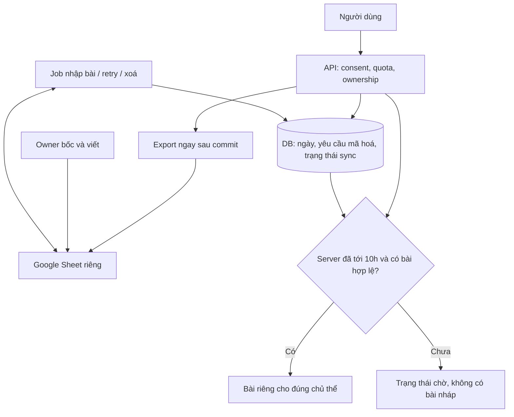
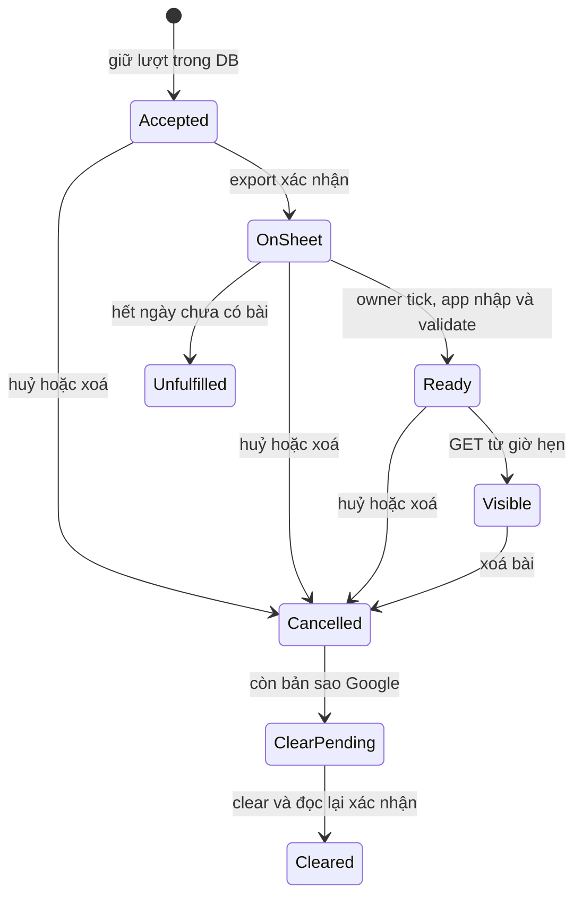
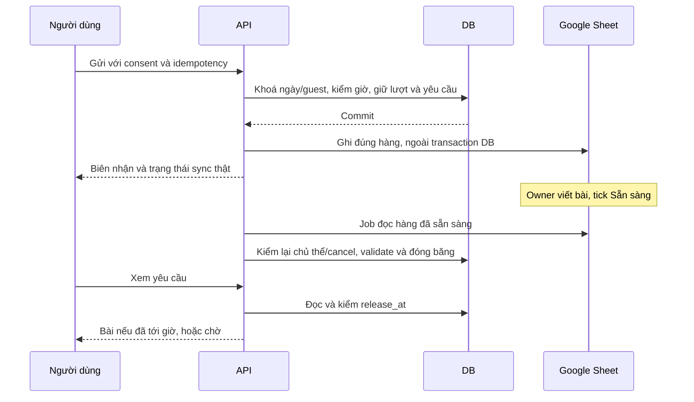

# Birth correction and human Tarot via Google Sheets - Plan

## Goal Capsule

- Objective: Người dùng sửa được ngày sinh đã nhập sai và có thể nhờ người thật bốc bài, nhận bài riêng trong app vào lịch đã hẹn.
- Means: Kế thừa phần sửa ngày sinh của #113; dùng một Google Sheet riêng làm nơi owner nhận câu hỏi và viết bài, theo KTD1–KTD7.
- Authority: Quyết định owner trong chat 29/10, Product Contract dưới đây, D1–D6 của kế hoạch #113, rồi các lựa chọn kỹ thuật trong plan này. Không thay đổi các bài đã đóng băng.
- Execution profile: Lập kế hoạch, không phải lệnh triển khai. Claude thực hiện theo các U-ID sau khi đọc các điểm cần chốt; Codex review từng SHA. Owner quyết định bật thật và phát hành.
- Stop conditions: Không dùng dữ liệu thật trước khi chốt quyền Google, consent, retention và xử lý bản sao. Không chạy probe PostgreSQL, đổi IAM/secret/budget, bật provider hay deploy từ plan này. Giữ P07 PARTIAL/B và mọi receipt đỏ.

---

## Product Contract

### Summary

Mình có thêm đường sửa ngày sinh sau khi lưu.
Tarot có hai lựa chọn: tự bốc với luồng hiện tại, hoặc nhờ người thật bốc và viết bài.
Lựa chọn người thật nhận tối đa 10 lượt một ngày; mỗi lượt đi vào một Google Sheet riêng của owner ngay sau khi app ghi nhận.
Owner viết bài trong Sheet, đánh dấu hoàn tất, app lấy bài và mở cho đúng người dùng từ 10h cùng ngày theo giờ Việt Nam.

### Problem Frame

Ngày sinh nhập sai làm các phần dựa trên lá số tiếp tục dùng dữ liệu sai.
Cách nhận bài người thật cần cho owner một chỗ làm việc quen thuộc và khối lượng cố định, thay vì xây dashboard quản trị, chat hoặc hệ thống phân công.
Người dùng cần phân biệt rõ bài tự bốc và bài người thật, biết khi nào có bài và vẫn xoá được dữ liệu của mình.

### Requirements

#### Birth correction

- R1. Sửa ngày sinh từ Mình theo D1–D6 và AC1–AC14 của `docs/plans/2026-10-29-birth-data-edit-plan.md` tại #113, bổ sung hai sửa bắt buộc r54 được nêu ở U1/U2. Không coi bản plan đó là runtime đã có.
- R2. Mọi thay đổi ngày sinh là một giao dịch thay thế có kiểm revision; lỗi hoặc từ chối tuổi giữ nguyên dữ liệu cũ. Cùng ngày sinh là replay, không làm mất lớp giờ/nơi sinh.
- R3. Bản đã lưu và link đã chia sẻ giữ chữ như cũ qua sửa ngày sinh, vẫn có đường unsave/revoke; bỏ giờ/nơi sinh giữ hành vi xoá đã công bố. Tarot độc lập lá số không bị huỷ chỉ vì đổi ngày sinh.

#### Human Tarot

- R4. Lựa chọn người thật là một luồng riêng, có người thật bốc và viết; không dùng AI thay thế âm thầm. Luồng tự bốc hiện tại vẫn dùng được và không tiêu hạn mức người thật.
- R5. Server nhận tối đa 10 yêu cầu thành công toàn app mỗi ngày lịch `Asia/Ho_Chi_Minh`, mỗi phiên chủ thể tối đa một lượt trong ngày. Huỷ, xoá, retry, restart và nhiều worker không hoàn lại hạn mức đã nhận. Đây là cận trên 10 lượt, không phải bằng chứng nhận diện 10 con người khác nhau.
- R6. Không nhận yêu cầu mới từ 10:00 tới hết ngày; không tự xếp sang hôm sau. Bài của lượt nhận hôm nay có giờ hẹn 10:00 hôm nay, không cho chọn giờ khác. Retry lượt đã nhận vẫn xem được biên nhận sau giờ đóng.
- R7. App cố gắng ghi ngay lượt đã nhận vào đúng một file Sheet của owner; nếu Google lỗi phải hiện trạng thái đồng bộ, giữ việc đã nhận và không để gửi lại tạo lượt thứ hai. Mục tiêu bình thường là đồng bộ trong 5 giây; chưa chuyển được không được báo là owner đã thấy.
- R8. Owner điền các lá, bài đọc và bước nhỏ trong Sheet, rồi đánh dấu `Sẵn sàng`. App chỉ nhập bài đầy đủ, hợp lệ của đúng mã yêu cầu; bản nháp không bao giờ được trả cho người dùng.
- R9. Trước 10h API chỉ trả trạng thái và giờ hẹn. Từ 10h API cho chủ thể đọc bản người thật đã nhập và đóng băng; nếu chưa có bài hợp lệ thì hiện đang chờ, không tự tạo kết quả để đủ giờ. 10h là thời điểm trả bài dự kiến, không phải cam kết con người hoặc mạng luôn hoàn thành đúng giây.
- R10. Người dùng quay lại app để xem bài, có nút kiểm tra lại; không cần mở app liên tục. Không thêm push, email, SMS, chat hay thanh toán trong bản đầu.

#### Privacy and operating limits

- R11. Trước khi gửi, người dùng chủ động đồng ý cho người bốc được chỉ định đọc câu hỏi và cho Google xử lý bản sao trong Sheet. Không mặc định bật hoặc gộp vào consent AI cũ. Câu hỏi có thể chứa thông tin riêng; không gọi việc bỏ tên là ẩn danh tuyệt đối.
- R12. Sheet chỉ có mã yêu cầu ngẫu nhiên, ngày/giờ hẹn, chủ đề, câu hỏi và phần bài cần làm. Không tự lấy thêm ngày/giờ/nơi sinh, lá số, email, điện thoại, tên tài khoản, guest/session ID, cookie, CSRF, token chia sẻ hoặc link mở bài. Nhắc người dùng không đưa tên đầy đủ, liên hệ hay dữ kiện nhận diện người khác vào câu hỏi.
- R13. Chủ thể có thể huỷ lượt hoặc xoá bài; app chặn đọc/import ngay và theo dõi xoá bản sao Google tới khi xác nhận. Không báo đã xoá hết khi chỉ mới xoá DB. Guest deletion, clear history, expiry và replay sau restore đều phải xử lý loại dữ liệu mới.
- R14. Không có dịch vụ AI hay quota trả phí mới; không thay ngân sách hiện tại. Google Sheet là nguồn bài do owner viết, DB vẫn quyết quyền xem, hạn mức, giờ mở và trạng thái xoá.

### Key decisions

- KD1. Người thật bốc và viết, không phải người dùng tự chọn rồi chỉ hẹn giờ hiện. `(session-settled: user-directed, chosen over scheduled self-draw: owner xác nhận người thật.)` Governs R4, R8.
- KD2. Một đợt trả bài 10h cùng ngày và đóng nhận sau 10h; không nhận cho hôm sau. `(session-settled: user-directed, chosen over next-day queue: owner yêu cầu hôm sau mở lại.)` Governs R6, R9.
- KD3. Owner nhận và viết trong một Google Sheet, thay cho công cụ quản trị riêng. `(session-settled: user-directed, chosen over operator dashboard/CLI: owner chọn nơi làm việc quen thuộc.)` Governs R7, R8, R12.

### Flows and copy draft

F1. Mình → Ngày sinh → Sửa → xem tác động → nhập ngày hai lần → xác nhận → Lá mới. Bảng tác động của #113 phải nói lời mời chưa được chấp nhận sẽ ngừng hoạt động, gồm lời mời đã mở. Người dùng vẫn quản lý được bản lưu/link cũ.

F2. Tarot → "Tự bốc ngay" hoặc "Nhờ người bốc". Lựa chọn người thật hiện "Tối đa 10 lượt/ngày · Trả bài lúc 10:00 hôm nay". Bên dưới có giờ Việt Nam, tình trạng còn lượt và thông tin consent R11 trước nút gửi. Hết lượt hiện "Hôm nay đã đủ 10 lượt. Bạn có thể quay lại ngày mai hoặc tự bốc ngay." Sau giờ nhận hiện "Hôm nay đã ngừng nhận lượt. Ngày mai bạn quay lại nhé."

F3. Gửi thành công → "Đã nhận câu hỏi · Hẹn bạn lúc 10:00, dd/MM". Chưa chuyển sang Sheet hiện thêm "Đang chuyển tới người bốc". Sau khi chuyển được mới đổi thành "Người bốc đã nhận câu hỏi". App không dùng câu này làm bằng chứng owner đã đọc.

F4. Owner xem hàng mới trong Sheet → bốc theo số lá đã hiện → điền bài và bước nhỏ → kiểm câu hỏi tương ứng → tick Sẵn sàng → thấy cột app xác nhận "Đã nhận bài" hoặc lỗi trường cần sửa. Không nhập nội dung qua GitHub, email hoặc cuộc chat agent.

F5. Đến giờ, người dùng mở lại yêu cầu → nhận bài người thật. Chưa xong hiện "Bài của bạn chưa hoàn tất. Bạn có thể quay lại sau hoặc huỷ yêu cầu." Không tự đổi ngày hẹn hoặc giả vờ một bài do máy viết là bài người thật.

### Scope boundaries

Bản đầu có một người bốc là owner và một Sheet riêng cho môi trường production.
Staging chỉ dùng một Sheet tổng hợp riêng, không dùng file production.
Không xây marketplace người bốc, hồ sơ công khai, chat, thanh toán, ảnh tải lên hoặc tuỳ chọn giờ cá nhân.
Không dùng Google Apps Script public webhook, Redis, hàng đợi SaaS hay dashboard quản trị mới.
Không lấy connector Google của cuộc chat làm kết nối production chạy nền.

### Assumptions and open choices

- A1. Giờ nhận sớm hơn 10h chưa được owner chốt. Đề xuất 09:00 để có thời gian bốc/viết. Không tự đưa 09:00 vào hành vi chính thức; trước khi có quyết định, R6 là cận đóng 10h và R9 có trạng thái chậm rõ ràng. Muốn quảng bá bảo đảm đúng 10h phải chốt giờ ngừng nhận và khả năng phục vụ của owner trước launch.
- A2. Một lượt mỗi phiên chủ thể/ngày là chính sách chống chiếm lượt nhẹ, không thêm đăng nhập bắt buộc hay lấy số điện thoại. Giới hạn toàn app vẫn là R5 dù tạo nhiều phiên.
- A3. Đề xuất retention cho luồng mới: bản live trong Sheet và câu hỏi thô trong app hết mục đích sau khi nhận bài, tối đa 24h từ giờ hẹn; bài đã đóng băng trong app tối đa 30 ngày từ giờ hẹn, có thể mất sớm theo guest deletion/clear. Bài chưa hoàn tất hết ngày thì kết thúc không có kết quả. Owner cần duyệt retention/copy này trước dữ liệu thật; không kế thừa 30 ngày cho câu hỏi trên Google một cách ngầm định.
- A4. Cần xác minh một identity kết nối Google server-side có quyền chỉ trên file đã duyệt. Chưa có chứng cứ credential phù hợp đã tồn tại; cấu hình quyền/secret là việc riêng cần owner cho phép. Không mở Google login cho người dùng vì tính năng này.

---

## Planning Contract

### Existing evidence

Runtime được đọc ở integration `e0d62fafcc696035b86686c82b87d5fc095b5114`, qua bản bất biến của #113; không dựa vào checkout bootstrap cũ để suy ra trạng thái sản phẩm.
`tarot/service.py` đã có payload AES-GCM, idempotency, kiểm chủ thể, câu hỏi 8–280 ký tự và xoá có journal.
`content_rewrite/postgres.py` có mẫu debit quota ngày với upsert và row lock; mẫu đó dùng ngày UTC, nên không sao chép phép tính ngày.
`content_studio` không cho câu hỏi thật và auth beta bị cấm ở staging/production; không mở rộng Studio để lách điều kiện này.
Nguồn schema/API/frontend dưới đây đều nằm trong `apps/api` và `apps/web` hiện có.
Không có solutions corpus hoặc Compound Pack được khai báo cho chủ đề này.

### Key technical decisions

- KTD1. Tách domain yêu cầu người thật khỏi TarotSession hiện có, theo R4. Hai bảng mới dự kiến: `human_tarot_days` giữ tổng nhận theo ngày, lease đồng bộ và trạng thái cấu hình ngày; `human_tarot_requests` giữ metadata, payload mã hoá, trạng thái export/import/clear và kết quả đóng băng. Dùng cột trạng thái bền vững làm outbox, không thêm broker. Bảng backend-only bật RLS và thu hồi quyền PUBLIC/anon/authenticated trong migration; test chốt này, không mở Data API cho câu hỏi.
- KTD2. Nhận lượt theo R5/R6 trong một transaction: khoá dòng ngày, rồi khoá guest theo thứ tự thống nhất, kiểm lại giờ server sau khi chờ khoá, kiểm lượt đã có, debit và tạo yêu cầu. Có ràng buộc DB cho trần 10 và một lượt chủ thể/ngày; idempotency xung đột trả đúng lượt thắng. Không trừ thêm lượt khi mất response hoặc Google lỗi. Bản tổng theo ngày không chứa ID người và không bị giảm khi xoá yêu cầu.
- KTD3. File Sheet là bảng công việc ngày hiện tại với 10 hàng được cấp vị trí từ DB, không append mù. Mã yêu cầu/ngày/vị trí gắn với bản export dự kiến; retry ghi đúng range của nó. Không ghi đè hàng có mã khác; duplicate/mất header/sort sai gây lỗi đồng bộ rõ ràng. Mọi lần đọc/import vẫn kiểm lại mã và ngày, không xác thực bằng số hàng. Giữ một file, không tạo file cho từng người hay từng ngày.
- KTD4. Export thử ngay sau commit, ngoài lock, theo R7. Một job đồng bộ mỗi 60 giây trên hạ tầng hiện có nhập bài Sẵn sàng và xử lý retry/xoá; có lease bền vững để nhiều process không nhập/ghi lặp. Bài đã import không bị thay bằng lần sửa Sheet sau đó. Google timeout sau khi ghi được xử lý bằng kiểm đúng mã/range, không cấp lượt mới. Đơn vị triển khai của job được xác minh ở U5, không bật lại worker Luna để tận dụng nhầm cờ.
- KTD5. Theo R8/R9, server kiểm `release_at` trên mọi GET, không chỉ ẩn trong UI. Import có schema riêng: đúng số lá và mã catalog, bài/bước nhỏ dạng chữ thuần có giới hạn, không công thức/HTML/link thực thi. Không chạy lại deterministic stance để sửa lời người thật và không tự enqueue Luna. Các gate an toàn/nội dung vẫn áp dụng; lỗi có mã không kèm câu hỏi. Một lần nhập hợp lệ tạo bản bất biến có provenance người bốc/phiên bản schema/giờ nhập.
- KTD6. Theo R11–R13, consent riêng `human-tarot-v1`, envelope context riêng, owner-only API và no-store. Export kiểm consent, owner còn hợp lệ và epoch ngay trước gửi; cancel/delete ghi journal cùng transaction và ngăn mọi late import. Cần fence cho Google write đang bay, rồi clear đúng mã hàng và xác nhận ở lần đọc sau. Request tombstone/trạng thái xoá đủ để retry và không hồi sinh khi restore. Hạn mức đã nhận không được reset theo việc xoá dữ liệu cá nhân.
- KTD7. Kết nối server-to-server hoặc OAuth owner có quyền file tối thiểu, được quyết sau preflight A4; không public link, không quyền toàn Drive mặc định. Ghi câu hỏi với `RAW` để không thành công thức. Chỉ owner và identity kết nối được chia sẻ file. Không có khách nào nhận URL/ID Sheet hoặc credential. Người dùng chỉ nói chuyện với API của app.
- KTD8. Sửa ngày sinh theo R1–R3: lifecycle/schema triển khai trước endpoint; detach active pointer và flush trước xoá; source recheck trong transaction tạo share dưới cùng guest lock; compute trước lock, capture/drain sends, correction journal và cache giữ queued unsaves. Không gộp migration ngày sinh với migration luồng người thật để dễ review/rollback.

Không chọn Sheet làm nguồn quota/quyền xem vì chỉnh hàng, timeout và nhiều request đồng thời không chứng minh được R5.
Không chọn tự động Apps Script hoặc webhook vì cần thêm bề mặt xác thực và phụ thuộc vận hành không cần cho 10 lượt.
Việc mở đúng giờ là kiểm thời gian khi đọc dữ liệu đã nhập; không cần một job riêng để "phát hành" 10h.

### High-level technical design

### Sheet layout

Tab làm việc tên "Hôm nay" có header cố định và 10 hàng, kèm một tab hướng dẫn không có dữ liệu khách.
App chỉ cập nhật các cột do app sở hữu, không ghi đè bài owner đang viết.
Không sort/di chuyển hàng dữ liệu; phần bảo vệ vùng chỉ giúp tránh nhầm, không thay kiểm tra server.

| Nhóm | Cột | Ai ghi | Quy tắc |
| --- | --- | --- | --- |
| Nhận diện công việc | Mã yêu cầu, ngày nhận, giờ hẹn | App | Không phải token truy cập; không thể nhập mã bất kỳ để lấy bài khách khác |
| Câu hỏi | Chủ đề, câu hỏi, số lá | App | Chỉ sau consent; không kèm hồ sơ sinh |
| Bốc bài | Lá 1 đến Lá 5 | Owner | Dropdown catalog; chỉ điền đúng số lá cần cho yêu cầu |
| Bài | Bài đọc, bước nhỏ | Owner | Chữ thuần; không nhúng URL, formula hoặc nội dung AI |
| Hoàn tất | Sẵn sàng | Owner | Tick sau cùng; bỏ tick để sửa trước khi app nhận |
| Phản hồi | Trạng thái app, lỗi trường | App | Không echo nội dung; bài đã nhận phải sửa qua quy trình riêng, không âm thầm đổi |

Đổi ngày phải kết thúc/import hoặc đánh dấu yêu cầu cũ chưa hoàn tất, lưu việc cần xoá rồi mới tái dùng hàng.
Lease đồng bộ và kiểm mã/ngày phải chặn callback ngày cũ ghi/xoá nhầm hàng ngày mới.
Không dùng Sheet này làm kho lưu trữ bài cũ; app giữ kết quả theo A3.

### Privacy, security and cost

Việc đưa câu hỏi vào Google Sheet là một luồng dữ liệu mới, dù không kèm tên hay ngày sinh.
Data map, privacy notice, consent, hồ sơ P09/P10 và khai báo store phải ghi rõ người thật và Google trước dữ liệu tester thật.
Đây là điều kiện thiết kế, không phải kết luận đã tuân thủ pháp luật.
Cần kiểm lại cơ sở xử lý, bên nhận, nơi xử lý, retention và điều khoản Google; chủ thể có thể chọn tự bốc mà không đồng ý luồng này.

Xoá DB hoặc clear ô chỉ là xoá bản live đã kiểm; không tự chứng minh xoá khỏi lịch sử phiên bản, bản sao tải xuống hay retention của Google.
Trước pilot dữ liệu thật, owner/engineering phải có phương án xử lý các bản sao đó và câu chữ đúng giới hạn, thay vì hứa xoá hoàn toàn trong 24h.
Nếu chưa có phương án đáp ứng yêu cầu áp dụng, chỉ chạy tổng hợp và để luồng người thật tắt.
Không làm việc với câu hỏi thật qua GitHub, log, APM body, email hoặc chat agent; chỉ dùng số đếm/mã lỗi trong vận hành.

Không cần mua dịch vụ hay tăng quota.
Thiết kế bình thường dùng một lần đọc batch/phút khi còn việc, tối đa 10 lượt nhận/ngày và ghi batch nhỏ, không polling theo từng người.
Đặt giới hạn ứng dụng tối đa 30 request Google/phút và 2.000/ngày gồm retry, fail closed khi chạm giới hạn; không tự mở billing hoặc xin quota.
Giới hạn này không phải đảm bảo mọi chi phí của hạ tầng bằng 0; nhân công và hạ tầng hiện có vẫn có chi phí.
Giá/quota Google phải xác minh lại ở lúc bật thật. Trần phút này cho phép 10 lượt ghi riêng lẻ gần nhau; batch không phải điều kiện để lượt thứ sáu được thử export ngay. Sau restore trong ngày đang nhận, mặc định đóng nhận tới ngày sau hoặc tới khi đối soát được quota và tombstone; không tự mở lại theo số hàng Sheet còn trống.

### Launch choices still requiring a decision or evidence

1. Giờ ngừng nhận trước 10h và mức cam kết đúng giờ theo A1.
2. Retention/copy A3 và xử lý Google history/backup; không coi checkbox consent là đã giải quyết hết P09/P10.
3. File/identity Google cụ thể, quyền truy cập và điều kiện dịch vụ theo A4/KTD7. Không nhờ khách đăng nhập Google.

---

## Implementation Units

### U1. Complete the birth artifact lifecycle prerequisite

Goal: R1/R3 và KTD8 trước khi endpoint sửa ngày sinh được bật.
Dependencies: Sửa kế hoạch #113 theo r54 và review SHA mới; không coi APPROVE #114 là duyệt #113.
Files: `docs/plans/2026-10-29-birth-data-edit-plan.md`, `apps/api/app/domains/saved/tables.py`, `apps/api/app/domains/share/tables.py`, `apps/api/app/domains/share/postgres.py`, `apps/api/app/domains/birth/postgres.py`, migration Alembic mới, `apps/api/tests/birth/`, `apps/api/tests/share/`.
Approach: Tách FKs nguồn cho bản frozen, giữ guest cascade; thay mọi cascade cần giữ bằng explicit delete; khoá/recheck nguồn khi tạo share; downgrade từ chối orphan. Chưa mở correction endpoint.
Test scenarios:
- Bản lưu/link giữ nguyên sau xoá nguồn theo correction, vẫn unsave/revoke được.
- Precision removal vẫn xoá các bản đó đúng thông báo.
- Create trước removal thì removal dọn bản mới; removal trước insert thì insert bị từ chối; có PostgreSQL hai connection khi được phép test dùng một lần.
Verification: Migration và các đường lifecycle có chứng cứ, không chỉ mock repository; không có late public share.

### U2. Add birth replacement and restore semantics

Goal: R1/R2, KTD8; hiện thực API và journal của #113.
Dependencies: U1.
Files: `apps/api/app/domains/birth/service.py`, `apps/api/app/domains/birth/postgres.py`, `apps/api/app/api/v1/routes/birth.py`, `apps/api/app/domains/erasure_journal/`, `apps/api/tests/birth/`, `apps/api/tests/erasure_journal/`.
Approach: Kiểm tuổi/range trước compute; same-date replay; old POST từ chối ngày khác; correction kiểm expected revision, hạn 3 lần/24h, detach/flush trước xoá, activate sau; capture/drain sends và journal cùng thay thế. Restore trước correction để không còn subject, không ghi ngày mới vào journal.
Test scenarios:
- Lỗi compute, journal hoặc flush không để dữ liệu nửa cũ/nửa mới; stale revision và dưới 18 tuổi giữ nguyên.
- Pointer đang active không cản correction/replay; transaction rollback vẫn phục hồi subject.
- Send cũ đang bay kết thúc trước response; publication cũ không được hồi sinh.
- Dump trước/sau correction theo checkpoint; cùng ngày sinh không hạ chart đã có giờ/nơi.
Verification: AC API/restore của #113 có test thật trên repository; PostgreSQL proof chưa chạy thì ghi thiếu, không thay bằng SQLite để gọi là đạt.

### U3. Add the birth edit flow and retained-copy management

Goal: R1/R3 và F1.
Dependencies: U1/U2.
Files: `apps/web/src/features/profile/ProfilePage.tsx`, `apps/web/src/features/birth/`, `apps/web/src/features/saved/`, `apps/web/src/shared/storage/clearChartDerivedData.ts`, `apps/api/app/api/v1/routes/share_artifacts.py`, test web tương ứng, story US-23 và SRS.
Approach: Xác nhận tác động, nhập ngày hai lần, báo lỗi bình tĩnh; API danh sách share owner-only không trả token/nội dung; cache bỏ save cũ nhưng giữ unsave đang chờ.
Test scenarios:
- Offline unsave trước correction rồi reload vẫn tới server; callback chart cũ không ghi lại cache.
- Link trước correction vẫn tìm/thu hồi được; không lẫn unsave với revoke.
- Pending invite đã mở cũng được nói rõ sẽ ngừng hoạt động; focus và bàn phím của sheet hoạt động.
Verification: Một flow e2e tổng hợp và kiểm UI trên mobile; frozen Tarot không đổi theo ngày sinh.

### U4. Add human Tarot admission and private request APIs

Goal: R4–R6/R9/R13, KTD1/KTD2/KTD5/KTD6.
Dependencies: Chốt schema/copy và retention A3 trong docs; độc lập U1–U3.
Files: domain mới `apps/api/app/domains/human_tarot/`, route mới `apps/api/app/api/v1/routes/human_tarot.py`, `apps/api/app/main.py`, migration Alembic, `apps/api/app/domains/history/postgres.py`, `apps/api/app/domains/erasure_journal/`, `apps/api/tests/human_tarot/`.
Approach: Schema chặt, tái dùng intake an toàn và số lá/map đã chọn; APIs nhỏ gồm availability, create, get-current/get-owned và cancel/delete; session/CSRF/Origin/no-store như Tarot. Lưu consent, idempotency, encrypted payload và quota transaction. Không gửi Google trong lock.
Test scenarios:
- 20 chủ thể gửi đồng thời cho tối đa 10 thành công; cùng key/nhiều worker vẫn một receipt và một debit.
- Khoá chờ qua 10h thì request mới bị từ chối; replay cũ vẫn có receipt; local-day rollover đúng giờ Việt Nam.
- Huỷ/xoá/clear/expiry/restore không giảm quota hoặc hồi sinh yêu cầu.
- GET trái chủ thể không thấy bài; 09:59:59 không thấy payload dù đã Ready; 10:00:00 có bài nếu đã Ready.
Verification: Có chứng cứ concurrency DB cho cap và xoá; không dùng middleware memory làm bằng chứng cap toàn app.

### U5. Add the bounded two-way Sheet bridge

Goal: R7/R8/R11–R14, KTD3/KTD4/KTD6/KTD7.
Dependencies: U4; A4 và privacy launch choices chỉ cần xong trước dữ liệu thật, phát triển dùng adapter giả/tổng hợp.
Files: `apps/api/app/infrastructure/google_sheets/` mới, `apps/api/app/domains/human_tarot/` sync logic, `apps/api/scripts/sync_human_tarot.py` mới, cấu hình/job trong `infra/hetzner/`, `apps/api/tests/human_tarot/test_sheets_sync.py` mới, runbook mới cho người bốc và bản mẫu Sheet.
Approach: Một template file 10 hàng, app columns/read-only metadata và owner columns; Google write RAW, fixed range, mismatch fail closed. Export ngay, durable retry và job batch 60s có lease. Import có kiểm đúng request/epoch/schema/ready, freeze once; xoá live row có readback. Không chạy Apps Script/webhook hay kích hoạt worker AI.
Test scenarios:
- Timeout sau khi Google đã ghi, retry không nhân đôi hoặc ghi đè bài/hàng khác; Google 429/5xx không mất lượt và không log body.
- Đổi mã/đổi ngày/sort/duplicate row/thiếu header/công thức/link bị từ chối; câu hỏi bắt đầu bằng dấu bằng vẫn là text khi export.
- Ready thiếu lá/bài bị báo đúng cột; sửa Sheet sau import không đổi bài đã đóng băng.
- Cancel/guest erase xen giữa export/import, callback hôm qua và reuse hàng hôm nay không làm lộ/hồi sinh/xoá nhầm bài.
- OAuth hết quyền hoặc job ngừng: trạng thái sync lỗi rõ; không báo giả owner đã nhận.
Verification: Adapter fake kiểm dữ liệu/vận hành, rồi một rehearsal với file Google tổng hợp khi có quyền riêng; không dùng bằng chứng giả làm integration Google thật.

### U6. Add the human request and result UI

Goal: R4/R6–R13 và F2–F5.
Dependencies: U4/U5 contract.
Files: `apps/web/src/features/tarot/TarotPage.tsx`, feature mới cho human request/result, `apps/web/src/shared/api/client.ts`, OpenAPI/TS generated, privacy/consent UI, test component và e2e tương ứng.
Approach: Lựa chọn rõ tự bốc/người thật; consent riêng và trạng thái còn lượt; recover receipt từ server không lưu câu hỏi vào localStorage; countdown chỉ trình bày; refetch khi quay lại/đến giờ, không polling từng giây. Kết quả ghi đúng người thật, không dựng provenance engine giả.
Test scenarios:
- Hết lượt, đóng nhận, sync pending/error, chưa tới giờ, chậm bài, Ready, huỷ và phiên hết hạn đều có hành động rõ.
- Reload sau POST mất response không nhận thêm lượt; XSS/formula chỉ là text hoặc bị chặn; không xuất Sheet URL/token.
- Đổi giờ máy không mở bài sớm; logout/owner change xoá cache và chặn callback muộn.
Verification: Mobile 320/375/390px, focus/reader/reduced-motion, flow tự bốc không regression và flow người thật dùng response thật của API tổng hợp.

### U7. Validate the two deliveries and prepare a bounded pilot

Goal: Chứng minh các yêu cầu và cập nhật tài liệu trước lệnh release riêng.
Dependencies: U1–U6; tách release sửa ngày sinh và pilot người thật nếu một phần chưa đủ gate.
Files: US-23, US-20 bổ sung luồng người thật, SRS, `docs/legal/store-privacy-data-map.md`, privacy policy, runbook Google mới, registry, E2E và receipt review.
Approach: Giữ ma trận AC, full check exact combined head, copy mẫu người dùng/owner, rehearsal synthetic ngày/mạng/xoá. Liệt kê riêng operator evidence còn thiếu và các launch choices; không tự gỡ P07/B.
Test scenarios:
- Chuỗi nhận → Sheet → owner ghi → import → mở lúc10h → xoá/clear Google không đổi người hoặc lộ sớm.
- Backup/replay, Google unavailable và owner không hoàn thành không dẫn tới giả thành công.
Verification: Reviewer có receipt độc lập và owner có hướng dẫn 10 lượt/giờ hẹn rõ; không tuyên bố full compliance hoặc release Go từ test xanh.

---

## Verification Contract

Bắt đầu bằng các regression về FK/share của r54 trước khi sửa lifecycle; không chạy lại integration SHA đã khép để lấy receipt mới.
Sau implementation chạy bộ phù hợp với feature rồi `CI=1 pnpm check` một lần trên đúng head ghép mới; contracts và fallback chỉ refresh khi thật sự đổi bảng/copy có duyệt.
Concurrency phải có PostgreSQL dùng một lần khi được cho phép; SQLite không thay cho chứng cứ đó.
Google chỉ kiểm thật với file tổng hợp riêng và quyền đã được owner cấp, không lấy Sheet cá nhân khác để thử.
Mỗi receipt ghi exact SHA, môi trường và pass/fail; giữ cả red setup/test thay vì chỉ báo lần retry xanh.

| Nhóm | Bằng chứng cần có |
| --- | --- |
| Sửa ngày sinh | Lifecycle upgrade/downgrade; pointer/delete ordering; same-date/stale/age/rollback; gửi đang bay; hai phía dump; unsave/revoke sau sửa |
| Nhận 10 lượt | DB contention, unique/idempotency, quota không hoàn, restart, 10h boundary, local day |
| Sheet | RAW, retry ambiguous write, mapping/mismatch, ready validation, freeze, 429/credential failure, late day/cancel fencing |
| Privacy | Payload inventory mới; consent riêng; at-rest encryption; API/log canaries; scope/file ACL; erasure và bản sao Google |
| Frontend | Tự bốc giữ hành vi; người thật đủ states; cache/owner change; mobile/accessibility; E2E tổng hợp |
| Vận hành | Copy/retention/cutoff được quyết; quota/billing không đổi; receipt rehearsal; release riêng theo runbook |

---

## Definition of Done

- Mỗi R có test hoặc chứng cứ vận hành tương ứng; các giới hạn chưa chứng minh được ghi là chưa đạt.
- #113 và phần sửa mới được review đúng SHA, không chuyển approval cũ sang code mới.
- Schema/OpenAPI/TS, copy, consent, data map, privacy và store declarations không mâu thuẫn với hai luồng mới.
- Không mất chữ bài cũ, queued unsave, quyền xoá/revoke hoặc privacy fence.
- Không còn code thử/draft integration bị bỏ lại trong diff.
- Owner đọc mẫu, chốt launch choices và cho phép quyền Google trước dữ liệu thật; deploy/bật là lệnh riêng.
- P07 PARTIAL/B, các gate còn mở và mọi receipt đỏ được giữ.

---

## Sources

Nguồn nội bộ: `AGENTS.md`, `docs/operations/codex-claude-collaboration.md`, kế hoạch #113 tại `e372e29df57ef060619ae059258618a82dd6c065`, review r54 ở [#113](https://github.com/honghanh153-creator/la-lanh/pull/113#issuecomment-6499880630), runtime integration `e0d62fafcc696035b86686c82b87d5fc095b5114`, `apps/api/app/domains/tarot/service.py`, `apps/api/app/domains/content_rewrite/postgres.py`, `apps/api/app/domains/birth/postgres.py`, `apps/api/app/domains/share/postgres.py`.

Nguồn chính thức đọc ngày 29/10/2026:
- [Google Sheets limits and pricing](https://developers.google.com/workspace/sheets/api/limits): thiết kế dưới quota, không mặc định cho tăng quota/billing.
- [Google RAW input](https://developers.google.com/workspace/sheets/api/reference/rest/v4/ValueInputOption): ghi câu hỏi như text.
- [Google revision deletion](https://developers.google.com/workspace/drive/api/reference/rest/v3/revisions/delete): không thể dùng API này để xoá riêng revision của Sheet; clear hàng không chứng minh xoá lịch sử.
- [Google scopes](https://developers.google.com/workspace/sheets/api/scopes): quyền file tối thiểu, không coi protected range là auth của app.
- [PostgreSQL17 row locks](https://www.postgresql.org/docs/17/explicit-locking.html): kiểm cap có transaction/lock.
- [Luật91/2025, Điều9–11](https://congbaocdn.chinhphu.vn/CongBaoCP/CongBao/2025/7/45574/57723-1-971-972.pdf) và [Apple5.1.1](https://developer.apple.com/app-store/review/guidelines/#data-collection-and-storage): đầu vào cho rà consent, mục đích, quyền và retention; không phải chứng nhận áp dụng pháp luật.
