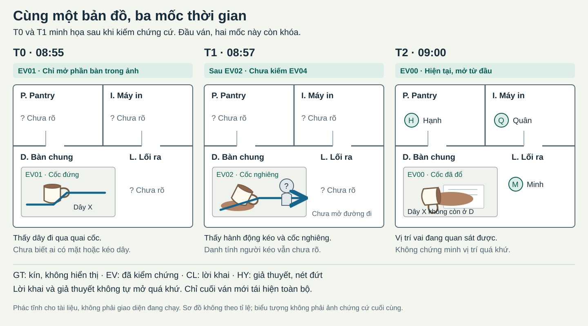

# Bản đồ 2D cho hiện tại và quá khứ

Ngày: 27/10/2026. Phạm vi: bổ sung thiết kế, không viết runtime.

Một sơ đồ không gian dùng chung cho hiện tại và các mốc quá khứ. Người chơi phục dựng sự việc bằng chứng cứ kiếm được. Game giữ riêng diễn biến thật và chỉ tái hiện toàn bộ khi ván đã kết thúc.

Đây là thiết kế mới theo trao đổi hiện tại, không phải phần đã được duyệt trong PR93. Tài liệu nghiên cứu cũ và gói 88 tài liệu gốc được giữ nguyên.

## 1. Phạm vi của ví dụ

- Vụ mẫu: "Ai làm đổ cà phê?", một nhánh có profile nhân vật mặc định.
- Ba mốc của bản đồ: T0 = 08:55, T1 = 08:57, T2 = 09:00.
- T2 là hiện trường lúc bắt đầu điều tra. Chọn điểm trên bản đồ để khám xét hoặc hỏi nhân vật.
- Mẫu dùng vai gây chuyện biết hành động của mình và được che giấu bằng lời khai. Đây là giả định của ví dụ, không chốt mọi phiên bản game.
- Sơ đồ là nơi chốn hư cấu. Vị trí vai không phải vị trí ngoài đời của người tham gia.
- Chưa bổ sung di chuyển thời gian thực, cơ chế phá hủy chứng cứ, hệ thống vật lý, API, cơ sở dữ liệu hoặc sinh vụ án bằng AI.

## 2. Một sơ đồ, bốn vùng cố định

Các vùng giữ nguyên vị trí ở cả ba mốc. Người, đồ vật và mức thông tin được phép thấy thay đổi theo mốc.

```text
                    VĂN PHÒNG HƯ CẤU
   +------------------------+------------------------+
   | P. Pantry              | I. Khu máy in          |
   | Bồn rửa, khăn lau       | Máy in, máy tính       |
   +---------- cửa ---------+---------- cửa ---------+
   |                                                 |
   | D. Bàn chung                 L. Lối ra           |
   | Cốc, tài liệu, dây sạc        Cửa hành lang       |
   |                                                 |
   +-------------------------------------------------+
```

Đây là sơ đồ quan hệ không gian, không theo tỉ lệ. Nó không xác lập tốc độ đi bộ, tầm nhìn qua tường hoặc quãng đường bằng mét.

Tất cả ảnh và lời khai dùng cùng mã P, I, D, L. Không xoay trái phải giữa ảnh hiện tại và ảnh quá khứ. Bằng chứng cần góc nhìn khác phải ghi rõ hướng chụp và vị trí trên sơ đồ.

## 3. Bốn loại thông tin không được trộn

| Loại | Người chơi thấy gì? | Cách ghi trên bản đồ | Giới hạn |
|---|---|---|---|
| GT: sự thật kín | Không thấy toàn bộ khi đang điều tra. Mỗi vai chỉ nhận thông tin riêng được kịch bản cho phép | Không có nút, lớp bản đồ hay chú thích công khai để mở GT | Cố định từ đầu lượt. Không đổi để đối phó với dự đoán của người chơi |
| EV: thông tin đã kiểm chứng | Chỉ phần quan sát mà một chứng cứ đã kiếm được thực sự xác nhận | Nhãn "Đã kiểm chứng", mã chứng cứ, mốc và phạm vi quan sát | Không suy rộng từ "có dây ở bàn" thành "chủ dây đã gây chuyện" |
| CL: lời khai | Một nhân vật nói mình hoặc người khác đã làm gì | Nhãn "Lời khai", người nói, mốc được nhắc tới và nguyên văn câu nói | Chưa được coi là vị trí thật. Người gây chuyện có thể nói dối |
| HY: giả thuyết | Người chơi tự đặt người, vật hoặc đường đi để thử cách giải thích | Nhãn "Giả thuyết", nét đứt, người tạo và chứng cứ đang dùng | Không tự trở thành EV dù nhiều người đồng ý hoặc thử nhiều lần |

Mỗi nhãn có chữ và hình dạng để phân biệt. Không chỉ dùng màu.

Một lời khai có thể được ghi thêm "được EV04 xác nhận" hoặc "mâu thuẫn EV04". Game vẫn giữ câu nói ban đầu để người chơi thấy nhân vật đã đổi lời thế nào.

Các câu chữ trên màn hình:

- "Chưa biết" khi chưa có nguồn cho chi tiết đó.
- "Lời khai của vai ..." khi chỉ có lời nói.
- "Đã kiểm chứng bằng EV..." khi có chứng cứ phù hợp.
- "Đang thử giả thuyết. Chưa xác nhận diễn biến thật" khi mở phần thử phương án.

## 4. Quyền biết và quyền chia sẻ

### 4.1. Bản đồ chung

Bản đồ chung chỉ chứa quan sát công khai, chứng cứ đã công khai và các lời khai được phát biểu cho nhóm. Ban đầu, quá khứ chưa có vị trí nhân vật đã kiểm chứng.

### 4.2. Thông tin riêng

Một vai có thể biết mình đã làm gì từ thẻ vai. Biết riêng không làm bản đồ chung tự xuất hiện một dấu vị trí hoặc đường đi. Vai chỉ được chia sẻ hoặc giữ lại những gì luật của ván cho phép.

Nếu có chứng cứ riêng, nó chỉ mở chi tiết quá khứ cho người đã kiếm được chứng cứ. Khi công khai chứng cứ, đúng phần quan sát đó mới xuất hiện trên bản đồ chung. Tài liệu mẫu không bắt buộc có chứng cứ riêng.

Để nhóm không bị kẹt vì một người giấu thông tin, đường kiếm chứng cứ quyết định phải còn một cách tiếp cận công khai hoặc do NPC cung cấp. Profile riêng không phải chìa khóa duy nhất để thắng ván.

### 4.3. Không hiển thị ngầm sự thật

Không lộ GT qua hình xem trước, tên lớp, chú thích ảnh, tooltip, đường đi mờ hoặc hình nhân vật bị che nhưng vẫn có tên. Bản đồ quá khứ không phải bản GT được giảm độ sáng.

Hai người có cùng chứng cứ và cùng thông tin công khai phải nhận cùng mức phản hồi khi thử cùng một giả thuyết. Việc một người đang giữ vai gây chuyện không được làm lộ thêm đáp án trong phần kiểm giả thuyết.

## 5. Minh họa ba mốc thời gian



Hình là bản phác tĩnh cho tài liệu. T0 và T1 thể hiện phần được phép thấy sau khi kiếm chứng cứ tương ứng, không phải những gì hiện sẵn khi mới vào ván.

| Mốc | Khi chưa kiếm chứng cứ | Phần có thể mở bằng chứng cứ | Phần vẫn chưa được biết |
|---|---|---|---|
| T0, 08:55 | Chỉ có khung P, I, D, L. Nhãn "Chưa có chứng cứ cho mốc này" | EV01 mở ảnh cốc đứng và dây X ở D, gồm đường dây mắc vào quai cốc | Ai đứng ở P, I, D, L tại T0. Ảnh không xác nhận những người ngoài khung |
| T1, 08:57 | Chỉ có khung địa điểm. Lời khai và giả thuyết hiện riêng nếu người chơi đã thêm | EV02 cho thấy một người chưa rõ danh tính kéo dây X tại D, cốc nghiêng. EV04 về sau nối được đoạn rời D tới L và xác nhận danh tính người đó | Các hành động ngoài khung hình và diễn biến đầy đủ của những người khác |
| T2, 09:00 | Hiện trường hiện tại mở từ đầu bằng EV00 | Cốc đã đổ ở D, có vết cà phê trên tài liệu, dây X không còn tại D. Hạnh ở P, Quân ở I, Minh ở L | Vị trí hiện tại không xác nhận vị trí của bất kỳ ai tại T0 hoặc T1 |

Không vẽ một đường thẳng nối vị trí T0 với T2 rồi gọi đó là đường đi đã kiểm chứng. Chỉ đoạn đường được chứng cứ bao phủ mới được ghi nhãn EV.

Khi quay về T0 hoặc T1, không mang biểu tượng nhân vật ở T2 sang. Phần chưa biết tiếp tục để trống hoặc ghi "?".

## 6. Chứng cứ phải kiếm được

EV00 là quan sát hiện tại được cấp khi vào ván. EV01 đến EV04 là nội dung hư cấu do tác giả chuẩn bị. Đây không phải yêu cầu người chơi nộp ảnh, camera, lịch hay hồ sơ thật.

| Mã | Cách kiếm trong vụ mẫu | Điều được xác nhận | Điều chưa được kết luận |
|---|---|---|---|
| EV00 | Quan sát hiện trường T2 | Trạng thái hiện tại và vị trí các vai đang hiện diện | Ai đã đứng đâu trước đó |
| EV01 | Ghép đúng các mảnh ảnh gốc. Game công khai dấu giờ T0 và mép ảnh để đối chiếu | Cốc đứng ở D. Dây X đi qua quai cốc như trong ảnh | Ai đặt dây vào vị trí đó hoặc ai sẽ kéo dây |
| EV02 | Sắp thứ tự ba khung theo dấu giờ và chuyển động liên tục. Khung bị cắt không chứa gương mặt | Tại T1, người chưa rõ danh tính kéo dây X từ D, cốc nghiêng theo chuyển động đó | Danh tính người kéo. Không dùng màu tay áo để tự gán tên |
| EV03 | Đối chiếu mã X trên ảnh với sổ mượn phụ kiện hư cấu trong game | Vai nào đã nhận dây X theo sổ | Chủ dây không đương nhiên là người kéo dây tại T1 |
| EV04 | Ghép góc cửa với EV02 bằng dấu giờ đồng bộ và chi tiết nối khung. Có thể kiếm qua khảo sát, không phụ thuộc việc người gây chuyện có thú nhận | Theo dõi liên tục được cùng người từ D tới L trong sự kiện T1. Góc cửa xác nhận được vai đó | Không mở toàn bộ quá khứ của P hoặc I, không tự phát phần tái hiện cuối ván |

Mỗi challenge hiển thị vật liệu cần để giải. Không đòi hỏi người chơi đã biết đáp án kín mới vượt được challenge. Một lần chọn sai nhận gợi ý về vật liệu đang thấy, không nhận thêm một mẩu GT.

Tarot có thể mở câu hỏi hoặc gợi điểm cần khảo sát. Chỉ sau khi hoàn thành hành động kiếm chứng cứ, chi tiết tương ứng mới được ghi thành EV. Profile và diễn giải chiêm tinh không tự xác nhận một người đã ở D lúc T1.

EV01, EV02 và EV04 phải được vẽ sao cho đường dây, chuyển động và việc nối cùng một người đọc được bằng mắt. Nếu hình quá mơ hồ, chưa được coi vụ mẫu đã đủ bằng chứng để phân biệt các giả thuyết.

## 7. Lời khai nằm cạnh chứng cứ, không thay chứng cứ

Ba lời khai mẫu dùng để kiểm cách hiển thị:

| Mã | Người nói | Lời khai về quá khứ | Cách xuất hiện |
|---|---|---|---|
| CL01 | Minh | "Lúc 08:57 tôi chỉ đứng ở lối ra L, không tới bàn D" | Vị trí L ở T1 có nhãn lời khai, không phải dấu vị trí EV |
| CL02 | Hạnh | "Tôi tới D lau sau khi thấy cà phê đã đổ" | Một hành động được khai trong khoảng sau T1, trước T2. Không tự đặt Hạnh tại D ở đúng T1 |
| CL03 | Quân | "Tôi ở I để thử âm thanh cho buổi sinh nhật" | Nhãn lời khai tại I. Vị trí Quân ở I tại T2 không xác minh câu nói về T1 |

Nếu người chơi chưa công khai một lời khai, bản đồ chung không hiện nội dung hoặc biểu tượng có thể làm lộ nó.

## 8. Thử kịch bản không phải hỏi đáp án kín

Người chơi có thể đặt một người tại D ở T1, chọn hành động và gắn các chứng cứ làm căn cứ. Bản thử không thay đổi lịch sử vụ việc hoặc làm mất chứng cứ đã kiếm được.

Phần thử chỉ phản hồi từ quy tắc công khai và thông tin người thử đã được phép biết:

| Tình huống | Phản hồi được phép |
|---|---|
| Thiếu chứng cứ để xác định người ở D | "Chưa đủ chứng cứ xác định danh tính người ở D" |
| Phương án không mâu thuẫn các chứng cứ đang có | "Chưa bị các chứng cứ hiện có bác bỏ. Chưa xác nhận là sự thật" |
| Phương án mâu thuẫn chứng cứ đã kiếm được | "Mâu thuẫn EV...", kèm đúng quan sát mà chứng cứ đó xác nhận |
| Phương án chỉ mâu thuẫn GT hoặc chứng cứ chưa mở | Không báo mâu thuẫn, không gợi vị trí đúng và không làm thay đổi mức phản hồi |

Ví dụ: trước EV04, giả thuyết "Hạnh kéo dây tại D" có thể chưa bị thông tin hiện có bác bỏ. Game không trả lời sai chỉ vì tác giả đã biết danh tính thật. Sau EV04, người chơi mới có thể nhận phản hồi về mâu thuẫn danh tính, với EV04 được nêu làm nguồn.

Một hoạt cảnh giả định chỉ minh họa các hành động người chơi đã đặt và các quan hệ đã công khai. Nó không được thêm một đồ vật, đường đi hoặc hành động kín để giúp hay bác bỏ giả thuyết.

Thử nhiều lần không mở thêm lịch sử và không nhận điểm "gần đúng" dựa trên GT. Một lựa chọn phù hợp profile cũng không được coi là diễn biến đã xảy ra.

## 9. Kết thúc ván và tái hiện đầy đủ

Trong khi đang điều tra, kể cả khi đã đủ chứng cứ để suy ra người gây chuyện, game vẫn không bật lớp GT hoặc tự chạy toàn bộ quá khứ.

Khi chốt đáp án cuối, ván đóng phần điều tra. Sau đó game mới phát phần tái hiện đầy đủ cho cả nhóm. Không mở lại cùng ván để tiếp tục thử sau khi đã xem đáp án.

Phần tái hiện dùng đúng P, I, D, L và ba mốc T0, T1, T2. Nó lần lượt giải thích:

1. Vị trí thật của các vai và đồ vật.
2. Hành động gây đổ, đường đi và hậu quả.
3. Lời khai nào đúng, lời khai nào sai và chứng cứ nào cho phép phân biệt.
4. Vì sao những chi tiết gây nghi ngờ hoặc vẻ kinh dị lại xuất hiện.

Chi tiết làm câu đùa cuối không được thay thế một chứng cứ quyết định đã bị giấu suốt ván. Với vụ này, thông tin quyết định phải có đường kiếm trước khi chốt đáp án.

## 10. Những ví dụ cần kiểm trước khi triển khai

Các mục dưới đây là tiêu chí kiểm tài liệu và prototype tương lai. Chưa có runtime để xác nhận chúng đã hoạt động.

| ID | Tình huống | Kết quả yêu cầu |
|---|---|---|
| MAP-AC01 | Vào vụ mẫu | Thấy T2 và khung địa điểm. T0, T1 chưa có vị trí quá khứ đã kiểm chứng |
| MAP-AC02 | Chuyển mốc trước khi kiếm EV01 hoặc EV02 | Không thấy ảnh, bóng người, đường đi, chú thích hoặc tên đồ vật kín của mốc đó |
| MAP-AC03 | Kiếm EV01 | Chỉ mở phần D tại T0 nằm trong ảnh. Không xác định các vai ngoài khung |
| MAP-AC04 | Kiếm EV02 nhưng chưa kiếm EV04 | Người kéo ở T1 còn là "?", không có tên trong hình, chú thích hoặc mô tả ảnh |
| MAP-AC05 | Thêm CL01 lên bản đồ | Hiện là lời khai. Không thay đổi GT hoặc các dấu EV |
| MAP-AC06 | Nhiều người cùng tin CL01 | Không tự nâng CL01 thành thông tin đã kiểm chứng |
| MAP-AC07 | Thêm, sửa hoặc xóa HY | Chỉ thay bản thử, không thay GT, EV hoặc lời khai gốc |
| MAP-AC08 | Thử HY sai theo GT nhưng chưa bị EV đang có bác bỏ | Không nhận phản hồi dựa trên thông tin chưa kiếm được |
| MAP-AC09 | Thử HY đúng theo GT nhưng chưa đủ chứng cứ | Không nhận thông báo đúng, tỷ lệ đúng hoặc dấu xác nhận đặc biệt |
| MAP-AC10 | Hai vai có cùng chứng cứ thử cùng HY | Nhận cùng phản hồi từ phần thử, dù một vai là người gây chuyện |
| MAP-AC11 | Công khai một chứng cứ riêng | Chỉ phạm vi chứng cứ đó mở cho nhóm. Các thông tin riêng khác không lộ |
| MAP-AC12 | Kiếm EV03 | Biết quan hệ nhận dây theo sổ, chưa có kết luận chủ dây là người kéo |
| MAP-AC13 | Kiếm EV04 | Mở đúng danh tính và đoạn D tới L được chuỗi hình xác nhận, không mở toàn bộ T0 hoặc T1 |
| MAP-AC14 | Đã kiếm đủ chứng cứ nhưng chưa kết thúc ván | Vẫn không phát tái hiện đầy đủ |
| MAP-AC15 | Đã chốt đáp án cuối | Đóng điều tra, phát diễn biến thật cùng một bản đồ, không cho thử tiếp trên ván đã lộ đáp án |
| MAP-AC16 | Thay profile hoặc tên hiển thị sau khi ván đã bắt đầu | Không sửa vị trí, danh tính vai và chuỗi nhân quả đã cố định của ván |
| MAP-AC17 | Hình nhỏ hoặc không phân biệt được màu | Vẫn đọc được loại thông tin, tên vùng và nguồn chứng cứ bằng chữ hoặc hình dạng |
| MAP-AC18 | Chơi solo với NPC | Cùng quy tắc mở thông tin. Câu hỏi cho NPC không vượt qua điều kiện kiếm chứng cứ |

## 11. Tài liệu liên quan và giới hạn

- [Sơ đồ tĩnh ba mốc](05-ban-do-ca-phe-ba-moc.svg).
- [Tài liệu tác giả có đáp án](06-ca-phe-su-that-kin-cho-tac-gia.md). Có spoiler. Không dùng làm tài liệu phát cho người chơi.
- Bản nghiên cứu trước `04-ket-qua-nghien-cuu.md` là lịch sử nghiên cứu, không đóng gói trong PR này. Khuyến nghị Tam Sao trong bản đó đã được người dùng bỏ ở các trao đổi sau.

Việc tách file là cách tổ chức tài liệu, không phải bảo vệ dữ liệu cho một game đã triển khai. Chưa kiểm chứng độ vui, khả năng viral, cân bằng vai hoặc tính khả thi của hình minh họa cuối cùng. Các cổng pháp lý và riêng tư trước đây không thay đổi.
