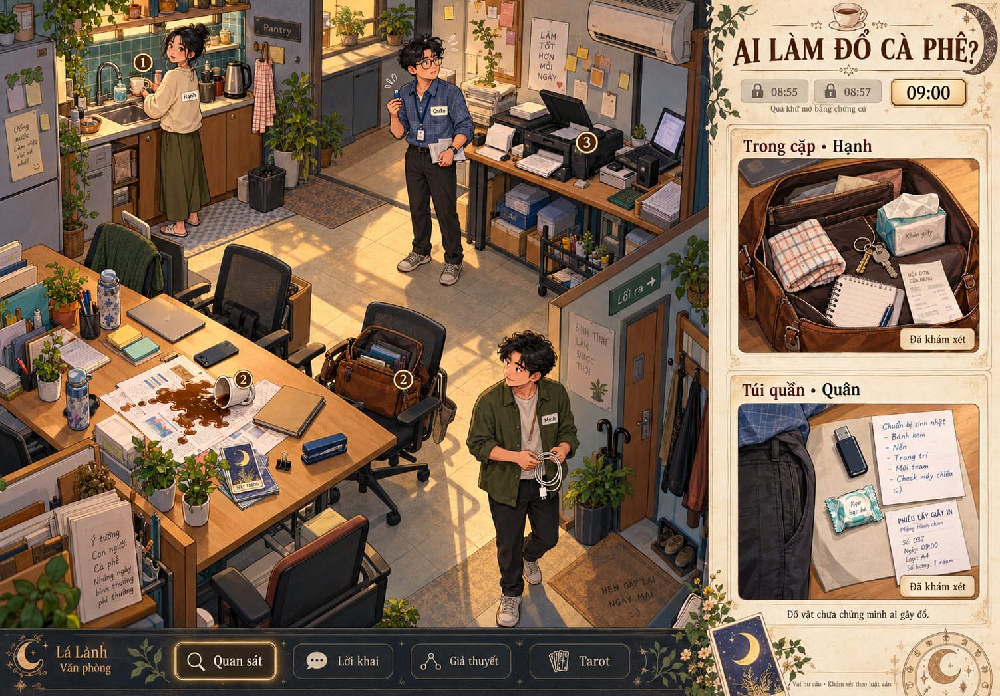

# Hiện trường và khám xét, bản minh họa 2

Ngày: 27/10/2026. Đây là hướng minh họa mới, chưa viết runtime. Không thay đáp án đã cố định trong tài liệu tác giả.

Hình tạo bằng công cụ imagegen tích hợp. [Prompt tạo hình đầy đủ](07-prompt-minh-hoa-hien-truong.txt). Giữ bản SVG trước để đối chiếu logic, không dùng nó làm hướng mỹ thuật mới.

## Hình cần cho thấy điều gì

Một hiện trường văn phòng có người và đồ vật, thay cho những ô sơ đồ trống. Góc nhìn từ trên xuống hơi nghiêng, tường thấp để nhìn rõ bên trong. Giữ nguyên bốn vùng P, I, D, L của [thiết kế bản đồ](05-ban-do-hien-tai-qua-khu.md).

Hình chính ở hiện tại 09:00. Hạnh ở pantry, Quân ở máy in, Minh ở lối ra. Bàn chung có cốc đổ, tài liệu dính cà phê và những vật dụng bình thường. Dây X không còn trên bàn. Hai mốc quá khứ vẫn khóa. Chưa vẽ toàn bộ lịch sử hoặc đánh dấu ai có lỗi.

Hai khung cận cảnh minh họa trạng thái sau khi khám xét một nơi cụ thể. Chúng không phải thông tin có sẵn khi mới vào ván. Hình là bản định hướng mỹ thuật, chưa phải bộ ảnh chứng cứ cuối cùng.

## Các nơi có thể khám xét

| Nơi | Cách thể hiện | Điều cần phân biệt |
|---|---|---|
| Mặt bàn D | Thấy riêng từng món: cốc, tài liệu, sổ, bút, điện thoại úp, ghim giấy, bình nước, bộ tarot | Đồ trang trí vẫn có mô tả khi xem. Không phải món nào cũng là manh mối quyết định |
| Cặp của Hạnh trên ghế | Mở khóa kéo, nhìn thấy lót cặp và từng ngăn. Phóng to khăn, giấy ăn, chìa khóa, giấy mua hàng, sổ | Cặp ở cạnh D không chứng minh Hạnh đang ở D, hoặc đã ở D vào T1 |
| Túi quần của vai Quân | Chọn túi của avatar, mở khay đồ hư cấu. Không cần cảnh lục cơ thể người khác | USB, giấy ghi việc chuẩn bị sinh nhật và đồ lặt vặt là đề xuất mỹ thuật. Chưa được thêm vào sự thật kín như chứng cứ quyết định |
| Máy in, kệ, bồn rửa, móc áo | Phóng gần nơi đã chọn, giữ rõ vị trí trong bản đồ chung | Chưa mở ngăn không có nghĩa ngăn trống. Mở một ngăn không khám hết các ngăn khác |

Đồ của từng vai và nội dung túi đều là dữ liệu do tác giả viết cho ván. Không yêu cầu người thật chụp cặp, lục túi ngoài đời, nộp tin nhắn hoặc tiết lộ đồ riêng. Đồng ý tham gia bằng profile không đồng nghĩa đồng ý truy cập đồ thật của người đó.

## Quy tắc để đồ vật dùng được cho suy luận

1. Mỗi món có danh tính ổn định, nơi chứa, mốc quan sát và nguồn. Một món trong khung phóng to và trên bản đồ là cùng một món, không sinh hai bản sao.
2. Đặt đồ ở đâu và nằm trong ngăn nào được chốt từ đầu ván. Không đổi nội dung khi người chơi đoán hoặc mở lại ngăn.
3. Khám xét mở đúng phần nhìn thấy. Nhìn ngăn chính chưa xác nhận nội dung túi phụ, mặt sau tờ giấy hoặc màn hình điện thoại khóa.
4. Tìm thấy khăn trong cặp chỉ xác nhận khăn có trong cặp ở thời điểm khám. Muốn kết luận khăn từng lau cà phê, hoặc ai dùng nó, cần nguồn bổ sung.
5. Vật quan sát được có thể được ghi nhận thành EV với phạm vi cụ thể. Lời giải thích của chủ đồ vẫn là CL. Người chơi gán công dụng hoặc lịch sử cho món đồ là HY.
6. Chỉ nguồn đã kiếm được mới mở chi tiết quá khứ. Tìm thấy đồ hiện tại không tự hiện đường đi lịch sử của chủ đồ.
7. Đồ riêng chỉ xuất hiện cho người có quyền khám theo luật ván. Bản đồ chung chỉ nhận phần được chia sẻ. Vai gây chuyện không được chặn vô thời hạn đường kiếm chứng cứ quyết định.
8. Tarot có thể gợi một hướng khảo sát hoặc một câu hỏi về vật đã thấy. Tarot và tính cách không xác nhận chủ đồ là người gây chuyện.

Ví dụ thẻ vật:

> Khăn trong ngăn chính của cặp Hạnh. Quan sát lúc 09:00, sau khi mở ngăn này. Chưa xác minh đã được dùng lúc nào hoặc để làm gì.

Không viết thành: "Khăn của Hạnh, bằng chứng Hạnh làm đổ cà phê".

## Điều cần chốt trước khi làm ảnh chứng cứ

- Danh sách vật quyết định giữ theo EV01 đến EV04 trong tài liệu tác giả. Những món mới trong bản minh họa là ứng viên, không âm thầm thay chuỗi nhân quả.
- Đồ quan trọng phải nhìn rõ ở mức phóng to thông thường. Không bắt người chơi đoán một vệt AI vẽ mơ hồ hoặc đọc chữ nhỏ bị sai.
- Bản concept còn nhãn đánh số trùng trên cốc và cặp. Khi dựng tài sản chính thức cần đặt mã riêng cho từng vật, gõ lại chữ nhỏ và đối chiếu đồ trong ô phóng to với cùng đồ trên bản đồ. Khung túi là cận cảnh kiểm kê, không phải bản sao của đồ nhân vật đang cầm.
- Nội dung tờ giấy, mã dây, dấu giờ và vị trí vật cần được tác giả kiểm và dựng ổn định trước khi dùng để chấm đáp án. Ảnh concept chưa đủ làm nguồn kiểm chứng.
- Phần khám xét phải có kết quả cho đồ thường, đồ đáng ngờ và đồ không liên quan. Không tạo cảm giác mọi món đều có bí mật hoặc người chơi phải thử mọi tổ hợp đồ vật.
- Chỉ cuối ván mới tái hiện toàn bộ, theo cùng một sơ đồ.

## Prompt tiếp cho Claude

Đọc tài liệu 05, 06 và 07 trong thư mục này. Lập danh mục vật cho vụ cà phê: mã vật, nơi chứa, mốc, quyền xem, cách khám xét, quan sát được, lời khai liên quan, giả thuyết được hỗ trợ và điều chưa thể kết luận. Giữ nguyên GT và chuỗi EV01 đến EV04. Tách món bắt buộc, món đánh lạc hướng công bằng và món tạo không khí. Chưa viết runtime, chưa coi đồ mới trong hình concept là chứng cứ đã chốt.
