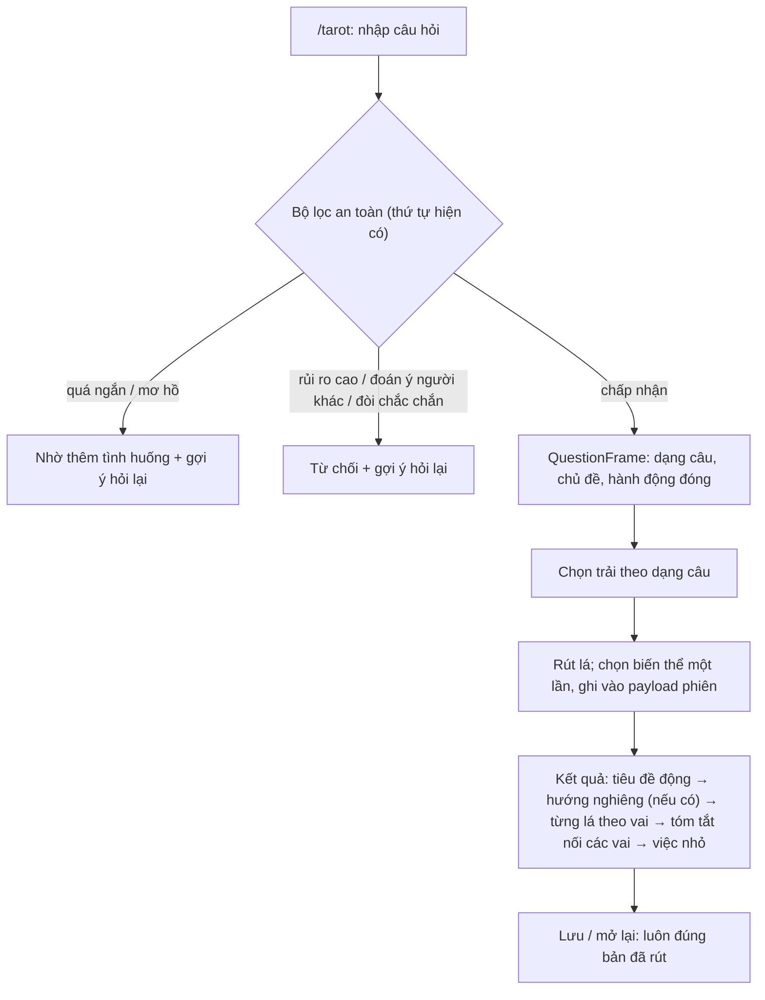

# US-20 — Tarot trả lời đúng câu hỏi và riêng cho từng câu

> Nguồn: Issue #6, kế hoạch `docs/plans/2026-10-16-personalisation-variety-plan.md` (§3, §14, quyết định
> owner §8: T2), audit 11/10. Đã có trước đây: hành vi Tarot hiện tại ở `docs/foundation/la-lanh-tarot-engine-spec.md`.

## User story

Là người đang phân vân một chuyện cụ thể, tôi muốn bài Tarot trả lời đúng câu tôi hỏi: có một hướng
nghiêng rõ kèm lý do từ các lá, mỗi lá được đọc theo vị trí của nó, và kết thúc bằng một việc nhỏ tôi làm
được. Bài không được quyết thay tôi, không đoán trước và không đoán ý người khác.

## Phạm vi

**Bao gồm:**

- `QuestionFrame` gồm dạng câu, chủ đề và nhóm hành động đóng.
- Nghĩa theo vai của từng vị trí.
- Hướng nghiêng 3 mức cho câu có/không và câu A/B.
- Tóm tắt dạng câu chuyện; tiêu đề động.
- Câu "khi nào" đổi thành "điều cần sẵn sàng trước".
- Kiểm câu mơ hồ.
- Dọn chữ thừa và tên tiếng Anh.
- Khung câu theo ngữ pháp nội dung (`docs/foundation/la-lanh-content-grammar-spec.md`).
- Cà khịa; phiên bản; tương thích với Luna (vẫn tắt).

**Không bao gồm:**

- Gợi ý cách hỏi, đào sâu một lá, nhật ký (chặng 2).
- Lá ngược chiều, trải bài mới, đổi cách bốc lá.
- Bật Luna.

## User flow

## Bảng nhãn hành động đóng (đề xuất, owner chốt ở P0)

`nhan_loi`, `tu_choi`, `noi_ra`, `nhan_lai`, `hoi_lai`, `cho_them`, `bat_dau`, `dung_lai`, `doi_viec`,
`xin_gop_y`, `nghi_ngoi`, `gui_di`, `xin_loi`, `hen_gap`, `chia_se`, `dat_ranh_gioi`, `ket_thuc`,
`thu_lai`, `hoc_them`, `tap_trung`, `sap_xep_lai`, `nho_giup`, `gop_y`, `de_xuat`, `don_dep`, `ra_ngoai`,
`o_nha`, `doi_thoi_quen`, `tu_thuong`, `viet_ra`.

Không khớp nhãn nào thì `action = None` và bài dùng cách nói chung. **Không bao giờ chép nguyên văn câu
hỏi vào bài đọc.**

## Acceptance Criteria

### Hiểu câu hỏi

- **AC01:** Mọi câu trong `docs/fixtures/tarot-question-bank-v1.json` được phân loại dạng câu
  (`yes_no`, `choice`, `how`, `why`, `timing`, `open`). Tỷ lệ đúng ≥ 95% trên các mục có nhãn dạng, đo ở
  audit.
- **AC02:** Chủ đề được chấm điểm theo nhiều tín hiệu chứ không lấy kết quả khớp đầu tiên. Chứa chữ "hỏi"
  không tự động thành chủ đề giao tiếp. Các mục `edge.*` của fixture đạt đúng `expected.topic`.
- **AC03:** Thứ tự bộ lọc an toàn giữ nguyên: quá ngắn → rủi ro cao → đoán ý người khác → đòi chắc chắn.
  Mọi mục `reject.third_party_mind|certainty|high_stakes` vẫn bị từ chối, kèm gợi ý hỏi lại.
- **AC04 (mới):** Câu mơ hồ, thiếu tình huống, được yêu cầu thêm tình huống. Đây là mục `reject.too_vague`;
  engine hiện chấp nhận 6/8 câu, đo ngày 16/10. Câu như "Mình có nên nhắn cho họ trước không?" vẫn được
  chấp nhận (`edge.7`).
- **AC05 (đổi hành vi theo quyết định T2):**
  - Câu "khi nào / bao giờ" không còn bị từ chối mà được trả lời theo hướng **điều cần sẵn sàng trước**,
    kèm một dòng giải thích vì sao không đoán thời điểm.
  - "Chắc chắn", "có quay lại", "sẽ xảy ra" vẫn bị từ chối.
- **AC06:** `QuestionFrame` chỉ nằm trong payload AES-GCM của phiên, không log, không gửi tới provider.
  Ranh giới không đổi: **câu hỏi gốc và mọi văn bản tự do dẫn xuất từ nó không bao giờ đi vào payload
  provider**. Cách kiểm dựa trên **nguồn gốc dữ liệu**, không lọc substring:
  - **Schema:** payload Luna dùng model `extra="forbid"`. Mỗi trường chuỗi chỉ là (i) một nhãn enum đóng
    (`stance`, `action`, focus key) hoặc (ii) nội dung có mã từ catalog hoặc allowlist đã duyệt (meaning,
    scene, action, brief, mang id và provenance). Reducer không có đường nào ghép chuỗi từ input của người
    dùng.
  - **Kiểm nguồn gốc:** test duyệt mọi trường lồng nhau. Mỗi chuỗi phải tra được về một nhãn enum hoặc một
    mã catalog/allowlist; chuỗi nào không tra được thì test thất bại.
  - **Canary riêng tư:** câu hỏi tổng hợp chứa token canary không có trong catalog (ví dụ `zqcanary7tim`)
    và một cụm riêng tư tổng hợp (ví dụ "chị Lan ở phòng 302"). Chạy qua toàn đường meaning, scene, action,
    brief và payload. Kỳ vọng: không trường nào chứa canary hay cụm riêng tư, kể cả từng phần ≥ 2 từ liền
    nhau của cụm đó.
  - Trùng từ ngẫu nhiên giữa câu hỏi và giá trị catalog (ví dụ "hỏi lại" vừa trong câu hỏi vừa trong nhãn
    `hoi_lai`) **được phép**, vì giá trị đó có nguồn gốc là catalog chứ không phải input.

### Bài đọc

- **AC07:** Mỗi vị trí đọc theo **vai** của nó:
  - Trải 3 lá: "Điều đã rõ" dùng core/cảnh; "Điều dễ bỏ sót" dùng tension/pitfall; "Một bước nhỏ có thể
    thử" dùng resource/action.
  - Trải 5 lá dùng các vai theo `_POSITIONS`.
  - Không còn nhánh câu chung ("Ý chính của lá: …").
  - Việc nhỏ chỉ xuất hiện ở vai mang tính bước tiếp.
- **AC08:** Câu `yes_no` và `choice` (khi tách được A và B vào nhãn đóng) có **hướng nghiêng** đúng một
  trong ba mức: "Các lá nghiêng về thử {action}", "Các lá gợi ý cân nhắc thêm trước khi {action}", "Chưa
  rõ: các lá kéo về hai phía".
  - Không có mức "nghiêng về chưa nên".
  - Có 1–2 lý do, mỗi lý do trỏ tới vai và nội dung lá.
  - Không tách được A/B thì chuyển sang dạng "điều cần rõ trước khi chọn".
- **AC09:** Hướng nghiêng tính từ nhãn `lean ∈ {mở, giữ, hai mặt}` của lá × chủ đề và trọng số theo vai.
  Gate `stance_consistent` bảo đảm chữ trong tiêu đề, tóm tắt và khối hướng nghiêng khớp kết quả tính.
- **AC10:** (Đổi theo góp ý của owner ngày 29/10/2026, renderer v9.) Tóm tắt viết thường, không lấy tên lá
  làm chủ ngữ, không dùng liên từ nối các lá không liên quan:
  - nói ý chính của vai đầu tiên;
  - sau đó là hai hướng của câu chọn, hoặc điều dễ vướng đầu tiên;
  - kết thúc bằng đúng bước nhỏ hiện ở vị trí bước.

  Gate `summary_plain` thay `summary_links_cards`: có nội dung các vai được tóm, **kết thúc đúng bằng** bước
  đang hiển thị, và ngoài phần chữ của lá thì không nêu tên lá nào trong cả bộ, kể cả lá không được rút, ở cả
  hai thứ tiếng. Việc so tên dùng chuẩn NFC và không phân biệt hoa thường. Bài cũ (legacy) vẫn giữ quy tắc
  nêu đủ tên lá. (Trước đây: nối các vai bằng liên từ, gate `summary_links_cards` đòi N−1 liên từ.)
- **AC11:** Tiêu đề dựng từ dạng câu + hướng nghiêng (hoặc chủ đề), **không nêu tên lá** (owner, 29/10/2026).
  Trên ngân hàng câu hỏi, tỷ lệ **phần mở đầu (tiêu đề + tóm tắt)** trùng nhau < 10%. Tỷ lệ trùng của riêng
  tiêu đề vẫn được báo cáo. (Trước đây: có lá trọng tâm trong tiêu đề, và ngưỡng 10% đo trên tiêu đề.)
- **AC12:** Không còn "Ý chính của lá:", "Thử nhé:", hay "Ví dụ:" nằm dưới nhãn "Ví dụ để đối chiếu". Tên
  lá hiện **cả tiếng Anh truyền thống và tiếng Việt** ở mọi nhãn lá (ô vị trí đã chọn, tiêu đề từng lá,
  danh sách lá đã rút) và trong tên đọc cho trình đọc màn hình, dạng "The Devil · Sợi Ràng", phần tiếng Anh
  gắn `lang="en"` (owner quyết định 19/10/2026, audit T04; trước đây tên tiếng Anh chỉ nằm trong chi tiết
  kỹ thuật). Câu văn của bài đọc do server sinh giữ nguyên, bài đã lưu không đổi. Dòng "Engine …" vẫn chỉ
  nằm trong chi tiết kỹ thuật thu gọn.
- **AC13:** Gate Tarot không còn ép số chữ tối thiểu (cảnh ≥ 12 chữ, hành động ≥ 6 chữ). Vẫn giữ trần độ
  dài và các bộ lọc an toàn. Gate `no_decision_or_prediction` và `role_fit` mới đều đạt.
- **AC14:** Checklist tâm lý của chuẩn nội dung đạt cho cả bài và từng phần.

### Đa dạng, đóng băng, phiên bản

- **AC15:** Biến thể (khung câu theo vai, ví dụ đời thường, tiêu đề) được chọn **một lần lúc rút** theo
  seed `HMAC(K[v], owner_scope ‖ "tarot" ‖ catalog_version)` và vị trí theo phiên, rồi ghi vào payload
  phiên. Mở lại, đổi giọng, cache miss hay restart đều trả **đúng bản đã rút**.
- **AC16:** Hai câu hỏi khác nhau rút cùng một lá ở cùng vai ra câu khác nhau với ≥ 80% cặp trong fixture
  (đo ở audit).
- **AC17:** Phiên rút trước khi phát hành vẫn giữ nguyên bản cũ tới khi hết hạn (≤ 29 ngày 18 giờ). Trường
  mới đều tuỳ chọn; có test đọc lại một bản v6 đã lưu bằng code mới.
- **AC18:** Phiên bản: renderer v7, gates v5 (thành hằng số), knowledge v5, meaning brief v3. Default cũ ở
  `models.py` và các tài liệu đã cũ được sửa.

### Giọng và kiểm tra

- **AC19:** Cà khịa có bản cho tiêu đề, hướng nghiêng, liên từ và khung vai. Ánh xạ theo mã tổ hợp. Câu
  hỏi nhạy cảm vẫn bị ép khỏi giọng Cà khịa. Owner duyệt câu mới qua file Excel.
- **AC20:** `pnpm tarot:audit` chạy toàn bộ ngân hàng câu hỏi × mọi map × 4 giọng. Báo cáo gồm phân bố
  hướng nghiêng, tỷ lệ trùng tiêu đề và số câu chung chung còn sót (phải bằng 0). `pnpm check` đạt.

## Definition of Done

- AC01–AC20 có test hoặc kết quả audit. Contract API: `stance?` tuỳ chọn. Web: khối "Hướng nghiêng" dùng
  thẻ đêm "Tím đêm dịu".
- Cập nhật tarot engine spec, content standard, content-matrix-release-gate, baseline, data map (dữ liệu
  suy ra trong payload phiên).
- Codex APPROVE ở đúng SHA; owner duyệt nội dung mới; release theo runbook.
