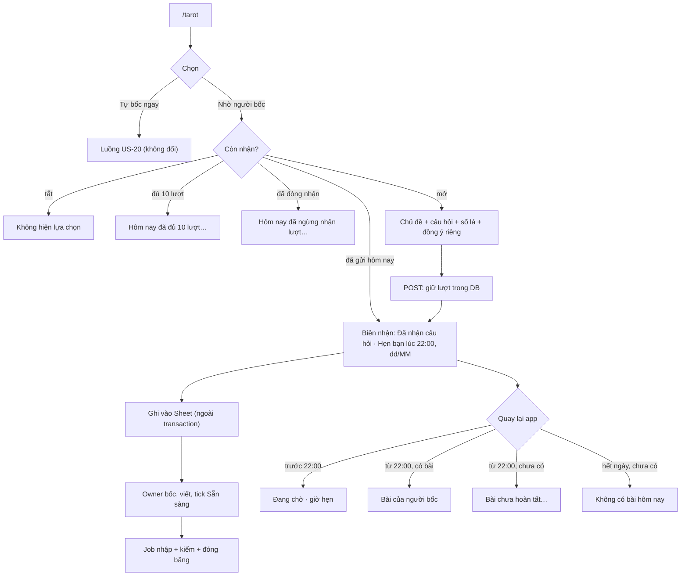

# US-24 — Nhờ người thật bốc và viết bài Tarot

> Nguồn: kế hoạch `docs/plans/2026-10-29-2222-feat-birth-human-tarot-plan.md` (Codex, 29/10/2026; Product Contract
> R4–R14, KD1–KD3, KTD1–KTD7, U4–U7) và quyết định của owner trong chat ngày 29–30/10/2026: người thật bốc và viết,
> tối đa 10 lượt toàn app mỗi ngày, ghi sang một Google Sheet ngay khi nhận, owner điền kết quả và tick Sẵn sàng, app
> mở bài từ 22:00 cùng ngày (owner 30/10: ngừng nhận 18:00, trả bài 22:00); sau giờ đóng nhận không nhận và không tự xếp sang hôm sau. Ít backend, không thêm AI,
> SaaS hay dashboard: DB kiểm hạn mức và quyền xem, Sheet là nơi owner làm việc.
> Story liên quan: US-20 (Tarot tự bốc, intake an toàn), US-01 (phiên khách, xoá dữ liệu), US-05 (lưu), P07 (nhật ký
> xoá), P09/P10 (đánh giá quyền riêng tư, owner/engineering).

**Trạng thái:** đặc tả và code sau cờ tắt. Không có dữ liệu thật, không có kết nối Google, không bật ở staging hay
production. Ba lựa chọn ở mục 9 phải được owner chốt trước dữ liệu thật.

## 1. User story

Là người đang phân vân một chuyện, tôi muốn nhờ một người thật bốc bài và viết riêng cho câu hỏi của mình, rồi quay
lại app lúc 22:00 để đọc. Tôi biết rõ bài nào do người viết và bài nào do app tự xếp, biết còn lượt hay không, biết
câu hỏi của mình được đưa đi đâu và có thể huỷ hoặc xoá bất cứ lúc nào.

Là owner (người bốc), tôi muốn nhận câu hỏi trong một Google Sheet quen thuộc với tối đa 10 hàng mỗi ngày, viết bài
ngay trong Sheet, tick Sẵn sàng là xong; không phải mở dashboard, chat hay GitHub.

## 2. Phạm vi

**Bao gồm:**

- Hai lựa chọn ở Tarot: "Tự bốc ngay" (luồng US-20, không đổi, không tiêu lượt người thật) và "Nhờ người bốc".
- Nhận tối đa 10 yêu cầu thành công toàn app mỗi ngày lịch `Asia/Ho_Chi_Minh`, mỗi phiên khách tối đa 1 lượt/ngày.
- Đồng ý riêng `human-tarot-v1` cho từng lần gửi.
- Ghi yêu cầu vào đúng một Google Sheet của owner ngay sau khi nhận; job đồng bộ mỗi phút nhập bài Sẵn sàng, thử
  lại khi Google lỗi và xoá bản sao trên Sheet.
- Mở bài cho đúng người từ 22:00 cùng ngày; trước giờ đó API chỉ trả trạng thái và giờ hẹn.
- Huỷ yêu cầu, xoá bài; xoá theo xoá phiên khách, xoá lịch sử, hết hạn và replay sau restore.

**Không bao gồm (bản đầu):**

- Nhiều người bốc, hồ sơ người bốc, marketplace, thanh toán, chat, ảnh, push/email/SMS, chọn giờ riêng.
- AI viết thay, AI sửa lời người thật, gửi câu hỏi cho Luna.
- Google Apps Script, webhook công khai, Redis, hàng đợi SaaS, dashboard quản trị.
- Google login cho người dùng; connector Google của cuộc chat agent làm kết nối production.
- Lưu bài người thật vào Đã lưu hay chia sẻ link (chặng sau, cần quyết định riêng).

## 3. Quyết định đã chốt

| # | Quyết định | Nguồn |
|---|---|---|
| KD1 | Người thật bốc và viết; không phải người dùng tự bốc rồi chỉ hẹn giờ. App không bao giờ âm thầm thay bằng bài máy. | Owner 29/10 |
| KD2 | Một đợt trả bài 22:00 cùng ngày. Không nhận từ giờ đóng nhận tới hết ngày; không xếp sang hôm sau. | Owner 29/10 |
| KD3 | Owner làm việc trong một Google Sheet riêng thay cho công cụ quản trị. | Owner 29/10 |
| D-HT1 | DB là nguồn của hạn mức, quyền xem, giờ mở và trạng thái xoá. Sheet chỉ là bàn làm việc. | Plan KTD1/KTD3 |
| D-HT2 | Đồng ý gắn vào **từng yêu cầu** (`consent_version = "human-tarot-v1"`, lưu cùng yêu cầu), không gộp vào đồng ý Luna hay đồng ý Tarot cũ, không mặc định bật. Rút lại = huỷ yêu cầu. | Plan R11, KTD6 |
| D-HT3 | Người dùng chọn chủ đề và số lá (1, 3 hoặc 5) như luồng tự bốc; câu hỏi đi qua đúng bộ lọc an toàn của US-20 (quá ngắn, mơ hồ, rủi ro cao, đoán ý người khác, đòi chắc chắn). | Plan U4 |
| D-HT4 | Hạn mức đã nhận không bao giờ được trả lại: huỷ, xoá, retry, restart, nhiều worker hay xoá phiên khách đều không giảm. | Plan R5 |

## 4. User flow

### Copy (bản nháp, chờ owner duyệt — mục 9, OD4)

| Nơi | Chữ |
|---|---|
| Lựa chọn | "Tự bốc ngay" · "Nhờ người bốc" |
| Dưới "Nhờ người bốc" | "Tối đa 10 lượt/ngày · Trả bài lúc 22:00 hôm nay" + "Giờ Việt Nam" + "Còn N lượt" |
| Đồng ý (checkbox, không tick sẵn) | "Mình đồng ý để người bốc của Lá Lành đọc câu hỏi này, và để câu hỏi được lưu tạm trong một Google Sheet riêng của người bốc cho tới khi có bài (tối đa hết ngày). Câu hỏi không kèm tên, ngày sinh hay thông tin tài khoản." |
| Nhắc trước nút gửi | "Đừng ghi tên đầy đủ, số điện thoại hay chi tiết giúp nhận ra người khác." |
| Hết lượt | "Hôm nay đã đủ 10 lượt. Bạn có thể quay lại ngày mai hoặc tự bốc ngay." |
| Đóng nhận | "Hôm nay đã ngừng nhận lượt. Ngày mai bạn quay lại nhé." |
| Biên nhận | "Đã nhận câu hỏi · Hẹn bạn lúc 22:00, dd/MM" |
| Đang chuyển | "Đang chuyển tới người bốc" |
| Đã chuyển | "Người bốc đã nhận câu hỏi" (chỉ nói Sheet đã có hàng; không phải bằng chứng owner đã đọc) |
| Chuyển lỗi | "Chưa chuyển được tới người bốc. App đang thử lại; lượt của bạn vẫn được giữ." |
| Trước giờ | "Bài sẽ mở lúc 22:00. Bạn quay lại lúc đó nhé." + nút "Kiểm tra lại" |
| Chậm | "Bài của bạn chưa hoàn tất. Bạn có thể quay lại sau hoặc huỷ yêu cầu." |
| Hết ngày không có bài | "Hôm nay người bốc chưa kịp viết bài cho bạn. Yêu cầu đã kết thúc; bạn có thể tự bốc ngay." |
| Kết quả | Nhãn "Bài do người bốc viết", các lá theo vị trí, bài đọc, "Một bước nhỏ". |
| Huỷ/xoá | "Huỷ yêu cầu" (trước khi có bài) · "Xoá bài này" (sau). Sau đó: "Đã xoá trong app. Bản tạm trên Google Sheet đang được xoá." → "Đã xoá bản tạm trên Google Sheet." |

## 5. Field và validation

| Field | Nơi | Ràng buộc |
|---|---|---|
| `context` | body `POST /v1/human-tarot/requests` | Một trong 6 chủ đề Tarot hiện có. |
| `question` | body | 8–280 ký tự sau khi gộp khoảng trắng; qua `assess_question` của US-20; bị từ chối → `422 TAROT_QUESTION_REJECTED` kèm giải thích và gợi ý hỏi lại như luồng tự bốc. |
| `spread` | body | `one_card`, `three_card`, `five_card`; map vị trí do engine chọn như luồng tự bốc. |
| `consent_version` | body | Phải đúng `human-tarot-v1`, nếu không → `422 HUMAN_TAROT_CONSENT_REQUIRED`. |
| `idempotency_key` | body | 22–200 ký tự `[A-Za-z0-9_-]`. Cùng key + cùng nội dung → trả lại biên nhận cũ; cùng key + khác nội dung → `409 HUMAN_TAROT_CONFLICT`. |
| Phiên | cookie + `X-CSRF-Token` | Trusted Origin + CSRF cho POST/DELETE; chủ sở hữu suy ra từ cookie. GET cần phiên còn hạn. |
| Thân request | — | `extra="forbid"`. Không nhận giờ hẹn, ngày, tên hay liên hệ. |

### Thứ tự kiểm tra của POST

1. Cờ bật (`human_tarot_enabled`), nếu không → `404 HUMAN_TAROT_DISABLED`.
2. Origin, CSRF, phiên; đồng ý `human-tarot-v1`; idempotency key đúng dạng.
3. Bộ lọc câu hỏi US-20.
4. Replay theo idempotency (trước kiểm giờ, để retry sau giờ đóng vẫn thấy biên nhận).
5. Trong một transaction: khoá dòng ngày, khoá phiên khách, đọc lại giờ server sau khi có khoá, kiểm lại replay,
   kiểm đóng nhận (giờ đóng hoặc ngày bị đóng sau restore) → `409 HUMAN_TAROT_CLOSED`; kiểm đã gửi hôm nay →
   `409 HUMAN_TAROT_ALREADY_REQUESTED`; kiểm đủ lượt → `409 HUMAN_TAROT_FULL`; tăng bộ đếm ngày, cấp vị trí hàng
   (1–10) và mã yêu cầu, tạo yêu cầu (payload mã hoá).
6. Commit, rồi thử ghi Sheet ngoài transaction (tối đa vài giây); lỗi Google không làm hỏng biên nhận.

## 6. Mô hình dữ liệu (backend-only, RLS bật, thu hồi PUBLIC/anon/authenticated)

| Bảng | Cột chính | Ghi chú |
|---|---|---|
| `human_tarot_days` | `day` (PK), `accepted_count` (CHECK 0–10), `intake_closed`, `created_at` | Không có ID người. Không bao giờ giảm. `intake_closed` đặt sau restore. |
| `human_tarot_requests` | `id`, `guest_id` (FK cascade), `day`, `idempotency_hash` (unique theo guest), `status` (`accepted`/`ready`/`unfulfilled`/`cancelled`), `context`, `spread`, `spread_map`, `consent_version`, `consented_at`, `payload_ciphertext` (AES-GCM, context `human-tarot-request:{id}`; câu hỏi, sau khi nhập thêm bài đóng băng), `release_at`, `imported_at`, `cancelled_at`, `question_purged_at`, `expires_at`, `created_at`, `updated_at` | Xoá cùng phiên khách. |
| `human_tarot_slots` | `id`, `day`, `slot_no` (1–10), `request_code` (unique, `LL-` + 6 ký tự), `guest_id` (FK SET NULL), `request_id` (FK SET NULL), `sheet_state`, `sheet_error`, `attempts`, `next_attempt_at`, `lease_token`, `lease_until`, `exported_at`, `cleared_at`, `created_at` | Sổ cấp lượt và trạng thái Sheet. Unique (`day`, `slot_no`) và (`day`, `guest_id`). Không chứa câu hỏi. Yêu cầu biến mất (xoá phiên, hết hạn, replay) → `request_id` thành NULL → job xoá hàng trên Sheet. |
| `human_tarot_google_usage` (U5) | `bucket`, `used`, `expires_at` | Trần 30 request Google/phút và 2.000/ngày, gồm retry; chạm trần → dừng, thử lại sau. |
| `human_tarot_sync_lease` (U5) | `name`, `holder`, `lease_until` | Một lượt nhập bài tại một thời điểm. |

`sheet_state`: `pending_export` → `on_sheet` → `clear_due` → `clear_sent` → `cleared`. Export, import, clear đều
kiểm mã yêu cầu và ngày ở đúng hàng; không xác thực bằng số hàng.

## 7. API

| Method | Path | Mô tả |
|---|---|---|
| GET | `/v1/human-tarot/availability` | `enabled`, `accepting`, `reason` (`open`/`full`/`closed`/`already_requested`/`disabled`), `local_date`, `closes_at`, `release_at`, `daily_limit`, `remaining`, `consent_version`, `current_request_id`. |
| POST | `/v1/human-tarot/requests` | Tạo yêu cầu (mục 5). `201` + view. |
| GET | `/v1/human-tarot/requests/current` | Yêu cầu gần nhất còn hạn của phiên, hoặc `404 HUMAN_TAROT_NOT_FOUND`. |
| GET | `/v1/human-tarot/requests/{id}` | View; chỉ chủ sở hữu. Người khác → `404`. |
| DELETE | `/v1/human-tarot/requests/{id}` | Huỷ (trước khi có bài) hoặc xoá bài (sau). `204`. Idempotent. |

View: `id`, `status` (`waiting`/`ready`/`late`/`unfulfilled`/`cancelled`), `delivery` (`pending`/`delivered`/`error`,
chỉ khi `waiting`/`late`), `copy_cleared` (khi `cancelled`), `local_date`, `release_at`, `context`, `spread`,
`question` (tới khi bị xoá theo retention), `result` (chỉ khi `ready`: lá theo vị trí, `reading`, `step`, `reader:
"human"`, `imported_at`), `expires_at`. Server kiểm `release_at` trên mọi GET: trước giờ, view không có `result` dù
bài đã nhập. Mọi response `Cache-Control: no-store`; lỗi là problem+json chỉ có mã, không lặp lại câu hỏi.

## 8. Google Sheet

Một file production và một file tổng hợp cho staging. Tab **"Hôm nay"**: hàng 1 là header cố định, hàng 2–11 là
10 vị trí do DB cấp. Tab **"Hướng dẫn"** và **"Lá"** (danh sách lá cho dropdown) không có dữ liệu khách.

| Cột | Header | Ai ghi | Quy tắc |
|---|---|---|---|
| A | Mã yêu cầu | App | `LL-XXXXXX`, ngẫu nhiên; không phải token truy cập. |
| B | Ngày nhận | App | `dd/MM/yyyy` giờ Việt Nam. |
| C | Giờ trả bài | App | `22:00`. |
| D | Chủ đề | App | Nhãn tiếng Việt của chủ đề. |
| E | Câu hỏi | App | Ghi bằng `RAW`: chuỗi bắt đầu bằng `=` vẫn là chữ. |
| F | Số lá | App | 1, 3 hoặc 5. |
| G | Vị trí các lá | App | "1. Điều đã rõ · 2. …". |
| H–L | Lá 1 … Lá 5 | Owner | Dropdown tên lá (tab "Lá"); chỉ điền đúng số lá ở cột F. |
| M | Bài đọc | Owner | Chữ thuần 40–1.500 ký tự; không link, công thức, HTML hay nội dung AI. |
| N | Bước nhỏ | Owner | Chữ thuần 8–240 ký tự. |
| O | Sẵn sàng | Owner | Checkbox, tick sau cùng. |
| P | Trạng thái app | App | `Đang chờ bài` · `Đã nhận bài` · `Cần sửa` · `Đã huỷ`. |
| Q | Cần sửa | App | Mã lỗi theo cột (ví dụ `LA_2_KHONG_CO`, `BAI_DOC_QUA_NGAN`); không lặp nội dung. |

Quy tắc an toàn: không append mù; export chỉ ghi vào hàng trống hoặc hàng đã mang đúng mã của nó; header sai, hàng bị
sort, mã trùng hay mã khác ở hàng đã cấp → lỗi đồng bộ, không ghi đè. Bài đã nhập không bị thay bởi lần sửa Sheet sau
đó. Mã đúng dạng nhưng DB không biết (ví dụ sau restore) → xoá hàng. Owner sửa bài sau khi đã nhập phải qua quy trình
riêng (huỷ yêu cầu, không sửa âm thầm).

## 9. Lựa chọn owner phải chốt trước dữ liệu thật

| # | Lựa chọn | Đề xuất | Hiện trạng code |
|---|---|---|---|
| OD1 | Giờ ngừng nhận và giờ trả bài (A1) | **Owner chốt 30/10: ngừng nhận 18:00, trả bài 22:00** để kịp bốc và viết | `RELEASE_TIME = 22:00`; `human_tarot_intake_closes_at` mặc định 18:00, không được muộn hơn 22:00. |
| OD2 | Retention (A3) và bản sao Google | Câu hỏi trong app: xoá 24 giờ sau giờ hẹn. Bài đóng băng: 30 ngày sau giờ hẹn. Hàng trên Sheet: xoá khi huỷ/xoá, và chậm nhất lúc hết ngày (≤ 2 giờ sau giờ hẹn). Lịch sử phiên bản của Sheet không xoá được qua API: thay file Sheet định kỳ (đề xuất mỗi tháng), chuyển file cũ vào thùng rác rồi dọn thùng rác. | Hằng số trong `human_tarot/policy.py`; chưa có quy trình thay file. |
| OD3 | Danh tính Google và quyền (A4) | Service account riêng, chỉ được chia sẻ quyền Editor trên đúng một file; scope `spreadsheets`; khoá là file secret trên VPS. Không dùng OAuth tài khoản cá nhân (quyền rộng hơn). | Adapter có sẵn nhưng chỉ chạy khi cấu hình đủ; không có credential nào trong repo. |
| OD4 | Copy mục 4 và câu đồng ý | — | Bản nháp. |
| OD5 | Hiện số lượt còn lại cho mọi người | Có (không lộ ai đã gửi) | Có. |
| OD6 | P09/P10: thêm bên nhận Google (có thể ngoài Việt Nam) và người bốc; cập nhật thông báo quyền riêng tư, store privacy | Cập nhật trước tester thật | Bản nháp ở U7. |

Khi chưa chốt đủ, cờ `human_tarot_enabled` chỉ được bật ở local/test với Sheet giả; config từ chối bật ở staging hay
production nếu thiếu `human_tarot_launch_approved`.

## 10. Acceptance Criteria

### Nhận lượt

- **AC01:** Given 20 phiên khách gửi đồng thời trong giờ nhận, When tất cả xong, Then đúng 10 yêu cầu thành công,
  10 nhận `409 HUMAN_TAROT_FULL`, bộ đếm ngày = 10. (R5)
- **AC02:** Given cùng idempotency key gửi hai lần (cả khi đồng thời), Then một yêu cầu, một lượt bị trừ, hai response
  cùng `id`. Khác nội dung với cùng key → `409 HUMAN_TAROT_CONFLICT`. (R5, KTD2)
- **AC03:** Given một phiên đã có yêu cầu hôm nay (kể cả đã huỷ hay xoá), When gửi lại với key mới, Then `409
  HUMAN_TAROT_ALREADY_REQUESTED` và bộ đếm không đổi. (R5, A2)
- **AC04:** Given đã qua giờ đóng nhận theo giờ server (giờ Việt Nam), When gửi mới, Then `409 HUMAN_TAROT_CLOSED`;
  retry cùng key của lượt đã nhận vẫn trả biên nhận. Request chờ khoá vượt qua giờ đóng cũng bị từ chối. (R6)
- **AC05:** Given huỷ, xoá, xoá phiên khách, retry hay restart, Then bộ đếm ngày không giảm. (R5, D-HT4)
- **AC06:** Ngày đổi đúng nửa đêm `Asia/Ho_Chi_Minh`, không theo UTC; yêu cầu nhận lúc 00:00:00 thuộc ngày mới. (R5)
- **AC07:** Thiếu đồng ý `human-tarot-v1` → `422`; câu hỏi bị bộ lọc US-20 từ chối → `422` và không trừ lượt. (R11)

### Xem bài

- **AC08:** Given bài đã nhập, When GET lúc 21:59:59, Then không có `result`; lúc 22:00:00 có `result`. Đổi giờ máy
  người dùng không ảnh hưởng. (R9)
- **AC09:** Phiên khác GET hoặc DELETE id của người khác → `404`, không lộ trạng thái. (R9)
- **AC10:** Từ 22:00 chưa có bài → `late`; hết ngày chưa có bài → `unfulfilled`, câu hỏi bị xoá khỏi payload; không
  có bài máy nào được tạo thay. (R9, KD1)
- **AC11:** Bài hiện nhãn "Bài do người bốc viết"; provenance lưu `reader`, `schema`, `imported_at`. (R4, KTD5)

### Sheet

- **AC12:** Câu hỏi bắt đầu bằng `=`, `+`, `-`, `@` vẫn là chữ trên Sheet (`RAW`). (KTD7)
- **AC13:** Timeout sau khi Google đã ghi: lần thử lại không tạo hàng thứ hai, không ghi đè hàng của mã khác. (R7)
- **AC14:** Google 429/5xx hoặc credential hết quyền: lượt vẫn được giữ, trạng thái `delivery = error`, không log
  nội dung. (R7)
- **AC15:** Hàng Sẵn sàng thiếu lá, thừa lá, lá không có trong catalog, bài quá ngắn/dài, có link hay công thức, hoặc
  câu khẳng định không an toàn → không nhập; cột "Cần sửa" ghi mã lỗi. (R8, KTD5)
- **AC16:** Sửa Sheet sau khi app đã nhập không đổi bài đã đóng băng. (KTD4)
- **AC17:** Header sai, hàng bị sort hay mã trùng → lỗi đồng bộ rõ, không ghi đè. (KTD3)
- **AC18:** Trần 30 request Google/phút và 2.000/ngày gồm retry; chạm trần thì dừng và thử lại sau, không tự mở
  billing. (Plan "cost")

### Xoá và quyền riêng tư

- **AC19:** Huỷ hoặc xoá: app chặn đọc và chặn nhập ngay trong cùng transaction; job xoá hàng trên Sheet và chỉ báo
  "Đã xoá bản tạm" sau khi đọc lại thấy hàng trống. (R13)
- **AC20:** Huỷ xen giữa lúc đang ghi Sheet: hàng vẫn được xoá sau khi lần ghi kết thúc; không có bản sao mồ côi. (KTD6)
- **AC21:** Xoá phiên khách, xoá lịch sử, hết hạn, replay nhật ký sau restore đều xoá yêu cầu trong app và dẫn tới xoá
  hàng trên Sheet. (R13)
- **AC22:** Sau restore trong ngày đang nhận, ngày đó bị đóng nhận; không mở lại theo số hàng trống trên Sheet. (Plan)
- **AC23:** Sheet chỉ có mã, ngày, giờ hẹn, chủ đề, câu hỏi, số lá, vị trí và phần owner viết; không có ngày/giờ/nơi
  sinh, lá số, email, điện thoại, tên tài khoản, guest/session id, cookie, CSRF, token hay link. Log chỉ có số đếm và
  mã lỗi. (R12)
- **AC24:** Luồng tự bốc không đổi hành vi và không tiêu lượt người thật. (R4)

## 11. Definition of Done

- AC01–AC24 có test; concurrency có test SQLite thật và test PostgreSQL (chạy khi được phép một lần, không thay bằng
  SQLite để gọi là đạt).
- OpenAPI/TS, copy, đồng ý, data map, thông báo quyền riêng tư và khai báo store không mâu thuẫn với runtime.
- Owner chốt OD1–OD6 và cấp quyền Google cho file tổng hợp; rehearsal với file tổng hợp có receipt riêng.
- Cờ vẫn tắt ở staging/production tới lệnh release riêng. P07 PARTIAL/B và mọi receipt đỏ giữ nguyên.
- Codex APPROVE theo đúng SHA của từng PR (U4, U5, U6, U7).
