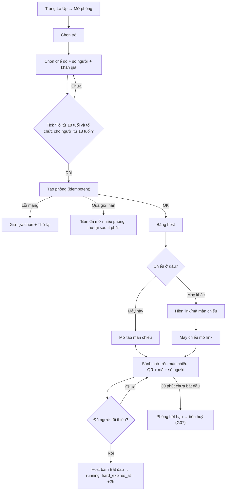

# G01 — Host tạo phòng và mở màn chiếu

> Hạ tầng phòng dùng chung. Đặc tả: [`shared-room-platform-srs.md`](../../foundation/game-line/shared-room-platform-srs.md)
> §4.1, §5, §7, §9.3. Dùng cho Phiên Tòa Tủ Lạnh (G31), Sĩ Số +1 (G41) và Tam Sao Thất Bản bản phòng trực tiếp.
> Trạng thái: nháp, chờ owner duyệt. Giai đoạn 3 chưa bắt đầu, chưa có code.

## 1. User story

Là người tổ chức một buổi tất niên văn phòng hoặc một buổi sinh hoạt lớp đại học, tôi muốn mở một phòng chơi trong
chưa tới một phút, chiếu QR lên màn hình lớn và điều khiển buổi chơi từ điện thoại, mà không phải tạo tài khoản hay
khai thông tin cá nhân.

## 2. Mục tiêu và ranh giới

### Mục tiêu

- Từ lúc mở trang tới lúc màn chiếu hiện QR: ≤ 60 giây, không đăng nhập.
- Màn chiếu và bảng host tách nhau: cả phòng chỉ thấy màn chiếu, không thấy nút điều khiển.
- Màn chiếu đọc được từ cuối phòng (6–10 m), không nhấp nháy gây hại.

### Trong phạm vi

Chọn trò và chế độ; xác nhận 18+ của host; cấu hình người tối đa và khán giả; sinh mã, link, QR; mở màn chiếu trên
cùng máy hoặc máy khác; sảnh chờ; bắt đầu; phòng chưa bắt đầu hết hạn sau 30 phút.

### Ngoài phạm vi

Tài khoản host, lịch hẹn buổi chơi, gửi lời mời qua tin nhắn từ máy chủ, tìm phòng công khai, host nhận vai (RP-D1),
mã khôi phục host (RP-D7). Luật riêng của trò (G31, G41).

## 3. Actor, điều kiện và output

- **Actor:** host (người lớn, 18+), không tài khoản.
- **Điều kiện:** trình duyệt hỗ trợ (SRS §9.2); có màn hình lớn hoặc laptop để chiếu.
- **Output:** phòng ở trạng thái `lobby`; `host_session` gắn với trình duyệt host; mã phòng, token vào phòng, token
  màn chiếu (máy chủ chỉ giữ hash); màn chiếu đang hiện sảnh chờ.

## 4. Luồng

## 5. Giao diện và trạng thái

### Bảng host (điện thoại hoặc laptop)

| Thành phần | Nội dung |
|---|---|
| Tiêu đề | Tên trò + chế độ |
| Mã phòng | 6 ký tự, chữ to, nút sao chép |
| Màn chiếu | `Chiếu trên máy này` · `Chiếu trên máy khác` (hiện link màn chiếu và cảnh báo "Ai có link này đều xem được màn chiếu") |
| Danh sách | Biệt danh người chơi, chấm kết nối, số khán giả |
| Nút | `Khoá phòng`, `Thu hồi link`, `Bắt đầu` (tắt khi chưa đủ người, có dòng "Cần ít nhất N người chơi") |
| Liên hệ | Email hỗ trợ Lá Úp |

### Màn chiếu — sảnh chờ

| Thành phần | Nội dung |
|---|---|
| QR | Chiếm ≥ 30% chiều cao màn hình |
| Mã phòng | Chữ ≥ 96 px, kèm địa chỉ trang vào phòng ngắn |
| Đếm | "Đã vào: 23 người chơi · 4 người xem" |
| Biệt danh | Ô biệt danh người chơi hiện dần; khán giả chỉ có số |
| Nhắc | "Chỉ dành cho người từ 18 tuổi. Không cần tài khoản." |

### Trạng thái

`đang tạo`, `lỗi mạng`, `quá giới hạn`, `sảnh chờ`, `đã khoá`, `màn chiếu chưa mở`, `màn chiếu mất kết nối`,
`sắp hết hạn sảnh (phút 25)`, `đã hết hạn`.

## 6. Quy tắc

1. `host_session`, mã phòng và token theo RP-FR-01, RP-FR-03, RP-SEC-02; máy chủ chỉ giữ hash có khoá.
2. Token vào phòng và token màn chiếu đặt sau `#` trong link và QR (RP-FR-04, RP-FR-05).
3. Token màn chiếu chỉ đọc kênh `display` (SRS §5.1).
4. Bấm tạo nhiều lần với cùng `cmd_id` chỉ tạo một phòng.
5. Giới hạn: 5 phòng/giờ, 2 phòng đang mở mỗi `host_session` (SRS §7.1).
6. Mọi route của phòng có header ở RP-SEC-03.

## 7. Tiêu chí chấp nhận

- **G01-AC01:** Host tạo được phòng không cần đăng nhập, không bị hỏi email, số điện thoại, ngày sinh hay bất kỳ dữ liệu
  cá nhân nào; chỉ phải tick ô xác nhận 18+ (không tick sẵn).
- **G01-AC02:** Từ lúc bấm "Mở phòng" tới lúc màn chiếu hiện QR, trung vị ≤ 60 giây trong thử nghiệm với 5 host lần đầu.
- **G01-AC03:** QR và link chứa token sau `#`; log máy chủ và ingress sau một lượt tạo và vào phòng không chứa token
  (canary RP-TH-05).
- **G01-AC04:** Mở link màn chiếu, gửi một lệnh host bất kỳ bằng token màn chiếu → bị từ chối `not_allowed`.
- **G01-AC05:** Gói tin kênh `display` và `host` trong sảnh không chứa biệt danh khán giả (chỉ số đếm).
- **G01-AC06:** Bấm "Tạo phòng" hai lần liền (cùng `cmd_id`) chỉ tạo một phòng; lần thứ sáu trong một giờ trả thông báo
  giới hạn, không tạo phòng.
- **G01-AC07:** "Bắt đầu" tắt khi chưa đủ số người tối thiểu của trò; khi bắt đầu, `hard_expires_at = started_at + 2 giờ`.
- **G01-AC08:** Phòng không bắt đầu sau 30 phút chuyển `ended` và tiêu huỷ (G07); link và mã không còn tác dụng.
- **G01-AC09:** Màn chiếu ở 1920×1080: chữ nội dung ≥ 40 px, mã phòng ≥ 96 px, tương phản ≥ 7:1 cho chữ chính
  (RP-NFR-10, RP-NFR-11).
- **G01-AC10:** Mọi hiệu ứng của sảnh qua kiểm nhấp nháy (RP-TH-08); công tắc "giảm chuyển động" và "tắt âm thanh" có trên
  bảng host.
- **G01-AC11:** Route tạo phòng, bảng host và màn chiếu trả `Cache-Control: no-store`, `Referrer-Policy: no-referrer`,
  `X-Robots-Tag: noindex, nofollow` (RP-TH-07).

## 8. Trường hợp biên

| Trường hợp | Cách xử lý |
|---|---|
| Host đóng tab bảng host | Mở lại cùng trình duyệt là vào lại (cookie còn); quá 10 phút vắng: RP-FR-65 |
| Màn chiếu và bảng host cùng một laptop đang chiếu | Hướng dẫn dùng "Chiếu trên máy này" ở tab riêng và chỉ chiếu tab đó; cảnh báo "Đừng chiếu bảng host" |
| Link màn chiếu bị lộ | Chỉ xem được những gì cả phòng đang thấy; host `Thu hồi link` sinh token màn chiếu mới |
| Máy chiếu dùng trình duyệt cũ | Trang báo "Trình duyệt này chưa hỗ trợ", gợi ý mở trên laptop |
| Wi-Fi hội trường chặn kết nối thời gian thực | Dự phòng hỏi định kỳ (SRS §5.5) |

## 9. Definition of Done

- G01-AC01–AC11 có test tự động hoặc biên bản thử nghiệm.
- Kiểm bảo mật: token entropy, hash có khoá, fragment URL, phân quyền token màn chiếu, giới hạn tần suất, header.
- Canary log không tìm thấy token hay mã phòng.
- Trợ năng màn chiếu và bảng host đạt SRS §9.3; thử trên máy chiếu thật ở khoảng cách 8 m.
- Bảng kê dữ liệu khớp DPIA và nháp nhãn cửa hàng/chính sách; không có SDK bên thứ ba.
- Không còn lỗi bảo mật hay riêng tư mức P0/P1.

## 10. Bàn giao

- **Nguồn:** SRS hạ tầng phòng; báo cáo "Chốt năm trò" (mục hạ tầng chung); research note courtroom §1, §5.
- **Đã xử lý:** tách màn chiếu khỏi bảng host; token ở fragment; hết hạn sảnh 30 phút.
- **Rủi ro mở:** RP-D1, RP-D3, RP-D6, RP-D7.
- **AC/DoD chưa xong:** toàn bộ (chưa có code).
