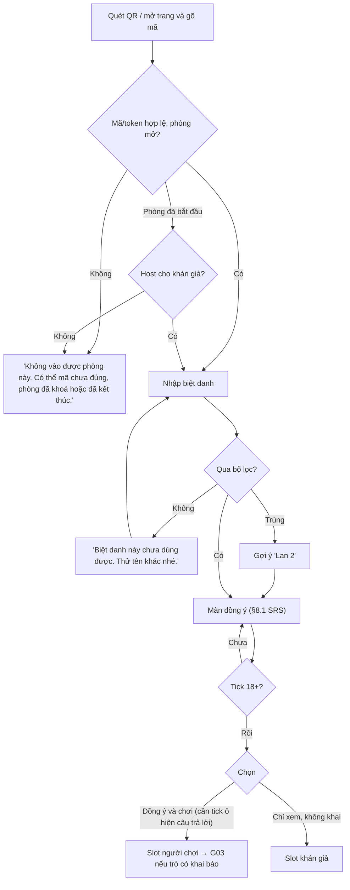

# G02 — Vào phòng bằng QR hoặc mã, đặt biệt danh và đồng ý

> Hạ tầng phòng dùng chung. Đặc tả: [`shared-room-platform-srs.md`](../../foundation/game-line/shared-room-platform-srs.md)
> §4.2, §7, §8, §8.1. Trạng thái: nháp, chờ owner duyệt câu chữ đồng ý.

## 1. User story

Là người trong phòng, tôi muốn quét QR, đặt một biệt danh và vào chơi ngay, biết rõ câu trả lời của mình sẽ hiện ở đâu
và bị xoá khi nào, và có thể chỉ xem nếu không muốn khai gì.

## 2. Mục tiêu và ranh giới

### Mục tiêu

- Quét QR tới lúc vào phòng xong: trung vị ≤ 60 giây.
- Đồng ý rõ ràng, tách mục đích, không tick sẵn, nút đồng ý và từ chối ngang hàng.
- Người không muốn khai vẫn có chỗ trong cuộc vui (chỉ xem).

### Trong phạm vi

Vào bằng QR (token ở fragment) hoặc gõ mã; biệt danh và bộ lọc; xác nhận 18+; đồng ý hiện câu trả lời trên màn hình
chung; hai nút `Đồng ý và chơi` / `Chỉ xem, không khai`; vào muộn; thông báo lỗi chung.

### Ngoài phạm vi

Khai báo 5 câu (G03); tài khoản; ảnh đại diện; chọn biệt danh từ danh bạ; mời người khác từ máy người chơi.

## 3. Actor, điều kiện và output

- **Actor:** người chơi hoặc khán giả, 18+, không tài khoản.
- **Điều kiện:** phòng ở `lobby` (hoặc `running` với khán giả), chưa khoá, chưa đủ người.
- **Output:** slot `player` (có `consent_display = true`) hoặc `audience`; cookie `player_session`; biệt danh hiện trên
  màn chiếu (chỉ người chơi).

## 4. Luồng

## 5. Giao diện và trạng thái

| Màn | Nội dung chính |
|---|---|
| Nhập mã | Ô 6 ký tự, bàn phím chữ in, nút `Vào` |
| Biệt danh | Ô 2–20 ký tự, đếm ký tự, gợi ý "Tên ai trong phòng cũng nhận ra, không cần tên thật" |
| Đồng ý | Bản §8.1 của SRS: đoạn giải thích, hai ô không tick sẵn, hai nút ngang hàng cùng cỡ cùng kiểu, dòng giải thích "Chỉ xem", liên hệ và chính sách |
| Đã vào | "Bạn đã vào phòng với tên Lan. Nhìn lên màn hình chung nhé." + nút `Rời phòng`, `Báo cáo` |

Trạng thái: `mã sai/không vào được` (một thông báo chung), `quá giới hạn thử`, `biệt danh bị lọc`, `biệt danh trùng`,
`phòng đầy`, `đã bắt đầu → chỉ xem`, `mất mạng khi gửi` (giữ biệt danh trong bộ nhớ trang, `Thử lại`).

## 6. Quy tắc

1. Bộ lọc biệt danh theo RP-FR-13, chạy ở máy chủ; đầu ra luôn được escape (RP-SEC-06).
2. Hai ô đồng ý không tick sẵn; `Đồng ý và chơi` cần cả hai; `Chỉ xem` cần ô 18+ (RP-FR-11, RP-FR-12).
3. Bản ghi đồng ý: `consent_display`, `consent_copy_version`, `consented_at` (RP-FR-18).
4. Thông báo lỗi chung, không lộ phòng có tồn tại (RP-FR-17).
5. Giới hạn đoán mã và vào phòng (SRS §7.1).
6. Biệt danh chỉ lưu trong kho tạm thời; xoá khi rời, bị kick hoặc phòng kết thúc.
7. Trang không ghi gì vào `localStorage`/IndexedDB ngoài tuỳ chọn hiển thị (sáng/tối); phiên nằm trong cookie `HttpOnly`.

## 7. Tiêu chí chấp nhận

- **G02-AC01:** Quét QR mở thẳng màn biệt danh, không cần gõ mã; token không xuất hiện trong request line, log máy chủ,
  ingress hay header `Referer` (canary RP-TH-05).
- **G02-AC02:** Gõ mã đúng, không phân biệt hoa thường, vào được. Mã sai, phòng khoá, phòng đầy, phòng đã kết thúc: cùng
  một thông báo và cùng mã HTTP/thời gian phản hồi tương đương.
- **G02-AC03:** Lần đoán mã sai thứ 11 trong 10 phút bị từ chối `rate_limited`.
- **G02-AC04:** Biệt danh có URL, `@`, 6 chữ số liền, ký tự điều khiển hoặc từ trong danh sách cấm bị từ chối với câu "Biệt
  danh này chưa dùng được". Biệt danh có dấu tiếng Việt hợp lệ được nhận đúng sau chuẩn hoá NFC.
- **G02-AC05:** Biệt danh chứa `<script>` hiển thị nguyên văn dạng chữ trên màn chiếu, bảng host và điện thoại (không chạy).
- **G02-AC06:** Hai ô đồng ý mặc định trống. Khi chưa tick ô "hiện trên màn hình chung", nút `Đồng ý và chơi` tắt, nút
  `Chỉ xem, không khai` vẫn bật (nếu ô 18+ đã tick). Hai nút cùng kích thước, cùng kiểu chữ, cùng độ nổi.
- **G02-AC07:** Không tick ô 18+ thì không vào được dưới hình thức nào; máy chủ từ chối request `join` thiếu xác nhận 18+.
- **G02-AC08:** Khán giả không bao giờ thấy màn khai báo 5 câu và biệt danh khán giả không hiện trên màn chiếu.
- **G02-AC09:** Người vào sau khi phòng bắt đầu chỉ được vào làm khán giả (trừ khi SRS của trò cho nhận vai muộn).
- **G02-AC10:** Lời đồng ý hiển thị đúng phiên bản đang ghi trong `consent_copy_version`; đổi câu chữ phải tăng phiên bản.
- **G02-AC11:** Màn vào phòng có liên hệ công khai của Lá Úp và link chính sách quyền riêng tư.
- **G02-AC12:** Điện thoại 320 px, chữ 200%, trình đọc màn hình: đọc đủ lời đồng ý, hai ô và hai nút theo đúng thứ tự.

## 8. Trường hợp biên

| Trường hợp | Cách xử lý |
|---|---|
| Hai người cùng đặt "Lan" | Người sau thấy "Lan 2" trước khi vào, sửa được |
| Người vào bằng ảnh QR đăng trên mạng | Host khoá phòng/kick/thu hồi link (G06); phòng đã bắt đầu chỉ nhận khán giả |
| Người dùng bấm Back sau khi vào | Vẫn giữ slot; mở lại trang là vào lại (G09) |
| Người chơi đổi ý muốn chỉ xem | Chuyển được trước khi pha khai báo đóng; câu trả lời bị xoá ngay (G08) |
| Trình duyệt chặn cookie | Báo "Trình duyệt đang chặn cookie cần cho phòng chơi", không vào được; không chuyển sang lưu phiên trong `localStorage` |

## 9. Definition of Done

- G02-AC01–AC12 có test.
- Owner duyệt câu chữ đồng ý; DPIA ghi đủ trường đồng ý và thời hạn xoá.
- Kiểm bảo mật: đoán mã, đồng dạng phản hồi lỗi, XSS biệt danh, CSRF/Origin, cookie flags.
- Nháp App Privacy / Data safety / chính sách quyền riêng tư ghi đúng: biệt danh, định danh phiên, câu trả lời tuỳ trò, thời
  hạn xoá, không chia sẻ bên thứ ba.
- Không còn lỗi P0/P1.

## 10. Bàn giao

- **Nguồn:** SRS §4.2, §8; báo cáo (đồng ý không tick sẵn, 18+); research note risks §2 (Luật 91, Nghị định 356).
- **Đã xử lý:** nút từ chối ngang hàng; lời đồng ý nói rõ màn chiếu có thể bị quay; lỗi chung.
- **Rủi ro mở:** bộ lọc từ cấm tiếng Việt chưa có; RP-D5 (bằng chứng đồng ý); chưa đối chiếu nguyên văn Nghị định 356.
- **AC/DoD chưa xong:** toàn bộ.
