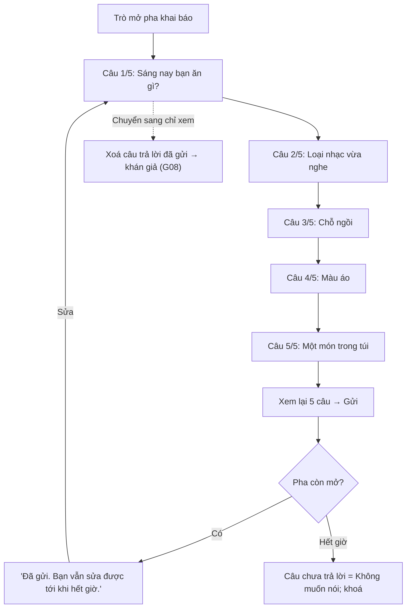

# G03 — Khai báo 5 câu vô hại

> Hạ tầng phòng dùng chung, module bật cho Phiên Tòa Tủ Lạnh và Sĩ Số +1 (Tam Sao không dùng). Đặc tả:
> [`shared-room-platform-srs.md`](../../foundation/game-line/shared-room-platform-srs.md) §4.3, §6.2. Trạng thái: nháp;
> danh sách phương án chờ owner duyệt văn phong.

## 1. User story

Là người chơi đã đồng ý, tôi muốn trả lời nhanh 5 câu vô hại về chính mình bằng cách chạm chọn, có quyền bỏ qua câu nào
không muốn nói, để trò chơi có manh mối mà tôi không phải kể chuyện riêng hay chuyện của người khác.

## 2. Mục tiêu và ranh giới

### Mục tiêu

- Xong 5 câu trong ≤ 60 giây với người dùng lần đầu (pha khai báo của trò dài 3 phút).
- Không câu nào chạm sức khoẻ, tiền, tôn giáo, gia đình, tình cảm hay người khác.
- Mọi câu có "Không muốn nói" và không bị phạt.

### Trong phạm vi

Năm câu và phương án ở SRS §6.2; sửa trước khi pha đóng; khoá sau khi pha đóng; xoá khi rời/kick/kết thúc.

### Ngoài phạm vi

Chữ tự do; câu hỏi do host tự viết; câu hỏi về người khác ("ngồi cạnh ai" đã bị bỏ); cách trò dùng câu trả lời làm manh
mối (G33 Phiên Tòa, G42–G43 Sĩ Số +1).

## 3. Actor, điều kiện và output

- **Actor:** người chơi có `consent_display = true`.
- **Điều kiện:** trò đang ở pha khai báo.
- **Output:** 5 giá trị, mỗi giá trị là một mã phương án hoặc `skip`.

## 4. Luồng

## 5. Giao diện và trạng thái

- Mỗi câu một màn, chip lớn (≥ 44 px), "Không muốn nói" là chip cuối cùng cùng kiểu với chip khác.
- Thanh tiến độ "2/5" và đồng hồ của pha.
- Dòng nhắc cố định: "Câu trả lời có thể hiện trên màn hình chung. Bị xoá khi buổi chơi kết thúc."
- Màn xem lại: 5 dòng, mỗi dòng sửa được.
- Màn chiếu trong pha này chỉ hiện "Đã khai: 21/27", không hiện câu trả lời.

Trạng thái: `đang trả lời`, `đã gửi (sửa được)`, `mất mạng khi gửi` (giữ lựa chọn trong bộ nhớ trang, tự gửi lại),
`hết giờ (khoá)`.

## 6. Quy tắc

1. Chỉ nhận mã phương án trong danh sách đã duyệt của phiên bản nội dung hiện tại; máy chủ từ chối giá trị lạ.
2. Không có ô chữ tự do ở bất kỳ câu nào.
3. Câu chưa trả lời khi pha đóng được ghi `skip`.
4. Trò không được dùng câu `skip` làm manh mối, lời thoại hay tiêu chí chọn người cho chính người đó.
5. Màn chiếu không hiện câu trả lời trong pha khai báo; trò quyết định lúc nào công khai.
6. Câu trả lời nằm trong kho tạm thời, xoá khi rời/kick/kết thúc (SRS §6.1).
7. Số đếm "Không muốn nói" theo câu được giữ ở dạng tổng hợp (SRS §6.3) để đội nội dung biết câu nào gây ngại.

## 7. Tiêu chí chấp nhận

- **G03-AC01:** Năm câu và phương án hiển thị đúng bảng SRS §6.2 của phiên bản nội dung; không có ô nhập chữ.
- **G03-AC02:** Mỗi câu có chip "Không muốn nói"; chọn nó không đổi vai, nhóm hay quyền của người chơi.
- **G03-AC03:** Gửi giá trị ngoài danh sách bị máy chủ từ chối `invalid`.
- **G03-AC04:** Sửa được trước khi pha đóng; sau khi pha đóng, lệnh `answers.submit` trả `closed`.
- **G03-AC05:** Hết giờ khi mới trả lời 2/5: ba câu còn lại ghi `skip`; người chơi vẫn nhận vai bình thường (trừ vai cần dữ
  liệu theo SRS của trò — G04).
- **G03-AC06:** Gói tin `display`, `host`, `audience` trong pha khai báo chỉ chứa số đếm đã khai, không chứa câu trả lời.
- **G03-AC07:** Khán giả gửi `answers.submit` bị từ chối `not_allowed`.
- **G03-AC08:** Chuyển sang chỉ xem hoặc rời phòng: câu trả lời bị xoá khỏi kho ngay (kiểm bằng RP-TH-06).
- **G03-AC09:** Rà nội dung: không phương án nào thuộc nhóm cấm (sức khoẻ, thuốc, tiền, ví, giấy tờ, tôn giáo, gia đình,
  tình cảm, ngoại hình cơ thể, vùng miền); biên bản rà có chữ ký owner.
- **G03-AC10:** Người dùng mới hoàn tất 5 câu trong ≤ 60 giây (trung vị, thử với 8 người).

## 8. Trường hợp biên

| Trường hợp | Cách xử lý |
|---|---|
| Người chơi không mặc áo một màu rõ | Có "Nhiều màu" và "Không muốn nói" |
| Người chơi đang đứng | Có "Đang đứng" |
| Ai đó cố khai sai để đánh lừa | Được phép; trò chơi chấp nhận (là một phần của bluff), nhưng hướng dẫn nói "trả lời thật thì trò vui hơn" |
| Rất nhiều người chọn "Không muốn nói" | Trò dùng câu khác làm manh mối; nếu không đủ dữ liệu, SRS của trò có phương án dự phòng |

## 9. Definition of Done

- G03-AC01–AC10 pass.
- Owner duyệt văn phong và danh sách phương án; biên bản rà nhóm chủ đề cấm.
- DPIA, nháp App Privacy / Data safety ghi "5 câu trả lời chọn sẵn, xoá khi kết thúc buổi".
- Test xoá khi rời/kick/kết thúc; test lọc payload theo kênh.
- Không còn lỗi P0/P1.

## 10. Bàn giao

- **Nguồn:** báo cáo (bộ 5 câu chung, bỏ "ngồi cạnh ai"); brief chung (hợp đồng dữ liệu); SRS §4.3, §6.2.
- **Đã xử lý:** thêm "Không muốn nói" cho mọi câu; loại thuốc/ví/giấy tờ khỏi "món trong túi"; nhạc hỏi theo loại thay vì
  tên bài để không cần chữ tự do.
- **Rủi ro mở:** phương án có thể chưa đủ đa dạng để làm manh mối ở phòng 50 người — chơi thử giấy đo.
- **AC/DoD chưa xong:** toàn bộ.
