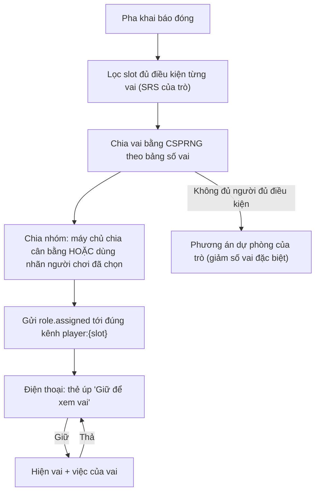

# G04 — Chia vai bí mật và chia nhóm

> Hạ tầng phòng dùng chung. Đặc tả: [`shared-room-platform-srs.md`](../../foundation/game-line/shared-room-platform-srs.md)
> §4.4, §5.1, RP-SEC-07. Bảng số vai cụ thể nằm trong SRS của trò (Phiên Tòa §5, Sĩ Số +1 §5). Trạng thái: nháp.

## 1. User story

Là người chơi, tôi muốn nhận vai bí mật trên điện thoại sao cho chỉ mình tôi biết, người ngồi cạnh không liếc được, và
không ai (kể cả host) đoán được vai của tôi qua màn hình chung hay cách điện thoại tôi phản hồi.

## 2. Mục tiêu và ranh giới

### Mục tiêu

- Vai do máy chủ chia ngẫu nhiên, đúng bảng số vai của trò.
- Vai không bao giờ rời máy chủ tới ai ngoài chủ vai, cho tới pha lật mặt.
- Chia nhóm (đội, dãy bàn, bàn) theo đúng kiểu của trò.

### Trong phạm vi

Bộ sinh ngẫu nhiên; điều kiện nhận vai; thẻ vai úp và "giữ để xem"; chia nhóm do máy chủ hoặc người chơi tự chọn; gói tin
đồng dạng; đổi vai theo vụ/vòng (khi trò yêu cầu).

### Ngoài phạm vi

Tên vai, số lượng và quyền của từng vai (SRS của trò); pha lật mặt (G35, G36, G47).

## 3. Actor, điều kiện và output

- **Actor:** máy chủ (chia), người chơi (nhận, xem), host (chỉ thấy số đếm nhóm).
- **Điều kiện:** pha khai báo đã đóng (nếu trò có) hoặc host bắt đầu (nếu không có khai báo).
- **Output:** bản ghi vai: slot, vai, nhóm, chỉ số vụ/vòng, `assigned_at`.

## 4. Luồng

## 5. Giao diện và trạng thái

| Thành phần | Nội dung |
|---|---|
| Thẻ vai úp | Mặt sau giống hệt nhau cho mọi vai; chữ "Giữ để xem vai" |
| Thẻ vai mở | Tên vai, một câu "việc của bạn", tên nhóm/đội; nút `Xem luật vai` |
| Chế độ trình đọc màn hình | Nút bật/tắt thay cho giữ; cảnh báo "Người bên cạnh có thể nhìn thấy màn hình" |
| Màn chiếu | "Vai đã được chia. Đừng để ai nhìn điện thoại của bạn." + số người mỗi nhóm (không có vai) |
| Bảng host | Số người mỗi nhóm; không có vai |

## 6. Quy tắc

1. Chia bằng bộ sinh số ngẫu nhiên an toàn mật mã ở máy chủ (RP-FR-30). Môi trường test cho phép hạt giống cố định
   (RP-TH-01); build production không có cờ này.
2. Chỉ kênh `player:{slot}` nhận vai của slot đó (RP-FR-31).
3. Điều kiện nhận vai do trò quy định (ví dụ cần ≥ 3 câu trả lời khác `skip`) (RP-FR-34).
4. Gói tin cùng pha có kích thước và nhịp gửi giống nhau giữa các vai (RP-FR-35): thêm đệm cho gói ngắn, gửi cùng lúc.
5. Người "vắng" (G09) lúc chia vai không nhận vai đặc biệt; họ nhận vai thường khi vào lại nếu trò cho phép.
6. Nhóm do người chơi tự chọn chỉ là nhãn host đặt (ví dụ "Dãy 1, Dãy 2, Dãy 3"), không phải chữ tự do.
7. Đổi vai giữa các vụ/vòng: bản ghi cũ giữ tới hết buổi (để lật mặt), xoá khi kết thúc.

## 7. Tiêu chí chấp nhận

- **G04-AC01:** Với 1.000 lần chia giả lập ở 15, 30 và 50 người, số lượng mỗi vai luôn đúng bảng của trò và phân bố mỗi
  slot nhận vai đặc biệt không lệch có ý nghĩa thống kê (kiểm chi bình phương, p > 0,01).
- **G04-AC02:** Ghi lại toàn bộ gói `display`, `host`, `audience` và gói `player` của người khác trong một ván giả lập: không
  gói nào chứa vai của một slot trước pha lật mặt (RP-TH-04).
- **G04-AC03:** Các gói `role.assigned` của mọi vai có cùng kích thước (± 0 byte sau đệm) và được gửi trong cùng một cửa sổ
  100 ms.
- **G04-AC04:** Thẻ vai mặc định úp; thả tay là úp lại trong ≤ 100 ms; chế độ trình đọc màn hình đọc được tên vai và việc
  của vai.
- **G04-AC05:** Slot không đủ điều kiện dữ liệu không bao giờ nhận vai cần dữ liệu đó.
- **G04-AC06:** Khi không đủ người đủ điều kiện, trò áp phương án dự phòng và bảng host hiện một dòng "Đã giảm số vai X vì ít
  người khai đủ" (không nêu tên ai).
- **G04-AC07:** Chia nhóm do máy chủ: chênh lệch số người giữa hai nhóm bất kỳ ≤ 1. Chia nhóm tự chọn: chỉ nhận nhãn host đã
  đặt.
- **G04-AC08:** Vào lại (G09) trả đúng vai và nhóm cũ; trình duyệt khác không lấy được vai của slot cũ.

## 8. Trường hợp biên

| Trường hợp | Cách xử lý |
|---|---|
| Người cạnh bên nhìn trộm khi đang giữ xem | Hướng dẫn "nghiêng điện thoại về phía mình"; thẻ chỉ mở khi giữ |
| Ai đó chụp màn hình vai và khoe | Không chặn được trên web; là một phần luật chơi xã hội; host có thể nhắc |
| Một người rời ngay sau khi nhận vai đặc biệt | Trò xử lý theo SRS của trò (ví dụ vai bị bỏ trống, không chia lại giữa chừng) |
| Nhóm tự chọn bị lệch (40 người cùng chọn Dãy 1) | Bảng host cảnh báo; host có nút "Chia đều lại" (máy chủ chuyển ngẫu nhiên người thừa, báo trên điện thoại họ) |

## 9. Definition of Done

- G04-AC01–AC08 pass, kể cả test thống kê và kiểm payload.
- Review bảo mật: CSPRNG, cờ hạt giống không có trong build production, lọc theo kênh, gói tin đồng dạng.
- Trợ năng thẻ vai trên iOS VoiceOver và Android TalkBack.
- Không còn lỗi P0/P1.

## 10. Bàn giao

- **Nguồn:** SRS §4.4; báo cáo (vai do game chia ngẫu nhiên); research note courtroom §5.
- **Đã xử lý:** host không thấy vai; gói tin đồng dạng chống đoán vai.
- **Rủi ro mở:** chụp màn hình khoe vai không chặn được trên web.
- **AC/DoD chưa xong:** toàn bộ.
