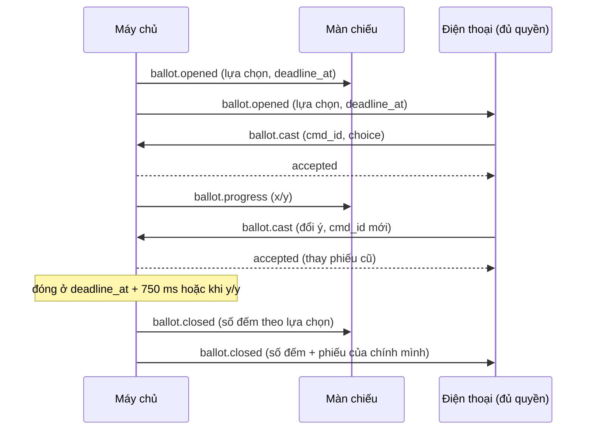

# G05 — Bỏ phiếu đồng thời

> Hạ tầng phòng dùng chung. Đặc tả: [`shared-room-platform-srs.md`](../../foundation/game-line/shared-room-platform-srs.md)
> §4.5, §5.5. Trạng thái: nháp.

## 1. User story

Là người chơi, tôi muốn cả phòng bỏ phiếu cùng lúc trên điện thoại trong vài chục giây, không ai thấy ai bầu ai, để tôi
chọn theo suy luận của mình chứ không chạy theo số đông hay sợ bị trách.

## 2. Mục tiêu và ranh giới

### Mục tiêu

- 50 người bỏ phiếu xong trong 20 giây, không mất phiếu, không phiếu đôi.
- Không lộ ai bầu ai, kể cả sau buổi.
- Một khung phiếu chung cho mọi lượt chọn: phiếu công khai và lượt chọn bí mật theo vai.

### Trong phạm vi

Mở phiếu; một hoặc k lựa chọn; phiếu trắng; đổi ý trước hạn; đóng sớm khi đủ; bù trễ 750 ms; công bố số đếm; phiếu khán
giả đếm riêng; lượt chọn bí mật theo vai.

### Ngoài phạm vi

Ý nghĩa kết quả và luật hoà của từng trò (SRS của trò); thảo luận miệng trước khi bầu.

## 3. Actor, điều kiện và output

- **Actor:** người chơi đủ quyền (theo danh sách của phiếu), khán giả (phiếu khán giả), máy chủ.
- **Điều kiện:** trò mở phiếu.
- **Output:** bản ghi phiếu (`ballot_id`, `ballot_type`, slot, lựa chọn, `cast_at`); số đếm khi đóng.

## 4. Luồng

## 5. Giao diện và trạng thái

| Nơi | Nội dung |
|---|---|
| Điện thoại | Danh sách lựa chọn (tìm kiếm nếu > 12 lựa chọn), nút `Bỏ phiếu`, đồng hồ, "Phiếu của bạn: …" sau khi gửi, `Đổi ý` |
| Màn chiếu khi mở | Câu hỏi, đồng hồ lớn, "Đã bỏ phiếu: 31/42". Không có thanh số phiếu |
| Màn chiếu khi đóng | Số đếm theo lựa chọn (cột hoặc số), dòng "Khán giả nghĩ…" nếu có |
| Lượt chọn bí mật | Màn chiếu không hiện gì riêng; điện thoại mọi người cùng có một việc trên màn (G04 quy tắc 4) |

Trạng thái: `đang mở`, `đã gửi`, `đã đổi`, `đóng`, `mất mạng khi gửi` (tự gửi lại cùng `cmd_id`), `bị huỷ do host bỏ qua`.

## 6. Quy tắc

1. Phiếu theo RP-FR-40 đến RP-FR-47.
2. Lệnh trùng `cmd_id` trả `duplicate`, không đếm lại.
3. Không hiện số phiếu từng lựa chọn khi đang mở, kể cả cho host.
4. Không công bố ai bầu ai ở bất kỳ thời điểm nào; không lưu sau khi phòng kết thúc.
5. Người không bỏ phiếu là phiếu trắng; màn chiếu không gọi tên người chưa bầu.
6. Phiếu khán giả đếm riêng, không quyết định kết quả ở MVP (trừ khi SRS của trò ghi khác).
7. Lượt chọn bí mật theo vai dùng cùng khung, `ballot_type` riêng, danh sách người được chọn chỉ gồm người giữ vai.

## 7. Tiêu chí chấp nhận

- **G05-AC01:** Thử tải 50 người chơi + 100 khán giả gửi phiếu trong 20 giây: 100% phiếu hợp lệ được đếm, 0 phiếu đôi.
- **G05-AC02:** Gửi cùng `cmd_id` ba lần → một phiếu; gửi `cmd_id` mới trước hạn → phiếu mới thay phiếu cũ.
- **G05-AC03:** Phiếu gửi tới máy chủ lúc `deadline_at + 500 ms` được nhận; lúc `deadline_at + 1.000 ms` bị `closed`.
- **G05-AC04:** Trong khi phiếu mở, gói `display`, `host`, `audience` chỉ có `x/y`; không có số theo lựa chọn hay danh tính.
- **G05-AC05:** Sau khi đóng, không kênh nào (kể cả `host`) nhận được ánh xạ slot → lựa chọn của người khác.
- **G05-AC06:** Người không bầu được tính phiếu trắng; màn chiếu không liệt kê tên người chưa bầu.
- **G05-AC07:** Phiếu đóng sớm khi mọi slot đủ quyền đã bầu.
- **G05-AC08:** Host bỏ qua khi phiếu đang mở: phiếu bị huỷ, không công bố số đếm.
- **G05-AC09:** Lượt chọn bí mật theo vai: người không giữ vai gửi lệnh vào phiếu đó → `not_allowed`, và phản hồi lỗi
  không khác phản hồi của một phiếu không tồn tại.
- **G05-AC10:** Danh sách trên 12 lựa chọn có ô tìm theo biệt danh, đọc được bằng trình đọc màn hình.

## 8. Trường hợp biên

| Trường hợp | Cách xử lý |
|---|---|
| Điện thoại mất mạng đúng lúc gửi | Tự gửi lại cùng `cmd_id` khi có mạng; nếu đã quá hạn, báo "Phiếu đã đóng trước khi kịp gửi" |
| Người bị bầu cũng có quyền bầu cho chính mình | Trò quy định; mặc định cho phép |
| Hoà | Trò quy định (ví dụ bầu lại 15 giây giữa các lựa chọn hoà) |
| Lệch giờ điện thoại | Đồng hồ hiển thị theo giờ máy chủ ước lượng; máy chủ là người chốt |

## 9. Definition of Done

- G05-AC01–AC10 pass, có thử tải.
- Review bảo mật: idempotency, phân quyền theo phiếu, đồng dạng lỗi, không lộ ánh xạ người → phiếu.
- DPIA ghi phiếu (kể cả lượt chọn bí mật theo vai) là dữ liệu trong buổi, xoá khi kết thúc.
- Không còn lỗi P0/P1.

## 10. Bàn giao

- **Nguồn:** SRS §4.5; báo cáo (bỏ phiếu cùng lúc); research note courtroom §5 (bỏ phiếu đồng thời trên mọi điện thoại).
- **Đã xử lý:** ẩn số phiếu khi đang mở để giảm chạy theo số đông; lượt chọn bí mật dùng chung khung phiếu.
- **Rủi ro mở:** chưa có dữ liệu thời lượng tối ưu cho phiếu 30–50 người (research note §5, Gaps).
- **AC/DoD chưa xong:** toàn bộ.
