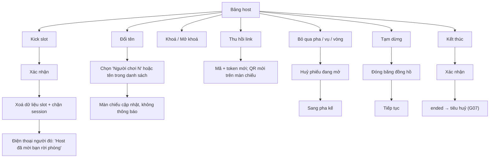

# G06 — Nút host: khoá, thu hồi, kick, đổi tên, bỏ qua, tạm dừng, kết thúc

> Hạ tầng phòng dùng chung. Đặc tả: [`shared-room-platform-srs.md`](../../foundation/game-line/shared-room-platform-srs.md)
> §4.6, RP-SEC-05. Trò có thể đổi tên hiển thị của nút (ví dụ Phiên Tòa: "Tạm dừng tòa", "Bỏ qua vụ"). Trạng thái: nháp.

## 1. User story

Là host, tôi muốn có nút để chặn người phá, đổi một biệt danh khó nghe, bỏ qua một vụ không hợp không khí, tạm dừng khi
có chuyện và kết thúc ngay khi cần, để buổi chơi luôn an toàn và tôi không phải giải thích dài dòng trước cả phòng.

## 2. Mục tiêu và ranh giới

### Mục tiêu

- Mọi nút an toàn bấm được trong ≤ 2 chạm từ bảng host.
- Kick và đổi tên không làm người bị xử lý bị bêu tên trên màn chiếu.
- Tạm dừng và kết thúc có hiệu lực trên mọi điện thoại trong ≤ 1 giây.

### Trong phạm vi

Khoá/mở khoá; thu hồi link; kick (chặn vào lại); đổi tên trung tính; bỏ qua pha/vụ/vòng; tạm dừng/tiếp tục; thêm 30
giây; kết thúc có xác nhận; xem báo cáo.

### Ngoài phạm vi

Host gõ chữ tự do cho người khác; host xem vai hay câu trả lời; cấm người chơi ở phòng khác (không có tài khoản để cấm).

## 3. Actor, điều kiện và output

- **Actor:** host có `host_session` của phòng.
- **Điều kiện:** phòng ở `lobby`, `running` hoặc `paused`.
- **Output:** trạng thái phòng/slot/pha thay đổi; sự kiện tới các kênh.

## 4. Luồng

## 5. Giao diện và trạng thái

- Bảng host có một hàng nút cố định: `Tạm dừng`, `Bỏ qua`, `+30 giây`, `Kết thúc`. Danh sách người chơi: chạm vào một
  biệt danh mở menu `Đổi tên`, `Mời rời phòng (kick)`.
- Huy hiệu báo cáo: số báo cáo theo loại, biệt danh bị báo cáo (nếu có).
- Màn chiếu khi tạm dừng: màn tạm dừng của trò (Phiên Tòa: "Tòa tạm nghỉ"); không nêu lý do.
- Màn chiếu khi kick hoặc đổi tên: không có thông báo; ô biệt danh biến mất hoặc đổi chữ.
- Điện thoại người bị kick: "Host đã mời bạn rời phòng. Dữ liệu của bạn trong buổi này đã được xoá." Không có nút vào lại.

## 6. Quy tắc

1. Mọi lệnh host kiểm `host_session` của đúng phòng (RP-FR-59).
2. Kick xoá dữ liệu như rời phòng (RP-FR-82) và chặn `player_session` đó vào lại phòng này (RP-FR-52).
3. Đổi tên chỉ tới tên hệ thống hoặc danh sách soạn sẵn (RP-FR-53).
4. Bỏ qua huỷ phiếu đang mở, không công bố (RP-FR-54).
5. Tạm dừng không kéo dài mốc hết hạn 2 giờ (RP-FR-55).
6. `+30 giây` tối đa 3 lần mỗi pha (RP-FR-56).
7. Kết thúc chỉ hỏi xác nhận một lần, không có bước "bạn có chắc không" thứ hai.
8. Bảng host không bao giờ thấy ai báo cáo, ai bầu ai, vai hay câu trả lời.

## 7. Tiêu chí chấp nhận

- **G06-AC01:** Kick một slot: trong ≤ 1 giây điện thoại người đó hiện màn rời phòng; biệt danh, câu trả lời, bản ghi đồng ý
  bị xoá khỏi kho (RP-TH-06); cùng trình duyệt mở lại link → thông báo lỗi chung.
- **G06-AC02:** Màn chiếu không hiện chữ "kick", "bị mời ra" hay biệt danh người bị kick.
- **G06-AC03:** Đổi tên không mở được ô nhập chữ; tên mới chỉ thuộc danh sách hệ thống.
- **G06-AC04:** Thu hồi link: mã và token cũ trả thông báo lỗi chung; QR mới hiện trên màn chiếu; người đang trong phòng
  không bị ngắt.
- **G06-AC05:** Khoá phòng: mọi `join` mới (cả khán giả) bị từ chối bằng thông báo chung.
- **G06-AC06:** Tạm dừng: mọi đồng hồ dừng trong ≤ 1 giây; tiếp tục chạy lại từ thời gian còn lại đã lưu; `hard_expires_at`
  không đổi.
- **G06-AC07:** Bỏ qua khi phiếu mở: phiếu huỷ, không công bố, pha kế bắt đầu.
- **G06-AC08:** `+30 giây` lần thứ tư trong cùng pha bị tắt.
- **G06-AC09:** Kết thúc: một bước xác nhận, rồi phòng chuyển `ended` và chạy G07.
- **G06-AC10:** Lệnh host gửi bằng `player_session` hoặc token màn chiếu bị từ chối; lệnh host của phòng A gửi tới phòng B
  bị từ chối.
- **G06-AC11:** Bảng host hiện báo cáo mới trong ≤ 2 giây, có loại và biệt danh bị báo cáo, không có người gửi.

## 8. Trường hợp biên

| Trường hợp | Cách xử lý |
|---|---|
| Host kick nhầm | Người đó vào lại bằng trình duyệt khác làm khán giả (nếu phòng mở khán giả); slot cũ không khôi phục |
| Người bị kick đang giữ vai quan trọng | Trò xử lý như rời phòng (SRS của trò) |
| Host bấm Kết thúc nhầm | Không hoàn tác được vì dữ liệu đã xoá; nút Kết thúc tách xa các nút khác, có xác nhận một lần |
| Nơi vừa mất đồ thật, vụ "trộm" không hợp | Phiên Tòa có nút "Đổi sang vụ con vịt cao su" (G31) |

## 9. Definition of Done

- G06-AC01–AC11 pass.
- Review bảo mật phân quyền host; test kick xoá dữ liệu; test tạm dừng không kéo dài hết hạn.
- Bảng host đạt trợ năng WCAG 2.2 AA trên điện thoại.
- Không còn lỗi P0/P1.

## 10. Bàn giao

- **Nguồn:** SRS §4.6; báo cáo (nút kick, bỏ qua vụ, tạm dừng tòa, kết thúc); research note courtroom §1, §4 (kick là "essential").
- **Đã xử lý:** kick không bêu tên; đổi tên không cho chữ tự do; tạm dừng không kéo dài hết hạn.
- **Rủi ro mở:** không có cách cấm người phá ở phòng sau (không tài khoản) — chấp nhận ở MVP.
- **AC/DoD chưa xong:** toàn bộ.
