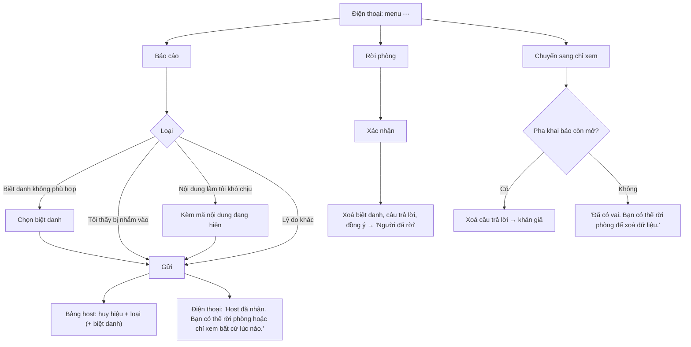

# G08 — Báo cáo, rời phòng và chỉ xem

> Hạ tầng phòng dùng chung. Đặc tả: [`shared-room-platform-srs.md`](../../foundation/game-line/shared-room-platform-srs.md)
> §4.8, RP-PRV-05. Trạng thái: nháp.

## 1. User story

Là người trong phòng, tôi muốn báo cho host khi thấy khó chịu mà không phải nói trước mọi người, rời phòng bất cứ lúc nào
và mang dữ liệu của mình đi theo, hoặc chỉ ngồi xem mà vẫn được tham gia, để không ai bị kẹt trong một trò mình không
muốn chơi.

## 2. Mục tiêu và ranh giới

### Mục tiêu

- Báo cáo trong ≤ 3 chạm, không gõ chữ, không ai biết ai báo cáo.
- Rời phòng là xoá biệt danh, câu trả lời, đồng ý của mình ngay.
- Chỉ xem là một lựa chọn bình đẳng, không bị coi là "bỏ cuộc".

### Trong phạm vi

Nút báo cáo và bốn loại; gửi tới host; giới hạn 5 báo cáo; mã nội dung kèm theo; liên hệ công khai; rời phòng; chuyển sang
chỉ xem; khảo sát một câu cuối buổi (tuỳ trò).

### Ngoài phạm vi

Chặn người dùng giữa các phòng (không tài khoản); hộp thư kiểm duyệt (RP-D4); chữ tự do trong báo cáo.

## 3. Actor, điều kiện và output

- **Actor:** người chơi, khán giả; host (nhận báo cáo).
- **Output:** báo cáo trong buổi (xoá khi kết thúc, giữ số đếm theo loại và mã nội dung); slot bị xoá/ẩn danh khi rời; slot
  chuyển `audience` khi chỉ xem.

## 4. Luồng

## 5. Giao diện và trạng thái

- Menu ⋯ luôn ở góc điện thoại, mọi pha: `Báo cáo`, `Chỉ xem`, `Rời phòng`, `Liên hệ Lá Úp`.
- Báo cáo: bốn nút lớn, câu phụ "Host sẽ thấy loại báo cáo, không thấy ai gửi."
- Rời phòng: "Rời phòng sẽ xoá biệt danh và câu trả lời của bạn khỏi buổi này." `Rời phòng` / `Ở lại`.
- Khảo sát cuối buổi (do trò bật): một câu, ba lựa chọn, có "Không muốn trả lời". Ví dụ Phiên Tòa: "Có lúc nào bạn thấy bị
  nhắm vào không?"; Sĩ Số +1: "Có lúc nào bạn thấy bị nhắm vào hoặc sợ thật không?" (theo phiếu chơi thử của báo cáo).

## 6. Quy tắc

1. Báo cáo theo RP-FR-70 đến RP-FR-74; không ghi người gửi ngoài bộ đếm giới hạn trong bộ nhớ.
2. Báo cáo không hiện trên màn chiếu.
3. Rời phòng theo RP-FR-80 đến RP-FR-82; trò xử lý vai bị bỏ trống.
4. Chỉ xem: sau khi đã có vai thì không chuyển sang chỉ xem được (để luật trò không vỡ); thay vào đó rời phòng.
5. Câu khảo sát cuối buổi chỉ lưu số đếm theo phương án, không gắn slot, không gắn biệt danh.
6. Liên hệ công khai có ở menu ⋯ và màn kết thúc.

## 7. Tiêu chí chấp nhận

- **G08-AC01:** Báo cáo gửi được trong ≤ 3 chạm từ mọi pha; không có ô chữ.
- **G08-AC02:** Bảng host nhận loại báo cáo (và biệt danh bị báo cáo nếu có) trong ≤ 2 giây; gói tin `host` không chứa slot
  hay biệt danh người gửi.
- **G08-AC03:** Báo cáo thứ 6 của cùng slot trong phòng bị từ chối với câu nhẹ nhàng "Bạn đã gửi nhiều báo cáo. Host đã nhận
  đủ."
- **G08-AC04:** Báo cáo "Nội dung làm tôi khó chịu" lưu mã nội dung đang hiện; sau tiêu huỷ chỉ còn số đếm theo mã nội dung.
- **G08-AC05:** Rời phòng: biệt danh, câu trả lời, đồng ý bị xoá ngay (RP-TH-06); mọi chỗ hiện sau đó dùng "Người đã rời".
- **G08-AC06:** Chuyển sang chỉ xem khi pha khai báo còn mở: câu trả lời bị xoá ngay, slot thành khán giả, biệt danh rời khỏi
  danh sách người chơi trên màn chiếu.
- **G08-AC07:** Khán giả không bao giờ nhận vai và không thấy màn khai báo.
- **G08-AC08:** Câu khảo sát cuối buổi lưu dưới dạng số đếm; kiểm kho sau tiêu huỷ không có ánh xạ slot → câu trả lời khảo sát.
- **G08-AC09:** Menu ⋯ đọc được bằng trình đọc màn hình và không che nút chính của pha.

## 8. Trường hợp biên

| Trường hợp | Cách xử lý |
|---|---|
| Một người báo cáo chính host | Báo cáo vẫn tới bảng host (không có kênh khác ở MVP); người báo cáo được nhắc có thể rời phòng; RP-D4 |
| Nhiều người cùng báo cáo một biệt danh | Bảng host gộp "3 báo cáo: biệt danh X"; host đổi tên hoặc kick |
| Người rời đang giữ vai bí mật | Trò xử lý (Phiên Tòa G32, Sĩ Số +1 G42) |
| Người muốn quay lại sau khi rời | Vào lại như người mới nếu sảnh còn mở, hoặc làm khán giả |

## 9. Definition of Done

- G08-AC01–AC09 pass.
- Thông tin liên hệ công khai đã có thật (email hỗ trợ Lá Úp) trước khi phát hành (Apple 1.2).
- DPIA và nháp chính sách ghi: báo cáo xoá khi kết thúc, chỉ giữ số đếm; rời phòng là xoá ngay.
- Không còn lỗi P0/P1.

## 10. Bàn giao

- **Nguồn:** SRS §4.8; Apple App Review Guidelines 1.2 (đọc lại 26/10/2026); báo cáo (phiếu khảo sát "bị nhắm vào").
- **Đã xử lý:** báo cáo không lộ người gửi; rời là xoá ngay; khảo sát chỉ là số đếm.
- **Rủi ro mở:** RP-D4 (báo cáo nhắm vào host không có kênh riêng).
- **AC/DoD chưa xong:** toàn bộ.
