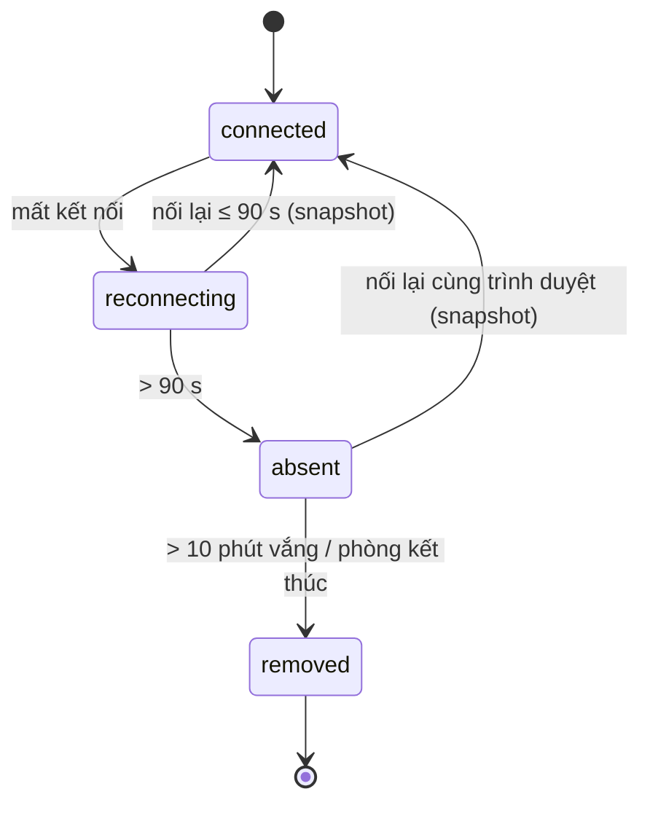

# G09 — Mất kết nối và vào lại

> Hạ tầng phòng dùng chung. Đặc tả: [`shared-room-platform-srs.md`](../../foundation/game-line/shared-room-platform-srs.md)
> §4.9, §5.5. Trạng thái: nháp.

## 1. User story

Là người chơi ở hội trường Wi-Fi chập chờn, tôi muốn khi mất mạng vài giây thì điện thoại tự nối lại đúng chỗ, vẫn giữ
biệt danh và vai, không bị loại chỉ vì mạng yếu.

## 2. Mục tiêu và ranh giới

### Mục tiêu

- Vào lại đúng trạng thái trong ≤ 3 giây sau khi có mạng.
- Vắng mặt không bị coi là bị loại.
- Không có cách lấy slot của người khác.

### Trong phạm vi

Tự thử lại có độ trễ tăng dần; ảnh chụp trạng thái khi vào lại; đánh dấu "vắng" sau 90 giây; xử lý trình duyệt khác; màn
chiếu mất kết nối; host mất kết nối; chế độ dự phòng hỏi định kỳ.

### Ngoài phạm vi

Chuyển slot sang máy khác; mã khôi phục host (RP-D7); chơi offline.

## 3. Actor, điều kiện và output

- **Actor:** người chơi, khán giả, màn chiếu, host; máy chủ.
- **Output:** client hiển thị đúng `room.snapshot`; trạng thái slot `absent` ↔ `player`/`audience`.

## 4. Luồng

## 5. Giao diện và trạng thái

| Nơi | Khi | Hiển thị |
|---|---|---|
| Điện thoại | Đang nối lại | Dải trên cùng "Đang kết nối lại…", nút chính tạm tắt, đồng hồ vẫn chạy theo giờ máy chủ ước lượng |
| Điện thoại | Nối lại xong | Dải tắt; nếu pha đã đổi, hiện pha mới; nếu phiếu đã đóng, "Phiếu đã đóng trong lúc bạn mất mạng" |
| Bảng host | Slot vắng | Chấm xám cạnh biệt danh |
| Màn chiếu | Slot vắng | Không hiện gì riêng |
| Màn chiếu | Màn chiếu mất > 2 phút | (Trên các máy khác) phòng tạm dừng; bảng host "Màn chiếu mất kết nối" |
| Màn chiếu | Host mất kết nối | Chấm nhỏ góc màn "Host đang kết nối lại" |
| Điện thoại | Trình duyệt khác | Như người mới: vào sảnh hoặc làm khán giả |

## 6. Quy tắc

1. Thử lại 1 s, 2 s, 4 s, 8 s, rồi 15 s một lần, cộng nhiễu ngẫu nhiên (RP-FR-90).
2. Vào lại luôn nhận `room.snapshot` đầy đủ đã lọc theo kênh (RP-FR-91).
3. Vắng > 90 giây: không nhận vai mới, phiếu trắng, đồng hồ không chờ (RP-FR-92).
4. Vắng > 10 phút hoặc phòng kết thúc: slot bị xoá như rời phòng (RP-FR-93, RP-FR-82).
5. Màn chiếu mất > 2 phút: tự tạm dừng (RP-FR-94). Host mất: trò tiếp tục, > 10 phút thì kết thúc (RP-FR-95, RP-FR-65).
6. Không có đường khôi phục slot ngoài cookie `player_session` của chính trình duyệt đó.

## 7. Tiêu chí chấp nhận

- **G09-AC01:** Cắt mạng 10 giây rồi bật lại: điện thoại hiện đúng pha, vai, phiếu đang mở và phiếu đã bỏ trong ≤ 3 giây.
- **G09-AC02:** Cắt mạng 120 giây: bảng host thấy chấm vắng; phiếu mở trong lúc đó tính trắng; nối lại vẫn giữ vai và biệt danh.
- **G09-AC03:** Mở cùng link vào phòng trên trình duyệt khác khi phòng đang chạy: chỉ vào được làm khán giả, không nhận được
  vai hay câu trả lời của slot cũ.
- **G09-AC04:** Tắt màn chiếu 2 phút 10 giây: phòng chuyển `paused`; mở lại màn chiếu, host tiếp tục được.
- **G09-AC05:** Tắt bảng host: các pha vẫn tự chạy; sau 10 phút vắng liên tục phòng kết thúc và tiêu huỷ.
- **G09-AC06:** Chặn kênh bền (giả lập proxy hội trường): client chuyển sang hỏi định kỳ 2 giây/lần và vẫn chơi được.
- **G09-AC07:** Thử 50 điện thoại mất mạng cùng lúc 15 giây rồi nối lại: máy chủ không quá tải (độ trễ sự kiện p95 vẫn ≤ 1,5 s
  sau 10 giây).

## 8. Trường hợp biên

| Trường hợp | Cách xử lý |
|---|---|
| Điện thoại hết pin | Như vắng; sạc xong mở lại trình duyệt cũ là vào lại nếu chưa quá 10 phút |
| Người chơi chuyển từ Wi-Fi sang 4G | Cookie vẫn còn; nối lại bình thường |
| Trình duyệt ẩn danh bị đóng | Cookie mất; như trình duyệt khác |
| Nhiều tab cùng một slot | Tab mới nhất được giữ kết nối; tab cũ hiện "Phòng đang mở ở tab khác" |

## 9. Definition of Done

- G09-AC01–AC07 pass, có thử mất mạng thật trên iOS Safari và Chrome Android.
- Review bảo mật: không có đường chiếm slot; cookie flags đúng.
- Không còn lỗi P0/P1.

## 10. Bàn giao

- **Nguồn:** SRS §4.9, §5.5.
- **Đã xử lý:** vắng không phải bị loại; chỉ cookie của chính trình duyệt khôi phục được slot.
- **Rủi ro mở:** RP-D7; Wi-Fi doanh nghiệp có thể chặn kênh bền — cần thử ở địa điểm thật.
- **AC/DoD chưa xong:** toàn bộ.
