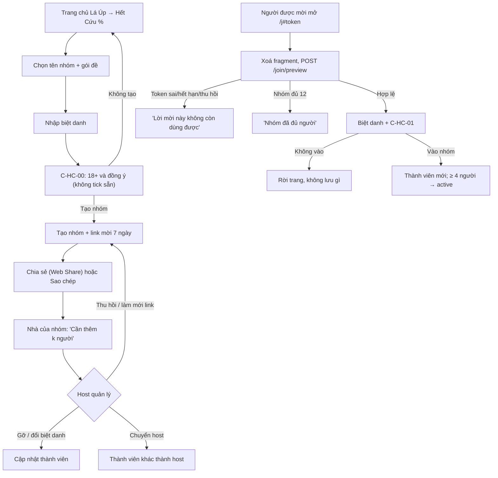

# G10 — Hết Cứu %: tạo nhóm và mời bạn vào

> Nguồn: [PRD Hết Cứu %](../../foundation/game-line/het-cuu-phan-tram-prd.md) §3, §4, §8 · [SRS](../../foundation/game-line/het-cuu-phan-tram-srs.md)
> HC-FR-01–10, §5, §7, §8.2 (C-HC-00, C-HC-01). Trạng thái: nháp, chờ owner duyệt. Giai đoạn hiện tại: chỉ tài liệu.

## 1. User story

Là người hay rủ rê trong nhóm bạn hoặc phòng ban, tôi muốn tạo một nhóm Hết Cứu % kín trong một phút, không cần tài khoản, rồi gửi link vào
nhóm chat, để cả nhóm cùng chơi mỗi tuần mà người ngoài không vào được.

## 2. Mục tiêu và ranh giới

**Mục tiêu**

- Host tạo nhóm và có link mời trong ≤ 60 giây.
- Người được mời hiểu trò lưu gì, bao lâu, trước khi vào.
- Link mời an toàn theo kiểu "nhạy cảm theo năng lực": có hạn, thu hồi được, không vào log hay Referer, không bị lập chỉ mục.

**Trong phạm vi:** tạo nhóm; chọn tên nhóm soạn sẵn và gói đề; biệt danh; xác nhận 18+; đồng ý; tạo, chia sẻ, thu hồi, làm mới link mời; tham gia;
nhóm đủ 12; host gỡ thành viên, đổi biệt danh, chuyển host, nhận vai host khi host vắng 21 ngày; giới hạn số nhóm mỗi phiên.

**Ngoài phạm vi:** tự khai và sự kiện (G11); rời nhóm và xoá dữ liệu của chính mình (G15); thông báo (G15); tài khoản; tìm nhóm công khai; tải danh bạ;
mời tự động; tên nhóm chữ tự do.

## 3. Actor, điều kiện và output

- **Actor:** host (người tạo); người được mời; thành viên đang có.
- **Điều kiện:** trình duyệt bật cookie; người dùng tự xác nhận từ 18 tuổi.
- **Output:** `hc_group` (`forming` hoặc `active`), `hc_member` của host, `hc_invite` (chỉ băm token), cookie phiên thiết bị; với người vào: `hc_member` mới.

## 4. Luồng

## 5. UI/UX và trạng thái

| Màn | Thành phần | Ghi chú |
|---|---|---|
| Tạo nhóm | Lưới tên soạn sẵn ("Hội Thang Máy", "Phòng Pantry", "Lớp Mèo Ngủ", …) kèm emoji; 3 chip gói đề | Không ô chữ ngoài biệt danh |
| Biệt danh | Ô 2–20 ký tự, đếm ký tự, lỗi ngay dưới ô | "Biệt danh này đã có trong nhóm." / "Biệt danh không được chứa link hay số điện thoại." |
| C-HC-00 / C-HC-01 | Chữ nguyên văn ở SRS §8.2; hai ô không tick sẵn; nút đồng ý bị khoá tới khi tick đủ; nút từ chối cùng kích thước | Link chính sách mở trang mới |
| Link sẵn sàng | "Link mời đã sẵn sàng. Ai có link đều vào được, tối đa 12 người, hết hạn sau 7 ngày." Nút Chia sẻ / Sao chép | Không nói "đã gửi" |
| Nhà của nhóm (host) | Danh sách biệt danh, số chỗ trống, trạng thái link, menu từng thành viên (Gỡ, Đổi biệt danh, Chuyển host) | Xác nhận trước khi gỡ: "Gỡ {biệt danh}? Dữ liệu của họ trong nhóm sẽ bị xoá." |
| Tab ẩn danh | Cảnh báo khi phát hiện được: "Bạn đang dùng tab ẩn danh, đóng tab là rời nhóm." | |

Trạng thái loading / empty / error / hết hạn / offline: theo SRS §4.2 (trang tham gia, nhà của nhóm).

## 6. Quy tắc nghiệp vụ

HC-FR-01 đến HC-FR-10; phiên thiết bị theo SRS §5; bảo mật link theo SRS §7.

## 7. Tiêu chí chấp nhận

- **G10-AC01:** Given màn C-HC-00 hoặc C-HC-01, When màn hiện lần đầu, Then hai ô "18+" và "đồng ý" đều chưa tick và nút "Tạo nhóm"/"Vào nhóm" bị khoá cho tới khi tick đủ hai ô.
- **G10-AC02:** Given người dùng bấm "Không tạo"/"Không vào", When kiểm DB, Then không có `hc_group`, `hc_member` hay phiên mới nào được tạo.
- **G10-AC03:** Given biệt danh dài 1 hoặc 21 ký tự, chứa URL hoặc `@`, chứa dãy từ 6 chữ số liền, nằm trong danh sách chặn, hoặc trùng biệt danh khác khi bỏ dấu và hoa thường, When gửi, Then server từ chối với câu lỗi tiếng Việt cố định.
- **G10-AC04:** Given link mời vừa tạo, When kiểm DB và URL, Then token có 256 bit ngẫu nhiên, nằm trong fragment `#`, DB chỉ có băm HMAC, và fragment bị xoá khỏi thanh địa chỉ ngay khi trang tham gia đọc xong.
- **G10-AC05:** Given chạy hết bộ test tạo/mở/vào/thu hồi, When quét log ứng dụng và proxy, Then không có token, biệt danh hay cookie phiên nào; trang tham gia trả `Cache-Control: no-store`, `Referrer-Policy: no-referrer`, `X-Robots-Tag: noindex, nofollow`.
- **G10-AC06:** Given token sai dạng, sai giá trị, hết hạn hoặc đã thu hồi, When mở link, Then cả bốn trường hợp trả cùng một câu và cùng mã trạng thái; sau 5 lần sai liên tiếp từ một IP, lần tiếp theo bị chặn 15 phút.
- **G10-AC07:** Given nhóm đã có 12 thành viên, When người thứ 13 mở link hợp lệ, Then thấy "Nhóm đã đủ người" và không thấy biệt danh nào.
- **G10-AC08:** Given host thu hồi hoặc làm mới link, When có người mở link cũ ngay sau đó, Then nhận phản hồi chung của AC06.
- **G10-AC09:** Given host gỡ một thành viên, When thành viên đó tải lại trang, Then phiên của họ không truy cập được nhóm (404 chung) và mọi dữ liệu của họ trong nhóm đã bị xoá theo HC-FR-48; thành viên khác chỉ thấy "Một thành viên đã rời nhóm".
- **G10-AC10:** Given host đổi biệt danh của thành viên, When biệt danh mới vi phạm bộ lọc, Then bị từ chối như AC03.
- **G10-AC11:** Given host chuyển host, Then đúng một `role=host` tồn tại sau giao dịch; Given phiên host không hoạt động 21 ngày, Then thành viên vào sớm nhất còn hoạt động thấy "Nhận vai host" và chỉ một người nhận được.
- **G10-AC12:** Given một phiên đã là host của 3 nhóm đang hoạt động hoặc thành viên của 5 nhóm, When tạo/vào thêm, Then bị từ chối với câu giải thích.
- **G10-AC13:** Given host bấm Chia sẻ, Then app chỉ gọi bảng chia sẻ của hệ điều hành hoặc sao chép; không xin quyền danh bạ, không tự gửi tin, không ghi đích chia sẻ.

## 8. Edge case

| Tình huống | Xử lý |
|---|---|
| Hai người vào cùng lúc khi còn 1 chỗ | Giao dịch khoá; một người vào, người kia thấy "Nhóm đã đủ người" |
| Người được mời đã là thành viên (cùng phiên) | Đưa thẳng vào nhà của nhóm, không tạo bản ghi mới |
| Người được mời xoá cookie rồi mở lại link | Thành thành viên mới; biệt danh cũ còn giữ nếu thành viên cũ chưa bị gỡ, nên phải chọn biệt danh khác |
| Link bị dán vào trang công khai | `noindex`, link hết hạn 7 ngày, tối đa 12 người; host thu hồi và gỡ người lạ |
| Host là người duy nhất và bỏ nhóm | Thuộc G15 (rời = xoá nhóm) |
| Trình duyệt chặn cookie | "Trình duyệt đang chặn cookie nên không giữ được chỗ của bạn trong nhóm." Không vào được |
| Mở link trong trình duyệt nhúng của Zalo/Messenger | Chạy được; nếu cookie không bền, cảnh báo "Mở bằng trình duyệt để không mất chỗ" |

## 9. Definition of Done

- G10-AC01–AC13 có test tự động; T-HC-01–05 và T-HC-16 xanh.
- Chữ C-HC-00/C-HC-01 và tên nhóm soạn sẵn được owner duyệt; luật sư đã xem màn đồng ý.
- Bảo mật: token fragment, băm, một phản hồi chung, giới hạn tần suất, CSRF + Origin, header capability; không P0/P1 mở.
- Quyền riêng tư: `hc_group`, `hc_member`, `hc_invite`, `hc_device_session` có trong DPIA với thời hạn và job xoá; chính sách quyền riêng tư nói rõ không có
  khôi phục khi mất phiên; nếu gói vào app store thì Apple App Privacy và Google Play Data safety khai biệt danh và mã thiết bị (không theo dõi).
- Trợ năng: đọc màn hình đọc đúng nhãn ô đồng ý; chữ 200%; vùng chạm 44×44.
- Codex `APPROVE @ <SHA>` khớp head.

## 10. Bàn giao theo AGENTS.md

Nguồn: PRD/SRS Hết Cứu %, US-08 (mẫu link mời), `privacy-security-flow-notes.md`. Phát hiện đã sửa: token chuyển vào fragment; tên nhóm không chữ tự do.
Rủi ro mở: mất phiên = mất chỗ (không có khôi phục); trình duyệt nhúng của ứng dụng chat có thể không giữ cookie. AC/DoD chưa xong: toàn bộ (chưa dựng).
