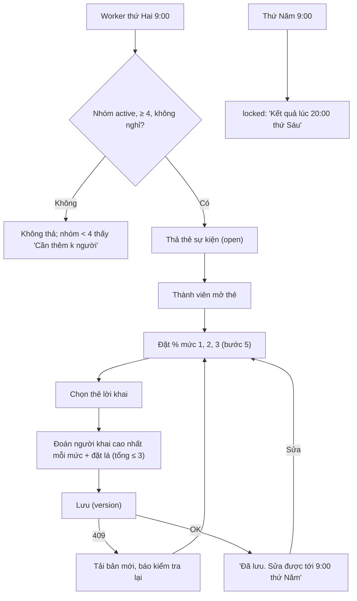

# G11 — Hết Cứu %: nhận sự kiện tuần, tự khai % và đặt lá

> Nguồn: [PRD](../../foundation/game-line/het-cuu-phan-tram-prd.md) §4.1–4.3, §5 · [SRS](../../foundation/game-line/het-cuu-phan-tram-srs.md)
> HC-FR-11–22, §4, §10. D3 (cơ chế lá) là **đề xuất — chờ owner**. Trạng thái: nháp.

## 1. User story

Là thành viên một nhóm Hết Cứu %, tôi muốn mở sự kiện của tuần, tự khai kín mình có bao nhiêu % sẽ làm từng mức, chọn một thẻ lời khai và đoán
ai trong nhóm khai cao nhất, để tối thứ Sáu có cái mà cười cùng cả nhóm.

## 2. Mục tiêu và ranh giới

**Mục tiêu:** khai xong trong ≤ 2 phút; luật lá dễ hiểu trong một câu; không ai biết ai đã nộp hay nộp gì trước màn lật.

**Trong phạm vi:** thả đề thứ Hai 9:00 (gồm chọn đề, không lặp, host đổi đề một lần); thẻ sự kiện; thanh trượt %; thẻ lời khai; phiếu đoán và lá; sửa
tới khi khoá; khoá thứ Năm 9:00; nhóm chưa đủ 4 người; thành viên vào giữa tuần; trạng thái offline/lỗi.

**Ngoài phạm vi:** Nhân Vật Chính (G16); tin nóng (G12); "ẩn %" và "đừng đoán tôi" (G15, chỉ được gọi từ màn này); màn lật (G13); tuần nghỉ (G14).

## 3. Actor, điều kiện và output

- **Actor:** thành viên; host (đổi đề); worker lịch.
- **Điều kiện:** nhóm `active`, ≥ 4 thành viên, không đặt nghỉ tuần.
- **Output:** `hc_event` ở `open` rồi `locked`; `hc_claim`, `hc_alibi`, `hc_guess` (`kind=top_claim`) của từng người.

## 4. Luồng

## 5. UI/UX và trạng thái

| Phần | Nội dung |
|---|---|
| Thẻ sự kiện | Tranh, tên sự kiện, 3 mức có nhãn "bình thường / bựa / hết cứu", lá của tuần, "Khoá lúc 9:00 thứ Năm · Lật lúc 20:00 thứ Sáu" |
| Thanh trượt | Mỗi mức một thanh, nút −/+ 5%, trạng thái "chưa khai" khi chưa chạm; đọc màn hình: "Mức 2, bựa, 35 phần trăm" |
| Thẻ lời khai | 10 thẻ dạng chip, chọn một; ghi chú "Thẻ này được đọc to nếu bạn khai cao nhất" |
| Đoán | Mỗi mức một hàng biệt danh (không có mình, không có người bật "đừng đoán tôi"), dưới là 3 lá; đếm "Còn {k} lá". Giải thích một câu: "Đoán đúng được cộng số lá đã đặt, đoán sai bị trừ. Lá chỉ dùng trong tuần này." |
| Lựa chọn của tôi | Hai công tắc dẫn sang G15: "Ẩn % của tôi", "Tuần này đừng đoán tôi" |
| Đã khoá | "Đã khoá. Kết quả lúc 20:00 thứ Sáu." + "{k}/{n} người đã tham gia" |
| Host xem trước | Từ màn lật thứ Sáu tới 9:00 thứ Hai: "Đề tuần sau: {tên}. [Đổi đề] (còn 1 lần)" |

Không có chữ "cược", "kèo", "thắng tiền". Trạng thái loading / empty / error / hết hạn / offline theo SRS §4.2 (màn tự khai); offline không lưu gì trên máy.

## 6. Quy tắc nghiệp vụ

HC-FR-11–22. Lá: 3/sự kiện, mỗi phiếu ≥ 1, không mang sang (HC-FR-18, D3). Phiếu nhắm vào người rời nhóm hoặc bật "đừng đoán tôi" theo HC-FR-28 (thuộc G13 về
chấm điểm; màn này chỉ hiện thông báo trả lá).

## 7. Tiêu chí chấp nhận

- **G11-AC01:** Given đồng hồ giả ở thứ Hai 8:59 và 9:00 (giờ Việt Nam), When worker chạy, Then sự kiện chỉ chuyển `open` lúc 9:00; Given thứ Năm 9:00, Then chuyển `locked` và mọi ghi sau đó trả 409 `event_locked`, kể cả request bắt đầu trước 9:00 nhưng tới sau.
- **G11-AC02:** Given nhóm có 3 thành viên hoặc đặt nghỉ tuần, When tới thứ Hai 9:00, Then không có `hc_event` mới và nhóm < 4 thấy "Cần thêm {k} người để bắt đầu".
- **G11-AC03:** Given % = 33, −5, 105 hoặc chuỗi, When lưu, Then server từ chối; Given thanh trượt chưa chạm, Then client không gửi giá trị cho mức đó.
- **G11-AC04:** Given người chơi chọn thẻ lời khai, Then đúng một `alibi_card_id` thuộc ngân hàng đã duyệt được lưu và gắn với mức có % cao nhất (hoà thì mức số lớn hơn).
- **G11-AC05:** Given phiếu đoán chính mình, đoán người bật "đừng đoán tôi", phiếu 0 lá, hoặc tổng lá 4, When lưu, Then server từ chối từng trường hợp.
- **G11-AC06:** Given người chơi còn lá chưa dùng khi khoá, When sự kiện sau mở, Then họ có đúng 3 lá; không có trường, API hay màn nào hiện tổng lá hoặc tổng điểm nhiều sự kiện.
- **G11-AC07:** Given hai thiết bị (hai tab) cùng phiên lưu với cùng `version`, Then lần lưu thứ hai nhận 409 và client tải bản mới, không ghi đè im lặng.
- **G11-AC08:** Given đọc màn hình (VoiceOver/TalkBack), Then mỗi thanh trượt đọc mức, tên mức và %; nút −/+ đạt 44×44; chữ 200% không vỡ bố cục.
- **G11-AC09:** Given thành viên A, When gọi mọi API của sự kiện đang mở hoặc đã khoá, Then không có dữ liệu nào cho biết thành viên B đã nộp hay chưa, hay B khai/đoán gì; chỉ có số đếm "{k}/{n}".
- **G11-AC10:** Given host xem trước đề tuần sau, When bấm "Đổi đề" lần hai, Then bị từ chối; đề mới không trùng đề đã chơi trong nhóm khi ngân hàng còn đề chưa dùng.
- **G11-AC11:** Given mất mạng khi đang khai, Then nút lưu bị khoá, câu trả lời chỉ giữ trong bộ nhớ trang, và không có gì được ghi vào localStorage, IndexedDB hay Cache Storage.
- **G11-AC12:** Given thành viên vào nhóm lúc sự kiện đang `open`, Then chơi được sự kiện đó; vào lúc `locked`, Then thấy "Bạn sẽ chơi từ sự kiện tuần sau".

## 8. Edge case

| Tình huống | Xử lý |
|---|---|
| Ngân hàng của gói đã dùng hết | Cho lặp đề cũ nhất; báo owner qua bộ đếm vận hành |
| Thành viên rời nhóm sau khi đã khai | Dữ liệu của họ xoá ngay (G15); danh sách đoán của người khác cập nhật |
| Nhóm tụt xuống 3 người giữa tuần | Sự kiện vẫn chạy; nếu < 3 người có thể bị đoán thì màn lật ở chế độ chỉ tự khai (G13) |
| Đồng hồ máy người chơi sai | Giờ khoá do server quyết; client hiện giờ server trả về |
| Worker thả trễ | Cửa sổ khai vẫn đóng thứ Năm 9:00; trễ > 15 phút báo operator |

## 9. Definition of Done

- G11-AC01–AC12 có test; T-HC-06–08, T-HC-18 xanh.
- Owner chốt D3 (hoặc chọn phương án không lá) và duyệt chữ thẻ sự kiện, thẻ lời khai, câu giải thích lá.
- Bảo mật: CSRF + Origin, kiểm quyền thành viên, schema chặt, giới hạn 30 lần lưu/giờ; không P0/P1.
- Quyền riêng tư: `hc_claim`, `hc_alibi`, `hc_guess` có trong DPIA với thời hạn lật + 72 giờ; không lưu trên máy; chính sách quyền riêng tư và (nếu có) nhãn store
  khai "nội dung do người dùng tạo: lựa chọn trong trò chơi".
- Codex `APPROVE @ <SHA>` khớp head.

## 10. Bàn giao theo AGENTS.md

Nguồn: báo cáo (luật chốt từng bước), PRD/SRS, `growth.test.ts` (không streak/coin). Phát hiện đã sửa: lá không mang sang; không hiện ai đã nộp. Rủi ro mở: D3
(mô phỏng cờ bạc) chưa có ý kiến luật sư. AC/DoD chưa xong: toàn bộ.
