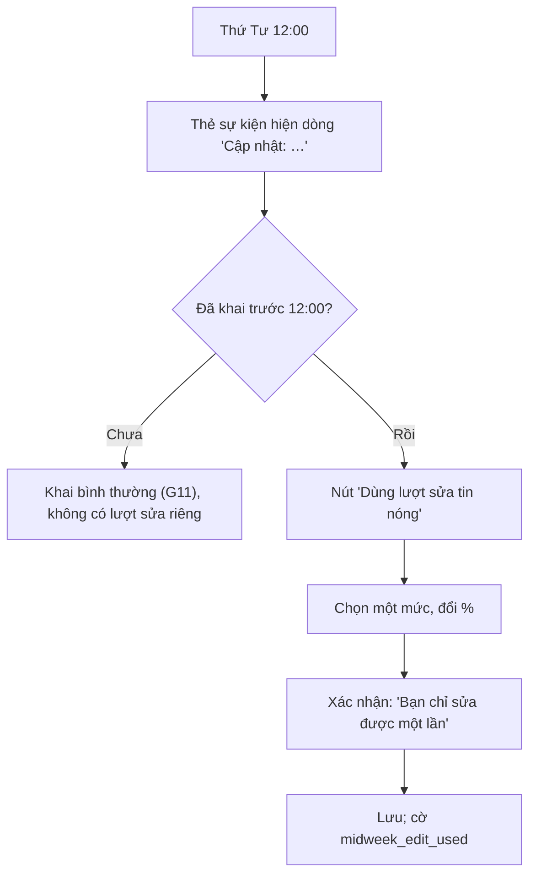

# G12 — Hết Cứu %: tin nóng giữa tuần (sau MVP)

> Nguồn: [PRD](../../foundation/game-line/het-cuu-phan-tram-prd.md) §4.1, §5.2, HC-D5 · [SRS](../../foundation/game-line/het-cuu-phan-tram-srs.md) HC-FR-57–59.
> **Phạm vi: sau MVP**, theo báo cáo "Chốt năm trò" (MVP không có tin nóng). Viết sẵn để không phải đổi mô hình dữ liệu về sau.

## 1. User story

Là thành viên đã khai, tôi muốn thứ Tư có thêm một chi tiết bất ngờ cho sự kiện và được sửa một con số, để có thêm một nhịp hồi hộp và một cơ hội lừa cả hội.

## 2. Mục tiêu và ranh giới

**Mục tiêu:** thêm một nhịp giữa tuần mà không thêm thông báo, không thêm dữ liệu cá nhân mới ngoài một cờ.

**Trong phạm vi:** hiện tin nóng thứ Tư 12:00; một lượt sửa một con số tự khai; không lộ ai đã sửa.

**Ngoài phạm vi:** thông báo đẩy cho tin nóng (không có); sửa phiếu đoán hay lá (vẫn sửa tự do tới khi khoá theo G11); tin nóng do người dùng viết.

## 3. Actor, điều kiện và output

- **Actor:** thành viên đã có tự khai trước thứ Tư 12:00.
- **Output:** `hc_claim.pct` mới và `midweek_edit_used = true` trên đúng một mức.

## 4. Luồng

## 5. UI/UX và trạng thái

- Dải "Tin nóng" màu nhấn trên thẻ sự kiện, chữ lấy từ ngân hàng (PRD §5.2).
- Sau 12:00, các mức đã khai trước 12:00 hiện khoá nhỏ; chạm vào thì mở hộp "Dùng lượt sửa tin nóng cho mức này?".
- Đã dùng: "Bạn đã dùng lượt sửa tuần này."
- Trạng thái lỗi/offline/khoá theo SRS §4.2.

## 6. Quy tắc nghiệp vụ

HC-FR-57–59. Mức chưa khai trước 12:00 vẫn khai lần đầu tự do tới khi khoá. Số cũ không được lưu. Không có thông báo đẩy cho tin nóng.

## 7. Tiêu chí chấp nhận

- **G12-AC01:** Given đồng hồ giả thứ Tư 11:59 và 12:00, Then dòng tin nóng chỉ hiện từ 12:00 và không có thông báo đẩy nào được gửi.
- **G12-AC02:** Given thành viên đã khai mức 2 lúc 10:00 thứ Tư, When sửa mức 2 lúc 13:00, Then lưu thành công và `midweek_edit_used = true`; When sửa tiếp mức 2 hoặc mức khác đã khai trước 12:00, Then bị từ chối.
- **G12-AC03:** Given lượt sửa đã dùng, When kiểm DB, Then không có giá trị % cũ nào được giữ (không bảng lịch sử, không cột "trước khi sửa").
- **G12-AC04:** Given màn lật, When đọc API màn lật của bất kỳ thành viên nào, Then không có trường nào cho biết ai đã dùng lượt sửa.

## 8. Edge case

| Tình huống | Xử lý |
|---|---|
| Khai lần đầu mức 3 lúc 14:00 thứ Tư | Khai tự do, không tính là lượt sửa |
| Bật "đừng đoán tôi" sau khi dùng lượt sửa | Tự khai bị xoá theo G15; lượt sửa không trả lại |
| Owner sửa chữ tin nóng giữa tuần | Không áp cho sự kiện đang mở (HC-FR-62) |

## 9. Definition of Done

- G12-AC01–AC04 có test; T-HC-17 xanh. Owner duyệt 20 câu tin nóng (PRD §5.2).
- Quyền riêng tư: cờ `midweek_edit_used` có trong DPIA, xoá cùng số thô; không thêm dữ liệu khác.
- Bảo mật: kiểm lượt sửa ở server trong giao dịch; không P0/P1.
- Codex `APPROVE @ <SHA>` khớp head.

## 10. Bàn giao theo AGENTS.md

Nguồn: báo cáo (tin nóng, MVP), PRD/SRS. Phát hiện đã sửa: không lưu số cũ; không thông báo cho tin nóng (giữ trần 1 thông báo/tuần). Rủi ro mở: không. AC/DoD chưa xong: toàn bộ (sau MVP).
