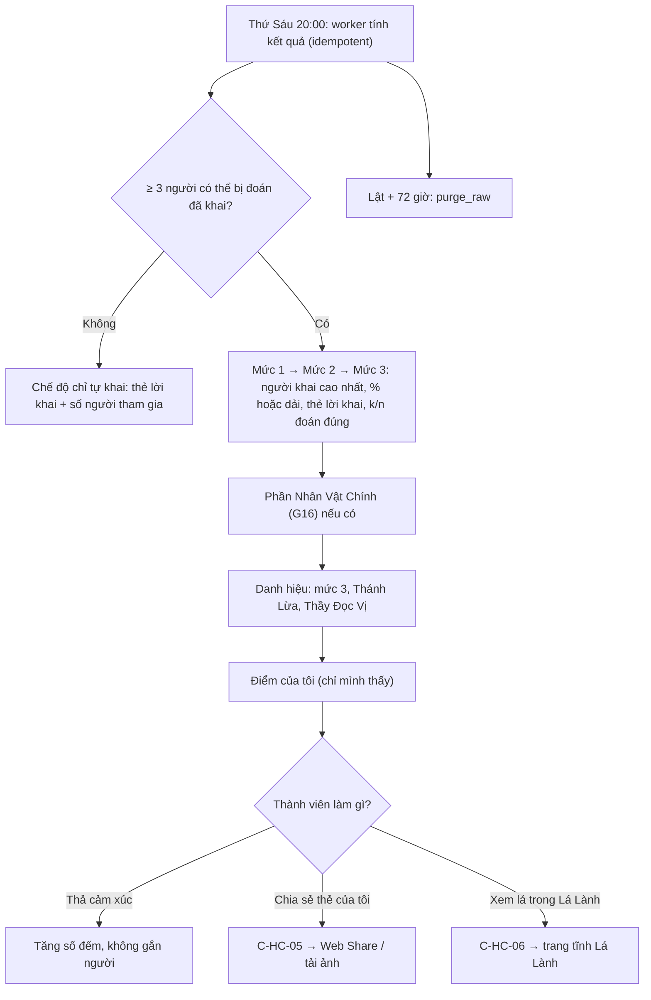

# G13 — Hết Cứu %: màn lật tối thứ Sáu

> Nguồn: [PRD](../../foundation/game-line/het-cuu-phan-tram-prd.md) §4.3–4.4, §5.4, §8 · [SRS](../../foundation/game-line/het-cuu-phan-tram-srs.md)
> HC-FR-23–34, §4.2. D3 và HC-D3 là **đề xuất — chờ owner**. Phần Nhân Vật Chính thuộc G16.

## 1. User story

Là thành viên nhóm, tôi muốn tối thứ Sáu xem ai khai cao nhất ở từng mức, ai lừa được cả hội, mình đoán trúng bao nhiêu, để cả nhóm cười cùng nhau
mà không ai thấy mình bị đem ra xếp hạng.

## 2. Mục tiêu và ranh giới

**Mục tiêu:** màn lật có nhịp (mức 1 → mức 2 → mức 3 → danh hiệu); chỉ lộ đúng những gì luật cần; số thô xoá sau 72 giờ.

**Trong phạm vi:** tính kết quả lúc 20:00; chấm điểm; lừa cả hội; huỷ phiếu không hợp lệ; chế độ chỉ tự khai; hiện mức, thẻ lời khai, danh hiệu; điểm riêng của mình;
thả cảm xúc; chia sẻ thẻ danh hiệu của mình; cầu nối "lá của tuần" sang Lá Lành; xoá số thô sau 72 giờ.

**Ngoài phạm vi:** màn ba nhịp Nhân Vật Chính và Đọc vị (G16); khoảnh khắc mùa (G14); báo cáo (G15).

## 3. Actor, điều kiện và output

- **Actor:** worker lịch; thành viên.
- **Điều kiện:** sự kiện `locked`.
- **Output:** `hc_event_result`; `hc_moment` cho danh hiệu; `hc_reaction_count`; sau 72 giờ: số thô bị xoá.

## 4. Luồng

## 5. UI/UX và trạng thái

| Nhịp | Nội dung (nháp PRD §5.4) |
|---|---|
| Mở đầu | Tranh sự kiện + "Lật thôi!" ; nút "Xem từng mức" (không tự chạy nếu bật giảm chuyển động) |
| Mỗi mức | "Mức 3 · hết cứu: người khai cao nhất là **{biệt danh}** với **{%}**" hoặc "… với mức **cao**"; thẻ lời khai đọc to; "{k}/{n} người đoán đúng" |
| Lừa cả hội | "**{biệt danh}** khai cao nhất mà chỉ {k}/{n} người đoán ra. Thánh Lừa tuần này." |
| Danh hiệu | Thẻ "siêu năng lực" cho từng danh hiệu; hoà thì nhiều biệt danh cùng thẻ |
| Của tôi | "Bạn được {x} điểm tuần này" + chi tiết phiếu của chính mình; nút "Chia sẻ thẻ của tôi" chỉ hiện nếu mình có danh hiệu |
| Cảm xúc | 6 emoji soạn sẵn với số đếm |
| Lá của tuần | "Lá của tuần: The Fool, lá của người dám bước vào chuyện lạ." + "Xem lá này trong Lá Lành" |
| Sau 72 giờ | "Số liệu tuần này đã được xoá. Danh hiệu vẫn còn trong tổng kết mùa." |

Không có danh sách điểm của mọi người, không có hạng, không có "người đoán tệ nhất", không có "ai đoán ai". Trạng thái theo SRS §4.2 (màn lật).

## 6. Quy tắc nghiệp vụ

HC-FR-23–34. Dải ẩn %: `cao` ≥ 70, `vừa` 35–65, `thấp` ≤ 30. Lừa cả hội cần ≥ 3 người đoán mức đó. Điểm sự kiện sàn 0.

## 7. Tiêu chí chấp nhận

- **G13-AC01:** Given đồng hồ giả thứ Sáu 20:00, When worker chạy hai lần, Then chỉ có một `hc_event_result`; trang lật đọc kết quả đã lưu và sẵn sàng ≤ 60 giây sau 20:00.
- **G13-AC02:** Given bảng kịch bản chấm điểm (đúng/sai, nhiều mức, hoà cao nhất), Then điểm khớp HC-FR-26 cho mọi dòng; hoà thì phiếu trúng bất kỳ người hoà nào đều đúng.
- **G13-AC03:** Given 6 người đoán mức 3 và X khai cao nhất, When 2 người đoán X, Then X được +3 "Lừa cả hội"; When 3 người đoán X, Then không được; Given chỉ 2 người đoán mức đó, Then không ai được "Lừa cả hội".
- **G13-AC04:** Given tổng điểm âm, Then điểm sự kiện hiện 0; Given hai người cùng điểm cao nhất > 0, Then cả hai nhận Thầy Đọc Vị; Given mọi người điểm 0, Then không trao Thầy Đọc Vị.
- **G13-AC05:** Given thành viên A, When gọi API màn lật, Then phản hồi chỉ có điểm và phiếu của A; không có điểm, phiếu, ước lượng hay % của thành viên khác ngoài người khai cao nhất từng mức (kiểm cả JSON và DOM).
- **G13-AC06:** Given người khai cao nhất mức 2 bật "ẩn %" với 85%, Then màn lật hiện "mức cao" và không có số 85 trong phản hồi API.
- **G13-AC07:** Given chỉ 2 thành viên có thể bị đoán đã khai, Then màn lật ở chế độ chỉ tự khai: hiện thẻ lời khai không gắn tên, số người tham gia, không điểm, không danh hiệu ngoài "Cả nhóm đã có mặt".
- **G13-AC08:** Given `prefers-reduced-motion`, Then các mức hiện tĩnh, chuyển bằng nút; đọc màn hình đọc đủ câu của từng mức.
- **G13-AC09:** Given lật lúc T, When đồng hồ giả tới T + 72 giờ + 15 phút, Then `hc_claim`, `hc_alibi`, `hc_guess`, `hc_participation_flags`, `hc_reaction_count` và phần số của `hc_event_result` của sự kiện đều 0 dòng; `hc_moment` còn; biên nhận job ghi số dòng không ghi định danh.
- **G13-AC10:** Given thành viên có danh hiệu bấm chia sẻ, Then màn C-HC-05 hiện trước; ảnh chỉ chứa biệt danh của chính họ, danh hiệu, tên sự kiện, lá của tuần; không chứa link mời, mã nhóm, QR có token hay biệt danh người khác.
- **G13-AC11:** Given thả cảm xúc, Then chỉ `hc_reaction_count` tăng; không có bản ghi gắn `member_id`.
- **G13-AC12:** Given bấm "Xem lá này trong Lá Lành", Then màn C-HC-06 hiện; link đích không có tham số nào ngoài mã lá công khai, mở với `noopener noreferrer`, và không request nào từ Lá Úp tới Lá Lành mang dữ liệu game.
- **G13-AC13:** Given mọi kịch bản test, Then không có danh hiệu nào thuộc danh sách tiêu cực (thấp nhất, tệ nhất, thua) được tạo.

## 8. Edge case

| Tình huống | Xử lý |
|---|---|
| Worker lật lỗi | Thử lại mỗi 5 phút; quá 24 giờ thì bỏ lật, xoá số thô ngay, hiện lời xin lỗi (SRS §10) |
| Người khai cao nhất rời nhóm trước 20:00 | Dữ liệu của họ đã xoá; người cao kế tiếp thành cao nhất; phiếu đoán họ bị huỷ |
| Mọi người khai 0% ở một mức | Mọi người hoà cao nhất ở 0%; mức đó hiện "Cả nhóm đồng lòng: 0%" và không chấm điểm mức đó |
| Một người bật "đừng đoán tôi" sau khi khoá | Không được (khoá); chỉ rời nhóm hoặc báo cáo |
| Mở màn lật sau 72 giờ | Hiện câu "đã được xoá"; danh hiệu xem ở tổng kết mùa |

## 9. Definition of Done

- G13-AC01–AC13 có test; T-HC-06, T-HC-09, T-HC-10, T-HC-18 xanh.
- Owner duyệt chữ màn lật, danh hiệu, câu lá của tuần (không câu dự đoán) và chốt HC-D3.
- Bảo mật: kiểm quyền theo phiên; không lộ dữ liệu người khác trong JSON/DOM; không P0/P1.
- Quyền riêng tư: job `purge_raw` có biên nhận và báo động khi trễ; DPIA ghi `hc_event_result` và `hc_reaction_count`; chính sách quyền riêng tư nói "số liệu xoá sau
  72 giờ, danh hiệu giữ tới hết mùa + 30 ngày"; thẻ chia sẻ được khai là do người dùng chủ động chia sẻ.
- Codex `APPROVE @ <SHA>` khớp head.

## 10. Bàn giao theo AGENTS.md

Nguồn: báo cáo (màn lật, chấm điểm), research note (Gas "God Mode"), PRD/SRS. Phát hiện đã sửa: chỉ lộ % của người khai cao nhất; không lộ ai đoán ai; bỏ "lá đã
báo trước"; chỉ chia sẻ thẻ của chính mình. Rủi ro mở: D3 chưa chốt. AC/DoD chưa xong: toàn bộ.
