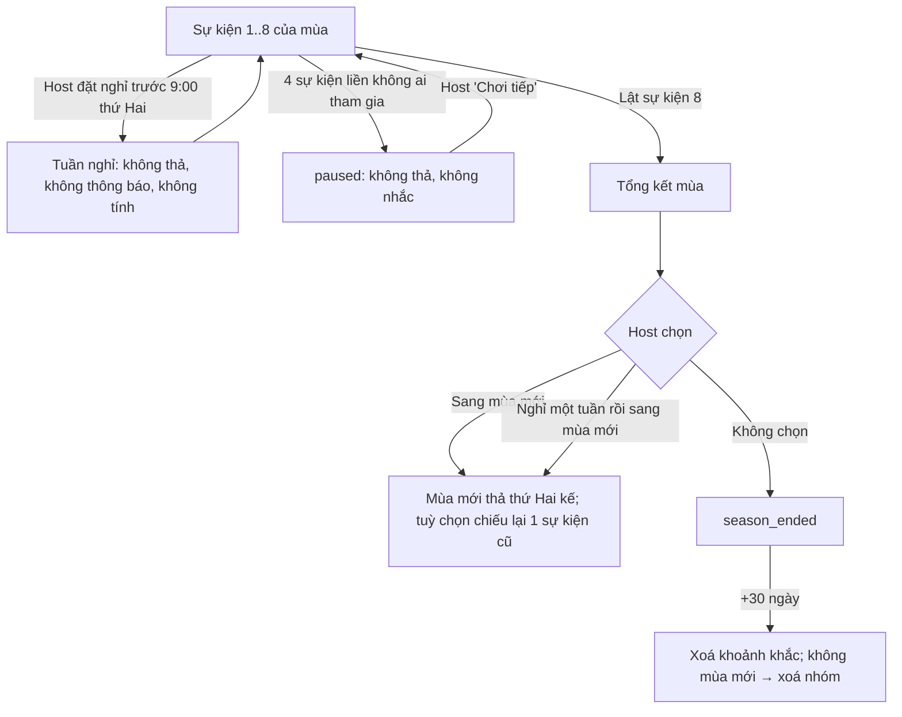

# G14 — Hết Cứu %: mùa 8 tuần, tuần nghỉ và tổng kết mùa

> Nguồn: [PRD](../../foundation/game-line/het-cuu-phan-tram-prd.md) §4.5, D3, HC-D4 · [SRS](../../foundation/game-line/het-cuu-phan-tram-srs.md) HC-FR-41–45.
> D3 và HC-D4 là **đề xuất — chờ owner**.

## 1. User story

Là thành viên nhóm, sau 8 tuần tôi muốn xem lại những danh hiệu và khoảnh khắc buồn cười nhất của nhóm, rồi cả nhóm chọn nghỉ hay sang mùa mới,
mà không có bảng điểm ai hơn ai và không bị nhắc khi nhóm muốn nghỉ.

## 2. Mục tiêu và ranh giới

**Mục tiêu:** có một cái kết cho nhịp tuần; cho nhóm nghỉ không bị phạt; dữ liệu mùa có hạn rõ ràng.

**Trong phạm vi:** đếm sự kiện của mùa; host đặt nghỉ tuần; tự tạm dừng khi nhóm im 4 sự kiện; trang tổng kết mùa; sang mùa mới; chiếu lại một sự kiện cũ; xoá khoảnh
khắc sau mùa + 30 ngày; xoá nhóm khi không có mùa mới.

**Ngoài phạm vi:** quyết định giữ khoảnh khắc của Nhân Vật Chính (G16); điểm cộng dồn (không có, D3); thông báo (G15).

## 3. Actor, điều kiện và output

- **Actor:** host; thành viên; worker.
- **Output:** `hc_group.season_no`, `season_event_count`, `status`, `season_ended_at`; trang tổng kết đọc `hc_moment`.

## 4. Luồng

## 5. UI/UX và trạng thái

| Màn | Nội dung |
|---|---|
| Nhà của nhóm | "Tuần {k}/8 của mùa {m}". Không có "chuỗi", không có ngọn lửa, không đếm tuần đã bỏ |
| Nghỉ tuần (host) | "Cho nhóm nghỉ tuần tới?" → "Tuần tới không có sự kiện. Không ai bị nhắc." |
| Tạm dừng | "Nhóm đang nghỉ. Host bấm Chơi tiếp khi cả nhóm muốn." |
| Tổng kết mùa | Dòng thời gian 8 tuần: tên sự kiện + danh hiệu tuần đó; khối "Khoảnh khắc hết cứu nhất" chỉ khi có khoảnh khắc NVC được giữ; không tổng điểm, không đếm danh hiệu theo người |
| Cuối trang | "Mùa này giữ tới {ngày}. Sau đó danh hiệu được xoá." + nút host |
| Chiếu lại | Host chọn một sự kiện cũ; màn lật sau đó có dòng "Mùa trước: {khoảnh khắc đã giữ}" nếu có, nếu không thì không so |

Trạng thái theo SRS §4.2 (tổng kết mùa).

## 6. Quy tắc nghiệp vụ

HC-FR-41–45. Khoảnh khắc chỉ là danh hiệu + biệt danh (và số NVC nếu người đó đã giữ). Không so với số thô của mùa trước, vì số thô đã xoá sau 72 giờ.

## 7. Tiêu chí chấp nhận

- **G14-AC01:** Given host đặt nghỉ trước thứ Hai 9:00, Then tuần đó không có `hc_event`, không thông báo, và `season_event_count` không tăng; đặt sau 9:00 bị từ chối cho tuần hiện tại.
- **G14-AC02:** Given 4 sự kiện liên tiếp không ai tham gia, Then nhóm chuyển `paused`, không thả đề, không gửi thông báo hay tin nhắc nào; host bấm "Chơi tiếp" thì thứ Hai kế thả đề.
- **G14-AC03:** Given trang tổng kết mùa, When kiểm API và DOM, Then không có tổng điểm, thứ hạng, số danh hiệu theo người hay bất kỳ phép cộng nào qua nhiều sự kiện.
- **G14-AC04:** Given host chiếu lại sự kiện cũ, Then sự kiện mới thu tự khai mới; màn lật chỉ hiện so sánh với khoảnh khắc đã giữ có đồng ý; không có truy vấn nào đọc số thô của mùa trước.
- **G14-AC05:** Given `season_ended_at` = T, When đồng hồ giả tới T + 30 ngày + 24 giờ, Then mọi `hc_moment` của mùa đó đã xoá.
- **G14-AC06:** Given không có mùa mới trong 30 ngày sau T, Then `hc_group`, `hc_member`, `hc_invite`, `hc_push_subscription` của nhóm đều đã xoá; Given mùa mới bắt đầu trong 30 ngày, Then nhóm và thành viên còn, chỉ khoảnh khắc mùa cũ bị xoá ở T + 30 ngày.
- **G14-AC07:** Given trang nhà của nhóm sau một tuần nhóm không chơi, Then không có câu nào đếm tuần bỏ lỡ hoặc thúc quay lại (đối chiếu nguyên tắc `growth.test.ts`).

## 8. Edge case

| Tình huống | Xử lý |
|---|---|
| Nhóm tụt dưới 4 người giữa mùa | Không thả đề (G11) nhưng không tính là "không ai tham gia"; mùa giữ nguyên |
| Host vắng khi mùa kết thúc | Thành viên nhận vai host theo G10 rồi chọn |
| Thành viên rời nhóm | Khoảnh khắc mang biệt danh họ bị xoá ngay (G15), tổng kết hiện "—" ở tuần đó |
| Owner gỡ một sự kiện khỏi ngân hàng | Khoảnh khắc cũ vẫn hiện tên sự kiện theo `bank_version` đã lưu |

## 9. Definition of Done

- G14-AC01–AC07 có test; T-HC-08, T-HC-15 xanh.
- Owner chốt D3 (không bảng điểm mùa) và HC-D4 (vòng đời nhóm).
- Quyền riêng tư: `purge_moments`, `purge_groups` có biên nhận; DPIA và chính sách quyền riêng tư ghi "danh hiệu giữ tới hết mùa + 30 ngày; nhóm xoá nếu không có mùa mới".
- Bảo mật: chỉ host đổi trạng thái mùa; không P0/P1.
- Codex `APPROVE @ <SHA>` khớp head.

## 10. Bàn giao theo AGENTS.md

Nguồn: báo cáo (mùa 8 tuần, tổng kết), plan 23/10 (không streak/coin/XP), `growth.test.ts`. Phát hiện đã sửa: bỏ bảng điểm mùa; chiếu lại không dùng số thô.
Rủi ro mở: HC-D4 chưa có trong hợp đồng dữ liệu chung. AC/DoD chưa xong: toàn bộ.
