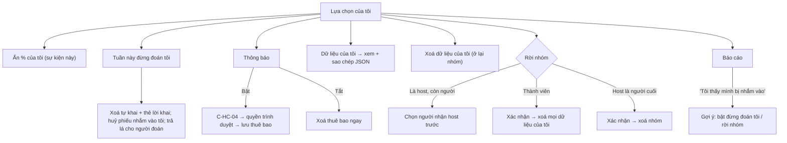

# G15 — Hết Cứu %: lựa chọn riêng tư của tôi (ẩn %, đừng đoán tôi, thông báo, rời nhóm, xoá, báo cáo)

> Nguồn: [PRD](../../foundation/game-line/het-cuu-phan-tram-prd.md) §2.3, §9, HC-D2 · [SRS](../../foundation/game-line/het-cuu-phan-tram-srs.md)
> HC-FR-46–56, §8, §9. Trạng thái: nháp, chờ owner và luật sư duyệt chữ.

## 1. User story

Là thành viên nhóm, tôi muốn tự quyết phần nào của mình được lộ ra, có thể xin không bị đoán trong một tuần, chọn nhận hay không nhận thông báo,
rời nhóm và xoá dữ liệu của mình bất cứ lúc nào, để trò vui không bao giờ thành chuyện khó chịu.

## 2. Mục tiêu và ranh giới

**Mục tiêu:** mọi lối thoát ở trong tầm một chạm từ màn tự khai và nhà của nhóm; rút lại dễ như đồng ý.

**Trong phạm vi:** "Ẩn % của tôi"; "Tuần này đừng đoán tôi"; bật/tắt thông báo (C-HC-04); rời nhóm; xoá dữ liệu của tôi; xem dữ liệu của tôi; báo cáo và gợi ý sau
báo cáo "bị nhắm vào"; host phải chuyển host trước khi rời.

**Ngoài phạm vi:** host gỡ người khác (G10); rút lui khỏi ghế NVC và bỏ giữ khoảnh khắc (G16); chặn một người cụ thể (không có chữ tự do hay nhắn tin nên không cần ở MVP;
xem rủi ro).

## 3. Actor, điều kiện và output

- **Actor:** thành viên; host (khi rời).
- **Output:** cờ trên `hc_claim`/`hc_participation_flags`; xoá bản ghi; `hc_push_subscription`; `hc_report`.

## 4. Luồng

## 5. UI/UX và trạng thái

| Thành phần | Chữ (nháp) |
|---|---|
| Ẩn % | "Ẩn % của tôi tuần này. Nếu bạn khai cao nhất, nhóm chỉ thấy mức cao, vừa hay thấp." |
| Đừng đoán tôi | "Tuần này đừng đoán tôi. Bạn không cần khai %, không ai đoán được bạn, và bạn vẫn đoán người khác được." Xác nhận nếu đã khai: "% bạn đã khai tuần này sẽ bị xoá." |
| Thông báo | Màn C-HC-04 (SRS §8.2); trạng thái hiện tại "Đang nhận: khi lật kết quả" + nút "Tắt" |
| Dữ liệu của tôi | Danh sách mọi trường đang lưu, thời hạn xoá của từng nhóm dữ liệu, nút "Sao chép" |
| Xoá dữ liệu của tôi | "Xoá câu trả lời tuần này và danh hiệu mang biệt danh của bạn? Bạn vẫn ở trong nhóm." |
| Rời nhóm | "Rời nhóm và xoá mọi dữ liệu của bạn trong nhóm? Việc này không hoàn tác." Nút đỏ "Rời và xoá" / "Ở lại" cùng kích thước |
| Báo cáo | 4 lựa chọn cố định, không ô chữ; sau khi gửi: "Cảm ơn bạn. Lá Úp sẽ xem lại đề này." |

Không có hộp thoại níu kéo kiểu "Bạn chắc chứ? Cả nhóm sẽ buồn". Trạng thái lỗi/offline: nút bị khoá khi offline, lỗi có "Thử lại".

## 6. Quy tắc nghiệp vụ

HC-FR-46–56. Quy tắc thông báo ở SRS §9. Báo cáo không lưu người báo cáo; báo cáo biệt danh báo cho host không lộ người báo cáo.

## 7. Tiêu chí chấp nhận

- **G15-AC01:** Given bật "Ẩn % của tôi" trước khi khoá, Then `hide_pct = true` cho sự kiện; màn lật chỉ có dải (kiểm theo G13-AC06); sự kiện sau mặc định tắt.
- **G15-AC02:** Given đã khai rồi bật "Đừng đoán tôi", Then `hc_claim` và `hc_alibi` của người đó cho sự kiện bị xoá trong cùng giao dịch, họ biến khỏi danh sách có thể bị đoán, và không nhận danh hiệu mức 3.
- **G15-AC03:** Given B đã đặt 2 lá đoán A ở mức 1, When A bật "Đừng đoán tôi", Then phiếu của B bị huỷ, B có lại 2 lá, và B thấy "Một phiếu của bạn không còn hợp lệ, lá đã trả lại" (không nêu tên A).
- **G15-AC04:** Given thành viên rời nhóm, When đếm dòng trước/sau, Then không còn `hc_member`, `hc_claim`, `hc_alibi`, `hc_guess` (do họ tạo), `hc_participation_flags`, `hc_moment` mang `member_id` của họ, hay `hc_push_subscription` của họ trong nhóm.
- **G15-AC05:** Given "Xoá dữ liệu của tôi", Then câu trả lời sự kiện đang mở và khoảnh khắc của họ bị xoá; biệt danh và tư cách thành viên còn.
- **G15-AC06:** Given "Dữ liệu của tôi", Then màn hiện đúng các trường SRS §8.1 đang lưu về người đó trong nhóm, không có dữ liệu của người khác, và bản JSON khớp màn hình.
- **G15-AC07:** Given thành viên mới, Then thông báo tắt; ô trong C-HC-04 không tick sẵn; `Notification.requestPermission()` chỉ gọi sau khi tick và bấm "Bật thông báo" trong cùng thao tác.
- **G15-AC08:** Given đồng hồ giả chạy 4 tuần, Then mỗi thành viên nhận ≤ 1 thông báo mỗi tuần mỗi nhóm, đúng loại đã chọn; tuần nghỉ và nhóm `paused` nhận 0.
- **G15-AC09:** Given thông báo được gửi, Then payload đúng một trong hai câu cố định ở HC-FR-55, không biệt danh, không số, không token; Given dịch vụ đẩy trả 404/410, Then thuê bao bị xoá.
- **G15-AC10:** Given chạy bộ test G15, When quét log, Then không có endpoint đẩy, khoá `p256dh`/`auth`, biệt danh, % hay token.
- **G15-AC11:** Given gửi báo cáo, Then `hc_report` không có trường người báo cáo; báo cáo "biệt danh không phù hợp" hiện cho host là "Có người báo cáo biệt danh {X}"; ≥ 2 báo cáo "khó chịu/bị nhắm vào" từ ≥ 2 nhóm trong tuần làm đề đó bị gỡ khỏi lượt chọn (HC-FR-61).
- **G15-AC12:** Given gửi báo cáo "Tôi thấy mình bị nhắm vào", Then ngay sau đó hiện hai nút "Bật đừng đoán tôi cho tuần này" và "Rời nhóm".
- **G15-AC13:** Given host còn thành viên khác bấm rời, Then phải chọn người nhận host trước; Given host là thành viên cuối, Then rời = xoá nhóm và mọi bản ghi của nhóm.

## 8. Edge case

| Tình huống | Xử lý |
|---|---|
| Bật "đừng đoán tôi" sau khi khoá | Không cho; gợi ý báo cáo hoặc rời nhóm |
| Rời nhóm khi đang là NVC | Phần NVC bị bỏ, ước lượng về họ bị xoá (G16) |
| Người dùng chặn quyền thông báo ở trình duyệt | Lá Úp không hỏi lại; hiện cách bật trong cài đặt trình duyệt; không lưu thuê bao |
| iPhone chưa thêm vào Màn hình chính | C-HC-04 nói rõ; nút "Bật thông báo" dẫn tới hướng dẫn thêm vào Màn hình chính |
| Một người bị cả nhóm "nhắm" qua đoán | Không có chữ tự do nên không có lời xúc phạm; người đó dùng "đừng đoán tôi" / rời; báo cáo để owner rà đề |

## 9. Definition of Done

- G15-AC01–AC13 có test; T-HC-12–14, T-HC-16 xanh.
- Owner và luật sư duyệt chữ C-HC-04, rời nhóm, xoá, báo cáo; owner chốt HC-D2.
- Quyền riêng tư: luồng xoá được đối chiếu với DPIA; dịch vụ đẩy của hãng trình duyệt được ghi là bên nhận trong data map và chính sách quyền riêng tư; nếu gói vào app
  thì Apple App Privacy/Google Data safety khai "mã thiết bị cho thông báo", không theo dõi.
- Bảo mật: CSRF + Origin cho mọi thao tác; xoá trong giao dịch; không P0/P1.
- Trợ năng: công tắc có nhãn và trạng thái đọc được; xác nhận xoá không chỉ dựa vào màu.
- Codex `APPROVE @ <SHA>` khớp head.

## 10. Bàn giao theo AGENTS.md

Nguồn: báo cáo (ẩn %, đừng đoán tôi, Gas), SRS §8–9, WebKit (web push chỉ trên Màn hình chính). Phát hiện đã sửa: "đừng đoán tôi" không thu %; rời nhóm xoá cả khoảnh khắc
và thuê bao. Rủi ro mở: không có nút chặn người cụ thể (Apple 1.2 đòi khi có UGC; ở đây UGC chỉ là biệt danh, cần luật sư/owner xác nhận); không xác minh được quyền
chủ thể ngoài phiên thiết bị. AC/DoD chưa xong: toàn bộ.
