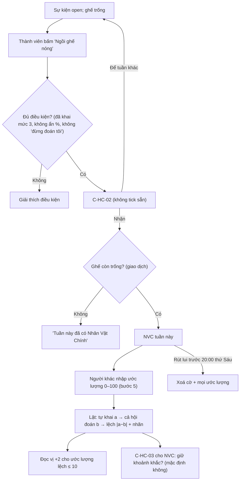

# G16 — Hết Cứu %: Nhân Vật Chính tự nguyện và màn ba nhịp

> Nguồn: [PRD](../../foundation/game-line/het-cuu-phan-tram-prd.md) §4.2–4.4, D8, HC-D1 · [SRS](../../foundation/game-line/het-cuu-phan-tram-srs.md)
> HC-FR-35–40, §8.2 (C-HC-02, C-HC-03). D8 là **đề xuất — chờ owner**: chỉ người tự nguyện.

## 1. User story

Là thành viên thích làm trò, tôi muốn tự nguyện ngồi "ghế nóng" một tuần để cả nhóm đoán tôi khai bao nhiêu % ở mức hết cứu, rồi cùng cười ở màn
"Bạn tự khai 5%… cả hội đoán 92%… lệch 87". Là thành viên khác, tôi muốn đoán con số đó để thử tài đọc vị.

## 2. Mục tiêu và ranh giới

**Mục tiêu:** khoảnh khắc cười to nhất của tuần, nhưng chỉ xảy ra với người đã đồng ý rõ ràng và rút lui được tới phút chót.

**Trong phạm vi:** nhận ghế (C-HC-02); điều kiện và xoay vòng; ước lượng của người khác; rút lui; màn ba nhịp; điểm Đọc vị; danh hiệu Hết Cứu; hỏi giữ khoảnh khắc (C-HC-03).

**Ngoài phạm vi:** chỉ định NVC; NVC bắt buộc; chú thích chiêm tinh cá nhân cho NVC (HC-D1, không làm trong Lá Úp); bình luận về NVC.

## 3. Actor, điều kiện và output

- **Actor:** thành viên tình nguyện (NVC); các thành viên khác.
- **Điều kiện tình nguyện:** sự kiện `open`; đã khai mức 3; không bật "ẩn %" hay "đừng đoán tôi".
- **Output:** `hc_participation_flags.nvc_volunteer`; `hc_guess` loại `nvc_estimate`; phần `nvc` trong `hc_event_result`; `hc_moment` loại `het_cuu` (chỉ khi giữ).

## 4. Luồng

## 5. UI/UX và trạng thái

| Màn | Nội dung (nháp) |
|---|---|
| Lời mời trên thẻ sự kiện | "Ghế nóng tuần này đang trống. Ai muốn để cả nhóm đoán % mức 3 của mình?" |
| Đã có NVC | "{biệt danh} đang ngồi ghế nóng. Đoán xem {biệt danh} khai bao nhiêu % ở mức hết cứu." + thanh trượt ước lượng |
| NVC thấy | "Bạn đang ngồi ghế nóng. [Rút lui]" — rút lui không hỏi lý do |
| Màn ba nhịp | Ba khung lần lượt: "{biệt danh} tự khai **{a}%**…" → "cả hội đoán **{b}%**…" → "lệch **{d}**: HẾT CỨU / Cứu được chút / Tự biết mình ghê". Giảm chuyển động: hiện cả ba cùng lúc |
| Thiếu ước lượng | "Chưa đủ người đoán, ghế nóng để tuần sau." |
| Sau lật (chỉ NVC) | C-HC-03 |

## 6. Quy tắc nghiệp vụ

HC-FR-35–40. Xoay vòng: người làm NVC sự kiện trước không nhận được nếu trong 24 giờ đầu của cửa sổ có thành viên khác chưa từng làm NVC trong mùa đã bấm tình nguyện;
sau 24 giờ ai cũng nhận được. "Cả hội đoán" = trung bình ước lượng, làm tròn tới số nguyên. Cần ≥ 3 ước lượng.

## 7. Tiêu chí chấp nhận

- **G16-AC01:** Given thành viên chưa khai mức 3, hoặc bật "ẩn %", hoặc bật "đừng đoán tôi", When bấm nhận ghế, Then bị từ chối kèm giải thích; Given đủ điều kiện, Then C-HC-02 hiện với ô không tick sẵn và nút "Nhận ghế nóng" bị khoá tới khi tick.
- **G16-AC02:** Given hai thành viên gửi nhận ghế cùng lúc, Then đúng một người thành NVC; người kia thấy "Tuần này đã có Nhân Vật Chính".
- **G16-AC03:** Given có NVC, Then mọi thành viên khác (không phải NVC) nhập được ước lượng bội số 5 trong [0,100]; NVC không thấy ước lượng của ai trước màn lật; ước lượng xoá cùng số thô (lật + 72 giờ).
- **G16-AC04:** Given NVC rút lui lúc 19:59 thứ Sáu, Then cờ NVC và mọi `nvc_estimate` của sự kiện bị xoá ngay và màn lật không có phần NVC; rút lui sau 20:00 bị từ chối.
- **G16-AC05:** Given chỉ 2 ước lượng, Then màn lật hiện "Chưa đủ người đoán, ghế nóng để tuần sau", không tiết lộ a.
- **G16-AC06:** Given a = 5 và ước lượng 90, 95, 90, Then b = 92, lệch 87, nhãn "HẾT CỨU", NVC nhận danh hiệu Hết Cứu; Given lệch 20 thì nhãn "Cứu được chút"; lệch 19 thì "Tự biết mình ghê".
- **G16-AC07:** Given ước lượng lệch đúng 10 so với a, Then người đó +2 Đọc vị; lệch 15 thì không.
- **G16-AC08:** Given NVC không trả lời C-HC-03 trong 72 giờ hoặc bấm lưu khi ô chưa tick, Then không có `hc_moment` loại `het_cuu` chứa số; Given tick và lưu, Then khoảnh khắc chứa a, b; bỏ giữ sau đó thì số bị xoá ngay.
- **G16-AC09:** Given A làm NVC sự kiện trước và B (chưa làm NVC trong mùa) bấm tình nguyện trong 24 giờ đầu, Then A không nhận được ghế sự kiện này; không có API hay nút nào cho phép một người chỉ định người khác làm NVC.

## 8. Edge case

| Tình huống | Xử lý |
|---|---|
| NVC sửa % mức 3 sau khi nhận ghế | Được sửa tới khi khoá; màn lật dùng số cuối |
| NVC rời nhóm | Như rút lui; dữ liệu xoá theo G15 |
| NVC bật "ẩn %" sau khi nhận | Không cho; phải rút lui trước |
| Nhóm 4 người, NVC + 3 người, một người không đoán | < 3 ước lượng → bỏ phần NVC (AC05) |
| Không ai tình nguyện cả mùa | Bình thường; màn lật không có phần NVC |

## 9. Definition of Done

- G16-AC01–AC09 có test; T-HC-11 xanh.
- Owner chốt D8 và duyệt chữ C-HC-02, C-HC-03, ba nhãn lệch; luật sư xem C-HC-02 (đồng ý công khai một con số tự khai).
- Quyền riêng tư: đồng ý `hc-nvc-v1`, `hc-moment-v1` lưu kèm phiên bản và thời điểm; DPIA ghi khoảnh khắc NVC và thời hạn.
- Bảo mật: khoá giao dịch khi nhận ghế; không lộ ước lượng của từng người; không P0/P1.
- Codex `APPROVE @ <SHA>` khớp head.

## 10. Bàn giao theo AGENTS.md

Nguồn: báo cáo (Nhân Vật Chính, D8, màn ba nhịp), research note (Vazire, vi phạm lành tính). Phát hiện đã sửa: không chú thích chiêm tinh cá nhân trong Lá Úp (HC-D1);
khoảnh khắc NVC chỉ giữ khi đồng ý; rút lui xoá ngay ước lượng. Rủi ro mở: con số tự khai bị cả nhóm nhìn thấy có thể bị đem ra trêu ngoài trò (người dùng chụp màn hình),
Lá Úp không kiểm soát được. AC/DoD chưa xong: toàn bộ.
