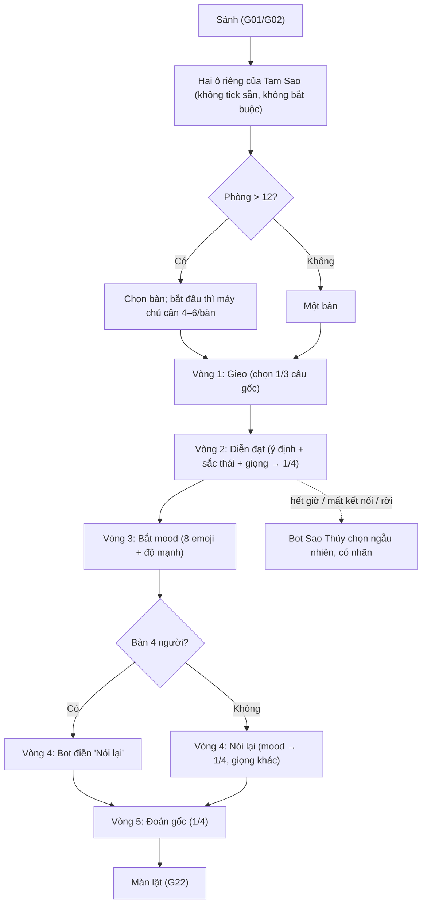

# G20 — Tam Sao Thất Bản: chơi một ván phòng trực tiếp với chuỗi song song

> Nguồn: [PRD](../../foundation/game-line/tam-sao-that-ban-prd.md) §4.1 · [SRS](../../foundation/game-line/tam-sao-that-ban-srs.md) TS-FR-01–14, §8.2.
> Dùng hạ tầng phòng chung: tạo phòng, màn chiếu, vào phòng, mất kết nối thuộc G01, G02, G09 (`shared-room-platform-srs.md`). Story này chỉ có phần riêng của Tam Sao.
> TS-D3, TS-D5 là **đề xuất — chờ owner**.

## 1. User story

Là lớp trưởng hoặc trưởng nhóm có một màn hình chung, tôi muốn mở một ván Tam Sao Thất Bản để mọi người dùng điện thoại chuyền câu cùng lúc, ai cũng luôn có việc để làm,
không ai phải gõ chữ, để sau khoảng 10 phút cả phòng có màn lật để cười.

## 2. Mục tiêu và ranh giới

**Mục tiêu:** không ai phải chờ; mỗi người chỉ thấy một mảnh; ván không bao giờ kẹt vì một người.

**Trong phạm vi:** cấu hình riêng (giọng, đọc to, nhịp); hai ô biệt danh của Tam Sao lúc vào phòng; chia bàn; 5 bước; xoay vòng; đồng hồ bước; Bot Sao Thủy; bàn 4 người; người vào
muộn làm khán giả; người rời giữa ván; tách thông tin giữa các điện thoại.

**Ngoài phạm vi:** màn lật, bỏ phiếu, thẻ lật (G22); ghép phương án và ngân hàng (G23); nút host chi tiết (G24, RP G06); tiêu huỷ (G25, RP G07); bản chat (G21).

## 3. Actor, điều kiện và output

- **Actor:** host; người chơi (4–30); khán giả; Bot Sao Thủy.
- **Điều kiện:** phòng Tam Sao đã tạo theo G01; người chơi đã qua G02 với ô 18+.
- **Output:** `ts_chain` (N chuỗi mỗi bàn), `ts_hop` (5 bước mỗi chuỗi) trong kho trạng thái tạm thời của phòng.

## 4. Luồng

## 5. UI/UX và trạng thái

| Màn (điện thoại) | Nội dung |
|---|---|
| Bước 1 | "Chọn câu bạn muốn chuyền đi" + 3 thẻ câu; đồng hồ số + thanh |
| Bước 2 | Chip "Nhờ vả · hơi ngại" + "Giọng: Cô hàng xóm nhắn Zalo" + 4 nút phương án |
| Bước 3 | Câu bước 2 + vòng 8 emoji có nhãn chữ + 3 nấc độ mạnh. Nếu đọc to bật, người làm bước 2 thấy nhắc "Đọc to câu này cho người kế bên? (bỏ qua được)" |
| Bước 4 | "Mood: 😅 Ngại · mạnh 2" + "Giọng: Sếp gửi mail" + 4 nút |
| Bước 5 | Câu bước 4 + "Câu gốc là câu nào?" + 4 nút |
| Đã chọn | "Đã chọn. Chờ cả bàn…" (không hiện ai chưa chọn) |
| Bot điền | "Hết giờ. Sao Thủy đã điền giúp lượt này." |
| Khán giả | "Bạn đang xem. Tới màn lật bạn được bỏ phiếu." |

Màn chiếu trong lúc chơi: "Vòng {r}/5 · {bàn}" + đồng hồ + "đã chọn x/y" theo bàn; không hiện câu nào. Trạng thái lỗi/offline/kết thúc theo SRS §4.2 và RP-FR-90–95.

## 6. Quy tắc nghiệp vụ

TS-FR-01–14. Thời lượng nhịp thường 10/20/15/20/15 giây; nhịp chậm gấp đôi. Xoay vòng theo TS-FR-05: bước s của chuỗi j do người (j + o(s)) mod N; o = 0, 1, 2, 3, 4 khi N = 5–12; o = 0, 1, 2, Bot, 3 khi N = 4. Phòng ≤ 12 là một bàn; phòng > 12 chia bàn 4–6. Bảng ví dụ cho N = 4, 5, 6, 7, 12 ở SRS §3.1.1. Bất biến: không ai làm hai bước của cùng một chuỗi; người gieo không bao giờ đoán gốc.

## 7. Tiêu chí chấp nhận

- **G20-AC01:** Given trang vào phòng Tam Sao, Then ngoài ô 18+ của RP có đúng hai ô "Hiện biệt danh của tôi ở bước tôi đã chọn khi phát lại" và "Cho biệt danh của tôi nằm trên thẻ lật", đều không tick sẵn; không tick vẫn vào chơi được.
- **G20-AC02:** Given 27 người chơi tự chọn bàn lệch (ví dụ 15/8/4), When host bắt đầu, Then mọi bàn có 4–6 người, số người bị chuyển là nhỏ nhất, người chọn sớm hơn được giữ bàn.
- **G20-AC03:** Given bàn N từ 5 đến 12, Then sau 5 vòng mỗi chuỗi có 5 bước do 5 người khác nhau làm, và mỗi người làm đúng một bước ở mỗi vòng.
- **G20-AC04:** Given bàn 4 người, Then bước 4 của mọi chuỗi có `bot_filled = true`; chuỗi j đi qua người j, j+1, j+2, Bot, j+3 (đúng bảng N = 4 ở SRS §3.1.1); không ai làm hai bước một chuỗi.
- **G20-AC05:** Given người chơi chưa chọn khi hết giờ bước (+ 750 ms), Then Bot chọn một trong các phương án đang hiện cho người đó, bước ghi `bot_filled`, và người chơi thấy "Sao Thủy đã điền giúp".
- **G20-AC06:** Given người chơi rời hoặc bị kick ở vòng 2, Then các bước còn lại của họ do Bot điền, bước đã làm hiện "Người đã rời" khi lật, và biệt danh của họ bị xoá ngay theo RP-FR-82.
- **G20-AC07:** Given người làm bước 4, When kiểm mọi gói dữ liệu gửi tới điện thoại đó trong ván, Then chỉ có mood + độ mạnh của chuỗi đang làm và 4 phương án; không có câu gốc, câu bước 2 hay dữ liệu chuỗi khác; màn chiếu không nhận lựa chọn nào trước màn lật.
- **G20-AC08:** Given nhịp `chậm`, Then mọi thời lượng bước gấp đôi; Given host thêm 30 giây, Then cả vòng của bàn được cộng, tối đa 3 lần mỗi vòng.
- **G20-AC09:** Given đọc màn hình, Then mỗi phương án là một nút đọc đủ câu; mỗi emoji mood đọc nhãn chữ; đồng hồ có số đọc được; chữ phóng 200% không che nút.
- **G20-AC10:** Given bước 1, Then 3 câu gốc thuộc 3 ý định khác nhau, và khi ngân hàng đủ, không hai người cùng bàn nhận cùng một ý định ở chuỗi mình gieo.
- **G20-AC11:** Given người vào sau khi ván bắt đầu, Then chỉ vào được làm khán giả và không được giao bước nào.
- **G20-AC12:** Given đọc to bật, Then không có yêu cầu quyền micro hay camera nào, không có âm thanh nào được ghi hay gửi; bỏ qua nhắc không ảnh hưởng ván.
- **G20-AC13:** Given bàn N bất kỳ từ 4 đến 12 chơi hết 5 bước (test tối thiểu N = 4, 5, 6, 7, 12), When so người làm bước 5 với người gieo của từng chuỗi, Then không chuỗi nào có người gieo tự đoán gốc, và phân công khớp bảng SRS §3.1.1.

## 8. Edge case

| Tình huống | Xử lý |
|---|---|
| Bàn tụt từ 5 xuống 3 người giữa ván | Bot điền mọi bước thiếu; chuỗi vẫn lật; chỉ số ghi "Sao Thủy gánh" |
| Phòng chỉ 4 người, 1 người rời trước khi bắt đầu | Host không bắt đầu được (tối thiểu 4) |
| Hai tab cùng phiên | Phiên là một slot; lựa chọn nộp từ tab nào cũng là của slot đó, nộp lặp bị bỏ qua theo `cmd_id` |
| Màn chiếu mất kết nối | RP-FR-94: phòng tự tạm dừng |
| Ngân hàng thiếu câu cùng mood ở giọng V' | Lấy mood kề theo bảng (TS-FR-43) |

## 9. Definition of Done

- G20-AC01–AC13 có test; T-TS-01–04, T-TS-18 xanh; playtest giấy trực tiếp đã chạy và phân bố độ thất bản không dồn về 0–1.
- Owner chốt TS-D3, TS-D5 và duyệt chữ hai ô biệt danh; luật sư xem hai ô.
- Bảo mật: tách thông tin theo bước (test hợp đồng), kiểm `choice_id` thuộc phương án đã hiện, CSRF + Origin, giới hạn theo RP; không P0/P1.
- Quyền riêng tư: hai cờ biệt danh có trong DPIA §5.4; kho phòng không backup (RP-D3); chính sách quyền riêng tư nói rõ lựa chọn chỉ gắn tên khi đồng ý.
- Trợ năng: nhịp chậm; nhãn chữ cho emoji.
- Codex `APPROVE @ <SHA>` khớp head.

## 10. Bàn giao theo AGENTS.md

Nguồn: báo cáo (luật phòng trực tiếp), research note (Gartic, Jackbox), RP SRS. Phát hiện đã sửa: bàn 4 người; gắn tên vào bước cần đồng ý; đọc to không dùng micro. Rủi ro mở: độ trôi
của trắc nghiệm chưa kiểm chứng. AC/DoD chưa xong: toàn bộ.
