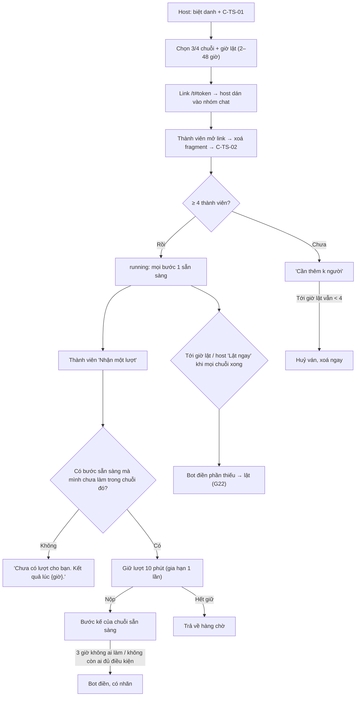

# G21 — Tam Sao Thất Bản: ván nhóm chat không đồng bộ với "nhận lượt"

> Nguồn: [PRD](../../foundation/game-line/tam-sao-that-ban-prd.md) §4.2 · [SRS](../../foundation/game-line/tam-sao-that-ban-srs.md) TS-FR-15–30, §5, §7, §8.2.
> **D4 — đề xuất, chờ owner:** story này chỉ dựng nếu playtest giấy đạt ≥ 70% chuỗi có ≥ 4 lượt người làm trước giờ lật và nhóm tự xin chơi lại. TS-D4 chờ owner.

## 1. User story

Là một nhóm bạn ở xa nhau, chúng tôi muốn chơi Tam Sao Thất Bản rải rác trong ngày qua một link gửi vào nhóm chat, ai rảnh lúc nào nhận lượt lúc đó, rồi tối cùng xem kết quả,
mà không ai phải chờ đúng một người.

## 2. Mục tiêu và ranh giới

**Mục tiêu:** chuỗi không bao giờ đứng vì một người; chờ có hẹn (giờ lật); khung chat chỉ mang link, một câu nhắc và thẻ lật.

**Trong phạm vi:** tạo ván; link năng lực; vào ván; ngưỡng 4 thành viên; hàng chờ và nhận lượt; giữ lượt 10 phút; hạn chót 3 giờ; Bot điền; nhóm 4 người; giờ lật và "Lật ngay"; câu
nhắc do host sao chép; thu hồi link; giới hạn số ván.

**Ngoài phạm vi:** màn lật và thẻ (G22); ghép phương án (G23); gỡ thành viên, đổi tên, kết thúc và xoá (G24, G25); thông báo đẩy (không có).

## 3. Actor, điều kiện và output

- **Actor:** host; thành viên (4–8); Bot Sao Thủy; worker.
- **Output:** `ts_async_game`, `ts_async_member`, `ts_chain` (3–4), `ts_hop`, `ts_claim` trong Supabase.

## 4. Luồng

## 5. UI/UX và trạng thái

| Màn | Nội dung |
|---|---|
| Tạo ván | Chọn 3/4 chuỗi; giờ lật dạng "Hôm nay 21:00" / "Mai 21:00" / tuỳ chọn trong 2–48 giờ |
| Link sẵn sàng | "Dán link này vào nhóm chat. Tối đa 8 người. Kết quả lúc {giờ}." Nút Chia sẻ / Sao chép |
| Nhà của ván | "{k}/{n} bước đã xong · Kết quả lúc {giờ}"; nút lớn "Nhận một lượt"; "Lượt bạn đã làm" chỉ hiện lựa chọn của mình |
| Đang giữ lượt | Màn bước như G20, đồng hồ 10 phút, nút "Thêm 10 phút" (một lần) |
| Host | Danh sách bước đang chờ quá 1 giờ, mỗi bước một nút "Sao chép câu nhắc" (dùng một lần); "Lật ngay" khi mọi chuỗi xong; "Thu hồi link" |

Không có ai-đã-làm-gì, không có "đang chờ Lan". Trạng thái theo SRS §4.2 (trang ván chat, đang giữ lượt).

## 6. Quy tắc nghiệp vụ

TS-FR-15–30. Mỗi chuỗi có một bước sẵn sàng tại một thời điểm; mỗi người tối đa một bước trong mỗi chuỗi và gieo tối đa một chuỗi.

## 7. Tiêu chí chấp nhận

- **G21-AC01:** Given C-TS-01 và C-TS-02, Then mọi ô không tick sẵn; "Tạo ván"/"Vào ván" chỉ bật khi tick ô 18+ và ô đồng ý; hai ô biệt danh không bắt buộc; từ chối không tạo bản ghi nào.
- **G21-AC02:** Given ván có 3 thành viên tới giờ lật, Then ván chuyển `cancelled`, mọi dữ liệu xoá ngay và trang hiện "Ván chưa đủ người nên đã huỷ".
- **G21-AC03:** Given hai thành viên bấm "Nhận một lượt" cùng lúc và chỉ còn một bước phù hợp, Then đúng một người giữ bước đó; người kia nhận bước khác hoặc "Chưa có lượt cho bạn".
- **G21-AC04:** Given giữ lượt, When quá 10 phút không nộp, Then bước trở lại `ready`; Given bấm "Thêm 10 phút" lần hai, Then bị từ chối; nộp sau khi lease hết bị từ chối.
- **G21-AC05:** Given thành viên đã làm bất kỳ bước nào của chuỗi X, Then máy chủ không bao giờ giao thêm bước nào của X cho họ; và họ chỉ gieo được một chuỗi.
- **G21-AC06:** Given bước sẵn sàng 3 giờ không có ai nộp, Then Bot điền trong ≤ 2 phút và bước ghi `bot_filled`; Given không còn thành viên nào đủ điều kiện cho bước, Then Bot điền ngay; Given bước 4 sẵn sàng mà chỉ còn đúng một thành viên đủ điều kiện, Then Bot điền bước 4 ngay và bước 5 được giao cho thành viên đó, không bao giờ cho người gieo (TS-FR-23).
- **G21-AC07:** Given đồng hồ giả tới giờ lật khi còn bước thiếu, Then Bot điền mọi bước thiếu và ván `revealed` trong ≤ 2 phút; Given mọi chuỗi xong sớm, Then host thấy "Lật ngay".
- **G21-AC08:** Given bước chờ quá 1 giờ, Then host sao chép được câu nhắc cố định đúng một lần cho bước đó; câu không chứa biệt danh, không chứa link, không chứa token.
- **G21-AC09:** Given toàn bộ ván, Then không có yêu cầu quyền thông báo, không lưu địa chỉ nhận thông báo, không gửi email hay tin nhắn nào từ máy chủ.
- **G21-AC10:** Given link ván, Then token 256 bit nằm trong fragment, DB chỉ có băm, fragment xoá khỏi thanh địa chỉ khi đọc, trang trả `no-store`, `no-referrer`, `noindex, nofollow`; token sai/hết hạn/thu hồi/đã xoá trả cùng một thông báo; 5 lần sai liên tiếp từ một khoá IP bị chặn 15 phút.
- **G21-AC11:** Given thành viên A, When gọi mọi API trước khi lật, Then không có dữ liệu cho biết ai đã làm bước nào hay lựa chọn của người khác; chỉ có số đếm và lựa chọn của A.
- **G21-AC12:** Given ván đã có 8 thành viên, Then người thứ 9 nhận phản hồi chung; Given một phiên host đã có 2 ván mở hoặc một phiên là thành viên 5 ván mở, Then tạo/vào thêm bị từ chối.
- **G21-AC13:** Given host thu hồi link, Then không ai vào thêm được bằng link cũ, còn thành viên đã có phiên vẫn nhận lượt được.

## 8. Edge case

| Tình huống | Xử lý |
|---|---|
| Nhóm 4 người, hoặc bước 4 chỉ còn một người đủ điều kiện | Bot điền bước 4 ngay; người còn lại được giữ cho bước 5, nên người gieo không bao giờ đoán gốc (TS-FR-23) |
| Thành viên mở link trong trình duyệt nhúng của Zalo, mất cookie | Thành thành viên mới nếu còn chỗ; bước cũ thành "Người đã rời" |
| Host xoá cookie | Mất quyền host; ván vẫn chạy tới giờ lật và tự xoá (TS-FR-57) |
| Một người nhận lượt liên tục rồi bỏ | Lease 10 phút, gia hạn 1 lần, 30 lượt/giờ; Bot điền khi quá hạn |
| Giờ lật rơi vào lúc ít người online | Màn lật vẫn chạy; trang lật xem lại được tới lật + 48 giờ |

## 9. Definition of Done

- Owner chốt D4 dựa trên số liệu playtest chat 24 giờ; chốt TS-D4.
- G21-AC01–AC13 có test; T-TS-05–08 xanh.
- Luật sư trả lời câu hỏi "mạng xã hội / G1" cho bản chat (DPIA Q17, KS-26) trước khi mở cho người dùng thật.
- Bảo mật: link năng lực đủ KS-05/06, khoá dòng khi nhận lượt, CSRF + Origin, giới hạn tần suất; không P0/P1.
- Quyền riêng tư: bảng §6.2 có trong DPIA và sổ ghi xoá P07; chính sách quyền riêng tư nêu thời hạn 48 giờ sau lật; nếu gói vào app store thì nhãn khai biệt danh và mã thiết bị, không theo dõi.
- Codex `APPROVE @ <SHA>` khớp head.

## 10. Bàn giao theo AGENTS.md

Nguồn: báo cáo (luật nhóm chat), research note (Broken Picture Telephone, Draw Something, Messenger 2019, Aalto). Phát hiện đã sửa: bỏ thông báo đẩy; câu nhắc không biệt danh/link;
ván < 4 người huỷ và xoá; giới hạn thời gian sống tối đa. Rủi ro mở: chưa biết ngưỡng 70% có đạt không; trình duyệt nhúng của ứng dụng chat có thể làm mất phiên. AC/DoD chưa xong: toàn bộ.
