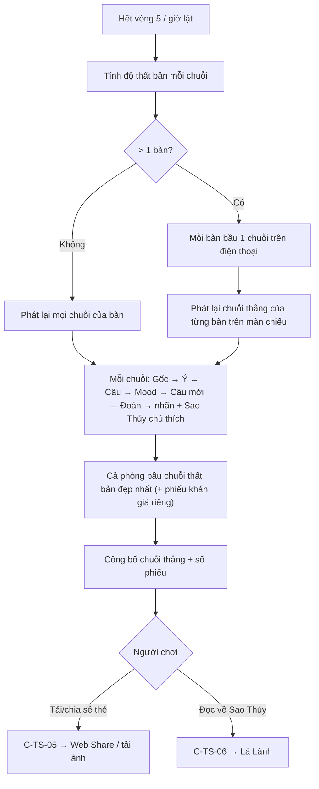

# G22 — Tam Sao Thất Bản: màn lật, phát lại, bỏ phiếu và thẻ lật

> Nguồn: [PRD](../../foundation/game-line/tam-sao-that-ban-prd.md) §4.3–4.4, §8 · [SRS](../../foundation/game-line/tam-sao-that-ban-srs.md) TS-FR-31–40, §8.2.
> TS-D1, TS-D2 là **đề xuất — chờ owner**.

## 1. User story

Là người chơi (hoặc khán giả), tôi muốn xem cả chuỗi được phát lại cạnh câu gốc, cười vì nó trôi xa thế nào, bầu chuỗi thất bản đẹp nhất và gửi thẻ lật vào nhóm chat, mà không ai
bị chỉ mặt là "người làm sai".

## 2. Mục tiêu và ranh giới

**Mục tiêu:** màn lật gánh trọn tiếng cười; không chấm người; biệt danh chỉ hiện khi người đó đồng ý.

**Trong phạm vi:** tính độ thất bản; phát lại trên màn chiếu (trực tiếp) và trang lật (chat); hiện tên theo hai cờ; Sao Thủy chú thích chung; bỏ phiếu bàn/phòng/khán giả; thẻ lật; cảnh báo
trước khi chia sẻ; cầu nối Lá Lành.

**Ngoài phạm vi:** host ẩn chuỗi (G24); xoá sau lật (G25); chú thích Sao Thủy cá nhân (không làm, TS-D6).

## 3. Actor, điều kiện và output

- **Actor:** host (điều khiển nhịp phát lại); người chơi; khán giả.
- **Output:** `drift_score` mỗi chuỗi; phiếu (chỉ số đếm được công bố); ảnh thẻ lật trên máy người dùng.

## 4. Luồng

## 5. UI/UX và trạng thái

| Phần | Nội dung |
|---|---|
| Khung chuỗi | Cột dọc: câu gốc (to) → chip ý định → câu bước 2 (kèm nhãn giọng) → emoji mood → câu bước 4 → câu đoán; câu gốc và câu đoán đặt cạnh nhau ở cuối |
| Tên ở mỗi bước | Biệt danh nếu người đó tick; "Người chơi A/B…" nếu không; "Sao Thủy điền giúp"; "Người đã rời" |
| Dấu | Nhãn chữ theo độ thất bản (PRD §4.3): "Truyền tin chuẩn chỉnh" … "THẤT BẢN toàn tập"; dấu đỏ đóng xuống (tắt khi giảm chuyển động) |
| Sao Thủy chú thích | Một dòng, ví dụ "Một dấu thanh đổi, cục sạc thành cái sạp." + "Đọc thêm về Sao Thủy trong Lá Lành" |
| Phiếu | "Chuỗi nào thất bản đẹp nhất?" danh sách chuỗi theo câu gốc; trong lúc mở chỉ hiện "đã bỏ phiếu x/y" |
| Kết quả | "Chuỗi thất bản đẹp nhất: 'Mai cho tớ mượn sạc dự phòng nhé' → 'Thứ Bảy này qua nhà tớ pha phin nhé!' · {k} phiếu" |
| Thẻ lật | Nút "Lưu thẻ" dưới mỗi chuỗi; xem trước ảnh trước khi chia sẻ |

Không có điểm cá nhân, không có "ai đoán đúng". Trạng thái theo SRS §4.2 (màn lật).

## 6. Quy tắc nghiệp vụ

TS-FR-31–40; phiếu theo RP-FR-40–46.

## 7. Tiêu chí chấp nhận

- **G22-AC01:** Given bảng kịch bản (mọi tổ hợp 4 chỗ trôi, có và không có Bot), Then `drift_score` đúng 0–4 và nhãn đúng theo PRD §4.3.
- **G22-AC02:** Given phát lại trên màn chiếu, Then thứ tự là Gốc → Ý định → Câu → Mood → Câu mới → Đoán, mỗi bước hiện ≥ 3 giây hoặc tới khi host bấm "Tiếp"; phòng > 1 bàn chỉ phát chuỗi thắng của từng bàn.
- **G22-AC03:** Given người làm bước 2 không tick `show_name_on_screen`, Then bước đó hiện "Người chơi B" trên màn chiếu và trang lật, và biệt danh của họ không có trong gói dữ liệu màn lật; Given có tick, Then hiện biệt danh.
- **G22-AC04:** Given phiếu đang mở, Then màn chiếu và bảng host chỉ thấy "đã bỏ phiếu x/y"; Given phiếu đóng, Then chỉ công bố chuỗi thắng và số phiếu; không API nào trả ai bầu gì; phiếu khán giả hiện riêng thành dòng "Khán giả nghĩ…".
- **G22-AC05:** Given tạo thẻ lật, Then ảnh 1080×1920 chỉ có chữ ngân hàng, nhãn độ thất bản, logo, và tên theo `show_name_on_card` (không tick → "Người chơi A/B…"); ảnh không chứa link mời, mã phòng, QR có token hay biệt danh của người không tick.
- **G22-AC06:** Given bấm chia sẻ hoặc tải, Then C-TS-05 hiện trước; ảnh tạo trên máy, không có request tải ảnh lên máy chủ.
- **G22-AC07:** Given toàn bộ màn lật, Then không có chữ "sai", điểm hay nhận xét nào gắn với một biệt danh.
- **G22-AC08:** Given mỗi chuỗi, Then có đúng một dòng Sao Thủy chú thích lấy từ bảng mẫu theo loại trôi đầu tiên; dòng không chứa biệt danh và không chứa câu dự đoán.
- **G22-AC09:** Given ván chat đã lật lúc T, Then thành viên xem lại trang lật và bỏ phiếu tới T + 24 giờ, xem lại tới T + 48 giờ; sau đó nhận thông báo chung TS-FR-64.
- **G22-AC10:** Given bấm "Đọc thêm về Sao Thủy trong Lá Lành", Then C-TS-06 hiện; link không có tham số định danh, mở với `noopener noreferrer`.
- **G22-AC11:** Given `prefers-reduced-motion`, Then không có hiệu ứng đóng dấu, các bước hiện tĩnh và chuyển bằng nút.

## 8. Edge case

| Tình huống | Xử lý |
|---|---|
| Mọi chuỗi độ thất bản 0 | Vẫn lật; Sao Thủy chú thích "Chuỗi này giữ được ý. Hiếm đấy."; chỉ số báo nội dung cần sửa |
| Hoà phiếu | Công bố mọi chuỗi hoà |
| Người đã đồng ý hiện tên rồi rời ván | Hiện "Người đã rời"; biệt danh không còn |
| Người chơi đổi ý bỏ tick trước khi lật | Áp dụng ngay; sau lật không đổi được (thẻ đã có thể được tải) |
| Khán giả muốn tải thẻ | Được, tên tuân cờ của từng người |

## 9. Definition of Done

- G22-AC01–AC11 có test; T-TS-09–11 xanh.
- Owner chốt TS-D1, TS-D2 và duyệt chữ màn lật, nhãn độ thất bản, bảng Sao Thủy chú thích, C-TS-05, C-TS-06.
- Bảo mật: gói dữ liệu màn lật lọc theo cờ; không lộ phiếu cá nhân; không P0/P1.
- Quyền riêng tư: chính sách nói rõ thẻ lật tạo trên máy, ảnh đã chia sẻ không thu lại được (KS-18); DPIA ghi hai cờ biệt danh; nếu gói vào app thì nhãn store khai việc chia sẻ do người dùng chủ động.
- Trợ năng: giảm chuyển động; đọc màn hình đọc đúng thứ tự chuỗi.
- Codex `APPROVE @ <SHA>` khớp head.

## 10. Bàn giao theo AGENTS.md

Nguồn: báo cáo (màn lật, không chấm người), research note (Gartic không thắng thua, Whisper Challenge), RP SRS (phiếu). Phát hiện đã sửa: tên theo đồng ý riêng; chú thích không dự đoán.
Rủi ro mở: người trong phòng có thể quay màn chiếu, Lá Úp không kiểm soát được. AC/DoD chưa xong: toàn bộ.
