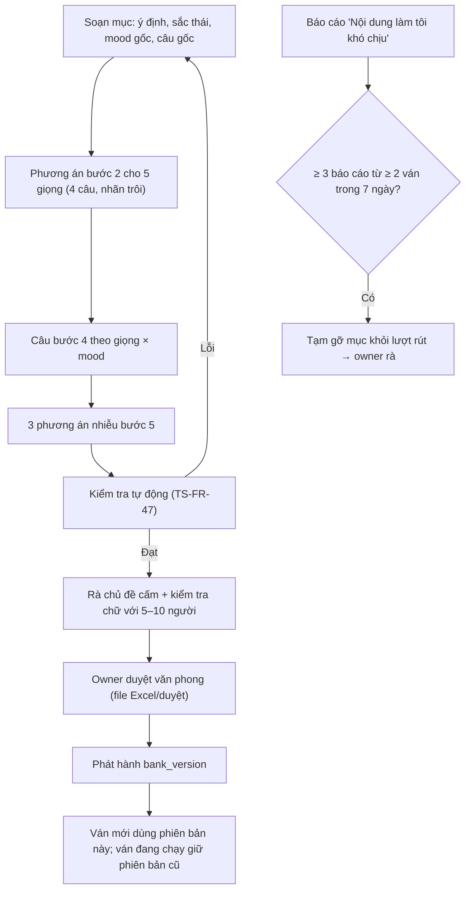

# G23 — Tam Sao Thất Bản: ngân hàng đề và phương án gần đúng

> Nguồn: [PRD](../../foundation/game-line/tam-sao-that-ban-prd.md) §5 · [SRS](../../foundation/game-line/tam-sao-that-ban-srs.md) TS-FR-41–50.
> Chuẩn chữ: `docs/foundation/la-lanh-plain-vietnamese-content-standard.md`. Toàn bộ ngân hàng là **nháp, chờ owner duyệt văn phong**.

## 1. User story

Là owner (người duyệt nội dung), tôi muốn một ngân hàng đề có cấu trúc rõ, mỗi lượt luôn có phương án gần đúng được cài có chủ đích, và một bộ kiểm tra tự động, để câu chuyền đi
trôi đủ xa mà vẫn an toàn, và không câu nào lên màn hình khi tôi chưa duyệt.

## 2. Mục tiêu và ranh giới

**Mục tiêu:** đủ trôi để buồn cười (phân bố độ thất bản không dồn về 0–1); không chạm chủ đề cấm; ghép phương án lúc chơi đúng quy tắc.

**Trong phạm vi:** cấu trúc mục ngân hàng; nhãn kiểu trôi; giọng; vòng mood và bảng kề; quy tắc ghép bước 2, 4, 5; ngẫu nhiên an toàn và lưu phương án đã hiện; kiểm tra tự động; rà chủ đề
cấm; phiên bản cố định theo ván; tạm gỡ mục bị báo cáo; bảng Sao Thủy chú thích.

**Ngoài phạm vi:** công cụ soạn thảo giao diện (Content Studio, nếu có, là tuỳ chọn); đề do người dùng tạo (không có); giọng đọc máy (sau MVP).

## 3. Actor, điều kiện và output

- **Actor:** người soạn nội dung; owner (duyệt); hệ thống (ghép phương án lúc chơi); người chơi (báo cáo).
- **Output:** gói ngân hàng có phiên bản (`bank_version`), báo cáo kiểm tra, biên nhận duyệt của owner.

## 4. Luồng

## 5. UI/UX và trạng thái

Không có màn hình người chơi riêng. Đầu ra cho owner: bảng duyệt mỗi mục (ý định, câu gốc, 5×4 phương án bước 2 có nhãn, câu bước 4, 3 phương án nhiễu, chú thích), cột "Duyệt / Sửa / Bỏ".
Lỗi kiểm tra tự động hiện theo mục và luật bị vi phạm.

## 6. Quy tắc nghiệp vụ

TS-FR-41–50. Nhãn trôi: [đúng ý], [dấu], [âm], [chi tiết], [sắc thái], [nghĩa đen]. Mood là cảm xúc của câu nhắn. Giọng là kiểu người chung (cô hàng xóm, sếp, MC, Gen Z, thơ; không dùng người trong gia đình), không người thật.
Thơ lục bát đúng 6/8 chữ.

## 7. Tiêu chí chấp nhận

- **G23-AC01:** Given gói ngân hàng, When kiểm schema, Then mỗi mục có đủ trường của TS-FR-41 và không trường thừa.
- **G23-AC02:** Given bước 2 của chuỗi có ý định I và giọng V, Then 4 phương án hiện ra đều thuộc (I, V), có đúng 1 [đúng ý], có ≥ 2 nhãn trôi khác nhau, thứ tự xáo trộn.
- **G23-AC03:** Given bước 3 chọn mood M độ mạnh k, Then bước 4 hiện 4 câu giọng V' ≠ V, mood M (độ mạnh lệch ≤ 1) hoặc mood kề khi thiếu, có câu của ý định gốc nếu ngân hàng có, còn lại thuộc ý định khác.
- **G23-AC04:** Given câu bước 4 thuộc ý định gốc, Then bước 5 là câu gốc + 3 phương án nhiễu của nó; Given thuộc ý định khác J, Then bước 5 là câu gốc + 1 nhiễu của câu gốc + câu gốc của J + 1 nhiễu của câu gốc J.
- **G23-AC05:** Given chạy kiểm tra tự động, Then báo lỗi khi: thiếu phương án, không có hoặc có hai [đúng ý], mood có < 4 câu ở một giọng, thiếu phương án nhiễu, câu trùng sau chuẩn hoá, câu lục bát sai 6/8, chữ dính danh sách từ cấm.
- **G23-AC06:** Given một bản phát hành, Then có biên nhận owner duyệt văn phong cho mọi mục mới hoặc sửa nghĩa, và checklist rà chủ đề cấm (ngoại hình, tình dục, sức khoẻ, phạm pháp, quan hệ thật, tiền, gia đình nhạy cảm, tôn giáo, vùng miền, chính trị, người thật có tên, tự hại, rượu bia, kết quả thi) đã ký cho từng mục.
- **G23-AC07:** Given một ván tạo với `bank_version` = v1, When phát hành v2 trong lúc ván chạy, Then ván đó vẫn dùng v1 tới hết, kể cả màn lật.
- **G23-AC08:** Given một mục nhận 3 báo cáo "Nội dung làm tôi khó chịu" từ 2 ván khác nhau trong 7 ngày, Then mục đó không còn được rút cho ván mới cho tới khi owner rà lại.
- **G23-AC09:** Given một bước đã hiện, Then máy chủ lưu `offered_option_ids` và màn lật phát lại đúng các phương án đó; ngẫu nhiên dùng bộ sinh an toàn mật mã ở máy chủ.

## 8. Edge case

| Tình huống | Xử lý |
|---|---|
| Ngân hàng chưa đủ câu bước 4 cho một (mood, giọng) | Dùng mood kề; kiểm tra tự động cảnh báo trước phát hành |
| Phương án [âm] quá xa, không ai chọn nhầm | Phát hiện qua phân bố lựa chọn ở playtest (đếm tổng hợp), sửa câu |
| Câu vô tình trùng tên người nổi tiếng | Danh sách chặn tên; owner rà |
| Câu dùng tiếng lóng có nghĩa khác ở vùng miền | Kiểm tra chữ với 5–10 người nhiều vùng |

## 9. Definition of Done

- G23-AC01–AC09 có test; T-TS-12, T-TS-13 xanh.
- Ngân hàng MVP: khoảng 60 thông điệp gốc, đủ 5 giọng mỗi ý định, 8 mood × 5 giọng × ≥ 4 câu bước 4, bảng chú thích; owner duyệt; kiểm tra chữ với 5–10 người đạt.
- Không chứa dữ liệu cá nhân; không gửi nội dung ra dịch vụ ngoài; không AI tạo câu ở MVP (KS-21). Nếu sau này dùng AI để soạn nháp, phải qua cùng gate và owner duyệt, và ghi lại.
- Bản quyền: giọng là kiểu người chung, không bắt chước chương trình hay nhân vật cụ thể.
- Codex `APPROVE @ <SHA>` khớp head.

## 10. Bàn giao theo AGENTS.md

Nguồn: báo cáo (ngân hàng đề, giọng, phương án gần đúng), research note (§5 quy tắc 1–2), chuẩn nội dung tiếng Việt. Phát hiện đã sửa: quy tắc bước 5 thêm câu gốc của ý định bước 4; đề
"qua môn" đổi để tránh kết quả thi. Rủi ro mở: chưa có dữ liệu trắc nghiệm trôi đủ để cười. AC/DoD chưa xong: toàn bộ; ngân hàng mới có 16/60 ý định, mỗi ý định mới có 1/5 giọng.
