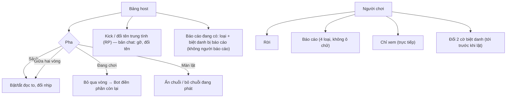

# G24 — Tam Sao Thất Bản: quyền của host và người chơi

> Nguồn: [PRD](../../foundation/game-line/tam-sao-that-ban-prd.md) §9, TS-D5 · [SRS](../../foundation/game-line/tam-sao-that-ban-srs.md) TS-FR-51–57.
> Phòng trực tiếp dùng nguyên nút host và người chơi của hạ tầng chung (G06, G08; RP-FR-50–59, RP-FR-70–83). Story này chỉ thêm hành vi riêng của Tam Sao và toàn bộ nút của bản chat.

## 1. User story

Là host, tôi muốn điều khiển nhịp ván, gạt bỏ chuỗi hoặc người làm hỏng không khí. Là người chơi, tôi muốn rời, báo cáo, chỉ xem, và tự quyết biệt danh của mình có hiện khi lật hay không,
để ván luôn vui và an toàn.

## 2. Mục tiêu và ranh giới

**Mục tiêu:** host xử lý được mọi tình huống xấu trong ≤ 2 chạm; người chơi luôn có lối ra.

**Trong phạm vi:** "Bỏ qua" theo nghĩa của Tam Sao; ẩn chuỗi khỏi màn lật; đổi "đọc to" và nhịp; nút host bản chat (đổi tên trung tính, gỡ, thu hồi, lật ngay); quyền người chơi (rời, báo cáo,
chỉ xem, đổi hai cờ biệt danh); liên hệ công khai; host mất máy.

**Ngoài phạm vi:** nút chung đã định nghĩa trong RP (khoá, kick, tạm dừng, thêm 30 giây, kết thúc) — chỉ được gọi; xoá dữ liệu khi rời (G25); "Kết thúc và xoá" (G25).

## 3. Actor, điều kiện và output

- **Actor:** host (`host_session`); người chơi; khán giả.
- **Output:** trạng thái vòng; cờ `hidden_by_host`; cờ biệt danh; bản ghi báo cáo; thay đổi thành viên.

## 4. Luồng

## 5. UI/UX và trạng thái

| Nút | Chữ / hành vi |
|---|---|
| Bỏ qua vòng | "Bỏ qua vòng này? Sao Thủy sẽ điền phần còn lại." |
| Ẩn chuỗi | Ở màn lật, mỗi chuỗi có "Ẩn chuỗi này"; xác nhận một lần; chuỗi biến khỏi phát lại và phiếu |
| Đọc to / nhịp | Công tắc trong sảnh và giữa hai vòng; trong vòng thì mờ đi kèm "Đổi được sau vòng này" |
| Bản chat: đổi tên | Chọn từ danh sách trung tính ("Người chơi 3", "Bạn Áo Xanh"…), host không gõ chữ |
| Bản chat: gỡ | "Gỡ {biệt danh}? Biệt danh của họ bị xoá; lượt đã làm vẫn ở trong chuỗi, không ghi tên." |
| Người chơi: biệt danh | Màn "Lựa chọn của tôi" có lại hai ô biệt danh, đổi được tới trước khi lật |
| Báo cáo | `Biệt danh không phù hợp` (chọn biệt danh), `Tôi thấy bị nhắm vào`, `Nội dung làm tôi khó chịu`, `Lý do khác` |
| Liên hệ | Email hỗ trợ Lá Úp ở màn vào, báo cáo, kết thúc (chờ owner chốt địa chỉ) |

## 6. Quy tắc nghiệp vụ

TS-FR-51–57; RP-FR-50–59, RP-FR-70–83 cho phòng trực tiếp.

## 7. Tiêu chí chấp nhận

- **G24-AC01:** Given host bấm "Bỏ qua" ở vòng 3, Then mọi bước vòng 3 chưa chọn do Bot điền ngay và ván sang vòng 4; Given bấm ở màn lật, Then chuỗi đang phát dừng và chuyển chuỗi kế.
- **G24-AC02:** Given host ẩn một chuỗi ở màn lật, Then chuỗi đó không phát, không có trong phiếu bầu, và không tạo được thẻ lật cho chuỗi đó.
- **G24-AC03:** Given đang trong một vòng, When host đổi "đọc to" hoặc nhịp, Then bị từ chối với "Đổi được sau vòng này"; trong sảnh hoặc giữa hai vòng thì áp dụng ngay.
- **G24-AC04:** Given host kick một người ở vòng 2 (RP-FR-52), Then các bước còn lại của người đó do Bot điền theo G20-AC06 và phiên của họ không vào lại được phòng.
- **G24-AC05:** Given bản chat, Then host đổi tên chỉ được chọn từ danh sách trung tính; gỡ thành viên xoá ngay bản ghi thành viên và huỷ lượt họ đang giữ; mọi lệnh host thiếu `host_session` của ván bị từ chối.
- **G24-AC06:** Given người chơi đổi hai cờ biệt danh trước khi lật, Then màn lật và thẻ lật dùng giá trị mới; sau khi lật thì không đổi được.
- **G24-AC07:** Given người chơi gửi báo cáo, Then không có ô chữ; host thấy loại và (với loại biệt danh) biệt danh bị báo cáo, không thấy ai báo cáo; mỗi slot/thành viên gửi tối đa 5 báo cáo mỗi ván.
- **G24-AC08:** Given màn vào, màn báo cáo, màn kết thúc, Then có thông tin liên hệ công khai của Lá Úp.
- **G24-AC09:** Given host xoá cookie trong bản chat, Then không ai có quyền host; ván vẫn lật đúng giờ và tự xoá theo lịch.

## 8. Edge case

| Tình huống | Xử lý |
|---|---|
| Host ẩn hết mọi chuỗi | Phiếu bầu bỏ qua; màn lật kết thúc với "Không có chuỗi nào được phát" |
| Host đổi tên người đã tick hiện biệt danh | Tên trung tính thay biệt danh ở mọi chỗ, kể cả thẻ |
| Người chơi báo cáo chính host | Báo cáo vẫn tới bảng host (theo RP); mã nội dung và số đếm tới owner; người chơi có thể rời |
| Bản chat: host là người duy nhất còn lại | Ván không đủ 4 → huỷ theo G21-AC02 tới giờ lật |

## 9. Definition of Done

- G24-AC01–AC09 có test; T-TS-14 xanh.
- Owner chốt TS-D5 và địa chỉ liên hệ công khai; duyệt danh sách tên trung tính.
- Bảo mật: lệnh host kiểm `host_session`; giới hạn báo cáo; không P0/P1.
- Quyền riêng tư: báo cáo không lưu người báo cáo; DPIA ghi `ts_report` [bổ sung]; Apple 1.2 (báo cáo, liên hệ; "chặn" được thay bằng kick/gỡ của host vì không có tin nhắn — cần luật sư/owner xác nhận).
- Codex `APPROVE @ <SHA>` khớp head.

## 10. Bàn giao theo AGENTS.md

Nguồn: RP SRS (nút host, báo cáo), báo cáo (host kick/kết thúc/thu hồi), Apple 1.2 (đọc lại 26/10/2026). Phát hiện đã sửa: host không gõ chữ cho người khác; ẩn chuỗi chặn cả thẻ lật. Rủi ro mở:
không có nút "chặn người" cho người chơi. AC/DoD chưa xong: toàn bộ.
