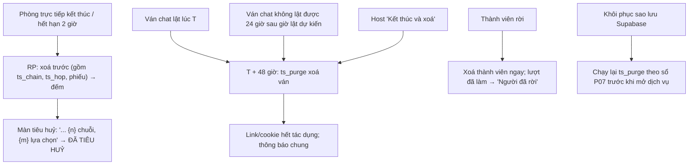

# G25 — Tam Sao Thất Bản: xoá dữ liệu và tiêu huỷ hồ sơ

> Nguồn: [PRD](../../foundation/game-line/tam-sao-that-ban-prd.md) §2.1 (G4) · [SRS](../../foundation/game-line/tam-sao-that-ban-srs.md) TS-FR-60–67, §6.
> Phòng trực tiếp dùng tiêu huỷ hồ sơ của hạ tầng chung (G07, RP-FR-60–66). DPIA KS-07, KS-08, KS-18, KS-23.

## 1. User story

Là người chơi, tôi muốn biết chắc biệt danh và lựa chọn của mình biến mất khi ván kết thúc (hoặc 48 giờ sau màn lật ở bản chat), và tôi tự rời được bất cứ lúc nào, để chơi mà không lo
dữ liệu nằm lại.

## 2. Mục tiêu và ranh giới

**Mục tiêu:** xoá đúng hạn, có bằng chứng, không "sống lại" sau khôi phục sao lưu.

**Trong phạm vi:** tiêu huỷ phòng trực tiếp (phần đếm riêng của Tam Sao); xoá bản chat lật + 48 giờ; ván không lật được; "Kết thúc và xoá" của host; rời ván (bỏ liên kết); thông báo sau xoá;
log; số đếm tổng hợp; sổ ghi xoá P07; thẻ lật không lưu ở máy chủ.

**Ngoài phạm vi:** luồng tiêu huỷ chung (G07); xoá khi kick trong phòng trực tiếp (RP-FR-82, G06).

## 3. Actor, điều kiện và output

- **Actor:** worker; host; người chơi; operator (khôi phục sao lưu).
- **Output:** biên nhận xoá (số dòng, không định danh); màn tiêu huỷ; `ts_metric_daily`.

## 4. Luồng

## 5. UI/UX và trạng thái

| Màn | Chữ (nháp) |
|---|---|
| Tiêu huỷ (trực tiếp) | Theo RP-FR-61, thêm dòng "{n} chuỗi, {m} lựa chọn" |
| Trang ván chat sau lật | "Ván này tự xoá lúc {T + 48 giờ}." |
| Kết thúc và xoá (host) | "Kết thúc và xoá ngay mọi dữ liệu của ván? Không hoàn tác." → màn "ĐÃ TIÊU HUỶ" với số đếm thật |
| Rời ván | "Rời ván? Biệt danh của bạn bị xoá ngay. Lượt bạn đã làm vẫn ở trong chuỗi nhưng không ghi tên." |
| Sau xoá | "Ván này đã kết thúc. Dữ liệu đã được xoá." (chung cho hết hạn, thu hồi, xoá) |

## 6. Quy tắc nghiệp vụ

TS-FR-60–67. Thời gian sống tối đa của dữ liệu ván chat: giờ tạo + 48 giờ (giờ lật tối đa) + 24 giờ (lật lỗi) + 48 giờ.

## 7. Tiêu chí chấp nhận

- **G25-AC01:** Given phòng trực tiếp kết thúc, When truy vấn kho trạng thái sau `room.purged`, Then không còn `ts_chain`, `ts_hop`, phiếu hay slot nào của phòng, và số "{n} chuỗi, {m} lựa chọn" trên màn tiêu huỷ bằng số dòng đã xoá.
- **G25-AC02:** Given ván chat lật lúc T, When đồng hồ giả tới T + 48 giờ + 15 phút, Then `ts_async_game`, `ts_async_member`, `ts_chain`, `ts_hop`, `ts_claim`, `ts_vote`, `ts_report` của ván đều 0 dòng; biên nhận job có số dòng, không có định danh.
- **G25-AC03:** Given host "Kết thúc và xoá", Then mọi dữ liệu của ván xoá trong một giao dịch trước khi màn tiêu huỷ hiện; link và cookie của ván trả thông báo chung.
- **G25-AC04:** Given thành viên rời trước khi lật, Then bản ghi thành viên (biệt danh, cờ đồng ý, phiên) bị xoá ngay; `ts_hop.member_id` của họ thành null; lượt đang giữ bị huỷ; màn lật hiện "Người đã rời".
- **G25-AC05:** Given token hết hạn, bị thu hồi, hoặc ván đã xoá, Then cả ba trả cùng một thông báo và cùng mã trạng thái.
- **G25-AC06:** Given chạy hết bộ test Tam Sao, When quét log ứng dụng và proxy, Then không có token, cookie, biệt danh, lựa chọn, id phương án hay IP đầy đủ.
- **G25-AC07:** Given 24 giờ sau khi một ván bị xoá, Then `ts_metric_daily` không còn `game_id`/`room_id`, chỉ số đếm gộp theo ngày.
- **G25-AC08:** Given khôi phục bản sao lưu Supabase trên môi trường thử, Then trước khi mở dịch vụ, job xoá chạy lại và mọi ván quá `purge_at` không còn (sổ ghi xoá P07).
- **G25-AC09:** Given người dùng tạo và chia sẻ thẻ lật, Then không có request nào tải ảnh thẻ lên máy chủ Lá Úp.

## 8. Edge case

| Tình huống | Xử lý |
|---|---|
| Job xoá lỗi | Thử lại mỗi 15 phút; trễ > 1 giờ báo operator; route từ chối truy cập ván quá `purge_at` kể cả khi chưa xoá |
| Máy chủ khởi động lại giữa phòng trực tiếp | Theo RP: phòng coi như đã tiêu huỷ |
| Người chơi đã tải thẻ lật trước khi xoá | Ảnh nằm trên máy họ; chính sách nói rõ không thu lại được |
| Yêu cầu xoá qua email khi không còn phiên | Không xác minh được người gửi; dữ liệu tự xoá theo thời hạn; trả lời theo mẫu |

## 9. Definition of Done

- G25-AC01–AC09 có test; T-TS-15–17 xanh.
- Operator có receipt khôi phục thử cho bảng Tam Sao chat theo P07 trước khi mở bản chat.
- Quyền riêng tư: DPIA §5.4 và chính sách quyền riêng tư ghi đúng thời hạn (kết thúc phòng; lật + 48 giờ; tối đa theo §6) và việc sao lưu; nhãn store (nếu có) khớp.
- Bảo mật: xoá trong giao dịch; từ chối truy cập quá hạn; quét log; không P0/P1.
- Codex `APPROVE @ <SHA>` khớp head.

## 10. Bàn giao theo AGENTS.md

Nguồn: RP SRS (tiêu huỷ), DPIA (KS-07/08/18/23), `docs/operations/backup-restore-and-deletion-reconciliation.md` (P07), báo cáo. Phát hiện đã sửa: rời ván bỏ liên kết thay vì làm vỡ chuỗi;
ván < 4 người và ván lật lỗi có hạn xoá; giới hạn thời gian sống tối đa. Rủi ro mở: bản sao lưu giữ dữ liệu đã xoá tới hết vòng xoay. AC/DoD chưa xong: toàn bộ.
