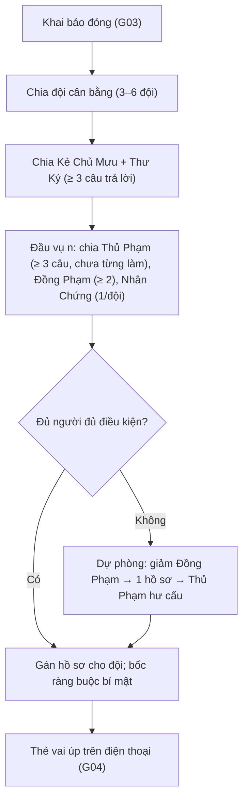

# G32 — Nhận đội hành tinh và vai Phiên Tòa

> Phiên Tòa Tủ Lạnh. [PRD](../../foundation/game-line/phien-toa-tu-lanh-prd.md) §5 · [SRS](../../foundation/game-line/phien-toa-tu-lanh-srs.md)
> §3.2, §3.7. Khai báo 5 câu: **G03**. Cơ chế chia vai bí mật, thẻ úp, gói tin đồng dạng: **G04**. Trạng thái: nháp.

## 1. User story

Là người chơi, tôi muốn biết mình thuộc đội hành tinh nào và vai của mình trong vụ này là gì, có một câu nói rõ tôi phải làm gì,
để tôi chơi được ngay mà không cần đọc luật dài.

## 2. Mục tiêu và ranh giới

### Mục tiêu

- Số vai mỗi vụ đúng bảng quy mô (PRD §5.2).
- Không ai làm Thủ Phạm hai lần; vai rải đều.
- Thẻ vai một câu, hiểu ngay.

### Trong phạm vi

Chia đội cố định; vai cả buổi (Kẻ Chủ Mưu, Thư Ký); vai theo vụ (Thủ Phạm, Đồng Phạm, Nhân Chứng, Bồi Thẩm); điều kiện dữ liệu; dự
phòng thiếu người; gán hồ sơ cho đội; nội dung thẻ vai; xử lý người rời theo vai.

### Ngoài phạm vi

Luật Sư (chia khi ra tòa — G34); cơ chế chia/gửi/che vai (G04); 5 câu (G03).

## 3. Actor, điều kiện và output

- **Actor:** máy chủ, người chơi.
- **Điều kiện:** pha khai báo đã đóng (vai cả buổi + đội), hoặc đầu mỗi vụ (vai theo vụ).
- **Output:** bản ghi vai theo SRS §7.

## 4. Luồng

## 5. Giao diện và trạng thái

| Vai | Câu trên thẻ (nháp, chờ owner duyệt) |
|---|---|
| Bồi Thẩm – Thám Tử | "Cùng đội giải manh mối và buộc tội đúng người." |
| Thủ Phạm | "Bạn đóng vai Thủ Phạm vụ này. Câu trả lời của bạn sẽ thành manh mối. Ở câu hỏi phụ, hãy chọn '{ràng buộc}'. Thoát án là thắng." |
| Đồng Phạm | "Bạn giúp Thủ Phạm. Ở câu hỏi phụ, chọn một chi tiết để tráo bằng chi tiết của bạn." |
| Nhân Chứng | "Bạn sẽ nhận riêng một manh mối thật. Kể cho đội hay giữ lại là tuỳ bạn." |
| Kẻ Chủ Mưu | "Cả buổi, bạn đứng sau mọi vụ. Mỗi vụ đổi một chữ trong một manh mối bằng chữ '{chữ}'. Tới Đại Án không bị lộ là thắng." |
| Thư Ký Tòa | "Mỗi vụ bạn kiểm được một manh mối: thật, giả hay bị sửa." |

Thẻ đội: tên đội + biểu tượng hành tinh + "Đội bạn điều tra hồ sơ A". Màn chiếu: bảng đội với số người mỗi đội (không vai, không danh
sách tên theo đội để người chơi tự tìm nhau bằng điện thoại — PT-D11 ở dưới).

## 6. Quy tắc

Theo SRS PT-FR-11 đến PT-FR-18 và bảng §3.7.

## 7. Tiêu chí chấp nhận

- **G32-AC01:** Với 15, 24, 25, 34, 35, 44, 45, 50 người chơi, số đội và số vai mỗi vụ đúng PRD §5.2 (PT-TH-02).
- **G32-AC02:** Trên 1.000 buổi giả lập, không ai làm Thủ Phạm hai lần trong một buổi (PT-TH-03).
- **G32-AC03:** Kẻ Chủ Mưu và Thư Ký không bao giờ nhận Thủ Phạm hoặc Đồng Phạm; Nhân Chứng không là Thủ Phạm/Đồng Phạm cùng vụ.
- **G32-AC04:** Người có < 3 câu trả lời khác `skip` không bao giờ làm Thủ Phạm hoặc Kẻ Chủ Mưu; < 2 không làm Đồng Phạm.
- **G32-AC05:** Khi mọi người chơi đều chọn "Không muốn nói" ở ≥ 3 câu, vụ chạy với Thủ Phạm hư cấu và bảng host hiện dòng giải thích.
- **G32-AC06:** Đội chênh lệch ≤ 1 người; đội giữ nguyên cả buổi.
- **G32-AC07:** Nhiều hồ sơ trong một vụ: các Thủ Phạm thuộc các đội khác nhau khi số đội cho phép.
- **G32-AC08:** Thẻ Thủ Phạm hiện ràng buộc; thẻ Kẻ Chủ Mưu hiện chữ của vụ; người khác không nhận dữ liệu này (G04-AC02).
- **G32-AC09:** Người rời theo từng vai được xử lý đúng bảng SRS §3.7 (một test cho mỗi dòng).

## 8. Trường hợp biên

| Trường hợp | Cách xử lý |
|---|---|
| 15 người nhưng 3 người vắng lúc chia | Người vắng nhận Bồi Thẩm; nếu thiếu người đủ điều kiện, áp dự phòng |
| Kẻ Chủ Mưu trùng chữ cái đầu với nhiều người | Bình thường; chữ chỉ là gợi ý thu hẹp |
| Người chơi đổi ý muốn chỉ xem sau khi có vai | Không chuyển được; có thể rời phòng (G08) |

## 9. Definition of Done

- G32-AC01–AC09 pass.
- Câu trên thẻ vai được owner duyệt văn phong.
- Không còn lỗi P0/P1.

## 10. Bàn giao

- **Nguồn:** báo cáo (bảng vai, bảng quy mô); PRD §5; SRS §3.2.
- **Đã xử lý:** điều kiện dữ liệu cho vai; Thủ Phạm hư cấu; xử lý rời theo vai.
- **Rủi ro mở:** **PT-D11 (chờ owner):** màn chiếu có hiện danh sách tên theo đội để người chơi tìm nhau không — mặc định không (chỉ
  điện thoại báo đội; người chơi tự gọi nhau "Đội Sao Hỏa ở đâu?") để giảm biệt danh trên màn chiếu.
- **AC/DoD chưa xong:** toàn bộ.
