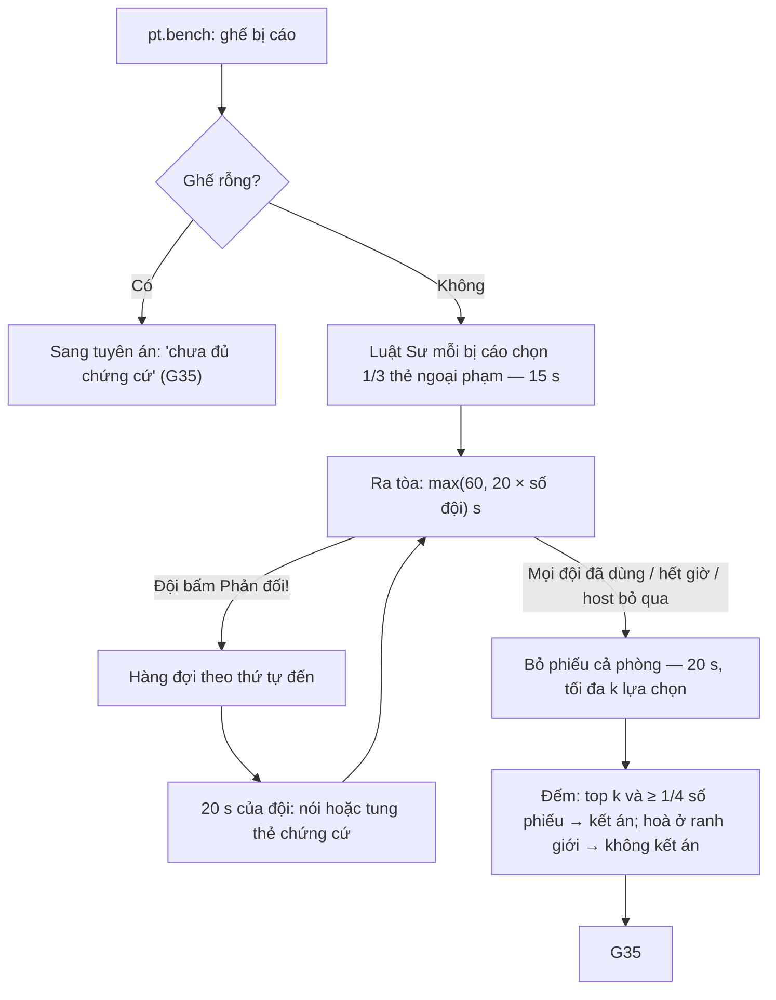

# G34 — Ra tòa: ghế bị cáo, Luật Sư, "Phản đối!" và bỏ phiếu

> Phiên Tòa Tủ Lạnh. [PRD](../../foundation/game-line/phien-toa-tu-lanh-prd.md) §4.2 (pha 5–6), §4.3, §6.5 ·
> [SRS](../../foundation/game-line/phien-toa-tu-lanh-srs.md) §3.4. Cơ chế phiếu đồng thời: **G05**. Trạng thái: nháp.

## 1. User story

Là thành viên đội, tôi muốn có một lần hô "Phản đối!" để giành 20 giây bào chữa hoặc tung một thẻ chứng cứ nếu tôi ngại nói, rồi
cùng cả phòng bỏ phiếu cùng lúc, để màn xử án có kịch tính mà không ai bị ép đứng lên nói.

## 2. Mục tiêu và ranh giới

### Mục tiêu

- Mỗi đội đúng một lần Phản đối mỗi vụ, 20 giây, không chen nhau.
- Người ngại nói có thẻ chứng cứ thay lời.
- Bỏ phiếu 20 giây, kết án theo ngưỡng rõ ràng.

### Trong phạm vi

Ghế bị cáo; Luật Sư và thẻ ngoại phạm; nút Phản đối, hàng đợi, thẻ chứng cứ; bỏ phiếu cả phòng (1 hoặc k lựa chọn); ngưỡng kết án;
phiếu khán giả; ghế rỗng.

### Ngoài phạm vi

Tuyên án, Miễn án (G35); khung phiếu chung (G05).

## 3. Actor, điều kiện và output

- **Actor:** đội, Luật Sư, mọi người chơi, khán giả.
- **Điều kiện:** pha buộc tội đã tạo ghế bị cáo (G33).
- **Output:** lượt Phản đối (đội, vụ, slot, thời điểm, thẻ); phiếu `pt_lawyer_card`, `pt_room_verdict`; danh sách người bị kết án.

## 4. Luồng

## 5. Giao diện và trạng thái

| Nơi | Nội dung |
|---|---|
| Màn chiếu — ghế bị cáo | Tiêu đề "Ghế bị cáo — những người bị nghi đóng vai Thủ Phạm"; mỗi bị cáo một ô: biệt danh, đội buộc tội, thẻ ngoại phạm của Luật Sư |
| Màn chiếu — Phản đối | Dấu "PHẢN ĐỐI!" (bản tĩnh khi giảm chuyển động), tên + biểu tượng đội, đồng hồ 20 s, thẻ chứng cứ nếu được tung, câu TPL-10/11/12 |
| Điện thoại thành viên đội | Nút "Phản đối!" ≥ 64 px (tắt sau khi đội đã dùng); trong 20 s của đội: 3 thẻ chứng cứ để chọn |
| Điện thoại Luật Sư | "Bạn là luật sư của {biệt danh}. Chọn một chứng cứ ngoại phạm." + 3 thẻ |
| Bỏ phiếu | Danh sách ghế bị cáo; "Chọn tối đa k người"; phiếu trắng |

## 6. Quy tắc

Theo SRS PT-FR-40, PT-FR-41, PT-FR-50 đến PT-FR-56. Không ai được hệ thống gọi tên để phải nói. Bị cáo được bỏ phiếu cho chính mình.

## 7. Tiêu chí chấp nhận

- **G34-AC01:** Ghế bị cáo gộp trùng, tối đa bằng số đội; ghế rỗng bỏ qua ra tòa và bỏ phiếu.
- **G34-AC02:** Mỗi bị cáo có một Luật Sư khác nhau, chọn từ Bồi Thẩm không ngồi ghế và không giữ vai đặc biệt của vụ; hết giờ máy chủ
  chọn thẻ ngẫu nhiên.
- **G34-AC03:** Mỗi đội chỉ được một Phản đối mỗi vụ: lần bấm đầu của bất kỳ thành viên nào được tính, nút tắt trên mọi điện thoại của
  đội trong ≤ 1 giây.
- **G34-AC04:** Hai đội bấm cách nhau < 100 ms: đội đến trước được 20 s, đội sau vào hàng đợi và được 20 s ngay sau đó.
- **G34-AC05:** Trong 20 s của đội, một thành viên chọn thẻ chứng cứ thì thẻ hiện trên màn chiếu; chỉ một thẻ mỗi lượt.
- **G34-AC06:** Pha ra tòa kết thúc đúng khi mọi đội đã dùng, hoặc hết `max(60, 20 × số đội)` s cộng 15 s Luật Sư, hoặc host bỏ qua.
- **G34-AC07:** Phiếu cả phòng: số lựa chọn tối đa = số hồ sơ; kết án đúng luật top k + ≥ 1/4; hoà ở vị trí k thì không kết án người
  hoà (test bảng nhiều trường hợp).
- **G34-AC08:** Phiếu khán giả hiện dòng "Khán giả nghĩ…" và không đổi kết quả.
- **G34-AC09:** Lượt Phản đối lưu đội, vụ, slot, thời điểm, mã thẻ; xoá khi kết thúc (RP-TH-06); màn chiếu không hiện ai đã bấm.
- **G34-AC10:** Chơi thử giấy: không người chơi nào trả lời "Có" ở câu "Có lúc nào bạn thấy bị ép phải nói không?" (câu 4 của phiếu
  khảo sát chơi thử, [`05-khao-sat-an-danh.md`](../../playtests/2026-11-game-line/phien-toa-tu-lanh/05-khao-sat-an-danh.md)).

## 8. Trường hợp biên

| Trường hợp | Cách xử lý |
|---|---|
| Không đủ Bồi Thẩm rảnh làm Luật Sư | Bị cáo không có Luật Sư, máy chủ bốc thẻ ngoại phạm ngẫu nhiên |
| Bị cáo rời phòng | Ô hiện "Người đã rời"; vẫn là lựa chọn phiếu; kết án thì không có bản án (SRS §3.7) |
| Không đội nào bấm Phản đối | Pha kết thúc sau thời lượng; Thẩm Phán "Tòa không nghe thấy phản đối nào" (biến thể nhịp Phản đối) |
| Tất cả bỏ phiếu trắng | Không kết án; TPL-20 |

## 9. Definition of Done

- G34-AC01–AC10 pass.
- Kiểm nhấp nháy dấu "PHẢN ĐỐI!" (RP-TH-08).
- Thẻ ngoại phạm/chứng cứ được owner duyệt văn phong.
- Không còn lỗi P0/P1.

## 10. Bàn giao

- **Nguồn:** báo cáo (bước 5–6: Phản đối 20 s, thẻ chứng cứ cho người ngại nói, bỏ phiếu 20 s; Luật Sư); research note §3 (bào chữa
  ngẫu hứng có thẻ chọn sẵn).
- **Đã xử lý:** hàng đợi Phản đối; ngưỡng 1/4 để không kết án bằng vài phiếu lẻ.
- **Rủi ro mở:** PT-D9 (ngưỡng).
- **AC/DoD chưa xong:** toàn bộ.
