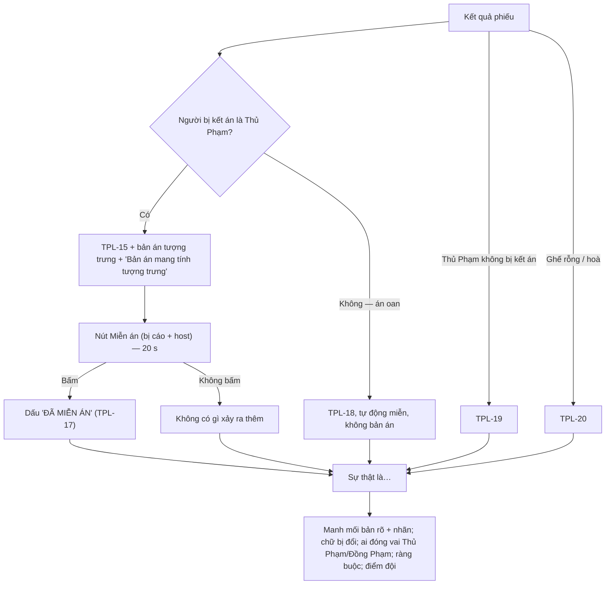

# G35 — Tuyên án, Miễn án và "Sự thật là…"

> Phiên Tòa Tủ Lạnh. [PRD](../../foundation/game-line/phien-toa-tu-lanh-prd.md) §2.3, §4.2 (pha 7), §4.3, §6.4 ·
> [SRS](../../foundation/game-line/phien-toa-tu-lanh-srs.md) §3.5. Trạng thái: nháp.

## 1. User story

Là người chơi vừa bị cả phòng kết án vì đóng vai Thủ Phạm quá đạt, tôi muốn bản án chỉ là trò đùa có nút Miễn án, và muốn tòa kể
lại manh mối nào thật, manh mối nào bị cài, để tôi thấy mình được khen chứ không bị bêu.

## 2. Mục tiêu và ranh giới

### Mục tiêu

- Không bản án nào bắt buộc; người vô tội không bao giờ nhận bản án.
- Câu tuyên án luôn nói về vai.
- "Sự thật là" giải thích rõ cách tòa đi tới kết quả.

### Trong phạm vi

Tuyên án Thủ Phạm; án oan tự miễn; nút Miễn án; Thủ Phạm thoát; "chưa đủ chứng cứ"; lá Justice tĩnh; "Sự thật là" (nhãn manh mối,
chữ bị đổi, vai của vụ); gọi lại vụ trước; bảng điểm đội.

### Ngoài phạm vi

Đại Án (G36); mẫu câu (G37 quản lý kho).

## 3. Actor, điều kiện và output

- **Actor:** Thẩm Phán Lá (hệ thống), người bị kết án, host.
- **Điều kiện:** phiếu cả phòng đã đóng (G34) hoặc ghế rỗng.
- **Output:** phiếu `pt_pardon` (nếu bấm); điểm đội cập nhật.

## 4. Luồng

## 5. Giao diện và trạng thái

- Màn chiếu tuyên án: câu Thẩm Phán, bản án chữ lớn, dòng nhỏ "Bản án mang tính tượng trưng", lá Justice (hình tĩnh) bên cạnh.
- Điện thoại người bị kết án: "Bạn đóng vai Thủ Phạm quá đạt. Bản án: {bản án}." + nút lớn `Miễn án` + dòng "Không bấm cũng
  không sao."
- Bảng host: nút `Miễn án cho bị cáo`.
- "Sự thật là": từng manh mối lật lại bản rõ với nhãn `Thật` / `Đồng Phạm cài` / `Bị đổi một chữ` (tô chữ); "Vai Thủ Phạm: {biệt
  danh}", "Vai Đồng Phạm: {biệt danh}…"; "Thủ Phạm buộc phải chọn: chậu cây"; bảng điểm đội.

## 6. Quy tắc

Theo SRS PT-FR-60 đến PT-FR-66. Thêm:

1. Không có cơ chế ghi nhận "đã chấp hành án". Bản án chỉ tồn tại trên màn chiếu trong vài giây.
2. "Sự thật là" không hiện Kẻ Chủ Mưu, Thư Ký, Nhân Chứng.
3. Người không có `consent_display` không bao giờ nhận vai (PT-PRV-01) nên không xuất hiện ở đây.

## 7. Tiêu chí chấp nhận

- **G35-AC01:** Mọi bản án hiện kèm "Bản án mang tính tượng trưng" và nút Miễn án trên điện thoại bị cáo và bảng host.
- **G35-AC02:** Bị cáo không phải Thủ Phạm bị kết án: không có bản án, có TPL-18 (PT-TH-06).
- **G35-AC03:** Bấm Miễn án: màn chiếu đóng dấu trong ≤ 1 giây; không bấm: không thông báo, không đếm "chưa chấp hành".
- **G35-AC04:** Mọi câu tuyên án chứa tên vai; không câu nào có cấu trúc "{biệt danh} đã {hành vi trong vụ}" (PT-TH-04).
- **G35-AC05:** Kho bản án không chứa mục tốn tiền, đồ ăn mua thật, rượu bia, thử thách thể chất hay nhận xét ngoại hình (PT-TH-05).
- **G35-AC06:** "Sự thật là" hiện đúng nhãn cho mọi manh mối và tô đúng chữ bị đổi; hiện ràng buộc của từng Thủ Phạm.
- **G35-AC07:** "Sự thật là" không hiện Kẻ Chủ Mưu, Thư Ký, Nhân Chứng.
- **G35-AC08:** Thẩm Phán gọi lại vụ trước khi điều kiện PT-FR-65 xảy ra (ví dụ cùng đội đoán trúng hai vụ liền → TPL-23).
- **G35-AC09:** Bảng điểm đội đúng PRD §4.3; không có bảng cá nhân.
- **G35-AC10:** Lá Justice là ảnh tĩnh đóng gói, không link, không tải từ nguồn ngoài.

## 8. Trường hợp biên

| Trường hợp | Cách xử lý |
|---|---|
| Nhiều Thủ Phạm bị kết án cùng lúc | Tuyên lần lượt, mỗi người một bản án khác nhau, mỗi người một nút Miễn án |
| Thủ Phạm đã rời trước tuyên án | "Thủ Phạm đã rời tòa, hồ sơ khép lại" (SRS §3.7) |
| Host bấm bỏ qua giữa tuyên án | Bỏ phần còn lại của tuyên án, vẫn chạy "Sự thật là" rút gọn để giải thích (luôn giải thích) |

## 9. Definition of Done

- G35-AC01–AC10 pass.
- Kho bản án, câu tuyên án được owner duyệt văn phong.
- Không còn lỗi P0/P1.

## 10. Bàn giao

- **Nguồn:** báo cáo (bản án tượng trưng + Miễn án; "Sự thật là…"; Thủ Phạm bị kết án là "Thủ Phạm Xuất Sắc"; bỏ bản án trà sữa);
  research note §3, §4.
- **Đã xử lý:** án oan tự miễn (PT-D3); không đếm "chấp hành án"; bỏ qua vẫn giải thích.
- **Rủi ro mở:** PT-D4 (ai bấm Miễn án).
- **AC/DoD chưa xong:** toàn bộ.
