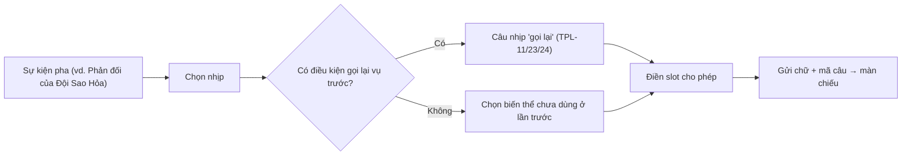

# G37 — Thẩm Phán Lá chạy bằng mẫu câu

> Phiên Tòa Tủ Lạnh. [PRD](../../foundation/game-line/phien-toa-tu-lanh-prd.md) §6.3 · [SRS](../../foundation/game-line/phien-toa-tu-lanh-srs.md)
> §3.8. Quyết định chung D7 (không AI ở MVP) — đề xuất, chờ owner. Trạng thái: nháp.

## 1. User story

Là cả phòng đang chơi, chúng tôi muốn có một vị thẩm phán giọng công đường, phản ứng với từng nhịp và nhớ vụ trước, nhưng không
bao giờ nói điều xúc phạm hay gán tội cho người thật, và không bao giờ "sập" giữa buổi.

## 2. Mục tiêu và ranh giới

### Mục tiêu

- Mỗi nhịp của buổi có câu Thẩm Phán phù hợp, ≥ 2 biến thể khi kho đủ.
- Không câu nào sinh lúc chạy; không phụ thuộc dịch vụ ngoài.
- Không câu nào gán hành vi cho biệt danh.

### Trong phạm vi

Kho mẫu câu có phiên bản; nhãn và slot; bộ điền slot; luật gọi lại vụ trước; không lặp liền; kiểm nội dung trước phát hành; mã câu
cho báo cáo; hiện chữ trên màn chiếu (âm thanh tuỳ chọn).

### Ngoài phạm vi

Thẩm phán AI (sau MVP, D7: chỉ nhãn vai và mã manh mối, không biệt danh, bộ lọc đầu ra, đánh giá chuyển dữ liệu ra nước ngoài);
giọng đọc máy.

## 3. Actor, điều kiện và output

- **Actor:** hệ thống; đội nội dung (biên tập kho); owner (duyệt văn phong).
- **Output:** câu đã điền slot kèm mã `TPL-xx` trong gói tin.

## 4. Luồng

## 5. Giao diện và trạng thái

- Câu Thẩm Phán hiện trong khung riêng trên màn chiếu (biểu tượng búa + "Thẩm Phán Lá"), chữ ≥ 56 px, đứng yên theo RP-NFR-17.
- Âm thanh (búa gõ) tuỳ chọn; mọi thông tin có ở chữ.
- Điện thoại không hiện câu Thẩm Phán (trừ trợ năng: nút "Đọc câu của tòa" cho người dùng trình đọc màn hình).

## 6. Quy tắc

Theo SRS PT-FR-80 đến PT-FR-83 và quy tắc slot ở PRD §6.3. Câu mới hoặc sửa nghĩa phải owner duyệt lại (chuẩn nội dung, mục "Duyệt
câu chữ"). Giọng: "Bao đại nhân" chung chung, câu ngắn, chủ động, không chửi thề, không miệt thị, không chọc vào danh tính, ngoại
hình, giới, gia đình, tiền bạc hay sức khoẻ (theo giọng Roast của chuẩn nội dung: trêu tình huống, không trêu người).

## 7. Tiêu chí chấp nhận

- **G37-AC01:** Kho có ≥ 20 câu (bản nháp hiện có 33), phủ mọi nhịp ở PRD §6.3; mỗi câu có mã, nhịp, nhãn, slot.
- **G37-AC02:** Kiểm tự động: mọi câu chứa `{biet_danh}` có nhãn `dong_vai` hoặc `khen`; không câu nào ghép `{biet_danh}` với động từ
  hành vi của vụ (PT-TH-04).
- **G37-AC03:** Kiểm tự động: không câu nào chứa từ trong danh sách nhóm chủ đề cấm và danh sách cụm từ không dùng của chuẩn nội dung.
- **G37-AC04:** Câu dùng slot ngoài danh sách cho phép bị chặn ở bước kiểm trước phát hành.
- **G37-AC05:** Không dùng lại đúng một câu ở hai lần liền của cùng nhịp khi nhịp có ≥ 2 biến thể.
- **G37-AC06:** Gọi lại vụ trước kích hoạt đúng điều kiện PT-FR-65 và chỉ dùng dữ liệu đội/nội dung vụ.
- **G37-AC07:** Tắt mạng ra ngoài của máy chủ game: Thẩm Phán vẫn chạy đủ (không gọi dịch vụ ngoài).
- **G37-AC08:** Gói tin câu Thẩm Phán có mã `TPL-xx`; báo cáo "Nội dung làm tôi khó chịu" lưu đúng mã này.
- **G37-AC09:** Owner duyệt văn phong toàn bộ kho (biên bản hoặc workbook).

## 8. Trường hợp biên

| Trường hợp | Cách xử lý |
|---|---|
| Biệt danh rất dài làm vỡ dòng | Cắt hiển thị ở 20 ký tự (đã là giới hạn); câu tự xuống dòng |
| Một câu bị báo cáo nhiều lần | Đội nội dung xem số đếm theo mã câu, sửa hoặc gỡ ở phiên bản sau |
| Đội tên trùng nhịp gọi lại liên tục | Tối đa một câu gọi lại mỗi vụ |

## 9. Definition of Done

- G37-AC01–AC09 pass.
- Kho câu nằm trong kho nội dung có phiên bản, có test kiểm slot và từ cấm.
- Không còn lỗi P0/P1.

## 10. Bàn giao

- **Nguồn:** báo cáo ("Thẩm Phán Lá chạy bằng mẫu câu ở MVP"; lý do: Death by AI sập dịch vụ, chi phí tiếng không phải tiếng Anh, gửi
  dữ liệu ra nước ngoài); research note §1, §3; chuẩn nội dung tiếng Việt dễ hiểu.
- **Đã xử lý:** nhãn `dong_vai`/`khen` cho mọi câu có biệt danh; kiểm tự động động từ gán hành vi.
- **Rủi ro mở:** PT-D5 (tên/hình "Lá" trong Lá Úp); kho 33 câu có thể lặp sau vài buổi.
- **AC/DoD chưa xong:** toàn bộ.
