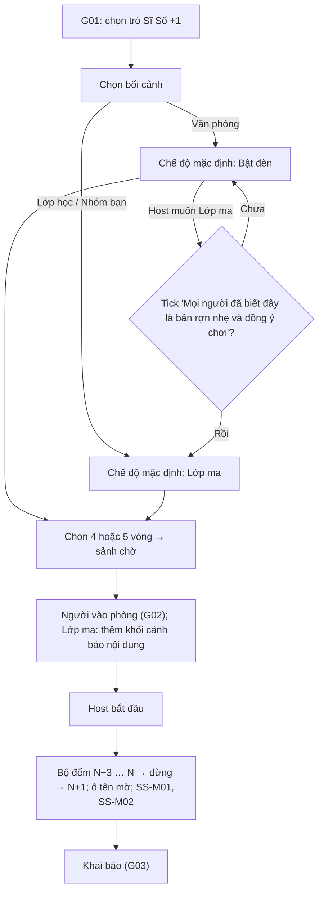

# G41 — Mở màn: chọn chế độ, cảnh báo nội dung và điểm danh ra N+1

> Sĩ Số +1. [PRD](../../foundation/game-line/si-so-cong-1-prd.md) §4.1, §4.3, §6.4 · [SRS](../../foundation/game-line/si-so-cong-1-srs.md)
> §3.1. Tạo phòng, màn chiếu: **G01**. Vào phòng, đồng ý, chỉ xem: **G02**. Quyết định chung D6 (văn phòng mặc định bật đèn) — đề xuất,
> chờ owner. Trạng thái: nháp.

## 1. User story

Là host, tôi muốn chọn bối cảnh phòng mình (văn phòng, lớp học, nhóm bạn) để trò tự chọn mức rợn phù hợp, và muốn cả phòng cùng thấy
khoảnh khắc sĩ số nhảy lên một người không có thật, để buổi chơi mở đầu bằng một cú "ơ" mà không ai sợ thật.

## 2. Mục tiêu và ranh giới

### Mục tiêu

- Văn phòng mặc định bật đèn; Lớp ma chỉ bật khi host xác nhận cả phòng đồng ý.
- Người vào phòng chế độ Lớp ma biết trước có yếu tố rợn và có lựa chọn chỉ xem.
- Cảnh N+1 gây "ơ" mà không nhấp nháy, không tiếng động lớn.

### Trong phạm vi

Chọn bối cảnh và chế độ; xác nhận chuyển văn phòng sang Lớp ma; số vòng; cảnh báo nội dung ở màn vào phòng; cảnh mở màn N+1 hai chế
độ; bản tĩnh khi giảm chuyển động.

### Ngoài phạm vi

G01, G02; chia vai (G42).

## 3. Actor, điều kiện và output

- **Actor:** host; người vào phòng; màn chiếu.
- **Output:** cấu hình: bối cảnh, chế độ, số vòng; cảnh mở màn đã chạy.

## 4. Luồng

## 5. Giao diện và trạng thái

| Nơi | Lớp ma | Bật đèn |
|---|---|---|
| Bảng host — chế độ | "Lớp ma — chuyện ma học đường, rợn nhẹ." | "Bật đèn — nhân viên mới bí ẩn, không yếu tố ma." |
| Màn vào phòng | Khối cảnh báo (SRS SS-FR-03) phía trên lời đồng ý; nút `Chỉ xem, không khai` ngang hàng | Không cảnh báo thêm |
| Màn chiếu mở màn | Nền tối, bộ đếm "Sĩ số", ô tên mờ, chữ hiện dần | Nền sáng, "Bảng chấm công", không nhiễu |
| Giảm chuyển động | Số hiện ngay, không hiệu ứng mờ; chữ hiện cả câu | Như trái |

## 6. Quy tắc

Theo SRS SS-FR-01 đến SS-FR-07. Mở màn không yêu cầu tắt đèn phòng; bảng host có dòng "Đừng tắt hết đèn phòng, giữ lối đi sáng".

## 7. Tiêu chí chấp nhận

- **G41-AC01:** Chọn bối cảnh Văn phòng → chế độ là Bật đèn; Lớp học/Nhóm bạn → Lớp ma.
- **G41-AC02:** Chuyển Văn phòng sang Lớp ma chỉ được khi tick ô xác nhận (mặc định trống).
- **G41-AC03:** Chế độ Lớp ma: màn vào phòng có khối cảnh báo nội dung trước lời đồng ý; nút chỉ xem ngang hàng nút chơi.
- **G41-AC04:** Bộ đếm dừng đúng ở N (số người chơi có vai) rồi hiện N+1; N lấy từ máy chủ, không tính khán giả.
- **G41-AC05:** Trình đọc màn hình đọc ô tên mờ là "Một cái tên không đọc được"; không dùng ký tự tổ hợp (zalgo) làm chữ thật.
- **G41-AC06:** Mọi hiệu ứng mở màn qua kiểm nhấp nháy (RP-TH-08); có bản tĩnh khi bật giảm chuyển động.
- **G41-AC07:** Không âm thanh mở màn nào lớn hơn mức nhạc nền đã đặt (đo dB tương đối trong file âm thanh).
- **G41-AC08:** Chế độ Bật đèn không chứa từ "ma", "hồn", "nhập", "thầy pháp" ở bất kỳ chữ nào trên màn chiếu hay điện thoại.
- **G41-AC09:** Chế độ và số vòng không đổi được sau khi bắt đầu.

## 8. Trường hợp biên

| Trường hợp | Cách xử lý |
|---|---|
| Có người vào muộn sau mở màn | Vào làm khán giả (RP-FR-16); N không đổi |
| N = 15, bộ đếm chạy từ 12 | Như thiết kế |
| Một người hoảng sợ ngay mở màn | Người đó chuyển chỉ xem trước khi khai báo đóng hoặc rời phòng (G08); host có thể tạm dừng (G06) |

## 9. Definition of Done

- G41-AC01–AC09 pass.
- Câu SS-M01, SS-M02 và cảnh báo nội dung được owner duyệt văn phong.
- Kiểm nhấp nháy và âm thanh trên máy chiếu thật.
- Không còn lỗi P0/P1.

## 10. Bàn giao

- **Nguồn:** báo cáo (mở màn 27…30 → 31; "Cảm ơn lớp đã cho tôi vào"; bật đèn cho văn phòng); research note risks §1, §5 (hoảng loạn đạo
  đức, khung "dark mystical").
- **Đã xử lý:** cảnh báo nội dung, xác nhận khi chuyển văn phòng sang Lớp ma, không tắt đèn phòng, không zalgo.
- **Rủi ro mở:** D6, SS-D9.
- **AC/DoD chưa xong:** toàn bộ.
