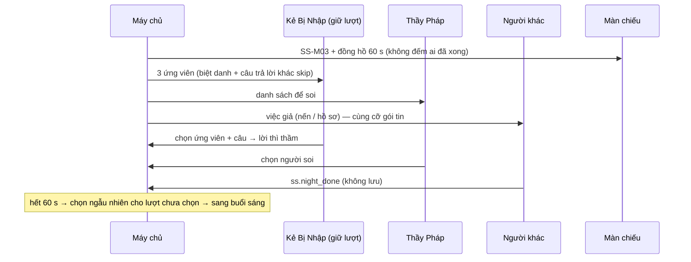

# G42 — Nhận vai, chọn dãy bàn và pha đêm

> Sĩ Số +1. [PRD](../../foundation/game-line/si-so-cong-1-prd.md) §4.1, §5 · [SRS](../../foundation/game-line/si-so-cong-1-srs.md) §3.2,
> §3.3. Khai báo 5 câu: **G03**. Chia vai bí mật, thẻ úp, gói tin đồng dạng: **G04**. Lượt chọn bí mật dùng khung phiếu: **G05**.
> Hồn chọn chữ trong đêm: **G45**. Trạng thái: nháp.

## 1. User story

Là Kẻ Bị Nhập, tôi muốn mỗi đêm được đưa 3 ứng viên và chọn một câu trả lời vô hại của người mình chọn để con ma kể lại, trong khi
người ngồi cạnh tôi cũng đang chạm điện thoại y như tôi, để không ai đoán được ai đang hành động.

## 2. Mục tiêu và ranh giới

### Mục tiêu

- Đêm 60 giây, mọi điện thoại có một việc giống nhau về bố cục.
- Không ai bị chọn hai lần; ứng viên rải đều.
- Kẻ Bị Nhập chỉ thấy câu trả lời của 3 ứng viên của mình.

### Trong phạm vi

Chia vai (Người Sống, Kẻ Bị Nhập, Thầy Pháp); đồng bọn; chọn dãy bàn (N ≥ 25); số lượt bắt; chọn ứng viên; phiếu bắt + lời thì thầm;
Thầy Pháp soi; việc giả không lưu; hết giờ.

### Ngoài phạm vi

Buổi sáng (G43); Hồn (G45); cơ chế chung (G03–G05).

## 3. Actor, điều kiện và output

- **Actor:** Kẻ Bị Nhập giữ lượt, Thầy Pháp, mọi người chơi khác, máy chủ.
- **Output:** vai, dãy; lời thì thầm; phiếu `ss_night_capture`, `ss_seer_check`; không có bản ghi việc giả.

## 4. Luồng

## 5. Giao diện và trạng thái

| Vai | Màn đêm trên điện thoại |
|---|---|
| Kẻ Bị Nhập giữ lượt | Bước 1: 3 thẻ ứng viên (biệt danh). Bước 2: các câu trả lời của người đã chọn ("Bữa sáng: bánh mì trứng"…), chọn một để thì thầm. Nút `Thì thầm` |
| Kẻ Bị Nhập không giữ lượt | Việc giả + dòng "Đêm nay `{biet_danh}` giữ lượt" |
| Thầy Pháp | Danh sách người còn trong cuộc, chọn một để soi |
| Người Sống, Ngoài Hành Lang | Việc giả: chạm thắp 3 ngọn nến (Lớp ma) / xếp 3 tập hồ sơ (Bật đèn) |
| Khán giả | "Đêm xuống" |

Mọi màn đêm có cùng khung, cùng thời gian chạm ước lượng (3 chạm), cùng nút cuối. Thẻ vai lúc nhận vai theo G04, câu thẻ: Người Sống
"Tìm và trục xuất Kẻ Bị Nhập."; Kẻ Bị Nhập "Bạn giúp Người thứ N+1. Đồng bọn: … Mỗi đêm người giữ lượt chọn một người và một câu trả lời
để con ma kể."; Thầy Pháp "Mỗi đêm soi một người."

## 6. Quy tắc

Theo SRS SS-FR-10 đến SS-FR-28, SS-SEC-02, SS-SEC-04.

## 7. Tiêu chí chấp nhận

- **G42-AC01:** Số Kẻ Bị Nhập, Thầy Pháp, số lượt bắt mỗi đêm và số dãy đúng PRD §5.2 với 15, 24, 25, 39, 40, 50 người (SS-TH-02).
- **G42-AC02:** Kẻ Bị Nhập thấy biệt danh đồng bọn; người khác không nhận dữ liệu này (G04-AC02).
- **G42-AC03:** N ≥ 25: mọi người chọn được dãy trong 30 s; người không chọn được gán vào dãy ít người nhất.
- **G42-AC04:** Ứng viên chỉ gồm Người Sống/Thầy Pháp còn trong cuộc, không vắng, có ≥ 2 câu khác `skip`; các lượt trong một đêm không
  trùng ứng viên.
- **G42-AC05:** Trên 1.000 buổi giả lập: không ai bị bắt hai lần; số lần làm ứng viên giữa người đủ điều kiện lệch ≤ 1 trong buổi khi có
  thể (SS-TH-03).
- **G42-AC06:** Điện thoại Kẻ Bị Nhập chỉ nhận câu trả lời của 3 ứng viên của mình, không có câu `skip`.
- **G42-AC07:** Gói tin đêm và lệnh lên của mọi vai cùng cỡ (SS-TH-06); đêm không đóng sớm; màn chiếu không hiện "đã xong x/y".
- **G42-AC08:** Hết giờ: lượt bắt chưa chọn được máy chủ chọn ngẫu nhiên ứng viên và câu; Thầy Pháp chưa chọn thì không soi.
- **G42-AC09:** Kiểm kho sau đêm: không có bản ghi nào của việc giả.
- **G42-AC10:** Không đủ người đủ điều kiện ứng viên: số lượt bắt giảm theo SRS SS-FR-21; không còn ai: đêm không có lượt bắt.

## 8. Trường hợp biên

| Trường hợp | Cách xử lý |
|---|---|
| Kẻ Bị Nhập giữ lượt vắng | Máy chủ chọn ngẫu nhiên |
| Ứng viên rời phòng giữa đêm | Bị gỡ khỏi thẻ; nếu đã được chọn, buổi sáng hiện "Người đã rời" (SRS §3.10) |
| Thầy Pháp soi đúng một Kẻ Bị Nhập | Kết quả riêng ở buổi sáng (G43) |
| Nhiều người chọn "Không muốn nói" | Ít người đủ điều kiện ứng viên; số lượt bắt giảm |

## 9. Definition of Done

- G42-AC01–AC10 pass.
- Câu thẻ vai và việc giả được owner duyệt văn phong.
- Review bảo mật payload đêm.
- Không còn lỗi P0/P1.

## 10. Bàn giao

- **Nguồn:** báo cáo ("Ai cũng làm một việc giả… 3 ứng viên ngẫu nhiên… không ai bị chọn hai lần"); research note §1 (đêm dài làm chậm
  ván lớn).
- **Đã xử lý:** việc giả không lưu; ưu tiên người ít làm ứng viên; đêm không đóng sớm.
- **Rủi ro mở:** SS-D2, SS-D7.
- **AC/DoD chưa xong:** toàn bộ.
