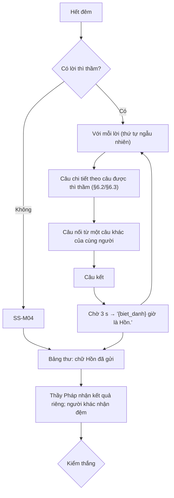

# G43 — Buổi sáng: Người thứ N+1 nói một chi tiết thật

> Sĩ Số +1. [PRD](../../foundation/game-line/si-so-cong-1-prd.md) §4.1, §6.1–§6.3 · [SRS](../../foundation/game-line/si-so-cong-1-srs.md)
> §3.4. Trạng thái: nháp; ngân hàng câu chờ owner duyệt văn phong.

## 1. User story

Là người chơi, tôi muốn nghe con ma nói ra một chi tiết thật về một người trong phòng ("Sáng nay có người ăn bánh mì trứng… người đó đang
mặc áo xanh dương") để cả phòng quay sang nhìn nhau, rồi biết ai vừa thành Hồn, mà không ai bị nói điều gì ngoài câu trả lời vô hại họ đã
đồng ý cho hiện.

## 2. Mục tiêu và ranh giới

### Mục tiêu

- Khoảnh khắc "sao nó biết" mỗi buổi sáng.
- Câu chữ rợn vừa đủ, không doạ, không nói điều gì mới về người chơi.
- Thầy Pháp nhận kết quả mà không ai biết ai là Thầy Pháp.

### Trong phạm vi

Ghép lời buổi sáng (câu chi tiết + câu nối + câu kết + dòng biệt danh); nhiều lượt bắt; đêm không ai bị bắt; người bị bắt thành Hồn; kết
quả Thầy Pháp; bảng thư; kiểm thắng.

### Ngoài phạm vi

Thẻ Hồn và gửi chữ (G45); ban ngày (G44).

## 3. Actor, điều kiện và output

- **Actor:** máy chủ, màn chiếu, người bị bắt, Thầy Pháp.
- **Điều kiện:** đêm đã kết thúc (G42).
- **Output:** trạng thái `hon` cho người bị bắt; câu đã dùng (để tránh lặp).

## 4. Luồng

## 5. Giao diện và trạng thái

- Màn chiếu Lớp ma: nền tối, từng câu hiện dần (không chớp), chữ ≥ 56 px; dòng biệt danh hiện sau 3 s.
- Màn chiếu Bật đèn: nền sáng, giọng "em" của nhân viên mới; dòng "`{biet_danh}` đang đi họp."
- Điện thoại người bị bắt: chuyển sang thẻ Hồn (G45) đúng lúc dòng biệt danh hiện, không sớm hơn.
- Điện thoại Thầy Pháp: "`{biet_danh}`: bị nhập / không bị nhập"; người khác: thẻ cùng cỡ "Trời sáng rồi."
- Bảng thư: mỗi Hồn một cột, ghi biệt danh Hồn và các chữ đã gửi.

## 6. Quy tắc

Theo SRS SS-FR-30 đến SS-FR-35, SS-PRV-02. Câu `skip` không bao giờ được dùng. Câu chi tiết luôn đúng câu được Kẻ Bị Nhập thì thầm; câu
nối do máy chủ chọn trong các câu khác `skip` còn lại.

## 7. Tiêu chí chấp nhận

- **G43-AC01:** Câu chi tiết dùng đúng câu và phương án trong lời thì thầm; câu nối dùng một câu khác `skip` khác câu đó của cùng người.
- **G43-AC02:** Không lời buổi sáng nào chứa phương án `skip` hay dữ liệu ngoài 5 câu.
- **G43-AC03:** Trong một buổi, cùng một câu chi tiết không lặp khi kho còn câu chưa dùng cho trường đó.
- **G43-AC04:** Dòng biệt danh hiện sau câu kết ≥ 3 s; điện thoại người bị bắt chuyển sang thẻ Hồn cùng lúc đó (± 300 ms).
- **G43-AC05:** Hai hoặc ba lượt bắt: các lời hiện lần lượt, mỗi lời 15–20 s, tổng buổi sáng ≤ 75 s.
- **G43-AC06:** Đêm không có lượt bắt: SS-M04, không ai thành Hồn.
- **G43-AC07:** Kết quả Thầy Pháp chỉ ở điện thoại Thầy Pháp; gói `ss.seer_result` của mọi người cùng cỡ.
- **G43-AC08:** Chế độ Bật đèn chỉ dùng câu SS-B*, SS-N* (cột bật đèn) và SS-BK*; không có từ thuộc nhóm ma.
- **G43-AC09:** Rà kho câu (SS-TH-04): không chết, máu, giết, tự tử, nguyền, nghi lễ tôn giáo; không nhóm chủ đề cấm.
- **G43-AC10:** Người bị bắt đã rời trước buổi sáng: lời vẫn hiện, dòng biệt danh là "Người đã rời", không có Hồn mới.

## 8. Trường hợp biên

| Trường hợp | Cách xử lý |
|---|---|
| Người bị bắt chỉ có đúng 2 câu khác `skip` | Câu chi tiết từ câu được thì thầm, câu nối từ câu còn lại |
| Hai người bị bắt có cùng câu trả lời được thì thầm | Dùng hai câu chi tiết khác nhau |
| Câu ghép quá dài với biệt danh dài | Mỗi câu hiện riêng, không ghép thành một dòng |

## 9. Definition of Done

- G43-AC01–AC10 pass.
- Kho 30 câu chi tiết Lớp ma, 10 câu bật đèn, câu nối, câu kết được owner duyệt văn phong.
- Kiểm nhấp nháy chữ hiện dần.
- Không còn lỗi P0/P1.

## 10. Bàn giao

- **Nguồn:** báo cáo ("Con ma nói một chi tiết thật… Người đó thành Hồn"); PRD §6.
- **Đã xử lý:** tách câu chi tiết / câu nối / câu kết để câu tự nhiên; không dùng `skip`; đồng bộ thẻ Hồn với dòng biệt danh.
- **Rủi ro mở:** SS-D3 (hiện biệt danh người bị bắt).
- **AC/DoD chưa xong:** toàn bộ.
