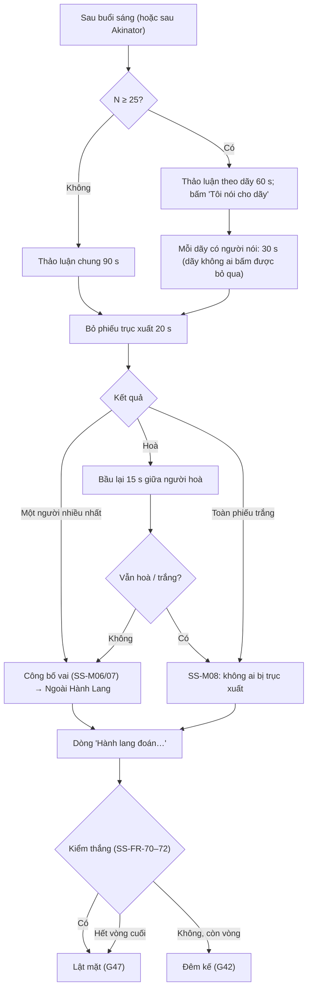

# G44 — Ban ngày: thảo luận theo dãy bàn, bỏ phiếu trục xuất, thắng thua

> Sĩ Số +1. [PRD](../../foundation/game-line/si-so-cong-1-prd.md) §4.1, §4.2 · [SRS](../../foundation/game-line/si-so-cong-1-srs.md) §3.5,
> §3.8. Phiếu đồng thời: **G05**. Trạng thái: nháp.

## 1. User story

Là người chơi trong một lớp 40 người, tôi muốn được bàn với dãy của mình thay vì cả lớp nói chồng lên nhau, có người tình nguyện nói thay
dãy trong 30 giây, rồi cả lớp bỏ phiếu cùng lúc, để ai cũng có tiếng nói mà không ai bị ép đứng lên.

## 2. Mục tiêu và ranh giới

### Mục tiêu

- Lớp đông thảo luận song song theo dãy; lớp nhỏ thảo luận chung.
- Người nói là tình nguyện, không bị chỉ định.
- Trục xuất chỉ lật vai; người bị trục xuất vẫn còn việc.

### Trong phạm vi

Thảo luận; dãy và người nói; phiếu trục xuất; bầu lại khi hoà; công bố vai; Ngoài Hành Lang và phiếu đoán không tính; kiểm thắng (ngay và
hết vòng).

### Ngoài phạm vi

Akinator (G46, chen trước ban ngày ở vòng 3); khung phiếu (G05).

## 3. Actor, điều kiện và output

- **Actor:** người chơi còn trong cuộc (bầu), Ngoài Hành Lang (đoán không tính), máy chủ.
- **Output:** phiếu `ss_day_vote`, `ss_day_revote`, `ss_hallway_guess`; người bị trục xuất; kết quả thắng thua nếu có.

## 4. Luồng

## 5. Giao diện và trạng thái

| Nơi | Nội dung |
|---|---|
| Màn chiếu — thảo luận | SS-M05, đồng hồ; N ≥ 25: ba khung dãy, mỗi khung ghi người nói đã đăng ký (nếu có) |
| Màn chiếu — người nói | "Dãy 2 — `{biet_danh}` đang nói", đồng hồ 30 s |
| Điện thoại — thảo luận | Nút "Tôi nói cho dãy" (chỉ khi N ≥ 25, tắt khi dãy đã có người) |
| Điện thoại — bỏ phiếu | Danh sách người còn trong cuộc (tìm theo biệt danh), phiếu trắng |
| Điện thoại Hồn / Ngoài Hành Lang | "Bạn không bỏ phiếu trục xuất." + (Ngoài Hành Lang) phiếu đoán không tính |
| Màn chiếu — công bố | Biệt danh + vai theo chế độ |

## 6. Quy tắc

Theo SRS SS-FR-40 đến SS-FR-46, SS-FR-70 đến SS-FR-73. Không ai bị hệ thống gọi tên để phải nói. Không hiện ai bầu ai.

## 7. Tiêu chí chấp nhận

- **G44-AC01:** N < 25: thảo luận 90 s chung, không có dãy; N ≥ 25: thảo luận theo dãy 60 s và người nói 30 s mỗi dãy có người.
- **G44-AC02:** Người nói là người bấm đầu tiên trong dãy; dãy không ai bấm được bỏ qua, không chỉ định.
- **G44-AC03:** Chỉ người còn trong cuộc được bầu và được bầu chọn; Hồn, Ngoài Hành Lang, khán giả gửi `ss_day_vote` → `not_allowed`.
- **G44-AC04:** Hoà → bầu lại 15 s giữa người hoà; vẫn hoà hoặc trắng hết → không ai bị trục xuất.
- **G44-AC05:** Công bố hiện đúng vai theo tên chế độ; người bị trục xuất chuyển Ngoài Hành Lang, vẫn nhận việc giả ban đêm và phiếu đoán.
- **G44-AC06:** Phiếu đoán của Ngoài Hành Lang không ảnh hưởng kết quả; hiện sau khi phiếu trục xuất đóng.
- **G44-AC07:** Thắng thua đúng SS-FR-70–72 trên bảng tình huống (trục xuất hết; Hồn ≥ ⌈N/2⌉; Kẻ Bị Nhập ≥ phe còn lại; hết vòng với ≥ /
  < một nửa Kẻ Bị Nhập bị trục xuất; Kẻ Bị Nhập rời phòng).
- **G44-AC08:** Không gói tin nào mang ánh xạ người → phiếu (G05-AC05).

## 8. Trường hợp biên

| Trường hợp | Cách xử lý |
|---|---|
| Dãy lệch người (một dãy 25 người) | Host "Chia đều lại" (G04 trường hợp biên) trước vòng 1 |
| Người nói rời phòng giữa 30 s | Hết lượt dãy đó |
| Mọi Kẻ Bị Nhập đã rời phòng | Người Sống thắng ngay (SS-FR-70), nhưng không tính là trục xuất |

## 9. Definition of Done

- G44-AC01–AC08 pass.
- Câu SS-M05–SS-M08 được owner duyệt văn phong.
- Chơi thử giấy đo tỷ lệ người từng lên tiếng ở lớp 25–50.
- Không còn lỗi P0/P1.

## 10. Bàn giao

- **Nguồn:** báo cáo ("Lớp đông chia 2–3 dãy bàn… mỗi dãy cử một người nói 30 giây"; thắng thua); research note §1, §5.
- **Đã xử lý:** người nói tình nguyện; luật hết vòng; Ngoài Hành Lang còn việc.
- **Rủi ro mở:** SS-D2, SS-D6.
- **AC/DoD chưa xong:** toàn bộ.
