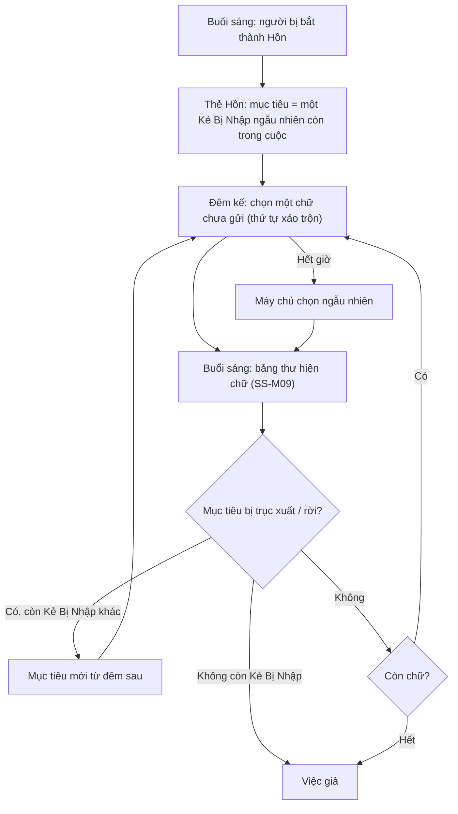

# G45 — Hồn gửi chữ cái

> Sĩ Số +1. [PRD](../../foundation/game-line/si-so-cong-1-prd.md) §5.1 · [SRS](../../foundation/game-line/si-so-cong-1-srs.md) §3.6.
> Khung phiếu: **G05**. Trạng thái: nháp.

## 1. User story

Là người vừa bị con ma "bắt", tôi muốn vẫn được chơi: con ma lỡ để lộ tên một Kẻ Bị Nhập, và mỗi đêm tôi gửi một chữ cái trong tên đó lên bảng thư cho cả lớp, để bị
bắt không có nghĩa là bị gạt ra ngoài.

## 2. Mục tiêu và ranh giới

### Mục tiêu

- Hồn có một việc có ý nghĩa mỗi đêm.
- Chữ cái giúp Người Sống mà không lộ cả tên ngay.
- Luật "Hồn chỉ nói bằng chữ" rõ ràng.

### Trong phạm vi

Thẻ Hồn; mục tiêu; chọn chữ; chuẩn hoá chữ; đổi mục tiêu khi Kẻ Bị Nhập bị trục xuất/rời; hết chữ; bảng thư; quyền còn lại của Hồn.

### Ngoài phạm vi

Ghép lời buổi sáng (G43).

## 3. Actor, điều kiện và output

- **Actor:** Hồn; máy chủ; màn chiếu.
- **Output:** phiếu `ss_ghost_letter`; bảng thư.

## 4. Luồng

## 5. Giao diện và trạng thái

- Thẻ Hồn (Lớp ma): "Bạn đã thành Hồn. Con ma để lộ một cái tên: `{biet_danh}` là Kẻ Bị Nhập. Mỗi đêm, gửi một chữ cái trong tên đó cho cả
  lớp. Hồn chỉ nói bằng chữ." Bật đèn: "Bạn đang đi họp. Em nhân viên mới lỡ nói: `{biet_danh}` là Người Được Nhờ. Mỗi giờ nghỉ trưa, nhắn
  về một chữ cái trong tên đó. Người đi họp chỉ nhắn bằng chữ."
- Đêm: các ô chữ cái (xáo trộn), chữ đã gửi mờ đi; nút `Gửi chữ`.
- Ban ngày: "Bạn không bỏ phiếu trục xuất. Bảng thư đang giúp cả lớp."
- Bảng thư trên màn chiếu: cột theo Hồn, không hiện số ô trống hay độ dài tên.

## 6. Quy tắc

Theo SRS SS-FR-50 đến SS-FR-54. Chữ chuẩn hoá: bỏ dấu, viết hoa, giữ A–Z và 0–9 (ví dụ "Đức Anh" → D, U, C, A, N, H).

## 7. Tiêu chí chấp nhận

- **G45-AC01:** Thẻ Hồn hiện biệt danh một Kẻ Bị Nhập còn trong cuộc, bốc ngẫu nhiên, độc lập với việc ai đã chọn người đó (SS-TH-09); người
  khác không nhận dữ liệu này.
- **G45-AC02:** Chữ chuẩn hoá đúng với biệt danh có dấu, khoảng trắng, số, ký tự `-_.`.
- **G45-AC03:** Mỗi đêm Hồn gửi đúng một chữ chưa gửi; chữ lặp trong tên tính theo vị trí; hết giờ máy chủ chọn ngẫu nhiên.
- **G45-AC04:** Bảng thư không lộ độ dài biệt danh mục tiêu.
- **G45-AC05:** Mục tiêu bị trục xuất hoặc rời: từ đêm sau Hồn nhận mục tiêu mới (Kẻ Bị Nhập còn lại, ngẫu nhiên) và thẻ cập nhật; không
  còn ai thì làm việc giả.
- **G45-AC06:** Hồn gửi `ss_day_vote` → `not_allowed`; Hồn vẫn trả lời được Akinator (G46) và thấy màn lật.
- **G45-AC07:** Gói tin đêm của Hồn cùng cỡ với mọi vai (SS-TH-06).
- **G45-AC08:** Hồn rời phòng: cột thư giữ chữ đã gửi, tên cột "Người đã rời".

## 8. Trường hợp biên

| Trường hợp | Cách xử lý |
|---|---|
| Hồn nói to tên Kẻ Bị Nhập | Trái luật chơi xã hội; host nhắc; không có cơ chế phạt (SS-D4 theo dõi qua chơi thử) |
| Hai Hồn cùng mục tiêu | Mỗi Hồn gửi chữ riêng; có thể trùng chữ |
| Biệt danh mục tiêu toàn ký tự bị bỏ khi chuẩn hoá | Không thể xảy ra vì biệt danh cần chữ/số (RP-FR-13); nếu có, Hồn làm việc giả |

## 9. Definition of Done

- G45-AC01–AC08 pass.
- Câu thẻ Hồn hai chế độ được owner duyệt văn phong.
- Không còn lỗi P0/P1.

## 10. Bàn giao

- **Nguồn:** báo cáo ("Hồn — không rời cuộc chơi. Mỗi vòng gửi cho người sống một chữ cái, ghép lại ra biệt danh một Kẻ Bị Nhập"; "Hồn
  vẫn có quyền").
- **Đã xử lý:** mục tiêu ngẫu nhiên để không lộ "ai chọn ai" (DPIA R10); bảng thư không lộ độ dài tên.
- **Rủi ro mở:** SS-D4.
- **AC/DoD chưa xong:** toàn bộ.
