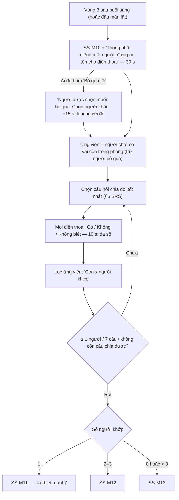

# G46 — Khoảnh khắc Akinator

> Sĩ Số +1. [PRD](../../foundation/game-line/si-so-cong-1-prd.md) §4.1, §6.4 (SS-M10–SS-M13) · [SRS](../../foundation/game-line/si-so-cong-1-srs.md)
> §3.7, §6. Khung phiếu: **G05**. Trạng thái: nháp.

## 1. User story

Là cả lớp, chúng tôi muốn cùng nghĩ về một người trong phòng, trả lời vài câu có/không trên điện thoại, và nghe con ma đọc đúng biệt danh
người đó, để có một khoảnh khắc "sao nó biết" — và cuối buổi được biết nó làm thế nào.

## 2. Mục tiêu và ranh giới

### Mục tiêu

- ≤ 2 phút, ≤ 7 câu hỏi.
- Hệ thống không biết người được chọn; chỉ suy ra từ đáp án của cả phòng.
- Người được chọn có quyền nói "bỏ qua tôi".

### Trong phạm vi

Mở vòng; nút "Bỏ qua tôi"; câu hỏi có/không/không biết theo đa số; chọn câu hỏi bằng cây quyết định; kết quả 1 / 2–3 / 0 hoặc nhiều người;
thời điểm chạy (vòng 3 hoặc đầu màn lật).

### Ngoài phạm vi

AI; dùng vai, phiếu hay lời thì thầm trong cây hỏi.

## 3. Actor, điều kiện và output

- **Actor:** mọi điện thoại trong phòng (SS-D5), máy chủ.
- **Output:** phiếu `ss_akinator_answer`; kết quả trên màn chiếu.

## 4. Luồng

## 5. Giao diện và trạng thái

- Màn chiếu: câu hỏi chữ lớn, đồng hồ 10 s, "Còn `x` người khớp"; kết quả theo chế độ.
- Điện thoại: ba nút lớn `Có` · `Không` · `Không biết`; 30 s đầu có thêm nút nhỏ "Bỏ qua tôi" kèm dòng "Bấm nếu bạn là người cả phòng vừa
  chọn và không muốn bị đoán".
- Trạng thái: `chọn người`, `có người bỏ qua`, `đang hỏi (k/7)`, `kết quả`.

## 6. Quy tắc

Theo SRS SS-FR-60 đến SS-FR-66 và §6. Câu hỏi chỉ nói về 5 câu vô hại, không nhắc tên ai. Đáp án là đa số; hoà là "Không biết".

## 7. Tiêu chí chấp nhận

- **G46-AC01:** Vòng chạy ở vòng 3; nếu ván kết thúc trước vòng 3, chạy ở đầu màn lật.
- **G46-AC02:** Người bấm "Bỏ qua tôi" bị loại khỏi ứng viên; màn chiếu chỉ hiện câu chung, không hiện ai bấm.
- **G46-AC03:** Mỗi câu hỏi chọn theo luật `min max(|có|+|chưa biết|, |không|+|chưa biết|)`; không hỏi câu không chia được.
- **G46-AC04:** Đáp án `Không biết` không lọc và bỏ các câu cùng trường khỏi lượt.
- **G46-AC05:** Dừng đúng khi ≤ 1 ứng viên, đủ 7 câu, hoặc hết câu chia được; kết quả dùng đúng SS-M11/12/13.
- **G46-AC06:** Cây hỏi không đọc vai, phiếu, lời thì thầm (kiểm bằng test: đổi vai không đổi chuỗi câu hỏi với cùng hạt giống và đáp án).
- **G46-AC07:** SS-TH-05: phòng 30 người, ≤ 20% `skip`, đáp án đúng theo người X → kết thúc ở tập chứa X trong ≤ 7 câu với tỉ lệ ≥ 80%.
- **G46-AC08:** Khán giả, Hồn, Ngoài Hành Lang trả lời được; người đã rời không phải ứng viên.
- **G46-AC09:** Câu hỏi trong kho được owner duyệt văn phong và không chạm nhóm chủ đề cấm.

## 8. Trường hợp biên

| Trường hợp | Cách xử lý |
|---|---|
| Phòng không thống nhất được một người | Đáp án đa số lẫn lộn → thường ra 0 người → SS-M13, vẫn vui |
| Người được chọn đã chọn "Không muốn nói" nhiều câu | Họ ở nhánh "chưa biết" và có thể còn lại cùng người khác → SS-M12 |
| Ai đó cố tình trả lời sai | Đa số quyết; một vài phiếu lệch không đổi kết quả |

## 9. Definition of Done

- G46-AC01–AC09 pass.
- Màn lật (G47) giải thích Akinator chạy bằng câu có/không trên 5 câu trả lời.
- Không còn lỗi P0/P1.

## 10. Bàn giao

- **Nguồn:** báo cáo ("Khoảnh khắc Akinator… cây quyết định dựng từ 5 câu trả lời"; Akinator hơn 100 triệu lượt cài — AppBrain qua báo cáo).
- **Đã xử lý:** quyền "Bỏ qua tôi"; hệ thống không biết người được chọn; cây không dùng dữ liệu vai.
- **Rủi ro mở:** SS-D5; độ phân biệt ở phòng đông có nhiều câu trả lời giống nhau.
- **AC/DoD chưa xong:** toàn bộ.
