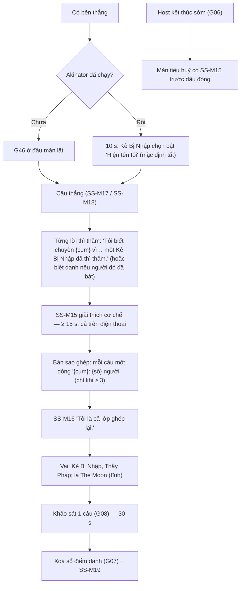

# G47 — Lật mặt: lời thì thầm, giải thích cơ chế, bản sao ghép từ cả lớp, xoá sổ

> Sĩ Số +1. [PRD](../../foundation/game-line/si-so-cong-1-prd.md) §2.3, §4.1, §6.4 (SS-M14–SS-M19) ·
> [SRS](../../foundation/game-line/si-so-cong-1-srs.md) §3.9. Câu khảo sát: **G08**. Tiêu huỷ hồ sơ: **G07**. Nút kết thúc của host:
> **G06**. Trạng thái: nháp.

## 1. User story

Là người chơi vừa trải qua 25 phút rợn nhẹ, tôi muốn thấy con ma biết mọi chuyện bằng cách nào — từng lời thì thầm, và "Người thứ 31" thật ra
là bản ghép từ câu trả lời của cả lớp — rồi thấy hồ sơ bị xoá, để tôi ra về với tiếng cười chứ không với nỗi sợ.

## 2. Mục tiêu và ranh giới

### Mục tiêu

- Không buổi nào kết thúc mà không giải thích cơ chế (bài học Momo).
- Bản sao ghép chỉ bằng số đếm, không lộ ai chọn gì.
- Kết bằng xoá sổ điểm danh thật (G07).

### Trong phạm vi

Công tắc "Hiện tên tôi" cho Kẻ Bị Nhập (mặc định tắt); câu thắng; từng lời thì thầm; câu giải thích bắt buộc; bản sao ghép (số đếm, ẩn phương án < 3 người); danh sách vai;
lá The Moon tĩnh; khảo sát; xoá sổ; giải thích khi host kết thúc sớm.

### Ngoài phạm vi

Thẻ chia sẻ; cầu nối The Moon về Lá Lành (sau MVP); "tập sau".

## 3. Actor, điều kiện và output

- **Actor:** máy chủ, màn chiếu, mọi điện thoại.
- **Điều kiện:** có bên thắng (SS-FR-70–72), hoặc host kết thúc sớm.
- **Output:** số đếm khảo sát; phòng `ended` → `purged`.

## 4. Luồng

## 5. Giao diện và trạng thái

- Lời thì thầm hiện lần lượt theo đêm, mỗi lời 6–8 s; mặc định "một Kẻ Bị Nhập"; biệt danh chỉ khi người đó đã bật công tắc.
- Điện thoại Kẻ Bị Nhập, 10 s đầu: công tắc "Hiện tên tôi ở lời thì thầm" (mặc định tắt) kèm dòng "Tắt thì màn chiếu chỉ nói 'một Kẻ Bị Nhập'."
- Câu giải thích: khung sáng (cả chế độ Lớp ma), chữ lớn, đứng yên ≥ 15 s; điện thoại hiện cùng câu kèm "Không có con ma nào. Bạn có thể
  kể lại trò này cho người khác mà không sợ gì cả."
- Bản sao ghép: hình bóng người ghép từ 5 mảnh, mỗi mảnh một dòng ("ăn bánh mì trứng — 8 người", "mặc áo đen — 11 người"…); câu có
  phương án nhiều nhất < 3 người hiện "mỗi người một kiểu".
- Lá The Moon: hình tĩnh, chú thích một dòng "Lá Mặt Trăng: thứ ta sợ thường là thứ ta chưa thấy rõ." (nháp, chờ owner duyệt).

## 6. Quy tắc

Theo SRS SS-FR-80 đến SS-FR-84, SS-PRV-03, SS-PRV-04, SS-PRV-05. Không thẻ chia sẻ, không link, không lời mời "chơi tiếp tập sau".

## 7. Tiêu chí chấp nhận

- **G47-AC01:** Mọi lời thì thầm của buổi được kể lại đúng thứ tự đêm và đúng cụm; mặc định nêu "một Kẻ Bị Nhập"; chỉ nêu biệt danh khi chính
  Kẻ Bị Nhập đó đã bật công tắc (mặc định tắt) trong 10 s đầu (SS-TH-09).
- **G47-AC02:** Câu SS-M15 hiện ≥ 15 s trên màn chiếu và trên mọi điện thoại; không có nút bỏ qua riêng cho câu này (host bỏ qua cả màn
  thì vẫn chạy G07 kèm SS-M15).
- **G47-AC03:** Bản sao ghép: mỗi câu lấy phương án nhiều người nhất (không tính `skip`); chỉ hiện số khi ≥ 3; không hiện biệt danh hay ai
  chọn gì (SS-TH-07).
- **G47-AC04:** Danh sách vai cuối chỉ hiện Kẻ Bị Nhập và Thầy Pháp; Người Sống không cần liệt kê.
- **G47-AC05:** Lá The Moon là ảnh tĩnh đóng gói, không link, không tải từ nguồn ngoài.
- **G47-AC06:** Câu khảo sát "Có lúc nào bạn thấy bị nhắm vào hoặc sợ thật không?" chỉ lưu số đếm (G08-AC08).
- **G47-AC07:** Sau khảo sát, G07 chạy với SS-M19; số trên màn tiêu huỷ khớp số hàng đã xoá.
- **G47-AC08:** Host kết thúc ở bất kỳ pha nào sau mở màn → màn tiêu huỷ có SS-M15 (SS-TH-08).
- **G47-AC09:** Màn kết thúc không có thẻ chia sẻ, link, lời mời "tập sau" hay yêu cầu gửi cho người khác.
- **G47-AC10:** Chế độ Bật đèn dùng cột bật đèn của SS-M14–SS-M19.

## 8. Trường hợp biên

| Trường hợp | Cách xử lý |
|---|---|
| Không có lượt bắt nào cả buổi | Bỏ phần lời thì thầm; vẫn giải thích và bản sao ghép |
| Ít người chơi trả lời một câu (đa số `skip`) | Câu đó "mỗi người một kiểu" |
| Mất kết nối màn chiếu trong màn lật | Điện thoại vẫn hiện câu giải thích; G07 vẫn chạy |

## 9. Definition of Done

- G47-AC01–AC10 pass.
- Câu SS-M14–SS-M19 và chú thích The Moon được owner duyệt văn phong.
- DPIA ghi rõ màn lật hiện ai đã thì thầm (một phần luật chơi đã nêu ở lời đồng ý) và bản sao ghép chỉ là số đếm.
- Không còn lỗi P0/P1.

## 10. Bàn giao

- **Nguồn:** báo cáo (màn lật mặt, "bản sao ghép từ câu trả lời của cả phòng… chỉ số đếm tổng hợp", "luôn giải thích cơ chế ở cuối"); research
  note risks §1 (Momo).
- **Đã xử lý:** giải thích bắt buộc kể cả khi kết thúc sớm; ẩn phương án < 3 người (DPIA KS-04); mặc định không nêu ai đã thì thầm (DPIA DP-1);
  không thẻ chia sẻ.
- **Rủi ro mở:** SS-D10 — owner chọn giữa mặc định riêng tư này và bản gốc của báo cáo (nêu tên, vui hơn nhưng lộ "ai chọn ai").
- **AC/DoD chưa xong:** toàn bộ.
