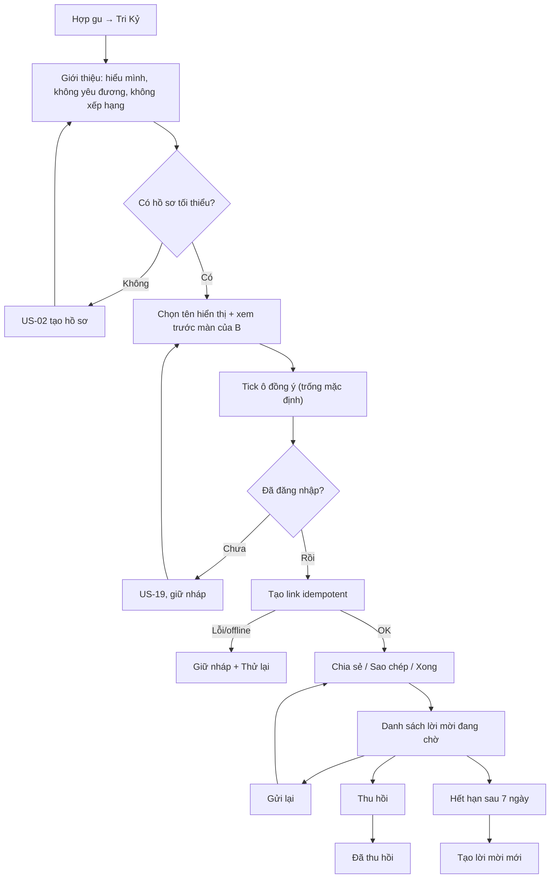

# G50 — Gửi lời mời Tri Kỷ

> Trạng thái: nháp 26/10/2026, chờ owner duyệt. Không code ở giai đoạn này.
> Nguồn: [PRD Tri Kỷ](../../foundation/game-line/tri-ky-prd.md) §4 bước 1–3; [SRS](../../foundation/game-line/tri-ky-srs.md) FR-TK-001–011, §9, §12. Hợp đồng capability link dùng lại từ [US-08](../US-08-gui-loi-moi-la-chung.md) §6–7.

## 1. User story

Là A, một người 18+ đã có hồ sơ Lá Lành, tôi muốn gửi một lời mời Tri Kỷ riêng cho đúng một người bạn, để hai đứa cùng mở một lá đôi mà không ai phải nhập ngày sinh hộ ai.

## 2. Mục tiêu và ranh giới

**Trong phạm vi:** màn giới thiệu; tên hiển thị A chọn; xem trước màn của B; đồng ý `tri-ky-pair-v1` của A; đăng nhập khi tạo link (US-19); tạo link idempotent; chia sẻ qua bảng OS hoặc sao chép; danh sách lời mời đang chờ; gửi lại; thu hồi; hết hạn; giới hạn.

**Ngoài phạm vi:** B nhận lời (G51); dựng lá (G52); picker danh bạ; mời hàng loạt; gợi ý người; server gửi SMS/email; chữ tự do ngoài tên hiển thị; ngữ cảnh khác `friend`.

## 3. Actor, điều kiện và output

- **Actor:** A, ≥ 18 tuổi theo hồ sơ của chính A, có hồ sơ đạt mức tối thiểu (TK-1, đề xuất Level 1).
- **Lối vào:** khu Hợp gu → thẻ "Tri Kỷ"; danh sách Tri Kỷ → "Mời một người".
- **Auth:** xem giới thiệu và soạn không cần đăng nhập; bấm "Tạo link riêng" cần đăng nhập (TK-2), giữ nháp qua US-19.
- **Output:** `tri_ky_invites` ở `pending`, token hash, bản mã hoá tạm để gửi lại, `expires_at` = +7 ngày, đồng ý của A có version và thời điểm.

## 4. Luồng

## 5. UI/UX

| Màn | Thành phần | Hành vi |
|---|---|---|
| Giới thiệu | Câu giới thiệu, dòng chặn hiểu sai, ba bước, ghi chú riêng tư (copy PRD §5) | Một CTA "Mời một người", phụ "Để sau". Không danh sách gợi ý |
| Soạn | `sender_display_name` 1–32 grapheme | Mặc định tên hồ sơ nếu có; lọc từ cấm, số điện thoại, email, URL |
| Xem trước | Bản sao đúng màn B sẽ thấy | Không hiện chart, Vibe, cung, ngày sinh của A |
| Đồng ý | Ô `tri-ky-pair-v1` | Trống mặc định; nút tạo link tắt khi chưa tick; không chữ nhỏ che ý chính |
| Gửi | "Chia sẻ", "Sao chép link", "Xong" | Share sheet đóng → quay lại màn gửi; không ghi "đã gửi". Sao chép kèm cảnh báo ai có link cũng mở được |
| Đang chờ | Tên A chọn, ngày tạo, hạn, trạng thái | Gửi lại; thu hồi có xác nhận; không có "đã xem" |

## 6. Business rules

1. Token ≥ 256 bit, chỉ lưu hash; bản mã hoá envelope chỉ giải khi A gửi lại và xoá khi lời mời kết thúc (US-08 BR1).
2. Link dạng `/tri-ky/i#<token>`; không ID, không tên, không dữ liệu sinh trong URL.
3. Hạn 7 ngày theo giờ server; gửi lại không kéo dài.
4. Cùng `idempotency_key` + nháp → cùng lời mời.
5. Chủ lời mời lấy từ credential server; không tin ID từ client.
6. Thu hồi có hiệu lực ngay và thắng race với accept.
7. Giới hạn (TK-3): 5 lời mời đang chờ, 10 lá đang có, 10 lần tạo/ngày.
8. Không theo dõi mở link; preview bot không tạo sự kiện.
9. Không picker danh bạ ở MVP, không xin quyền danh bạ (Apple 5.1.2(v)).

## 7. Dữ liệu và API

Bảng `tri_ky_invites` (SRS §6.1). Endpoint: `POST /v1/tri-ky/invites`, `GET /v1/tri-ky/invites`, `POST /v1/tri-ky/invites/{id}/share`, `POST /v1/tri-ky/invites/{id}/revoke` (SRS §12).

## 8. Acceptance Criteria

- **G50-AC01:** Given A mở Tri Kỷ, When màn giới thiệu hiện, Then có đủ: người hiểu mình, không yêu đương, không xếp hạng, chỉ hai người thấy, ai cũng giải tán được; và không có danh sách gợi ý người.
- **G50-AC02:** Given A chưa có hồ sơ tối thiểu, When bấm "Mời một người", Then được dẫn sang US-02 và quay lại đúng màn soạn sau khi có hồ sơ.
- **G50-AC03:** Given A là khách, When bấm "Tạo link riêng", Then US-19 mở, tên hiển thị và trạng thái ô đồng ý được giữ; huỷ đăng nhập không tạo lời mời.
- **G50-AC04:** Given màn đồng ý, When hiện lần đầu, Then ô `tri-ky-pair-v1` trống và nút tạo link tắt cho tới khi A tick.
- **G50-AC05:** Given A bấm tạo hai lần hoặc mạng chập chờn, When server nhận cùng `idempotency_key`, Then chỉ có một lời mời và một token.
- **G50-AC06:** Given lời mời vừa tạo, When kiểm DB, log, analytics, crash, Then token chỉ tồn tại ở dạng hash và bản mã hoá; plaintext chỉ có trong phản hồi tạo/gửi lại.
- **G50-AC07:** Given link được tạo, When xem URL, Then token nằm trong fragment, không có ID/tên/dữ liệu sinh.
- **G50-AC08:** Given A huỷ share sheet, When quay lại, Then lời mời vẫn `pending`, không có trạng thái "đã gửi".
- **G50-AC09:** Given lời mời `pending`, When A thu hồi, Then xem trước và accept trả trạng thái "không còn mở được" ngay, kể cả khi accept đang chạy song song.
- **G50-AC10:** Given A đã có 5 lời mời đang chờ hoặc 10 lá, When tạo thêm, Then nhận thông báo trung tính và không có lời mời mới.
- **G50-AC11:** Given mọi request tạo lời mời, When payload có trường sinh hoặc ngữ cảnh khác `friend`, Then server trả 422.
- **G50-AC12:** Given mọi màn G50, When rà copy, Then không có "crush", "nửa kia", "soulmate", "top", "thân nhất", không đếm ngược hay áp lực.

## 9. Edge cases

| Tình huống | Xử lý |
|---|---|
| App bị tắt sau khi đăng nhập xong | Khôi phục nháp an toàn; không tạo trùng |
| Lời mời hết hạn | Hiện "Hết hạn"; CTA tạo mới phải bấm rõ ràng |
| A gửi lại sau khi đổi máy | Server giải mã bản mã hoá sau khi xác thực A; không log |
| Tên hiển thị chứa số điện thoại | Cảnh báo và chặn lưu |
| A dưới 18 (hồ sơ cũ sai) | Không vào được Tri Kỷ; copy trung tính |
| Clipboard bị app khác đọc | Cảnh báo khi sao chép; link một lần, 7 ngày, thu hồi được |

## 10. Test matrix

Khách → đăng nhập thành công/huỷ/lỗi/app bị tắt; tạo hai lần; timeout; gửi lại; thu hồi; hết hạn; race thu hồi–accept; giới hạn; payload có trường sinh; token entropy/hash/redact; 320/390/430 px, 200% chữ, screen reader, light/dark.

## 11. Analytics

Chỉ bộ đếm server `invite_created` (SRS §10). Không sự kiện client, không ID, không tên.

## 12. Definition of Done

- G50-AC01–AC12 pass; test T-TK-02, T-TK-06, T-TK-10, T-TK-11, T-TK-22 pass.
- Capability link, idempotency, phân quyền, CSRF/Origin, rate limit, race có test.
- Copy được owner duyệt; kiểm chữ "tri kỷ" với 5–10 người đã chạy.
- **Riêng tư/store:** dòng Tri Kỷ trong `store-privacy-data-map.md` (Apple App Privacy, Google Data Safety) và chính sách quyền riêng tư đã cập nhật cho tên hiển thị, đồng ý, token; không khai "tracking".
- Evidence native: share sheet, universal/app link giữ fragment, không quyền danh bạ — `[Pending]`.
- Không còn P0/P1 bảo mật/riêng tư.

## 13. Phụ thuộc, riêng tư và evidence

- **Phụ thuộc:** US-02 (hồ sơ), US-19 (đăng nhập), quyết định TK-1, TK-2, TK-3.
- **Downstream:** G51 chỉ nhận token hợp lệ.
- Tên hiển thị, đồng ý, quan hệ "A đã mời ai đó" là dữ liệu cá nhân; giữ theo SRS §8.
- Evidence: `[Pending] native share/link QA`, `[Pending] token penetration test`, `[Pending] store disclosures`.

## 14. Bàn giao theo AGENTS.md

Nguồn: PRD/SRS Tri Kỷ, US-08, US-19, radar spec §7, `routes/radar.py`. Phát hiện đã sửa: token trong fragment; không picker danh bạ ở MVP. Rủi ro: fragment trên universal link chưa kiểm; TK-1–TK-3 chưa quyết. AC/DoD còn thiếu: toàn bộ (chưa build).
