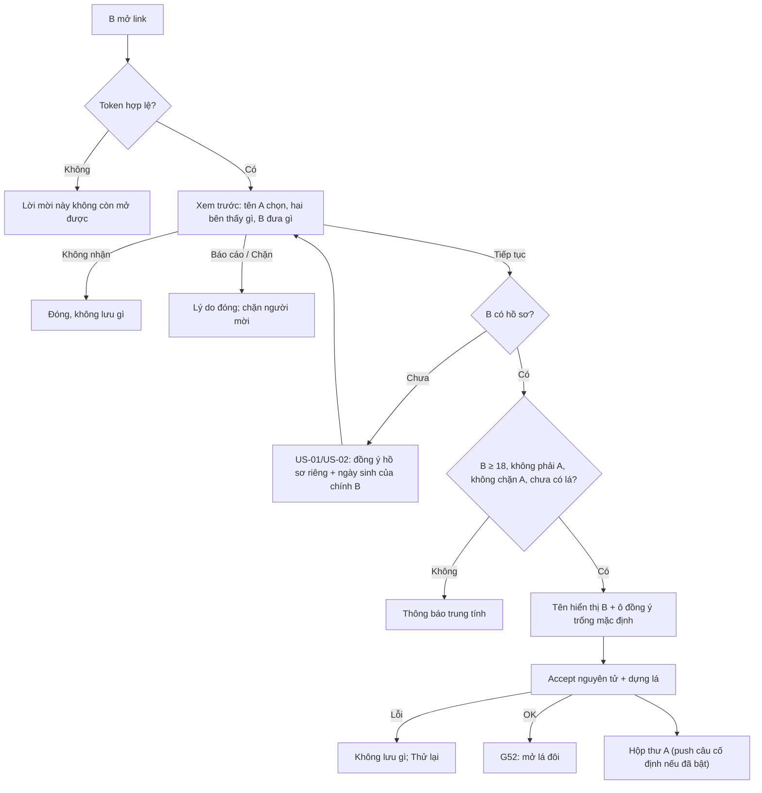

# G51 — Nhận và đồng ý lời mời Tri Kỷ

> Trạng thái: nháp 26/10/2026, chờ owner duyệt. Không code ở giai đoạn này.
> Nguồn: [PRD Tri Kỷ](../../foundation/game-line/tri-ky-prd.md) §4 bước 4–6; [SRS](../../foundation/game-line/tri-ky-srs.md) FR-TK-020–032, FR-TK-120–123. Mẫu runtime: Radar `consented_invite` (`la-lanh-radar-hop-gu-spec.md` §2, §7). Lối "Check kín" của [US-12](../US-12-tao-va-gui-la-ghep.md) **bị chặn** cho Tri Kỷ.

## 1. User story

Là B, một người 18+ vừa nhận link từ một người quen, tôi muốn biết rõ ai mời, hai bên sẽ thấy gì và tôi phải đưa gì, rồi tự quyết định dùng hồ sơ của chính mình để mở lá đôi, hoặc từ chối, báo cáo, chặn mà không bị làm phiền.

## 2. Mục tiêu và ranh giới

**Trong phạm vi:** xem trước an toàn; trạng thái link không hợp lệ; dẫn tạo hồ sơ (US-01/US-02) và quay lại; đồng ý `tri-ky-pair-v1` của B; tên hiển thị của B; kiểm 18+, tự nhận, chặn, lá trùng; accept nguyên tử; dựng lá trong cùng giao dịch; báo A trong app; "Không nhận"; báo cáo; chặn người mời.

**Ngoài phạm vi:** nội dung lá (G52); A nhập dữ liệu sinh của B (bị cấm); attestation `radar-authorized-input-v1`; chat; thông báo cho B từ hệ thống.

## 3. Actor, điều kiện và output

- **Actor:** B có link hợp lệ. Có thể chưa có Lá Lành.
- **Lối vào:** universal/app link → app; chưa cài app → web companion (cùng hợp đồng).
- **Auth:** B dùng phiên khách có hồ sơ; không bắt buộc tài khoản (TK-2).
- **Output:** lời mời `accepted`; `tri_ky_pairs` `active` có đồng ý của cả hai, tên hiển thị của cả hai, lá đã mã hoá; một mục hộp thư cho A.

## 4. Luồng

## 5. UI/UX

| Màn | Nội dung | Hành vi |
|---|---|---|
| Không hợp lệ | "Lời mời này không còn mở được. Nếu cần, nhờ người gửi tạo link mới." | Như nhau cho sai/hết hạn/thu hồi/đã dùng/bị chặn |
| Xem trước | "[Tên A] mời bạn mở một lá Tri Kỷ." + B sẽ đưa gì + hai bên thấy gì + dòng chặn hiểu sai + "Chỉ nhận nếu lời mời này dành cho bạn." | CTA "Tiếp tục"; phụ "Không nhận"; liên kết "Báo cáo lời mời", "Không nhận lời mời Tri Kỷ từ người này nữa" |
| Tạo hồ sơ | US-01/US-02 nguyên trạng | Sau khi có hồ sơ, quay lại xem trước, không mất ý định |
| Đồng ý | Tên hiển thị B (1–32); câu báo dữ liệu nhạy cảm; ngay bên dưới là ô `tri-ky-pair-v1` trống | Câu nằm **ngay trên** ô, giống màn của A (FR-TK-033). Nháp, chờ owner duyệt: "Lá đôi là dữ liệu nhạy cảm vì nó nói về đời sống riêng tư của hai bạn. Lá Lành chỉ tạo khi cả hai cùng đồng ý, và chỉ hai bạn xem được." "Đồng ý và mở lá" và "Không nhận" cùng kích thước |
| Báo cáo | Lý do: Không dành cho tôi · Tôi không biết người gửi · Tên không phù hợp · Link đáng ngờ · Khác | Không chữ tự do; xác nhận trung tính |

Xem trước không hiện chart, Vibe, cung, ngày sinh hay nhãn riêng nào A đặt cho B.

## 6. Business rules

1. Xem trước qua POST, token trong body; GET không đổi trạng thái.
2. Accept cần phiên khách của B, trusted Origin, CSRF, `binding_id` khớp, `tri-ky-pair-v1`, `consent_given=true`.
3. **Chặn Check kín:** không endpoint nào nhận trường sinh hay attestation; schema `extra=forbid`.
4. B dưới 18 theo hồ sơ của B → từ chối trước khi tính, không lưu.
5. Cùng principal/guest với A → 422.
6. Accept thứ nhất thắng; lời mời dùng một lần.
7. Đã có lá giữa hai người → trả lá hiện có, không tạo lá thứ hai.
8. Dựng lá cùng giao dịch; lỗi → rollback toàn bộ, lời mời vẫn `pending`.
9. Chặn: lưu HMAC principal A + tên A lúc chặn (mã hoá); không báo A; lời mời sau từ A hiện như không hợp lệ.
10. Báo cáo `dont_know_sender`/`suspicious_link` vô hiệu lời mời ngay.
11. Không nhận: không lưu gì, không báo A; lời mời tự hết hạn.

## 7. Dữ liệu và API

`POST /v1/public/tri-ky/invite/preview`, `/accept`, `/report`; `POST /v1/tri-ky/blocks` (SRS §12). Bảng `tri_ky_pairs`, `tri_ky_blocks`, `tri_ky_reports` (SRS §6).

## 8. Acceptance Criteria

- **G51-AC01:** Given token hợp lệ, When B mở link, Then chỉ thấy tên A tự chọn, hạn, mô tả hai bên thấy gì và B đưa gì; không chart/Vibe/cung/ngày sinh/nhãn riêng của A.
- **G51-AC02:** Given token sai, hết hạn, thu hồi, đã dùng hoặc B đã chặn A, When mở, Then cùng một màn và cùng mã phản hồi; không lộ tên A.
- **G51-AC03:** Given B chưa có hồ sơ, When bấm "Tiếp tục", Then đi qua US-01/US-02 với đồng ý hồ sơ riêng và quay lại đúng lời mời.
- **G51-AC04:** Given bất kỳ request Tri Kỷ, When chứa `birth_date`, `birth_time_*`, `place_id`, tọa độ hoặc `authorization_attested`, Then 422 và không có hàng mới.
- **G51-AC05:** Given màn đồng ý, When hiện, Then ô `tri-ky-pair-v1` trống và hai nút ngang hàng.
- **G51-AC06:** Given B dưới 18 theo hồ sơ của B, When accept, Then bị từ chối trước khi tính và không lưu gì.
- **G51-AC07:** Given A tự mở link của mình, When accept, Then 422, không có lá.
- **G51-AC08:** Given hai người cùng accept một link, When song song, Then đúng một lá được dựng; người sau thấy màn không hợp lệ.
- **G51-AC09:** Given accept trùng lúc thu hồi/hết hạn, When race, Then chỉ một chuyển trạng thái thắng.
- **G51-AC10:** Given engine hoặc gate lỗi, When accept, Then không lưu đồng ý, tên, lá; lời mời vẫn `pending`; B thấy "Thử lại".
- **G51-AC11:** Given accept thành công, When kiểm hộp thư A, Then có đúng một mục; push (nếu có) là câu cố định không tên, không "Tri Kỷ".
- **G51-AC12:** Given B chọn "Không nhận", When đóng, Then không có hàng mới, không thông báo A.
- **G51-AC13:** Given B chặn A, When A tạo lời mời mới cho B, Then B thấy màn không hợp lệ và A không được báo đã bị chặn.
- **G51-AC14:** Given báo cáo `dont_know_sender`, When gửi, Then lời mời vô hiệu ngay và có bản ghi lý do, không có chữ tự do.
- **G51-AC15:** Given lá đã có giữa hai người, When accept lời mời mới, Then trả lá hiện có.
- **G51-AC16:** Given màn đồng ý của B (app hoặc web companion), When hiện, Then câu báo có chữ "dữ liệu nhạy cảm" là phần tử nằm ngay phía trên ô `tri-ky-pair-v1` đang trống, screen reader đọc câu trước ô, và nút "Đồng ý và mở lá" không bật khi thiếu câu này; test copy T-TK-23 chạy và pass **trước khi build** màn này.

## 9. Edge cases

| Tình huống | Xử lý |
|---|---|
| Link mở trong trình duyệt nhúng chặn cookie | Accept không dựa vào cookie mời; phiên khách vẫn cần; báo "Mở bằng trình duyệt/app" |
| B tạo hồ sơ xong nhưng lời mời hết hạn giữa chừng | Màn không hợp lệ; hồ sơ B vẫn giữ (là của B) |
| Hai tab lời mời khác nhau | `binding_id` lệch → 409, không accept nhầm |
| Preview bot mở link | Không có GET nhận token; không đổi trạng thái |
| B đổi ý sau khi accept | Giải tán (G54) |
| B không biết A là ai | Báo cáo `dont_know_sender`; A thấy lời mời không còn, không thấy lý do |

## 10. Test matrix

Token hợp lệ/sai/hết hạn/thu hồi/đã dùng/bị chặn; chưa có hồ sơ → US-02 → quay lại; dưới 18; tự nhận; hai accept song song; accept–revoke race; lỗi engine; payload có trường sinh; báo cáo; chặn; lá trùng; header công khai; canary log; 320/390/430 px, screen reader, 200% chữ, light/dark.

## 11. Analytics

Bộ đếm server `invite_accepted`, `pair_built`, `invite_profile_created_in_flow`, `invite_reported{reason}`, `inviter_blocked`, `build_failed{code}`. Không ID, không tên.

## 12. Definition of Done

- G51-AC01–AC16 pass; T-TK-02, T-TK-05, T-TK-06, T-TK-08, T-TK-09, T-TK-10, T-TK-11, T-TK-22, T-TK-23 pass.
- Không còn đường nào cho phép A cung cấp dữ liệu sinh của B (test âm).
- Copy được owner duyệt; luật sư trả lời Q-L1, Q-L2.
- **Riêng tư/store:** data map, App Privacy, Data Safety, chính sách quyền riêng tư phản ánh: đồng ý theo mục đích của cả hai, lá đôi là dữ liệu suy luận linked, chặn, báo cáo; web companion không tracker.
- Evidence native: universal/app link, quay lại sau tạo hồ sơ, trình duyệt nhúng — `[Pending]`.
- Không còn P0/P1.

## 13. Phụ thuộc, riêng tư và evidence

- **Phụ thuộc:** G50; US-01/US-02; outbox + hộp thư (US-09 BR7); TK-2, TK-4.
- **Downstream:** G52.
- Quan hệ "A có lá với B" là dữ liệu nhạy cảm (đồ thị quan hệ) theo SRS §6.6.
- Evidence: `[Pending] public-route penetration test`, `[Pending] native link QA`, `[Pending] counsel Q-L1/Q-L2`.

## 14. Bàn giao theo AGENTS.md

Nguồn: PRD/SRS Tri Kỷ, US-09, US-12, radar spec §2/§7, `radar/service.py` `accept`. Phát hiện đã sửa: xem trước không trả nhãn riêng (khác runtime Radar); chặn Check kín ở schema; "Không nhận" không báo A. Rủi ro: link chuyển tiếp (TK-4); xác minh tuổi yếu. AC/DoD còn thiếu: toàn bộ.
