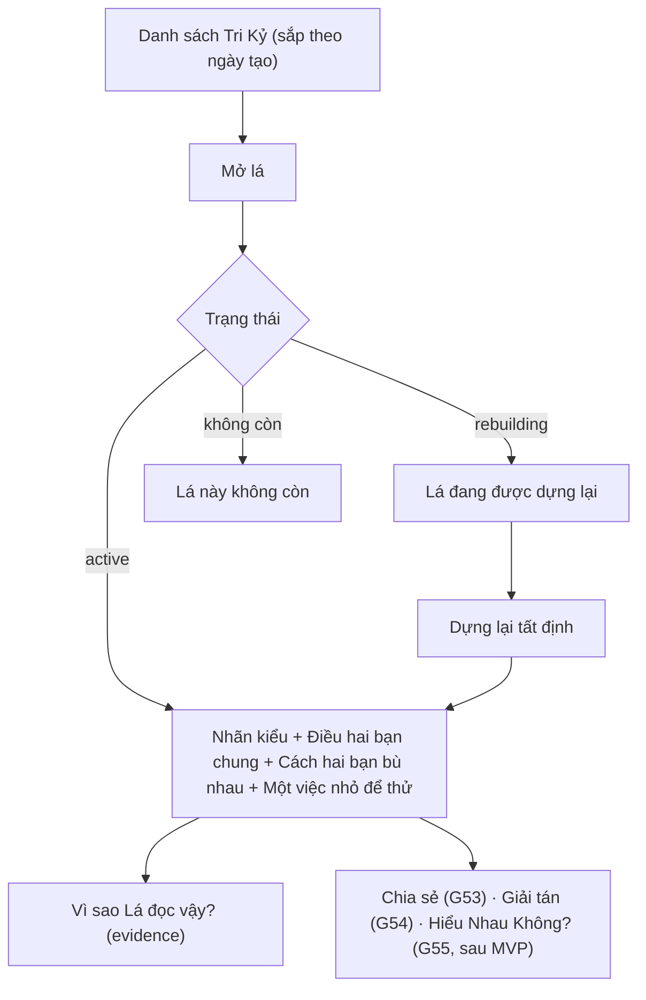

# G52 — Xem lá đôi Tri Kỷ

> Trạng thái: nháp 26/10/2026, chờ owner duyệt. Không code ở giai đoạn này.
> Nguồn: [PRD Tri Kỷ](../../foundation/game-line/tri-ky-prd.md) §4 bước 6 và bảng ba kiểu; [SRS](../../foundation/game-line/tri-ky-srs.md) FR-TK-040–051, §13. Engine dùng lại: relationship engine v2, quy tắc độ chính xác của [US-22](../US-22-hop-gu-rieng-tung-cap.md) AC07, bất biến [US-13](../US-13-hoan-tat-full-la-ghep.md) AC04.

## 1. User story

Là một thành viên của cặp Tri Kỷ, tôi muốn đọc một lá đôi nói đúng về hai đứa mình: điều chung, cách bù nhau và một việc nhỏ để thử, để thấy mình được hiểu mà không bị chấm điểm hay so với ai.

## 2. Mục tiêu và ranh giới

**Trong phạm vi:** danh sách lá; màn lá đôi; nhãn kiểu đồng điệu; ba khối; evidence sau disclosure; disclaimer; dựng lại khi hồ sơ đổi; sửa tên hiển thị của mình; trạng thái lỗi/offline.

**Ngoài phạm vi:** chia sẻ (G53); giải tán (G54); trò đố (G55); lá tarot của hai đứa (sau MVP); giọng Cà khịa (sau MVP); Luna (TK-10).

## 3. Actor, điều kiện và output

- **Actor:** A hoặc B, là thành viên của cặp `active`.
- **Lối vào:** khu Hợp gu → Tri Kỷ → danh sách; ngay sau G51 với B; mục hộp thư với A.
- **Output:** projection `tri-ky-card-v1` theo góc nhìn người xem. Không ghi gì mới khi chỉ đọc.

## 4. Luồng

## 5. UI/UX

| Thành phần | Quy tắc |
|---|---|
| Danh sách | Tên hiển thị của người kia + ngày tạo. Không nhãn kiểu, không con số, không "thân nhất", không đếm tổng |
| Đầu lá | "Tri Kỷ · [tên bạn] & [tên kia]" + nhãn kiểu (một trong ba, cùng trọng lượng hình ảnh) + một dòng giải thích |
| Dòng chặn hiểu sai | "Tri Kỷ nói về tình bạn, không phải chuyện yêu đương. Không có bảng xếp hạng." |
| Ba khối | "Điều hai bạn chung" (1–2 câu) · "Cách hai bạn bù nhau" (1 câu, dải mềm, tối đa một khác biệt kèm lối ra) · "Một việc nhỏ để thử" (động từ + "khi…") |
| Evidence | Sau "Vì sao Lá đọc vậy?": hành tinh, góc chiếu, nguyên tố; không ngày/giờ/nơi/tọa độ |
| Disclaimer | Kiểu hiển thị riêng, ngoài nội dung chính |
| Độ chính xác | Nếu một người chỉ có ngày sinh: một dòng "Lá đọc từ ngày sinh của [ai], nên bỏ qua phần cần giờ sinh." |
| Hành động | Chia sẻ · Giải tán · Sửa tên của tôi |

Không có thanh, vòng, sao, phần trăm hay thang. Không confetti.

## 6. Business rules

1. Ngữ cảnh cố định `friend`; không chủ đề `attraction`; không chương "Điểm dễ cấn".
2. Projection không có trường số; không có ba chỉ báo `Bắt sóng`/`Dễ phối hợp`/`Lực cấn` (D5).
3. Kiểu đồng điệu tất định theo `tri-ky-band-v1`; ngưỡng không ra API.
4. Câu nguyên tố chỉ khi Sun sign của người đó chắc chắn.
5. Không rõ giờ: bỏ Mặt Trăng, cung mọc, nhà của người đó; contact natal–natal chỉ khi chắc trên tích hai miền ngày sinh (US-22 AC07).
6. Nội dung đóng băng lúc dựng; mở lại trả đúng bản đó.
7. Hồ sơ một người đổi → `rebuilding`, xoá bản cũ, dựng lại lần mở kế tiếp trong cùng mục đích đồng ý.
8. Mỗi người thấy góc nhìn của mình; không ai thấy dữ liệu sinh thô của người kia.
9. Gate chung + `tri-ky-lexicon-v1` trước khi lưu; trượt → nhánh `opening`; vẫn trượt → lỗi chung, không lưu.
10. Lá chỉ ở bộ nhớ trên máy; không cache bền.

## 7. Dữ liệu và API

`GET /v1/tri-ky/pairs`, `GET /v1/tri-ky/pairs/{id}`, `PATCH /v1/tri-ky/pairs/{id}/display-name`. Bảng `tri_ky_pairs`; `card_ciphertext` gồm `band` (SRS §6.2, §13).

## 8. Acceptance Criteria

- **G52-AC01:** Given một thành viên mở lá, When projection trả về, Then có đúng nhãn kiểu, ba khối, evidence, disclaimer và không có trường số nào (T-TK-01).
- **G52-AC02:** Given mọi lá, When rà nội dung, Then không có từ trong `tri-ky-lexicon-v1` và không motif `attraction` (T-TK-03, T-TK-04).
- **G52-AC03:** Given danh sách lá, When hiển thị, Then sắp theo ngày tạo, chỉ có tên và ngày, không nhãn kiểu hay số đếm ra ngoài (T-TK-12).
- **G52-AC04:** Given ba kiểu `deep`, `complementary`, `opening`, When render, Then cùng kích thước, cùng nền, không xếp thành thang, screen reader đọc nhãn bằng chữ.
- **G52-AC05:** Given một người chỉ có ngày sinh, When dựng, Then không có câu dựa vào Mặt Trăng/cung mọc/nhà của người đó và có dòng nói rõ.
- **G52-AC06:** Given Sun sign của một người không chắc (ngày giáp ranh, không có giờ), When dựng, Then không có câu nguyên tố cho người đó.
- **G52-AC07:** Given lá đã dựng, When mở lại nhiều lần, Then nội dung giống hệt.
- **G52-AC08:** Given hồ sơ một thành viên đổi, When người kia mở lá, Then bản cũ không đọc được, lá dựng lại từ snapshot mới hoặc hiện "Lá đang được dựng lại" (T-TK-15).
- **G52-AC09:** Given người không phải thành viên hoặc ID đoán, When gọi `GET /pairs/{id}`, Then 404 giống ID ngẫu nhiên.
- **G52-AC10:** Given evidence mở, When đọc, Then không có ngày, giờ, nơi, tọa độ của ai.
- **G52-AC11:** Given gate trượt hai lần, When dựng, Then không lưu lá dở và hiện lỗi chung có "Thử lại".
- **G52-AC12:** Given app offline, When mở lá, Then hiện "Cần kết nối để mở lá"; không có bản lá trong storage bền.
- **G52-AC13:** Given nội dung `complement`, When rà, Then tối đa một khác biệt và có việc làm được; không dùng cụm từ cấm của chuẩn nội dung (ví dụ "giữ nhịp").

## 9. Edge cases

| Tình huống | Xử lý |
|---|---|
| Ít contact cá nhân hoá | `opening` với câu low-signal; không bịa đủ ba khối |
| Hai người cùng ngày sinh | Vẫn dựng; câu "chung" không nói "giống hệt nhau" |
| Một người xoá giờ sinh | Dựng lại ở độ chính xác thấp hơn |
| Một người xoá hồ sơ | Lá không còn (cascade, G54) |
| Engine bận | Lỗi chung, retry; không lưu dở |

## 10. Test matrix

50 cặp tổng hợp × (có giờ/không giờ) × ngày giáp ranh; schema không số; lexicon; không attraction; tất định; dựng lại; IDOR; offline; screen reader, 200% chữ, light/dark, 320/390/430 px.

## 11. Analytics

Không có. Không đo số lần mở, thời gian đọc hay phân bố kiểu đồng điệu.

## 12. Definition of Done

- G52-AC01–AC13 pass; `ContentReviewAgent`, checklist tâm lý, gate chung và `tri-ky-lexicon-v1` xanh trên output thật của 50 cặp tổng hợp.
- Copy ba khối, ba nhãn và dòng giải thích được owner duyệt; kiểm chữ xác nhận không nhãn nào nghe như bị từ chối.
- **Riêng tư/store:** lá đôi khai là dữ liệu suy luận linked, App Functionality/Product Personalization, không tracking, không chia sẻ cho bên thứ ba; mục Tri Kỷ trong chính sách quyền riêng tư nói rõ dữ liệu suy luận và hạn lưu.
- `tri_ky` không thuộc allowlist Luna (test config).
- Evidence native: không cache bền, xoá khi đổi phiên — `[Pending]`.

## 13. Phụ thuộc, riêng tư và evidence

- **Phụ thuộc:** G51; relationship engine; quyết định D5, TK-1, TK-9, TK-10.
- Lá đôi coi là dữ liệu nhạy cảm (SRS §6.6) tới khi luật sư trả lời Q-L1.
- Evidence: `[Pending] golden fixtures tri-ky-band-v1`, `[Pending] owner copy approval`, `[Pending] copy test`.

## 14. Bàn giao theo AGENTS.md

Nguồn: PRD/SRS Tri Kỷ, US-13, US-22, radar spec §8, relationship engine spec, `radar/reading.py`. Phát hiện đã sửa: bỏ ba chỉ báo số, bỏ `attraction`, đổi "giữ nhịp". Rủi ro: ngưỡng kiểu chưa có golden; nhãn "đang mở" có thể nghe như bị từ chối. AC/DoD còn thiếu: toàn bộ.
